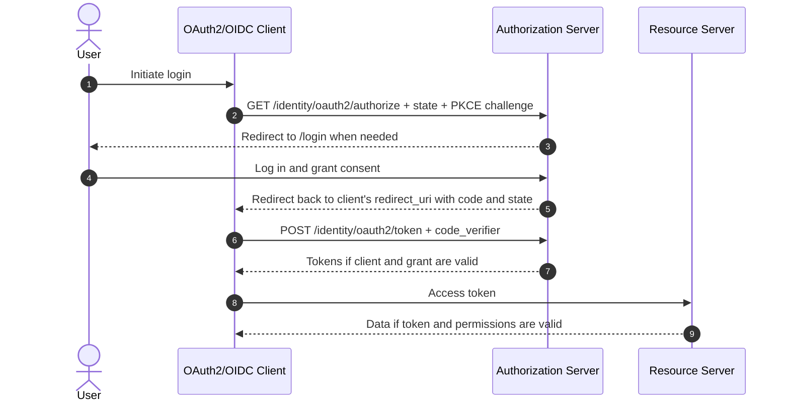

# Customizing OAuth2 Endpoint Paths

## Learning Objectives

In the **Server Configuration** chapter of the **SPRING_SECURITY_OAUTH2_OIDC_AUTHORIZATION_SERVER** module, this lesson focuses on designing and changing the paths of OAuth 2.0/OpenID Connect (OIDC) endpoints provided by **Spring Authorization Server** in a **Spring Boot** application using **Spring Security**.

After this lesson, you will be able to:

- Distinguish between `issuer`, Authorization Server endpoints, client `redirect_uri`, and login UI URLs.
- Use `AuthorizationServerSettings` to change supported protocol endpoints.
- Coordinate new paths with `SecurityFilterChain`, metadata discovery, OAuth2 Client, and Resource Server.
- Identify errors when placing the application behind a reverse proxy, combining servlet context paths, or changing the issuer.
- Test and deploy URL changes safely without weakening client authentication, PKCE, or token protection requirements.

> **Example context:** The Authorization Server has the public issuer `https://login.example.com`, currently serving `/oauth2/authorize` and `/oauth2/token`. The team wants to move OAuth2 endpoints to `/identity/oauth2/*` and optional OIDC endpoints to `/identity/oidc/*`, while keeping the issuer unchanged.

## 1. Understanding the Scope of Changing Endpoint Paths

An OAuth 2.0 Authorization Server issues tokens to clients; OIDC adds a user authentication layer through ID Tokens and corresponding endpoints/metadata. Each endpoint has its own protocol contract for HTTP method, parameters, authentication, and error codes. Changing the HTTP address **does not change the endpoint's behavior**.

Valid reasons to customize paths include URL standardization, adapting to an existing API gateway, namespace separation from other applications, supporting migration plans from a legacy IdP, or complying with a published integration contract. Conversely, changing URLs just to make the system look non-default adds maintenance overhead across clients, documentation, gateways, and monitoring.

### 1.1. Four Commonly Confused URL Types

| Concept | Example | Role |
|---|---|---|
| **Issuer** | `https://login.example.com` | Stable identity of the token issuer; used in metadata and the `iss` claim where applicable. |
| **Authorization Server endpoint** | `https://login.example.com/identity/oauth2/token` | Address where clients send token requests. |
| **OAuth2 Client Redirect URI** | `https://app.example.com/login/oauth2/code/company` | Callback address of the client application after the Authorization Code flow. |
| **Login UI** | `https://login.example.com/login` | User authentication path, configured by the application's login setup. |

**Changing `authorizationEndpoint(...)` does not automatically change `redirect_uri` or the `/login` page**. The Redirect URI must still be registered and matched according to protocol requirements; the OIDC client must still verify the exact issuer. When only changing the token endpoint path within the same trust domain, you normally do not need to change the issuer.

### 1.2. Authorization Code + PKCE Flow Using New URLs



At the step exchanging the code for tokens, the client must call the **new token endpoint**. If the client library still holds the old URL, login may succeed in the browser yet fail immediately at the token exchange step.

## 2. Default Endpoints List and Configuration Points

The table below lists common paths in **Spring Authorization Server 1.x**. Availability can depend on version, configured Beans, and whether OIDC or protocol extensions are enabled. Always verify against the API of your actual dependency.

| Function | Common default path | Primary HTTP method | Builder method |
|---|---|---|---|
| Authorization | `/oauth2/authorize` | GET (and POST when required by flow) | `authorizationEndpoint(...)` |
| Token | `/oauth2/token` | POST | `tokenEndpoint(...)` |
| Token Introspection | `/oauth2/introspect` | POST | `tokenIntrospectionEndpoint(...)` |
| Token Revocation | `/oauth2/revoke` | POST | `tokenRevocationEndpoint(...)` |
| JWK Set | `/oauth2/jwks` | GET | `jwkSetEndpoint(...)` |
| Device Authorization | `/oauth2/device_authorization` | POST | `deviceAuthorizationEndpoint(...)` |
| Device Verification | `/oauth2/device_verification` | GET/POST depending on step | `deviceVerificationEndpoint(...)` |
| Pushed Authorization Request (PAR) | `/oauth2/par` in supported versions | POST | `pushedAuthorizationRequestEndpoint(...)` if provided by version |
| OIDC UserInfo | `/userinfo` | GET/POST as required | `oidcUserInfoEndpoint(...)` |
| OIDC Logout | `/connect/logout` | GET/POST depending on flow | `oidcLogoutEndpoint(...)` |
| OIDC Dynamic Client Registration | `/connect/register` | POST | `oidcClientRegistrationEndpoint(...)` |
| OAuth2 Authorization Server Metadata | `/.well-known/oauth-authorization-server` for issuers without a path | GET | Built from issuer and endpoint info |
| OIDC Discovery | `/.well-known/openid-configuration` for issuers without a path | GET | Built from issuer and OIDC configuration |

**Two notes on discovery endpoints:**

- `/.well-known/oauth-authorization-server` belongs to RFC 8414; `/.well-known/openid-configuration` belongs to OIDC Discovery. There is no general builder method to arbitrarily rename each well-known path like `tokenEndpoint(...)`. If the issuer contains a path component, how discovery URLs are constructed also depends on each standard's specific rules.
- OIDC URLs only work when the corresponding feature is configured. In particular, configuring `oidcClientRegistrationEndpoint(...)` **does not mean Dynamic Client Registration is enabled**. JWK Set requires an appropriate key/JWK source; PAR can only be configured if your actual version provides the corresponding API.

Most OAuth2 endpoints can share a unified prefix, though sharing a prefix is **not required** by the standards. Token Endpoint, Revocation, Introspection, and JWKS have different processing models; grouping them under one path prefix does not allow applying a single `permitAll()` rule to all endpoints.

## 3. Designing the Path Contract Before Writing Code

Keep the issuer at `https://login.example.com` and choose the paths:

| Endpoint | New public URL |
|---|---|
| Authorization | `https://login.example.com/identity/oauth2/authorize` |
| Token | `https://login.example.com/identity/oauth2/token` |
| Introspection | `https://login.example.com/identity/oauth2/introspect` |
| Revocation | `https://login.example.com/identity/oauth2/revoke` |
| JWK Set | `https://login.example.com/identity/oauth2/jwks` |
| Device Authorization | `https://login.example.com/identity/oauth2/device_authorization` |
| Device Verification | `https://login.example.com/identity/oauth2/device_verification` |
| OIDC UserInfo (if enabled) | `https://login.example.com/identity/oidc/userinfo` |
| OIDC Logout (if enabled) | `https://login.example.com/identity/oidc/logout` |
| OIDC Client Registration (if enabled) | `https://login.example.com/identity/oidc/register` |

For an issuer without a path, OIDC discovery normally remains at `https://login.example.com/.well-known/openid-configuration` and OAuth2 Authorization Server Metadata at `https://login.example.com/.well-known/oauth-authorization-server`.

Evaluate the URL design against these criteria: paths start with `/`, do not overlap each other or collide with `/login`/`/admin/**`/`/actuator/**`; contain no query, fragment, or `..` segments; clients can reach them over HTTPS; the reverse proxy has clear forwarding rules; client owners know the final public URLs.

## 4. Customizing with `AuthorizationServerSettings`

Spring Authorization Server provides `AuthorizationServerSettings.Builder` to set endpoint paths. The following example illustrates the **Spring Authorization Server 1.x** API line (you must use compatible Spring Security/Spring Boot versions with your actual dependencies).

```java
package com.example.authserver.config;

import org.springframework.beans.factory.annotation.Value;
import org.springframework.context.annotation.Bean;
import org.springframework.context.annotation.Configuration;
import org.springframework.security.oauth2.server.authorization.settings.AuthorizationServerSettings;

@Configuration(proxyBeanMethods = false)
public class AuthorizationServerEndpointsConfiguration {

    @Bean
    AuthorizationServerSettings authorizationServerSettings(
            @Value("${app.authorization-server.issuer}") String issuer) {

        return AuthorizationServerSettings.builder()
                .issuer(issuer)
                // OAuth 2.0
                .authorizationEndpoint("/identity/oauth2/authorize")
                .tokenEndpoint("/identity/oauth2/token")
                .tokenIntrospectionEndpoint("/identity/oauth2/introspect")
                .tokenRevocationEndpoint("/identity/oauth2/revoke")
                .jwkSetEndpoint("/identity/oauth2/jwks")
                .deviceAuthorizationEndpoint("/identity/oauth2/device_authorization")
                .deviceVerificationEndpoint("/identity/oauth2/device_verification")
                // OIDC (only active when the corresponding feature is enabled)
                .oidcUserInfoEndpoint("/identity/oidc/userinfo")
                .oidcLogoutEndpoint("/identity/oidc/logout")
                .oidcClientRegistrationEndpoint("/identity/oidc/register")
                .build();
    }
}
```

Define the issuer in `application.yml` and supply the concrete value via environment variable:

```yaml
app:
  authorization-server:
    issuer: ${AUTH_ISSUER}
```

For example, in production, `AUTH_ISSUER=https://login.example.com`; locally, `http://localhost:9000` can be used for development. **Do not set the production issuer to a pod hostname, internal gateway, or a URL that changes on every deployment.** Separating issuers by environment should also separate databases, signing keys, client credentials, and corresponding accounts.

### 4.1. Can You Change Just One Endpoint?

Yes. For example, changing only the token issuance path:

```java
@Bean
AuthorizationServerSettings authorizationServerSettings() {
    return AuthorizationServerSettings.builder()
            .issuer("https://login.example.com")
            .tokenEndpoint("/identity/oauth2/token")
            .build();
}
```

Endpoints that are not reconfigured continue to use defaults appropriate for the framework version. However, any clients hard-coding `/oauth2/token` must be updated or given a tested compatibility solution. Normally, keep **one effective `AuthorizationServerSettings` Bean** in the same application context to avoid conflicts.

### 4.2. For PAR or Newer Features

Some versions provide an additional builder method for Pushed Authorization Request:

```java
// Additional line in AuthorizationServerSettings.builder(), when supported:
.pushedAuthorizationRequestEndpoint("/identity/oauth2/par")
```

This is only an **extension illustration**: check whether your dependency version provides the API, the feature is enabled, and metadata publishes `pushed_authorization_request_endpoint` at the new address. Do not write a custom MVC controller to act as a token/PAR endpoint instead of the framework without a compelling architectural reason and thorough protocol testing.

### 4.3. Do Not Use Builder Methods to Replace the Login Page

`/login`, the consent UI, the device activation UI, and admin pages are application components with their own routing/security configuration. Certain Device Verification flows involve UI pages, so keep protocol paths and UI paths consistent according to your specific design. `authorizationEndpoint(...)` only changes the authorization endpoint; it **does not rewrite the login form**.

## 5. Protecting New Endpoints with `SecurityFilterChain`

When moving paths to `/identity/oauth2/**`, a hand-written `SecurityFilterChain` matching only `/oauth2/**` will no longer cover the actual endpoints.

Use the matcher provided by `OAuth2AuthorizationServerConfigurer` itself:

```java
package com.example.authserver.config;

import org.springframework.context.annotation.Bean;
import org.springframework.context.annotation.Configuration;
import org.springframework.core.annotation.Order;
import org.springframework.http.MediaType;
import org.springframework.security.config.Customizer;
import org.springframework.security.config.annotation.web.builders.HttpSecurity;
import org.springframework.security.oauth2.server.authorization.config.annotation.web.configurers.OAuth2AuthorizationServerConfigurer;
import org.springframework.security.web.SecurityFilterChain;
import org.springframework.security.web.authentication.LoginUrlAuthenticationEntryPoint;
import org.springframework.security.web.util.matcher.MediaTypeRequestMatcher;

@Configuration(proxyBeanMethods = false)
public class SecurityConfiguration {

    @Bean
    @Order(1)
    SecurityFilterChain authorizationServerFilterChain(HttpSecurity http)
            throws Exception {

        OAuth2AuthorizationServerConfigurer authorizationServer =
                OAuth2AuthorizationServerConfigurer.authorizationServer();

        http.securityMatcher(authorizationServer.getEndpointsMatcher())
                .with(authorizationServer,
                        configurer -> configurer.oidc(Customizer.withDefaults()))
                .authorizeHttpRequests(authorize ->
                        authorize.anyRequest().authenticated())
                .exceptionHandling(exceptions -> exceptions
                        .defaultAuthenticationEntryPointFor(
                                new LoginUrlAuthenticationEntryPoint("/login"),
                                new MediaTypeRequestMatcher(MediaType.TEXT_HTML)))
                .oauth2ResourceServer(resourceServer ->
                        resourceServer.jwt(Customizer.withDefaults()));

        return http.build();
    }

    @Bean
    @Order(2)
    SecurityFilterChain applicationFilterChain(HttpSecurity http)
            throws Exception {

        http.authorizeHttpRequests(authorize -> authorize
                        .requestMatchers("/assets/**").permitAll()
                        .requestMatchers("/admin/**")
                            .hasAuthority("AUTH_SERVER_ADMIN")
                        .anyRequest().authenticated())
                .formLogin(Customizer.withDefaults());

        return http.build();
    }
}
```

This is an **illustrative wiring** example, not a production-ready application: beyond filter chains and settings, the project still needs user/authentication configuration, `RegisteredClientRepository`, `OAuth2AuthorizationService`, consent storage if used, `JWKSource`, `JwtDecoder` per OIDC/JWT requirements, and related Beans. The `.with(...)` API is used in Spring Security 6.2+; consult the matching documentation when using a different framework version.

### 5.1. What Benefit Does `getEndpointsMatcher()` Provide?

`getEndpointsMatcher()` represents protocol requests handled by the Authorization Server, including customized endpoints wired properly into configuration. This avoids hard-coding `/oauth2/**` patterns that would cause endpoints under `/identity/**` to fall into the application chain by mistake.

Even so, **verify empirically** after configuration. If a `POST /identity/oauth2/token` request is redirected to the login UI, the `SecurityFilterChain` may not match properly, `@Order` may be wrong, or the endpoint may not be registered as expected.

### 5.2. Do Not Lower Security to Fix Path Errors

| Endpoint | Protection mechanisms to watch |
|---|---|
| Authorization | User authentication, client registration, redirect URI, state, PKCE, and consent per flow. |
| Token | HTTP POST, appropriate client authentication, and grant/token validation. |
| Introspection/Revocation | Client authentication and authorization to invoke the endpoint per protocol/policy. |
| JWKS | Publish public keys only; never expose private keys or secrets in responses. |
| OIDC UserInfo | Valid access token and appropriate scope/claim handling. |
| Client Registration | Controlled registration policy; enable only when required by business needs. |

Do not turn `/identity/**` into `permitAll()` for all requests, disable CSRF application-wide, or disable client authentication to clear 401/403 errors. Framework endpoints have dedicated protocol filters; fix the matcher and wiring at the root cause.

## 6. Discovery Metadata Must Reflect Public URLs

OAuth 2.0 Authorization Server Metadata (RFC 8414) and OIDC Discovery allow clients to look up endpoints dynamically instead of hard-coding URLs. With the example issuer:

```text
GET https://login.example.com/.well-known/openid-configuration
GET https://login.example.com/.well-known/oauth-authorization-server
```

When OIDC and required Beans are enabled, fields in the discovery document are expected to look like (this is a **sample excerpt**, not the full JSON document):

```json
{
  "issuer": "https://login.example.com",
  "authorization_endpoint": "https://login.example.com/identity/oauth2/authorize",
  "token_endpoint": "https://login.example.com/identity/oauth2/token",
  "jwks_uri": "https://login.example.com/identity/oauth2/jwks",
  "userinfo_endpoint": "https://login.example.com/identity/oidc/userinfo"
}
```

Verify over HTTP:

```bash
curl --fail --silent --show-error \
  https://login.example.com/.well-known/openid-configuration

curl --fail --silent --show-error \
  https://login.example.com/.well-known/oauth-authorization-server
```

If OIDC is not enabled, do not assume OIDC discovery will return 200. If the issuer **contains a path component**, well-known metadata locations in OIDC and RFC 8414 follow different rules than issuers consisting solely of scheme + host; follow the exact specification instead of manually prepending endpoint prefixes.

### 6.1. Impact on OAuth2 Client and Resource Server

When a Spring Security OAuth2 Client registers a provider with `issuer-uri`, the OIDC client can automatically fetch authorize/token URLs from metadata:

```yaml
spring:
  security:
    oauth2:
      client:
        registration:
          internal-login:
            provider: internal-oidc
            client-id: ${OIDC_CLIENT_ID}
            client-secret: ${OIDC_CLIENT_SECRET}
            authorization-grant-type: authorization_code
            scope: openid,profile
        provider:
          internal-oidc:
            issuer-uri: https://login.example.com
```

The client still must register the exact callback `redirect_uri` on the Authorization Server. Clients configured directly with `authorization-uri` or `token-uri` must be updated manually. Some libraries cache discovery, so verify metadata reload timing during rollout.

For a Resource Server verifying JWTs, changing the JWKS path changes `jwks_uri` in metadata. **You do not need to change `iss` just to move JWKS**, but you must ensure APIs can access the new public keys location and have a cache refresh strategy. If signing keys are rotated at the same time, perform key rotation with sufficient overlap for existing valid tokens.

## 7. Paths and Reverse Proxy / Servlet Context Path

Suppose an Internet client calls:

```text
POST https://login.example.com/identity/oauth2/token
```

While the Spring Boot container listens on `http://auth-server:9000`.

**Option A — gateway preserves the path:**

```text
Public:   /identity/oauth2/token
Gateway:  forwards path as-is
Spring:   /identity/oauth2/token
```

In this case, `AuthorizationServerSettings.tokenEndpoint("/identity/oauth2/token")` matches the application route. This is usually the easiest layout to verify.

**Option B — gateway rewrites the path:**

```text
Public:   /identity/oauth2/token
Gateway:  rewrites to /oauth2/token
Spring:   /oauth2/token
```

If the gateway already strips the prefix, the application should not simultaneously expect `/identity/oauth2/token`. Pay special attention to whether metadata publishes **public URLs**; rewriting can cause published paths to differ from the paths clients actually access.

`server.servlet.context-path=/auth` adds a path context for **the entire application**, unlike `tokenEndpoint("/identity/oauth2/token")` which is a protocol path inside the application. Combining a context path, configurer path, and gateway prefix can create duplicated URL segments. Clearly define which layer owns each prefix and test through the public gateway.

### 7.1. Issuer and Forwarded Headers

The issuer must represent the stable public URL of the Authorization Server. When TLS terminates at the gateway, the internal server typically sees HTTP connections; configure forwarded header handling appropriately and **only trust headers set by controlled proxies**. Do not accept arbitrary `Forwarded`/`X-Forwarded-*` headers from outside, which could cause the application to emit internal URLs, redirect to the wrong host, or produce untrusted metadata.

With multiple replicas, use the same approved issuer and paths. Also ensure the signing key source and authorization state are shared appropriately so tokens/authorization codes do not break when requests move between instances.

## 8. Thorough Testing After Changing Endpoints

A URL appearing in YAML or code **does not prove** the endpoint works. Test across multiple layers.

### 8.1. Automated Metadata Check

Assuming the test project has configured a client registry, signing keys, and enabled OIDC, you can use Spring Boot + MockMvc:

```java
@SpringBootTest(
        properties = "app.authorization-server.issuer=https://login.example.com"
)
@AutoConfigureMockMvc
class CustomizedEndpointsTest {

    @Autowired
    MockMvc mockMvc;

    @Test
    void oidcDiscoveryContainsNewUrls() throws Exception {
        mockMvc.perform(get("/.well-known/openid-configuration"))
                .andExpect(status().isOk())
                .andExpect(jsonPath("$.issuer")
                        .value("https://login.example.com"))
                .andExpect(jsonPath("$.authorization_endpoint")
                        .value("https://login.example.com/identity/oauth2/authorize"))
                .andExpect(jsonPath("$.token_endpoint")
                        .value("https://login.example.com/identity/oauth2/token"))
                .andExpect(jsonPath("$.jwks_uri")
                        .value("https://login.example.com/identity/oauth2/jwks"));
    }
}
```

Imports and test fixtures are omitted. This test only verifies metadata within the application context; it **does not replace** real HTTP E2E tests going through the gateway and token issuance flow.

### 8.2. Functional and Security Test Matrix

| Test case | Expected result |
|---|---|
| OIDC discovery/AS metadata | Correct issuer and new public URLs. |
| Authorization Code + PKCE | Authorize uses new path, valid `redirect_uri` callback, token exchange on new path. |
| Wrong or missing PKCE | Code-to-token exchange rejected per protocol policy. |
| Unregistered Redirect URI | Invalid request rejected; no redirect to arbitrary host. |
| Client Credentials (if enabled) | Valid client receives token with expected scope/audience; invalid client rejected. |
| GET sent to token endpoint | No token returned; invalid HTTP method handled properly. |
| Introspection/Revocation | POST on new path; requires appropriate client authentication/authorization. |
| JWKS | Public keys only, matching `kid`; unexpired JWTs still verify. |
| OIDC UserInfo/Logout (if enabled) | New URLs operate correctly with tokens, sessions, and policies. |
| Device flow/PAR (if enabled) | Client receives correct endpoints; flow requests succeed. |
| Old URLs | Behavior matches migration policy; never silently issue tokens over uncontrolled routes. |
| Gateway, multiple instances, restart | Consistent URLs/issuer/key set; no state lost when requests switch instances. |

**Do not send `GET /identity/oauth2/token` and expect HTTP 200** to judge whether configuration works. The Token Endpoint primarily accepts POST with client authentication. Responses such as 400/401/405/302 must be interpreted in the context of HTTP method, filter chain, and protocol error; test valid requests using an OAuth2 Client or test fixture.

### 8.3. Environment-Specific Configuration Verification

You can vary the issuer per environment while sharing the same endpoint configuration. For example:

```yaml
# application-local.yml
app:
  authorization-server:
    issuer: http://localhost:9000
```

```yaml
# application-prod.yml
app:
  authorization-server:
    issuer: ${AUTH_ISSUER}
```

Production needs a real HTTPS issuer, protected signing keys, and durable state. At startup, fail fast on missing issuer, invalid URI, or accidental use of a localhost host in production. Never allow production issuer to fall back to local. The same artifact can move through staging and production, injecting issuer/secret values at deploy time.

## 9. Migrating Endpoints in a Running System

Paths are contracts consumed by clients. Changing paths without a plan can disrupt login, token refresh, introspection, and JWT verification.

Recommended procedure:

1. **Inventory** clients using discovery and clients hard-coding authorize/token/JWKS, APIs calling introspection or revocation, as well as gateway/WAF/monitoring rules.
2. **Test in staging** with a dedicated issuer, new endpoints, browser-based flows, machine-to-machine flows, and invalid requests.
3. **Preserve continuity** of issuer/keys/state if only changing paths; do not accidentally change signing keys at the same time without a rotation plan.
4. **Provide controlled support for legacy clients** if needed: consider internal reverse proxy rewrites from old URLs to new endpoints, preserving method, body, authentication, and audit logging.
5. **Update metadata/clients**: publish the new contract, refresh discovery/JWKS caches, and test via actual client libraries.
6. **Monitor and retire old routes**: measure remaining traffic, identify unmigrated apps, define a deprecation cutoff, and prepare a rollback procedure.

`AuthorizationServerSettings` normally accepts only **one primary path per endpoint**. Calling `.tokenEndpoint(...)` twice does not register two URLs: the later call overwrites the earlier one. If you must support old and new URLs simultaneously, do not write a custom controller accepting client secrets and redirecting to the token endpoint; doing so can leak credentials, alter HTTP method/body, or break client authentication. HTTP 301/302/307/308 redirects are also not reliable equivalents for POST token requests. Any compatibility path must be separately designed, scoped, and tested.

### 9.1. When Must You Change the Issuer?

Only when the organization intentionally changes the **issuer identity** (such as migrating trust domains or splitting issuers). Changing the issuer is much larger than changing endpoints: OIDC Clients and Resource Servers must trust the new issuer, token `iss` changes, user identities are often mapped by the `issuer + subject` pair, and existing tokens/sessions require a transition strategy. If you are only changing `/oauth2/token` to `/identity/oauth2/token`, **keep the issuer unchanged** unless required otherwise.

## 10. Common Configuration Errors

| Symptom | Typical cause | Remediation |
|---|---|---|
| HTTP 404 on new path | Settings not applied, OIDC not enabled, or gateway rewrite mismatch. | Inspect settings, matcher, and public/internal routing. |
| HTTP 302 to login on POST token | Request handled by application filter chain. | Check `@Order`, `getEndpointsMatcher()`, method, and chains. |
| `invalid_client` / HTTP 401 | Wrong client secret, authentication method, or client registry. | Verify client registration in the target environment. |
| `invalid_grant` | Authorization code already used/expired, wrong PKCE, redirect URI mismatch. | Retry full flow from authorize; check state/clock. |
| HTTP 405 | Sending GET to a POST-only endpoint. | Use the proper HTTP method and content type. |
| Metadata still shows old paths | Config not applied, stale cache, or instance config drift. | Fetch metadata from each environment/replica; inspect deployment. |
| Metadata contains internal hostname | Missing public issuer or improper proxy header handling. | Set explicit issuer and configure trusted proxies. |
| Client reports issuer mismatch | Issuer in metadata/token differs from client config. | Compare exact scheme, host, path, and trailing slashes against contract. |
| API fails JWT verification after JWKS change | Unrefreshed cache/`jwks_uri` or unintended signing key change. | Check discovery, `kid`, key rotation, and Resource Server. |
| Admin/UI login broken | Endpoint prefix collides with controller or filter chain. | Separate UI and AS protocol URLs; verify matcher/CSRF. |

Never log raw `Authorization` headers, client secrets, authorization codes, refresh tokens, or private keys during troubleshooting. You may log request ID, sanitized client ID, HTTP method, path, error type, and timestamp to aid investigation.

## 11. Hands-On Exercise

**Prompt:** Starting from a Spring Authorization Server running with default URLs, move the Authorization, Token, Introspection, Revocation, and JWKS endpoints to `/gateway/oauth2/*`. Keep the issuer `https://auth.demo.example` and the login page `/login`.

Tasks:

1. List old/new URLs and identify those that **do not** change: issuer, client callback `redirect_uri`, login UI, and well-known discovery.
2. Create an `AuthorizationServerSettings` Bean with the chosen endpoints.
3. Ensure the Authorization Server chain uses `getEndpointsMatcher()` and the login UI belongs to the application chain.
4. Boot with an appropriate client registry, signing key, authorization state, and test account.
5. Inspect OIDC discovery/AS metadata to verify `authorization_endpoint`, `token_endpoint`, and `jwks_uri`.
6. Complete an Authorization Code + PKCE flow or Client Credentials flow (when supported) through the new endpoints.
7. Test an invalid redirect URI, PKCE, client secret, and send GET to the token endpoint; record how the framework rejects them.
8. Test behind a reverse proxy, catch any duplicated prefix issue, and align public/internal URLs.
9. Write a short Architecture Decision Record covering the rationale for changing paths, affected clients, migration approach, and rollback plan.

**Expected outcome:** clients obtain the new endpoints from metadata or are configured with the new URLs, tokens continue to carry a valid issuer, the Resource Server still verifies JWTs, and no secrets appear in logs.

## 12. Deployment Checklist

- [ ] Distinguished issuer, endpoints, redirect URI, and login UI.
- [ ] New path list has no duplicates or collisions with admin URLs.
- [ ] One effective `AuthorizationServerSettings` configuration exists.
- [ ] Updated `SecurityFilterChain` with the framework's endpoint matcher.
- [ ] Discovery metadata returns correct public URLs; OIDC/PAR/Device enabled if used.
- [ ] Executed at least one valid token issuance flow and negative flows for security verification.
- [ ] OAuth2 Client, Resource Server, WAF/gateway, caches, and monitoring synchronized.
- [ ] Verified public issuer and ensured forwarded headers are accepted only from trusted proxies.
- [ ] Planned legacy URL deprecation, monitoring remaining dependent clients, key/JWKS rotation, and rollback.
- [ ] Did not disable client authentication, PKCE, redirect URI validation, or protocol controls while troubleshooting.

## Summary

In Spring Authorization Server, `AuthorizationServerSettings` is the primary configuration point for customizing **OAuth2/OIDC endpoint paths**. However, a new URL only works when the security matcher, discovery metadata, OAuth2 Client, Resource Server, and proxy layer are all aligned.

Changing paths should keep the issuer unchanged when only modifying routes, strictly follow the protocol, avoid weakening security, and be verified through public HTTPS endpoints before rolling out to real clients.

## References

1. [Spring Authorization Server — Configuration Model](https://docs.spring.io/spring-authorization-server/reference/configuration-model.html): `AuthorizationServerSettings` and Spring Authorization Server endpoint configuration.
2. [Spring Authorization Server — Protocol Endpoints](https://docs.spring.io/spring-authorization-server/reference/protocol-endpoints.html): protocol endpoints and customization mechanisms.
3. [Spring Security — Authorization Server Configuration Model](https://docs.spring.io/spring-security/reference/servlet/oauth2/authorization-server/configuration-model.html): corresponding configuration API in Spring Security's integrated Authorization Server line.
4. [RFC 8414 — OAuth 2.0 Authorization Server Metadata](https://www.rfc-editor.org/rfc/rfc8414): metadata rules and discovery URLs.
5. [OpenID Connect Discovery 1.0](https://openid.net/specs/openid-connect-discovery-1_0.html): issuer, OIDC Provider Configuration, and endpoint discovery.
6. [RFC 6749 — The OAuth 2.0 Authorization Framework](https://www.rfc-editor.org/rfc/rfc6749): authorization/token endpoints, clients, and redirect URIs.
7. [Spring Security — OAuth 2.0 Client](https://docs.spring.io/spring-security/reference/servlet/oauth2/client/index.html): client configuration and provider discovery.
