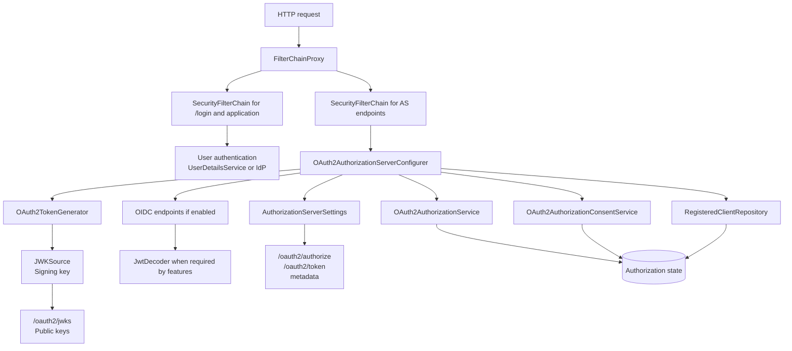
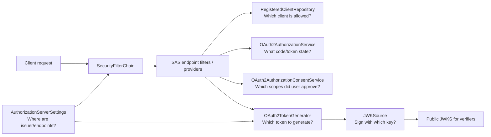

# Registering Required and Optional Infrastructure Beans

## 1. Objectives and Context

In the **Server Configuration** chapter of the **SPRING_SECURITY_OAUTH2_OIDC_AUTHORIZATION_SERVER** module, declaring beans is the step that connects the OAuth 2.0/OpenID Connect (OIDC) protocol with the real services of a **Spring Boot** application. Spring Authorization Server (SAS) provides protocol filters, converters, providers, and endpoints; the application must decide how to register clients, persist authorizations/consents, issue tokens, authenticate users, and manage signing keys.

After this lesson, you will be able to:

- Identify **required** beans, beans **the framework can create by default**, and beans **needed only in specific configurations**.
- Understand relationships among `SecurityFilterChain`, `RegisteredClientRepository`, `OAuth2AuthorizationService`, `OAuth2AuthorizationConsentService`, `OAuth2TokenGenerator`, `JWKSource`, `JwtDecoder`, and `AuthorizationServerSettings`.
- Build a local Authorization Server with Authorization Code + PKCE and OIDC, then verify endpoints, metadata, and JWKS.
- Replace in-memory storage with JDBC without changing endpoints or protocol-layer responsibilities.
- Diagnose missing beans, duplicate bean declarations, misconfigured issuers, JWT/JWK errors, and security filter chain ordering bugs.

**Version scope:** Examples use common programmatic APIs from **Spring Boot 3.x**, **Spring Security 6.x**, and **Spring Authorization Server 1.x**. APIs, auto-configuration, and bean conditions may differ in newer versions, especially across major framework generations. Cross-check dependencies and documentation for your exact running version. Examples demonstrate manual configuration to make each bean's responsibility explicit.

> Make the distinction: **a bean required by design** does not necessarily have to be declared manually with `@Bean`, because the framework/auto-configuration can create a default bean. Conversely, an optional bean at the protocol level may be mandatory for a feature you enabled, such as JWT signing keys and OIDC.

## 2. Bean Map and Request Flow



The diagram shows **dependencies and responsibilities**, not a fixed call sequence for every request. For example, `GET /oauth2/jwks` publishes the public portion of keys without generating tokens; `POST /oauth2/token` checks client, grant, and authorization state; `GET /oauth2/authorize` also involves authentication sessions and consent.

In Spring Security, `FilterChainProxy` selects the matching `SecurityFilterChain` by matcher and order. For an AS application with form login, **two chains** are usually needed: a higher-priority chain for protocol endpoints, and a chain for `/login`/application pages. Chains only route and secure HTTP; repositories/services hold the authorization business data.

## 3. Classifying Beans to Register

### 3.1. Decision Table

| Bean / component | Necessity level | Role and notes |
| --- | --- | --- |
| `RegisteredClientRepository` | **Required for AS** | Looks up registered clients: client ID, secret/method, grants, redirect URIs, scopes, client settings, and token settings. A repository must be provided to SAS. |
| `SecurityFilterChain` configuring SAS | **Requires filter registration mechanism** | Attaches endpoints and Spring Security policies. Declared explicitly in manual configuration; Boot starter may auto-configure depending on version. |
| `OAuth2AuthorizationService` | Required for authorization state; SAS may provide an in-memory default | Stores authorization codes, tokens, and related state/metadata; **production should explicitly register persistence**. |
| `OAuth2AuthorizationConsentService` | Required when managing consent; SAS may provide an in-memory default | Stores scopes approved by users for clients; use persistence when consent must survive restarts. |
| `OAuth2TokenGenerator<?>` | Required for issuing tokens; SAS can create a default generator | Coordinates JWT, opaque access tokens, and refresh tokens per configuration. Write a custom bean only when controlling token generation. |
| `AuthorizationServerSettings` | Can use default; should be configured explicitly | Issuer and endpoint paths. Fix the issuer so metadata and `iss` stay consistent. |
| `JWKSource<SecurityContext>` | **Required when signing JWTs and publishing JWKS** | Supplies keys for JWTs; AS publishes only public JWKs. Not mandatory for OAuth2 deployments using exclusively opaque tokens. |
| `JwtDecoder` | **Required for OIDC features needing JWT decoding/verification** | Especially UserInfo and Dynamic Client Registration per SAS configuration; usually created from `JWKSource`. |
| `UserDetailsService` or identity integration | Requires an end-user authentication mechanism when interactive login exists | Not a required OAuth2 protocol bean if the application has no interactive user login (e.g., machine-to-machine). |
| `PasswordEncoder` | Required when storing/comparing encoded passwords and client secrets | Use BCrypt/Argon2 per policy; never hard-code plaintext credentials. |
| `OAuth2TokenCustomizer<JwtEncodingContext>` | Optional | Adds or adjusts JWT claims per policy and token type. |
| `OAuth2TokenCustomizer<OAuth2TokenClaimsContext>` | Optional | Customizes claims for opaque access tokens when using a compatible generator. |
| `OAuth2AuthorizationServerConfigurer` | Infrastructure configuration component | Usually instantiated inside the `HttpSecurity` configuration method; **does not need to be declared as a standalone bean by default**. |
| `RegisteredClient`, `ClientSettings`, `TokenSettings` | Client configuration objects | Typically constructed and stored **via `RegisteredClientRepository`**, without creating a separate Spring bean per client. |

**Core point:** Documentation or examples may call a group of beans "required components" meaning the system needs them at runtime. When configuring SAS 1.x manually, several dependencies are created by default by the framework if you do not register them; do not assume every row in the table needs a separate `@Bean`. Likewise, the Spring Boot starter may auto-configure additional components depending on classpath and auto-configuration conditions.

### 3.2. Default Beans That Can Be Misleading

When custom beans are absent, common SAS 1.x setups use:

- `InMemoryOAuth2AuthorizationService` to keep authorization state in memory.
- `InMemoryOAuth2AuthorizationConsentService` to keep consent.
- A `DelegatingOAuth2TokenGenerator` combining suitable generators for present dependencies; the JWT generator depends on JWT encoding/signing capability.
- `AuthorizationServerSettings` with default endpoints and an issuer that may be inferred from request context if not explicitly set.

This is convenient for launching a demo, but **is not a production storage architecture**. Across multiple instances or restarts, authorization codes, refresh tokens, consent, and other state must be shared or have a clear persistence policy. When the AS sits behind a reverse proxy, inferring the issuer from requests can also produce the wrong public URL.

For a local environment with OIDC, explicitly register at minimum: **registered clients, signing key/`JWKSource`, `JwtDecoder`, `AuthorizationServerSettings`, and security chain configurations**. Deliberately choose how users authenticate and where state is stored rather than relying on defaults in a system meant for durable operation.

## 4. HTTP Protection Beans: `SecurityFilterChain`

### 4.1. Chain for Authorization Server Endpoints

Example using programmatic configuration in SAS 1.x:

```java
@Configuration(proxyBeanMethods = false)
@EnableWebSecurity
public class AuthorizationServerSecurityConfig {

    @Bean
    @Order(1)
    SecurityFilterChain authorizationServerChain(HttpSecurity http)
            throws Exception {

        OAuth2AuthorizationServerConfigurer authorizationServer =
                OAuth2AuthorizationServerConfigurer.authorizationServer();

        http
            .securityMatcher(authorizationServer.getEndpointsMatcher())
            .with(authorizationServer, configurer ->
                    configurer.oidc(Customizer.withDefaults()))
            .authorizeHttpRequests(authorize ->
                    authorize.anyRequest().authenticated())
            .exceptionHandling(exceptions ->
                    exceptions.defaultAuthenticationEntryPointFor(
                            new LoginUrlAuthenticationEntryPoint("/login"),
                            new MediaTypeRequestMatcher(MediaType.TEXT_HTML)))
            .oauth2ResourceServer(resourceServer ->
                    resourceServer.jwt(Customizer.withDefaults()));

        return http.build();
    }

    @Bean
    @Order(2)
    SecurityFilterChain applicationChain(HttpSecurity http)
            throws Exception {

        http
            .authorizeHttpRequests(authorize ->
                    authorize.anyRequest().authenticated())
            .formLogin(Customizer.withDefaults());

        return http.build();
    }
}
```

Imports are omitted for wiring clarity; primary types belong to `org.springframework.security.*` and `org.springframework.security.oauth2.server.authorization.*`.

- `@Order(1)` ensures the protocol chain is evaluated first. `authorizationServer.getEndpointsMatcher()` scopes the chain to SAS endpoints.
- `.oidc(Customizer.withDefaults())` enables SAS OIDC support; it does not automatically enable every extension feature such as Dynamic Client Registration.
- `.exceptionHandling(...)` sends browser requests needing authentication to `/login`; it does not turn JSON errors from the token endpoint into redirects.
- `.oauth2ResourceServer(...jwt(...))` is required when the AS chain must accept Bearer access tokens for OIDC features like UserInfo.
- `@Order(2)` handles `/login` and other requests, using sample form login for local use.

**Common mistake:** Declaring the AS chain with a matcher covering all `/**`, preventing `/login` from reaching the application chain and causing redirect loops or 403s. Conversely, placing a catch-all application chain before the AS chain can prevent `/oauth2/token` from being handled properly.

Spring Security includes built-in CSRF protection suited to form login and browser requests. Never disable CSRF globally just to make the token endpoint work. Verify separate policies for protocol endpoints and interactive endpoints.

## 5. Client Registration Bean: `RegisteredClientRepository`

### 5.1. Key Data in `RegisteredClient`

A registered client typically contains:

| Property | Purpose |
| --- | --- |
| `id` / `clientId` | Internal key and client identifier used in OAuth2 requests. |
| `clientSecret` | Encoded secret for confidential clients; not used for public clients unable to keep secrets. |
| `clientAuthenticationMethods` | E.g., `client_secret_basic`, `private_key_jwt`, or `none`. |
| `authorizationGrantTypes` | Allowed grants, e.g., `authorization_code`, `refresh_token`, `client_credentials`. |
| `redirectUris` | Callback addresses that must be registered accurately. |
| `scopes` | Scopes the client is permitted to request, e.g., `openid` and `profile`. |
| `ClientSettings` | Require PKCE, consent, JWK Set URL, or other client policies. |
| `TokenSettings` | Lifetimes for access tokens, refresh tokens, ID tokens, and related token policies. |

**`RegisteredClientRepository` is the lookup store for registration info**, not where issued authorization codes or refresh tokens are saved. Storing authorization state belongs to `OAuth2AuthorizationService`.

### 5.2. Registering a Local Client

Example running locally with confidential client `local-web` and PKCE required:

```java
@Bean
PasswordEncoder passwordEncoder() {
    return new BCryptPasswordEncoder();
}

@Bean
RegisteredClientRepository registeredClientRepository(
        PasswordEncoder encoder,
        @Value("${LOCAL_AS_CLIENT_SECRET}") String clientSecret) {

    RegisteredClient client = RegisteredClient.withId(
                    UUID.randomUUID().toString())
            .clientId("local-web")
            .clientSecret(encoder.encode(clientSecret))
            .clientAuthenticationMethod(
                    ClientAuthenticationMethod.CLIENT_SECRET_BASIC)
            .authorizationGrantType(
                    AuthorizationGrantType.AUTHORIZATION_CODE)
            .authorizationGrantType(
                    AuthorizationGrantType.REFRESH_TOKEN)
            .redirectUri(
                    "http://127.0.0.1:8080/login/oauth2/code/local-web")
            .scope(OidcScopes.OPENID)
            .scope(OidcScopes.PROFILE)
            .clientSettings(ClientSettings.builder()
                    .requireProofKey(true)
                    .requireAuthorizationConsent(true)
                    .build())
            .tokenSettings(TokenSettings.builder()
                    .accessTokenTimeToLive(Duration.ofMinutes(5))
                    .reuseRefreshTokens(false)
                    .build())
            .build();

    return new InMemoryRegisteredClientRepository(client);
}
```

Here `LOCAL_AS_CLIENT_SECRET` is an environment variable passed to the JVM; do not write real secrets into source code. `PasswordEncoder` hashes the secret before putting it into the repository. Never place passwords in URLs or logs.

**Key distinction:** `client_secret_basic` authenticates the confidential client at the token endpoint, whereas **PKCE** protects the Authorization Code Flow using `code_verifier`/`code_challenge`. The two mechanisms complement each other. Public clients typically register authentication method `none` and also need PKCE; never ship a client secret to a JavaScript frontend or mobile app and treat it as secure.

**Restart note:** `UUID.randomUUID()` creates a new internal ID on every startup, suitable for an in-memory demo. With JDBC or multiple instances, use a stable ID persisted in the store with controlled migrations/registration rather than recreating clients arbitrarily on every startup.

## 6. State Storage Beans: Authorization and Consent

### 6.1. `OAuth2AuthorizationService`

This service provides save, lookup, and removal operations for authorizations. Depending on the grant/token, a record may reference the principal, registered client, authorization code, access token, refresh token, ID token, and their metadata.

Local example, declared explicitly so learners see the bean:

```java
@Bean
OAuth2AuthorizationService authorizationService() {
    return new InMemoryOAuth2AuthorizationService();
}
```

SAS 1.x can provide an in-memory default if you omit this bean; the example declares it explicitly to show where to swap implementations. When a client redeems an issued code or uses a refresh token, this service retrieves the state. Data is not shared across in-memory instances.

### 6.2. `OAuth2AuthorizationConsentService`

This service stores scope approvals for each user/client pair according to policy. Consent is **not** a login session and **not** the registered clients repository.

```java
@Bean
OAuth2AuthorizationConsentService authorizationConsentService() {
    return new InMemoryOAuth2AuthorizationConsentService();
}
```

If a client specifies `requireAuthorizationConsent(true)`, displaying and saving consent must fit the browser flow. In production applications, consent records must be persistent if users should not be re-prompted after every restart.

### 6.3. Do Not Confuse the Three Data Types

| Repository/service | Stored object | Example access moment |
| --- | --- | --- |
| `RegisteredClientRepository` | **Permitted client** configuration | Verifying `client_id`, secret, grants, scopes, redirect URI. |
| `OAuth2AuthorizationService` | **Issued authorization** and related tokens/codes | Issuing codes, exchanging codes, refreshing tokens, revocation, introspection. |
| `OAuth2AuthorizationConsentService` | Principal's **consent** for a client | Displaying the consent form and saving approved scopes. |

The three data groups have distinct lifecycles and access controls. Never use a registered client record in place of an issued authorization.

## 7. Token Generation and JWT Signing Beans

### 7.1. `OAuth2TokenGenerator` as Token Coordination Point

In standard setups, SAS can construct an appropriate token generator. Typical components include:

- `JwtGenerator`: generates signed JWTs, usually used for OIDC ID tokens and access tokens if JWT format is chosen.
- `OAuth2AccessTokenGenerator`: generates access tokens without self-contained JWT claims (opaque/reference tokens) per configuration.
- `OAuth2RefreshTokenGenerator`: generates refresh tokens per policy.

`DelegatingOAuth2TokenGenerator` delegates to the generator capable of handling the current token type. Do not write a brand-new `OAuth2TokenGenerator` just to add a standard claim to a JWT; prefer a customizer.

### 7.2. `JWKSource<SecurityContext>` and JWKS

When using asymmetrically signed JWTs, the AS needs a private key and verifiers need the public key. Local example **generating an RSA key at startup**:

```java
@Bean
JWKSource<SecurityContext> jwkSource()
        throws NoSuchAlgorithmException {

    KeyPairGenerator generator = KeyPairGenerator.getInstance("RSA");
    generator.initialize(3072);
    KeyPair pair = generator.generateKeyPair();

    RSAKey rsaKey = new RSAKey.Builder(
            (RSAPublicKey) pair.getPublic())
            .privateKey((RSAPrivateKey) pair.getPrivate())
            .keyID(UUID.randomUUID().toString())
            .keyUse(KeyUse.SIGNATURE)
            .algorithm(JWSAlgorithm.RS256)
            .build();

    JWKSet jwkSet = new JWKSet(rsaKey);
    return (selector, context) -> selector.select(jwkSet);
}
```

The RSA/JWK classes come from Java Security and Nimbus JOSE. `JWKSource` is used by SAS to select signing keys; the `/oauth2/jwks` endpoint must publish only the **public** portion of the key set. The JWT header carries `kid` so Resource Servers select the matching key from JWKS.

**Demo limitation:** The method above generates a new private key and `kid` on every startup, making previously issued JWTs unverifiable via JWKS after a restart. For systems needing repeatable testing, use a protected PKCS#12 keystore, KMS/HSM, or persistent key storage. Never put private keys into `application.yml`, Git, or logs. When rotating keys, allow an overlap window publishing both old and new public keys.

### 7.3. `JwtDecoder` for OIDC

Some OIDC features require a `JwtDecoder`, such as UserInfo handling or Dynamic Client Registration depending on enabled capabilities. With a registered `JWKSource`:

```java
@Bean
JwtDecoder jwtDecoder(JWKSource<SecurityContext> jwkSource) {
    return OAuth2AuthorizationServerConfiguration.jwtDecoder(jwkSource);
}
```

Do not confuse `JwtDecoder` inside the Authorization Server with the verifier configuration of an **external Resource Server**. APIs still need their own verifier for access tokens, issuer, audience, expiration, and scopes. Do not force every Resource Server to call the AS to decode every JWT when the architecture is designed for offline verification via JWKS.

### 7.4. Customizing JWT Claims with `OAuth2TokenCustomizer`

When adding controlled claims to a **JWT access token**, register:

```java
@Bean
OAuth2TokenCustomizer<JwtEncodingContext> jwtTokenCustomizer() {
    return context -> {
        if (OAuth2TokenType.ACCESS_TOKEN.equals(
                context.getTokenType())) {

            context.getClaims().claim(
                    "app_environment", "local");
        }
    };
}
```

In this example, the static claim is only for testing. In real applications, identity/permission-dependent values must come from authenticated and approved sources, never copied from client-supplied input. An ID token has a different semantic role than an access token; do not arbitrarily push API-specific claims into ID tokens.

If you create your own `OAuth2TokenGenerator<?>` bean instead of the default generator, attach the customizer directly to the corresponding `JwtGenerator`/`OAuth2AccessTokenGenerator`; simply declaring a customizer bean does not guarantee a custom generator will pick it up automatically.

## 8. Metadata and Endpoint Configuration Bean: `AuthorizationServerSettings`

`AuthorizationServerSettings` defines the issuer and endpoint paths. For running locally on port 9000:

```java
@Bean
AuthorizationServerSettings authorizationServerSettings() {
    return AuthorizationServerSettings.builder()
            .issuer("http://localhost:9000")
            .authorizationEndpoint("/oauth2/authorize")
            .tokenEndpoint("/oauth2/token")
            .jwkSetEndpoint("/oauth2/jwks")
            .tokenRevocationEndpoint("/oauth2/revoke")
            .tokenIntrospectionEndpoint("/oauth2/introspect")
            .build();
}
```

`issuer` must match the value in discovery metadata and the `iss` claim; clients/Resource Servers must use that exact issuer to verify tokens. `http://localhost:9000` and `http://127.0.0.1:9000` **differ as strings** even though both point to loopback. Avoid differing hostnames, schemes, ports, or trailing `/` slashes across components.

| Typical endpoint | When needed | Related beans |
| --- | --- | --- |
| `/oauth2/authorize` | Authorization Code, login, consent | AS chain, registered clients, authentication session, authorization/consent services. |
| `/oauth2/token` | Code exchange, refresh, and enabled grants | Client repository, authorization service, token generator, `JWKSource` if issuing JWTs. |
| `/oauth2/jwks` | For verifiers to fetch public keys | `JWKSource`. |
| `/.well-known/oauth-authorization-server` | OAuth2 metadata when supported by framework | `AuthorizationServerSettings` and endpoint settings. |
| `/.well-known/openid-configuration` | OIDC discovery when OIDC is enabled | OIDC configurer, issuer/settings, signing algorithm metadata. |
| `/oauth2/revoke` | Token revocation | Client authentication and authorization service. |
| `/oauth2/introspect` | Permitted token state inspection | Client authentication and authorization service. |
| `/userinfo` | OIDC UserInfo when enabled | OIDC, Bearer token processing, claim mapping, and required decoder. |

Advanced endpoints such as **Pushed Authorization Requests (PAR)**, Device Authorization, OIDC logout, and Dynamic Client Registration depend on SAS version and feature configuration. Never assume they are automatically active just because OIDC is enabled.

To have the local application listen on the corresponding port:

```yaml
server:
  port: 9000
```

When moving to production, set the issuer to the **public HTTPS URL**, protect forwarded headers from trusted reverse proxies, and ensure every AS instance uses that same issuer.

## 9. Combining into a Complete Local Configuration

The methods in sections 4–8 were shown separately for clarity. In a real project, place them in one or a few `@Configuration` classes within the `ApplicationContext`, avoiding duplicate bean names/types. A minimal working setup for Authorization Code + PKCE + OIDC satisfies the following table:

| Bean / config | Provided by | Purpose |
| --- | --- | --- |
| AS `SecurityFilterChain` | `authorizationServerChain` | Receives and secures protocol endpoints. |
| Application `SecurityFilterChain` | `applicationChain` | Handles form login. |
| `RegisteredClientRepository` | `registeredClientRepository` | Knows `local-web`, grants, PKCE, consent. |
| `OAuth2AuthorizationService` | `authorizationService` | Stores codes/tokens in memory. |
| `OAuth2AuthorizationConsentService` | `authorizationConsentService` | Stores approved scopes in memory. |
| `JWKSource` | `jwkSource` | Signs JWTs and publishes public JWKS. |
| `JwtDecoder` | `jwtDecoder` | Supports OIDC features needing JWT verification. |
| `AuthorizationServerSettings` | `authorizationServerSettings` | Issuer and endpoint paths. |
| `PasswordEncoder` + `UserDetailsService` | Sample bean below | Authenticates local users. |
| `OAuth2TokenGenerator<?>` | SAS default when applicable | Generates tokens; no custom bean needed in example. |

To give form login a demo user:

```java
@Bean
UserDetailsService userDetailsService(
        PasswordEncoder encoder,
        @Value("${LOCAL_AS_USER_PASSWORD}") String userPassword) {

    UserDetails user = User.withUsername("alice")
            .password(encoder.encode(userPassword))
            .roles("USER")
            .build();

    return new InMemoryUserDetailsManager(user);
}
```

Before running, set `LOCAL_AS_CLIENT_SECRET` and `LOCAL_AS_USER_PASSWORD` in the JVM environment. Avoid typing plaintext secrets in source code or placing secret parameters in URLs. An OAuth2 client running at `127.0.0.1:8080` must register a callback and secret matching `RegisteredClient`.

**Relationship with auto-configuration:** If the Spring Boot starter already creates equivalent beans, redeclaring them can introduce differences in chain ordering or bean candidates. Pick one clear configuration style, inspect the bean list/condition report at startup, and override only components the application needs to customize.

## 10. Replacing In-Memory Beans with JDBC

A production model can use `JdbcTemplate`, corresponding JDBC repositories/services, and the database schema for your SAS version. Example (assuming the application already configures `DataSource` and `JdbcTemplate`):

```java
@Bean
RegisteredClientRepository registeredClientRepository(
        JdbcTemplate jdbcTemplate) {
    return new JdbcRegisteredClientRepository(jdbcTemplate);
}

@Bean
OAuth2AuthorizationService authorizationService(
        JdbcTemplate jdbcTemplate,
        RegisteredClientRepository registeredClientRepository) {
    return new JdbcOAuth2AuthorizationService(
            jdbcTemplate, registeredClientRepository);
}

@Bean
OAuth2AuthorizationConsentService authorizationConsentService(
        JdbcTemplate jdbcTemplate,
        RegisteredClientRepository registeredClientRepository) {
    return new JdbcOAuth2AuthorizationConsentService(
            jdbcTemplate, registeredClientRepository);
}
```

This **replaces** the three in-memory beans in sections 5–6; do not register both simultaneously as two unqualified/non-primary implementations in the same context. You must:

1. Apply the SQL schema and database migrations **matching the exact SAS version**; never guess column names or copy schemas from another version.
2. Register clients persistently in the database (via a controlled client provisioning process). Replace code generating a new client `UUID` on every startup.
3. Protect hashed client secrets, refresh tokens, and authorization metadata at the DB layer; restrict privileges of the database account.
4. Design transactions/connection pools, expired authorization cleanup policies, and backup/restore.
5. Verify AS instances share the same database and compatible signing keys; avoid letting each instance hold separate authorizations or signing keys.

In large applications, you can implement `RegisteredClientRepository`, `OAuth2AuthorizationService`, and `OAuth2AuthorizationConsentService` directly to integrate existing data stores, provided API contracts are honored. Never use arbitrary data types or serializers that corrupt token metadata.

## 11. Optional Beans and Extension Points Worth Considering

| Extension point | Use case | Things to watch |
| --- | --- | --- |
| `OAuth2TokenCustomizer<JwtEncodingContext>` | Add controlled claims to JWTs | Only add trusted data, check token type, avoid unnecessary PII. |
| Custom `OAuth2TokenGenerator<?>` | Change token generation mechanism or algorithm as required | Must compose generators for all supported access/refresh/ID tokens. |
| Custom `AuthenticationProvider` / `AuthenticationConverter` | Integrate extension grants or custom authentication | Register on the proper endpoint configurer, validate client and scopes, return standard OAuth2 errors. |
| `OAuth2AuthorizationServerConfigurer#tokenEndpoint(...)` | Customize token endpoint handlers/converters | Distinguish request converter from provider; never bypass client authentication. |
| `OAuth2AuthorizationServerConfigurer#clientAuthentication(...)` | Advanced client authentication policies | Never treat a secret in a public client as trustworthy. |
| OIDC UserInfo customizer/mapper | Define UserInfo claims by scope and user | Do not release sensitive claims merely because an access token is valid. |
| Custom consent UI | Design scope approval page | Must verify principal, client binding, and CSRF protection. |
| JDBC repository/service | Multiple instances, durability requirements | Manage schema migrations and data access permissions. |
| `JWKSource` backed by keystore/KMS | Persistent signing keys and key rotation | Private keys never exposed in JWKS or logs. |
| Event handling, metrics, audit | Troubleshooting, attack monitoring, and operations | Never log credentials, authorization codes, or access/refresh/ID tokens. |

**Not every extension point is a standalone `@Bean`.** Some capabilities are attached via DSL to `OAuth2AuthorizationServerConfigurer`, some expose bean interfaces, and others depend on the protocol/version in use.

### 11.1. Example Adding a Provider for an Extension Grant

For a custom-designed grant, the integration point is typically on the token endpoint:

```java
http.with(authorizationServer, configurer ->
        configurer.tokenEndpoint(tokenEndpoint ->
                tokenEndpoint
                    .accessTokenRequestConverter(customConverter)
                    .authenticationProvider(customProvider)));
```

`customConverter` and `customProvider` above are **application-built components**, not default beans. You must properly implement grant recognition, client authentication, scope validation, replay protection, and authorization binding. When no extension grant is needed, sticking with standard SAS converters/providers carries less risk.

### 11.2. When Should You Use `@ConditionalOnMissingBean`?

`@ConditionalOnMissingBean` is useful when authoring a **reusable starter/auto-configuration** and wanting consumers to override implementations. In an ordinary application, you do not need to put this annotation on every bean. Understand auto-configuration ordering, bean names, generic types, and qualifiers to avoid a default bean accidentally overriding or making application bean selection ambiguous.

## 12. Testing After Registering Beans

The first step is verifying the Spring context starts and endpoints respond, followed by testing both happy paths and failure paths.

### 12.1. Checking Metadata, JWKS, and Login

On Windows PowerShell you can use `curl.exe`:

```powershell
curl.exe -i http://localhost:9000/.well-known/openid-configuration
curl.exe -i http://localhost:9000/oauth2/jwks
curl.exe -i http://localhost:9000/oauth2/authorize
```

Expected:

- OIDC metadata returns issuer `http://localhost:9000` with accurate `authorization_endpoint`, `token_endpoint`, and `jwks_uri`.
- JWKS contains a public RSA JWK, `kid` matching the signing key, and **no private RSA parameters** such as `d`, `p`, `q`.
- `/oauth2/authorize` missing parameters normally returns a **protocol error**; the goal of this request is confirming the endpoint routes to the AS, not receiving an authorization code.

A valid authorize request must include client ID, registered redirect URI, `response_type=code`, scopes, `state`, and PKCE `code_challenge`/`code_challenge_method=S256`. The browser must authenticate and complete consent before receiving a code.

### 12.2. Bean-by-Bean Test Matrix

| Test | Bean/feature observed | Expected result |
| --- | --- | --- |
| Context start | Beans and their dependencies | No missing-bean errors, circular dependencies, or ambiguous bean candidates. |
| Discovery | `AuthorizationServerSettings`, OIDC configurer | Issuer and endpoint URLs match local config. |
| JWKS | `JWKSource` | Valid public JWK, matching `kid`/JWT algorithm. |
| Authorization Code | Registered client, user auth, auth service, consent service | User logs in/consents; code bound to client and redirect URI. |
| Token exchange + PKCE | Token provider, authorization service, token generator | Only valid client, unused code, and matching `code_verifier` receive tokens. |
| Wrong redirect URI | `RegisteredClientRepository` | Invalid request rejected; never redirect browser to arbitrary URL. |
| Reuse authorization code | `OAuth2AuthorizationService` | No additional tokens issued when code was already used. |
| JWT validation | `JWKSource`, client/API verifiers | Signature, `iss`, `aud`, `exp`, and scopes verified. |
| Consent persistence | `OAuth2AuthorizationConsentService` | Approved scopes saved and queried per policy. |
| Restart/multi-instance | JDBC services + key store | Data and signing keys remain consistent per target architecture. |
| Revoke/refresh | Authorization service, token settings | Revoked/expired tokens or invalid refresh rejected per policy. |

You can use **Spring Security Test + MockMvc** for filters/endpoints, and **integration tests with a real database or Testcontainers** for JDBC and transactions. With a real OIDC client, verify ID tokens on the client (`iss`, `aud`, expiration, signature, and `nonce` if used). Resource Server APIs must validate access tokens along with appropriate audience/permissions.

### 12.3. Diagnosing Errors via the Dependency Graph

| Error / symptom | What to check |
| --- | --- |
| `No qualifying bean of type RegisteredClientRepository` | Repository not created or auto-configuration conditions not met. |
| `NoUniqueBeanDefinitionException` for service/repository | Multiple implementations of the same type without `@Qualifier`/`@Primary`, or demo and JDBC beans registered simultaneously. |
| AS endpoint returns 404 | `SecurityFilterChain` matcher, `@Order`, `AuthorizationServerSettings`, or feature not enabled. |
| Browser redirect loop at `/login` | Application chain, form login, session, authentication entry point. |
| `invalid_client` | Client authentication method, client secret, registered client state. |
| `invalid_grant` | Expired/used authorization code, wrong PKCE, wrong redirect URI, invalid refresh token. |
| No ID token issued | OIDC not enabled, scope lacks `openid`, JWT token generator/signing key misconfigured. |
| OIDC UserInfo authentication failure | `JwtDecoder`, resource-server JWT support, Bearer token, principal/scope. |
| JWT unverifiable after restart | Regenerated signing key or inconsistent `kid`/JWKS. |
| Resource Server reports `invalid_issuer` | `iss` on JWT differs from metadata or `issuer-uri` configuration. |
| JDBC error reading authorization | Schema/serializer/DB version incompatible with SAS model structure. |

Use response types to distinguish OAuth2 errors returned by providers (such as `invalid_client` and `invalid_grant`) from HTTP security errors caused by requests hitting the wrong filter chain (such as 404/403). Avoid randomly editing multiple beans before isolating the failing stage.

## 13. Implementation Roadmap and Checklist

A registration sequence that minimizes dependency errors:

1. Lock down Spring Boot/Spring Security/SAS dependencies and configuration approach (starter auto-configuration vs. manual configuration).
2. Declare `RegisteredClientRepository` and a test registered client; define grants, redirect URIs, PKCE, consent, and scopes.
3. Declare or confirm `OAuth2AuthorizationService` and `OAuth2AuthorizationConsentService`; choose in-memory only for local or JDBC for durable state.
4. Configure private signing keys, `JWKSource`, and `JwtDecoder` when JWT/OIDC is needed.
5. Fix `AuthorizationServerSettings.issuer` and endpoint paths.
6. Create the AS `SecurityFilterChain`, application login chain, and user authentication source if browser flows exist.
7. Only after standard endpoints work properly should you add token customizers, custom grants, or custom consent UIs.
8. Run discovery/JWKS, Authorization Code + PKCE, token exchange, and Resource Server validation; add restart, key rotation, and failure-path tests.

**Pre-completion checklist for configuration:**

- [ ] Exactly one `RegisteredClientRepository` operates according to the intended setup.
- [ ] Authorization and consent have explicit services; you know whether data survives restarts.
- [ ] AS chain is selected before application chain for protocol endpoints; `/login` works properly.
- [ ] Issuer is fixed and matches discovery metadata, token `iss`, and Resource Server.
- [ ] If using JWT/OIDC, `JWKSource` and `JwtDecoder` satisfy enabled features.
- [ ] JWKS publishes public keys only; private signing keys are protected with a durability/rotation plan.
- [ ] Clients have valid grants/scopes/redirect URIs, PKCE, and authentication methods suited to client type.
- [ ] Tested successful token issuance and rejection cases (wrong client, redirect, PKCE, code reuse).
- [ ] Passwords, client secrets, authorization codes, and access/refresh/ID tokens are never logged.
- [ ] Demo/in-memory beans are replaced by persistence and proper key storage before multi-instance operation.

## 14. Remembering Responsibility Boundaries



The most crucial distinction is that **client registration**, **authorization state**, **consent**, **token generation**, **key management**, and **HTTP security** are separate responsibilities. Registering the right beans and wiring them along clear dependency lines keeps designing, configuring, securing, testing, and operating an OAuth2/OIDC Authorization Server with Spring Security and Spring Authorization Server consistent, while minimizing errors when replacing in-memory components with production infrastructure.
