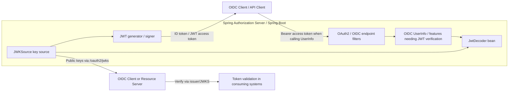
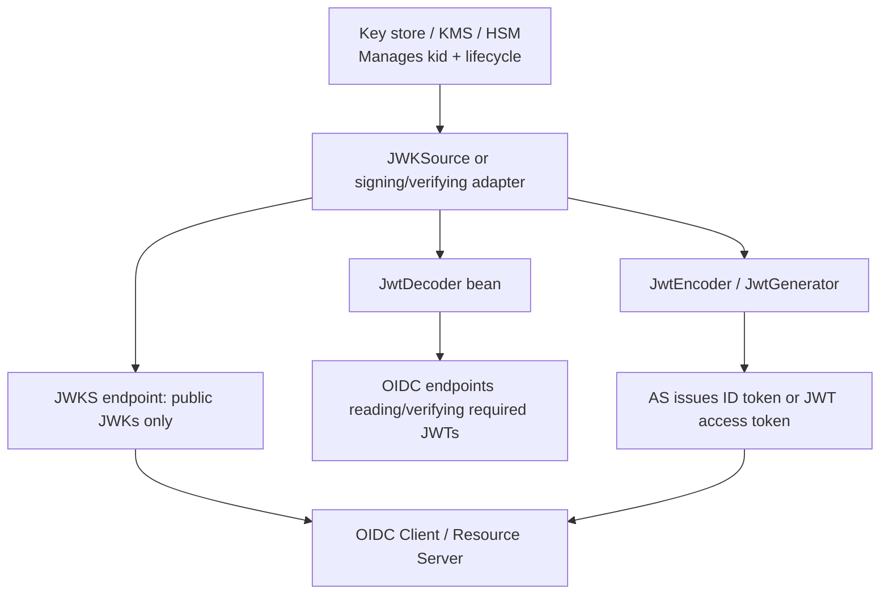
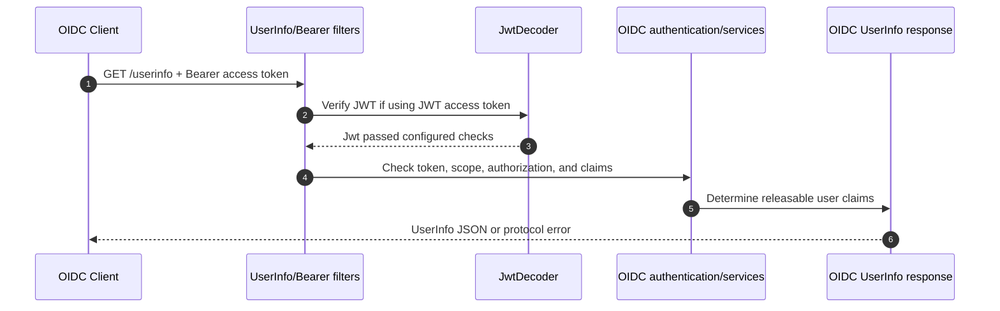

# Configuring JwtDecoder for OIDC Features That Require JWT Verification

In a Spring Boot application acting as an **OAuth 2.0/OpenID Connect Authorization Server**, learners often focus on **signing and issuing JWTs**: generating RSA/EC keys, publishing JWKS, and returning ID tokens to OIDC clients. However, several **Spring Authorization Server** features also need to **read, verify signatures on, and process incoming JWTs**. The Spring Security component representing that capability is `JwtDecoder`.

This lesson belongs to the **Server Configuration** chapter of the **SPRING_SECURITY_OAUTH2_OIDC_AUTHORIZATION_SERVER** module. The module's goal is to design, configure, secure, test, and operate an OAuth 2.0/OpenID Connect Authorization Server with Spring Security and Spring Authorization Server in a Spring Boot application. The content here walks from why a `JwtDecoder` bean is needed, how to connect it to the `JWKSource` key source, to testing and secure operations. Code snippets follow the common API family of Spring Authorization Server 1.x and Spring Security 6.x; when using another version, verify against the API of the version locked in your project.

## 1. Why Does an Authorization Server Need JwtDecoder?

### 1.1. Issuing JWTs and Verifying JWTs Are Two Responsibilities

An Authorization Server typically holds a **private key** to sign tokens. OIDC clients and Resource Servers use the **public key** to verify JWTs they are permitted to receive. Even though the Authorization Server is the issuer, it can still receive a JWT as input to an endpoint or need to decode a JWT while executing an OIDC feature.

| Component | Data direction | Role |
|---|---|---|
| `JWKSource<SecurityContext>` | Provides key material to internal components | Key source used for signing and/or verification, depending on the consumer |
| `JwtEncoder` / `JwtGenerator` | Claims → JWT | Encodes as a JWT and signs the token with the appropriate key |
| `JwtDecoder` | JWT → validated `Jwt` | Parses, verifies signature, and runs configured validators |
| JWKS endpoint | AS → external apps | Publishes **public JWKs** for external JWT verification |
| `OAuth2AuthorizationService` | Persists/queries authorization state | Manages authorization and code/token metadata; does **not** replace a JWT decoder |
| Resource Server token validation | API validating tokens | Validates issuer, audience, expiration, and API access permissions |

Never treat `JwtDecoder` as a "Base64 reader object." A JWS-signed JWT's payload can be read via Base64URL without **proving authenticity**. A decoder is only secure when configured with the proper algorithms, key source, and validators. A successful `JwtDecoder.decode(String)` indicates the JWT passed the checks that **particular decoder actually enforces**; protocol-specific requirements must still be checked at the business/protocol layer.

### 1.2. Which OIDC Features Use JwtDecoder?

Spring Authorization Server configuration documentation identifies a `JwtDecoder` bean as required for the **OpenID Connect UserInfo endpoint** and **OpenID Connect Client Registration endpoint**. Architecturally, any OIDC feature that reads or verifies JWTs must have a decoder suited to the token type being handled.

| Flow/feature | Relevant JWT | Role of decoder or verifier |
|---|---|---|
| **OIDC UserInfo** (`/userinfo`) | JWT-format access token in compatible setups | Verifies the token before returning user information |
| **OIDC Dynamic Client Registration** (`/connect/register`, if enabled) | Bearer token/input requiring verification per endpoint mechanism | Ensures input is verified and the client is authorized to register |
| OIDC logout using `id_token_hint` (if supported and enabled) | ID token hint | Validates suitability of the ID token hint per endpoint rules; do not assume every version uses the same bean along a single code path |
| **OIDC client** logging into **an** Authorization Server | ID token received from the identity provider | The **client** is responsible for verifying the ID token; it does not implicitly use the AS's internal decoder bean |

**Common pitfall:** An ID token is issued **by the Authorization Server for the OIDC client**, with `aud` aimed at the client. Having a `JwtDecoder` bean inside the Authorization Server does **not** mean the server "self-verifies every ID token it just signed" during issuance. OIDC endpoints needing a decoder are why you configure the bean; verifying the ID token at the Relying Party remains the client's responsibility.

Similarly, an HTTP request to `/oauth2/token` with `grant_type=client_credentials` is primarily handled by **client authentication** and Authorization Server providers. Do not attribute every token flow to directly invoking a `JwtDecoder` bean.

## 2. Position of JwtDecoder in the Processing Architecture



The diagram shows a conceptual flow. The actual path through authentication filters, token providers, and decoders depends on the endpoint, token representation, and Spring version. In a standard design, **the private key is kept exclusively on the Authorization Server side** and never accidentally published via JWKS. The AS `JwtDecoder` and an API's decoder can access keys differently: the AS decoder uses the internal key source, while APIs typically use public metadata/`jwks_uri`.

### 2.1. What Is the Structure of a JWT?

A compact JWS consists of three parts separated by dots:

```text
BASE64URL(header).BASE64URL(payload).BASE64URL(signature)
```

Illustrative parsed data example (not a valid usable token):

```json
{
  "header": {
    "alg": "RS256",
    "kid": "signing-key-2026-01",
    "typ": "JWT"
  },
  "claims": {
    "iss": "https://login.example.com",
    "sub": "user-123",
    "aud": "portal-client",
    "iat": 1790000000,
    "exp": 1790000600
  }
}
```

- `alg` specifies the signing algorithm; the decoder must accept **only** permitted algorithms to prevent algorithm downgrade or key-type confusion.
- `kid` locates the matching verification key; during key rotation, multiple public keys may coexist temporarily.
- `iss` identifies the issuer; `aud` identifies the intended recipient; `exp` and `nbf` (if present) bound the validity window.
- OIDC claims such as `nonce`, `auth_time`, and `azp` have context-specific validation rules. **No single validator list works identically for all ID tokens, access tokens, and other JWT types.**

A signed JWT is **not an encrypted JWT**. Never place passwords, secrets, or unnecessary private data in claims; anyone holding the token can read the payload even without the private key.

## 3. Recommended JwtDecoder Configuration in Spring Authorization Server

Spring Authorization Server provides the factory method `OAuth2AuthorizationServerConfiguration.jwtDecoder(...)`. Given a `JWKSource` already registered as a bean, the minimal declaration is:

```java
package example.authorizationserver.config;

import com.nimbusds.jose.jwk.source.JWKSource;
import com.nimbusds.jose.proc.SecurityContext;
import org.springframework.context.annotation.Bean;
import org.springframework.context.annotation.Configuration;
import org.springframework.security.oauth2.jwt.JwtDecoder;
import org.springframework.security.oauth2.server.authorization.config.annotation.web.configuration.OAuth2AuthorizationServerConfiguration;

@Configuration(proxyBeanMethods = false)
public class JwtDecoderConfiguration {

    @Bean
    JwtDecoder jwtDecoder(JWKSource<SecurityContext> jwkSource) {
        return OAuth2AuthorizationServerConfiguration.jwtDecoder(jwkSource);
    }
}
```

### 3.1. Role of Each Piece

1. `@Bean JwtDecoder` registers the decoder in the Spring application context so components needing it can inject it.
2. `JWKSource<SecurityContext>` is the Nimbus key source. **`SecurityContext` in this generic is `com.nimbusds.jose.proc.SecurityContext`**, completely distinct from `org.springframework.security.core.context.SecurityContext` which holds user identity.
3. The factory `OAuth2AuthorizationServerConfiguration.jwtDecoder(jwkSource)` builds a decoder backed by the Authorization Server's own key source, avoiding configuring an external JWKS endpoint that makes loopback HTTP calls to itself.
4. The bean can only initialize if Spring finds **one matching `JWKSource`**. Without a key source or with multiple ambiguous beans, configuration is incomplete.
5. Configuring a JWT decoder does not automatically enable all OIDC features. You must also enable OIDC in the Authorization Server configurer and register required components.

The factory method is a concise approach for the **Authorization Server's own OIDC endpoints**. It does not replace a Resource Server's dedicated validator and does not imply that every Spring Security application in the system should share the same bean.

### 3.2. Why Not Use issuer-uri So the Server Calls Itself?

In a **Resource Server**, one commonly configures:

```yaml
spring:
  security:
    oauth2:
      resourceserver:
        jwt:
          issuer-uri: https://login.example.com
```

This uses OIDC/OAuth discovery to locate JWKS from the issuer and validate tokens at the **consuming API**. However, the Authorization Server already holds the internal `JWKSource`. Pointing the AS decoder at its own `issuer-uri` can create a circular HTTP dependency back to itself, causing failures at startup, when the proxy is not yet ready, or when the JWKS endpoint is restricted. For the **decoder serving AS OIDC endpoints**, the factory pattern using the internal key source is the natural choice.

The two models are not mutually exclusive: an Authorization Server can simultaneously act as an OAuth client to an external IdP; in that case, the **decoder used to verify tokens from the external IdP** must use **that IdP's** key source and issuer rules, separate from the internal issuer's key source.

## 4. Configuring JWKSource So JwtDecoder Has Verification Keys

A decoder cannot verify signatures without valid key material. Spring Authorization Server typically uses Nimbus JOSE/JWT to represent JWKs and build a `JWKSource`.

### 4.1. In-Memory RSA Key Example for Learning and Testing

The snippet below illustrates the full key-source setup in a **local test environment**:

```java
package example.authorizationserver.config;

import java.security.KeyPair;
import java.security.KeyPairGenerator;
import java.security.interfaces.RSAPrivateKey;
import java.security.interfaces.RSAPublicKey;
import java.util.UUID;

import com.nimbusds.jose.JWSAlgorithm;
import com.nimbusds.jose.jwk.JWKSet;
import com.nimbusds.jose.jwk.RSAKey;
import com.nimbusds.jose.jwk.source.ImmutableJWKSet;
import com.nimbusds.jose.jwk.source.JWKSource;
import com.nimbusds.jose.proc.SecurityContext;
import org.springframework.context.annotation.Bean;
import org.springframework.context.annotation.Configuration;

@Configuration(proxyBeanMethods = false)
public class DemoSigningKeyConfiguration {

    @Bean
    JWKSource<SecurityContext> jwkSource() throws Exception {
        KeyPairGenerator generator = KeyPairGenerator.getInstance("RSA");
        generator.initialize(3072);
        KeyPair pair = generator.generateKeyPair();

        RSAKey rsaKey = new RSAKey.Builder(
                    (RSAPublicKey) pair.getPublic())
                .privateKey((RSAPrivateKey) pair.getPrivate())
                .keyID(UUID.randomUUID().toString())
                .algorithm(JWSAlgorithm.RS256)
                .build();

        JWKSet jwkSet = new JWKSet(rsaKey);
        return new ImmutableJWKSet<>(jwkSet);
    }
}
```

Here, `JWKSource` holds an RSA JWK containing both public and private keys. It is used by JWT-issuing components and `JwtDecoder` through the internal key source. The public JWKS endpoint must export **only public fields** such as `kty`, `kid`, `n`, and `e`; the private exponent `d` and other private parameters must never be exposed.

**Critical limitation:** Each startup of the example above generates a completely new key pair and `kid`. Previously issued tokens lose verifiability after a restart; if running multiple instances, each instance would also sign with a different key. **Never use startup key generation in production.**

### 4.2. Key Design in Real Environments

In production, `JWKSource` must rely on a stable key source and lifecycle, for example:

- Load managed key pairs from a secret store, appropriate keystore, or KMS/HSM with suitable signing integration.
- Never write private keys/keystore passwords into Git, container images, public `application.yml`, or logs.
- Ensure all instances sharing an issuer publish the same valid public key set and follow consistent signing policies.
- Assign a stable `kid` to each key for its active period; execute rotation via a process with an old/new key overlap window.
- Remove an old public key from JWKS only when no valid tokens remain that need verification with it, accounting for token TTL and consumer JWKS caches.
- Maintain an incident procedure for private key compromise, token revocation/TTL reduction, and communication with Resource Servers.

Not every KMS/HSM exposes private keys directly to Nimbus `JWKSource` in readable form. If using remote or hardware-backed signing, you may need a dedicated `JwtEncoder`/`JWS signer` integration. Keep the **goal of separating secret signing material from public verification keys** rather than assuming private keys can always be exported.

### 4.3. Connecting JwtEncoder, JWKSource, and JwtDecoder



The diagram provides architectural guidance; with remote signing hardware, you can separate the signer adapter and public key source instead of a single `JWKSource` holding readable private keys.

## 5. Enabling OIDC and Wiring JwtDecoder into the Security Filter Chain

In addition to the decoder, the Authorization Server needs a security filter chain for protocol endpoints. Abbreviated example:

```java
@Configuration(proxyBeanMethods = false)
public class AuthorizationServerSecurityConfiguration {

    @Bean
    @Order(1)
    SecurityFilterChain authorizationServerSecurityFilterChain(
            HttpSecurity http) throws Exception {

        OAuth2AuthorizationServerConfigurer authorizationServer =
                OAuth2AuthorizationServerConfigurer.authorizationServer();

        http
            .securityMatcher(authorizationServer.getEndpointsMatcher())
            .with(authorizationServer, configurer -> configurer
                .oidc(Customizer.withDefaults()))
            .authorizeHttpRequests(authorize -> authorize
                .anyRequest().authenticated())
            .exceptionHandling(exceptions -> exceptions
                .defaultAuthenticationEntryPointFor(
                    new LoginUrlAuthenticationEntryPoint("/login"),
                    new MediaTypeRequestMatcher(MediaType.TEXT_HTML)))
            .oauth2ResourceServer(oauth2 -> oauth2
                .jwt(Customizer.withDefaults()));

        return http.build();
    }

    @Bean
    @Order(2)
    SecurityFilterChain applicationSecurityFilterChain(
            HttpSecurity http) throws Exception {
        http
            .authorizeHttpRequests(authorize -> authorize
                .anyRequest().authenticated())
            .formLogin(Customizer.withDefaults());
        return http.build();
    }
}
```

Corresponding Spring Security configuration imports can be found in `org.springframework.security.config` and `org.springframework.security.web` for your exact version. The example focuses on wiring and omits all beans needed for standalone execution.

Explanation:

1. **`authorizationServer.getEndpointsMatcher()`** selects only OAuth2/OIDC protocol requests; Spring Security evaluates the first matching chain.
2. **`oidc(Customizer.withDefaults())`** activates default OIDC features per the library version.
3. **`oauth2ResourceServer(...jwt(...))`** supports Bearer JWT validation on appropriate endpoints, such as OIDC UserInfo. The `JwtDecoder` bean is required input for that processing path.
4. **`LoginUrlAuthenticationEntryPoint("/login")`** applies to HTML requests requiring user login. Token endpoints for machine clients must return OAuth error responses, not auto-redirect to a login form.
5. **The application chain** provides form login for user authentication; the OIDC authorization flow can route the browser through `/login` and return to the authorization endpoint with a session.

This template still requires client registration (`RegisteredClientRepository`), user authentication, authorization/consent services, `AuthorizationServerSettings`, signing source `JWKSource`, and the corresponding decoder. Simply adding `JwtDecoder` and calling `/userinfo` does not create a working OIDC system on its own.

### 5.1. How Does OIDC UserInfo Process a Bearer Token?

Suppose Portal completed an Authorization Code Flow with a scope including `openid` and received an access token. Portal calls:

```http
GET /userinfo HTTP/1.1
Host: login.example.com
Authorization: Bearer <access-token>
Accept: application/json
```

A conceptually valid processing flow:



The actual flow also involves `OAuth2AuthorizationService`, `OidcUserInfoAuthenticationProvider`, and configured UserInfo generation/mapping. The token must be active, carry appropriate scopes/claims, and link to a valid authorization. A validly signed JWT **does not automatically** grant UserInfo access. Opaque tokens also require appropriate validation/lookup mechanisms; never assume `JwtDecoder` can decode every access token.

UserInfo claims must adhere to granted scopes and disclosure policy. Never return a full sensitive profile merely because the decoder verified the token.

### 5.2. Dynamic Client Registration Is an Optional Feature

OIDC Dynamic Client Registration enables registering clients over the protocol. This feature can change **who is allowed to register OAuth clients**, so it must be enabled intentionally and protected with a bootstrap/initial access token mechanism by design.

In supported versions, you can configure it specifically in the OIDC configurer, for example:

```java
.with(authorizationServer, configurer -> configurer
    .oidc(oidc -> oidc
        .clientRegistrationEndpoint(Customizer.withDefaults())))
```

This **replaces** the `.with(...)` block above, not as a standalone chain. Never allow anonymous clients to freely register redirect URIs and administrative scopes. If your environment does not require dynamic registration, leave it disabled and register clients through controlled administrative workflows.

## 6. Checking the Right Claims: Decoder Does Not Replace Protocol Validation

A JWT can pass signature verification yet still **not be intended for the receiving endpoint**. Properties that commonly require validation include:

| Field/condition | Meaning | Error example |
|---|---|---|
| Signature and `alg` | Token signed by trusted key source with allowed algorithm | Forged signature, disallowed algorithm |
| `kid` and key selection | Selects the matching public key in the key set | Missing `kid` or pointing to a retired key |
| `iss` | Issuer trusted by the recipient | Token from a different authorization server |
| `aud` | Intended recipient | Token issued for Portal used against Orders API |
| `exp`, `nbf` | Validity window | Expired token or token not yet valid |
| `scope`/`scp` and authorities | Permissions granted to client/token | Token only has `orders.read` yet calls write API |
| `sub`/authorization status | Subject/authorization bound to token | Session mismatch or revoked per policy |
| Additional OIDC claims | `nonce`, `azp`, `auth_time`, etc. depending on flow | ID token does not match login request |

**Do not copy one shared audience validator across every JWT type.** OIDC ID tokens usually carry `aud=client_id`; access tokens for Orders API need an audience targeting the API. Some AS features also involve JWT client assertions or `id_token_hint` with distinct verification contexts. Detecting token type and checking issuer, audience, and purpose must live in the appropriate protocol handler.

### 6.1. When a Resource Server Needs a Separate Decoder

In **Orders API** (a Resource Server separate from the AS), you can build a decoder from the public issuer and add an audience validator:

```java
@Bean
JwtDecoder ordersApiJwtDecoder() {
    String issuer = "https://login.example.com";
    NimbusJwtDecoder decoder =
            NimbusJwtDecoder.withIssuerLocation(issuer).build();

    OAuth2TokenValidator<Jwt> audienceValidator = token ->
            token.getAudience().contains("orders-api")
                ? OAuth2TokenValidatorResult.success()
                : OAuth2TokenValidatorResult.failure(
                    new OAuth2Error(
                        "invalid_token",
                        "Access token is not intended for Orders API",
                        null));

    decoder.setJwtValidator(
        new DelegatingOAuth2TokenValidator<>(
            JwtValidators.createDefaultWithIssuer(issuer),
            audienceValidator));

    return decoder;
}
```

This is an **example for a separate API application**; do not drop this bean into the same application context as the Authorization Server's OIDC decoder without resolving bean selection and validation policy. The API must also validate scopes/authorities and business authorization on target resources. `JwtDecoder` does not automatically decide whether user A may view user B's orders.

The snippet requires imports from `org.springframework.security.oauth2.jwt`, `org.springframework.security.oauth2.core`, `org.springframework.security.oauth2.core.validator`, and the appropriate Resource Server dependency.

## 7. Examples for Testing JwtDecoder and OIDC Endpoints

A useful test suite verifies **the decoder directly**, **wiring at application startup**, and **protocol HTTP paths**, rather than only checking that a bean exists.

### 7.1. Unit-Testing the Decoder Directly with Signed Tokens

Suppose a test fixture provides a `JWKSource` with an RSA key pair and a JWT issuer using the same key. Tests should verify sequentially:

1. A JWT signed with the matching private key, allowed `alg`, right `kid`, and validator-compliant claims → `decode(token)` succeeds.
2. A JWT with one character altered in the payload while keeping the old signature → decoder rejects the signature.
3. A JWT signed by an unknown private key even with matching `iss`/`aud` → decoder rejects it.
4. A `kid` absent from the key set or a disallowed algorithm → decoder rejects per policy.
5. `exp` in the past or `nbf` in the future → rejected **if time validators apply to that decoder**.
6. Wrong `iss`/`aud` → tests must exercise **the corresponding validator**, not just signature checks. For issuer/audience tests, ensure those validators are registered.

If the decoder comes from Spring Authorization Server's sample factory, do not assume the factory already applies every business validator you intend to test. Write tests against the **actual contract of the decoder and endpoint**.

### 7.2. HTTP Tests for OIDC

| Test | Condition | Expected result |
|---|---|---|
| Startup | OIDC UserInfo enabled, `JWKSource` and `JwtDecoder` present | Application initializes related components successfully |
| Missing required bean | Feature needing decoder enabled without declaring bean | Configuration/startup test detects error rather than silently skipping |
| Discovery | `GET /.well-known/openid-configuration` | JSON publishes accurate issuer, `jwks_uri`, and endpoints |
| JWKS | `GET /oauth2/jwks` | Contains public JWK; does not export `d`/private material |
| Valid UserInfo | Valid access token, matching scopes and claims | UserInfo response matches subject, only allowed claims |
| UserInfo missing token | No `Authorization: Bearer` | Rejected per OIDC/Bearer rules, never returns HTML login |
| UserInfo bad signature | JWT signed by unknown key | Rejected without leaking JWT contents |
| Expired UserInfo token | Expired token or invalid authorization | Rejected per token handling policy |
| Dynamic client registration | Endpoint enabled, with/without registration authority | Only authorized callers can execute |
| Rotation | Unexpired old token signed with old `kid`; new token with new `kid` | Both verify during valid overlap period |

Use `MockMvc` and `spring-security-test` to verify filter chains, HTTP status codes, and access controls at the integration level; also run real Authorization Code + PKCE tests to issue a token, call UserInfo with it, and assert returned claims. Mocked tokens that bypass signatures **do not prove** `JwtDecoder` and `JWKSource` work together properly.

### 7.3. Manual Check of JWKS and OIDC Metadata

With the Authorization Server running at the illustrative issuer:

```bash
# Check discovery.
curl -i https://login.example.com/.well-known/openid-configuration

# Check published JWKS.
curl -i https://login.example.com/oauth2/jwks

# UserInfo: use only a validly issued test token.
curl -i https://login.example.com/userinfo \
  -H "Authorization: Bearer $OIDC_ACCESS_TOKEN"
```

A public JWKS excerpt might look like the following; values in this example are symbolic placeholders:

```json
{
  "keys": [
    {
      "kty": "RSA",
      "use": "sig",
      "alg": "RS256",
      "kid": "signing-key-2026-01",
      "n": "<public-modulus-base64url>",
      "e": "AQAB"
    }
  ]
}
```

You must never see `d`, `p`, `q`, `dp`, `dq`, or `qi` (RSA private parameters) in public JWKS. `curl -i` only inspects HTTP responses; it does not prove all claims and policies are right. Never record real tokens in documentation, shared tools, or uncontrolled test logs.

## 8. Common Configuration Pitfalls

| Symptom | Likely cause | Remediation |
|---|---|---|
| Application context reports missing `JwtDecoder` | Enabled an OIDC endpoint requiring a decoder without declaring the bean | Declare the factory method with `JWKSource<SecurityContext>` |
| Cannot inject `JWKSource` | Bean missing, wrong `SecurityContext` generic/package, or ambiguous beans | Check bean declaration, Nimbus `SecurityContext`, and wiring |
| `/userinfo` returns 401 despite freshly issued token | Wrong token type, signature/key mismatch, expired, missing scope, or invalid token | Check token type, `kid`, key source, authorization, and safe error details |
| `/.well-known/openid-configuration` returns 404 | OIDC not enabled, path/proxy mismatch, or version mismatch | Check OIDC configurer, issuer, and endpoint matcher |
| `/oauth2/jwks` returns no keys | Missing `JWKSource` or misconfigured endpoint/keys | Check JWK key set and public visibility |
| After restart, old tokens are rejected | Generating a new key pair on every startup | Use persistent key store and overlapping key rollover |
| Token issued by node A fails verification on node B | Cluster uses different keys or unsynchronized metadata/cache | Standardize issuer/JWKS and key management |
| "Decodes" yet API rejects it | Wrong audience/scope/business permissions | Check validators and resource authorization |
| "Decodes" token with wrong audience | Decoder lacks an audience validator for that purpose | Add endpoint/token-type specific validation |
| Tests mock tokens yet production hits signature errors | Mocks bypass signing/verification or JWKS | Add integration tests with real signing and verification |
| Token has disallowed `alg` | Incompatible key selection/algorithm policy | Restrict algorithms; inspect `kid`/JWK |
| Data leaked in JWT/logs | Logging tokens or key material | Redact sensitive data and audit logging |

### 8.1. Pitfall of Customizing JwtDecoder Too Early

If you replace Spring Authorization Server's factory with a manually configured `NimbusJwtDecoder`, you must know precisely:

- Where does the decoder fetch keys? Does it introduce an HTTP dependency back to the Authorization Server itself or another issuer?
- Which signing algorithms are allowed?
- Which claims are validated here versus by the endpoint/protocol?
- Could setting `aud=orders-api` inadvertently reject JWTs that OIDC endpoints need to process?
- During key rotation, how does the decoder refresh key selection and JWKS?

Therefore, for the Authorization Server's own OIDC endpoints, start with the **library-provided factory** and customize only when driven by explicit requirements and tests. If you also want control over client authentication JWT assertions, examine Spring Authorization Server's dedicated **client assertion** verification mechanism; do not assume it uses the decoder bean above by default.

## 9. Securing and Operating JwtDecoder

### 9.1. Key Management Strategy

A production design should include:

1. **Single, consistent issuer** across `AuthorizationServerSettings`, metadata, and the `iss` claim.
2. **Stable, protected signing keys**; private keys are never sent to clients or Resource Servers.
3. **Managed `kid`**: each key has a stable identifier and validity schedule; publish the new key before switching signing if consumers cache JWKS.
4. **Transition overlap**: retain old public keys long enough for still-valid tokens to verify, accounting for clock skew and cache TTLs.
5. **Recovery plan**: securely back up required configurations/keys; maintain a key-compromise incident plan distinct from routine rotation.
6. **Multi-node deployments**: nodes sharing an issuer share state/keys properly; never let each pod generate its own key.
7. **Operational access control**: only necessary components access private signing material; audit all key operations.

### 9.2. Safe Observability and Diagnostics

Track token validation error counts by category (signature mismatch, expired, invalid issuer/audience, missing key ID) where supported by library and logging policy; monitor UserInfo 401 rates, JWKS fetch errors, and `kid` changes during rotation.

On errors, log only the **error type and correlation ID** along with low-sensitivity metadata. Never log raw JWTs, complete ID/access tokens, refresh tokens, private keys, client secrets, or cookies. Because JWT claims can carry user data, dumping payloads into logs poses risks even without logging signatures.

### 9.3. Criteria for Production Readiness

Configuring `JwtDecoder` is one piece of the foundation; an operational OIDC Authorization Server must also validate **client registration, scope policies, login/consent, OAuth2 token generation, issuer/discovery, `JWKSource`, key rotation, session/authorization storage, and resource endpoints**. Test at startup, after restarts, across rolling deployments, and while prior tokens remain unexpired.

## 10. Applied Exercise and Self-Check Questions

### Exercise: Configuring UserInfo with JWT Verification

An enterprise has `login.example.com` issuing ID tokens to `portal-client` and access tokens for Portal to call `/userinfo`. Design the configuration and tests:

1. Create a stable `JWKSource` for a test environment with an RSA key and fixed `kid`; register the `JwtDecoder` bean using Spring Authorization Server's factory.
2. Enable OIDC and register the Portal client with `authorization_code`/PKCE, `openid`, and required scopes. Complete the user store, authorization/consent services, and security chains.
3. Run an Authorization Code + PKCE login to obtain tokens; call UserInfo with the access token; return only claims matching granted permissions.
4. Replace the access token with a JWT signed by an unknown key and verify the request is rejected.
5. Test restarting with a newly generated key pair and explain why it is unsuitable for production; then switch to a persistent key source.
6. Contrast the OIDC client verifying an **ID token** with the Authorization Server verifying **UserInfo input**.

### Self-Assessment Questions

1. Why might an Authorization Server that already signs JWTs still need a `JwtDecoder` bean?
2. Which OIDC endpoints require a decoder according to Spring Authorization Server configuration guidance?
3. Which library's `SecurityContext` type does `JWKSource<SecurityContext>` use? What happens if you accidentally import the Spring Security context?
4. What is the difference between `JwtEncoder` and `JwtDecoder`? Which fields of an RSA JWK may the JWKS endpoint publish?
5. Why does the AS decoder using an internal key source differ from a Resource Server decoder using `issuer-uri`?
6. If an ID token has `aud=portal-client` and an access token has `aud=orders-api`, why should you not force one shared audience validator on both?
7. Why does generating a new RSA key on every startup break things after a restart or in a multi-node cluster?
8. How can you prove a `JwtDecoder` test actually verifies signatures rather than just parsing the JWT?

**Key takeaway:** In Spring Authorization Server, `JwtDecoder` provides the JWT verification capability needed by OIDC features that validate tokens. The `OAuth2AuthorizationServerConfiguration.jwtDecoder(jwkSource)` bean pattern binds the decoder to the Authorization Server's key source. However, a valid signature is only **one layer**; issuer, audience, expiration, token type, scopes, and endpoint policies must still be handled in context. Secure key management and testing with genuinely signed tokens are essential for reliable deployment.
