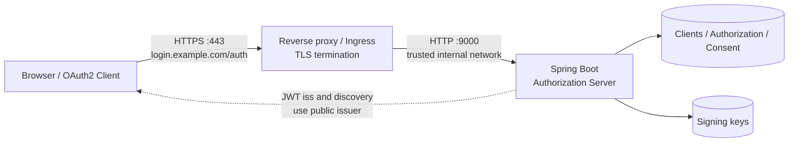
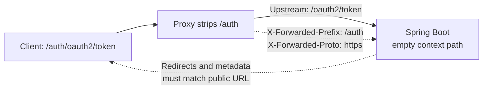

# Determining Base URL with Context Path, Reverse Proxy, and TLS Termination

## 1. Why Is Base URL a Security Concern for an Authorization Server?

A Spring Boot application may listen at `http://127.0.0.1:9000` while users and OAuth 2.0/OpenID Connect (OIDC) Clients access it exclusively via `https://login.example.com/auth`. Between those two addresses, there may be a **reverse proxy**, **path rewrite** rules, a **servlet context path**, and a **TLS termination** boundary.

If the server confuses its internal URL with the public URL, the system can suffer from errors such as:

- The login page redirects to `http://127.0.0.1:9000` or an internal hostname.
- Metadata publishes unreachable `authorization_endpoint`, `token_endpoint`, or `jwks_uri` URLs.
- Access tokens/ID tokens carry an `iss` claim different from the issuer trusted by Clients/Resource Servers.
- Paths omit the `/auth` prefix or duplicate it into `/auth/auth`.
- Session cookies receive the wrong `Secure` or `Path` attribute, causing lost sessions and login loops.

In the **Server Configuration** chapter of the `SPRING_SECURITY_OAUTH2_OIDC_AUTHORIZATION_SERVER` module, this lesson focuses on designing, configuring, securing, testing, and operating the **public base URL** with Spring Security and Spring Authorization Server on Spring Boot.

After this lesson, you will be able to distinguish public origin, issuer, context path, and endpoint path; choose the right proxy layout; handle forwarded headers safely; and verify discovery, redirects, JWTs, JWKS, and cookies when TLS terminates in front of the application.

## 2. Distinguishing URL Types Before Configuring

| Concept | Example | Meaning |
| --- | --- | --- |
| **Public origin** | `https://login.example.com` | Scheme, host, and port used by external clients |
| **Public base URL** | `https://login.example.com/auth` | Public URL of the service, including any path prefix |
| **Issuer** | `https://login.example.com/auth` | Security identifier of the Authorization Server in tokens and metadata |
| **Servlet context path** | `/auth` | Prefix used by the container to locate the Spring Boot application |
| **Endpoint path** | `/oauth2/token` | Relative path per Authorization Server protocol settings |
| **External token URL** | `https://login.example.com/auth/oauth2/token` | Actual address called by OAuth2 Clients |
| **Upstream URL** | `http://127.0.0.1:9000/auth/oauth2/token` | Address used by the proxy to reach Spring Boot |
| **Client redirect URI** | `https://app.example.com/login/oauth2/code/orders-web` | Where the browser returns after the user grants authorization |

**Public base URL** and **issuer** often have the same value, yet different meanings. The issuer is an identifier string matched strictly against the `iss` claim and metadata; it should not be constructed dynamically from each request's hostname. **Client redirect URI** belongs to the client application and is completely separate from the Authorization Server's `/oauth2/authorize` endpoint.

When `server.servlet.context-path=/auth` and the endpoint path is `/oauth2/token`, the expected external path is `/auth/oauth2/token`. Do not add `/auth` a second time inside `AuthorizationServerSettings.tokenEndpoint(...)` when the context path or proxy already handles it.

**Key rule:** Choose one **canonical public issuer** comprising the HTTPS scheme, hostname, port if non-default, required path, and trailing-slash convention. Keep that value identical across every instance.

## 3. Architecture with TLS Termination



The browser sees only HTTPS. Spring Boot may receive internal HTTP, so from the raw upstream connection alone it cannot know the public scheme, host, port, and URL prefix. The proxy supplies this information via `Forwarded` (RFC 7239) or `X-Forwarded-Proto`, `X-Forwarded-Host`, `X-Forwarded-Port`, and `X-Forwarded-Prefix`.

Only use HTTP between the proxy and the application if the internal network is genuinely isolated and satisfies security requirements. If internal hops cross untrusted zones or policy requires it, use TLS/mTLS for that leg as well.

## 4. Three Routing Models to Distinguish

Assume clients always call `https://login.example.com/auth/oauth2/token`.

| Model | URI outside proxy | URI into Spring Boot | `server.servlet.context-path` |
| --- | --- | --- | --- |
| **A. Proxy keeps prefix** | `/auth/oauth2/token` | `/auth/oauth2/token` | `/auth` |
| **B. Proxy strips prefix** | `/auth/oauth2/token` | `/oauth2/token` | Empty |
| **C. No public prefix** | `/oauth2/token` | `/oauth2/token` | Empty |

In Model C, the issuer can be `https://login.example.com`. When the Authorization Server has its own dedicated hostname, this is usually the simplest option. Model A fits when the application intentionally owns its context path; Model B fits when the gateway/ingress must rewrite paths.

**Two symmetric mistakes** commonly cause 404s: the proxy strips `/auth` while the servlet still requires context `/auth`, or the proxy keeps `/auth` while the application runs at root without matching prefix handling.

## 5. Model A: Proxy Keeps Prefix, Application Has Context Path

### 5.1. Spring Boot Configuration

```yaml
# application.yml - Spring Boot 3.x example
server:
  port: 9000
  servlet:
    context-path: /auth
    session:
      cookie:
        secure: true
        http-only: true
        same-site: lax
  forward-headers-strategy: framework

app:
  oauth2:
    issuer: https://login.example.com/auth
```

`app.oauth2.issuer` is a **custom-defined** property in the application. Spring Boot does not automatically convert it into the Authorization Server issuer; you must provide an `AuthorizationServerSettings` bean:

```java
import org.springframework.context.annotation.Bean;
import org.springframework.context.annotation.Configuration;
import org.springframework.core.env.Environment;
import org.springframework.security.oauth2.server.authorization.settings.AuthorizationServerSettings;

@Configuration
class IssuerConfiguration {

    @Bean
    AuthorizationServerSettings authorizationServerSettings(
            Environment environment) {
        String publicIssuer =
                environment.getRequiredProperty("app.oauth2.issuer");

        return AuthorizationServerSettings.builder()
                .issuer(publicIssuer)
                .build();
    }
}
```

The example uses the **Spring Authorization Server 1.x** API. If your project uses another Spring Security line integrating Authorization Server, verify the package/API for your version. Place the issuer in environment configuration and manage it as a controlled-change value rather than assembling it from the running hostname.

`server.forward-headers-strategy=framework` instructs Spring to process forwarded headers via the framework mechanism. Enable this only when the application receives requests through a managed proxy. `cookie.secure=true` instructs browsers to send the session cookie only over HTTPS even though the backend speaks HTTP. `SameSite=Lax` suits most top-level navigation flows, though response modes using cross-site POST may require a different cookie policy; always test actual flows.

### 5.2. Nginx Example Keeping the URI Intact

```nginx
# Illustrative configuration snippet for an HTTPS virtual host
server {
    listen 443 ssl;
    server_name login.example.com;

    ssl_certificate     /etc/nginx/certs/login.example.com.crt;
    ssl_certificate_key /etc/nginx/certs/login.example.com.key;

    location /auth/ {
        # NO trailing "/" after the port: preserves /auth/... to upstream.
        proxy_pass http://127.0.0.1:9000;

        # Proxy overwrites public info instead of trusting client headers.
        proxy_set_header Host login.example.com;
        proxy_set_header X-Forwarded-Host login.example.com;
        proxy_set_header X-Forwarded-Proto https;
        proxy_set_header X-Forwarded-Port 443;

        # Reject spoofed Forwarded/Prefix headers from clients.
        proxy_set_header Forwarded "";
        proxy_set_header X-Forwarded-Prefix "";

        # Use X-Forwarded-For only with a trusted proxy chain policy.
        proxy_set_header X-Forwarded-For $proxy_add_x_forwarded_for;
    }
}
```

This configuration is a **routing illustration**; add HTTP→HTTPS redirection, real certificate management, logging, and upstream protection according to your environment. Model A **does not need** `X-Forwarded-Prefix=/auth` when the upstream URI already keeps `/auth` and the servlet declares that context; sending both can trigger unintended prefix duplication.

Expected path resolution:

```text
Browser:  https://login.example.com/auth/oauth2/authorize
  -> Nginx:     /auth/oauth2/authorize
  -> Upstream:  http://127.0.0.1:9000/auth/oauth2/authorize
  -> Context:   /auth
  -> Endpoint:  /oauth2/authorize
  -> Login:     https://login.example.com/auth/login (if needed)
```

Test both `/auth` and `/auth/` if the application allows users to visit the root page; many proxies have rules that redirect to append a trailing slash. Ensure that behavior does not cause an infinite redirect loop.

## 6. Model B: Proxy Strips Prefix, Application Runs at Root

### 6.1. When to Use?

Suppose Nginx receives `/auth/oauth2/token` and forwards `/oauth2/token` to the backend. Spring Boot no longer sees `/auth` in the request path; therefore **do not** set `server.servlet.context-path=/auth`.



```yaml
server:
  port: 9000
  # Do not set servlet.context-path: /auth
  forward-headers-strategy: framework

app:
  oauth2:
    issuer: https://login.example.com/auth
```

The `AuthorizationServerSettings` bean still retains the public issuer. Omitting `/auth` upstream does **not** mean JWTs should carry an issuer without `/auth`.

### 6.2. Nginx Example Stripping Prefix

```nginx
location /auth/ {
    # Trailing "/" on proxy_pass: /auth/oauth2/token -> /oauth2/token.
    proxy_pass http://127.0.0.1:9000/;

    proxy_set_header Host login.example.com;
    proxy_set_header X-Forwarded-Host login.example.com;
    proxy_set_header X-Forwarded-Proto https;
    proxy_set_header X-Forwarded-Port 443;
    proxy_set_header X-Forwarded-Prefix /auth;
    proxy_set_header Forwarded "";
}
```

`X-Forwarded-Prefix` must be populated by the **proxy**, never taken from the browser. With Spring Boot, `server.forward-headers-strategy=framework` is typically appropriate when Spring needs to handle prefixes; the servlet container's `native` strategy may handle scheme/host yet fall short on environment-specific path prefixes.

Even so, do not assume every URL works automatically: hard-coded paths in HTML (`href="/login"`), controllers manually building URLs, cookie paths, and discovery metadata might still break. If the app runs at root, default session cookies may have `Path=/`; consider scoping `server.servlet.session.cookie.path` to `/auth` if appropriate and verify cookies are still sent on login/callback.

### 6.3. Issuer Does Not Replace Forwarded Headers

Setting an explicit issuer ensures tokens/metadata use a consistent identifier. However, issuer configuration **does not guarantee** MVC, login entry points, logout, consent pages, and generated redirect URLs have the right scheme/host/path. You must simultaneously verify:

1. Public URLs routed by the proxy.
2. How Spring processes `Forwarded`/`X-Forwarded-*`.
3. Context path and custom controllers/views.
4. Session cookies and browser redirect steps.

## 7. Configuring Issuer, Protocol Endpoints, and Metadata

### 7.1. AuthorizationServerSettings

In Spring Authorization Server 1.x, `AuthorizationServerSettings` defines the issuer and endpoint paths. Example:

```java
@Bean
AuthorizationServerSettings authorizationServerSettings() {
    return AuthorizationServerSettings.builder()
            .issuer("https://login.example.com/auth")
            .authorizationEndpoint("/oauth2/authorize")
            .tokenEndpoint("/oauth2/token")
            .jwkSetEndpoint("/oauth2/jwks")
            .build();
}
```

If proxy and context path are routed properly per Model A or B, expected public URLs are:

| Component | URL |
| --- | --- |
| Issuer | `https://login.example.com/auth` |
| Authorization endpoint | `https://login.example.com/auth/oauth2/authorize` |
| Token endpoint | `https://login.example.com/auth/oauth2/token` |
| JWKS | `https://login.example.com/auth/oauth2/jwks` |
| Login UI in same app | `https://login.example.com/auth/login` |

Do not set endpoint paths to `/auth/oauth2/token` just because the issuer includes `/auth`. Endpoint paths in the DSL and prefix handling at the proxy/container must be managed independently.

### 7.2. Two Different Discovery Rules When Issuer Has a Path

For the issuer `https://login.example.com/auth`, the specifications define `.well-known` locations as follows:

| Standard | Standard discovery URL |
| --- | --- |
| **RFC 8414** — OAuth 2.0 Authorization Server Metadata | `https://login.example.com/.well-known/oauth-authorization-server/auth` |
| **OIDC Discovery 1.0** | `https://login.example.com/auth/.well-known/openid-configuration` |

This detail is easy to miss. **RFC 8414 inserts `/.well-known/oauth-authorization-server` before the issuer's path**, whereas OIDC Discovery appends `/.well-known/openid-configuration` after the issuer's path.

In particular, in **Model A** with servlet context `/auth`, the RFC 8414 URL sits **outside** the `/auth` context path. Therefore, the proxy/ingress and framework version must have a way to serve the standard metadata path, possibly needing a **dedicated route for well-known metadata**. Routing only `location /auth/` while ignoring `/.well-known/.../auth` can cause OAuth discovery to return 404 even when the token endpoint works fine.

The actual metadata paths served by the framework and support for issuers with path components must be verified per version. If an endpoint does not yet support the standard path, handle compatibility proactively rather than assuming Spring creates every route automatically or altering metadata to a non-existent URL. OIDC discovery is only needed when OIDC is enabled.

A consistent metadata response must contain:

```json
{
  "issuer": "https://login.example.com/auth",
  "authorization_endpoint": "https://login.example.com/auth/oauth2/authorize",
  "token_endpoint": "https://login.example.com/auth/oauth2/token",
  "jwks_uri": "https://login.example.com/auth/oauth2/jwks"
}
```

This is an **illustrative excerpt** of fields to check, not a complete standards-compliant metadata document. Actual values also depend on enabled endpoints and version-specific settings.

### 7.3. Issuer on the Client and Resource Server

JWT access tokens or ID tokens carry the `iss` claim; the OIDC Client verifies the ID token's issuer, while the Resource Server must verify the access token's issuer when accepting JWTs. Example configuration on a **separate API application**:

```yaml
spring:
  security:
    oauth2:
      resourceserver:
        jwt:
          issuer-uri: https://login.example.com/auth
```

The `issuer-uri` value must match metadata and the `iss` claim **exactly**, including the path and any trailing slash. `https://login.example.com/auth` and `https://login.example.com/auth/` are two distinct strings. The API must also check audience (`aud`) when required, scopes, and resource access permissions; a valid issuer alone is insufficient.

Never weaken issuer checks or accept arbitrary issuers to mask proxy configuration bugs.

## 8. Forwarded Headers and Trust Boundaries

### 8.1. Common Headers

| Header | Function | Example |
| --- | --- | --- |
| `Forwarded` | RFC 7239 standard header describing `for`, `host`, `proto` | `proto=https;host=login.example.com` |
| `X-Forwarded-Proto` | External scheme | `https` |
| `X-Forwarded-Host` | External host | `login.example.com` |
| `X-Forwarded-Port` | External port | `443` |
| `X-Forwarded-Prefix` | External path prefix, commonly when proxy strips prefix | `/auth` |
| `X-Forwarded-For` | IP address chain across proxies | `203.0.113.5` (illustrative) |

Headers can conflict if multiple proxies set both `Forwarded` and `X-Forwarded-*`. Establish a clear rule at the edge specifying **which headers are authoritative**; never let Internet requests dictate the hostname, scheme, or prefix the application uses.

### 8.2. `server.forward-headers-strategy`

| Value | General behavior | When appropriate |
| --- | --- | --- |
| `none` | Does not process forwarded headers automatically | No trusted proxy or handled entirely by another mechanism |
| `native` | Uses servlet container mechanism, e.g., Tomcat | Proxy/container configured properly for host/proto; verify prefix handling capabilities |
| `framework` | Uses Spring mechanism, typically via `ForwardedHeaderFilter` | Need to handle scheme/host and `X-Forwarded-Prefix` |

**`framework` does not verify that headers are trustworthy.** Enable it only when the backend is blocked from direct untrusted network access and the ingress strips/overwrites client-sent headers. If you manually register an extra `ForwardedHeaderFilter` alongside Boot's auto-configuration, verify you do not apply it twice or receive conflicting values.

### 8.3. Host Header Injection Risk

Suppose an external request carries these headers:

```http
GET /auth/oauth2/authorize HTTP/1.1
Host: login.example.com
X-Forwarded-Host: attacker.example
X-Forwarded-Proto: http
```

If the backend trusts values not sanitized by the proxy, redirects/links generated from the request may point to an unintended host. Mitigations include: restricting valid hosts at ingress, having the proxy overwrite forwarded headers, disallowing direct access to the backend, and keeping `AuthorizationServerSettings.issuer` fixed.

Never take an unvalidated `X-Forwarded-Host` or `request.getServerName()` as a dynamic issuer per request. Issuing tokens with varying issuers breaks the trust boundary between the Authorization Server and APIs.

## 9. What Does TLS Termination Affect?

**TLS termination** can cause an internal HTTP application to misread the actual protocol exposed on the Internet. Check at least these areas:

1. **Redirect URLs:** When unaware of the external scheme, the application may emit `Location: http://...` or trigger HTTP→HTTPS redirect loops.
2. **Session cookies:** Browsers need cookies with `Secure`, `HttpOnly`, `Path`, and `SameSite` compatible with login, authorize, and callbacks. `SameSite=Strict` can break certain redirect-based login flows; `SameSite=None` requires `Secure`.
3. **Forms/CSRF:** Login and consent forms must submit to the right origin/path; never disable CSRF application-wide just to work around proxy issues.
4. **OIDC and OAuth metadata:** Clients require external HTTPS endpoints. Never emit `http://127.0.0.1:9000` in discovery or client documentation.
5. **Proxy→backend leg:** Protect or encrypt appropriately for the network zone, manage certificates, coordinate hostnames, and restrict upstream access.
6. **HSTS:** Enable at the proxy once all hostnames in scope are HTTPS-ready; avoid uncontrolled HSTS scope changes.

When multiple hops exist—CDN → WAF → ingress → backend—identify which hop terminates TLS and which hop is authorized to set `proto`/`host`. Never assume headers added by any arbitrary hop are inherently trustworthy.

## 10. Common Errors and Diagnostic Methods

| Symptom | Possible cause | How to check |
| --- | --- | --- |
| `404` at `/auth/oauth2/token` | Proxy strips prefix yet app expects `/auth`; or proxy keeps prefix yet app does not handle it | Log URIs at client, proxy, upstream, and context path |
| `Location: http://127.0.0.1:9000/...` | Scheme/host taken from upstream | Check forwarded proto/host, Boot config, and redirect-generating code |
| Login redirects to `/login` instead of `/auth/login` | Prefix stripped without handling `X-Forwarded-Prefix` | Check filters, MVC URL builders, form actions, and hard-coded links |
| Path becomes `/auth/auth` | Prefix applied twice | Pick Model A or B and remove the duplicate prefix |
| 302 loop on login | Cookie has wrong `Path`/`Secure`/`SameSite`, lost session, or wrong scheme | Inspect `Set-Cookie`, `Cookie`, and `Location` in the Network tab |
| `invalid_redirect_uri` | OAuth Client callback URI does not match registration | Compare redirect URI in client registration |
| JWT rejected with `Invalid issuer` | `iss` differs from `issuer-uri` or metadata | Compare exact issuer strings, including slashes |
| OAuth metadata 404 while token endpoint 200 | Missing `.well-known` route, especially for issuers with a path | Check RFC 8414 and OIDC paths separately |
| JWKS unreachable from Internet | Wrong metadata `jwks_uri`, missing route, or missing `JWKSource` | Check `jwks_uri` and ensure only public keys are published |
| Discovery shows `http` instead of `https` | Unset issuer, wrong forwarded headers, or links built from internal request | Lock down public issuer, fix edge config, and re-measure |

A `404` can originate at the proxy **before reaching Spring**, from the servlet container **mismatching context path**, or from Spring Security **mismatching the endpoint matcher**. Use a correlation ID to join proxy and application logs instead of looking solely at status codes.

## 11. External Testing: A Repeatable Procedure

### 11.1. Lock Down the URL Contract

```text
Public origin:      https://login.example.com
Issuer:             https://login.example.com/auth
External prefix:    /auth
Authorization URL:  https://login.example.com/auth/oauth2/authorize
Token URL:          https://login.example.com/auth/oauth2/token
JWKS URL:           https://login.example.com/auth/oauth2/jwks
Client callback:    https://app.example.com/login/oauth2/code/orders-web
Internal upstream:  http://127.0.0.1:9000
Routing mode:       A (keep prefix) or B (strip prefix)
```

Include this table in deployment docs for each environment. Running only `curl localhost` does not verify TLS termination or the URLs real clients observe.

### 11.2. Check Public Metadata and JWKS

```bash
# RFC 8414: .well-known precedes the issuer path
curl -i https://login.example.com/.well-known/oauth-authorization-server/auth

# OIDC Discovery: .well-known follows the issuer path (when OIDC is enabled)
curl -i https://login.example.com/auth/.well-known/openid-configuration

# JWKS public endpoint
curl -i https://login.example.com/auth/oauth2/jwks
```

These commands succeed only if your framework version and proxy are configured to serve the standard routes; **do not conclude OIDC is broken if the project has not enabled OIDC**. Inside metadata, verify `issuer`, `authorization_endpoint`, `token_endpoint`, `jwks_uri`, and whether advertised features are actually enabled. JWKS must publish **only the public keys**, never private keys.

### 11.3. Trace the Redirect Flow

With a validly registered client, run Authorization Code + PKCE in a browser in the test environment:

```text
GET https://login.example.com/auth/oauth2/authorize?...
  -> 302 Location: https://login.example.com/auth/login
  -> user authenticates / consents
  -> 302 Location: https://app.example.com/login/oauth2/code/orders-web?code=...&state=...
  -> OAuth2 Client exchanges code at https://login.example.com/auth/oauth2/token
  -> JWT iss = https://login.example.com/auth
  -> Resource Server verifies issuer and permissions
```

Inspect `Location` and `Set-Cookie` at every step. Validate tokens with a trusted JWT verification library; never treat a self-decoded JWT payload as verified information. Never share raw authorization codes, access/refresh tokens, client secrets, or session cookies in logs or screenshots.

### 11.4. Failure Test Matrix

| Scenario | Expected result |
| --- | --- |
| Proxy keeps prefix + context `/auth` | Endpoints/login/redirects all carry the prefix once |
| Proxy strips prefix + empty context + forwarded prefix | Redirects and metadata still use exact public URLs |
| Spoofed `X-Forwarded-Host` sent from Internet | Proxy overwrites it; generated URLs never point to spoofed host |
| Direct backend access outside allowed network | Blocked by firewall/ingress |
| Disable forwarded header handling in test environment | Tests detect broken redirect/cookie URLs if dependent on headers |
| Change cookie `Path` not to match login/callback | Tests detect lost session rather than silently skipping session checks |
| Resource Server configured with issuer missing `/auth` | Token rejected; never relax issuer validation |
| Test both OAuth and OIDC metadata with path issuer | Standard paths are served or gaps are clearly detected |
| Restart app or switch nodes | Issuer/keys stay unchanged; tokens and shared-store flows continue per policy |
| Proxy changes certificate/TLS mode | Re-verify HTTPS, redirects, HSTS, and trust chain |

## 12. Operating Multiple Instances and Changing Public URLs

In distributed systems, **every Authorization Server instance must have the exact same issuer**. Signing keys should be stored durably, with rotation and synchronized public JWKS. Authorization codes, tokens, and consent state must live in a shared store or have a consistency mechanism; if a code is issued on node A and redeemed on node B, isolated in-memory stores will break the transaction.

A minimal deployment record should capture: canonical issuer; context path; proxy model A/B/C; rewrite rules; trusted source of forwarded headers; TLS termination; cookie policy; metadata routes; JWKS URL; client redirect URI list; API `issuer-uri` configs; and rollback plan.

**Changing the domain or changing `/auth` is an identity change if the issuer changes.** Clients and Resource Servers may reject existing tokens even if a 301 redirect makes the new URL reachable. Plan transitions for issuer/metadata/registration configurations and token lifetimes; never just update DNS or add a redirect and assume all tokens remain valid.

## 13. Combined Scenario

An organization has `orders-web` using OIDC Authorization Code + PKCE, `reports-service` using Client Credentials, and two APIs validating JWTs. Operations selects the public issuer `https://login.example.com/auth` with Nginx performing TLS termination.

Using **Model A**, the deployment steps are:

1. Set `server.servlet.context-path=/auth` on every Spring Boot node.
2. Nginx preserves `/auth/...`, normalizes `Host` and `X-Forwarded-Proto=https`, and allows backend access only from the proxy network.
3. Declare `AuthorizationServerSettings.issuer("https://login.example.com/auth")`; keep endpoint paths `/oauth2/token` and `/oauth2/authorize`.
4. Ensure discovery metadata with a path-based issuer is routed properly, especially RFC 8414 placing `/.well-known` before `/auth`.
5. Register `orders-web`'s real callback; configure `issuer-uri` on Resource Servers.
6. Test login, token exchange, consent, cookies, JWKS, `iss` claims, API permissions, multiple instances, and spoofed headers.

Once complete, external clients never need to know `127.0.0.1:9000`. The Authorization Server issues tokens with the public issuer; APIs validate issuer, audience, scopes, and per-resource permissions.

## 14. Key Takeaways

- **Public base URL:** Where does the service appear to external clients?
- **Context path:** Under what prefix does the Spring Boot app accept requests?
- **Proxy rewrite:** Does the path forwarded upstream preserve that prefix?
- **Issuer:** Which identifier string is published in metadata and tokens?
- **Forwarded headers:** Who is authorized to tell the backend the external scheme, host, and prefix?

To avoid bugs, lock down the HTTPS issuer first, apply the prefix **exactly once**, trust headers only from controlled proxies, verify discovery at the public URL, and test redirects/cookies from a real browser. **Correct routing is a prerequisite; client authentication, PKCE, key management, token lifecycle, and API authorization still require independent configuration.**

### References

- [Spring Authorization Server — Configuration Model](https://docs.spring.io/spring-authorization-server/reference/configuration-model.html)
- [Spring Authorization Server — Core Model Components](https://docs.spring.io/spring-authorization-server/reference/core-model-components.html)
- [Spring Boot — Web Server / Reverse Proxy Guidance](https://docs.spring.io/spring-boot/how-to/webserver.html)
- [Spring Framework — Forwarded Header Handling](https://docs.spring.io/spring-framework/reference/web/webmvc/filters.html)
- [RFC 8414 — OAuth 2.0 Authorization Server Metadata](https://www.rfc-editor.org/rfc/rfc8414)
- [OpenID Connect Discovery 1.0](https://openid.net/specs/openid-connect-discovery-1_0.html)
- [RFC 9207 — Authorization Server Issuer Identification](https://www.rfc-editor.org/rfc/rfc9207)
