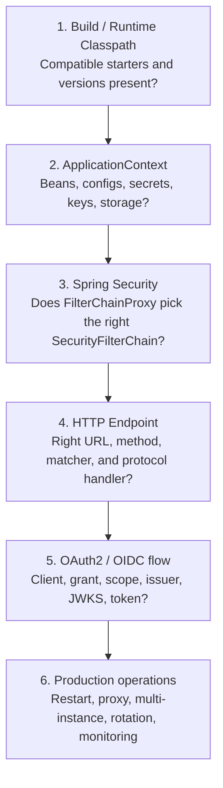
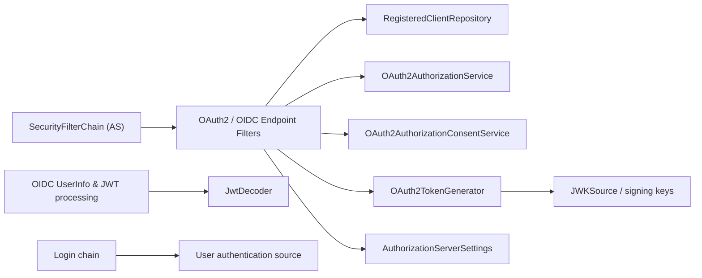

# Verifying Startup Configuration and Detecting Missing Beans or Endpoints

## 1. Why Can an Authorization Server Start Successfully Yet Still Not Work?

In the **Server Configuration** chapter of the `SPRING_SECURITY_OAUTH2_OIDC_AUTHORIZATION_SERVER` module, the goal is to verify whether Spring Boot has initialized the right components for the application to operate as an **OAuth 2.0/OpenID Connect Authorization Server**. This skill is essential when designing, configuring, securing, testing, and operating systems built on **Spring Security** and **Spring Authorization Server**.

A `Started AuthorizationServerApplication` message only confirms that the **Spring ApplicationContext initialized**. It does not prove:

- The Authorization Server has valid registered clients.
- The right `SecurityFilterChain` is handling OAuth 2.0/OIDC endpoints.
- Beans for JWT signing, authorization storage, and consent storage are properly configured.
- Required endpoints are actually exposed.
- Authorization Code + PKCE, Refresh Token, Client Credentials, or OIDC work properly.
- Metadata, issuer, JWKS, and public addresses stay consistent when running behind a reverse proxy.

For example, the application might serve `/login` normally yet return 404 on `/oauth2/token` because the Authorization Server filter chain was never wired into the system. Conversely, a request to `/oauth2/token` returning `invalid_client` can prove the endpoint received the request and rejected client authentication as designed.

**Practical objective:** diagnose in order from dependencies → beans → filter chains → endpoints → protocol flows; distinguish initialization errors from access errors enforced by security policy.

> **Version note:** the Java configuration examples below follow **Spring Boot 3.x, Spring Security 6.x, and Spring Authorization Server 1.x** on the Servlet stack. Starters, auto-configuration, API names, and bean creation conditions can change across versions. When using Spring Boot 4 or newer Spring Security/Spring Authorization Server versions, consult the documentation for the exact running version.

## 2. Six Layers to Verify



| Layer | Evidence to look for | Failure examples |
| --- | --- | --- |
| **Classpath** | `spring-boot-starter-oauth2-authorization-server` dependency resolved | `ClassNotFoundException`, library conflicts |
| **Bean** | Context has required components for selected configuration | `UnsatisfiedDependencyException`, missing repository/JWK |
| **Security filter** | Request matches Authorization Server chain, then handled by endpoint filters | Application filter chain catches all requests, returning HTML login instead of JSON |
| **HTTP endpoint** | Correct URL + method produces valid protocol response | `404` from missing endpoint, `405` from wrong method |
| **Protocol** | Valid client can execute grant; tokens verify properly | `invalid_client`, `invalid_grant`, issuer/audience mismatch |
| **Runtime** | Signing keys and state behave consistently across restarts/deployments | Old JWTs fail verification after random key change |

Do not jump straight from `404` to concluding a dependency is missing. Confirm the request actually reaches the right application, right context path, and right security chain.

## 3. Preflight: Dependencies, Web Stack, and Environment Configuration

### 3.1. Verify the Application's Role

With Spring Boot, an Authorization Server normally starts from:

```text
org.springframework.boot:spring-boot-starter-oauth2-authorization-server
```

This is not `spring-boot-starter-oauth2-client` (client logging in/calling resources) or `spring-boot-starter-oauth2-resource-server` (API validating bearer tokens). One application can combine multiple roles, but each role needs its own configuration.

Spring Authorization Server uses the **Servlet** architecture built on Spring Security. If you only include WebFlux/Reactive Security and copy Servlet `HttpSecurity` configuration, the application will not automatically get an equivalent Authorization Server pipeline.

Prerequisites to verify first:

1. JDK, Spring Boot, Spring Security, and Spring Authorization Server are in a compatible combination; prefer Spring Boot's BOM.
2. A web runtime exists and `@SpringBootApplication` scans the right packages.
3. No Spring Security dependency version is unintentionally overridden separately.
4. Port, context path, active profiles, and issuer are read from the right environment.
5. Required environment variables/secrets, databases, certificates, or key stores are ready; **never print secret values to logs**.

Developer inspection commands (choose Maven **or** Gradle matching your project):

```bash
# Maven
./mvnw -version
./mvnw dependency:tree -Dincludes=org.springframework.security:spring-security-oauth2-authorization-server
./mvnw spring-boot:run -Dspring-boot.run.arguments=--debug

# Gradle
./gradlew --version
./gradlew dependencyInsight --configuration runtimeClasspath --dependency spring-security-oauth2-authorization-server
./gradlew bootRun --args='--debug'
```

`--debug` enables Spring Boot's **Condition Evaluation Report**, showing which auto-configurations applied or backed off and why. Never enable full DEBUG logging for security libraries in production. On Windows you can use `mvnw.cmd` and `gradlew.bat`.

### 3.2. Distinguishing Three Commonly Confused Configuration Styles

| Configuration style | Meaning | What to verify |
| --- | --- | --- |
| **Spring Boot auto-configuration** | Boot creates beans when version, classpath, property, and missing-custom-bean conditions are met | Bean creation conditions and client/configuration property values |
| **Manual configuration with `OAuth2AuthorizationServerConfigurer`** | Application explicitly registers filter chains and extension points | AS chain, foundational beans, and not shadowed by another chain |
| **Combining auto-config with user-supplied beans** | Boot typically backs off where custom beans exist | Whether overriding beans drops expected default configuration |

**Do not rely on one rigid bean list across all versions.** Some beans may be provided by default by the framework/Boot, while others depend on whether OIDC or extension features are enabled. What matters is **identifying which beans are actually active in the running application**, rather than merely knowing the class exists on the classpath.

## 4. Beans and Components You Must Know to Diagnose

| Bean / component | Role | Signs to inspect |
| --- | --- | --- |
| `RegisteredClientRepository` | Stores and looks up client configs (`client_id`, grants, redirect URIs, scopes, authentication method) | No matching client, `invalid_client`, bean not found when required by custom config |
| `OAuth2AuthorizationService` | Stores authorization codes, access tokens, refresh tokens, and transaction state | Code lookup fails, tokens lost after restart or across nodes |
| `OAuth2AuthorizationConsentService` | Stores user consent approvals for clients | Repeated consent prompts or not persisted as expected |
| `AuthorizationServerSettings` | Issuer and Authorization Server endpoint paths | Metadata has wrong URLs; path customized while clients still call old path |
| `JWKSource<SecurityContext>` | Supplies JWK keys for JWT signing and publishes matching public keys | Cannot issue JWT/ID Token; JWKS endpoint missing or lacks expected key |
| `JwtDecoder` | Validates JWTs in features needing a decoder, especially parts of OIDC | OIDC or JWT Resource Server filter fails to initialize or operate |
| `OAuth2TokenGenerator<?>` | Generates access tokens and related tokens per policy | Custom generator fails to handle target token type |
| `SecurityFilterChain` | Binds OAuth2/OIDC filters and security rules to requests | Endpoints unmatched or handled by another chain |
| `AuthenticationProvider` / `AuthenticationManager` | Validates clients, grants, and authenticates users per case | Authentication fails even though request reached the endpoint |
| User login mechanism | E.g., form login, identity provider, MFA, `UserDetailsService` per architecture | Browser cannot log in or loops redirecting to `/login` |

**Distinguish "needed in the architecture" from "must always be declared as a manual `@Bean`."** For example, a minimal setup may use in-memory storage services provided by the framework; production may require JDBC or another store declared by the application. Likewise, key generation and `JwtDecoder` provisioning vary by active configuration.

### 4.1. Commonly Forgotten Dependencies

Simplified reference model:



The diagram shows **functional relationships**, not an exact constructor-injection graph. For instance, endpoint filters typically pass through `AuthenticationManager` and `AuthenticationProvider` implementations before providers invoke repositories/services or token generators.

### 4.2. Common Missing-Bean Errors at Startup

A failed startup log may contain:

```text
APPLICATION FAILED TO START

Description:
Parameter 0 of method someBean ... required a bean of type
'org.springframework.security.oauth2.server.authorization.client.RegisteredClientRepository'
that could not be found.
```

This is an **illustrative log**, not a mandatory framework method name. How to handle it:

1. Read the deepest `Caused by` and the bean name being instantiated when the failure occurred.
2. Check whether the bean is declared, covered by component scan, or conditionally created (`@Profile`, `@ConditionalOnProperty`).
3. If relying on Boot auto-configuration, inspect the Condition Evaluation Report to see why the bean was not created.
4. If the bean depends on an external system, check connectivity and permissions before trying to stub a replacement bean.
5. Never blindly add a duplicate `@Bean` or an in-memory bean into production just to get past startup.

`NoSuchBeanDefinitionException` differs from `NoUniqueBeanDefinitionException` (multiple beans of the same type, unable to resolve which to use). For duplicate-bean errors, check `@Primary`, `@Qualifier`, and auto-configuration strategy before editing.

## 5. Reference SecurityFilterChain Template

In a standard Servlet-based Spring Authorization Server setup, have a **chain handling Authorization Server endpoints** and an **application chain** for user login. Abbreviated example:

```java
import org.springframework.context.annotation.Bean;
import org.springframework.context.annotation.Configuration;
import org.springframework.core.annotation.Order;
import org.springframework.http.MediaType;
import org.springframework.security.config.Customizer;
import org.springframework.security.config.annotation.web.builders.HttpSecurity;
import org.springframework.security.oauth2.server.authorization.config.annotation.web.configurers.OAuth2AuthorizationServerConfigurer;
import org.springframework.security.web.SecurityFilterChain;
import org.springframework.security.web.authentication.LoginUrlAuthenticationEntryPoint;
import org.springframework.security.web.util.matcher.MediaTypeRequestMatcher;

@Configuration
class SecurityChains {

    @Bean
    @Order(1)
    SecurityFilterChain authorizationServerSecurityFilterChain(HttpSecurity http)
            throws Exception {
        OAuth2AuthorizationServerConfigurer as =
                OAuth2AuthorizationServerConfigurer.authorizationServer();

        http.securityMatcher(as.getEndpointsMatcher())
                .with(as, configurer -> configurer
                        .oidc(Customizer.withDefaults()))
                .authorizeHttpRequests(authorize ->
                        authorize.anyRequest().authenticated())
                .exceptionHandling(exceptions ->
                        exceptions.defaultAuthenticationEntryPointFor(
                                new LoginUrlAuthenticationEntryPoint("/login"),
                                new MediaTypeRequestMatcher(MediaType.TEXT_HTML)))
                .oauth2ResourceServer(resourceServer ->
                        resourceServer.jwt(Customizer.withDefaults()));

        return http.build();
    }

    @Bean
    @Order(2)
    SecurityFilterChain applicationSecurityFilterChain(HttpSecurity http)
            throws Exception {
        http.authorizeHttpRequests(authorize ->
                        authorize.anyRequest().authenticated())
                .formLogin(Customizer.withDefaults());
        return http.build();
    }
}
```

This is a **reference template for filter chains**, not a standalone runnable Authorization Server: you still need client configuration, an authentication store, token signing, and the supporting beans noted earlier. The `oauth2ResourceServer(...jwt(...))` section is used when serving OIDC features needing Bearer Access Token validation, such as UserInfo; that also makes `JwtDecoder` a configuration item to check. If the system only needs OAuth2 without enabling OIDC, adjust the configuration accordingly.

Analysis:

- `@Order(1)` prioritizes the chain with a narrow matcher dedicated to Authorization Server endpoints.
- `as.getEndpointsMatcher()` matches the configurer's endpoints according to enabled features and declared paths.
- `@Order(2)` is the application chain, serving `/login` and handling other URLs.
- `.oidc(Customizer.withDefaults())` enables supported OIDC features; registering the `openid` scope without the OIDC configurer may not suffice.
- `MediaTypeRequestMatcher` distinguishes HTML browser requests that should redirect to login from protocol requests that must receive standards-compliant errors.

**Note:** The first `SecurityFilterChain` that **matches** a request is selected. When an application chain uses a broad matcher with higher priority, Authorization Server filters may never execute. Conversely, an endpoint may exist yet legitimately return `401/403` when the caller is not authorized.

### 5.1. Not Every OAuth2 Endpoint Is a Spring MVC Controller

Spring Security filters process requests **before** reaching `DispatcherServlet`. Therefore, inspecting `@RequestMapping` lists, `RequestMappingHandlerMapping`, or `/actuator/mappings` and seeing no `/oauth2/token` is **not sufficient to conclude the endpoint is missing**. You must inspect `FilterChainProxy`, chain matchers, and test with protocol-valid HTTP requests.

## 6. Inspecting Created Beans Without Exposing Secrets

### 6.1. Reading the Condition Evaluation Report

Start locally with `--debug` and look for:

- Authorization Server/Security configurations that matched or did not match.
- Whether classpath, property, servlet web application, and `@ConditionalOnMissingBean` conditions were met.
- Auto-configurations skipped because a custom bean already exists.
- `BeanCreationException`, `UnsatisfiedDependencyException`, and the deepest `Caused by`.

If the report states auto-configuration **did not create** `RegisteredClientRepository` due to a user-defined bean, inspect that bean before suspecting the starter.

### 6.2. A Diagnostic ApplicationRunner Exclusively for Local Environments

You can temporarily add the following class to the **test application source** and enable it only under the `diagnostics` profile. It prints bean names and filter chain descriptions without printing tokens or secrets:

```java
import java.util.Arrays;
import java.util.LinkedHashMap;
import java.util.Map;

import org.springframework.boot.ApplicationRunner;
import org.springframework.context.ApplicationContext;
import org.springframework.context.annotation.Bean;
import org.springframework.context.annotation.Configuration;
import org.springframework.context.annotation.Profile;
import org.springframework.security.oauth2.jwt.JwtDecoder;
import org.springframework.security.oauth2.server.authorization.client.RegisteredClientRepository;
import org.springframework.security.oauth2.server.authorization.OAuth2AuthorizationService;
import org.springframework.security.oauth2.server.authorization.OAuth2AuthorizationConsentService;
import org.springframework.security.oauth2.server.authorization.settings.AuthorizationServerSettings;
import org.springframework.security.web.FilterChainProxy;
import org.springframework.security.web.SecurityFilterChain;
import com.nimbusds.jose.jwk.source.JWKSource;

@Configuration(proxyBeanMethods = false)
@Profile("diagnostics")
class AuthorizationServerBeanDiagnostics {

    @Bean
    ApplicationRunner reportSecurityBeans(ApplicationContext context) {
        return args -> {
            Map<String, Class<?>> types = new LinkedHashMap<>();
            types.put("SecurityFilterChain", SecurityFilterChain.class);
            types.put("RegisteredClientRepository", RegisteredClientRepository.class);
            types.put("OAuth2AuthorizationService", OAuth2AuthorizationService.class);
            types.put("OAuth2AuthorizationConsentService", OAuth2AuthorizationConsentService.class);
            types.put("AuthorizationServerSettings", AuthorizationServerSettings.class);
            types.put("JwtDecoder", JwtDecoder.class);
            types.put("JWKSource", JWKSource.class);

            types.forEach((label, type) ->
                    System.out.printf("%s: %s%n", label,
                            Arrays.toString(context.getBeanNamesForType(type))));

            context.getBeansOfType(FilterChainProxy.class).forEach((name, proxy) -> {
                System.out.printf("FilterChainProxy: %s%n", name);
                int index = 0;
                for (SecurityFilterChain chain : proxy.getFilterChains()) {
                    System.out.printf("  chain[%d]: %s%n", ++index, chain);
                }
            });
        };
    }
}
```

Compare the output list against the features you enabled. **Not every configuration must have exactly one bean of every type**, and some default components may be created internally by the framework rather than appearing as standalone beans in `ApplicationContext`. An empty list is a signal to investigate **within your specific configuration context**, not proof that the system is definitely broken.

Enable the profile with:

```bash
./mvnw spring-boot:run -Dspring-boot.run.arguments=--spring.profiles.active=diagnostics
```

With Gradle, use `./gradlew bootRun --args='--spring.profiles.active=diagnostics'`. After diagnosing, disable the profile and remove unnecessary debug code from the deployed application.

### 6.3. Can Actuator Help?

If the project includes Spring Boot Actuator, the `health`, `beans`, `conditions`, and `mappings` endpoints can aid diagnostics. However:

- Sensitive endpoints may not be exposed over HTTP by default; configure them selectively for dev environments.
- `beans` and `conditions` reveal the **ApplicationContext/auto-configuration** perspective.
- `mappings` does not always list endpoints implemented by Servlet filters.
- Never expose `/actuator/beans`, `/actuator/conditions`, internal configs, or secret info to the public Internet.

## 7. Verifying Endpoints with Protocol-Valid Requests

### 7.1. Reference Endpoint Table

The paths below are **common defaults** of Spring Authorization Server; they can be changed via `AuthorizationServerSettings`. Availability depends on enabled features and configured beans.

| Endpoint | Typical HTTP method | Expected when properly configured |
| --- | --- | --- |
| `/oauth2/authorize` | `GET` | Handles authorization requests; may redirect to `/login` or return an OAuth error if request is invalid |
| `/oauth2/token` | `POST` | Handles grants; requests with missing/wrong client may be rejected per OAuth2 |
| `/oauth2/jwks` | `GET` | Publishes **public** keys for token verification when a matching JWK source exists |
| `/oauth2/introspect` | `POST` | Accepts introspection requests; typically requires client authentication |
| `/oauth2/revoke` | `POST` | Accepts token revocation requests; typically requires client authentication |
| `/.well-known/oauth-authorization-server` | `GET` | OAuth Authorization Server metadata, when metadata endpoint is supported/enabled |
| `/.well-known/openid-configuration` | `GET` | OIDC Discovery metadata when OIDC is enabled |
| `/userinfo` | `GET` or `POST` per supported mode | OIDC UserInfo; requires an appropriate Access Token |
| `/login` | `GET`, `POST` | User login; provided by the application's login configuration |

Additional endpoints such as device authorization/verification, logout, and client registration may appear depending on version, features, and security configuration. Do not treat the absence of an **unenabled** endpoint as an initialization failure.

### 7.2. Local Smoke Test Commands

Suppose the local application runs at `http://localhost:9000` with its matching issuer configured:

```bash
# OIDC metadata: expect 200 only if OIDC has been enabled.
curl -i http://localhost:9000/.well-known/openid-configuration

# JWKS: expect valid response only when AS has a matching key/JWK source configured.
curl -i http://localhost:9000/oauth2/jwks

# A POST missing client authentication: expect a controlled OAuth2 error;
# do not expect this request to issue an access token.
curl -i -X POST http://localhost:9000/oauth2/token \
  -H "Content-Type: application/x-www-form-urlencoded" \
  --data-urlencode "grant_type=client_credentials"
```

**How to interpret results:**

| Result | Likely valid interpretation | Next step |
| --- | --- | --- |
| `200` and JSON with `issuer`, `jwks_uri` at discovery | OIDC Discovery is being served | Compare issuer/URIs with external values and verify real tokens |
| `200` and `keys` at JWKS | Endpoint publishing JWKs exists | Verify only public keys appear and `kid`/algorithm match tokens |
| `400`/`401` with `invalid_client` or OAuth2 error from Token Endpoint | Request likely reached the right filter and was validly rejected | Test with a real registered client, valid grant, and scope |
| `302` to `/login` when calling Authorization Endpoint from browser | Likely a valid user login step | Log in and follow redirect/consent |
| `302` to `/login` for a POST token request | Likely wrong chain order or HTML entry point intercepting the request | Check chain ordering and response handlers |
| `404` | Wrong path, wrong context path/proxy, unenabled endpoint, or missing filter | Check matchers, `AuthorizationServerSettings`, and proxy routes |
| `405` | Likely right URL but unsupported HTTP method | Retry with the right method before investigating dependencies |
| `500` | Unexpected error during processing | Read internal stack trace; never return traces to clients |

Never apply the rule "any status other than 404 proves the endpoint exists": a broad security chain can still return `401/302` for a URL with no handler. Compare **body/headers, which chain ran, and a valid request**.

### 7.3. Verifying Consistent OIDC Metadata

A discovery response usually contains fields similar to:

```json
{
  "issuer": "https://auth.example.com",
  "authorization_endpoint": "https://auth.example.com/oauth2/authorize",
  "token_endpoint": "https://auth.example.com/oauth2/token",
  "jwks_uri": "https://auth.example.com/oauth2/jwks",
  "response_types_supported": ["code"]
}
```

This is an **illustrative excerpt**, not the full field list of a discovery document. When running behind a proxy:

1. `issuer` must be the URL trusted by clients/resource servers, with consistent scheme/host/port/path.
2. Published endpoints must be reachable from the client's network.
3. JWKS must publish public keys matching token signatures; `kid` must point to the active key.
4. Forwarded header configuration must trust only controlled proxies; never blindly trust `X-Forwarded-*` sent by untrusted clients.
5. Never change the issuer between deployments without a client and token migration plan.

Example of configuring a fixed issuer in Java:

```java
@Bean
AuthorizationServerSettings authorizationServerSettings() {
    return AuthorizationServerSettings.builder()
            .issuer("https://auth.example.com")
            .build();
}
```

Use the real environment URL (for instance, a local issuer must not be declared as the production host). A system can **start normally yet have every OIDC client reject ID Tokens** if the issuer in metadata and the `iss` claim do not match what clients configured.

## 8. Diagnosing Startup and Runtime Errors by Symptom

### 8.1. `UnsatisfiedDependencyException` / `NoSuchBeanDefinitionException`

**Symptom:** Boot stops before printing `Started ...`; the log points to a missing bean.

**Common causes:** missing `RegisteredClientRepository`, missing `JwtDecoder` when JWT resource server/OIDC is enabled, missing `JWKSource` bean or token signing setup, custom storage components, or a bean existing only in another profile. Sometimes the root cause is **another bean's constructor throwing an exception**, rather than a completely absent bean definition.

**Remediation:** read `Caused by` and the Condition Evaluation Report; check annotation scanning, `@Bean`, profiles, dependencies, and secrets. Fix the **root cause** instead of adding dummy beans just to get the context to boot.

### 8.2. `BeanCreationException` When Configuring JWK, JWT, or Signing Keys

**Symptom:** key parsing errors, missing algorithm, `JwtDecoder`/encoder fails to initialize, or token signing fails.

**What to check:** PEM/JWK format, key ID (`kid`), algorithm, matching private/public key pair, keystore/KMS read permissions, secrets/certificates, and key lifecycle. The public JWK set served to clients must never accidentally contain private key material.

For local demos, some examples generate a random RSA key on every startup. That approach is **unsuitable for multi-instance environments or when tokens must remain valid across restarts**: tokens signed with the old key become unverifiable once the old public key is no longer published.

### 8.3. Application Runs Yet `/oauth2/token` Returns 404

**Sequential diagnosis:**

1. Does the request reach the right service and port? Check gateway, ingress, context path, and base URL.
2. Is there a `SecurityFilterChain` configured with `OAuth2AuthorizationServerConfigurer`?
3. Does an application chain have an `anyRequest()` matcher with higher `@Order` priority than the AS chain?
4. Was the token endpoint URI customized via `AuthorizationServerSettings`?
5. Was a form-encoded **POST** sent to the exact path?
6. If still 404, inspect filter-chain logs and which endpoint handles the request, not just Spring MVC mappings.

### 8.4. `/oauth2/token` Returns HTML Login Instead of OAuth2 JSON

**Typical cause:** the request is handled by the application chain or a browser exception entry point is mistakenly applied to the token endpoint.

**Remediation:** check `@Order`, `securityMatcher`, `exceptionHandling`, `Accept` headers, target URL, and how the client sends authentication. Never disable authentication or put `permitAll()` on the Token Endpoint to make the redirect disappear.

### 8.5. OIDC Discovery or UserInfo Does Not Exist

**Likely causes:** OIDC was not enabled with `.oidc(Customizer.withDefaults())`, endpoint path was customized, version API mismatch, or configuration lacks beans needed for OIDC/JWT.

**Remediation:** check the OIDC configurer, `JwtDecoder`, client config, and issuer; test discovery first, then test UserInfo **with an appropriate Access Token**. UserInfo may return `401` due to a missing token even when the endpoint exists; this is expected protective behavior.

### 8.6. JWKS Is Published Yet Clients Cannot Verify Tokens

**Likely causes:** token `kid` differs from the published key set, key was rotated without an overlap period, wrong issuer/algorithm/audience, or JWKS cached too long. Do not blame `/oauth2/jwks` for every signature failure.

**Remediation:** inspect the JWT **header** (`kid`, `alg`) in a controlled environment; compare `kid` against JWKS; verify signature and claims using a JWT/OIDC library with proper validation. JWT payloads are Base64URL-encoded, not encrypted secrets. Never paste real tokens into public debugging services.

### 8.7. `invalid_client`, `unauthorized_client`, `invalid_grant`

| OAuth2 error | What to inspect first |
| --- | --- |
| `invalid_client` | `client_id`, client secret/assertion, registered client authentication method |
| `unauthorized_client` | Grant type not in the list registered for the client |
| `invalid_scope` | Requested scope invalid or exceeds client authorization |
| `invalid_grant` | Authorization code/refresh token expired, already used, revoked, or wrong client/redirect URI/PKCE |
| `invalid_request` | Missing/duplicate/malformed parameter or non-compliant request |

These errors can be **evidence that the system is protecting itself properly**, not a missing bean. Inspect `RegisteredClient` config and transaction data before changing filter chains.

## 9. Testing to Confirm Endpoints Actually Issue Tokens

The most useful smoke test invokes an intentional grant with a **registered client in a test environment** and verifies a valid Access Token is returned. Example using `client_credentials` (suitable for server-to-server systems):

```bash
curl -i -X POST http://localhost:9000/oauth2/token \
  -u "test-service:<client-secret>" \
  -H "Content-Type: application/x-www-form-urlencoded" \
  --data-urlencode "grant_type=client_credentials" \
  --data-urlencode "scope=reports.read"
```

Assume client `test-service` **has registered** `client_secret_basic`, the `client_credentials` grant, and the `reports.read` scope. Never copy real secrets into shared terminals or CI logs. When all conditions pass, sample response:

```json
{
  "access_token": "<opaque-or-jwt-access-token>",
  "token_type": "Bearer",
  "expires_in": 600,
  "scope": "reports.read"
}
```

Token values and TTL are illustrative examples, not live output. `client_credentials` **creates no user session and is not an OIDC login**, so do not expect an ID Token in this flow.

### 9.1. Integration Test with MockMvc

If the project has `spring-boot-starter-test`, `spring-security-test`, and the client configuration described above, a test can use:

```java
import org.junit.jupiter.api.Test;
import org.springframework.beans.factory.annotation.Autowired;
import org.springframework.boot.test.autoconfigure.web.servlet.AutoConfigureMockMvc;
import org.springframework.boot.test.context.SpringBootTest;
import org.springframework.http.MediaType;
import org.springframework.test.web.servlet.MockMvc;

import static org.springframework.security.test.web.servlet.request.SecurityMockMvcRequestPostProcessors.httpBasic;
import static org.springframework.test.web.servlet.request.MockMvcRequestBuilders.post;
import static org.springframework.test.web.servlet.result.MockMvcResultMatchers.jsonPath;
import static org.springframework.test.web.servlet.result.MockMvcResultMatchers.status;

@SpringBootTest
@AutoConfigureMockMvc
class AuthorizationServerSmokeTest {

    @Autowired
    MockMvc mockMvc;

    @Test
    void registeredClientCanGetAccessToken() throws Exception {
        mockMvc.perform(post("/oauth2/token")
                        .with(httpBasic("test-service", "configured-test-secret"))
                        .contentType(MediaType.APPLICATION_FORM_URLENCODED)
                        .param("grant_type", "client_credentials")
                        .param("scope", "reports.read"))
                .andExpect(status().isOk())
                .andExpect(jsonPath("$.access_token").isNotEmpty())
                .andExpect(jsonPath("$.token_type").value("Bearer"));
    }
}
```

Ensure the secret in the test matches the encoded secret registered for the client and the test environment has the JWK/TokenGenerator needed to issue tokens. This is an **integration test for the endpoint and grant**, not merely a `contextLoads()` test.

Next, include negative tests:

- Missing or invalid client credentials → request rejected.
- Valid client without `client_credentials` permission → `unauthorized_client`.
- Unregistered scope → protocol scope error.
- Reused Authorization Code, wrong `code_verifier`, mismatched redirect URI → rejected per grant policy.
- ID Token is accepted by the OIDC Client only when issuer/audience/signature match.
- Valid JWT is verified by the Resource Server using JWKS; expired or insufficient-permission tokens are rejected.

Never write a single test like "POST returns status != 404" and treat that as proof the endpoint is properly configured: a misconfigured filter chain can still return 401/302 before the request ever reaches the Token Endpoint.

## 10. Verification in Gateway and Multi-Instance Deployments

In production environments, many bugs appear that do not surface locally:

| Symptom | Cause to check | Verification |
| --- | --- | --- |
| Discovery shows internal URL `http://host:port` | Improper issuer/forwarded headers | Compare external metadata against configured issuer |
| Client reports `invalid issuer` | Issuer URL from proxy differs from `iss` claim or client config | Compare exact scheme, host, port, and path |
| Token valid on node A yet fails on node B | Each node has its own signing key or authorization store | Check JWKS, key IDs, and shared storage |
| Refresh/code fails after restart | In-memory authorization store or regenerated keys | Test issuing authorizations before and after restart in staging |
| Endpoints unreachable through gateway | Path rewrite, TLS termination, routing rules | Compare direct-to-service vs. through gateway |
| JWKS fails after key rotation | Old/new public keys not published concurrently, stale caches | Check `kid`, token TTL, rotation strategy |

**Safe operations:** keep the issuer fixed, use HTTPS on public paths, manage private keys in an appropriate secret store/KMS/HSM, persist authorizations/consents when required, synchronize server clocks, and keep key rotation overlap windows longer than unexpired token lifetimes.

Useful metrics/logs: startup duration, bean errors per profile, per-endpoint request counts, HTTP status codes, OAuth2 error codes, token issuance success rate, database/signing latency, and JWKS fetch errors. Never place Access Tokens, Refresh Tokens, authorization codes, passwords, or assertions in logs, traces, or metric labels.

## 11. Checklist Before Publishing the Authorization Server

1. **Correct classpath:** Authorization Server starter, Servlet web stack, and Spring Boot-managed versions.
2. **Clean startup:** no `BeanCreationException`, `UnsatisfiedDependencyException`, property config errors, or key store failures.
3. **Valid beans:** client repository, authorization/consent services, issuer, and token-signing/OIDC components matching requirements; know which beans Boot creates versus custom ones.
4. **Correct chains:** `/oauth2/*` requests handled by the Authorization Server chain; `/login` by the application chain; no broad chain shadowing endpoints.
5. **Correct endpoints:** right URL/method; Token Endpoint returns OAuth2 JSON; OIDC discovery and JWKS are publicly served properly when features are enabled.
6. **Correct flows:** tested with a real registered client in tests, issuing valid tokens, checking scopes, PKCE, refresh, negative cases, and API access permissions.
7. **Correct security:** never disable client authentication or CSRF indiscriminately; never hard-code/log secrets; verify redirect URIs, token claims, and signing keys.
8. **Correct deployment:** issuer, metadata, and JWKS work behind the proxy; tokens remain verifiable across restarts or node switches; monitoring and key rotation procedures exist.

## 12. Self-Assessment Questions and Exercises

**Scenario A:** `/login` works, `/oauth2/token` returns 404. What do you check first? Explain the roles of `@Order`, `securityMatcher`, and `AuthorizationServerSettings`.

**Scenario B:** the application reports a missing `JwtDecoder` after enabling OIDC and `oauth2ResourceServer().jwt()`. Which bean, which JWK source do you inspect, and why might the error appear only after enabling the new feature?

**Scenario C:** `/oauth2/token` returns `invalid_client`, yet `/actuator/mappings` does not list that URL. Why are these two observations not contradictory?

**Scenario D:** the Authorization Server runs on two nodes and token verification succeeds intermittently. Specify how to inspect `kid`, JWKS, and signing key synchronization.

**Hands-on exercise:** in a test environment, capture (1) the dependency tree, (2) the diagnostic bean list, (3) the two `SecurityFilterChain` definitions, (4) OIDC discovery/JWKS outputs, and (5) one successful `client_credentials` response alongside one `invalid_client` error. From those artifacts, build a fault-classification table matching the layers in section 2; keep secrets and tokens out of the report.

## 13. References

- [Spring Authorization Server — Configuration Model](https://docs.spring.io/spring-authorization-server/reference/configuration-model.html)
- [Spring Authorization Server — Protocol Endpoints](https://docs.spring.io/spring-authorization-server/reference/protocol-endpoints.html)
- [Spring Authorization Server — Getting Started](https://docs.spring.io/spring-authorization-server/reference/getting-started.html)
- [Spring Security — Servlet Architecture](https://docs.spring.io/spring-security/reference/servlet/architecture.html)
- [Spring Boot — Auto-configuration](https://docs.spring.io/spring-boot/reference/using/auto-configuration.html)
- [Spring Boot — Actuator Endpoints](https://docs.spring.io/spring-boot/reference/actuator/endpoints.html)
- [RFC 6749 — OAuth 2.0](https://www.rfc-editor.org/rfc/rfc6749)
- [RFC 8414 — Authorization Server Metadata](https://www.rfc-editor.org/rfc/rfc8414)
- [OpenID Connect Discovery 1.0](https://openid.net/specs/openid-connect-discovery-1_0.html)

**Key takeaway:** A successful `ApplicationContext` startup is only the first step. To know an Authorization Server is truly ready, you must prove that beans and filter chains were created properly, endpoints return standards-compliant protocol responses, and a registered client can complete allowed flows while invalid requests are still safely rejected.
