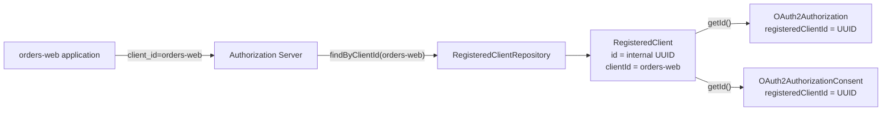
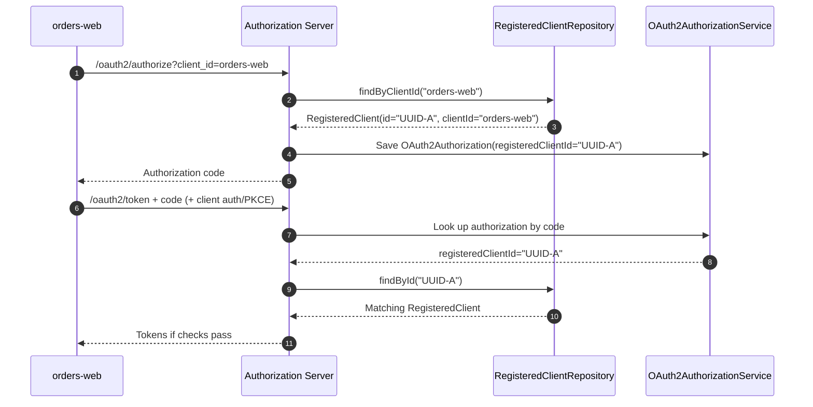
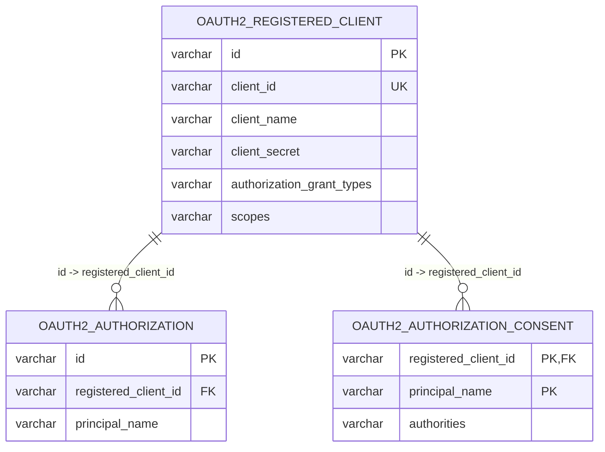

# RegisteredClient and the relationship between internal id and client_id

## 1. The problem: why does an OAuth client have two identifiers?

In a Spring Boot application using **Spring Security** and **Spring Authorization Server (SAS)**, `RegisteredClient` is the model that stores information about an **OAuth 2.0/OpenID Connect (OIDC) client application** allowed to interact with the Authorization Server. It is one of the core data models when designing, configuring, securing, testing, and operating an Authorization Server.

Suppose the system has three clients:

- `orders-web`: a web application for staff signing in via Authorization Code + PKCE.
- `inventory-worker`: a backend service using Client Credentials.
- `customer-mobile`: a mobile public client application signing in via Authorization Code + PKCE.

When `orders-web` requests authorization, the HTTP request carries `client_id=orders-web`. However, in the Authorization Server's data store, the client record might have `id=42c6e6fa-…`. These two values are **not two spellings of the same field**, and they should not be used interchangeably.

| Identifier | Example | Which layer? | Primary usage |
| --- | --- | --- | --- |
| `RegisteredClient.id` | `8c32d5c8-3ec4-4f7b-8b88-9ac7a3c8528f` | Internal identifier of SAS / persistence | Look up the record via `findById`; link authorizations, consents, and related records |
| `RegisteredClient.clientId` | `orders-web` | Client identifier per the OAuth 2.0/OIDC protocol | Sent by the client under the `client_id` parameter; SAS looks it up via `findByClientId` |

**Rule of thumb:** `id` helps the Authorization Server manage the **internal record**, while `client_id` helps the protocol identify **which client application is making the request**. Both must be managed consistently, but **`client_id` is not a password**, and the internal `id` does not serve as a replacement for client credentials.

## 2. What model is RegisteredClient?

`RegisteredClient` (package `org.springframework.security.oauth2.server.authorization.client` in the Spring Authorization Server 1.x line) is the model representing the registration details of an OAuth client.

It answers questions such as: which identifier does the client have, must it authenticate with a secret or signature, which grants is it allowed to request, which URIs may it redirect to, which scopes may it request, and how do token/consent policies apply?

### 2.1. Important fields

| Property / getter | Role | Example or note |
| --- | --- | --- |
| `id` / `getId()` | Internal key identifying the record | Stable string, usually a UUID; does not appear in standard OAuth requests |
| `clientId` / `getClientId()` | External client identifier | `orders-web`; appears as `client_id` |
| `clientIdIssuedAt` | Timestamp when the client ID was issued, if present | Useful for lifecycle management and dynamic registration |
| `clientSecret` | Authentication secret for a **confidential client**, if present | Stored in a one-way encoded form suitable for `PasswordEncoder`; public clients typically do not have a secret |
| `clientSecretExpiresAt` | Timestamp when the secret expires, if present | Does not mean the access token lifetime |
| `clientName` | Display/administrative name of the client | For example, `Orders Web Portal` |
| `clientAuthenticationMethods` | How the client authenticates at endpoints requiring authentication | `client_secret_basic`, `client_secret_post`, `private_key_jwt`, `none`… depending on configuration/support |
| `authorizationGrantTypes` | Allowed grant types | `authorization_code`, `client_credentials`, `refresh_token`… |
| `redirectUris` | List of URIs the client is allowed to redirect to | Must be registered and validated according to OAuth policy |
| `postLogoutRedirectUris` | Redirect URIs after OIDC logout, if used | Only relevant when logout is supported and configured accordingly |
| `scopes` | List of allowed requested scopes | `openid`, `profile`, `orders.read` |
| `clientSettings` | Client-level policy | For example, `requireProofKey`, `requireAuthorizationConsent`, client verification settings |
| `tokenSettings` | Token-level policy | For example, access/refresh token time-to-live, access token format, refresh token reuse |

**Note:** Java property names typically use camelCase (`clientId`), whereas protocol parameters and JDBC column names typically use snake_case (`client_id`). Do not equate them with the internal `id` just because their names look similar.

### 2.2. A RegisteredClient is not a user account

`RegisteredClient` does not represent `UserDetails`, a logged-in user, or a Resource Server. In the Authorization Code Flow, one user can grant permissions to multiple `RegisteredClient` instances. In the Client Credentials Flow, a client can obtain an access token **without an end user**.



The diagram illustrates **data relationships**; at runtime, `OAuth2Authorization` and `OAuth2AuthorizationConsent` are managed by separate services. Mapping the internal key across these services is a key reason why `RegisteredClient.id` must remain stable.

## 3. Accurately distinguishing id and client_id

### 3.1. `id` is the internal key of RegisteredClient

`RegisteredClient.id` is provided by the application when building the model, typically via `RegisteredClient.withId(...)`. In the standard JDBC store, it corresponds to the `id` column in the `oauth2_registered_client` table.

Primary purposes:

1. Consistently identify the record in the data store.
2. Support `RegisteredClientRepository.findById(id)`.
3. Serve as the reference key from `OAuth2Authorization.registeredClientId` and `OAuth2AuthorizationConsent.registeredClientId`.
4. Allow internal administrative layers to locate the right client even if its display name or policies change.

The `id` value can be a UUID or another unique string per your storage policy. What matters is that it is **unique, stable, and persisted**. You must not regenerate a new `id` on every startup when the client already exists.

### 3.2. `client_id` is the protocol-level identifier

In OAuth 2.0, the client sends `client_id` to the Authorization Server. For example:

```http
GET /oauth2/authorize?response_type=code
    &client_id=orders-web
    &redirect_uri=https%3A%2F%2Forders.example.com%2Fcallback
    &scope=openid%20orders.read
    &state=RANDOM_STATE
    &code_challenge=PKCE_CHALLENGE
    &code_challenge_method=S256
```

The values `RANDOM_STATE` and `PKCE_CHALLENGE` are only illustrative placeholders.

On the server side, `RegisteredClientRepository.findByClientId("orders-web")` must locate the corresponding client. Within an issuer/Authorization Server, `client_id` must be **unique across the client identifier space** served by that server. At the JDBC implementation level, uniqueness should be enforced with a unique constraint/index in addition to application-level checks.

`client_id` **is not a secret**. It can appear in redirects/query strings and integration documentation. A confidential client must authenticate using a registered mechanism such as `client_secret_basic` or `private_key_jwt`; for a public client, never assume that merely knowing `client_id` is enough to obtain a token. Authorization Code + PKCE and other constraints must still be enforced.

### 3.3. The two fields should not be used interchangeably

Consider a record:

```text
RegisteredClient {
  id       = "8c32d5c8-3ec4-4f7b-8b88-9ac7a3c8528f"
  clientId = "orders-web"
  clientName = "Orders Web Portal"
}
```

The following operations have different meanings:

```java
RegisteredClient a = repository.findById(
        "8c32d5c8-3ec4-4f7b-8b88-9ac7a3c8528f");

RegisteredClient b = repository.findByClientId("orders-web");

// a and b point to the same client record if the repository is consistent.
// Do NOT assume findById("orders-web") will find the client.
```

Technically, a developer *could* intentionally set `id` and `clientId` to the same value, but doing so tightly couples their two lifecycles and creates confusion in schemas/APIs. In systems requiring administration and migration, keep a clear boundary: `id` is the stable internal key, and `clientId` is the identifier used to communicate with the client.

### 3.4. `client_id` differs from `client_secret`

Three values are easily lumped together as "client credentials", yet each has a distinct role:

| Value | Is it a secret? | Who uses it? |
| --- | --- | --- |
| `RegisteredClient`'s `id` | Not an authentication mechanism; should be an internal identifier | Repository, authorization/consent services, administration |
| `client_id` | **No** | Client and Authorization Server to identify the client |
| `client_secret` | **Yes** | Confidential client proving its identity at endpoints allowing secret-based authentication |

Never create a policy saying "having the right client ID grants access to view data." Even successful client authentication does not mean the client has been granted a specific scope or has permission to read user resources.

## 4. The role of RegisteredClientRepository

`RegisteredClientRepository` is the SAS repository contract used to store and look up `RegisteredClient` instances:

```java
public interface RegisteredClientRepository {
    void save(RegisteredClient registeredClient);
    RegisteredClient findById(String id);
    RegisteredClient findByClientId(String clientId);
}
```

These APIs represent two lookup paths:

- `findByClientId`: typically used when authenticating/identifying a client from an OAuth 2.0 request.
- `findById`: enables services to retrieve the `RegisteredClient` via the internal key stored in authorization or consent state.

SAS provides baseline implementations such as `InMemoryRegisteredClientRepository` and `JdbcRegisteredClientRepository` in the 1.x line. If you use ORM/JPA or a custom distributed store, the development team implements an appropriate repository contract; do not assume a standard `JpaRegisteredClientRepository` is provided out of the box by the framework.

### 4.1. Example initializing two client types

The following snippet illustrates the **Spring Authorization Server 1.x** model. Imports, secret-holding beans, data stores, and security chain configuration are omitted; this example is not a complete production configuration.

```java
RegisteredClient web = RegisteredClient.withId(
            "b843b04a-0b75-4709-ae9f-48d6ba263e12")
        .clientId("orders-web")
        .clientName("Orders Web Portal")
        .clientAuthenticationMethod(ClientAuthenticationMethod.NONE)
        .authorizationGrantType(AuthorizationGrantType.AUTHORIZATION_CODE)
        .redirectUri("https://orders.example.com/callback")
        .scope(OidcScopes.OPENID)
        .scope("orders.read")
        .clientSettings(ClientSettings.builder()
                .requireProofKey(true)
                .requireAuthorizationConsent(true)
                .build())
        .tokenSettings(TokenSettings.builder()
                .accessTokenTimeToLive(Duration.ofMinutes(10))
                .build())
        .build();

RegisteredClient worker = RegisteredClient.withId(
            "c6c10241-e427-4d31-9e48-87d03a77ec87")
        .clientId("inventory-worker")
        .clientName("Inventory Worker")
        .clientSecret(passwordEncoder.encode(secretFromSecureSource))
        .clientAuthenticationMethod(
                ClientAuthenticationMethod.CLIENT_SECRET_BASIC)
        .authorizationGrantType(
                AuthorizationGrantType.CLIENT_CREDENTIALS)
        .scope("inventory.read")
        .tokenSettings(TokenSettings.builder()
                .accessTokenTimeToLive(Duration.ofMinutes(5))
                .build())
        .build();
```

`secretFromSecureSource` illustrates a secret provisioned and retrieved via an appropriate secret-management mechanism, **not a constant to hardcode in source code**. With `passwordEncoder`, use a properly configured one-way encoder per Spring Security standards and store the encoded secret on the server; the client should receive the raw secret only through a secure provisioning channel at credential creation/rotation time.

Key points to observe:

1. The two clients have separate internal `id` values and separate `clientId` values.
2. `orders-web` is a public client; `ClientAuthenticationMethod.NONE` does not make PKCE optional.
3. `inventory-worker` is a confidential client, has a client authentication method, and is granted only the `inventory.read` scope.
4. The `id` values here are fixed **to illustrate stable keys**; when creating real clients, you can generate a UUID once and persist it in the database. Do not copy the same set of IDs across multiple records in the same store.
5. The access token lifetime resides in `TokenSettings` and is **not directly tied** to the client secret expiration.

### 4.2. Example using the JDBC repository

```java
@Bean
RegisteredClientRepository registeredClientRepository(
        JdbcTemplate jdbcTemplate) {
    return new JdbcRegisteredClientRepository(jdbcTemplate);
}
```

This example assumes the application has already configured a DataSource, `JdbcTemplate`, and the tables matching the schema required by the SAS version in use. Simply declaring the repository bean does not create the schema automatically, does not generate clients automatically, and does not replace `OAuth2AuthorizationService`/`OAuth2AuthorizationConsentService`.

When you need to seed clients at deployment time, make the operation **idempotent**: look up by `clientId` first, and only create a new record when the client does not yet exist. A migration or client-management page is usually more appropriate than running an unchecked `save` on every startup.

## 5. Data relationships with OAuth2Authorization and OAuth2AuthorizationConsent

This section directly shows **why you must not arbitrarily change `id`**.

### 5.1. OAuth2Authorization references RegisteredClient.id

`OAuth2Authorization` describes the state of an authorization/token grant, which may include an authorization code, access token, refresh token, and related information depending on the flow. It has the property:

```java
String registeredClientId = authorization.getRegisteredClientId();
RegisteredClient client = registeredClientRepository.findById(registeredClientId);
```

Here `registeredClientId` points to **`RegisteredClient.id`**, not `RegisteredClient.clientId`.

Example request sequence:



The diagram highlights the lookups. The actual handler also authenticates the client, validates the redirect URI, code state, PKCE, expiration, consent, and related policies.

### 5.2. OAuth2AuthorizationConsent also references RegisteredClient.id

`OAuth2AuthorizationConsent` represents the authorities/scopes that a principal has approved for a client when the flow uses consent. It contains **`registeredClientId`** along with **`principalName`** to identify the approving subject.

Example:

```text
RegisteredClient:
  id       = UUID-A
  clientId = orders-web

OAuth2AuthorizationConsent:
  registeredClientId = UUID-A
  principalName      = alice
  authorities        = SCOPE_orders.read
```

In this example, `alice` is the end-user principal. **Do not confuse** `principalName` with `client_id`; one user can grant consent to multiple clients, and one client can be approved by multiple users.

### 5.3. Perspective from a relational database

In the SAS 1.x reference JDBC schema, the primary tables are typically named as follows:



This is a **simplified logical diagram**, not a complete DDL. Depending on the SAS version and database, the provided schema may differ in data types, column sizes, indexes, or physical foreign-key declarations. If you need FK constraints, check all deletion/migration flows and the official schema for your exact version.

An illustrative query showing the relationship:

```sql
SELECT a.id AS authorization_id,
       rc.id AS internal_registered_client_id,
       rc.client_id AS oauth_client_id,
       a.principal_name
FROM oauth2_authorization AS a
JOIN oauth2_registered_client AS rc
  ON rc.id = a.registered_client_id
WHERE rc.client_id = 'orders-web';
```

With the `UUID-A` data, the SQL query joins on `rc.id = a.registered_client_id`. Joining mistakenly on `rc.client_id = a.registered_client_id` typically returns an empty result, unless the two fields were accidentally assigned identical values.

## 6. Impact of changing id, client_id, and client_secret

These fields have different lifecycles. When running multiple Authorization Server instances, the differences become even more critical.

| Operation | Primary impact | Safe handling |
| --- | --- | --- |
| Changing `clientName` | Primarily changes the display name | Update the existing record properly |
| Adjusting scopes/redirect URIs/grants | Changes allowed policy and integration contract | Review/approve, test negative/positive requests, evaluate existing authorizations |
| Changing `clientSecret` | Changes the confidential client's credential | Controlled rotation, update client side, manage cutover timing |
| Changing `client_id` | External clients must send the new value; older integrations may fail | Treat as a client identity migration |
| **Changing internal `id`** | Existing authorizations/consents may point to a non-existent ID | **Keep stable**; if changing the ID is unavoidable, migrate all related references |
| Deleting a client | Existing tokens, codes, consents, and in-flight requests may be affected | Have a deactivation plan, audit trail, cleanup, and data governance |

### 6.1. Why generating a new UUID on every startup is dangerous

A common mistake:

```java
// Do NOT apply as-is on every startup for existing data.
RegisteredClient client = RegisteredClient.withId(UUID.randomUUID().toString())
        .clientId("orders-web")
        // ... other settings ...
        .build();
registeredClientRepository.save(client);
```

Suppose yesterday the record had `id=UUID-A` and `OAuth2Authorization` referenced `UUID-A`. Today a buggy seed creates `id=UUID-B` with the same `clientId=orders-web`. Depending on how the repository/database enforces constraints, the operation may **fail due to a duplicate client ID**, leave inconsistent state, or overwrite data so that authorizations/consents are no longer referenced properly.

Implementation rule: only generate an ID **upon initial creation**, persist it durably, and on subsequent startups read back the existing record. With JDBC, apply proper migrations/transactional seeding and unique constraints.

### 6.2. Can you change client_id while keeping id?

A data store may allow changing `client_id` on the same `id`. However, doing so **does not automatically inform external clients of the new identifier**. Applications still sending the old `client_id` will no longer be looked up as before; stored client configuration, consents, and tokens must be evaluated based on how SAS and your APIs use them.

If you need to restructure identifiers, it is usually easier to govern by **registering a new client**, guiding clients through migration, and revoking the old client on a schedule. Do not treat renaming `client_id` as a cosmetic display edit.

### 6.3. Rotating a client secret does not mean changing id

When rotating credentials, do not change `id` or `client_id` just because a secret expires. Keep the client identifiers intact, update the credential through the proper mechanism, and design the transition window. In the base `RegisteredClient` model, `clientSecret` is a single field; if you require **accepting multiple secrets concurrently** during a transition window, you need additional design or another appropriate authentication mechanism. Do not assume SAS automatically maintains multiple parallel secrets for a single record.

## 7. RegisteredClient in OAuth 2.0/OIDC flows

### 7.1. Authorization Code + PKCE

The client sends `client_id` in the authorization request; SAS looks up `RegisteredClient` to verify whether the client is allowed to use `authorization_code`, whether the redirect URI is valid, whether the requested scopes are in the allowed list, and whether PKCE is required.

After the user signs in and approves, SAS persists the authorization linked to **`RegisteredClient.id`**. When exchanging the code, the client must also satisfy the corresponding client authentication and PKCE checks. **Never** use `RegisteredClient.id` as a `code_verifier`, `client_secret`, or substitute for `client_id`.

### 7.2. Client Credentials

A backend service uses `client_id` and the appropriate client authentication method to request an access token. SAS verifies the credential against the registered details, then checks that the client is allowed to use `client_credentials` and the requested scopes. The authorization is stored under the internal ID if the flow/configuration creates corresponding state.

The `RegisteredClient.id` field is not an end-user identity; `client_credentials` typically has no end user. Resource Servers need appropriate authorization policies for services.

### 7.3. OpenID Connect

In OIDC, `client_id` is the identifier of the RP/client application when performing federated sign-in. The ID token typically has an `aud` claim containing the recipient's **OIDC `client_id`**, not `RegisteredClient.id`.

On the Authorization Server side, authorizations/consents must still be linked via the internal key. Do not put the internal `id` into tokens as a replacement "client identifier" unless there is an explicitly designed custom contract. An access token carries `aud` according to the Resource Server's policy, which is **not automatically identical** to `client_id` just because OIDC ID tokens follow their own audience rules.

## 8. Storage, querying, and multi-environment governance

### 8.1. InMemory vs. JDBC

| Criterion | `InMemoryRegisteredClientRepository` | `JdbcRegisteredClientRepository` |
| --- | --- | --- |
| Best suited for | Demos, simple experiments | Durable data, governance, and multi-instance deployments when properly designed |
| Data after restart | Not persistent by itself | Retained in the database |
| Internal key | Must be managed like any other client | `id` is persisted in the record |
| Lookup by client ID | Via `findByClientId` | Via repository/JDBC |
| Schema management | No DB tables required | Requires DDL, migrations, indexes, backups, transactions, and secret protection |

A production system also needs an appropriate `OAuth2AuthorizationService` and `OAuth2AuthorizationConsentService`, a durable signing key store, policy synchronization, and monitoring. Simply switching the client repository from InMemory to JDBC is not enough to solve all Authorization Server persistence concerns.

### 8.2. Uniqueness and multi-tenancy

Within the scope of a single issuer, each client must be unambiguously identifiable by `client_id`. If the application provides multi-tenancy, you may need to store an additional `tenant_id` or tenant relationship in a custom management model. Do not allow two tenants to accidentally register the same `client_id` in the **same issuer namespace** when the repository looks up only by `clientId`; results will be ambiguous and risk policy misapplication.

If each tenant uses an independent issuer/Authorization Server, naming rules may differ, but clients and Resource Servers must validate the exact issuer. Having the same `client_id` across two different issuers does not make the two clients the same identity.

### 8.3. Caching and configuration changes

An application may cache results of `findByClientId`/`findById` to reduce queries. When changing a client secret, redirect URI, scopes, or client status, you need a plan to **invalidate the cache** across all instances. Otherwise, one instance might accept a recently revoked credential while another instance already uses the updated data.

You should also audit client create/update/disable operations: actor, timestamp, change type, and outcome. **Never store raw client secrets** in audit logs or telemetry.

## 9. Mapping pitfalls when implementing a custom RegisteredClientRepository

If you use a JPA entity, document store, or custom adapter, do not equate the ORM model with the protocol object without defining explicit mappings.

| Pitfall | Consequence | Prevention |
| --- | --- | --- |
| `findById(clientId)` instead of `findByClientId(clientId)` | Client not found even though record exists | Call the right API for the identifier type |
| Writing `registeredClientId = registeredClient.getClientId()` | Authorizations/consents point to the wrong key | Use `registeredClient.getId()` |
| Using `client_id` as primary key while allowing arbitrary renames | Broken data links and higher migration cost | Separate a stable internal key |
| Not enforcing unique `client_id` | Multiple clients may exist with the same identifier | Unique constraint/index + write contention handling |
| Generating a new `id` on every seed | Duplicate records, orphaned authorizations/consents | Idempotent seeding and persist `id` |
| Storing client secret in plaintext or logging raw secrets | Credential exposure and risk of client impersonation | Secret management, appropriate encoder, restricted visibility |
| Omitting `ClientSettings`/`TokenSettings` during mapping | Loss of PKCE/consent enforcement and intended token lifetimes | Round-trip mapping tests |
| Saving `authorizationGrantTypes` while dropping `clientAuthenticationMethods` | Client authentication fails or behaves incorrectly | Test every grant and authentication method |
| Changing `client_id` expecting callbacks/APIs to update automatically | Old clients cannot be looked up or are rejected | Migration plan, communication, and contract tests |

Pay attention to collection fields such as `authorizationGrantTypes`, `redirectUris`, and `scopes` so they are serialized/deserialized **without dropping elements or mixing types**. Settings structures and token settings must preserve all values, including extension properties for the version in use. A custom adapter might boot up fine yet still introduce a security vulnerability if it fails to restore `requireProofKey` accurately.

## 10. Testing the model and identifier relationships

Lessons on data models should include both repository unit tests and protocol-level integration tests.

### 10.1. Basic repository test

```java
@Test
void lookupByInternalIdAndClientIdReturnsSameRegistration() {
    RegisteredClient byId = repository.findById(
            "b843b04a-0b75-4709-ae9f-48d6ba263e12");
    RegisteredClient byClientId = repository.findByClientId("orders-web");

    assertThat(byId).isNotNull();
    assertThat(byClientId).isNotNull();
    assertThat(byId.getId()).isEqualTo(byClientId.getId());
    assertThat(byId.getClientId()).isEqualTo("orders-web");
}
```

The example uses AssertJ assertion syntax; the test needs to set up the repository with a registered client. Afterwards, add tests for duplicate data, settings round-trip persistence, and durability across restarts.

### 10.2. Test matrix related to id and client_id

| Case | Expected outcome |
| --- | --- |
| Call `findByClientId("orders-web")` | Exactly one client with `clientId=orders-web` |
| Call `findById(UUID-A)` | Returns the client with `id=UUID-A` |
| Call `findById("orders-web")` when id differs from client ID | Does not return an unintended client |
| Register another client with a duplicate `client_id` | Rejected by governance mechanism/DB constraint |
| Restart Authorization Server | Records retain their `id`, `clientId`, and policies |
| Change client display name | `id` and `clientId` remain unchanged |
| Client sends a non-existent `client_id` | Authorization Server rejects the request appropriately per endpoint |
| Client uses wrong client secret | Authentication fails; no access token issued |
| Client uses unregistered grant/scope/redirect URI | Request rejected even though `client_id` is valid |
| Authorization code is created and exchanged for a token | `registeredClientId` accurately references `RegisteredClient.id` |
| User consent is recorded | `registeredClientId` is accurate; `principalName` represents the user |
| Modify settings and read back from JDBC/JPA adapter | PKCE, consent, token policies, and redirect URI set remain intact |
| Migrate to another DB/instance | All authorizations/consents still point to the correct client after migration |

If the project uses JDBC, test transactions and migrations against a real database or a test environment with equivalent characteristics. Simple in-memory tests are not sufficient to prove that unique constraints and column types behave properly in a production DB.

## 11. Practice exercise: analyzing a post-restart failure

**Scenario:** after every deployment, `orders-web` still uses `client_id=orders-web` and can open the login page. However, exchanging an older authorization code or querying existing consents fails. The development team discovers that the seeding logic calls `RegisteredClient.withId(UUID.randomUUID().toString())` on every application startup.

Answer the following:

1. Why can new requests still locate the client by `client_id`, while older authorizations/consents no longer match?
2. Why does changing the request from `client_id=orders-web` to `client_id=<internal UUID>` not properly solve the problem?
3. Which tables/columns in the JDBC schema should be inspected?
4. How should the seeding and migration process be changed to prevent this incident from recurring?
5. Should you directly update `registered_client_id` across all stored authorizations/consents? What conditions must be reviewed before doing so?

**Analysis hints:** `OAuth2Authorization` and `OAuth2AuthorizationConsent` states reference `RegisteredClient.id`. When the internal ID changes, the repository may no longer find the matching record. `client_id` in HTTP still serves **external** lookup, and does not repair broken references in the DB. Inspect the migration history, the `oauth2_registered_client` table, the `registered_client_id` column in authorization/consent tables, and any duplicate `client_id` records.

The optimal approach is to **restore the record with its previous internal ID if appropriate and still trustworthy**, make seeding idempotent, and apply changes via controlled migrations. Bulk updates of foreign/reference keys should only be considered once you fully understand token/code states, security impact, audit data, and rollback capability; never modify a production DB blindly.

## 12. Checklist when designing RegisteredClient for production

Before taking an Authorization Server to production, verify:

1. **Model:** each client has a unique/stable internal `id` and a unique `client_id` within the issuer; policies exist for creation, updates, and deactivation.
2. **Data store:** repository persists durably; `findById` and `findByClientId` behave consistently; schema and indexes are managed via migrations.
3. **References:** authorizations and consents use **`RegisteredClient.id`**; backup/restore procedures preserve keys.
4. **Client authentication:** `client_id` may be public, while secrets/private keys are kept secure; public clients are never assumed to hold confidential secrets.
5. **Grants and redirects:** each client has only the grants, scopes, redirect URIs, and authentication methods it needs; PKCE is required where appropriate.
6. **Lifecycle:** changes to client secrets, `client_id`, scopes, and client status follow testing, auditing, cache invalidation, and revocation procedures.
7. **Tokens/consents:** lifetimes and storage of authorizations, consents, and refresh tokens align with Resource Server authorization policies.
8. **Operations:** monitor `invalid_client`, `unauthorized_client`, `invalid_scope`, and client lookup errors without exposing secrets/tokens in logs.

## 13. Reference documentation

- [Spring Authorization Server — Core Model / RegisteredClient](https://docs.spring.io/spring-authorization-server/reference/core-model-components.html#registered-client): concepts, builder, and repositories.
- [Spring Authorization Server — Core Model / OAuth2Authorization](https://docs.spring.io/spring-authorization-server/reference/core-model-components.html#oauth2-authorization): authorization state and `registeredClientId`.
- [Spring Authorization Server — Core Model / OAuth2AuthorizationConsent](https://docs.spring.io/spring-authorization-server/reference/core-model-components.html#oauth2-authorization-consent): consent model and relationship to the client.
- [Spring Authorization Server — Getting Started](https://docs.spring.io/spring-authorization-server/reference/getting-started.html): minimal setup and client registration.
- [RFC 6749 — OAuth 2.0 Authorization Framework](https://www.rfc-editor.org/rfc/rfc6749): role of `client_id` in the protocol; [OpenID Connect Core](https://openid.net/specs/openid-connect-core-1_0.html) for OIDC rules.

The Spring links above describe the model in the SAS 1.x line; when a project uses Spring Security with integrated Authorization Server in a newer version, verify the exact packages, configuration, and schema for that version before copying code.

**Learning takeaway:** `RegisteredClient` defines **an application registered with the Authorization Server and what it is permitted to do**. `RegisteredClient.clientId` is the `client_id` used by the client in OAuth 2.0/OIDC, while `RegisteredClient.id` is the internal key used by `OAuth2Authorization` and `OAuth2AuthorizationConsent` to link state. Keeping both identifiers in their proper roles, unique, and stable is fundamental to issuing tokens securely, storing data consistently, and operating Spring Authorization Server without redeployment failures.
