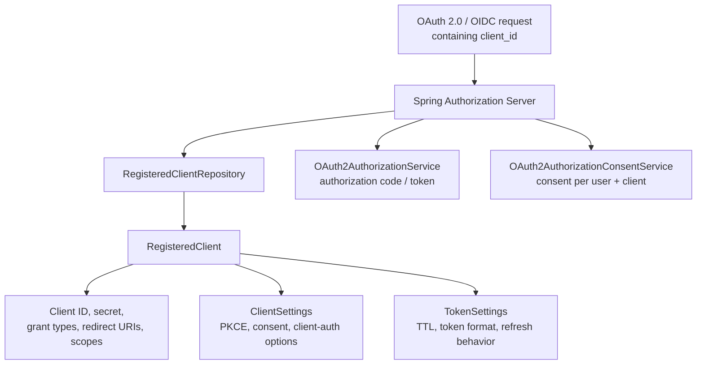
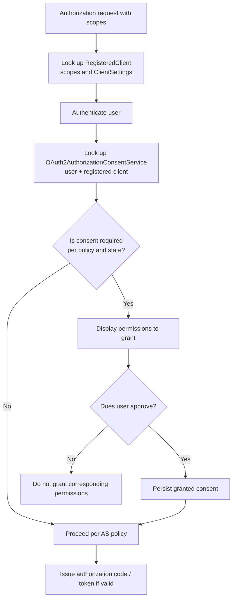

# ClientSettings and policies applied to a client

In Spring Authorization Server, **`RegisteredClient`** is the model representing an application permitted to use the Authorization Server; **`ClientSettings`** is the set of **additional policies attached specifically to that client**. Understanding this distinction helps you accurately configure PKCE enforcement, user consent requirements, and several advanced client authentication mechanisms such as JWT assertions or X.509 certificates.

This lesson belongs to the **Core Models** chapter of the **SPRING_SECURITY_OAUTH2_OIDC_AUTHORIZATION_SERVER** module, focusing on designing, configuring, securing, testing, and operating an OAuth 2.0/OpenID Connect Authorization Server in Spring Boot.

After this lesson, you will be able to:

- Explain the relationships among `RegisteredClient`, `ClientSettings`, `TokenSettings`, `AuthorizationServerSettings`, and persistence services.
- Understand the security impact of `requireProofKey` and `requireAuthorizationConsent`, as well as what they do **not** protect against on their own.
- Configure confidential clients and public clients with appropriate policies for Authorization Code + PKCE.
- Identify the role of `jwkSetUrl`, the JWT assertion signing algorithm when a client authenticates via JWT, and certificates when using mTLS.
- Write tests for valid requests, rejected requests, and post-deployment policy changes.

## 1. Where does ClientSettings fit in the model?

An OAuth application is not recognized by the Authorization Server solely by the `client_id` appearing in the URL. The Authorization Server must look up trusted registered information about that application, typically through `RegisteredClientRepository`.

In Spring Authorization Server, `RegisteredClient` consists of these data groups:

| Data group | Examples | Purpose |
| --- | --- | --- |
| **Identity and credentials** | `id`, `clientId`, `clientSecret`, `clientAuthenticationMethods` | Identifies the client and specifies how it authenticates at applicable endpoints. |
| **Grant types** | `authorizationGrantTypes`: `authorization_code`, `refresh_token`, `client_credentials` | Restricts which grants the client is registered to use. |
| **Callback addresses** | `redirectUris`, `postLogoutRedirectUris` | Restricts where authorization results and logout responses may be redirected. |
| **Permission scopes** | `scopes`: `openid`, `profile`, `orders.read` | Limits which scopes the client may request; server policies still decide which permissions are granted. |
| **`ClientSettings`** | `requireProofKey`, `requireAuthorizationConsent`, `jwkSetUrl`, and advanced auth options | Governs specific conditions when the client participates in the protocol. |
| **`TokenSettings`** | Code/token TTL, access token format, refresh token policy | Governs how tokens are issued and their lifecycle for the client. |

Diagram:



**Principle:** `RegisteredClient` states **what the client is registered to do**; `ClientSettings` specifies **certain conditions for doing it**; `TokenSettings` specifies **how tokens are issued**. Having a scope listed in the registration does not automatically grant users access to every resource covered by that scope.

For example, the backend client `orders-portal` is registered with `authorization_code` and callback `https://portal.example.com/login/oauth2/code/orders`. When a user signs in, the Authorization Server must still authenticate the user, validate the request, verify PKCE if required by the client, and handle consent according to policy. Having `client_id=orders-portal` in the request is not enough to bypass these steps.

## 2. Main policies of ClientSettings

The methods below belong to the `ClientSettings.builder()` API in the **Spring Authorization Server 1.x** line. Exact names and availability of advanced options should be verified against the version locked in your project.

| Policy | Typical configuration | Controlled condition | Things to note |
| --- | --- | --- | --- |
| **Require PKCE** | `requireProofKey(true)` | A client using Authorization Code must send a valid PKCE challenge and prove the matching verifier when exchanging the code. | PKCE binds the code to the transaction; it does not replace client authentication, `state`, or redirect URI validation. |
| **Require consent** | `requireAuthorizationConsent(true)` | When applicable to the request and stored consent state, the user must approve granting permissions to the client. | Consent is distinct from login and remains subject to server scope policies. |
| **Client JWK Set URI** | `jwkSetUrl("https://.../jwks.json")` | Supplies the client's public keys for mechanisms that use client keys, such as `private_key_jwt`. | Different from the Authorization Server's public JWKS used to verify tokens issued by the AS. |
| **JWT client authentication algorithm** | `tokenEndpointAuthenticationSigningAlgorithm(...)` | Constrains the JWS algorithm accepted for JWT assertions signed by the client when authenticating at the token endpoint. | Not the signing algorithm setting for ID tokens/access tokens issued by the AS. |
| **Client certificate Subject DN** | `x509CertificateSubjectDN(...)` | Adds a certificate identity constraint when using an appropriate TLS-certificate client authentication model. | Does not configure mTLS at the reverse proxy/Servlet container by itself or replace trusted certificate verification. |

`requireProofKey` and `requireAuthorizationConsent` are very common in Authorization Code Flow designs. Key/JWT/certificate settings are only needed when you actually choose the corresponding client authentication method; do not add a JWKS URL or DN just to "fill out the config."

A simple example:

```java
import org.springframework.security.oauth2.server.authorization.settings.ClientSettings;

ClientSettings settings = ClientSettings.builder()
    .requireProofKey(true)
    .requireAuthorizationConsent(true)
    .build();
```

This `ClientSettings` instance must be attached to `RegisteredClient` via `.clientSettings(settings)`. **Declaring a standalone `ClientSettings` bean without attaching it to a client does not mean every client will automatically apply that policy.**

### 2.1. ClientSettings does not enable or grant a grant type by itself

Example:

```java
RegisteredClient registeredClient = RegisteredClient.withId("internal-id")
    .clientId("orders-portal")
    .clientAuthenticationMethod(
        ClientAuthenticationMethod.CLIENT_SECRET_BASIC)
    .authorizationGrantType(
        AuthorizationGrantType.AUTHORIZATION_CODE)
    .redirectUri("https://portal.example.com/login/oauth2/code/orders")
    .scope("orders.read")
    .clientSettings(ClientSettings.builder()
        .requireProofKey(true)
        .build())
    .build();
```

This client **only** has `authorization_code` in its registered grant list. Setting `requireProofKey(true)` does not automatically add `refresh_token` or `client_credentials`. To use another grant, you must register that grant explicitly and meet its corresponding requirements.

Similarly, `requireAuthorizationConsent(true)` does not automatically add `orders.write` to scopes, create users, or configure callback URLs.

## 3. requireProofKey: binding the authorization code to the requester

**PKCE (Proof Key for Code Exchange)** mitigates the risk of an authorization code being intercepted or passed to another party and exchanged for an access token. In the Authorization Code Flow, the client generates a per-transaction secret called `code_verifier` and sends a proof derived from it called `code_challenge`.

Using the `S256` method:

```text
code_verifier:  strong random string, held in the client's transaction state
code_challenge: BASE64URL(SHA256(ASCII(code_verifier)))
code_challenge_method: S256
```

Note: these are **two different values**. `code_verifier` is not sent in the authorization request step; it is used at the token endpoint. PKCE does not provide the user's identity, nor does it expose or replace a secret for a public client.

### 3.1. Verification cycle when requireProofKey is enabled

```mermaid
sequenceDiagram
    autonumber
    actor U as User
    participant C as OAuth Client
    participant B as Browser
    participant AS as Authorization Server

    C->>C: Generate code_verifier, code_challenge=S256(verifier), state
    C-->>B: Redirect to authorization request
    B->>AS: /oauth2/authorize + client_id + challenge + state
    AS->>AS: Look up RegisteredClient; require PKCE
    AS-->>B: Login/consent if needed
    U->>B: Authenticate and approve
    B->>AS: Submit action result
    AS-->>B: Redirect with code and state
    B->>C: Callback with code and state
    C->>C: Match state against transaction
    C->>AS: POST /oauth2/token + code_verifier (+ client auth if applicable)
    AS->>AS: Verify code, client, redirect URI, verifier
    AS-->>C: Tokens if all checks pass
```

An abbreviated authorization request:

```http
GET /oauth2/authorize?response_type=code
    &client_id=orders-portal
    &redirect_uri=https%3A%2F%2Fportal.example.com%2Flogin%2Foauth2%2Fcode%2Forders
    &scope=openid%20orders.read
    &state=RANDOM_STATE
    &code_challenge=CHALLENGE_BASE64URL
    &code_challenge_method=S256
```

The example above is wrapped onto multiple lines for readability. In real HTTP, the URL must be properly encoded and sent on a single line.

Alongside PKCE verification, the AS still needs to verify that the client exists, the grant and scopes are valid, the redirect URI is registered, the user is authenticated, and consent/policy conditions are met. At the token endpoint, the AS checks that the code is unexpired, unused, bound to the right client/callback, and matches the verifier.

### 3.2. What does requireProofKey(true) protect against and what is still missing?

| Question | Answer |
| --- | --- |
| Does it help prevent someone else from redeeming a stolen code? | Yes, provided the attacker does not have the matching verifier and PKCE is properly validated. |
| Does it replace a client secret or JWT client authentication? | No. Confidential clients must still authenticate with their registered method. |
| Does it turn an SPA/native app into a confidential client? | No. JavaScript/binary code running in the user's environment still cannot keep a client secret safe. |
| Does it replace `state` in callback handling? | No. The client still needs to correlate the response with the initiated transaction and defend against injection/login CSRF accordingly. |
| Does it automatically enforce `S256` only across all versions/configurations? | Do not assume so. Use `S256`; if `plain` must be strictly forbidden, verify and enforce that policy at the appropriate validation point. |
| Does it protect access tokens from XSS after issuance? | No. Tokens accessible to JavaScript still need protection against malicious scripts running in the same origin. |

**Recommended practice:** enable PKCE for both public clients and confidential clients using the Authorization Code Flow. Keep in mind that `requireProofKey` is a **per-client-registration** policy, not a guarantee that every client in your store has it enabled. Inspecting registrations client by client helps avoid omissions.

## 4. requireAuthorizationConsent: authorization decision owned by the user and AS

In OAuth/OIDC, **authentication** determines who the user is; **authorization/consent** concerns the user agreeing to grant specific permissions to a client. Both steps may occur within the same browser flow, but they are not the same thing.

Suppose client `orders-portal` requests `openid`, `profile`, and `orders.read`. The AS authenticates the user and may then display a consent page for the user to review the scopes the client is permitted to use.

With:

```java
ClientSettings.builder()
    .requireAuthorizationConsent(true)
    .build();
```

Spring Authorization Server applies the consent requirement according to its rules and stored state. The user might not have to re-approve every scope every time if valid consent has already been persisted; exact behavior also depends on scopes, OIDC parameters, and UI/policy configuration.

### 4.1. Data flow related to consent



`OAuth2AuthorizationConsentService` stores the permissions that a principal has approved for a client, typically via `OAuth2AuthorizationConsent`. This data is **per user and registered client pair**, not a single field written on `ClientSettings` for all users.

Therefore:

- `ClientSettings.requireAuthorizationConsent` answers **whether a consent step is required by the client policy**.
- `OAuth2AuthorizationConsentService` answers **which user has approved which permissions for which client**.
- `RegisteredClient.scopes` defines the **registered permission ceiling**; consent cannot expand that ceiling.
- Resource Server decisions still restrict permissions per resource/tenant, even when a token carries valid scopes.

### 4.2. Misconceptions that easily cause bugs

**"Setting `requireAuthorizationConsent(false)` means skipping login."** False. The user still needs to be authenticated for Authorization Code/OIDC when required by the protocol. Consent policy and form login answer two different questions.

**"Once consent is given, the token can call any API."** False. A client can only request registered permissions; the AS still evaluates policies, and the RS must verify the token, audience, scopes, and object-level permissions.

**"Enabling consent guarantees every request always shows the exact same screen."** Not necessarily. Previously stored consent, newly requested scopes, OIDC `prompt`, and deployment rules can influence the flow. Write integration tests for expected behavior rather than asserting that a screen always appears.

**"Deleting old consent automatically invalidates all active access tokens."** Not automatically. Revoking consent and revoking tokens are separate operations/state sources; your design must account for token lifetimes and require revocation/introspection if immediate effect is needed.

### 4.3. Consent in multi-instance environments

If you use `InMemoryOAuth2AuthorizationConsentService`, consent state does not survive restarts and is not shared across separate instances. In a multi-replica environment, use shared storage suited to the authorization/consent services, ensuring proper data policies and concurrency handling.

Custom consent UIs must also protect against CSRF and validate input parameters. Never accept a list of scopes submitted by the browser and grant permissions blindly if it exceeds the client's allowed scopes or differs from the authenticated transaction.

## 5. Configuring confidential clients and public clients

The two client types have important differences: a **confidential client** can keep an authentication secret in a server-side environment; a **public client** (SPA/native) has nowhere to store a client secret where an end user cannot extract it.

| Factor | Confidential web client/BFF | Public SPA/native client |
| --- | --- | --- |
| Client authentication | `client_secret_basic`, `private_key_jwt`, or another suitable mechanism. | Typically `none`; no trustworthy secret. |
| Authorization Code + PKCE | Should require `requireProofKey(true)`. | Must use Authorization Code + PKCE per modern best practices. |
| Consent | Configured per authorization policy; often needed when third-party clients access user data. | Same; depends on the permissions being granted, not just client type. |
| Redirect | Fixed HTTPS callback received by the backend. | HTTPS callback of the SPA or appropriate native redirect mechanism; must be tightly registered. |
| Token storage | Prefer keeping tokens on the backend and using a hardened browser session cookie. | Executes in a less trusted environment; mitigate XSS and protect memory/storage. |
| Refresh token | Governed by grant, `TokenSettings`, and client policy. | Not granted by default in every version/configuration; requires extra safeguards such as rotation or sender-constrained tokens if supported. |

Remaining security rules—redirect restrictions, state validation, CSRF protection, OIDC ID token verification, and API authorization—are not replaced by a `ClientSettings` flag.

### 5.1. Java example: two RegisteredClient instances with distinct policies

This snippet focuses on the client model and configuration in **Spring Authorization Server 1.x**, using an in-memory store for illustration. It assumes the project already provides a `PasswordEncoder` bean.

```java
package com.example.authorization.config;

import java.time.Duration;
import java.util.UUID;

import org.springframework.beans.factory.annotation.Value;
import org.springframework.context.annotation.Bean;
import org.springframework.context.annotation.Configuration;
import org.springframework.security.crypto.password.PasswordEncoder;
import org.springframework.security.oauth2.core.AuthorizationGrantType;
import org.springframework.security.oauth2.core.ClientAuthenticationMethod;
import org.springframework.security.oauth2.core.oidc.OidcScopes;
import org.springframework.security.oauth2.server.authorization.client.InMemoryRegisteredClientRepository;
import org.springframework.security.oauth2.server.authorization.client.RegisteredClient;
import org.springframework.security.oauth2.server.authorization.client.RegisteredClientRepository;
import org.springframework.security.oauth2.server.authorization.settings.ClientSettings;
import org.springframework.security.oauth2.server.authorization.settings.TokenSettings;

@Configuration(proxyBeanMethods = false)
public class ClientRegistrationConfig {

    @Bean
    RegisteredClientRepository registeredClientRepository(
            PasswordEncoder passwordEncoder,
            @Value("${demo.portal-client-secret}") String clientSecret) {

        // Backend web client that can store a secret and perform token requests.
        RegisteredClient portal = RegisteredClient
            .withId(UUID.randomUUID().toString())
            .clientId("orders-portal")
            .clientSecret(passwordEncoder.encode(clientSecret))
            .clientAuthenticationMethod(
                ClientAuthenticationMethod.CLIENT_SECRET_BASIC)
            .authorizationGrantType(
                AuthorizationGrantType.AUTHORIZATION_CODE)
            .authorizationGrantType(
                AuthorizationGrantType.REFRESH_TOKEN)
            .redirectUri(
                "https://portal.example.com/login/oauth2/code/orders")
            .scope(OidcScopes.OPENID)
            .scope(OidcScopes.PROFILE)
            .scope("orders.read")
            .clientSettings(ClientSettings.builder()
                .requireProofKey(true)
                .requireAuthorizationConsent(true)
                .build())
            .tokenSettings(TokenSettings.builder()
                .accessTokenTimeToLive(Duration.ofMinutes(10))
                .reuseRefreshTokens(false)
                .build())
            .build();

        // Browser-based SPA: do not configure a client secret.
        RegisteredClient spa = RegisteredClient
            .withId(UUID.randomUUID().toString())
            .clientId("orders-spa")
            .clientAuthenticationMethod(ClientAuthenticationMethod.NONE)
            .authorizationGrantType(
                AuthorizationGrantType.AUTHORIZATION_CODE)
            .redirectUri("https://spa.example.com/callback")
            .scope(OidcScopes.OPENID)
            .scope("orders.read")
            .clientSettings(ClientSettings.builder()
                .requireProofKey(true)
                .requireAuthorizationConsent(true)
                .build())
            .build();

        return new InMemoryRegisteredClientRepository(portal, spa);
    }
}
```

Demo configuration in `application.yml`:

```yaml
demo:
  portal-client-secret: ${ORDERS_PORTAL_CLIENT_SECRET}
```

On a developer machine, provide the `ORDERS_PORTAL_CLIENT_SECRET` environment variable before running the application. Use an appropriate `DelegatingPasswordEncoder`/`BCryptPasswordEncoder` to encode the secret per Spring Authorization Server's authentication mechanism. Never commit real client secrets, and never log this value.

In the example above:

1. **`orders-portal`** authenticates with a client secret on the backend while also requiring PKCE in the Authorization Code Flow. These two layers of defense complement each other.
2. **`orders-spa`** uses `ClientAuthenticationMethod.NONE`. JavaScript running in the browser has no valid secret to authenticate as a confidential client. Enabling PKCE helps mitigate code interception.
3. Both clients enable `requireAuthorizationConsent(true)`, but this policy is **per client registration**. You can configure different consent levels depending on business cases, permissions, and organizational requirements.
4. `TokenSettings` is configured separately for the portal. TTL and refresh token reuse are **token policies**, not `ClientSettings`. `reuseRefreshTokens(false)` applies when refresh tokens are supported/issued and refreshed; it does not automatically issue refresh tokens to every client.
5. `InMemoryRegisteredClientRepository` is suitable for experimentation; the internal ID changes on restart in this sample. Real environments need a durable registration store and client governance procedures.

**For SPAs**, do not simply add `refresh_token` and expect the AS to always issue refresh tokens to a public client by default. Issuance, rotation, sender constraints, and refresh token protection depend on the Spring Authorization Server version and specific security design. Consider a BFF when you want to avoid exposing tokens to JavaScript.

### 5.2. Why shouldn't one RegisteredClient be shared across all applications?

Suppose the same `client_id`, callback, and secret were used by both an SPA and a backend. You would no longer have a reliable way to distinguish which client is allowed to authenticate with a secret and where the secret can safely live. A configuration leak in one client could compromise the other.

**Each independently deployed application or application with a different trust level should have its own client registration**, with appropriate callbacks, grants, scopes, and `ClientSettings`. This enables independent revocation, secret rotation, auditing, and testing.

## 6. ClientSettings in advanced authentication methods

`CLIENT_SECRET_BASIC` is convenient for backend demos. Systems with higher security requirements may use **JWT-based client authentication** or **mutual TLS (mTLS)**. The advanced fields of `ClientSettings` support those mechanisms.

### 6.1. jwkSetUrl: the **client's** public keys

When a confidential client uses `private_key_jwt`, the client can create a JWT assertion and **sign it with the client's own private key**. The Authorization Server must locate the client's trusted public key to verify the signature. `jwkSetUrl` attaches a JWKS endpoint URL to the client's registration.

Example configuration for a partner client (illustrative):

```java
import org.springframework.security.oauth2.core.ClientAuthenticationMethod;
import org.springframework.security.oauth2.jose.jws.SignatureAlgorithm;
import org.springframework.security.oauth2.server.authorization.client.RegisteredClient;
import org.springframework.security.oauth2.server.authorization.settings.ClientSettings;

RegisteredClient partner = RegisteredClient.withId("partner-internal-id")
    .clientId("partner-backend")
    .clientAuthenticationMethod(ClientAuthenticationMethod.PRIVATE_KEY_JWT)
    .authorizationGrantType(AuthorizationGrantType.CLIENT_CREDENTIALS)
    .scope("reports.read")
    .clientSettings(ClientSettings.builder()
        .jwkSetUrl("https://partner.example.com/.well-known/jwks.json")
        .tokenEndpointAuthenticationSigningAlgorithm(SignatureAlgorithm.RS256)
        .build())
    .build();
```

This sample illustrates **client registration** only. The application still needs to configure the token endpoint, AS keys, client repository, and corresponding Resource Server to complete the system. Check exact configuration API names and supported algorithms against your dependency version.

**Do not confuse the two different JWKS endpoints:**

| JWKS | Under whose control? | Used to verify what? |
| --- | --- | --- |
| `ClientSettings.jwkSetUrl` | OAuth client (accepted by the AS during registration) | Signature of JWT assertions sent by the **client** when authenticating, e.g., `private_key_jwt`. |
| AS `/oauth2/jwks` from `JWKSource<SecurityContext>` | Authorization Server | Signature on ID tokens/JWT access tokens issued by the **AS**. |

Protecting the client's JWKS URL is part of registration governance: enforce HTTPS, manage trusted sources, restrict allowed addresses if the AS fetches URLs, prevent SSRF redirects, and monitor cache lifetimes/key rotation. Never allow an arbitrary token request to supply its own JWKS URL and immediately be trusted.

### 6.2. tokenEndpointAuthenticationSigningAlgorithm: JWT assertion algorithm

When authenticating with `private_key_jwt` or `client_secret_jwt`, the client sends a JWT assertion to the token endpoint per that method's rules. The AS must verify the signature, algorithm, `iss`/`sub`/`aud` claims, expiration, `jti`, and replay protections according to the protocol and implementation.

`ClientSettings.tokenEndpointAuthenticationSigningAlgorithm(...)` specifies the JWT signing algorithm accepted by the AS for that client. Distinguish between:

- **Client JWT assertion signing algorithm**: used by the AS to authenticate the client.
- **AS access token/ID token signing algorithm**: determined by the AS's token signing configuration and keys; it cannot be changed via `ClientSettings.tokenEndpointAuthenticationSigningAlgorithm`.

Never accept the `none` algorithm or allow clients to choose weak algorithms in JWT assertions. When rotating keys/algorithms, coordinate updates across the client registration, JWKS keys, and client deployment pipeline.

### 6.3. x509CertificateSubjectDN and mTLS client authentication

In mTLS, the client presents a certificate at the TLS layer. The server/proxy must validate the trust chain, certificate validity period, and relevant TLS attributes. `ClientSettings.x509CertificateSubjectDN(...)` can be used to constrain the expected subject DN when applying the corresponding `tls_client_auth` mechanism.

Example settings snippet:

```java
ClientSettings certificateSettings = ClientSettings.builder()
    .x509CertificateSubjectDN("CN=partner-service,O=Example Corp,C=VN")
    .build();
```

The snippet above is **not enough to enable mTLS**. The client registration must also select the appropriate TLS authentication method, and the network/server infrastructure must require and validate real client certificates. If TLS terminates at a reverse proxy, there must be a protected mechanism to forward the verified certificate identity between the proxy and the application; never trust certificate headers sent directly by Internet clients.

Across different versions/deployment forms, certificate fields and authentication mechanisms may have varying support. Verify against the documentation for your exact version before going to production.

## 7. ClientSettings vs. TokenSettings and AuthorizationServerSettings

Three similarly named concepts operate at **three different scopes**:

| Object | Scope | Examples | Question it answers |
| --- | --- | --- | --- |
| `ClientSettings` | Policy for **a single registered client** | `requireProofKey`, `requireAuthorizationConsent`, `jwkSetUrl`. | What conditions must this client satisfy during authorization/authentication? |
| `TokenSettings` | **Token configuration for a single registered client** | Access token TTL, authorization code TTL, refresh token reuse, token format. | How are this client's tokens issued and what is their lifecycle? |
| `AuthorizationServerSettings` | Configuration for the **entire Authorization Server** | Issuer; authorization/token/JWK/metadata endpoint paths. | What identity does the server advertise and where are its endpoints published? |

Policy example for client `orders-portal`:

```java
ClientSettings clientSettings = ClientSettings.builder()
    .requireProofKey(true)
    .requireAuthorizationConsent(true)
    .build();

TokenSettings tokenSettings = TokenSettings.builder()
    .authorizationCodeTimeToLive(Duration.ofMinutes(3))
    .accessTokenTimeToLive(Duration.ofMinutes(10))
    .reuseRefreshTokens(false)
    .build();
```

Where `RegisteredClient` is built, attach both objects using `.clientSettings(clientSettings)` and `.tokenSettings(tokenSettings)`.

**Quick distinction scenarios:** Want the authorization code to expire after three minutes → `TokenSettings`. Want the client to be required to send `code_challenge` → `ClientSettings`. Want the AS to publish issuer `https://login.example.com` → `AuthorizationServerSettings`. Want the client to only obtain the `orders.read` scope → `RegisteredClient.scope(...)` and server/API policies.

## 8. Persistence, policy changes, and client registration lifecycle

### 8.1. RegisteredClientRepository is responsible for persisting ClientSettings

`RegisteredClientRepository` is where Spring Authorization Server looks up client registrations by ID. You can use:

- `InMemoryRegisteredClientRepository` for learning and simple testing.
- `JdbcRegisteredClientRepository` or a custom storage mechanism for deployments requiring durable data.

In database-backed models, client settings may be stored as a map/JSON according to the schema and mapper of your version. Maintain serialization compatibility when upgrading Spring Authorization Server; avoid editing `ClientSettings` JSON strings directly unless you understand the exact mapping.

Client settings are part of the **client registration**, so changes to `requireProofKey` or `requireAuthorizationConsent` generally take effect for new authorization requests once the repository/configuration is updated. However:

- An authorization code issued before the change may have its own stored state; evaluate how open transactions should be handled.
- Already-issued access tokens are not automatically deleted or revoked when you change PKCE/consent settings.
- Previously persisted consent may affect subsequent authorization requests.
- Multiple AS instances must read consistent policies; client registration caches need a refresh/invalidation mechanism when policies change.

Never assume "flipping the flag invalidates all old tokens." If security policy requires cutting off access immediately, plan for revocation, shorter lifetimes, token introspection, and session management accordingly.

### 8.2. How should sensitive configuration be controlled?

`ClientSettings` can hold identity-constraining URLs/fields, but it is not a place to store user passwords or a client's private key. The private key for `private_key_jwt` must stay on the client side in a secure keystore; the AS stores/looks up the registered **public** key. With `client_secret_basic`, the confidential client's secret is protected on the backend and the AS stores an appropriately encoded form.

When designing client onboarding or update workflows:

1. Classify each client as public/confidential based on its actual ability to keep secrets.
2. Restrict grants, callbacks, scopes, and authentication methods right on `RegisteredClient`.
3. Enforce PKCE for Authorization Code and choose consent policies based on data sensitivity.
4. For JWT/mTLS, define trusted key or certificate sources, allowed algorithms, and rotation lifecycles.
5. Persist registrations durably, control who can modify policies, and audit critical changes.
6. Test rejection paths after upgrading Spring Authorization Server or modifying policies.

## 9. Testing ClientSettings policies

**Testing at each boundary** ensures flags are actually enforced at the right endpoint rather than merely saved in the database.

| Test case | Setup/input | Expected outcome |
| --- | --- | --- |
| Authorization Code with valid PKCE | `requireProofKey(true)`, `S256` challenge, matching verifier | Proceeds if all other conditions are valid. |
| Missing `code_challenge` | Client requires PKCE | Authorization request is rejected; no usable code is issued. |
| Wrong `code_verifier` | Code bound to a different challenge | Token endpoint rejects, no token issued. |
| Reused code | Exchange code a second time after success | Rejected because codes are single-use. |
| Valid client ID but unknown callback | Unregistered `redirect_uri` | AS does not issue a code to the unknown callback. |
| Confidential client with wrong secret | `CLIENT_SECRET_BASIC`, mismatching secret | Token endpoint rejects client authentication. |
| Public client sends fake secret | `ClientAuthenticationMethod.NONE` | Does not treat a fake secret as proof of a confidential client. |
| Requesting scope beyond registration | `orders.write` not in `RegisteredClient.scopes` | AS rejects the disallowed scope. |
| No prior consent | `requireAuthorizationConsent(true)`, scope needs approval | Flow must execute the consent step before granting permissions. |
| Consent denied | User declines to grant permissions | Corresponding permissions are not granted; returns protocol error. |
| Stored consent, existing scopes | Returning user | Consent behavior follows policy and stored state without exceeding allowed scopes. |
| JWT client assertion signed with wrong key/algorithm | Client registered with `private_key_jwt` | Client authentication fails. |
| JWT assertion with wrong `aud` or expired | JWT client auth | Client authentication fails. |
| Client certificate does not match registration | mTLS client auth | Client authentication fails, even with a valid `client_id`. |

Note that exact HTTP error responses (`invalid_request`, `invalid_client`, `invalid_grant`, `invalid_scope`, redirect vs. error page) depend on the **endpoint and error type**. Tests should verify appropriate protocol error handling rather than assuming every failure returns the same status code.

### 9.1. What to verify in integration tests

An end-to-end test for an Authorization Code + PKCE client should cover:

1. Sending `/oauth2/authorize` with a registered `client_id`, exact `redirect_uri`, `S256` challenge, and `state`.
2. Authenticating the user and completing consent if required by policy.
3. Verifying `state` on the **OAuth client side**, extracting the code, and exchanging it with the verifier for tokens.
4. Verifying that token requests with a missing verifier, wrong verifier, or reused code are rejected.
5. Testing that requests with an unknown callback, unregistered scope, and invalid client auth are rejected.
6. If a Resource Server is present, testing expired tokens, wrong issuer/audience, wrong scopes, or unauthorized user ownership. These checks fall outside `ClientSettings` itself but are essential for system security.

In exercises or demos, you can run `InMemoryRegisteredClientRepository`. In tests for real systems, cover reading/writing registrations through the actual repository in use and behavior across restarts/policy updates.

### 9.2. Common configuration pitfalls

**PKCE is enabled, yet the OAuth client still gets authorization request errors.** Check whether the client properly generates `code_challenge` and `code_challenge_method=S256`, whether the redirect URI matches, and whether a registered grant is used. The PKCE verifier must be bound to the exact transaction and never reused arbitrarily.

**Consent keeps appearing on every login.** Check whether `OAuth2AuthorizationConsentService` persists durably, whether requested scopes changed, and whether the app generates a new registration ID on restart. In demos using `UUID.randomUUID()` and an in-memory store, consent data can be lost or fail to link as expected.

**Public SPA receives `invalid_client` on the token request.** Check that the registration specifies `ClientAuthenticationMethod.NONE`, the client is not actually sending a bogus Basic secret, the flow uses Authorization Code + PKCE, CORS/token endpoint (if cross-origin) is configured, and redirect configuration matches. A public client does not need a hardcoded client secret in JavaScript.

**Partner uses `private_key_jwt`, yet the AS fails to verify the assertion.** Check the client's JWKS URL, key ID/rotation, algorithm, and claims per the protocol. Do not mistakenly use the AS's own JWKS to verify the client's JWT assertion.

**After updating ClientSettings, one instance still enforces the old policy.** Check repository caching and how instances receive updates. New flags do not automatically synchronize across separate in-memory stores.

## 10. Scenario-based practice exercise

You are building an Authorization Server for three applications:

| Client | Application type | Requirements |
| --- | --- | --- |
| `employee-portal` | Company-operated Backend/BFF | Authorization Code + PKCE; SSO login; access `employees.read`. |
| `analytics-spa` | SPA used by employees | Authorization Code + PKCE, no client secret stored; access `reports.read`. |
| `partner-service` | External partner backend | Client Credentials, authenticated via `private_key_jwt`; access `reports.export`. |

Design three separate `RegisteredClient` registrations yourself, then answer:

- Which client uses `ClientAuthenticationMethod.NONE`, and which authenticate with a secret or private-key JWT?
- Which clients enable `requireProofKey(true)` and why doesn't this setting carry the same meaning for `client_credentials`?
- What consent policy fits when permissions are used internally by the company versus granted to a partner? Is user consent needed for machine-to-machine client credentials?
- Which party owns the `jwkSetUrl` in the `private_key_jwt` flow, and how must the AS protect fetching that URL?
- When you need to shorten the access token TTL only for `partner-service`, do you edit `ClientSettings` or `TokenSettings`?
- If the partner asks to change its JWKS URL, which old-key/new-key test cases will you run before rolling out?

**Explanation hints:** `employee-portal` and `analytics-spa` use Authorization Code and therefore need PKCE; `analytics-spa` is a public client. `partner-service` uses only `client_credentials`, so there is no user authorization code step or user consent in that flow. TTL policies live in `TokenSettings`. Using `private_key_jwt` requires verifying the client's JWT assertion against the trusted registered public key source.

## 11. Pre-production client checklist

- [ ] Clearly classify public vs. confidential clients based on execution environment and ability to protect secrets.
- [ ] Give each client its own registration and `client_id` if trust level, callbacks, or lifecycles differ.
- [ ] Enable only the necessary grant types, authentication methods, callback URIs, and scopes.
- [ ] For Authorization Code, require PKCE and use `S256`; ensure the client also validates `state` on callback.
- [ ] Choose `requireAuthorizationConsent` per policy; store and govern consent appropriately.
- [ ] For JWT/mTLS client auth, configure keys/certificates, algorithms, and TLS layers through tested procedures.
- [ ] Separate `ClientSettings`, `TokenSettings`, and `AuthorizationServerSettings` according to their exact scopes.
- [ ] Persist client registrations and consents durably in multi-instance deployments.
- [ ] Test rejection paths: missing PKCE, wrong secret, unknown callback, disallowed scope, invalid JWT assertion.
- [ ] Monitor policy changes, key/secret rotation, permission revocation, and impact on already-issued tokens.

**Key takeaway:** `ClientSettings` is attached **per** `RegisteredClient` and defines key client security conditions—most notably **PKCE** and **consent**—while supporting advanced client authentication methods. It must work alongside client registration, token policies, user authentication, and Authorization Server/Resource Server checks; no single setting replaces the full OAuth 2.0/OIDC trust boundary.

**Further reading:** Spring Authorization Server Reference — Core Model and Components (`RegisteredClient`, `ClientSettings`, `TokenSettings`, `OAuth2AuthorizationConsent`), Configuration Model, OAuth2 Client Authentication; RFC 6749 (OAuth 2.0), RFC 7636 (PKCE), RFC 9700 (OAuth 2.0 Security Best Current Practice), RFC 7523 (JWT Profile for Client Authentication), RFC 8705 (OAuth 2.0 Mutual-TLS Client Authentication), OpenID Connect Core 1.0.
