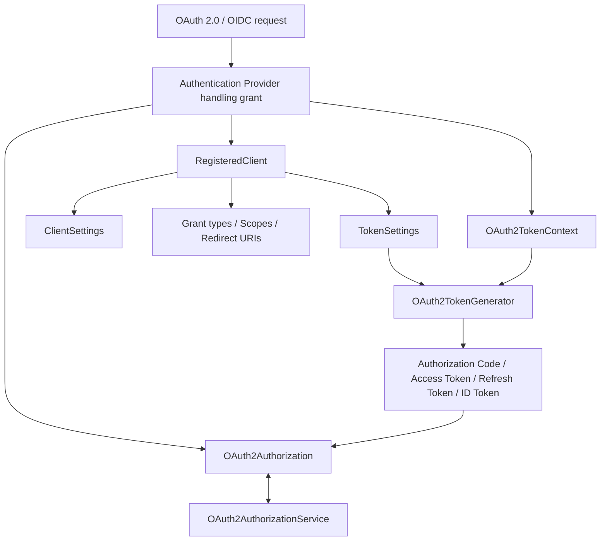
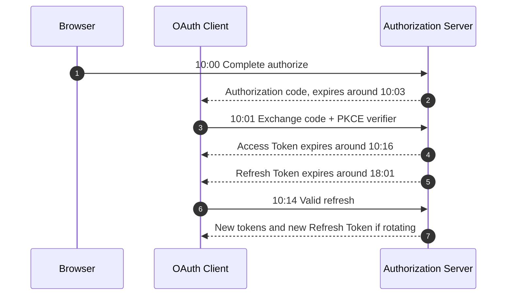
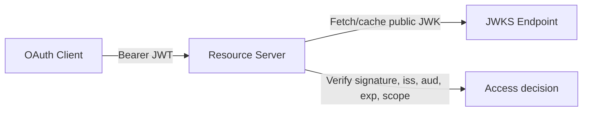
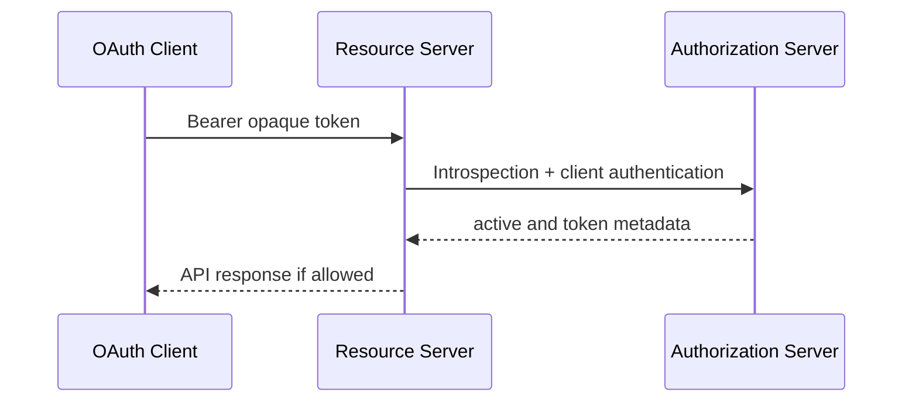
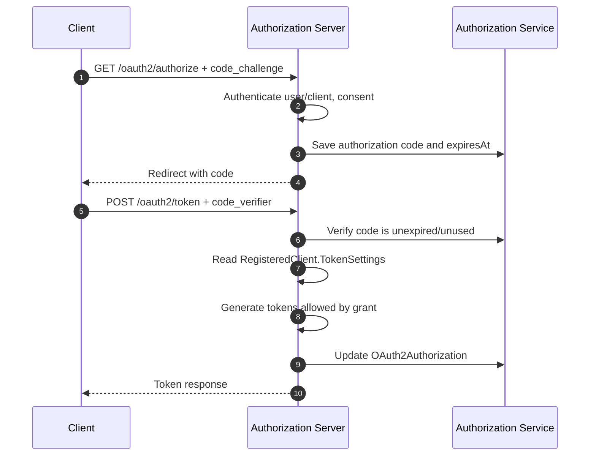

# TokenSettings and token issuance and lifetime policies

## 1. The role of TokenSettings in an Authorization Server

In the **Core Models** chapter of the **SPRING_SECURITY_OAUTH2_OIDC_AUTHORIZATION_SERVER** module, we explore how to design, configure, secure, test, and operate an OAuth 2.0/OpenID Connect Authorization Server using Spring Security and Spring Authorization Server in a Spring Boot application.

A practical question is: **How does the Authorization Server decide how long an Access Token remains valid, when an authorization code expires, whether a Refresh Token can be reused, and whether an Access Token is issued as a JWT or an opaque token?**

Spring Authorization Server represents those choices in `TokenSettings`, a set of settings attached to each `RegisteredClient`. Each client's token policy can differ depending on application type, grant type, risk level, and product requirements.

By the end of this lesson, you will be able to:

- Identify the place of `TokenSettings` within the `RegisteredClient`, `OAuth2Authorization`, and `OAuth2TokenGenerator` models.
- Configure lifetimes for authorization codes, Access Tokens, Refresh Tokens, Device Codes, and Access Token formats.
- Distinguish `reuseRefreshTokens(true/false)` from revocation, rotation, and replay-detection policies.
- Distinguish a self-contained JWT Access Token from a reference/opaque token and explain how a Resource Server verifies each.
- Implement a sample client with `TokenSettings` and test TTLs, refresh flows, and rejection cases.
- Explain the limits of `TokenSettings` in overall security: PKCE, audience, key rotation, sessions, and revocation.

**Principle to remember:** `TokenSettings` governs **how new tokens are issued** for a client; it is not a token table, does not revoke already-issued tokens on its own, and does not replace authorization checks at the Resource Server.

## 2. Where TokenSettings sits in the data model



The diagram shows logical relationships; each actual grant issues only its corresponding token types.

| Model | Responsibility | Example |
| --- | --- | --- |
| `RegisteredClient` | OAuth client registration info, grant types, redirect URIs, scopes, and settings. | Client `demo-web` registers `authorization_code`, `refresh_token`. |
| `ClientSettings` | Client interaction and protection policies. | Require PKCE, require consent. |
| **`TokenSettings`** | Issuance rules, lifetimes, and format of tokens for the client. | Access Token 15 minutes, Refresh Token 8 hours. |
| `OAuth2TokenContext` | Context of a single token generation call: client, principal, token type, grant, scopes. | Input to the token generator. |
| `OAuth2TokenGenerator` | Generates tokens according to the passed type and context. | Produces JWT or opaque Access Tokens. |
| `OAuth2Authorization` | State of an authorization transaction, issued tokens, and metadata. | Whether code was used, when tokens expire. |
| `OAuth2AuthorizationService` | Persists/retrieves authorization and token state. | In-memory/JDBC service. |
| `AuthorizationServerSettings` | Global configuration for the Authorization Server. | Issuer, endpoint paths; not per-client TTL policy. |

### 2.1. Distinguishing policy from token state

Suppose token A is issued at 09:00 with a 30-minute TTL. At 09:05, an administrator changes `TokenSettings.accessTokenTimeToLive` to 15 minutes. Token B issued at 09:06 will use the new policy and expire around 09:21, but already-issued token A still carries its old expiration timestamp around 09:30.

Changing `TokenSettings` **does not rewrite `exp` on already-issued JWTs**, nor does it automatically instruct every Resource Server to stop accepting that token. If old tokens must be cut off urgently, the system needs an appropriate revocation, denylist, or additional verification policy.

### 2.2. Policies are stored alongside RegisteredClient

In an application, the `RegisteredClientRepository` bean may store client info in memory or a database. Each `RegisteredClient` owns its own `TokenSettings`:

```java
RegisteredClient client = registeredClientRepository.findByClientId("demo-web");
if (client == null) {
    throw new IllegalStateException("Unknown client");
}

TokenSettings settings = client.getTokenSettings();
Duration accessTtl = settings.getAccessTokenTimeToLive();
Duration refreshTtl = settings.getRefreshTokenTimeToLive();
boolean reuseRefreshToken = settings.isReuseRefreshTokens();
OAuth2TokenFormat tokenFormat = settings.getAccessTokenFormat();
```

If you use a JDBC repository, editing sample client creation code will not necessarily update an existing record in the database. Update policies through the corresponding `RegisteredClient` update workflow.

## 3. Core properties of TokenSettings

The following APIs reflect common usage in the Spring Authorization Server 1.x line. Library versions may add or adjust properties; when bringing code into a project, verify against the official documentation for your exact version.

| Builder API | Effect | Security notes |
| --- | --- | --- |
| `authorizationCodeTimeToLive(Duration)` | Authorization code lifetime. | Short-lived, single-use code; still requires PKCE and valid redirect URI. |
| `accessTokenTimeToLive(Duration)` | Lifetime of new Access Tokens. | Trade-off between leaked-token exposure window and token issuance frequency. |
| `accessTokenFormat(OAuth2TokenFormat)` | Choose `SELF_CONTAINED` or `REFERENCE` for Access Tokens. | Affects how the Resource Server validates tokens. |
| `refreshTokenTimeToLive(Duration)` | Lifetime of new Refresh Tokens. | Requires secure storage plus rotation/revocation policies. |
| `reuseRefreshTokens(boolean)` | Whether to reuse the Refresh Token on a successful refresh. | `false` is appropriate for rotating refresh tokens, though not sufficient on its own to detect every replay. |
| `deviceCodeTimeToLive(Duration)` | Device code lifetime in the Device Authorization Grant. | Only relevant when implementing the device flow. |
| `idTokenSignatureAlgorithm(SignatureAlgorithm)` | Signing algorithm for OIDC ID Tokens. | Not an API for setting the ID Token TTL. |
| `x509CertificateBoundAccessTokens(boolean)` (if supported by version) | Requires tokens bound to the client certificate in applicable scenarios. | Requires a complete mTLS/certificate-bound token design, not just flipping one flag. |

Do not rely on library defaults without checking them. Configured values must be valid `Duration` instances, typically positive durations.

### 3.1. Practical policy example

```java
import java.time.Duration;
import org.springframework.security.oauth2.core.OAuth2TokenFormat;
import org.springframework.security.oauth2.jose.jws.SignatureAlgorithm;
import org.springframework.security.oauth2.server.authorization.settings.TokenSettings;

TokenSettings policy = TokenSettings.builder()
        .authorizationCodeTimeToLive(Duration.ofMinutes(3))
        .accessTokenTimeToLive(Duration.ofMinutes(15))
        .accessTokenFormat(OAuth2TokenFormat.SELF_CONTAINED)
        .refreshTokenTimeToLive(Duration.ofHours(8))
        .reuseRefreshTokens(false)
        .deviceCodeTimeToLive(Duration.ofMinutes(5))
        .idTokenSignatureAlgorithm(SignatureAlgorithm.RS256)
        .build();
```

**These numbers are illustrative** to clearly contrast the different token types; they are not a universal production TTL recommendation.

## 4. Issuance lifetimes and lifecycle of each token type

### 4.1. Authorization code

An authorization code is issued once the user has completed required authentication and consent steps. The client exchanges the code at the token endpoint. With `authorizationCodeTimeToLive(Duration.ofMinutes(3))`, a code issued at 10:00 expires around 10:03.

An authorization code must be **short-lived, unpredictable, and single-use**. In the Authorization Code Flow with PKCE, the client must submit a `code_verifier` matching the `code_challenge` bound to the original transaction. The Authorization Server must also verify the client, redirect URI, and code state. A short TTL does not replace PKCE, `state`, or redirect rules.

### 4.2. Access Token

An Access Token is the credential a client uses to call a Resource Server, typically sent in a header:

```http
GET /api/orders HTTP/1.1
Host: api.example.com
Authorization: Bearer <access-token>
```

For JWT Access Tokens, claims such as `iat` and `exp` indicate issuance and expiration times. The recipient must verify the signature/algorithm, issuer, expiration, audience, and appropriate permissions. For opaque Access Tokens, the Resource Server typically checks validity via introspection.

The shorter the Access Token TTL, the smaller the window for abusing a stolen token; in return, clients must refresh or request new tokens more often. Choose based on API risk, client architecture, and load capacity.

### 4.3. Refresh Token

A Refresh Token lets a client obtain new tokens when eligible without sending the user through the full Authorization Code Flow every time. It is a high-sensitivity credential and usually lives longer than an Access Token.

A Refresh Token is **not automatically issued to every client and every grant**. The Authorization Server considers the grant type, client authentication method, client registration, and token generator rules. For instance, `client_credentials` typically does not issue a Refresh Token because a confidential client can simply re-authenticate to obtain a new Access Token.

Two settings with distinct meanings:

```java
.reuseRefreshTokens(true)   // May return the existing Refresh Token on refresh.
.reuseRefreshTokens(false)  // Rotates the Refresh Token on a successful refresh.
```

When rotation is active, the client must replace the old Refresh Token with the new one. The old token can no longer be used to refresh under the updated authorization state. **Rotation alone does not guarantee detection of anomalous reuse, revocation of an entire token family, or enforcement of an absolute session limit**. Those requirements need dedicated design and testing, especially under concurrent refresh requests.

### 4.4. Device Code and ID Token

`deviceCodeTimeToLive` affects the **device code** lifetime in the Device Authorization Grant, when an input-constrained device needs the user to confirm on another device. Once device authorization succeeds, the Access Token has its own lifecycle governed by `accessTokenTimeToLive`.

An ID Token belongs to OpenID Connect and allows the client to verify the user's sign-in result. `idTokenSignatureAlgorithm` controls the signing algorithm such as `RS256`. In versions with the API above, `TokenSettings` has no `idTokenTimeToLive(...)` setter analogous to Access Token. **Do not assume ID Token TTL equals Access Token TTL**; inspect actual claims and supported customization options for your exact version. Never use an ID Token in place of an Access Token when calling APIs.

### 4.5. Timeline example

Assuming a 3-minute code TTL, 15-minute Access Token TTL, and 8-hour Refresh Token TTL:



Each token's lifetime is calculated from **that token's own issuance time**. A new token after refresh can receive a new expiration timestamp per policy, but do not assume refreshing forever allows an infinite session: re-authentication policies and absolute session lifetimes are complementary concerns.

## 5. SELF_CONTAINED and REFERENCE: two Access Token formats

### 5.1. Self-contained Access Token (typically JWT)

```java
.accessTokenFormat(OAuth2TokenFormat.SELF_CONTAINED)
```

When Spring Authorization Server is configured with an appropriate `JwtEncoder`/JWK, a common self-contained Access Token is a signed JWT. The Resource Server validates the signature and claims using public keys, typically fetched from JWKS.



**Pros:** APIs can validate tokens locally, reducing per-request round trips to the Authorization Server. **Limitations:** once a JWT is issued and the Resource Server only checks signature/expiration, state changes on the Authorization Server do not immediately cause that JWT to be rejected. You may need short TTLs or additional state checks if immediate revocation is required.

JWS-signed JWTs normally **do not encrypt the payload**. Anyone holding the token string can decode the claims, so never place secrets or unnecessary personal data in the payload.

### 5.2. Reference Access Token (opaque)

```java
.accessTokenFormat(OAuth2TokenFormat.REFERENCE)
```

A reference token is an opaque string acting as a pointer to token state on the Authorization Server. The Resource Server typically calls the introspection endpoint over a secured channel using appropriate credentials to check whether the token is still `active`.



| Criterion | SELF_CONTAINED/JWT | REFERENCE/opaque |
| --- | --- | --- |
| Typical validation | Local signature + claims verification. | Introspection against the Authorization Server. |
| Dependency on AS per API call | Usually not needed once JWKs are fetched/cached. | Usually needed, unless the Resource Server caches results. |
| Revocation effectiveness | Not immediate with offline verification alone without extra mechanisms. | Easier to check current state if introspection/caching is designed properly. |
| Reading claims from token string | Signed JWT payload is typically readable. | Opaque token does not directly expose claims via decoding. |
| Operational requirements | Public JWKS, key rotation, issuer/audience validation. | Introspection credentials, availability, latency, and cache policy. |

**Choosing an Access Token format does not change the purpose of an ID Token**: OIDC clients must still validate ID Tokens according to the OIDC specification.

## 6. Configuring TokenSettings on a sample RegisteredClient

The following example matches common configuration in Spring Authorization Server 1.x. It creates client `demo-web` under the `dev` profile, with a backend holding the client secret and using the Authorization Code Flow with PKCE. If your project uses another Spring Boot/Spring Security version, check the corresponding APIs and dependencies.

```java
package com.example.authorizationserver.config;

import java.time.Duration;
import java.util.UUID;

import org.springframework.context.annotation.Bean;
import org.springframework.context.annotation.Configuration;
import org.springframework.context.annotation.Profile;
import org.springframework.security.crypto.factory.PasswordEncoderFactories;
import org.springframework.security.crypto.password.PasswordEncoder;
import org.springframework.security.oauth2.core.AuthorizationGrantType;
import org.springframework.security.oauth2.core.ClientAuthenticationMethod;
import org.springframework.security.oauth2.core.OAuth2TokenFormat;
import org.springframework.security.oauth2.core.oidc.OidcScopes;
import org.springframework.security.oauth2.jose.jws.SignatureAlgorithm;
import org.springframework.security.oauth2.server.authorization.client.InMemoryRegisteredClientRepository;
import org.springframework.security.oauth2.server.authorization.client.RegisteredClient;
import org.springframework.security.oauth2.server.authorization.client.RegisteredClientRepository;
import org.springframework.security.oauth2.server.authorization.settings.ClientSettings;
import org.springframework.security.oauth2.server.authorization.settings.TokenSettings;

@Configuration(proxyBeanMethods = false)
@Profile("dev")
public class DemoClientTokenPolicyConfig {

    @Bean
    PasswordEncoder passwordEncoder() {
        return PasswordEncoderFactories.createDelegatingPasswordEncoder();
    }

    @Bean
    RegisteredClientRepository registeredClientRepository(PasswordEncoder encoder) {
        TokenSettings tokens = TokenSettings.builder()
                .authorizationCodeTimeToLive(Duration.ofMinutes(3))
                .accessTokenTimeToLive(Duration.ofMinutes(15))
                .accessTokenFormat(OAuth2TokenFormat.SELF_CONTAINED)
                .refreshTokenTimeToLive(Duration.ofHours(8))
                .reuseRefreshTokens(false)
                .idTokenSignatureAlgorithm(SignatureAlgorithm.RS256)
                .build();

        RegisteredClient demoWeb = RegisteredClient.withId(UUID.randomUUID().toString())
                .clientId("demo-web")
                .clientSecret(encoder.encode("dev-secret-only-change-me"))
                .clientAuthenticationMethod(ClientAuthenticationMethod.CLIENT_SECRET_BASIC)
                .authorizationGrantType(AuthorizationGrantType.AUTHORIZATION_CODE)
                .authorizationGrantType(AuthorizationGrantType.REFRESH_TOKEN)
                .redirectUri("http://127.0.0.1:8081/login/oauth2/code/demo-web")
                .scope(OidcScopes.OPENID)
                .scope(OidcScopes.PROFILE)
                .scope("api.read")
                .clientSettings(ClientSettings.builder()
                        .requireProofKey(true)
                        .requireAuthorizationConsent(true)
                        .build())
                .tokenSettings(tokens)
                .build();

        return new InMemoryRegisteredClientRepository(demoWeb);
    }
}
```

**Preconditions for applying this:**

- The application needs Spring Authorization Server dependencies, a `SecurityFilterChain` for OAuth/OIDC endpoints, user login for the Authorization Code Flow, `AuthorizationServerSettings`, and an appropriate signing key/JWK source. The snippet above **only configures the client and token policy**, not an entire Authorization Server.
- If a `PasswordEncoder` or `RegisteredClientRepository` bean already exists, integrate the configuration rather than creating duplicate beans.
- The sample client is a **confidential client**: only the backend holds the secret. Never put `dev-secret-only-change-me` in frontend JavaScript, mobile apps, or production source code.
- `http://localhost` and `127.0.0.1` are only for local testing. Production requires HTTPS, tightly controlled redirect URIs, and securely managed secrets.
- `InMemoryRegisteredClientRepository` does not persist data across restarts; production should use a durable repository and a controlled policy-update process.

### 6.1. Dedicated configuration for an opaque-token client

```java
TokenSettings opaquePolicy = TokenSettings.builder()
        .accessTokenTimeToLive(Duration.ofMinutes(10))
        .accessTokenFormat(OAuth2TokenFormat.REFERENCE)
        .refreshTokenTimeToLive(Duration.ofHours(2))
        .reuseRefreshTokens(false)
        .build();

// Pass opaquePolicy into tokenSettings(...) of another RegisteredClient.
```

Switching to `REFERENCE` must go hand in hand with configuring opaque token verification and introspection on the Resource Server. Do not change a single line on the Authorization Server and assume an API configured to validate JWTs will automatically understand reference tokens.

## 7. How TokenSettings is used across grants

### 7.1. Authorization Code Flow with PKCE



In this flow, the code TTL is applied when issuing the code; the Access Token TTL, token format, and Refresh Token policy are applied during the token issuance step. `ClientSettings.requireProofKey` and `requireAuthorizationConsent` are separate policies, not `TokenSettings` properties.

### 7.2. Refresh Token Grant

```http
POST /oauth2/token HTTP/1.1
Host: auth.example.com
Authorization: Basic <base64-client-credentials>
Content-Type: application/x-www-form-urlencoded

grant_type=refresh_token&refresh_token=<refresh-token>
```

The Authorization Server verifies the client, refresh token state, grant, and related conditions before issuing new tokens. With `reuseRefreshTokens(false)`, a successful refresh can return a new token replacing the old one. On the client side, **persist the new tokens atomically** so that two concurrent refresh flows do not overwrite state inconsistently.

### 7.3. Client Credentials Grant

A machine-to-machine client can request an Access Token using `client_credentials` if registered. This grant has no authorization code, user login, or PKCE; `accessTokenTimeToLive` still matters, whereas `authorizationCodeTimeToLive` has no effect on that request.

This is why **not every `TokenSettings` property affects every client type or grant**.

## 8. Testing token lifetimes and formats

### 8.1. Checking the Access Token after Authorization Code Flow

Suppose the demo Authorization Server runs at `http://localhost:9000`. First, use the registered client to initiate a valid Authorization Code Flow with `code_challenge_method=S256` and a random `state`. After the user logs in, approves scopes, and the client receives the callback, verify `state` and extract the **unused** authorization code.

In PowerShell, send the code exchange request:

```powershell
$code = '<authorization-code>'
$verifier = '<original-pkce-verifier>'
curl.exe -sS -X POST "http://localhost:9000/oauth2/token" -u "demo-web:dev-secret-only-change-me" -H "Content-Type: application/x-www-form-urlencoded" --data-urlencode "grant_type=authorization_code" --data-urlencode "code=$code" --data-urlencode "redirect_uri=http://127.0.0.1:8081/login/oauth2/code/demo-web" --data-urlencode "code_verifier=$verifier"
```

This is a local test command on localhost; real traffic always requires HTTPS. The client password in this example is strictly for learning.

A successful response may look like:

```json
{
  "access_token": "<access-token>",
  "token_type": "Bearer",
  "expires_in": 900,
  "refresh_token": "<refresh-token>",
  "scope": "openid profile api.read",
  "id_token": "<id-token>"
}
```

`expires_in` typically reflects the remaining validity duration of the Access Token in seconds; for 15 minutes, the value is usually close to `900`. Do not expect every measurement to match down to the exact second due to processing time and rounding. Refresh Token and ID Token appear only when supported by the grant, client, scopes, and policies.

If the Access Token is a JWT, decode the header/payload to **inspect** `iat` and `exp`, and compare their difference against the configured TTL. Decoding **does not replace** verifying signature, issuer, audience, and permissions.

### 8.2. Checking reference tokens

When using `OAuth2TokenFormat.REFERENCE`, test introspection using a client authorized to authenticate with the endpoint:

```http
POST /oauth2/introspect HTTP/1.1
Host: auth.example.com
Authorization: Basic <authorized-client-credentials>
Content-Type: application/x-www-form-urlencoded

token=<opaque-access-token>
```

The Resource Server must check the `active` field along with metadata and its own policies. Once a token expires or is revoked, it must no longer be treated as valid. Note that caching introspection responses can delay propagation of revocation status.

### 8.3. Testing Refresh Token rotation

Take the Refresh Token issued after the Authorization Code Flow, then invoke:

```powershell
$refreshToken = '<refresh-token>'
curl.exe -sS -X POST "http://localhost:9000/oauth2/token" -u "demo-web:dev-secret-only-change-me" -H "Content-Type: application/x-www-form-urlencoded" --data-urlencode "grant_type=refresh_token" --data-urlencode "refresh_token=$refreshToken"
```

With `reuseRefreshTokens(false)`, verify that a new token is issued on a successful refresh, then retry the old Refresh Token. According to the updated authorization state, the old token must no longer be usable for refreshing. Also test two nearly concurrent refresh requests and an expired Refresh Token.

### 8.4. Test matrix

| Scenario | Expected outcome |
| --- | --- |
| Authorization code past TTL | Token endpoint rejects, typically `invalid_grant`. |
| Already-used authorization code | Cannot be exchanged a second time. |
| Mismatching PKCE verifier | No token issued for the invalid transaction. |
| JWT `exp` after issuance | Duration matches the configured Access Token TTL. |
| Expired JWT calling API | Resource Server rejects, accounting for reasonable clock skew. |
| Client using REFERENCE | Resource Server validates via introspection rather than decoding as JWT. |
| Refresh Token rotation | New token replaces old token; old token can no longer be used. |
| Expired Refresh Token | No new tokens issued with that refresh token. |
| Client without `refresh_token` grant | Refresh request is rejected. |
| Change TokenSettings | New tokens follow new policy; old tokens are not retroactively altered. |
| Two clients with different TTLs | Each client receives tokens per its own `TokenSettings`. |
| OIDC ID Token | Verify signature, `iss`, `aud`, `exp`; do not infer TTL from Access Token. |

Never log or paste real tokens into public tools to inspect claims. Use dummy credentials and accounts in development environments.

## 9. Things TokenSettings does not do on its own

### 9.1. Authentication, PKCE, consent, and scopes

`TokenSettings` does not authenticate users, decide which grants a client may use, or determine permissions on the Resource Server. Those belong to `SecurityFilterChain`, user/client authentication, `RegisteredClient`, `ClientSettings`, authorization/consent services, and API configuration.

Shortening the authorization code lifetime **does not replace** PKCE; shortening the Access Token TTL **does not replace** audience or scope checks.

### 9.2. Token revocation and invalidation

Changing the TTL only affects tokens issued under the new policy. For already-issued self-contained JWTs, a Resource Server validating locally may still accept them until `exp` unless there is a denylist or extra status check. For reference tokens, introspection can reflect current state, though caching and availability must be weighed.

Revocation workflows, logout, invalidating all sessions on account compromise, and detecting refresh token replay require dedicated design. Rotation is part of the solution, not the entire answer.

### 9.3. Key management and issuer

`idTokenSignatureAlgorithm(SignatureAlgorithm.RS256)` selects the ID Token signing algorithm; generating, protecting, rotating, and publishing public keys belong to JWK/`JwtEncoder` configuration and key infrastructure. When rotating keys, keep publishing the old public key long enough for valid existing JWTs to be verified per policy.

The public issuer must be stable and configured via `AuthorizationServerSettings`. The Resource Server must check the JWT's `iss` against trusted issuers; `TokenSettings` does not fix reverse-proxy misconfigurations or wrong issuers.

### 9.4. Absolute session limits and system time

Refresh Token rotation can produce new tokens with new expiration timestamps; if the product requires users to **re-authenticate after N hours**, an absolute session lifetime and dedicated policy are needed. In addition, server clocks must be synchronized so `exp`/`nbf` checks remain reliable; do not arbitrarily widen clock skew to mask time-sync issues.

## 10. Choosing policies by client type and operations

| Application type | Common grants | Things to consider |
| --- | --- | --- |
| Backend web/BFF | Authorization Code + PKCE, Refresh Token if needed | Secret on backend; short Access Token; refresh tailored to session needs and risk. |
| SPA/public client | Authorization Code + PKCE | Do not embed client secret; protect refresh token if issued, using rotation/sender-constraining per risk and standards. |
| Mobile app | Authorization Code + PKCE | Store tokens securely using platform mechanisms; clear refresh policy. |
| Backend service | Client Credentials | Appropriately scoped Access Token TTL; typically no Refresh Token. |
| TV/input-constrained device | Device Authorization Grant | Separate Device Code TTL and polling behavior; Access Token still has its own TTL. |

Policy change procedures should include impact assessment, updating the repository storing `RegisteredClient`, testing new/old tokens, monitoring refresh rates, `invalid_grant`/`invalid_token`, and introspection load. Switching from JWT to opaque tokens also requires changing how Resource Servers verify tokens; this is an architectural change, not just flipping a single field.

Do not treat the 3-minute / 15-minute / 8-hour figures in this lesson as mandatory production baselines. Appropriate TTLs depend on resource sensitivity, token exposure risk, client type, traffic volume, user experience, and re-authentication policies.

## 11. Self-check exercises

**Exercise A — Two clients, two policies.** Register `demo-web` using Authorization Code + PKCE (15-minute Access Token, 8-hour Refresh Token, rotation) and a confidential client using only `client_credentials` (5-minute Access Token). Explain why the refresh policy plays virtually no role for the second client.

**Exercise B — Observing TTLs.** With a 3-minute code TTL, try exchanging a code after expiration. With a JWT Access Token, compare `iat`, `exp`, and `expires_in`. Do not confuse code issuance time with Access Token issuance time.

**Exercise C — JWT vs. reference.** Configure two clients with the two token formats, describe how the Resource Server validates each, and contrast what happens during revocation.

**Exercise D — Rotation and concurrency.** Refresh once, then try the old token. Next, describe what happens when two concurrent refresh requests arrive for the same client and how to avoid losing new tokens due to non-atomic state updates.

**Exercise E — Changing policy.** Lower the Access Token TTL from 15 minutes to 5 minutes, issue a new token, and compare it with an old token; explain why updating the policy does not retroactively expire already-issued tokens.

### Completion checklist

- [ ] Understand that `TokenSettings` is a policy on `RegisteredClient`, distinct from `OAuth2Authorization` and `OAuth2AuthorizationService`.
- [ ] Can configure authorization code, Access Token, Refresh Token, and Device Code TTLs as needed.
- [ ] Distinguish `SELF_CONTAINED` from `REFERENCE` along with Resource Server implications.
- [ ] Explain `reuseRefreshTokens(false)` and the limits of refresh rotation.
- [ ] Know that ID Tokens have their own signing policy and do not automatically use the Access Token TTL.
- [ ] Can verify expired/reused codes, expired Access Tokens, and invalid Refresh Tokens.
- [ ] Identify responsibilities outside `TokenSettings`: PKCE, issuer/audience validation, key rotation, consent, sessions, and revocation.
- [ ] Know how to update policies while accounting for existing token lifecycles and client behavior.

## 12. References

- [Spring Authorization Server Reference](https://docs.spring.io/spring-authorization-server/reference/) — core model, `RegisteredClient`, token generator, and endpoints.
- [Spring Authorization Server API: TokenSettings](https://docs.spring.io/spring-authorization-server/docs/current/api/org/springframework/security/oauth2/server/authorization/settings/TokenSettings.html) — getters and builder for token policies.
- [Spring Authorization Server API: RegisteredClient](https://docs.spring.io/spring-authorization-server/docs/current/api/org/springframework/security/oauth2/server/authorization/client/RegisteredClient.html) — attaching token settings to a client registration.
- [Spring Security Reference](https://docs.spring.io/spring-security/reference/) — Resource Server JWT, opaque tokens, and validation.
- [RFC 6749](https://www.rfc-editor.org/rfc/rfc6749) — OAuth 2.0 core: authorization code, access/refresh tokens, and grants.
- [RFC 7636](https://www.rfc-editor.org/rfc/rfc7636) — Proof Key for Code Exchange.
- [RFC 7009](https://www.rfc-editor.org/rfc/rfc7009) — OAuth 2.0 Token Revocation.
- [RFC 7662](https://www.rfc-editor.org/rfc/rfc7662) — OAuth 2.0 Token Introspection.
- [RFC 9700](https://www.rfc-editor.org/rfc/rfc9700) — OAuth 2.0 Security Best Current Practice.
- [OpenID Connect Core 1.0](https://openid.net/specs/openid-connect-core-1_0.html) — ID Token and verification.

**Key takeaway:** `TokenSettings` controls token issuance policies per OAuth client—especially Access Token lifetime and format alongside Refresh Token strategy. A secure design combines these policies properly with grant flows, state persistence, Resource Server authorization checks, key management, and revocation mechanisms.
