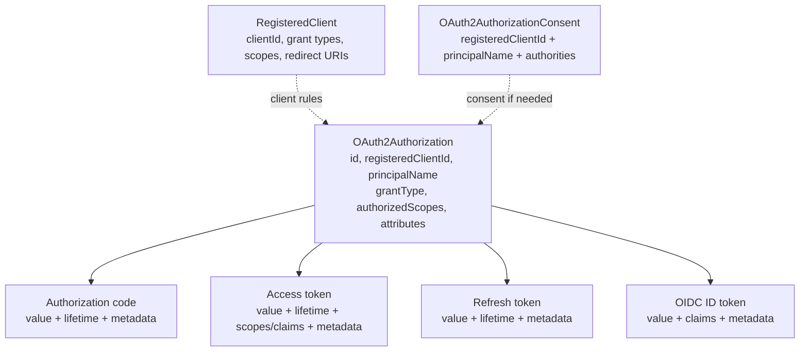
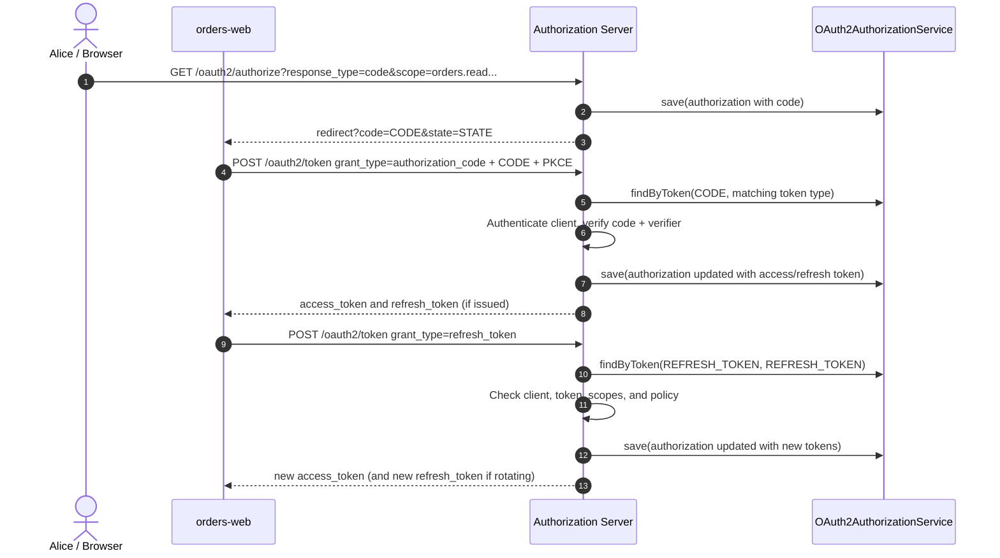

# OAuth2Authorization and the set of tokens attached to an authorization

## 1. Context: a single authorization can generate multiple tokens

In a **Spring Security OAuth 2.0 / OpenID Connect Authorization Server** built with **Spring Boot** and **Spring Authorization Server**, granting authorization to an application does not necessarily produce just one access token. When a user completes the Authorization Code Flow, the system may generate an authorization code, an access token, a refresh token, and—if OpenID Connect (OIDC) is used—an ID token. During subsequent refreshes, new access tokens are issued without sending the user through the login and consent screens again.

To manage this chain of events, Spring Authorization Server uses **`OAuth2Authorization`**: the domain model representing an **authorization created for a client and principal**, along with its state, authorized scopes, and associated tokens. This is a core topic of the **Core Models** chapter in the **SPRING_SECURITY_OAUTH2_OIDC_AUTHORIZATION_SERVER** module.

For example: an application `orders-web` requests `orders.read` on behalf of `alice`. After Alice signs in, the Authorization Server creates an authorization code, exchanges it for an access token, and may also issue a refresh token. All of them belong to the **same `OAuth2Authorization`** within that authorization's lifecycle.

> **Main point:** `OAuth2Authorization` is the Authorization Server's authorization state record; tokens are the values and state entries attached to that record. One authorization can contain multiple **types** of tokens, though you should not assume a single record retains the complete history of every token ever issued.

### Learning objectives

After this lesson, you will be able to:

1. Identify `OAuth2Authorization` and distinguish it from `RegisteredClient`, `OAuth2AuthorizationConsent`, and JWTs.
2. Read properties, token wrappers, metadata, and token statuses within the aggregate.
3. Explain the lifecycle of authorization codes, access tokens, refresh tokens, and OIDC ID tokens.
4. Use `OAuth2AuthorizationService` to save, find, and remove an authorization.
5. Decide when to use in-memory vs. JDBC storage and how to operate across multiple instances.
6. Avoid confusing stored state with the outcome of Bearer token verification at a Resource Server.

## 2. What is an Authorization in the Spring Authorization Server model?

OAuth 2.0 describes an **authorization grant** as the basis for a client to obtain an access token. In Spring Authorization Server, the **`OAuth2Authorization`** class concretizes the authorization state the server must retain while executing a grant. It is created/updated during steps involving the authorization endpoint, token endpoint, and token management endpoints.

Distinguish these four entities:

| Entity | Question it answers | Characteristics |
| --- | --- | --- |
| **`RegisteredClient`** | Which grants, redirect URIs, scopes, and authentication methods is the client **allowed** to use? | Client registration configuration; not a token-issuance session |
| **`OAuth2AuthorizationConsent`** | Which permissions has the Resource Owner **approved** for the client? | Consent state for a principal–client pair; may span multiple authorizations |
| **`OAuth2Authorization`** | What **state is this specific authorization in**, and what tokens has it issued/does it hold? | Grant/token lifecycle aggregate, identified by its own ID |
| **Access token / JWT** | What credential does the client carry to **access the Resource Server**? | Token sent on API calls; JWTs can be verified locally |

A user can have multiple distinct authorizations, even with the same client, due to different authorization grants, sessions, or grant types. **Do not treat `principalName` or `registeredClientId` as the unique key of the record.** `OAuth2Authorization.id` is the identifier of a specific authorization record.

### Conceptual relationship diagram



Dashed arrows represent business relationships, **not mandatory foreign keys** for every storage choice. An actual authorization holds only the token types relevant to the grant and enabled features. For instance, `client_credentials` has no interactive user, authorization code, or ID token; Authorization Code has no `id_token` if the client does not make a valid OIDC request.

## 3. Components and properties of `OAuth2Authorization`

Key components of the model:

| Property / API | Meaning | Usage |
| --- | --- | --- |
| `id` / `getId()` | Identifier of the authorization | Look up, update, and manage record lifecycle |
| `registeredClientId` / `getRegisteredClientId()` | **Internal** ID of the related `RegisteredClient` | Binds the authorization to the registered client |
| `principalName` / `getPrincipalName()` | Principal name used by the AS for the authorization | For Authorization Code, typically the username; for client credentials, typically represents the client itself |
| `authorizationGrantType` / `getAuthorizationGrantType()` | Grant/mechanism that created the authorization | For example, `authorization_code` or `client_credentials` |
| `authorizedScopes` / `getAuthorizedScopes()` | Scopes granted in this authorization | Distinct from the client's **requested** scopes and registered client scopes |
| `attributes` / `getAttributes()` | Internal authorization flow data | Such as Authentication, request context, state, or data used by the framework |
| Token set | Codes and tokens associated with the authorization | Look up tokens by type, inspect expiration and state |

Here `registeredClientId` is usually the internal ID used by the repository, **different from** the public `clientId` value the client sends in HTTP requests. To display the client ID, you can use `RegisteredClientRepository.findById(authorization.getRegisteredClientId())`.

**Scopes across two layers:** `RegisteredClient.scopes` are the scopes a client *may request*. `OAuth2Authorization.authorizedScopes` are the scopes allowed by the AS in that authorization; the actual scopes inside the access token may also depend on the grant, token context, and issuance policies. When enforcing API access, the Resource Server must verify that the **token being presented** carries the required scope/authority.

### The token wrapper: `OAuth2Authorization.Token<T>`

Spring Authorization Server does not store merely the raw token string. Inside `OAuth2Authorization`, each associated token is represented as `OAuth2Authorization.Token<T>` where `T extends OAuth2Token`:

```text
OAuth2Authorization
  ├── id / registeredClientId / principalName / grantType / scopes
  ├── attributes: authorization workflow data
  ├── Token<OAuth2AuthorizationCode>
  │     ├── token: code value and issuedAt/expiresAt
  │     └── metadata: status (e.g., invalidated)
  ├── Token<OAuth2AccessToken>
  │     ├── token: value, Bearer type, issuedAt/expiresAt, scopes
  │     └── metadata: status and claims if stored
  ├── Token<OAuth2RefreshToken>
  │     ├── token: value and issuedAt/expiresAt
  │     └── metadata: status
  └── Token<OidcIdToken> (if OIDC)
        ├── token: value and ID token claims
        └── metadata: status
```

Concepts to separate:

- **`getToken()`** on the wrapper: returns the token object containing the value and timestamps.
- **`getMetadata()`**: internal metadata attached to the token, used by the AS to mark state and store processing details.
- **`getClaims()`** on the wrapper: claims stored in metadata for that token, **if present**. Do not assume every opaque token or every storage version holds the same claim set as a JWT.
- **`isExpired()`**, **`isInvalidated()`**, **`isActive()`**: wrapper state checks. Conceptually, a token is only *active* when it is neither expired nor marked invalidated in stored state.

Authorization/token metadata is **server-side state**, not data meant to be exposed to clients. Never return raw `attributes` or `metadata` directly in an API response.

### Common token types

| Data type | Typical Java type | Appears in context | Purpose |
| --- | --- | --- | --- |
| Authorization code | `OAuth2AuthorizationCode` | Authorization Code Flow | Short-lived, single-use code exchanged for tokens |
| Access token | `OAuth2AccessToken` | Grants that issue access tokens | Calling a Resource Server |
| Refresh token | `OAuth2RefreshToken` | When permitted by client/flow/policy | Obtaining new access tokens |
| OIDC ID token | `OidcIdToken` | OIDC requests with `openid` scope | Proving authentication result to the Relying Party |
| Device code / user code | `OAuth2DeviceCode` / `OAuth2UserCode` | Device Authorization Flow if supported/enabled | Linking a session on an input-constrained device with user verification |

**An authorization code is not an access token**, and **an ID token is not meant for calling APIs**. Two tokens may both be JWTs yet serve completely different audiences and security purposes.

## 4. Lifecycle: from authorization code to refresh token

Consider a confidential client named `orders-web`, configured with `authorization_code` and `refresh_token` grants and allowed to request scope `orders.read`. User `alice` has logged in and, if required by policy, granted consent.



**Stage 1 — issuing the code:** once the authorization request is approved, the AS saves the authorization with the code and binding details for later verification: client, principal, scopes, and redirect URI/PKCE per handler logic. The code is short-lived and single-use.

**Stage 2 — exchanging the code:** the token endpoint finds the record containing the submitted code, verifies client authentication, the code, redirect URI, PKCE, and policy. On success, the AS updates the authorization with the access token and, where applicable, refresh token; the code is no longer accepted for another exchange. The system may keep the code record marked invalidated rather than deleting it immediately.

**Stage 3 — refreshing:** the token endpoint looks up the authorization by a valid refresh token. The AS may issue a new access token and, depending on configuration, rotate the refresh token. The existing authorization record is updated to reflect the new tokens rather than creating a brand-new authorization on every refresh by default.

**Stage 4 — expiration or revocation:** tokens can expire according to `expiresAt` or be marked invalidated. If the access token expires while the refresh token remains valid, the client can refresh per policy. Once the refresh token expires/is revoked or the authorization is removed, refreshing with that token is no longer possible.

### State over time

| Point in time | Authorization code | Access token | Refresh token |
| --- | --- | --- | --- |
| After successful authorization request | Briefly valid | Not yet issued | Not yet issued |
| After successful code exchange | Cannot be exchanged again | Active | May be issued |
| After access token expires | No longer used | Expired | May still be active |
| After successful refresh | Unchanged | New access token | Retained or replaced per policy |
| After refresh token is revoked | Unchanged | Status depends on revocation policy | Can no longer be used to refresh |

These rows describe typical Spring Authorization Server behavior; specifics of rotation, history retention, cascading revocation, and lifetimes depend on **`TokenSettings`**, client type, and framework version. Do not interpret this table as a promise that the system keeps every old token in memory indefinitely.

## 5. APIs for reading `OAuth2Authorization` and token state

Spring Authorization Server provides APIs to read tokens **by type**, rather than parsing a custom JSON structure. Two commonly used methods are:

```java
OAuth2Authorization.Token<OAuth2AccessToken> access = authorization.getAccessToken();
OAuth2Authorization.Token<OAuth2RefreshToken> refresh = authorization.getRefreshToken();
```

For other token types, use `authorization.getToken(TokenClass.class)` with the corresponding token class. These methods can return `null` if the authorization does not yet or will never contain that token type. **Never assume** every authorization simultaneously holds an access token, refresh token, authorization code, and OIDC ID token.

### Example: reading an authorization by access token

The Java snippet below illustrates querying server state from a received access token, running **inside the Authorization Server** or a component permitted to access `OAuth2AuthorizationService`. It is not a public API for arbitrary users to inspect tokens:

```java
package com.example.authserver;

import java.time.Instant;
import java.util.Set;
import java.util.Optional;

import org.springframework.security.oauth2.core.OAuth2AccessToken;
import org.springframework.security.oauth2.core.OAuth2TokenType;
import org.springframework.security.oauth2.server.authorization.OAuth2Authorization;
import org.springframework.security.oauth2.server.authorization.OAuth2AuthorizationService;
import org.springframework.stereotype.Service;

@Service
public class AuthorizationInspector {
    private final OAuth2AuthorizationService authorizations;

    public AuthorizationInspector(OAuth2AuthorizationService authorizations) {
        this.authorizations = authorizations;
    }

    public Optional<AuthorizationSummary> findByAccessToken(String rawAccessToken) {
        // Only look up tokens within authorized system boundaries.
        OAuth2Authorization authorization =
                authorizations.findByToken(
                        rawAccessToken, OAuth2TokenType.ACCESS_TOKEN);

        if (authorization == null) {
            return Optional.empty();
        }

        OAuth2Authorization.Token<OAuth2AccessToken> wrapper =
                authorization.getAccessToken();
        if (wrapper == null
                || !wrapper.getToken().getTokenValue().equals(rawAccessToken)) {
            return Optional.empty();
        }

        return Optional.of(new AuthorizationSummary(
                authorization.getId(),
                authorization.getRegisteredClientId(),
                authorization.getPrincipalName(),
                authorization.getAuthorizationGrantType().getValue(),
                authorization.getAuthorizedScopes(),
                wrapper.isActive(),
                wrapper.isExpired(),
                wrapper.isInvalidated(),
                wrapper.getToken().getExpiresAt()));
    }

    public record AuthorizationSummary(
            String authorizationId,
            String registeredClientId,
            String principalName,
            String grantType,
            Set<String> authorizedScopes,
            boolean accessTokenActive,
            boolean accessTokenExpired,
            boolean accessTokenInvalidated,
            Instant accessTokenExpiresAt) {
    }
}
```

**Important explanations:**

- `findByToken(value, OAuth2TokenType.ACCESS_TOKEN)` returns the **authorization owning the matching token**, not a verified `Jwt` directly.
- `getAccessToken()` provides details on the token currently attached to the authorization. Checking value equality prevents mistaking the queried record for a different token on the same authorization.
- `isActive()` reflects the server-stored state based on expiration and invalidation flags; **it does not cryptographically verify the signature of a JWT** passed to the query. Accepting Bearer JWTs at a Resource Server requires a JWT decoder/validator.
- The summary intentionally **omits token values, refresh tokens, codes, PII-bearing claims, and raw attributes**. Administrative screens must also enforce access control, logging hygiene, and field filtering.

For example, if you want to check whether a refresh token is still active:

```java
OAuth2Authorization.Token<OAuth2RefreshToken> refresh =
        authorization.getRefreshToken();

boolean canAttemptRefresh = refresh != null && refresh.isActive();
```

`canAttemptRefresh` is only a **necessary condition** regarding token state; the token endpoint still must authenticate the client, check token–client binding, grant, scopes, and protocol rules before issuing new tokens. Never rely on this variable to skip security checks.

### Metadata, claims, and state are not the same thing

For example, an access token has:

```text
token value: eyJhbGciOiJSUzI1NiIs... (illustrative only)
issuedAt:    2026-01-01T09:00:00Z
expiresAt:   2026-01-01T09:15:00Z
metadata:    {invalidated: false, ...}
claims:      {iss: "...", sub: "alice", aud: ["orders-api"], scope: "orders.read", ...}
```

Three layers of information serve different purposes:

1. **Token value** is the actual value the client presents to endpoints; for a JWT it carries the signed payload, while for an opaque token it is typically an unguessable string.
2. **AS-side metadata** tracks stored server state such as expiration/invalidation; this does not need to appear inside a JWT.
3. **Claims** are assertions carried with the issued token. Whether the wrapper keeps a copy of claims and how they are stored depends on the token generator/mapper and framework version.

`isActive()` status is not proof that a token has the right `aud`, `scope`, or signature; conversely, a JWT with a valid signature might already have been revoked on the AS without a Resource Server performing local-only JWT checks knowing about it.

## 6. `OAuth2AuthorizationService`: the authorization state store

This is the central interface managing the `OAuth2Authorization` lifecycle. Key operations:

| Method | Behavior | Usage example |
| --- | --- | --- |
| `save(OAuth2Authorization)` | Creates or updates an authorization | Save after issuing a code, exchanging for tokens, or changing token state |
| `remove(OAuth2Authorization)` | Deletes an authorization from the store | Cleanup/revocation per system design |
| `findById(String id)` | Finds an authorization by ID | Inspect state of a specific authorization |
| `findByToken(String token, OAuth2TokenType type)` | Finds an authorization by token value and token type | Token exchange, refresh, introspection, or revocation |

`save` is typically an **upsert by authorization ID**. When handling multiple tokens belonging to the same authorization, the application does not need to manually manage separate token tables at each step; the AS uses the service to look up and update the aggregate. Even so, physical storage and concurrency handling between requests depend on the repository/service implementation.

### Example configuring an in-memory store

```java
import org.springframework.context.annotation.Bean;
import org.springframework.security.oauth2.server.authorization.OAuth2AuthorizationService;
import org.springframework.security.oauth2.server.authorization.InMemoryOAuth2AuthorizationService;

@Bean
OAuth2AuthorizationService authorizationService() {
    return new InMemoryOAuth2AuthorizationService();
}
```

Suitable for single-process demos or simple tests. On restart, authorizations/codes/refresh tokens are lost; across multiple instances that do not share state, a browser authorizing on instance A and performing token exchange on instance B may fail to find the authorization code.

### Example configuring JDBC for environments requiring durable storage

```java
import org.springframework.context.annotation.Bean;
import org.springframework.jdbc.core.JdbcTemplate;
import org.springframework.security.oauth2.server.authorization.OAuth2AuthorizationService;
import org.springframework.security.oauth2.server.authorization.client.RegisteredClientRepository;
import org.springframework.security.oauth2.server.authorization.JdbcOAuth2AuthorizationService;

@Bean
OAuth2AuthorizationService authorizationService(
        JdbcTemplate jdbcTemplate,
        RegisteredClientRepository registeredClients) {
    return new JdbcOAuth2AuthorizationService(jdbcTemplate, registeredClients);
}
```

This example assumes the application has configured a `DataSource`, `JdbcTemplate`, and compatible `RegisteredClientRepository`, and has created the **`oauth2_authorization`** SQL schema using the official script for the Spring Authorization Server version in use. Adding the bean alone does not automatically create the tables.

In JDBC, columns are designed to store authorization ID, client, principal, grant, scopes, attributes, and value/timestamp/metadata groups for each token type. Column names, data types, and serialization formats can vary across versions; **never invent the schema by guessing from the Java API**. Pay special attention to column length limits for JWTs/claims, large object types, token lookup indexes/keys, and schema upgrade procedures.

### Notes on permissions and related stores

Persisting `OAuth2Authorization` **does not replace** the other two stores:

- `RegisteredClientRepository` stores client configuration, grant types, scopes, token settings, and redirect URIs. When the AS processes codes/refreshes, it must verify that the client is currently allowed to operate under that configuration.
- `OAuth2AuthorizationConsentService` stores the Resource Owner's approval of authorities/scopes when the application requires consent. Consent can be reused across authorizations per policy, whereas `OAuth2Authorization` describes one specific authorization.

For production deployments, coordinate **all three stores** consistently: registered clients, authorizations, and consents—alongside signing keys, issuer, user authentication methods, and monitoring.

## 7. Distinguishing permission scopes, tokens, and identities

Scenario: `RegisteredClient` permits `orders.read` and `orders.write`; user Alice approves only `orders.read`. When an access token is issued, it carries `orders.read`.

```text
RegisteredClient.scopes
    = {orders.read, orders.write}

OAuth2Authorization.authorizedScopes
    = {orders.read}

OAuth2AccessToken.scopes
    = {orders.read}    // example when the access token keeps the granted scopes

Resource Server required authority
    = SCOPE_orders.read
```

If the client tries to call `POST /api/orders` requiring `orders.write` using a token that only has `orders.read`, the API must reject it per policy. **Never assume a token holds every scope configured on `RegisteredClient`.**

### Client credentials and principalName

With `authorization_code`, the principal is typically the authenticated user. With `client_credentials`, the principal typically represents the **authenticated client**, because this grant carries no end-user login session. Therefore:

- Do not rely solely on `principalName` to conclude that an authorization represents a human user.
- Also inspect `authorizationGrantType` and the service's authentication/authorization model.
- Resource Servers should design dedicated permissions for service tokens rather than defaulting to user-level data access.

### OIDC ID token alongside an authorization

When using the Authorization Code Flow with a valid `openid` request, an authorization may also include an `OidcIdToken`. It describes the authentication event and contains claims such as `iss`, `sub`, `aud` (the client ID), `iat`, `exp`, and possibly `nonce`. The ID token is verified by the **OIDC client/Relying Party** for sign-in; it does not replace an access token. An `OAuth2Authorization` record holding both an access token and an ID token **does not mean the two tokens are interchangeable**.

## 8. How does TokenSettings affect the aggregate?

Token policies are set on the client configuration and applied by the server when issuing/exchanging tokens. Example configuration for `RegisteredClient.Builder`:

```java
import java.time.Duration;
import org.springframework.security.oauth2.server.authorization.settings.TokenSettings;

TokenSettings settings = TokenSettings.builder()
        .authorizationCodeTimeToLive(Duration.ofMinutes(3))
        .accessTokenTimeToLive(Duration.ofMinutes(15))
        .refreshTokenTimeToLive(Duration.ofDays(7))
        .reuseRefreshTokens(false)
        .build();

// Used when building RegisteredClient:
// RegisteredClient.withId(...).tokenSettings(settings).build();
```

| Setting | Lifecycle impact |
| --- | --- |
| `authorizationCodeTimeToLive` | Code expires after a short duration; cannot be exchanged for tokens after expiry |
| `accessTokenTimeToLive` | Access token expires even while the authorization/refresh token may still remain valid |
| `refreshTokenTimeToLive` | Limits how long the refresh token can be used |
| `reuseRefreshTokens(false)` | Requires rotating the refresh token on reissue when supported |
| `accessTokenFormat` | Selects self-contained (JWT) or reference (opaque) format, if supported by token generator and config |

**The number and longevity of tokens** are governed by these settings. Once a refresh token is rotated, do not consider the old token valid merely because it belonged to the same authorization. Preventing refresh token reuse in real systems also requires session security, anomaly monitoring, and atomic handling of concurrent requests.

## 9. Revocation, introspection, and the limits of JWTs

Three actions are frequently confused:

1. **JWT signature validation**: the Resource Server verifies that the token has a valid signature, issuer, audience, lifetime, and appropriate permissions.
2. **Introspection**: a Resource Server or authorized client asks the Authorization Server whether a token is still `active` according to server state.
3. **Revocation**: a client/administrator requests invalidation of a token per protocol and policy, typically updating stored authorization/token state on the server.

When the AS uses `OAuth2AuthorizationService`, it can locate the authorization owning the token and check invalidation flags or expiration. A typical introspection request looks like:

```http
POST /oauth2/introspect HTTP/1.1
Host: auth.example.com
Authorization: Basic <credentials-of-authorized-client>
Content-Type: application/x-www-form-urlencoded

token=ACCESS_TOKEN_VALUE
```

When a token is valid per policy, the response may contain `"active": true` along with additional attributes. If the token does not exist, is expired, or has been invalidated, it typically returns `"active": false`. Never design an endpoint that exposes internal sensitive authorization data to arbitrary callers; the introspection endpoint requires client authentication/authorization as configured.

### An easily missed scenario: a revoked JWT

Suppose a JWT access token has:

```text
iat = 09:00
exp = 09:15
revocation request reaches AS at 09:05
Resource Server verifies JWT signature locally at 09:06
```

If the Resource Server relies **only** on signature, `iss`, `aud`, `exp`, and scopes, the JWT can still pass verification at 09:06; the Resource Server does not automatically learn about the invalidation flag just written to `OAuth2Authorization`. Depending on security goals, consider short-lived tokens, online introspection, denylists, or effective session/revocation mechanisms. Each approach trades off latency, availability, and complexity.

**Do not equate these two statements:**

- "`OAuth2Authorization.Token.isActive()` is `false`" — the Authorization Server considers the token inactive based on stored state.
- "Every Resource Server has stopped accepting the token" — this depends on how each Resource Server verifies revocation status.

### When should an entire authorization be removed?

`remove(authorization)` deletes the authorization record from the store. This is broader than marking **one specific token** invalidated. Deleting the entire authorization can discard state needed for refreshing, introspection, diagnostics, or managing other tokens in the same authorization. When the requirement is simply to revoke an access token, let the AS's official revocation component manage token/metadata state per protocol and policy rather than arbitrarily deleting the entire aggregate in application code.

## 10. Common model scenarios

### Scenario A: same client, same user, multiple authorizations

Alice opens `orders-web` on her laptop and her phone; both go through the Authorization Code Flow. The system **can** create two separate authorization records even though `principalName = alice` and `registeredClientId` is the same. When logging out of one device, never assume all of Alice's authorizations are invalidated; logout and session/token revocation policies must be explicitly designed.

### Scenario B: access token only, no refresh token

A `service-report` client using `client_credentials` may receive an access token with **no** authorization code, ID token, or refresh token. If code operates assuming `authorization.getRefreshToken().isActive()` is always valid, it can throw a `NullPointerException`. Check token presence according to grant type before accessing it.

### Scenario C: exchanging a code a second time

After exchanging an authorization code for tokens, the client resubmits the same code. The AS detects or recognizes that the code has already been used/invalidated and rejects it with an error such as `invalid_grant`. Whether a code remains present in stored state **does not** mean it is still usable.

### Scenario D: refresh rotation when two requests arrive concurrently

Two tabs or two workers submit the same refresh token nearly simultaneously. If both requests read the old state and write new state without concurrency control, they can cause record contention, accidentally issue multiple tokens, or lose updates. A multi-instance application must define how concurrency is handled at the storage/protocol layer and test parallel refresh cases. Never assume JDBC alone automatically solves all race conditions.

### Scenario E: querying all authorizations of a user

The standard `OAuth2AuthorizationService` interface supports lookup by ID or by token. It **does not expose a built-in API to list all authorizations by `principalName`**. If the product needs an "active signed-in devices" screen, design additional queries/indexes and administrative access controls, handling sensitive fields and session–token consistency carefully. Never write a fake `findByToken` loop as a substitute for a listing query.

## 11. Testing the authorization model meaningfully

Testing should not stop at verifying that the token endpoint returns HTTP 200. The goal is to prove that **the aggregate holds accurate data and transitions state properly for each grant**.

| Scenario | Data to observe | Expected result |
| --- | --- | --- |
| Successful Authorization Code Flow | `registeredClientId`, principal, grant type, scopes, and code | Authorization bound to right client/principal, short-lived code |
| Exchanging code for access token | Code status and `getAccessToken()` | Code cannot be reused; access token exists and is active |
| Refresh token present | `getRefreshToken()` | Token present when allowed by client/flow; not assumed for every grant |
| Using a valid refresh token | Authorization before/after refresh | Token updated according to reuse/rotation policy |
| Attempting to reuse code | Token endpoint / authorization state | Rejected; no new access token issued from used code |
| Invalid or expired refresh token | `findByToken`, `isActive()`, token endpoint | Rejected with appropriate protocol error, no token issued |
| OIDC `openid` request | `getToken(OidcIdToken.class)` | ID token present for valid OIDC; not used as API Bearer token |
| Revoked token | Metadata and introspection | AS reports token inactive per revocation state |
| Resource Server receives revoked JWT | API validation configuration | Behavior reflects chosen revocation strategy; test both offline and online checks |
| Restart or node failover | Shared authorization store | JDBC/cluster locates active authorization and updates it properly |
| Concurrent refresh execution | Final state and issued tokens | No lost updates or token acceptance violating rotation policy |

### Self-verification exercise sequence

1. Register an Authorization Code client allowed to request `orders.read`, enforcing PKCE.
2. Sign in as a user and complete the authorization request. Verify that the authorization is persisted and contains the corresponding code.
3. Exchange the code at the token endpoint; look up the authorization again by access token and verify principal, grant, and scopes.
4. Use `getAccessToken().isActive()` to inspect stored state, then use a Spring Security Resource Server to validate the JWT in front of an API requiring `SCOPE_orders.read`. Explain why these two checks differ.
5. Resubmit the old authorization code; verify the token endpoint rejects it.
6. If a refresh token is present, perform a refresh and inspect the updated access/refresh token state.
7. Revoke a token through a supported mechanism; call introspection and compare with local JWT validation behavior.
8. Restart the application with an in-memory store, then with a durable store; note the difference in authorization lookup availability.

### Conceptual check questions

**Question 1.** Having a `RegisteredClient` and Alice signed in—why is that not yet enough to call an API?  
**Answer:** A registered client and an authenticated user do not prove that a valid access token with the proper scopes/audience has been issued and presented to the API.

**Question 2.** Does an `OAuth2Authorization` holding two different token types mean two separate authorizations occurred?  
**Answer:** No. The Authorization Code Flow can store the code, access token, refresh token, and ID token (if OIDC) within **the same authorization**.

**Question 3.** Does `getAccessToken().isActive() == true` guarantee a JWT has a valid signature and the API must permit access?  
**Answer:** No. Signature, issuer, audience, lifetime, and permissions must be verified at the Resource Server according to policy.

**Question 4.** Is deleting `OAuth2Authorization` the same as deleting `OAuth2AuthorizationConsent`?  
**Answer:** No. An authorization records the state of a single grant/token issuance; consent records the user's approval decision per client–principal pair and server storage mechanism.

**Question 5.** Can you fetch all of Alice's authorizations using a standard `findByPrincipalName` method on the `OAuth2AuthorizationService` interface?  
**Answer:** No. The standard interface only provides lookup by ID and by token; an additional lookup component must be designed if needed.

## 12. Design, security, and operational considerations

When building and operating an Authorization Server with Spring Security, `OAuth2Authorization` contains sensitive data. Pay attention to:

- **Protect token values at rest:** access/refresh tokens, authorization codes, and attributes may contain secrets or identifying data. Restrict DB permissions, encrypt connections, govern backups, and avoid writing tokens to logs.
- **Never return the whole aggregate to clients:** `attributes` can hold internal authentication/context data; `metadata` is not designed as a general API response.
- **Schema and serialization stability:** use the JDBC schema matching your library version, plan migrations, control Java class/serialization changes, and test upgrades against existing data.
- **Shared storage in a cluster:** issuing a code on node A and exchanging it on node B requires shared state. Also manage concurrency, atomicity, retries, and transactions when updating the same authorization.
- **Clean up expired tokens:** retention/cleanup policies prevent unbounded data growth. Token expiration does not automatically delete physical records immediately.
- **Persist signing keys durably:** keeping authorizations in a DB is insufficient if previously issued JWTs were signed with a key lost after restart. Manage public keys, private keys, and JWKS compatibly with token TTLs.
- **Selective observability:** log authorization ID, grant type, internal client ID, token type, processing outcome, and timestamps per policy; mask token values, client secrets, passwords, PKCE verifiers, and sensitive claims.
- **End-to-end testing:** verify code exchange, refresh, introspection/revocation, Resource Server JWT validation, OIDC ID tokens when enabled, as well as failures for disallowed scopes/grants/clients.

### Memory map

```text
RegisteredClient
    "What is the client allowed to do?"
            |
            v
OAuth2AuthorizationConsent (if needed)
    "Which permissions did the user approve?"
            |
            v
OAuth2Authorization
    "What state does this specific authorization hold?"
    id / registeredClientId / principalName / grantType / scopes
    attributes
    Token<authorization code>   [if present]
    Token<access token>         [if issued]
    Token<refresh token>        [if issued]
    Token<OIDC ID token>        [if OIDC requested]
            |
            v
OAuth2AuthorizationService
    save / remove / findById / findByToken
            |
            v
InMemory or JDBC (Authorization Server state)

Resource Server:
    validates Bearer JWT/opaque token against issuer,
    audience, lifetime, scopes, and revocation policy
```

**Learning takeaway:** `OAuth2Authorization` is the aggregate managing **a single authorization and its related tokens** on the Authorization Server side. Understanding the boundaries between this record, client registration, consent, token contents, and Resource Server verification helps you properly design storage models, token lifecycles, revocation handling, and OAuth 2.0/OIDC testing in Spring Boot.

## References

- [Spring Authorization Server Reference](https://docs.spring.io/spring-authorization-server/reference/) — `OAuth2Authorization` model, `OAuth2AuthorizationService`, providers, and endpoints.
- [Spring Security OAuth2 Resource Server](https://docs.spring.io/spring-security/reference/servlet/oauth2/resource-server/index.html) — validating JWTs, opaque tokens, and authorities.
- [RFC 6749 — The OAuth 2.0 Authorization Framework](https://www.rfc-editor.org/rfc/rfc6749) — authorization grants, access tokens, refresh tokens, and endpoints.
- [RFC 7009 — OAuth 2.0 Token Revocation](https://www.rfc-editor.org/rfc/rfc7009) — revoking tokens.
- [RFC 7662 — OAuth 2.0 Token Introspection](https://www.rfc-editor.org/rfc/rfc7662) — querying active state of a token.
- [OpenID Connect Core 1.0](https://openid.net/specs/openid-connect-core-1_0.html) — ID tokens and Authorization Code Flow in OIDC.
