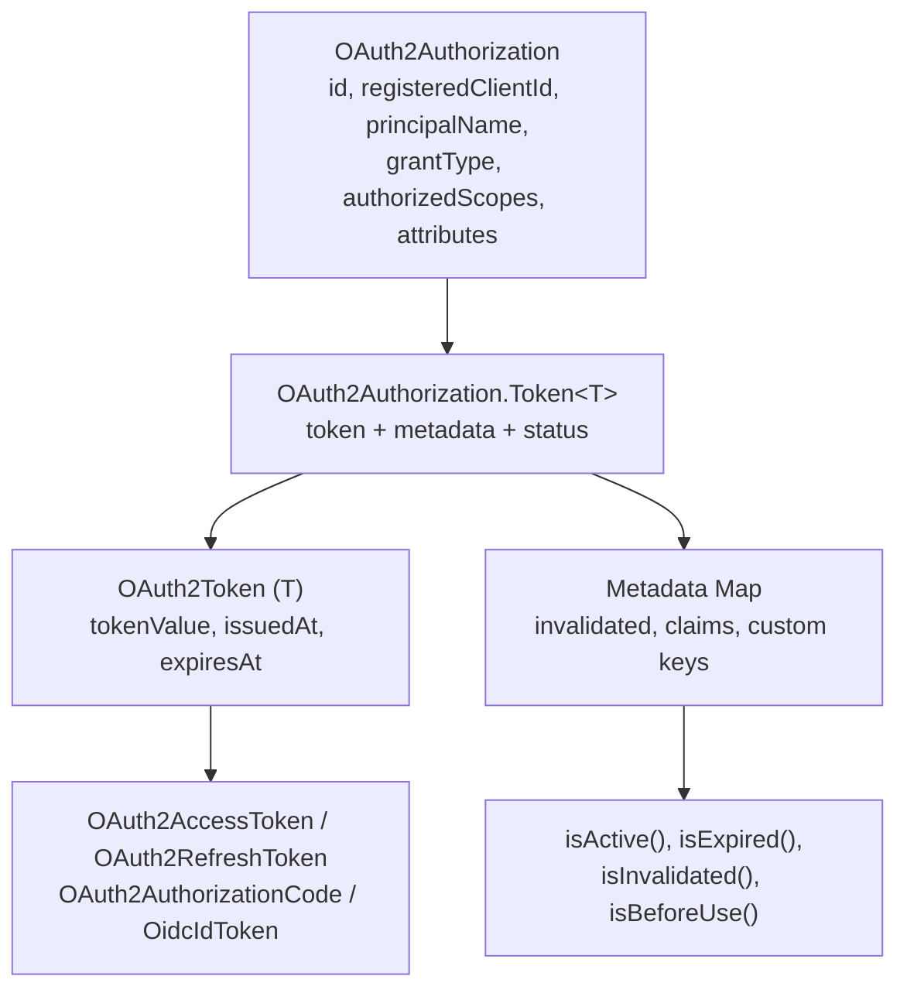
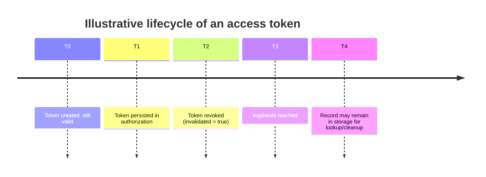
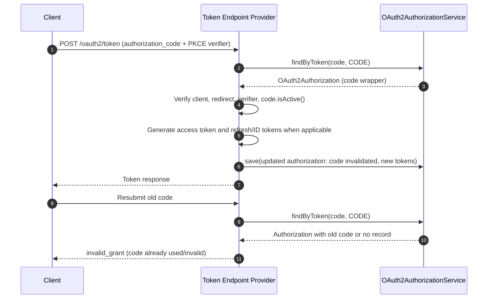
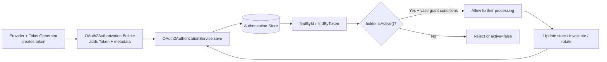
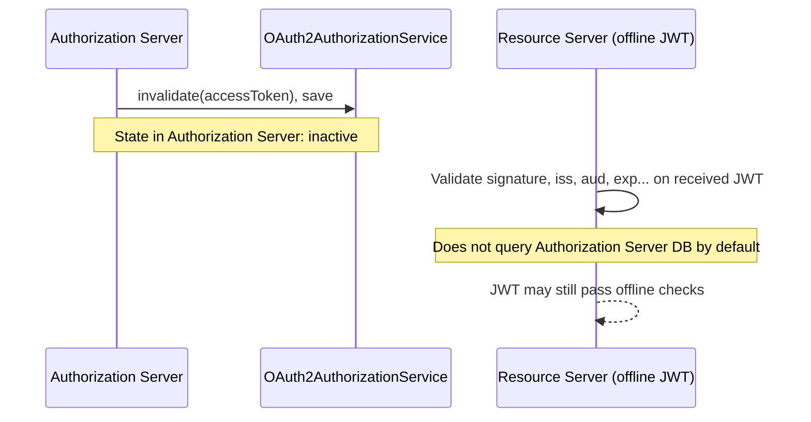

# OAuth2Authorization.Token, metadata, and active status

## 1. Why understand the Token model inside the Authorization Server?

In a **Spring Security OAuth2/OIDC Authorization Server**, issuing an access token goes beyond returning a string from `/oauth2/token`. Spring Authorization Server also needs to know which authorization event the token belongs to, which subject, which client, what claims it carries, whether it is expired or invalidated, and whether it can be used again to obtain a new token. This information forms the foundation for Authorization Code, Refresh Token, Token Introspection, Token Revocation, session management, and security testing.

This lesson belongs to the **Core Models** chapter and focuses on the nested class **`OAuth2Authorization.Token<T extends OAuth2Token>`** and the meaning of **metadata** and **active status** in a **Spring Boot** application using **Spring Security and Spring Authorization Server**. This is the state model *inside the Authorization Server*; it is not the Token Endpoint response DTO or an object the Resource Server always receives.

After this lesson, you will understand and be able to:

- Read the exact relationships among `OAuth2Authorization`, `OAuth2Authorization.Token`, and token classes such as `OAuth2AccessToken`, `OAuth2RefreshToken`, `OAuth2AuthorizationCode`, and `OidcIdToken`.
- Distinguish **token value**, **claims**, **metadata**, **authorization attributes**, and **validity status**.
- Use `getToken()`, `getClaims()`, `getMetadata()`, `isActive()`, `isExpired()`, `isInvalidated()`, and `isBeforeUse()` for their intended purposes.
- Create and update `OAuth2Authorization` via its builder, use `invalidate(token)`, and persist changes via `OAuth2AuthorizationService`.
- Explain why a token can still exist in the database while no longer being active, and why revoking a JWT on the Authorization Server does not immediately block APIs validating JWTs completely offline.

**API version:** The illustrative examples follow the **Spring Authorization Server 1.5.x / Spring Security 6.x** API group. The Spring Security 7.x line integrates Authorization Server capabilities into Spring Security and may differ in artifacts/packages or configuration details. In real implementations, consult the Javadoc for the exact version managed by Spring Boot.

## 2. Three layers to distinguish

Within an authorization granted to a client, Spring stores information across three layers:



### 2.1. `OAuth2Authorization` — state of an authorization event

`OAuth2Authorization` is the overarching object, which may contain:

| Property | Meaning |
| --- | --- |
| `id` | Dedicated ID of the authorization, **not** `client_id` or the access token string. |
| `registeredClientId` | **Internal** ID of the associated `RegisteredClient`. |
| `principalName` | User identity; with `client_credentials` this may represent the client. |
| `authorizationGrantType` | Grant type tied to this issuance, e.g., `authorization_code` or `client_credentials`. |
| `authorizedScopes` | Permission scopes granted for this authorization. |
| Tokens | One or more `OAuth2Authorization.Token<?>`, depending on the flow and processing stage. |
| `attributes` | Additional data at the **authorization level**, such as the authorization request or authentication info needed by the protocol. |

Do not assume an authorization always holds all of access token, refresh token, and ID token. For example, **Client Credentials** typically has only an access token; **Authorization Code** initially holds only an authorization code; **OIDC Authorization Code** can have an ID token after completing the code exchange.

### 2.2. `OAuth2Token` — the token value itself

The `OAuth2Token` interface represents the baseline token data, including:

- `getTokenValue()`: the string carrying the token (sensitive; never log it).
- `getIssuedAt()`: issuance timestamp, usable in time checks.
- `getExpiresAt()`: expiration timestamp.

Specialized classes add token-specific data. For instance, `OAuth2AccessToken` carries token type and scopes; `OidcIdToken` holds OIDC claims. Not every token is a JWT, and not every token value can be decoded for claims on the client side.

### 2.3. `OAuth2Authorization.Token<T>` — wrapper holding metadata and status

This is a nested class of `OAuth2Authorization`, parameterized by the stored `OAuth2Token` subtype. It holds the **token object** alongside a **metadata map** and provides validity checks.

Example when an access token is present:

```java
OAuth2Authorization.Token<OAuth2AccessToken> holder =
        authorization.getAccessToken();

if (holder != null) {
    OAuth2AccessToken accessToken = holder.getToken();
    boolean active = holder.isActive();
    boolean expired = holder.isExpired();
    boolean revoked = holder.isInvalidated();
    Map<String, Object> claims = holder.getClaims();
}
```

*This snippet assumes an `authorization` variable of type `OAuth2Authorization`, with appropriate Java/Spring imports.* Here `holder` is the wrapper, while `accessToken` is the token object. There is no equivalent `accessToken.isInvalidated()` API: **invalidation state lives on the wrapper**.

## 3. Distinguishing metadata, claims, and attributes

Three kinds of information are often loosely called "metadata", yet they live in different scopes.

| Storage location | API | Examples | Purpose |
| --- | --- | --- | --- |
| **Authorization attributes** | `authorization.getAttributes()`, `getAttribute(name)` | Authentication, authorization request | Context for the entire authorization event |
| **Token metadata** | `holder.getMetadata()`, `getMetadata(name)` | Invalidated flag, claims, and custom keys | State/information **specific to one token** |
| **Token claims** | `holder.getClaims()` | `sub`, `iss`, `aud`, `scope`… when present | Assertions attached by the generator or held server-side |
| **Token value** | `holder.getToken().getTokenValue()` | Three-part JWT string or opaque string | Credential value carried and used by the client |

### 3.1. Framework-defined metadata keys

`OAuth2Authorization.Token` exposes two important constants:

- `OAuth2Authorization.Token.INVALIDATED_METADATA_NAME`: key for the flag indicating whether the token is invalidated. By default, `isInvalidated()` returns `false` if it has not been marked invalidated.
- `OAuth2Authorization.Token.CLAIMS_METADATA_NAME`: metadata key used to store the token's **claims**. `getClaims()` returns the claims map or `null` if absent.

Example reading metadata without printing secret values:

```java
OAuth2Authorization.Token<OAuth2AccessToken> holder =
        authorization.getAccessToken();

if (holder != null) {
    Map<String, Object> metadata = holder.getMetadata();
    Boolean invalidated = holder.getMetadata(
            OAuth2Authorization.Token.INVALIDATED_METADATA_NAME);
    Map<String, Object> claims = holder.getClaims();

    // These boolean values can be passed to the application logger.
    // Do not output tokenValue or full claims/metadata.
    boolean active = holder.isActive();
    boolean revoked = Boolean.TRUE.equals(invalidated);
}
```

Do not hardcode literal metadata key strings or guess internal constant values. Use the framework constants to avoid compatibility bugs.

### 3.2. Are claims in metadata the JWT payload?

**Not necessarily.** When a token is created by a generator supporting claims, Spring can store claims in `OAuth2Authorization.Token` metadata. With a self-contained JWT, claims are also carried in the signed JWT payload. With an opaque token, **the value is a reference string**; claims may only exist on the Authorization Server side and be returned via introspection according to policy.

Two common mistakes:

1. `holder.getClaims()` can return `null`; do not assume every `OAuth2RefreshToken` or authorization code has a JWT claims map.
2. Writing a key directly into metadata **does not modify an already-signed JWT**. To alter a JWT's payload at issuance, use `OAuth2TokenCustomizer<JwtEncodingContext>` or an appropriate generator *before signing*. To store extra operational properties, decide clearly whether they belong in authorization attributes or token metadata.

**Security principle:** Do not place sensitive internal data in JWT claims simply because a signature guarantees integrity; a standard JWT payload can be read by whoever holds the token. Database metadata must also be protected because it can contain personal data and security-sensitive details.

## 4. Validity status: active, expired, invalidated, before use

`OAuth2Authorization.Token` provides four status checks:

| Method | Meaning | What can cause the result to change? |
| --- | --- | --- |
| `isExpired()` | Token is past its expiration time. | The clock reaches/passes `expiresAt`. |
| `isInvalidated()` | Token has been **marked invalidated**. | Metadata is updated when redeeming a code, revoking, or per another policy. |
| `isBeforeUse()` | Token has not yet reached its usable start time, if an applicable timestamp applies. | The clock is still before the effective start time. |
| `isActive()` | Token can currently be considered active according to the wrapper's status conditions. | Expiring, being invalidated, or being before its usable time. |

According to this state model, a token is **active** when it is not invalidated, not expired, and not in a before-use state. That is the mental model; in code, **call `holder.isActive()` directly** instead of reimplementing those checks against your own clock.

### 4.1. Scenario matrix

| Scenario | `isExpired()` | `isInvalidated()` | `isBeforeUse()` | `isActive()` |
| --- | --- | --- | --- | --- |
| Newly issued, within validity window | `false` | `false` | `false` | `true` |
| Expired, not revoked | `true` | `false` | Usually `false` | `false` |
| Marked revoked while still within lifetime | `false` | `true` | `false` | `false` |
| Before its usable time | May be `false` | `false` | `true` | `false` |
| Both expired **and** revoked | `true` | `true` | Usually `false` | `false` |

These states are not mutually exclusive: a revoked token **still continues aging toward expiration**. Setting the invalidated flag does not modify `expiresAt`. Results depend on evaluation time and token attributes; for `isBeforeUse()`, check the timing rules of your exact library version.

### 4.2. Timeline illustration



- From **T0 until before T2**, the token can be active if other conditions hold.
- At **T2**, the token becomes inactive because it is invalidated, even though its lifetime has not ended.
- At **T3**, the token is also expired; both reasons for inactivity can hold simultaneously.
- At **T4**, the record may still reside in `OAuth2AuthorizationService`. **Existing in the database does not prove a token is still usable.**

### 4.3. Status of the entire authorization

One authorization holds **multiple tokens** with different lifecycles. The authorization code may already be used and invalidated while the access token or refresh token remains active. Spring's model treats an authorization as **implicitly inactive** when all associated tokens are inactive. However, that **does not mean the framework deletes the record immediately**, nor is there a uniform `authorization.isActive()` method across all versions.

When checking the status of **one specific token**, retrieve the right wrapper and inspect it; do not infer a refresh token's status from the access token's status.

## 5. Tokens stored depending on grant and processing stage

| Flow | Tokens that may appear in the authorization | Key points |
| --- | --- | --- |
| Authorization Code | Authorization code first; after code exchange, access token and possibly refresh token | Code is **single-use**; invalidated after successful exchange. |
| OIDC Authorization Code | Authorization code, access token, possibly refresh token, and OIDC ID token | ID token enables client identity verification; not an API-calling token. |
| Client Credentials | Access token | Principal usually corresponds to the client itself; no user consent. |
| Refresh Token | Authorization looked up by refresh token and updated with new tokens | Refresh token may be replaced/rotated or reused per `TokenSettings`; policy governs. |
| Device Authorization / extension flows | Tokens/codes per enabled profile | Do not assume all authorization-code token types are always present. |

### 5.1. Successfully exchanged authorization code



Notice that the **authorization code is stored as a token inside the authorization** and may remain with metadata `invalidated=true` after use. Never equate finding the code record with permission to redeem the code again. The provider must check status and all grant constraints.

### 5.2. Refresh token and rotation

In the refresh flow, the server calls `OAuth2AuthorizationService.findByToken(..., OAuth2TokenType.REFRESH_TOKEN)` to locate the authorization, check status, authenticate the client, and verify policy. When new tokens are created, the updated state is saved in the authorization. Depending on `TokenSettings.isReuseRefreshTokens()` and grant/client type, the existing refresh token may be retained or replaced with a new one.

Do not assume "a used refresh token is revoked" in **every** configuration. Nor should you assume every public client receives a refresh token: behavior depends on Authorization Server policy and implementation version.

## 6. Typed APIs for reading tokens

Assuming `authorization` was retrieved from `OAuth2AuthorizationService`, prefer the typed accessors first:

```java
OAuth2Authorization.Token<OAuth2AccessToken> access =
        authorization.getAccessToken();

OAuth2Authorization.Token<OAuth2RefreshToken> refresh =
        authorization.getRefreshToken(); // May be null

OAuth2Authorization.Token<OAuth2AuthorizationCode> code =
        authorization.getToken(OAuth2AuthorizationCode.class);

OAuth2Authorization.Token<OidcIdToken> idToken =
        authorization.getToken(OidcIdToken.class); // May be null
```

`OAuth2Authorization` also provides `getToken(String tokenValue)` to look up a wrapper by **token value**, though the token value is a sensitive credential. At the HTTP boundary, looking up an authorization usually happens via **`OAuth2AuthorizationService.findByToken(value, type)`**, after which the provider evaluates status, client, and protocol rules.

Distinguish two operations:

```java
// Look up the full authorization record from storage using the received token.
OAuth2Authorization authorization =
        authorizationService.findByToken(
                presentedToken, OAuth2TokenType.ACCESS_TOKEN);

if (authorization != null) {
    // Read the token wrapped inside the retrieved record.
    OAuth2Authorization.Token<OAuth2AccessToken> holder =
            authorization.getAccessToken();
    boolean active = holder != null && holder.isActive();
}
```

**Do not use this snippet as a replacement for Spring Security's HTTP authentication mechanisms.** To authenticate an incoming API request, a Resource Server must validate signature/issuer/audience/scopes or use introspection as designed. Calling `findByToken` only performs a **storage lookup**; by itself it does not prove a request is valid or that a token is active.

## 7. Java example: creating an authorization, attaching claims, and changing status

The following example intentionally creates a minimal in-memory authorization to observe `OAuth2Authorization.Token`. This is a **data-model illustration for learning/testing**, not how access tokens are issued in production. A dummy token string is used in the example, with no JWT signature or cryptographically secure token generator.

```java
import java.time.Instant;
import java.util.List;
import java.util.Map;
import java.util.Set;

import org.springframework.security.oauth2.core.AuthorizationGrantType;
import org.springframework.security.oauth2.core.ClientAuthenticationMethod;
import org.springframework.security.oauth2.core.OAuth2AccessToken;
import org.springframework.security.oauth2.server.authorization.InMemoryOAuth2AuthorizationService;
import org.springframework.security.oauth2.server.authorization.OAuth2Authorization;
import org.springframework.security.oauth2.server.authorization.OAuth2TokenType;
import org.springframework.security.oauth2.server.authorization.client.RegisteredClient;
import org.springframework.security.oauth2.server.authorization.settings.ClientSettings;

class AuthorizationTokenModelExample {

    void demo() {
        RegisteredClient client = RegisteredClient.withId("registered-client-row-1")
                .clientId("sample-public-client")
                .clientAuthenticationMethod(ClientAuthenticationMethod.NONE)
                .authorizationGrantType(AuthorizationGrantType.AUTHORIZATION_CODE)
                .redirectUri("https://client.example.com/callback")
                .scope("files.read")
                .clientSettings(ClientSettings.builder().requireProofKey(true).build())
                .build();

        Instant issuedAt = Instant.now();
        OAuth2AccessToken accessToken = new OAuth2AccessToken(
                OAuth2AccessToken.TokenType.BEARER,
                "fake-token-for-model-demonstration-only",
                issuedAt,
                issuedAt.plusSeconds(300),
                Set.of("files.read"));

        // Create a record simulating that the provider has issued an access token.
        OAuth2Authorization created = OAuth2Authorization.withRegisteredClient(client)
                .principalName("alice")
                .authorizationGrantType(AuthorizationGrantType.AUTHORIZATION_CODE)
                .authorizedScopes(Set.of("files.read"))
                .token(accessToken, metadata -> metadata.put(
                        OAuth2Authorization.Token.CLAIMS_METADATA_NAME,
                        Map.of("sub", "alice",
                               "scope", List.of("files.read"))))
                .build();

        InMemoryOAuth2AuthorizationService service =
                new InMemoryOAuth2AuthorizationService();
        service.save(created);

        OAuth2Authorization readBack = service.findById(created.getId());
        OAuth2Authorization.Token<OAuth2AccessToken> holder =
                readBack.getAccessToken();

        // Do not print tokenValue; only observe structure/status.
        boolean initiallyActive = holder.isActive();        // Typically true
        boolean initiallyRevoked = holder.isInvalidated();  // false
        Map<String, Object> claims = holder.getClaims();

        // Operation analogous to a revocation decision: build a new state copy and save.
        OAuth2Authorization revoked = OAuth2Authorization.from(readBack)
                .invalidate(holder.getToken())
                .build();
        service.save(revoked);

        OAuth2Authorization afterRevocation = service.findById(created.getId());
        OAuth2Authorization.Token<OAuth2AccessToken> revokedHolder =
                afterRevocation.getAccessToken();

        boolean nowRevoked = revokedHolder.isInvalidated(); // true
        boolean nowActive = revokedHolder.isActive();       // false
    }
}
```

### What this code demonstrates

1. `withRegisteredClient(client)` links the authorization to the **internal client ID**. `principalName("alice")` sets the grant subject.
2. `token(accessToken, metadataConsumer)` attaches a token and token-specific metadata. The example manually adds claims to illustrate the API; it **does not create a real JWT** and does not perform a valid OAuth2 flow.
3. `service.save(created)` persists the authorization; `findById` returns the stored record.
4. `OAuth2Authorization.from(readBack).invalidate(holder.getToken()).build()` creates a version of the authorization with that token marked invalidated, and `save` persists the update.
5. `isInvalidated()` becomes `true` and `isActive()` becomes `false` even while `expiresAt` is still in the future.

**Do not mutate the map returned by `getMetadata()` directly and assume it is persisted.** The public API for updates is `OAuth2Authorization.Builder` (for example, `invalidate(token)` or `token(token, metadataConsumer)`), followed by saving the built record via `OAuth2AuthorizationService.save()`.

This snippet uses `InMemoryOAuth2AuthorizationService`, so data is lost on process restart. In multi-instance/production deployments, use durable persistence such as `JdbcOAuth2AuthorizationService` or a custom implementation with concurrency protection.

## 8. Custom metadata: when to use it and what are the limits?

You can attach custom metadata to a token via the `token(token, metadataConsumer)` overload, for example:

```java
OAuth2Authorization updated = OAuth2Authorization.from(authorization)
        .token(authorization.getAccessToken().getToken(), metadata -> {
            metadata.put("internal.audit.source", "scheduled-policy-check");
        })
        .build();

authorizationService.save(updated);
```

**Use this only when you have a genuine need and control serialization.** Custom metadata must be safe across your persistence implementation, versioning, and deserialization. With JDBC, the framework persists metadata/attributes via mapping and serialization; unexpected data, non-serializable Java objects, or type changes across versions can cause read failures.

What should and should not be stored:

| Data | Recommendation | Reason |
| --- | --- | --- |
| Internal lifecycle processing flags | Acceptable if governed by clear schema/policy | Aids monitoring; does not replace the standard invalidated flag. |
| Secret-free audit correlation ID | Worth considering | Connects technical events across steps. |
| Passwords, client secrets, private keys | **No** | Increases leak risk and serves no token metadata purpose. |
| Plaintext authorization codes or refresh tokens copied into custom metadata | **Avoid** | Token values are already sensitive; duplicating them expands attack surface. |
| Large claims or unnecessary personal data | Strongly restrict | Increases storage size, exposure, and compliance risk. |

Never invent custom metadata and treat it as a standard part of the OAuth2/OIDC protocol. Typical clients and Resource Servers **do not directly receive this server-side metadata map**.

## 9. Persisting and querying state via OAuth2AuthorizationService

### 9.1. Storage lifecycle



`OAuth2AuthorizationService` defines these core operations:

```java
void save(OAuth2Authorization authorization);
void remove(OAuth2Authorization authorization);
OAuth2Authorization findById(String id);
OAuth2Authorization findByToken(String token, OAuth2TokenType tokenType);
```

The signatures above show the interface for learning. `findById`/`findByToken` can return `null` if no record is found. **Record exists ≠ token is active**; **token is active ≠ request is authorized to proceed**, as client auth, grants, scopes, audience, redirect URI, PKCE, or other endpoint-specific conditions must still pass.

### 9.2. InMemory vs. JDBC

| Implementation | Characteristics | Impact on token state |
| --- | --- | --- |
| `InMemoryOAuth2AuthorizationService` | Data resides in process memory | Restarts lose records; multiple instances do not share state by default. |
| `JdbcOAuth2AuthorizationService` | Authorization/token data is persisted in a database | Can be shared across instances; requires schema, migrations, backups, indexes, and security strategy. |
| Custom implementation | Can use a custom storage engine | Must uphold contracts for token lookup, metadata, invalidation, consistency, and concurrency. |

Having `JdbcRegisteredClientRepository` for clients **does not automatically guarantee** `OAuth2AuthorizationService` also uses JDBC. Client registration data and per-grant token state are two separate components.

In production, stored metadata/tokens often hold sensitive values. Configure encryption at rest, restrict DB read privileges, protect backups, clean up expired tokens, and avoid exposing raw state via Actuator/logs.

### 9.3. Cleanup and validity

`isExpired()` returning `true` **does not mean the record is automatically deleted at that exact instant**. Cleanup jobs or retention policies must account for whether a refresh token is still active, other tokens in the same authorization, audit needs, and data-protection rules. Never delete an entire authorization simply because **one access token** expired while its refresh token may still be validly used.

## 10. Revocation and introspection: how does metadata factor into decisions?

### 10.1. Token Revocation Endpoint

On a valid revocation request per RFC 7009, the Authorization Server identifies the token to revoke and applies the invalidation policy. The wrapper reflects the `invalidated` status. Spring Authorization Server providers handle the endpoint and persist changes through the authorization service.

**Note:** calling `builder.invalidate(token)` operates only on the **state model**; it is not equivalent to a complete HTTP revocation request (which must authenticate the client, authorize the action, locate the token, and persist state). In real systems, prefer the protocol endpoint and governance mechanisms designed for revocation.

### 10.2. Token Introspection Endpoint

With opaque access tokens, Resource Servers typically call the introspection endpoint per RFC 7662. The Authorization Server looks up the authorization containing the token and determines whether the token is active based on state and policy rules. The response may include:

```json
{
  "active": true,
  "scope": "files.read",
  "client_id": "sample-public-client",
  "token_type": "Bearer",
  "exp": 1760000000
}
```

These numbers are **format examples only**, not real project output. `active` in an introspection response is computed by endpoint logic, not merely whether the token string exists in the database. Specific fields also depend on the token and server policy.

### 10.3. Self-validated JWT access tokens at the Resource Server

An operational nuance easily misunderstood:



A Resource Server validating only JWT signatures and claims offline **does not automatically learn** that `INVALIDATED_METADATA_NAME` just changed in the Authorization Server's database. The token can continue to be accepted until expiration unless an additional state-checking mechanism is deployed.

Architectural mitigations include short access token TTLs, introspection or revocation checks via an appropriate channel, managed denylists/caches, or opaque/reference tokens. Every option trades off latency, availability, and desired revocation immediacy.

## 11. Testing the right status: don't just check the value

### 11.1. Minimum scenarios

| Test case | Input/action | Verification target |
| --- | --- | --- |
| Unexpired, unrevoked token | Create token with future `expiresAt`, not invalidated | `isActive() == true` once usable time has arrived. |
| Expired token | Create token with `expiresAt` in the past | `isExpired() == true`; `isActive() == false`. |
| Token revoked before expiry | Use `OAuth2Authorization.from(...).invalidate(token)` then save | `isInvalidated() == true`; `isActive() == false`. |
| Token before usable time | Create token suitable for testing pre-use time | `isBeforeUse() == true` when the corresponding API condition applies. |
| Reused code | Redeem a valid authorization code twice | First succeeds; second fails even if the code record still exists. |
| Expired access token, valid refresh token | Authorization containing two tokens with different lifespans | Do not treat the whole authorization as invalid just because the access token expired. |
| Save/read via JDBC | Save then read back, including claims/invalidated metadata | Metadata accurate, state preserved across restarts/instances. |
| Revoked JWT accepted offline by Resource Server | Revoke at AS, RS checks only signature/exp | Document design limit; test additional revocation solution if required. |

### 11.2. Example verifying status after invalidation

```java
OAuth2Authorization.Token<OAuth2AccessToken> before =
        authorization.getAccessToken();

OAuth2Authorization after = OAuth2Authorization.from(authorization)
        .invalidate(before.getToken())
        .build();

OAuth2Authorization.Token<OAuth2AccessToken> now = after.getAccessToken();

assertThat(now.isInvalidated()).isTrue();
assertThat(now.isActive()).isFalse();
// Expiration status is an independent check:
assertThat(now.isExpired()).isEqualTo(before.isExpired());
```

This snippet illustrates a test using **AssertJ** (requiring `assertThat`/imports and an appropriate fixture). When testing persistence, add `authorizationService.save(after)` and `findById(...)`, then assert on the reloaded record. Authorization code replay or Token Endpoint behavior should be tested with HTTP/integration tests, not only builder unit tests.

### 11.3. Time-based testing without flakiness

`isExpired()`/`isActive()` depend on wall-clock time, so tests with ultra-short TTLs easily flake in CI. For simple model tests, pick timestamps well away from now (for example, an hour in the past/future) or use a clock/test facility appropriate to the logic under test. Never rely on long `Thread.sleep()` calls waiting for tokens to expire in regular test suites.

## 12. Common errors and misconceptions

| Misconception | Accurate understanding |
| --- | --- |
| "`OAuth2Authorization.Token` is the JWT string itself." | It is a **wrapper** containing an `OAuth2Token` and metadata; it can wrap an opaque token or an authorization code. |
| "`getTokenValue()` is enough to know a token is valid." | You need status, client auth, and protocol checks; Resource Servers must also validate tokens properly. |
| "Being in the database means `active=true`." | The record may be expired, invalidated, or not yet usable. |
| "Expired and revoked are the same thing." | Expiration is time-based; revocation/invalidation updates metadata. Both can be true at once. |
| "`getClaims()` always returns a map." | The method can return `null` when the token has no stored claims. |
| "Writing custom metadata updates already-signed JWTs." | Server-side metadata does not alter the payload of already-issued JWTs. |
| "Revoking a token instantly invalidates offline JWTs at every API." | APIs checking only signatures/claims will not automatically see state in the AS database. |
| "One authorization holds only one token." | It may hold code, access, refresh, and ID tokens with distinct statuses. |
| "Editing the metadata map directly is enough." | Use the builder, build a new authorization, and persist it via the service. |
| "Deleting consent revokes all issued tokens." | Consent and authorization/token state are managed by separate services; combined policies are required. |
| "Using an in-memory client repository means token state is always in-memory." | `RegisteredClientRepository` and `OAuth2AuthorizationService` are independent components. |

## 13. Operational scenario: tokens remain stored after user logout

Suppose a web application runs OIDC Authorization Code with scopes `openid profile files.read`:

1. User `alice` signs in; the client exchanges the code for an access token and may receive a refresh token per policy.
2. The Authorization Server saves `OAuth2Authorization`, where the used code may be invalidated while access and refresh tokens remain active.
3. The user closes the browser or logs out of the UI session. **Ending the browser session does not automatically guarantee that all issued access/refresh tokens are invalidated.**
4. If session/logout-related tokens must be revoked, the application needs an explicitly designed OIDC logout, token revocation, and lifecycle strategy. These steps tie into how sessions, clients, and tokens are stored.
5. If access tokens are JWTs validated offline by Resource Servers, access token TTL policies or an extra revocation channel determine immediate enforcement.

This example shows that **the active status of `OAuth2Authorization.Token`** is one piece of the security picture. Operating smoothly requires designing expiration, sessions, logout, consent, refresh rotation, auditing, and durable persistence together.

## 14. References

- [Spring Authorization Server — Core Model / Components](https://docs.spring.io/spring-authorization-server/reference/core-model-components.html): lifecycle of `OAuth2Authorization`, token wrappers, and related services.
- [Spring Authorization Server 1.5 API — OAuth2Authorization.Token](https://docs.spring.io/spring-authorization-server/reference/api/java/org/springframework/security/oauth2/server/authorization/OAuth2Authorization.Token.html): `getToken`, `getClaims`, `getMetadata`, `isExpired`, `isInvalidated`, `isBeforeUse`, `isActive`.
- [Spring Authorization Server 1.5 API — OAuth2Authorization.Builder](https://docs.spring.io/spring-authorization-server/reference/api/java/org/springframework/security/oauth2/server/authorization/OAuth2Authorization.Builder.html): `token(token, metadataConsumer)` and `invalidate(token)`.
- [Spring Authorization Server 1.5 API — OAuth2Authorization](https://docs.spring.io/spring-authorization-server/reference/api/java/org/springframework/security/oauth2/server/authorization/OAuth2Authorization.html): accessors `getAccessToken`, `getRefreshToken`, and `getToken`.
- [Spring Authorization Server — Configuration Model](https://docs.spring.io/spring-authorization-server/reference/configuration-model.html): token generators, services, and endpoint behavior.
- [RFC 6749 — OAuth 2.0 Authorization Framework](https://www.rfc-editor.org/rfc/rfc6749): grants/tokens and OAuth2 flow foundations.
- [RFC 7009 — Token Revocation](https://www.rfc-editor.org/rfc/rfc7009): token revocation protocol.
- [RFC 7662 — OAuth 2.0 Token Introspection](https://www.rfc-editor.org/rfc/rfc7662): meaning of `active` and metadata returned in introspection.
- [RFC 9068 — JWT Profile for OAuth 2.0 Access Tokens](https://www.rfc-editor.org/rfc/rfc9068): characteristics when using JWTs as access tokens.

**Core takeaway:** `OAuth2Authorization.Token` **does not hold only the token value**; it also holds metadata and checks indicating whether the token is currently active. When building a Spring Authorization Server, evaluate the **right wrapper for the right token**, use the builder to update state, persist via `OAuth2AuthorizationService`, and remember that a token invalidated inside the Authorization Server will not necessarily be rejected immediately by Resource Servers performing offline-only JWT validation.
