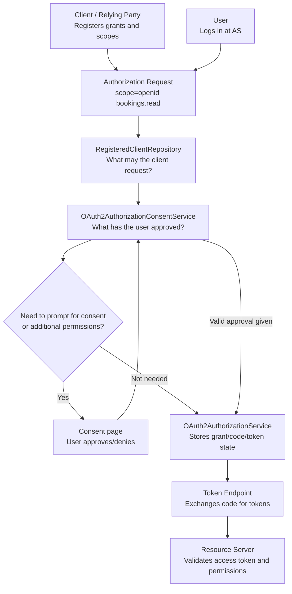
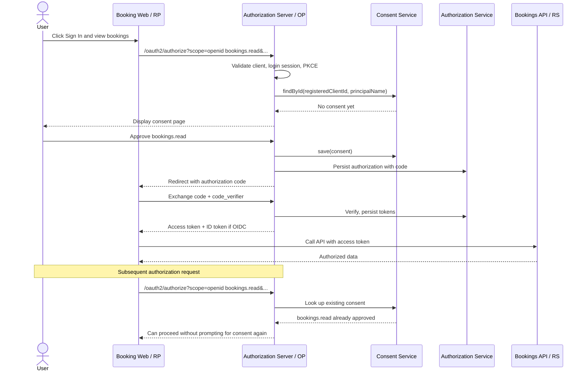

# OAuth2AuthorizationConsent and user-approved permissions

## 1. Context: why does the Authorization Server need to store consent?

In a **Spring Security OAuth 2.0/OpenID Connect Authorization Server** system built with **Spring Authorization Server** and Spring Boot, users often grant an application permission to access part of their data. For instance, the booking management app `booking-web` wants to read booking history via the `bookings.read` scope.

The Authorization Server may need to answer questions such as:

- Which scopes has this user **already approved** for this client?
- The next time the client requests those same permissions, does the consent screen need to be shown again?
- If the client additionally requests `bookings.cancel`, does the old approval automatically cover the new permission?
- When the user goes to **Connected Applications** and revokes consent, which data needs to change?
- After deleting consent, are already-issued access tokens or refresh tokens still valid?

Spring Authorization Server provides the **`OAuth2AuthorizationConsent`** model and **`OAuth2AuthorizationConsentService`** to save and retrieve permissions that a principal has approved for a registered client.

Think of consent as **a record of approval**, not a password, login session, or access token. Clearly separating these layers is the basis for designing, configuring, securing, testing, and operating an Authorization Server safely.

### Learning objectives

After this lesson, you will be able to:

1. Describe the structure and meaning of `OAuth2AuthorizationConsent`.
2. Distinguish `registeredClientId`, `principalName`, and `authorities`.
3. Explain how consent participates in the **Authorization Code + PKCE** flow, including first-time, repeat, and incremental scope requests.
4. Use `OAuth2AuthorizationConsentService` to save, find, and remove consent.
5. Compare consent with client registration, `OAuth2Authorization`, access tokens, sessions, and Resource Server policies.
6. Design consent management across multiple clients/users/tenants and handle revocation as expected.
7. Design security and operational test cases for consent.

## 2. Where does consent fit in OAuth 2.0/OIDC architecture?

OAuth 2.0 describes granting a client authorization to access resources, typically on behalf of a resource owner. When an interactive user is involved, the Authorization Server may ask the user to approve the set of scopes the client is requesting.

**Consent** typically occurs at the `/oauth2/authorize` step, before the Authorization Server issues an authorization code. Meanwhile:

- **Client registration** defines which client is allowed to operate, and which grants and scopes it may request.
- **Authentication session** determines whether the user is currently logged in at the Authorization Server.
- **Consent** stores the permissions the user has approved for the client.
- **`OAuth2Authorization`** records the state of a single authorization grant: grant type, granted scopes, codes/tokens, and related metadata.
- **Access token** is the credential used by the client to call the Resource Server/API.
- **Resource Server** validates the token and resource access policy on each incoming request.



The diagram is conceptual; the actual workflow depends on grant type, framework version, client settings, consent page, OIDC parameters, and Authorization Server policy.

**Not every grant has user consent.** With Client Credentials, the client requests a token for itself and there is no End-User approval step. Even in the Authorization Code Flow, configuration may allow skipping the consent screen. Therefore, **an issued token does not prove an `OAuth2AuthorizationConsent` record exists**.

## 3. The `OAuth2AuthorizationConsent` model

`OAuth2AuthorizationConsent` belongs to the core model of Spring Authorization Server. It represents the authorities that **one principal** has approved for **one registered client**.

Three central pieces of data:

| Property | Model data type | Meaning |
|---|---|---|
| `registeredClientId` | `String` | **Internal ID** of the `RegisteredClient` object to which the consent belongs |
| `principalName` | `String` | Identifier name of the approving principal |
| `authorities` | `Set<GrantedAuthority>` | Set of approved authorities; in typical OAuth flows, scopes represented as authorities |

At the Java API level, these values can be read via:

```java
String registeredClientId = consent.getRegisteredClientId();
String principalName = consent.getPrincipalName();
Set<GrantedAuthority> authorities = consent.getAuthorities();
```

### 3.1. `registeredClientId` differs from `clientId`

This is a very easy mistake that causes bugs.

`RegisteredClient` has at least two identifiers to distinguish:

- `registeredClient.getId()`: internal identifier of the client record inside the Authorization Server.
- `registeredClient.getClientId()`: OAuth client identifier sent over the protocol, such as `booking-web`.

`OAuth2AuthorizationConsent` is bound to **`registeredClient.getId()`**, not automatically the external `clientId` string. For example:

```text
RegisteredClient:
  id       = "rc-7f9a"
  clientId = "booking-web"

OAuth2AuthorizationConsent:
  registeredClientId = "rc-7f9a"
  principalName      = "user-42"
  authorities        = ["SCOPE_bookings.read"]
```

If you call `findById("booking-web", "user-42")` in this scenario, the service will fail to find the consent because the wrong identifier was passed.

### 3.2. `principalName` identifies the approving user

`principalName` comes from the principal recognized by the Authorization Server when handling the authorization. In the example, this is `user-42`.

Product design must decide on a stable, collision-free principal identifier:

- Do not automatically use email as a permanent identifier, because emails can change or be reassigned.
- In multi-tenant systems, prevent two users in different tenants from sharing the same `principalName` and being treated as one person.
- When renaming a username, merging accounts, or migrating tenants, decide whether old consents must be migrated or revoked.
- A principal stored in consent **does not replace** resource-ownership checks at the Resource Server.

For example, if two tenants both have a user `alice`, using the bare string `alice` across a shared Authorization Server can blur consent boundaries. A stable identifier strategy with a tenant namespace may be appropriate, provided it remains compatible with how Spring Security resolves the principal during login sessions and authorization flows.

### 3.3. `authorities` is the set of approved permissions, not necessarily roles

In common OAuth examples, each approved scope is represented as a `GrantedAuthority` with the `SCOPE_` prefix:

```text
requested scope:         bookings.read
authority in consent:    SCOPE_bookings.read
```

The corresponding authority can be constructed with:

```java
new SimpleGrantedAuthority("SCOPE_bookings.read")
```

However, `authorities` is a set of `GrantedAuthority`, not a list of system roles. **Never equate `SCOPE_bookings.read` with `ROLE_ADMIN`, user RBAC roles, or permission to access every booking record.**

Authorities persisted in consent must go through Authorization Server policies: whether the client is allowed to request the scope, whether the user is allowed to approve it, and whether the system actually supports that scope.

## 4. How does consent differ from authorizations, tokens, and sessions?

| Concept | Question it answers | Typical unit of storage | Can it survive logout? |
|---|---|---|---|
| **Authentication session** | Does the user have an active login session at the AS/RP? | Session/cookie, `SecurityContext` | Logged-out sessions terminate per logout mechanism |
| **RegisteredClient** | Which grants, redirects, and scopes may the client request? | `RegisteredClientRepository` | Yes |
| **OAuth2AuthorizationConsent** | Which permissions has the principal approved for the registered client? | `OAuth2AuthorizationConsentService` | Yes |
| **OAuth2Authorization** | What state are the grant and tokens of a specific authorization in? | `OAuth2AuthorizationService` | Possibly |
| **Access token** | Which APIs and permissions does the client hold a valid credential for? | Client-side token, AS/RS token state per architecture | Possibly |
| **Refresh token** | Can the client obtain new tokens without repeating interactive authorization? | Client and associated state at AS | Possibly |
| **ID token (OIDC)** | Does the RP hold proof of user authentication issued by the OP? | RP verifies ID token; AS stores state per implementation | May remain as proof, not used as an API bearer token |

Three critical distinctions:

1. **Consent is not an access token.** It is never sent in the `Authorization: Bearer ...` header, and APIs do not use consent as a substitute for validating access tokens.
2. **Consent is not an authorization record.** A user may retain consent over a long period even after all tokens from older authorizations have expired.
3. **Consent is not a login session.** A user logging out of the Authorization Server does not automatically delete persisted consent.

One user can hold consents for multiple clients; one client can hold consents from multiple users; and a single principal + registered client pair can yield **multiple distinct authorizations** over time.

## 5. Consent lifecycle in Authorization Code + PKCE

Consider a concrete scenario:

- Authorization Server: `https://auth.example.com`.
- Client: `booking-web`.
- User principal: `user-42`.
- API: `https://api.example.com/bookings`.
- Initial scopes: `openid bookings.read`.
- Additional scope requested later: `bookings.cancel`.
- Client is configured to require consent via `requireAuthorizationConsent(true)`.



Whether the consent screen is shown again depends on configuration, scopes, policies, and OIDC parameters such as `prompt=consent`. Having a consent record does not guarantee every subsequent request will bypass the screen.

### 5.1. Step 1 — which scopes is the client allowed to request?

`RegisteredClient` defines the grant types, redirect URIs, authentication methods, and scopes the client may request. Registering `bookings.read` means **the client is permitted to ask for** that scope, not that the user has agreed.

If the client is not registered for `bookings.cancel`, a consent entry containing that authority **does not make issuing that scope valid**. Authorization Server validation must still be enforced in full.

### 5.2. Step 2 — authenticate the user

Spring Security identifies the interacting principal. When there is no valid login session, the AS must handle login; when a valid SSO session exists, it may continue. Consent must always be bound to **the verified current principal**.

Never handle consent via an endpoint that trusts a self-declared `principalName` in the request. The principal must come from the Authorization Server's trusted authentication context.

### 5.3. Step 3 — look up prior consent and compare scopes

The service looks up consent by registered client ID and principal name. Typical cases:

| Current request | Stored consent | Handling |
|---|---|---|
| `bookings.read` | None | Prompt for consent if required by policy |
| `bookings.read` | `bookings.read` | Can reuse stored consent |
| `bookings.read bookings.cancel` | `bookings.read` | Must evaluate the additional `bookings.cancel` permission |
| `bookings.cancel` | `bookings.read` | Must not treat `bookings.cancel` as approved |
| `bookings.read` | Consent was deleted | Evaluate as having no prior consent per policy |

**Scope comparison must rely on verified identity and state**, not client-constructed checkboxes or URL parameters treated as already granted.

### 5.4. Step 4 — user approves or denies

The consent page should help the user clearly understand:

- **Which application** is requesting access, based on trusted client metadata.
- **Which permissions** are being requested, phrased in plain language.
- Which permissions were already granted and which are newly requested.
- How to approve/deny and how to revoke permissions later.

When denied, the system must not mark rejected scopes as approved. When selecting a subset of scopes, ensure both the protocol and UI support partial consent properly; do not assume every application supports per-scope toggles.

**Consent must defend against CSRF and session confusion.** Avoid a controller accepting POSTs from anywhere and saving consent based purely on user-submitted `principalName`, `clientId`, and `scope`. Rely on the Authorization Server's default pipeline and checks or a tightly engineered extension.

### 5.5. Step 5 — persist consent and issue the authorization

Once the consent decision is validly processed, `OAuth2AuthorizationConsentService` saves the approved authorities. `OAuth2AuthorizationService` manages authorization/code/token state per grant.

These two services have distinct responsibilities. Saving consent alone without creating a valid authorization does not give the client an access token. Conversely, an authorization can be created when policy does not require storing consent.

### 5.6. Step 6 — subsequent requests and incremental consent

Suppose the first request saved:

```text
registeredClientId = rc-7f9a
principalName      = user-42
authorities        = [SCOPE_bookings.read]
```

Later the client additionally requests `bookings.cancel`. If the user approves, the consent record can be updated to:

```text
registeredClientId = rc-7f9a
principalName      = user-42
authorities        = [SCOPE_bookings.read, SCOPE_bookings.cancel]
```

This is **incremental consent**: new permissions are reviewed explicitly rather than being granted silently because of unrelated old consent. The scopes actually granted in **each authorization** must still depend on that request, registration, and policy.

## 6. Core APIs of `OAuth2AuthorizationConsentService`

The public service interface exposes three primary business operations:

```java
public interface OAuth2AuthorizationConsentService {

    void save(OAuth2AuthorizationConsent authorizationConsent);

    void remove(OAuth2AuthorizationConsent authorizationConsent);

    OAuth2AuthorizationConsent findById(
        String registeredClientId,
        String principalName
    );
}
```

The snippet above illustrates the model signatures. Library versions may add nullability contract annotations or other details.

| Operation | Purpose | Security notes |
|---|---|---|
| `findById(...)` | Look up permissions a user has approved for a client | Pass the registered client **internal ID** and trusted principal |
| `save(...)` | Save new consent or update by composite key | Save permissions only after validation and legitimate user approval |
| `remove(...)` | Delete the consent record | Does not automatically revoke already-issued tokens |

This interface provides no built-in API to list all consents for a principal, paginate consents, keep audit history, or revoke all tokens. If the product needs a **Connected Applications** page, design an appropriate query/administration layer aligned with your data store and security policies; do not assume this interface alone covers every admin screen.

### 6.1. Creating a consent record

Suppose you have a valid `RegisteredClient` and an authenticated principal `user-42` who approved scope `bookings.read`:

```java
OAuth2AuthorizationConsent consent =
    OAuth2AuthorizationConsent
        .withId(registeredClient.getId(), "user-42")
        .authority(new SimpleGrantedAuthority("SCOPE_bookings.read"))
        .build();

authorizationConsentService.save(consent);
```

Meaning:

1. `registeredClient.getId()` supplies the internal ID.
2. `"user-42"` must match the identity the AS actually uses for the principal.
3. `SCOPE_bookings.read` is the authority representing the approved scope.
4. `save` persists the object through the configured repository/service.

**This is a data-model example**, not a suggestion for any controller to write consent while bypassing authorization requests, CSRF, client validation, and user authentication. In the standard flow, Spring Authorization Server's providers/handlers orchestrate consent decisions.

### 6.2. Looking up existing consent

```java
OAuth2AuthorizationConsent existing =
    authorizationConsentService.findById(
        registeredClient.getId(),
        authenticatedPrincipal.getName()
    );

boolean approvedRead = existing != null &&
    existing.getAuthorities().stream()
        .map(GrantedAuthority::getAuthority)
        .anyMatch("SCOPE_bookings.read"::equals);
```

This checks **stored consent**, not whether the user is permitted to read a specific booking. Permission checks at the Resource Server remain a separate responsibility.

### 6.3. Updating consent while preserving prior permissions

When a user approves an additional valid scope, you can build the new consent from the existing one:

```java
String registeredClientId = registeredClient.getId();
String principalName = authenticatedPrincipal.getName();

OAuth2AuthorizationConsent current =
    authorizationConsentService.findById(
        registeredClientId, principalName);

OAuth2AuthorizationConsent.Builder builder = (current == null)
    ? OAuth2AuthorizationConsent.withId(
        registeredClientId, principalName)
    : OAuth2AuthorizationConsent.from(current);

OAuth2AuthorizationConsent updated = builder
    .authority(
        new SimpleGrantedAuthority("SCOPE_bookings.cancel"))
    .build();

authorizationConsentService.save(updated);
```

This example assumes **you already verified the client is allowed to request the scope, the principal is authorized to approve, and the user just gave consent**. Without those checks, `save` could create overly broad consent. Handle concurrency when multiple authorization requests update consent simultaneously so permissions saved by another request are not lost.

### 6.4. Removing consent

```java
OAuth2AuthorizationConsent existing =
    authorizationConsentService.findById(
        registeredClient.getId(),
        authenticatedPrincipal.getName());

if (existing != null) {
    authorizationConsentService.remove(existing);
}
```

This operation means **deleting the stored approval**. It does not close HTTP sessions, does not delete `OAuth2Authorization`, does not proactively revoke refresh tokens, and does not automatically invalidate already-issued JWT access tokens.

If business requirements demand "immediate disconnection," implement additional token and session management steps according to concrete requirements (see section 10).

## 7. Distinguishing three easily confused scope sets

For an authorization request, three sets typically need to be distinguished:

1. **Allowed/registered scopes**: scopes the client is permitted to request per `RegisteredClient.getScopes()`.
2. **Consented scopes**: scopes the user has approved, stored as authorities on `OAuth2AuthorizationConsent`.
3. **Authorized scopes**: scopes actually granted in **a single authorization**, typically attached to `OAuth2Authorization.getAuthorizedScopes()` and issued tokens.

Example:

| Scope set | Example |
|---|---|
| Client registered scopes | `bookings.read`, `bookings.cancel`, `profile`, `openid` |
| User approved scopes | `bookings.read`, `profile` |
| Scopes requested in this request | `bookings.read` |
| Actually granted scopes | `bookings.read` |

Just because the client **registered** `bookings.cancel` does not mean the user approved it. Just because the user **previously approved** `profile` does not mean a new authorization requesting only `bookings.read` must automatically include `profile`. And just because a token carries `bookings.read` does not mean it authorizes reading every record in the API.

### 7.1. Consent is not the sole source for policy

A system may deny granting an already-consented scope because:

- The client was disabled or its configuration changed.
- The user was locked, switched tenants, or no longer holds sufficient privileges.
- The requested scope does not match the grant type.
- Consent must be reconfirmed due to policy or OIDC parameters.
- The system updated its data-access policies.

Therefore, **consent is an input to the authorization decision**, not a "blank check" to mint new tokens at any time.

### 7.2. Scopes do not replace business authorization

Suppose `bookings.read` is granted. When the client calls:

```http
GET /bookings/booking-123
Authorization: Bearer ACCESS_TOKEN_VALUE
```

The Resource Server must verify that the token is valid, matches audience/scope, and that the user is actually authorized to view `booking-123`. Scope approval at the Authorization Server does not determine ownership of individual bookings.

## 8. Configuring a client to require consent

Spring Authorization Server lets you configure whether a client prompts for consent via `ClientSettings`.

```java
RegisteredClient bookingWeb = RegisteredClient
    .withId(UUID.randomUUID().toString())
    .clientId("booking-web")
    .clientSecret(passwordEncoder.encode(secretFromSecureStore))
    .clientAuthenticationMethod(
        ClientAuthenticationMethod.CLIENT_SECRET_BASIC)
    .authorizationGrantType(
        AuthorizationGrantType.AUTHORIZATION_CODE)
    .authorizationGrantType(
        AuthorizationGrantType.REFRESH_TOKEN)
    .redirectUri(
        "https://app.example.com/login/oauth2/code/booking-web")
    .scope(OidcScopes.OPENID)
    .scope(OidcScopes.PROFILE)
    .scope("bookings.read")
    .scope("bookings.cancel")
    .clientSettings(ClientSettings.builder()
        .requireProofKey(true)
        .requireAuthorizationConsent(true)
        .build())
    .build();
```

Notable points:

- `requireAuthorizationConsent(true)` enables consent handling according to the framework's mechanisms and policies.
- `requireProofKey(true)` enforces PKCE for the Authorization Code Flow.
- `clientSecret` applies only to **confidential clients** able to protect secrets server-side; never place a client secret in an SPA/browser.
- `scope(...)` defines scopes the client may request, not scopes the user has already approved.
- `OidcScopes.OPENID` supports OIDC authentication requests when the OP is enabled and fully configured.

This snippet illustrates client registration; the application still needs `RegisteredClientRepository`, `OAuth2AuthorizationService`, `OAuth2AuthorizationConsentService`, user authentication/login, signing keys, and version-appropriate filter chains. Never mistake a single `RegisteredClient` for a complete Authorization Server.

### 8.1. The consent page can be customized while preserving the protocol

Spring Authorization Server offers hooks like `authorizationEndpoint(...).consentPage(...)` to direct users to a custom consent screen. The consent page should display trusted client metadata, clear scope descriptions, and limit checkboxes to scopes actually requested.

Example prompt:

```text
Application: Booking Web
Requests:
  [x] View bookings list (bookings.read)
  [ ] Cancel bookings (bookings.cancel)

[Approve]  [Deny]
```

This is a UX illustration, **not an assertion that every default Spring setup supports per-scope approval out of the box**. Server-side logic must honor the request, CSRF, authenticated principal, consent, and policies. Never put "scope approval" logic into a controller that manually mints authorization codes.

### 8.2. Combining consent with OIDC

OIDC uses the `openid` scope to request user authentication features. Scopes like `profile` and `email` request standard OIDC claim sets, subject to available data and consent/policy. An RP can pass `prompt=consent` so the OP re-displays the consent screen per OIDC rules; exact support and behavior depend on the OP and configuration.

Distinguish clearly:

- **ID token**: authentication proof for the Relying Party, which must be validated per OIDC.
- **Access token**: credential for Resource Servers or the UserInfo Endpoint as appropriate.
- **Consent**: data recording which data groups/permissions the user permitted sharing.

Approving `email` does not guarantee an email value is always issued or verified. OIDC provides dedicated claims such as `email_verified`; data accuracy and disclosure scope belong to OP policy.

## 9. Persistence: in-memory vs. JDBC

At the model layer, `OAuth2AuthorizationConsentService` does not mandate a specific storage technology. Spring Authorization Server ships implementations for different environments.

| Implementation | Use case | Limitations |
|---|---|---|
| `InMemoryOAuth2AuthorizationConsentService` | Demos, experiments, or isolated tests | Consent can be lost on process restart; not automatically shared across nodes |
| `JdbcOAuth2AuthorizationConsentService` | Systems needing durable consent in a relational database | Requires version-compatible schema, `JdbcOperations` config, and client repository |
| Custom `OAuth2AuthorizationConsentService` | MongoDB, sharding strategies, custom query/audit requirements | Must uphold save, find, remove, and concurrency-consistency contracts |

Example JDBC configuration:

```java
@Bean
OAuth2AuthorizationConsentService authorizationConsentService(
        JdbcOperations jdbcOperations,
        RegisteredClientRepository registeredClientRepository) {

    return new JdbcOAuth2AuthorizationConsentService(
        jdbcOperations,
        registeredClientRepository);
}
```

This example assumes `JdbcOperations` and `RegisteredClientRepository` beans are already configured. Create/migrate tables using the schema compatible with **the Spring Authorization Server version in use**. Do not copy table schemas from another version and assume compatibility.

### 9.1. Visualizing the data key

The logical relationship of a consent record is:

```text
CONSENT
  registered_client_id  ──┐
                         ├── Logical composite key
  principal_name        ──┘
  authorities              List of approved authorities
```

There is normally no "one consent record per access token." Multiple distinct access tokens can be issued over time while referencing the same consent for a client + user pair.

A query such as "all applications connected by this user" requires looking up consents by principal, joining with registered clients, and filtering by permissions/tenant. The public `OAuth2AuthorizationConsentService` exposes `findById` for a client/user pair, **not a built-in listing API**. You can build a supplementary administrative repository with access control and pagination.

### 9.2. Durability and consistency across multiple instances

Suppose the Authorization Server has nodes A and B:

1. The user grants consent on node A.
2. The next authorization request is routed by the load balancer to node B.
3. If each node uses separate in-memory consent stores, node B may re-prompt for consent or behave inconsistently.
4. If consent uses a shared store and session/user identity are also handled consistently, both nodes see the same persisted decision.

JDBC consent storage solves only **consent data**; you still need strategies for `OAuth2AuthorizationService`, HTTP sessions, the client repository, and token signing keys. Never rely on a static variable or local cache as the source of truth for cluster-wide consent.

### 9.3. Protecting consent data

Consent reveals the relationship between a user account, an application, and the data types the user allowed it to access. This is sensitive authorization data even though it is not an access token.

Recommended safeguards:

- Least-privilege DB permissions for the service reading/writing consent.
- Encrypted DB connections, protected backups, and suitable retention policies.
- Protect the Connected Applications UI with authentication and ownership checks.
- Audit events when granting, expanding, revoking, or changing consent; keep credentials out of logs.
- Policies for deleting/migrating consent when a user account is deleted, a client is removed, or a tenant changes.
- Concurrency control: prevent lost updates when simultaneous requests ask for different scopes.

## 10. Revoking consent does not automatically revoke tokens

This is the **single most important limitation** when building a "Remove access" feature.

Suppose the user approved `bookings.read` for `booking-web`, and the app received an access token valid for 10 minutes and a refresh token valid for 7 days.

The user clicks **Revoke access**. The management app calls:

```java
authorizationConsentService.remove(consent);
```

The immediate effect is that **the consent record is deleted**. However:

- Already-issued access tokens **may still be accepted by Resource Servers** until they expire.
- Already-issued refresh tokens **may still be used to obtain new access tokens** unless they are invalidated or checked by AS policy.
- HTTP sessions at the AS and RP **do not automatically disappear**.
- A fresh `/oauth2/authorize` request will have to re-evaluate the request and consent per policy.

### 10.1. Why can an access token still work?

For **self-validated JWT** access tokens, Resource Servers usually check signature, issuer, audience, expiration, and scopes without querying the Consent Service. Deleting consent at the AS does not alter an already-signed JWT.

For **opaque** access tokens with introspection, the AS can return `active=false` once token state is invalidated. However, deleting consent alone does not necessarily mark the token inactive; your service must coordinate updating authorization/token state.

Distinguish four actions:

| Action | Direct effect |
|---|---|
| Remove `OAuth2AuthorizationConsent` | Removes stored approval data for user + client |
| Revoke refresh token | Prevents that token from refreshing further, per revocation mechanism |
| Invalidate/revoke access token | Blocks access token usage as far as API verification supports |
| Logout AS/RP | Ends sessions at the respective components |

Never promise users they are "completely disconnected" if the system only deletes consent.

### 10.2. Business workflow for revoking access

A **Disconnect application** feature intending to block active access may need to:

1. Authenticate the requester; prove they are authorized to manage that principal's consents.
2. Identify the exact `registeredClientId` and principal; avoid trusting unverified display names or client IDs.
3. Remove or adjust consent via the service.
4. Query related authorizations through a purposefully designed data-management mechanism; **do not assume only one authorization exists per user/client**.
5. Invalidate necessary refresh tokens and authorizations so the client cannot refresh tokens.
6. Decide how to handle live access tokens: short lifetimes, introspection, revocation lists, or suitable status checks.
7. Handle RP/AS sessions if the product requirement genuinely includes sign-out.
8. Emit audit events, test API/token endpoints, and handle retries in distributed setups.

**Note:** The `OAuth2AuthorizationConsentService` interface manages consent only. It does not ship an out-of-the-box method to "find every authorization of a user across all clients." Design queries and invalidation logic in the business layer instead of writing ad-hoc SQL to delete tokens without controls.

### 10.3. Revoking a single scope vs. revoking full consent

There are two distinct product designs:

- **Disconnect app:** Remove consent for the entire principal + registered client pair, then execute the corresponding token-invalidation workflow if needed.
- **Revoke one permission:** Build a new consent record excluding the revoked scope's authority. If no authorities remain, consider removing the record per storage policy.

An example that **updates only the consent model**, assuming administrative permission was verified and retained scopes were computed properly:

```java
OAuth2AuthorizationConsent current =
    authorizationConsentService.findById(
        registeredClient.getId(),
        authenticatedPrincipal.getName());

if (current != null) {
    List<GrantedAuthority> retainedAuthorities =
        current.getAuthorities().stream()
        .filter(authority ->
            !authority.getAuthority().equals("SCOPE_bookings.cancel"))
        .toList();

    if (retainedAuthorities.isEmpty()) {
        authorizationConsentService.remove(current);
    } else {
        OAuth2AuthorizationConsent.Builder builder =
            OAuth2AuthorizationConsent.withId(
                current.getRegisteredClientId(),
                current.getPrincipalName());

        retainedAuthorities.forEach(builder::authority);
        OAuth2AuthorizationConsent updated = builder.build();
        authorizationConsentService.save(updated);
    }
}
```

This snippet does not complete token revocation. If the product requires cutting off `bookings.cancel` immediately, handle tokens and policies at the AS/Resource Server. Also control concurrency so removing a scope does not overwrite a permission validly approved in another flow.

## 11. Consent and OIDC: scopes, claims, and login sessions

Consent is often discussed alongside `openid`, `profile`, and `email`, yet **OIDC login** and **OAuth authorization** serve different purposes.

An OIDC client might request:

```text
scope=openid profile email bookings.read
```

Where:

- `openid`: requests OIDC authentication service.
- `profile` and `email`: request standard OIDC claim sets, subject to available data and consent/policy.
- `bookings.read`: application-defined permission to access the bookings API.

The Authorization Server/OpenID Provider decides which scopes and claims are actually issued based on client registration, user authentication, consent, other policies, and available data.

**Stored consent does not create a new ID token or session on its own.** When an RP wants OIDC sign-in, it must execute the proper flow and validate the ID token against required claims such as `iss`, `aud`, `exp`, `iat`, and `nonce` when used. Consent is an input to the authorization decision, not proof of user authentication.

### 11.1. Is consent always prompted while SSO is active?

No. A user may still have an active login session at the OP and have granted consent previously. When the client initiates a new authorization request with the same scopes, the OP may issue a code without re-displaying consent. However, this depends on provider policy, `prompt=consent`, requests for additional permissions, and session/authentication constraints.

Conversely, logging out of the OP usually does not delete consent. Upon logging back in, the user may still see previously approved permissions remembered unless consent was revoked or expired by policy.

## 12. Multi-tenancy, principal changes, and multiple clients

Consent is meaningful **per pair** of registered client + principal. As systems scale, additional data boundaries must be considered.

### 12.1. One user, multiple clients

```text
user-42 + booking-web     → [SCOPE_bookings.read]
user-42 + partner-mobile  → [SCOPE_bookings.read]
user-42 + admin-portal    → [SCOPE_profile]
```

If the user withdraws consent from `partner-mobile`, do not delete consent for `booking-web` unless the product has an explicitly defined client-group revocation policy.

### 12.2. One client, multiple users

```text
user-42 + booking-web  → [SCOPE_bookings.read]
user-77 + booking-web  → [SCOPE_bookings.read, SCOPE_bookings.cancel]
```

Never look up consent using `clientId` alone and apply it to all users. That bug would leak one user's permission decisions to another user.

### 12.3. One tenant, multiple accounts

For an Authorization Server serving multiple tenants, normalize user principals and client registrations so consent records cannot collide. If two tenants both have a username `alice` and share a registered client, an un-namespaced pair key can cause confusion.

Possible solutions include:

- Including tenant ID in the principal name or using an immutable subject namespaced by issuer.
- Managing `RegisteredClient` per tenant if the security model requires it.
- Always verifying both the principal's and client's tenant from trusted data in UI and admin queries.
- Planning migrations when identifiers change or tenants move.

Never prepend a `tenantId` from a client-supplied header onto a principal without verifying the tenant binding; that is untrusted input if the caller can alter it.

## 13. Securing the consent page and consent management APIs

For a real-world deployment, minimum safeguards include:

| Risk | Consequence | Mitigation |
|---|---|---|
| Consent CSRF | Users are tricked into approving scopes unintentionally | CSRF protection, strict binding to authorization request/session |
| Client identity spoofing | Page displays a misleading application name | Render metadata from trusted client registration |
| Scope escalation | Client injects scopes beyond its registration | Server-side scope validation at AS; never trust checkboxes/URLs blindly |
| Principal substitution | User A alters User B's consent | Derive principal from trusted authentication; enforce ownership checks |
| Tenant collision | One tenant's permissions bleed into another | Namespace principals/registered clients; verify tenant |
| Stale consent | Policy changed while old approval stays persisted | Re-evaluate as needed, version/migrate policies, or force re-consent |
| Lost update | Two concurrent requests overwrite each other's new permissions | Transactions, locking/optimistic concurrency in storage |
| Live tokens after consent revocation | API still accepts old credentials | Coordinate token revocation and RS validation strategy |
| Missing audit trail | Hard to prove who approved which scopes and when | Emit safe audit events without logging tokens/cookies |
| Data leakage | Exposes list of apps connected by a user | Authorize queries, minimize fields, mask PII |

### 13.1. Data to audit

When granting or revoking consent, audit events can record:

- Event type: consent granted, extended, reduced, revoked.
- Subject: stable principal ID and trusted tenant, if applicable.
- Registered client ID and appropriate client version/label.
- Scopes/authorities before and after processing.
- Timestamp, correlation ID, source of action, and outcome.
- Policy/flow identifier, if the system versions policies.

Avoid logging access tokens, refresh tokens, authorization codes, client secrets, session cookies, or full request/form bodies. Audit events do not replace the consent database: they provide an event log for investigation, whereas the consent service serves current state.

### 13.2. Permissions for administering consent

A "Connected Applications" page must never allow clients to freely ask:

```text
GET /manage-consent?principalName=someone-else
```

and trust that `principalName`. The principal must be bound to the authenticated user or a verified admin role. For support admins, verify specific delegated authorization and audit viewing/deleting another user's consent.

## 14. Essential test cases

### 14.1. Model and service tests

| Test | Setup | Expected result |
|---|---|---|
| Create consent | Valid internal client ID and principal | `getRegisteredClientId`, `getPrincipalName`, `getAuthorities` are accurate |
| Find consent | `save` then `findById` with exact pair | Returns persisted authorities |
| Wrong client ID | Query with public `clientId` instead of internal ID | Does not accidentally retrieve consent |
| User isolation | Two different principals, same client | Independent records |
| Client isolation | One principal, two registered clients | Independent records |
| Update scopes | Consent `read`, then add `cancel` | Old permissions preserved, new permission saved properly |
| Remove consent | `remove` existing record | `findById` no longer returns consent |
| Write contention | Two requests updating scopes simultaneously | Does not lose data contrary to policy |
| Restart/multi-instance | Shared JDBC store | Consent survives and reads consistently |

### 14.2. Integration protocol tests

| Scenario | Expected result |
|---|---|
| Client requests valid scope first time, consent required | Authorization Server prompts for approval per policy |
| User denies | No authorization issued for denied scopes |
| Client requests already-consented scopes | Can proceed without re-prompting, unless policy/`prompt=consent` requires it |
| Client requests additional new scope | New scope is not treated as already approved |
| Client requests unregistered scope | Rejected despite prior consent data or tampered form submission |
| Forged consent form/CSRF | Rejected, no consent saved |
| Invalid code + PKCE | Token Endpoint rejects, no tokens issued |
| Remove consent then re-authorize | Consent is re-evaluated per policy |
| Remove consent then call API with old token | Outcome reflects token policy; do not assume API rejects automatically |
| Revoke refresh token after disconnect | Client cannot use revoked refresh token |
| JWT access token invalidated by design | RS has corresponding mechanism to block it in time |
| Different principal/tenant | Cannot read or delete consent outside authorized scope |
| AS/RP logout | Logout and consent follow independent lifecycles per policy |

Include **real HTTP tests** against the Authorization Endpoint, Token Endpoint, and Resource Server, rather than only calling `OAuth2AuthorizationConsentService.save` directly. Service tests prove persistence; end-to-end tests prove consent participates properly in authorization issuance without breaking OAuth/OIDC.

### 14.3. Debugging observations

When consent keeps reappearing despite user approval, check in order:

1. Is the client requesting the exact stored scopes and using the right `registeredClientId`?
2. Does `principalName` in the current request match the earlier consent record?
3. Does the AS have multiple nodes using separate in-memory consent stores?
4. Is the consent service registered in the right filter chain/configurer?
5. Is `prompt=consent` present or is a force-reconsent policy active?
6. Did the UI submit a valid consent request with proper CSRF/state/context?
7. Did a migration, restart, consent deletion, or concurrent update overwrite the record?

When tokens still work after "disconnecting an app," inspect **token status** in `OAuth2AuthorizationService` and the RS's validation mechanism. Do not automatically blame the consent service; deleting consent is not a token-revocation operation by itself.

## 15. Common misconceptions

**"`OAuth2AuthorizationConsent` stores tokens."** False. It stores approved authorities. Authorization/token state belongs to `OAuth2Authorization` and the components issuing, storing, and verifying tokens.

**"Once a user consents, they are always granted that scope."** False. The AS still checks the registered client, requested scopes, policies, grant, user status, and other conditions.

**"Having an access token means a consent record exists."** False. Consent may be skipped by policy, and Client Credentials has no End-User consent.

**"`registeredClientId` is the client ID sent by the browser."** Not by default. Consent uses the internal ID of `RegisteredClient`; public `clientId` is a separate protocol identifier.

**"Consent authorities are equivalent to roles."** False. `SCOPE_bookings.read` represents scope approval, not `ROLE_ADMIN` or permission to read every record.

**"Logging out deletes consent."** False. Sessions and consent have separate lifecycles.

**"Deleting consent immediately invalidates JWT access tokens."** False. Signed JWTs may remain valid until expiry unless the RS has an additional revocation mechanism.

**"Deleting only the refresh token is enough."** Not necessarily. Active access tokens can still call APIs; product requirements determine when access must stop.

**"Reading consent inside the API is enough for authorization."** Consent does not replace access tokens, audience, scopes, or resource ownership checks at the Resource Server.

**"To build a consent list screen, call `findById` with the principal."** The interface has no method to list all consents; add an authorized administrative query.

## 16. Design and operational checklist

Before deploying consent features to production, verify:

- **Client identity:** Are internal registered client IDs and public client IDs clearly separated?
- **Principal identity:** Are usernames stable and collision-free across tenants?
- **Scopes:** What is the client registered for, what did the user consent to, and what did the authorization actually grant?
- **UI:** Does the user see the right application and permission descriptions, and can they deny and revoke permissions?
- **CSRF/session:** Is the consent form bound to a valid authenticated user and authorization request?
- **Persistence:** Does consent survive restarts and stay consistent across nodes?
- **Concurrency:** Could two concurrent scope requests cause lost updates?
- **Tokens:** Must disconnect block new tokens, existing tokens, or both? Is a revocation strategy in place?
- **Audit:** Are grant/revoke events logged sufficiently for investigation without exposing credentials?
- **Testing:** Have first-time consent, repeat consent, new scopes, denial, logout, revocation, and multi-tenancy been tested?

### Core knowledge

`OAuth2AuthorizationConsent` represents **the set of authorities a principal has approved for a registered client**. `OAuth2AuthorizationConsentService` provides `save`, `findById`, and `remove` to manage that state. In browser-based authorization flows, consent lets the Authorization Server know when prior approval can be honored and when new permissions must be evaluated.

**Consent is one part of the authorization decision**, not a substitute for client registration, authentication sessions, authorization records, access tokens, or Resource Server authorization. In particular, **deleting consent does not revoke tokens on its own**. Understanding this boundary helps you design and operate a Spring Authorization Server system that adheres to both the protocol and your product's privacy and security commitments.

## References

- [Spring Authorization Server — Core Model / Components](https://docs.spring.io/spring-authorization-server/reference/core-model-components.html)
- [Spring Authorization Server — Protocol Endpoints](https://docs.spring.io/spring-authorization-server/reference/protocol-endpoints.html)
- [Spring Authorization Server — Reference](https://docs.spring.io/spring-authorization-server/reference/)
- [Spring Security — Servlet Architecture](https://docs.spring.io/spring-security/reference/servlet/architecture.html)
- [RFC 6749 — The OAuth 2.0 Authorization Framework](https://www.rfc-editor.org/rfc/rfc6749)
- [RFC 7009 — OAuth 2.0 Token Revocation](https://www.rfc-editor.org/rfc/rfc7009)
- [RFC 7636 — Proof Key for Code Exchange](https://www.rfc-editor.org/rfc/rfc7636)
- [RFC 7662 — OAuth 2.0 Token Introspection](https://www.rfc-editor.org/rfc/rfc7662)
- [RFC 9700 — Best Current Practice for OAuth 2.0 Security](https://www.rfc-editor.org/rfc/rfc9700)
- [OpenID Connect Core 1.0](https://openid.net/specs/openid-connect-core-1_0.html)
