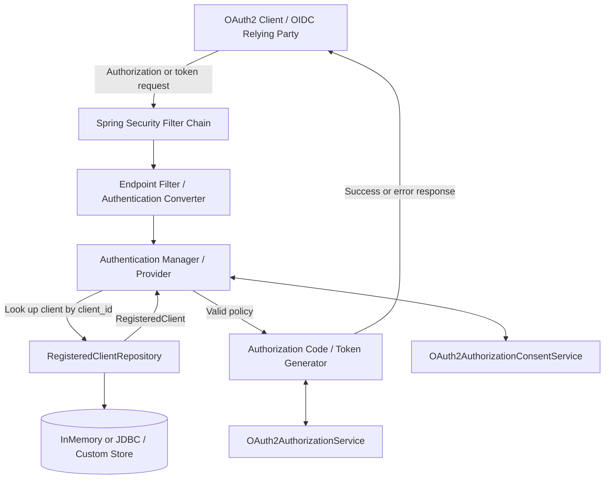
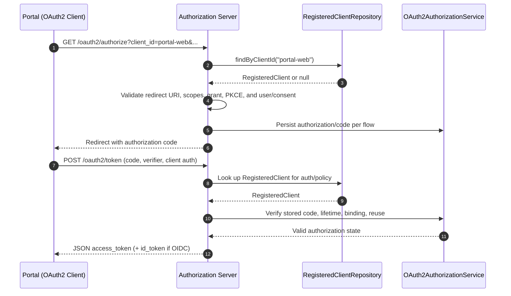

# RegisteredClientRepository and client lookup operations

In an **OAuth 2.0/OpenID Connect (OIDC) Authorization Server** system, an application wanting to request an authorization code, access token, or use OIDC authentication must be recognized and policy-checked by the Authorization Server. With **Spring Authorization Server**, application registration data is represented by **`RegisteredClient`**; the component responsible for **persisting and looking up** those records is **`RegisteredClientRepository`**.

This lesson belongs to the **Core Models** chapter of the **SPRING_SECURITY_OAUTH2_OIDC_AUTHORIZATION_SERVER** module and focuses on the repository contract, the three operations `save`/`findById`/`findByClientId`, using InMemory or JDBC implementations, integrating with Spring Boot, security boundaries, and testing. The goal is to design, configure, secure, test, and operate an Authorization Server based on clear models without confusing client registration data with tokens or user accounts.

> **Scope:** Java examples illustrate Spring Authorization Server in a Servlet application using familiar Spring Security APIs. Imports, dependencies, library versions, DB schemas, and supporting beans must be added according to your project. Some APIs/DSLs may vary across versions.

## 1. Who is the registered client, and what problem does the repository solve?

A **Client** in OAuth 2.0 is an application requesting authorization or tokens from the Authorization Server (AS). It can be a server-side web app, mobile app, SPA, or background service. A client is neither the **end user** nor the Resource Server providing APIs.

A **Registered client** describes a **client approved/registered with the AS**, including its identifier, authentication method, grant types, redirect URIs, scopes, and token issuance policies.

**`RegisteredClientRepository`** answers these questions:

1. Does the AS recognize this `client_id`?
2. Which authentication methods and grants are permitted on the corresponding client record?
3. What are the client's redirect URIs, scopes, PKCE requirements, consent policy, and token settings?
4. When client configuration changes, where does the AS store and look up the updated record?

For example, when `portal-web` requests `/oauth2/authorize`, the Authorization Server must look up `portal-web`'s registration data before validating `redirect_uri`, `response_type`, scopes, and related rules. When the client calls `/oauth2/token`, the AS also needs to know the client's authentication mechanism, allowed grants, and settings.

**The repository is the source of client registration data**, not where active authorization codes or refresh tokens are stored.

## 2. Placing RegisteredClientRepository in the processing architecture



The diagram illustrates **logical roles**, not a guaranteed invocation order for every filter/provider across all versions. Client authentication may pass through a separate filter before the token grant; OIDC and consent requests involve additional processing steps.

| Component | What does it store/know? | Cannot replace |
|---|---|---|
| **`RegisteredClient`** | Metadata and policies of a client | Tokens, login sessions, user accounts |
| **`RegisteredClientRepository`** | Saves/reads `RegisteredClient` | `OAuth2AuthorizationService` |
| **`OAuth2Authorization` / `OAuth2AuthorizationService`** | An issued authorization, codes/tokens, and related state | Client registration metadata |
| **`OAuth2AuthorizationConsent` / `OAuth2AuthorizationConsentService`** | A principal's consent permissions for a client | Client registration or token storage |
| **`AuthorizationServerSettings`** | Issuer and AS endpoint paths | Per-client configuration |
| **UserDetailsService / identity system** | User accounts and credentials | OAuth2 Client registration store |

This distinction is especially critical in operations. Deleting or modifying a client's metadata **does not automatically invalidate all already-issued JWT access tokens immediately**; token state, revocation capability, and Resource Server checks must be designed separately.

## 3. The RegisteredClient model: core property groups

`org.springframework.security.oauth2.server.authorization.client.RegisteredClient` is the object describing a client at the AS. Most updates are performed via a **builder**, producing a new instance from the existing configuration.

| Property/group | Role | Example |
|---|---|---|
| `id` | **Internal** identifier of the record at the AS; used for storage links | UUID |
| `clientId` | **Protocol** identifier sent by the client in OAuth2 requests | `portal-web` |
| `clientIdIssuedAt` | Timestamp when the client ID was issued, if set | `Instant` |
| `clientSecret` | Confidential client authentication value, usually one-way encoded | `{bcrypt}...` |
| `clientSecretExpiresAt` | Secret expiration timestamp, if applicable | `Instant` |
| `clientName` | Display name for admin/consent UIs | `Portal Documents` |
| `clientAuthenticationMethods` | Methods accepted by the AS to authenticate the client | `client_secret_basic`, `private_key_jwt`, `none` |
| `authorizationGrantTypes` | Allowed grant types | `authorization_code`, `refresh_token`, `client_credentials` |
| `redirectUris` | URIs to which the AS may return authorization results | `https://portal.example.com/login/oauth2/code/company` |
| `postLogoutRedirectUris` | Redirect URIs after OIDC logout when supported | `https://portal.example.com/signed-out` |
| `scopes` | Scopes permitted to be requested | `openid`, `profile`, `documents.read` |
| `clientSettings` | Client-level policies: PKCE, consent, and certain client auth options | `requireProofKey(true)` |
| `tokenSettings` | Token policies: TTL, refresh token reuse, format, and other options | 10-minute access token TTL |

### 3.1. How does `id` differ from `clientId`?

Both fields identify a client, yet serve **different contexts**:

- **`id`**: internal key inside the AS, used to link the registration with authorization/consent records.
- **`clientId`**: value sent by the client in protocol messages, such as `client_id=portal-web`.

For example:

```text
id       = "d9b10ac8-57b7-4b84-a939-68bd4fbe1f3f"
clientId = "portal-web"
```

Avoid habitually setting `id` equal to `clientId` when your persistence model relies on stable internal references. **Do not change `id` when updating an existing client**; a new `id` can leave prior authorizations/consents pointing to a non-existent record.

### 3.2. A secret is not the same as a client ID

`clientId` **is not a secret**; it regularly appears in authorization URLs. `clientSecret` is a credential meant for clients capable of keeping secrets, such as backends. For SPAs/mobile/public clients, **never pretend to have a secret** by embedding a string into JavaScript or mobile binaries.

When using `client_secret_basic` or `client_secret_post`, the secret must be stored in a format compatible with the `PasswordEncoder` used by the client authentication provider. A common setup uses **`DelegatingPasswordEncoder`**, storing prefixed hashes like `{bcrypt}...`. Never store raw secrets in repositories, public config files, or source control.

## 4. The RegisteredClientRepository contract

Spring Authorization Server's baseline interface has **three operations**:

```java
public interface RegisteredClientRepository {
    void save(RegisteredClient registeredClient);

    RegisteredClient findById(String id);

    RegisteredClient findByClientId(String clientId);
}
```

This is a **core contract**, not a REST controller or administrative CRUD API. The repository supplies the operations the AS needs to retrieve metadata; it **does not come with** methods like `findAll`, `deleteById`, `findByName`, `page`, or `rotateSecret`.

| Method | Input | Result | Use case |
|---|---|---|---|
| `save(RegisteredClient)` | A valid client record | `void`; persists per implementation semantics | Initializing a client, saving metadata updates |
| `findById(String id)` | Internal `id` | `RegisteredClient` or `null` if not found | Restoring metadata for records linked by ID |
| `findByClientId(String clientId)` | Protocol `client_id` | `RegisteredClient` or `null` if not found | Identifying a client on authorization/client-auth requests |

In OAuth flows, requests typically carry `client_id`, so `findByClientId` is invoked frequently. `findById` is useful when persisted authorization/consent data references the internal ID. Distinguish both keys clearly when designing database indexes and caches.

### 4.1. `findByClientId`: protocol-level lookup

Example:

```java
RegisteredClient registeredClient =
    registeredClientRepository.findByClientId("portal-web");

if (registeredClient == null) {
    // No matching registration exists in the repository.
    // The OAuth handling layer decides the error code appropriate for the endpoint/context.
}
```

The repository returns `null` when a client is not found per the standard interface contract. **Do not return `invalid_client` directly from the repository** for every missing lookup: the authorization endpoint, client authentication, and other endpoints have distinct error-response rules. Error mapping belongs in the protocol/provider layer handling the request.

### 4.2. `findById`: internal reference lookup

```java
String internalId = "d9b10ac8-57b7-4b84-a939-68bd4fbe1f3f";
RegisteredClient registeredClient =
    registeredClientRepository.findById(internalId);
```

When the AS stores authorization data referencing `registeredClientId`, looking up by `id` resolves the corresponding registration. Therefore keep `id` **stable** throughout the record's lifecycle; changing the ID or deleting the record without a migration strategy can break stored links.

### 4.3. `save`: persists the record, does not perform governance on its own

```java
RegisteredClient existing =
    registeredClientRepository.findByClientId("portal-web");

if (existing != null) {
    RegisteredClient updated = RegisteredClient.from(existing)
        .clientName("Portal Documents")
        .build();

    registeredClientRepository.save(updated);
}
```

`RegisteredClient.from(existing)` preserves unchanged properties, especially **`id`**, authentication methods, redirect URIs, scopes, and token settings. Whether `save` performs an insert, update, upsert, or throws on key conflicts depends on the implementation; for instance, JDBC uses database tables and constraints. **Do not assume this API automatically checks authorization policies, rotates secrets, or writes audit logs.**

## 5. How do the three operations collaborate in a request?

Example of client `portal-web` using Authorization Code + PKCE:



Key takeaways:

1. **The repository helps identify the client and evaluate its policies**, not authenticate end users.
2. **`OAuth2AuthorizationService` manages authorization/token state**; `RegisteredClientRepository` does not store authorization codes or refresh tokens.
3. The AS must enforce grants, redirect URIs, client authentication, consent, PKCE, and token validation in the proper handlers. **Finding the client is only a necessary condition**, not a guarantee that the client will receive any token.

## 6. Implementing InMemoryRegisteredClientRepository

Spring Authorization Server ships `InMemoryRegisteredClientRepository`, useful for examples, tests, or development environments. Registration data is held in the **running process's memory**; if the application restarts without reloading from a durable source, runtime changes disappear.

Example registering a **confidential web client** in Spring Boot:

```java
@Bean
PasswordEncoder passwordEncoder() {
    return PasswordEncoderFactories.createDelegatingPasswordEncoder();
}

@Bean
RegisteredClientRepository registeredClientRepository(
        PasswordEncoder passwordEncoder) {

    String rawSecret = System.getenv("PORTAL_CLIENT_SECRET");
    if (rawSecret == null || rawSecret.isBlank()) {
        throw new IllegalStateException("Missing PORTAL_CLIENT_SECRET");
    }

    RegisteredClient portal = RegisteredClient.withId(
            UUID.randomUUID().toString())
        .clientId("portal-web")
        .clientName("Portal Documents")
        .clientSecret(passwordEncoder.encode(rawSecret))
        .clientAuthenticationMethod(
            ClientAuthenticationMethod.CLIENT_SECRET_BASIC)
        .authorizationGrantType(
            AuthorizationGrantType.AUTHORIZATION_CODE)
        .authorizationGrantType(
            AuthorizationGrantType.REFRESH_TOKEN)
        .redirectUri(
            "https://portal.example.com/login/oauth2/code/company")
        .scope(OidcScopes.OPENID)
        .scope(OidcScopes.PROFILE)
        .scope("documents.read")
        .clientSettings(ClientSettings.builder()
            .requireProofKey(true)
            .requireAuthorizationConsent(true)
            .build())
        .tokenSettings(TokenSettings.builder()
            .accessTokenTimeToLive(Duration.ofMinutes(10))
            .refreshTokenTimeToLive(Duration.ofDays(7))
            .reuseRefreshTokens(false)
            .build())
        .build();

    return new InMemoryRegisteredClientRepository(portal);
}
```

**Notes on this example:**

- The code needs corresponding imports and dependencies from Spring Boot, Spring Security, and Spring Authorization Server. A complete AS configuration also needs `SecurityFilterChain`, issuer/endpoint settings, token signing/JWK source, user login, and authorization/consent storage.
- `PORTAL_CLIENT_SECRET` is an environment variable **supplied by the deployment environment**, not a value to commit into source code. Never print secrets or hashes to logs.
- `PasswordEncoderFactories.createDelegatingPasswordEncoder()` produces algorithm-prefixed hashes (e.g., `{bcrypt}...`), matching the `DelegatingPasswordEncoder` mechanism commonly used to verify client secrets. Verify the actual encoder if customizing client authentication.
- `UUID.randomUUID()` is convenient for demos; for production/seed data, keep a **stable internal ID across restarts** rather than generating a new ID for the same client on every startup if authorization/consent data is persisted elsewhere.
- `requireProofKey(true)` enforces PKCE; `requireAuthorizationConsent(true)` sets the client's consent policy. Design these to align with your OIDC flow and application traits.

### 6.1. Looking up in InMemory

```java
RegisteredClientRepository repository =
    new InMemoryRegisteredClientRepository(portal);

RegisteredClient byClientId = repository.findByClientId("portal-web");
RegisteredClient byId = repository.findById(portal.getId());
RegisteredClient missing = repository.findByClientId("unknown-client");

// byClientId != null; byId != null; missing == null
```

Here `portal` is the variable built in the previous example; the snippet illustrates lookup calls. To add another registration, you can build and `save(...)` a new record per the repository contract, taking care not to alter IDs or Client IDs unintentionally.

### 6.2. Why is InMemory insufficient for multi-node systems?

If AS instances hold different registrations, an authorization request hitting node A followed by a token request hitting node B can fail due to **inconsistent client metadata**. Every restart also requires re-seeding configuration. In production with multiple AS instances, a shared storage backend or explicit configuration synchronization strategy is generally more suitable.

When using InMemory for experimentation, remember **it only handles client registration storage**, not authorization code/token/consent persistence.

## 7. Implementing JdbcRegisteredClientRepository

For systems needing durable persistence, Spring Authorization Server provides `JdbcRegisteredClientRepository` built on `JdbcOperations`/`JdbcTemplate`. The repository uses a client registration table, typically **`oauth2_registered_client`** per the reference schema for your Spring Authorization Server version.

Example bean:

```java
@Bean
RegisteredClientRepository registeredClientRepository(
        JdbcTemplate jdbcTemplate) {
    return new JdbcRegisteredClientRepository(jdbcTemplate);
}
```

This only wires the repository to the datasource. It **does not create tables automatically**, does not seed clients automatically, and does not replace AS security policies. Create the schema matching **the exact library version deployed** using managed migrations (such as Flyway/Liquibase) and seed initial clients in a controlled manner.

### 7.1. Database data and constraints

A proper persistence model must protect:

| Requirement | Why |
|---|---|
| Primary/unique key on `id` | Locates internal records and preserves links to authorizations/consents |
| Unique constraint/index on `client_id` | Prevents two clients from sharing the same protocol identifier; fast deterministic lookup |
| Tightly restricted access to secret column | Holds **credential hashes**, which must still be shielded from unauthorized copying/reading |
| Intact storage of redirect URIs, grants, scopes, client/token settings | The AS must validate exact registered policies |
| Schema migrated alongside software version | Avoids mapper/query failures caused by mismatched table structure |
| Auditing client changes | Tracks client additions, new scopes, redirect URI edits, and secret rotations |

Collection fields are typically converted by Spring's mapper between Java structures and storage columns. **Never write raw SQL `INSERT` statements guessing the format from Java objects** without checking the exact mapper/schema. If you need a custom model such as tenant fields or custom structures, consider a custom `RegisteredClientRepository` or controlled migrations.

### 7.2. Seeding clients once while avoiding overwrites on restart

A practical pattern is creating the client only when no record exists yet:

```java
// Example inside a controlled provisioning/seeding task.
RegisteredClient existing = repository.findByClientId("portal-web");

if (existing == null) {
    RegisteredClient initial = buildPortalRegistration();
    repository.save(initial);
}
```

`buildPortalRegistration()` is an illustrative helper that builds a validated `RegisteredClient`. **This is not an atomic upsert**: in a multi-instance system running seeding concurrently, two processes may both read `null` and attempt to insert. Run provisioning once or use transactions/unique constraints and handle duplicate-key races cleanly.

Never rotate client secrets automatically on every startup. Doing so can break authentication for running clients after restarts or across two AS instances.

## 8. Updating clients and managing credential lifecycles

### 8.1. Updating metadata with RegisteredClient.from(...)

Example updating the display name while keeping the ID and other properties intact:

```java
RegisteredClient current =
    repository.findByClientId("portal-web");

if (current == null) {
    throw new IllegalStateException("Client registration not found");
}

RegisteredClient modified = RegisteredClient.from(current)
    .clientName("Portal Documents - Production")
    .build();

repository.save(modified);
```

When updating redirect URIs, scopes, grants, or `clientAuthenticationMethods`, the change **carries security impact** and must undergo administrative authorization, review, and auditing. For instance, adding a redirect URI pointing to a domain not controlled by the client can open an authorization code leakage channel.

### 8.2. Controlled secret rotation

Example creating an updated registration with an encoded new secret before saving:

```java
RegisteredClient current =
    repository.findByClientId("portal-web");

if (current == null) {
    throw new IllegalStateException("Client registration not found");
}

String newRawSecret = obtainNewSecretFromSecureProvisioning();

RegisteredClient rotated = RegisteredClient.from(current)
    .clientSecret(passwordEncoder.encode(newRawSecret))
    .clientSecretExpiresAt(Instant.now().plus(Duration.ofDays(90)))
    .build();

repository.save(rotated);
```

`obtainNewSecretFromSecureProvisioning()` is a placeholder for your secret-provisioning workflow; the snippet only illustrates builder usage. **Never log the raw secret**, and distribute it to the target client only over a secure channel.

The default repository stores a single `clientSecret` value per registration. **Do not assume changing the secret supports old and new secrets in parallel.** For zero-downtime rotation, design an appropriate transition process (coordinated client rollout window, dedicated authentication policy, or an architecture supporting overlapping credentials) and test it beforehand.

### 8.3. Secret expiration and client status

`clientSecretExpiresAt` records when a secret expires when using a corresponding mechanism. It **is not a general `enabled` flag for all client types**, and `RegisteredClientRepository` does not provide a built-in `disableClient`.

When disabling a client, specify clearly:

1. How to block **new authorization/token requests**, and in which policy/registration?
2. Can the client's existing **refresh tokens** still be used, and how must they be revoked?
3. Do already-issued **JWT access tokens** remain accepted by Resource Servers until expiry, or is there an early rejection mechanism?
4. What auditing, rollback, and notifications to API consumers are needed?

This is a multi-component operational/policy problem that cannot be completed merely with a single `save(...)` call or deleting one DB row.

## 9. Public clients, confidential clients, and OIDC

### 9.1. Confidential web client

A backend capable of protecting a secret typically registers:

```java
.clientAuthenticationMethod(ClientAuthenticationMethod.CLIENT_SECRET_BASIC)
.authorizationGrantType(AuthorizationGrantType.AUTHORIZATION_CODE)
.redirectUri("https://portal.example.com/login/oauth2/code/company")
.scope(OidcScopes.OPENID)
.clientSettings(ClientSettings.builder()
    .requireProofKey(true)
    .build())
```

If the client is used for OIDC sign-in, the `openid` scope triggers appropriate OIDC handling; the OP must support OIDC and the client must validate the ID Token's issuer, audience, signature, and lifetime. Registering the `openid` scope in the repository **does not automatically enable all OIDC capabilities** on the Authorization Server.

### 9.2. Public client (SPA or native app)

A public client **has no trustworthy client secret** inside a browser or device-installed binary. Example registration shape:

```java
RegisteredClient publicClient = RegisteredClient.withId(
        UUID.randomUUID().toString())
    .clientId("mobile-app")
    .clientAuthenticationMethod(ClientAuthenticationMethod.NONE)
    .authorizationGrantType(AuthorizationGrantType.AUTHORIZATION_CODE)
    .redirectUri("com.example.app:/oauth2redirect")
    .scope("documents.read")
    .clientSettings(ClientSettings.builder()
        .requireProofKey(true)
        .build())
    .build();
```

The custom-scheme redirect URI here is **illustrative only**; in practice apply URI rules suited to your app type, platform, and AS policy, favoring app-claimed HTTPS URIs where supported. Public clients require Authorization Code + PKCE with S256, strict redirect URI checks, and no fake embedded secrets. Policies for issuing refresh tokens to public clients must be evaluated separately.

### 9.3. Client_credentials

A background service can register `AuthorizationGrantType.CLIENT_CREDENTIALS` with an appropriate confidential client authentication mechanism. This grant does not represent an **end-user login**, so it does not request an OIDC ID Token. The repository stores **permission to use the grant**, while token issuance depends on the request and AS policies.

## 10. Distinguishing from OAuth2 Client's ClientRegistrationRepository

Spring Security has a very similarly named interface: **`ClientRegistrationRepository`**, which lives on **the application acting as an OAuth2 Client**, not the Authorization Server's client registration store.

| | `RegisteredClientRepository` | `ClientRegistrationRepository` |
|---|---|---|
| Belongs to | **Spring Authorization Server** | **Spring Security OAuth2 Client** |
| Stores objects of type | `RegisteredClient` | `ClientRegistration` |
| Purpose | AS determines which clients may receive grants/tokens and under which policies | Client app knows AS/OP endpoints, credentials, scopes, and redirect URIs to initiate flows |
| Typical lookup | `findByClientId("portal-web")`, `findById(internalId)` | `findByRegistrationId("company")` |
| Keys to understand | Internal `id` and protocol `clientId` | Local config `registrationId` and AS-assigned `clientId` |

For example, in a web client application with configuration:

```yaml
spring:
  security:
    oauth2:
      client:
        registration:
          company:
            provider: company-idp
            client-id: portal-web
            authorization-grant-type: authorization_code
            scope: openid, profile
        provider:
          company-idp:
            issuer-uri: https://identity.example.com
```

This configuration belongs to **OAuth2 Client**, used by Spring Boot to construct a `ClientRegistration`. It **does not automatically create** a `RegisteredClient` on the Authorization Server side. For the flow to work, `portal-web` must still be compatibly registered on the AS; confidential clients also need matching secrets/authentication methods securely configured on the client side.

## 11. When should you implement a custom RegisteredClientRepository?

You may need a custom repository if your organization already has a client configuration store, multi-tenancy, custom schema, or complex provisioning policies. Even then, you must preserve **the exact three-method contract**. A sketch:

```java
public final class CustomRegisteredClientRepository
        implements RegisteredClientRepository {

    private final ClientStore store;
    private final RegisteredClientMapper mapper;

    @Override
    public void save(RegisteredClient registeredClient) {
        // Validate permissions/uniqueness in provisioning layer,
        // then persist atomically with stable id and clientId.
        store.upsert(mapper.toRecord(registeredClient));
    }

    @Override
    public RegisteredClient findById(String id) {
        ClientRecord record = store.findById(id);
        return record == null ? null : mapper.toRegisteredClient(record);
    }

    @Override
    public RegisteredClient findByClientId(String clientId) {
        ClientRecord record = store.findByClientId(clientId);
        return record == null ? null : mapper.toRegisteredClient(record);
    }
}
```

`ClientStore`, `ClientRecord`, and `RegisteredClientMapper` are **illustrative types** you would design yourself; this snippet is not intended to compile as-is. In a custom implementation, pay attention to:

- **Dual keys and uniqueness:** prevent the same `clientId` from pointing to multiple `id` values; when changing a client ID, update indexes and links consistently.
- **Atomicity:** `save` must prevent partial updates; if multiple nodes create/edit clients concurrently, use appropriate constraints, transactions, or versioning.
- **Lossless mapping:** never drop `clientAuthenticationMethods`, `authorizationGrantTypes`, redirect URIs, scopes, `ClientSettings`, `TokenSettings`, secret expiration, or OIDC attributes.
- **Never expose raw secrets:** provide the stored hash only to compliant client authentication flows; restrict storage read permissions.
- **Errors and availability:** distinguish `null` (not found) from a database outage; never silently turn DB errors into "unknown client" without operational alerts.
- **Latency:** lookup by client ID is a hot path; provide appropriate indexes or caches with an invalidation plan when secrets/policies change.
- **Auditing:** record actor, timestamp, and change type in the provisioning system, avoiding plaintext secrets in audit logs.

### 11.1. Caching client lookups

If you cache `findByClientId` and `findById`, account for **both indexes**. For example, after rotating a secret, node A's cache may still hold the old hash and accept the old secret, while node B reads the new hash and accepts the new secret. After revoking a client or removing a redirect URI, stale caches can honor outdated config.

Therefore:

1. Choose TTL/invalidation strategies based on the severity of credential and policy changes.
2. When updating a client, invalidate entries keyed by both `id` and `clientId`.
3. In multi-node setups, use change-notification mechanisms or choose consistency aligned with security requirements.
4. Do not negatively cache non-existent clients for long if the system supports dynamic provisioning.

Do not assume `RegisteredClientRepository` provides these consistency/caching mechanisms out of the box.

## 12. Static client registration vs. Dynamic Client Registration

Writing beans with `InMemoryRegisteredClientRepository` or seeding a database is **static/administrative registration**: operators define clients and call `save`.

**Dynamic Client Registration** (e.g., RFC 7591) is a dedicated protocol/endpoint allowing clients to register dynamically per policy, often requiring special authorization or approval. **Having a `RegisteredClientRepository` does not mean the AS opens a public registration endpoint automatically.**

If you add an admin UI or dynamic registration endpoint, verify:

- Who may create and edit clients, and with what authentication/admin roles?
- Under what policy are redirect URIs accepted, and are dangerous domains blocked?
- Are grants, scopes, client authentication methods, and token TTLs constrained?
- Are secrets generated/distributed securely, or are stronger authentication mechanisms used?
- Are auditing, rate limiting, quotas, approvals, and revocation mechanisms in place?

The repository is solely the **persistence gateway** behind those decisions.

## 13. Testing the repository and Authorization Server flows

### 13.1. Contract unit test with InMemory

Example testing dual-key lookup and missing-client handling (assuming a valid `RegisteredClient portal` helper):

```java
@Test
void repositoryFindsClientByTwoKeys() {
    RegisteredClient portal = samplePortalClient();
    RegisteredClientRepository repository =
        new InMemoryRegisteredClientRepository(portal);

    assertThat(repository.findById(portal.getId()))
        .isEqualTo(portal);
    assertThat(repository.findByClientId(portal.getClientId()))
        .isEqualTo(portal);
    assertThat(repository.findByClientId("missing"))
        .isNull();
}
```

`samplePortalClient()` is a fixture helper you write; JUnit/AssertJ imports are omitted. This test verifies the repository contract, **not** that the Authorization Server actually rejects clients with wrong grants or secrets.

### 13.2. JDBC tests should use the real schema

With `JdbcRegisteredClientRepository`, test against a test datasource and the exact version-matched schema:

| Test | What to verify |
|---|---|
| `save` then `findById` | Record persists durably, ID unchanged |
| `save` then `findByClientId` | Exact client retrieved by protocol key |
| Reading non-existent client | Returns `null`, distinct from DB connection errors |
| Updating via `RegisteredClient.from(...)` | New values saved without losing unchanged scopes/grants/settings |
| Duplicate `clientId` | Unique constraint works; concurrent writes do not create duplicate registrations |
| Restart / 2 instances | Both observe durable registrations |
| Secret hash and expiration | Mapper round-trips complete fields without exposing raw secrets |
| DB failure | Surfaces clear operational failure rather than silently pretending unknown client |

You do not need to boot the entire AS for every repository unit test, but you must have **integration tests** running through the filter chain on paths that depend on client registration.

### 13.3. Protocol tests tied to client lookup

| Scenario | Expected behavior |
|---|---|
| Non-existent client ID in authorization request | No code issued; error handled per authorization endpoint contract without redirecting to untrusted URIs |
| Valid client ID but wrong redirect URI | Result is never redirected to unregistered URI |
| Client not permitted Authorization Code grant | No code issued; appropriate endpoint error |
| Existing client ID, invalid secret at token endpoint | `invalid_client` with status/headers matching client authentication rules |
| Public client without secret, valid PKCE | Flow accepted per policy and client type |
| Mismatching `code_verifier` | No tokens issued; typically `invalid_grant` |
| Client requests scope outside registration | No permissions granted beyond policy; appropriate error |
| Token exchange by a client different from the one issued the code | No tokens issued; client binding enforced |
| Client secret/policy update | Instances reflect updates per caching/consistency design |

When testing the token endpoint, **avoid sending requests with multiple simultaneous invalid conditions** if you want to assert a specific error code: for example, a bad client secret can fail before authorization code validation runs.

## 14. Common pitfalls in design and operations

| Pitfall | Consequence | Fix |
|---|---|---|
| Calling `findById(clientId)` | Lookup fails due to mixing up the two key types | Use `findByClientId(clientId)` for requests carrying `client_id` |
| Changing `id` when updating registration | Breaks links to existing authorizations/consents | Use `RegisteredClient.from(existing)` and keep ID stable |
| Storing raw client secret in `clientSecret` | Credential leak risk and encoder verification mismatch | Use an appropriate `PasswordEncoder` and protect provisioning |
| Embedding secret in SPA/mobile app | Secret extracted, client impersonated | Public client + PKCE; no embedded secrets |
| Using InMemory across unsynchronized nodes | Each node sees different clients/policies | Shared storage or controlled config synchronization |
| Generating a new ID and secret on every startup | Clients fail to authenticate; data links break | Provision once, keep IDs durable, rotate via controlled process |
| Exposing an unauthenticated `save` endpoint to the Internet | Attackers can inject redirect URIs/scopes/clients | Secure admin paths and validate policies before persistence |
| Deleting registration and assuming JWTs are revoked | Live access tokens at RS may remain valid | Design revocation, TTLs, and RS checks |
| Long client cache without invalidation | Stale secrets/redirect URIs/scopes remain accepted | Invalidate by both ID and client ID consistently across nodes |
| Testing `save` without testing the filter chain | Bugs in grant/client auth/PKCE handling go undetected | Integration tests with real OAuth requests |

## 15. Pre-production checklist

1. **Have you chosen a durable client data source?** Use InMemory only when operational requirements allow; multi-instance AS deployments require a consistency strategy.
2. **Are `id` and `clientId` unique and stable?** Are indexes/unique constraints in place and race conditions handled during seeding/updates?
3. **Do authentication methods match the client type?** Only confidential clients hold protected secrets; public clients use `none` and PKCE per flow.
4. **Are secrets stored, distributed, and rotated securely?** Does the encoder match client authentication, and are secrets excluded from logs, CI output, and source code?
5. **Are grants, scopes, redirect URIs, consent, and TTLs constrained?** Is there a review workflow for high-privilege changes?
6. **Do schemas/migrations match your library version?** Have `save`/lookup/update been tested after upgrades?
7. **Are authorization, consent, and client data properly separated?** Is there a token revocation plan when disabling a client?
8. **Does caching include invalidation?** Verified after rotation, scope edits, redirect URI updates, and across multiple nodes?
9. **Are auditing and monitoring in place?** Track `invalid_client` rates, repository/DB errors, and anomalous client edits without logging credentials.
10. **Are there real tests through the AS?** Cover unknown clients, wrong secrets, invalid grants, invalid scopes, invalid redirect URIs, and PKCE.

## 16. Summary

- **`RegisteredClient`** holds metadata/policies of a client **registered at the Authorization Server**.
- **`RegisteredClientRepository`** defines three core operations: `save`, `findById`, and `findByClientId`. Internal `id` **differs** from the protocol `clientId` sent by OAuth2 Clients.
- **`InMemoryRegisteredClientRepository`** suits learning, experiments, or simple setups; **`JdbcRegisteredClientRepository`** provides durable storage when paired with an appropriate schema and datasource.
- The repository does not replace **`OAuth2AuthorizationService`**, **`OAuth2AuthorizationConsentService`**, user identity systems, token validation, or administrative access control.
- Secure operations rely on **hashed secrets**, strict registered redirect URIs, least-privilege grants/scopes, controlled provisioning/rotation, stable IDs, auditing, and filter-chain testing.

Mastering this model and its lookup operations provides the foundation for building reliable Spring Security OAuth2/OIDC Authorization Servers in Spring Boot, from client registration through token issuance and multi-instance operations.

## 17. References

- [Spring Authorization Server Reference](https://docs.spring.io/spring-authorization-server/reference/): guide to the `RegisteredClient` model, configuring `RegisteredClientRepository`, and core components.
- [Spring Security Reference](https://docs.spring.io/spring-security/reference/): OAuth2 Client, Resource Server, and authentication principles.
- [RFC 6749 — The OAuth 2.0 Authorization Framework](https://www.rfc-editor.org/rfc/rfc6749): definitions of client, authorization grants, and client authentication.
- [RFC 7636 — PKCE](https://www.rfc-editor.org/rfc/rfc7636): binding authorization codes and `code_verifier`.
- [RFC 9700 — OAuth 2.0 Security Best Current Practice](https://www.rfc-editor.org/rfc/rfc9700): modern OAuth security recommendations.
- [RFC 7591 — OAuth 2.0 Dynamic Client Registration Protocol](https://www.rfc-editor.org/rfc/rfc7591): dynamic client registration protocol, distinct from repository persistence operations.
- [OpenID Connect Core 1.0](https://openid.net/specs/openid-connect-core-1_0.html): client/Relying Party concepts, ID Tokens, and OIDC requirements.
