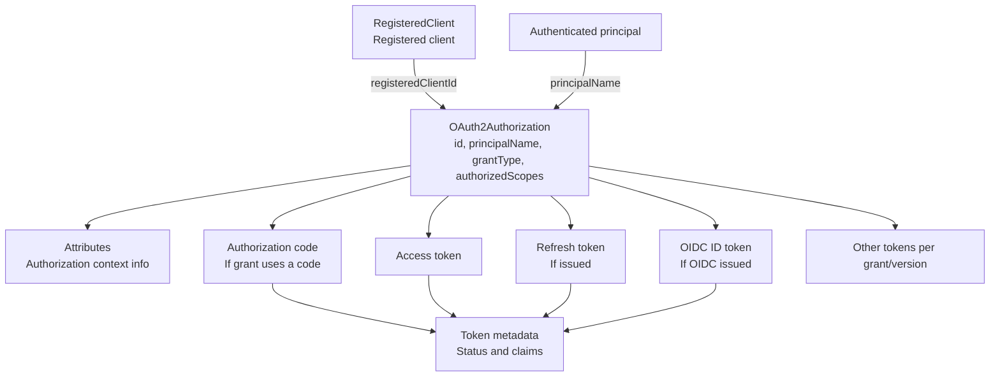
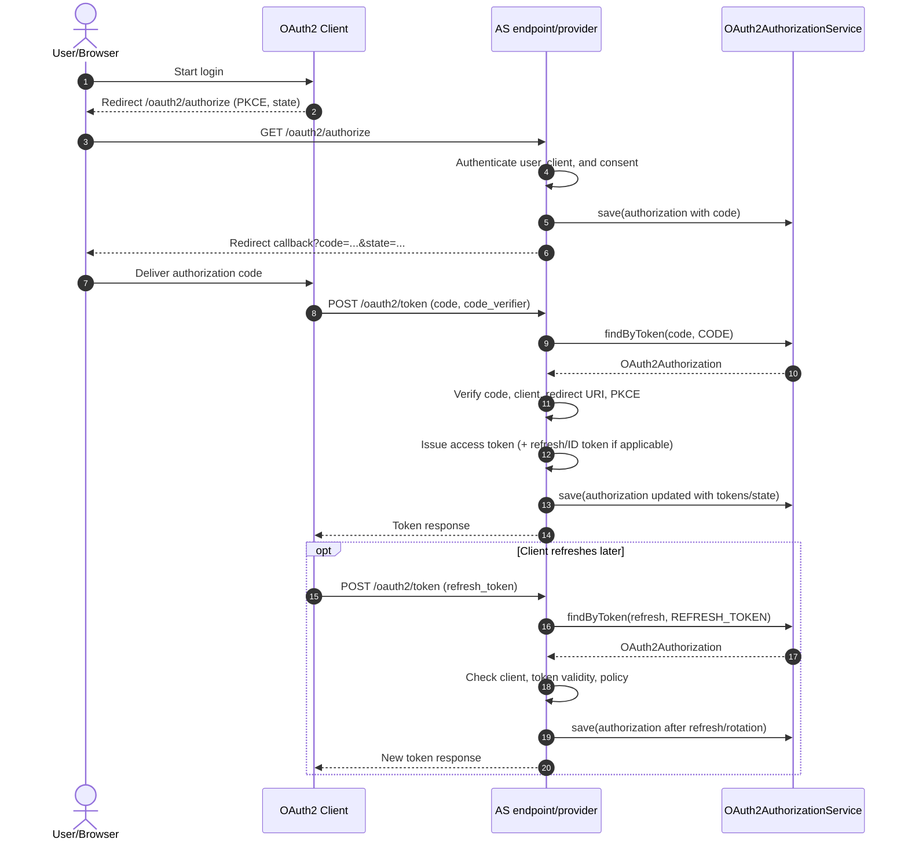
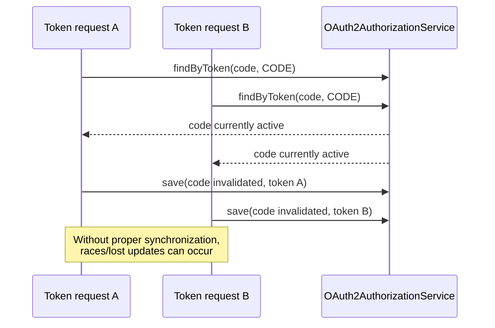
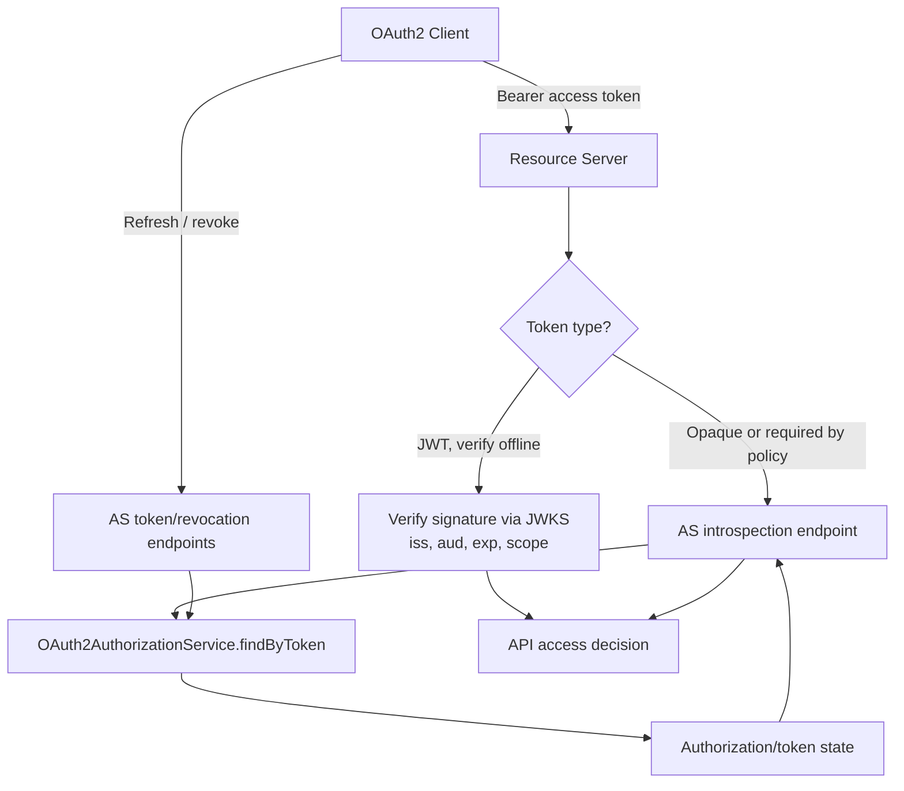
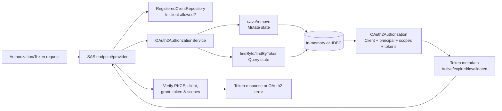

# OAuth2AuthorizationService and looking up authorizations by token

## 1. Objective and context

In the **Core Models** chapter of the **SPRING_SECURITY_OAUTH2_OIDC_AUTHORIZATION_SERVER** module, `OAuth2AuthorizationService` is the key abstraction enabling Spring Authorization Server (SAS) to maintain and look up **OAuth 2.0/OpenID Connect (OIDC) authorization state**. Understanding this service properly is foundational for designing, configuring, securing, testing, and operating an Authorization Server with Spring Security in a Spring Boot application.

After this lesson, you will be able to:

- Explain why one `OAuth2Authorization` holds **multiple tokens and metadata**, rather than just a single access token.
- Properly use the four methods `save`, `remove`, `findById`, and `findByToken` of `OAuth2AuthorizationService`.
- Distinguish looking up an authorization by authorization code, access token, and refresh token; understand how to specify `OAuth2TokenType`.
- Check token status via `OAuth2Authorization.Token#isActive()` and distinguish a lookup from token validation.
- Choose `InMemoryOAuth2AuthorizationService` or `JdbcOAuth2AuthorizationService` based on persistence, performance, and multi-instance requirements.
- Design tests for token issuance, authorization code exchange, refreshing, revocation, expiration, and data security.

**Scope:** Focuses on the data model and authorization lookups. Endpoint configs, login, and JWT signing algorithms are mentioned only as needed to understand the service. Java examples target common APIs of Spring Authorization Server 1.x on Spring Security 6.x/Spring Boot 3.x; always verify against your application's actual version.

## 2. What does `OAuth2Authorization` represent?

An authorization is an **authorization state record**, linking a **registered client**, a **principal** (user or machine-to-machine client), a **grant type**, **granted scopes**, **tokens generated within the same lifecycle**, and associated metadata.



For example: in the Authorization Code Flow, user `alice` consents to application `web-client` accessing scope `profile.read`. A corresponding authorization moves through multiple states: initially holding an authorization code, then after code exchange holding an access token and possibly a refresh token and ID token. On refresh or revocation, the service updates the authorization record and corresponding token metadata.

| Field or object | Interpretation | Common confusion |
| --- | --- | --- |
| `id` | Internal ID of an `OAuth2Authorization` | Not `client_id`, `code`, or the access token string. |
| `registeredClientId` | Internal ID referencing `RegisteredClient` | Differs from `clientId` used in OAuth2 requests. |
| `principalName` | Principal name associated with the authorization | With Client Credentials this can be the client, not necessarily a user account. |
| `authorizationGrantType` | Grant type that created the authorization | For example, `authorization_code`, `client_credentials`, or an extension grant. |
| `authorizedScopes` | Scopes actually granted | May differ from the scopes the client is registered to use or initially requested. |
| `attributes` | Context stored alongside the authorization | Can contain security objects; consider serialization and sensitive data. |
| `tokens` | Tokens belonging to the authorization | Do not assume every authorization contains all of code, access, refresh, and ID tokens. |
| `Token.metadata` | Per-token metadata | Contains the invalidated flag, claims, and protocol-handling details. |

**Three models to keep separate:** `RegisteredClient` describes *what a client is allowed to do*; `OAuth2Authorization` describes *permissions/tokens issued in one authorization session*; `OAuth2AuthorizationConsent` describes *which scopes a user has approved for a client*. The authorization service does not replace the client repository or consent service.

## 3. The `OAuth2AuthorizationService` contract

The core interface defines four methods:

```java
public interface OAuth2AuthorizationService {

    void save(OAuth2Authorization authorization);

    void remove(OAuth2Authorization authorization);

    OAuth2Authorization findById(String id);

    OAuth2Authorization findByToken(
            String token,
            OAuth2TokenType tokenType);
}
```

The signatures above omit version-specific nullability and metadata annotations for clarity. Lookup methods can return **`null`** when no matching record is found.

| Method | Input | Result | When to use |
| --- | --- | --- | --- |
| `save(authorization)` | A complete `OAuth2Authorization` | Creates a new record or updates an existing one | Issuing an authorization code, saving tokens, updating token state after refresh/revocation. |
| `remove(authorization)` | Authorization record | Deletes authorization state from the store | Data cleanup or lifecycle handling when required by framework/policy. |
| `findById(id)` | Internal authorization ID | `OAuth2Authorization` or `null` | Querying by a known internal ID. |
| `findByToken(token, tokenType)` | Token value string and token type | `OAuth2Authorization` holding the matching token or `null` | Looking up when receiving a code, access token, refresh token, or another supported token. |

### 3.1. Why does `findByToken` return an authorization instead of a token?

A token is a **component of an authorization**, and processing decisions usually require the surrounding context:

- Which grants is the registered client allowed to use?
- To which principal and scopes was the token issued?
- Is the token still within its lifetime or already marked invalidated?
- Does the authorization hold a refresh token and associated metadata?
- Which record needs updating after code exchange, refresh, or revocation?

Hence:

```text
tokenValue + tokenType
    -> OAuth2AuthorizationService.findByToken(...)
    -> OAuth2Authorization
    -> extract matching Token<?>
    -> verify state + client + grant + protocol conditions
    -> execute, reject, or update the authorization
```

**`findByToken` is strictly a lookup operation.** Finding a record does not mean the token is authorized for use. The caller must still check validity, client authentication, token type, grant, revocation status, and other security constraints.

### 3.2. `save` writes the state of the entire authorization

When creating or modifying tokens, SAS providers typically construct a new `OAuth2Authorization` based on existing state and call `save`. With `JdbcOAuth2AuthorizationService`, an update can overwrite multiple token/metadata columns in the **same authorization record**.

Do not think of `save` as an "append an independent token" API. If multiple concurrent requests read the same authorization and overwrite it without coordination, **lost updates** or race conditions can occur. Persistence design and consistency must account for refresh/rotation flows and deployment scale.

### 3.3. `remove` differs from invalidating a token

`remove(authorization)` deletes the record from the store. That differs from **keeping the record while marking a token invalidated**, which may be necessary to answer introspection, support auditing, or preserve relationships between access and refresh tokens.

Deleting the entire authorization affects every token inside it and subsequent refresh/revocation operations. Use SAS's revocation mechanism (such as `/oauth2/revoke`) rather than writing custom DB-deletion endpoints for arbitrary tokens.

## 4. Token-based lookups: token type defines semantics

The method has the form:

```java
OAuth2Authorization authorization =
        authorizationService.findByToken(tokenValue, tokenType);
```

Here `tokenValue` is the **actual token string** persisted by the AS; `tokenType` identifies the token type per SAS conventions.

### 4.1. Common lookup types

| Value to look up | Commonly used `tokenType` | Field in authorization | Purpose |
| --- | --- | --- | --- |
| Access token | `OAuth2TokenType.ACCESS_TOKEN` | `getAccessToken()` | Introspection, revocation, or internal checks by access token. |
| Refresh token | `OAuth2TokenType.REFRESH_TOKEN` | `getRefreshToken()` | Refresh Token Grant, verifying/revoking refresh tokens. |
| Authorization code | `new OAuth2TokenType(OAuth2ParameterNames.CODE)` | `getToken(OAuth2AuthorizationCode.class)` | Looking up a code just submitted by the client to the token endpoint. |
| OIDC ID token | `new OAuth2TokenType(OidcParameterNames.ID_TOKEN)` when version supports ID token lookup | `getToken(OidcIdToken.class)` | OIDC-related features needing lookup by ID token. |
| Device code or user code | Dedicated token type for device grant | Corresponding token class | Available only when Device Authorization is enabled and supported by the implementation. |

**Check version/implementation:** Extended token types and specific token indexing can vary across SAS versions. For codes and ID tokens, use the corresponding OAuth2/OIDC constants instead of typing strings manually when the API provides them. Do not assume every custom implementation supports every extended token type.

Example calling explicitly with token type:

```java
OAuth2Authorization byAccess = authorizationService.findByToken(
        accessTokenValue, OAuth2TokenType.ACCESS_TOKEN);

OAuth2Authorization byRefresh = authorizationService.findByToken(
        refreshTokenValue, OAuth2TokenType.REFRESH_TOKEN);

OAuth2Authorization byCode = authorizationService.findByToken(
        authorizationCodeValue,
        new OAuth2TokenType(OAuth2ParameterNames.CODE));
```

In SAS, `OAuth2TokenType.ACCESS_TOKEN` is the **protocol** token type. It differs from `OAuth2AccessToken.TokenType.BEARER`, which is how an access token is presented in an HTTP Authorization header. Mixing up those two types/enums is a common design mistake.

### 4.2. What if `tokenType = null` is passed?

The SAS lookup contract allows an unspecified `tokenType`; standard implementations generally search the token value across all supported fields. However, this may require querying multiple token columns and depends on the implementation's storage layout.

```java
OAuth2Authorization authorization =
        authorizationService.findByToken(tokenValue, null);
```

Use this approach **only when the context does not know the token type upfront**, such as an internal handler intentionally supporting multiple types. In the token endpoint, refresh handler, or introspection, callers normally know the allowed token type and should pass a **specific type** to avoid broad scans and reduce ambiguity. Never pass `null` to bypass token type validation.

### 4.3. Looking up by token value does not decode the token

For JWTs, the value string may contain three parts: `header.payload.signature`. `findByToken` locates the **matching record in the authorization store** by value and type. It is not a general API to:

- verify RS256/ES256 signatures;
- check `iss`, `aud`, `exp`;
- enforce scope/role policies at a Resource Server;
- extract claims by decoding a JWT without the authorization store.

If a Resource Server validates JWTs itself using JWKS, it does not need to call `OAuth2AuthorizationService` on every request. Conversely, introspection or near-instant revocation checks that require server-side state can rely on the authorization store.

## 5. Metadata and token status inside an authorization

SAS wraps each token as an `OAuth2Authorization.Token<T>`. From an authorization record, you can retrieve each token:

```java
OAuth2Authorization.Token<OAuth2AccessToken> access =
        authorization.getAccessToken();

OAuth2Authorization.Token<OAuth2RefreshToken> refresh =
        authorization.getRefreshToken();

OAuth2Authorization.Token<OAuth2AuthorizationCode> code =
        authorization.getToken(OAuth2AuthorizationCode.class);

OAuth2Authorization.Token<OidcIdToken> idToken =
        authorization.getToken(OidcIdToken.class);
```

A token not present in the authorization is returned as `null`. For example, Client Credentials Flow typically has neither an authorization code nor a user-representing ID token.

An `OAuth2Authorization.Token<?>` exposes lifecycle checks:

- `getToken()`: the underlying token object (holding value, issued-at, and expires-at timestamps depending on type).
- `getMetadata()`: metadata managed by framework/application, which can include the invalidated flag.
- `getClaims()`: claims stored alongside if provided by the token generator; never assume they exist for every token.
- `isExpired()`: whether the token is past its expiration timestamp.
- `isInvalidated()`: whether the token is marked invalidated.
- `isActive()`: whether the token is considered active under the status conditions checked by `Token`.

**Never use `isActive()` alone to grant client/API access.** Callers must still verify client binding, grant type, scopes, token purpose, JWT signature, and audience per function. Those conditions cannot be inferred solely from the active flag.

### 5.1. Example checking a token after lookup

An internal service inside the AS might inspect an access token as follows:

```java
@Service
public class AuthorizationLookupService {

    private final OAuth2AuthorizationService authorizations;

    public AuthorizationLookupService(
            OAuth2AuthorizationService authorizations) {
        this.authorizations = authorizations;
    }

    public Optional<OAuth2Authorization> findByActiveAccessToken(
            String tokenValue) {

        OAuth2Authorization authorization =
                authorizations.findByToken(
                        tokenValue, OAuth2TokenType.ACCESS_TOKEN);

        if (authorization == null) {
            return Optional.empty();
        }

        OAuth2Authorization.Token<OAuth2AccessToken> accessToken =
                authorization.getAccessToken();

        if (accessToken == null || !accessToken.isActive()) {
            return Optional.empty();
        }

        return Optional.of(authorization);
    }
}
```

**Scope of this example:** This is an **internal** helper illustrating lookup and status inspection, not a complete Bearer token validator or a public HTTP endpoint. Never return raw `OAuth2Authorization` objects to clients because they can contain sensitive tokens, metadata, and attributes. Standard SAS endpoints already include providers and policies enforcing client authentication.

### 5.2. Distinguishing "not found" from "no longer valid"

| State | `findByToken` result | Token status | Typical action |
| --- | --- | --- | --- |
| Unknown string | `null` | No token | Reject request; never guess data or log raw tokens. |
| Existing value queried with wrong type | May return `null` | Token belongs to a different type | Caller must pass the right token type instead of relaxing constraints. |
| Record exists, token within lifetime | Returns `OAuth2Authorization` | May have `isActive() = true` | Proceed to check binding, permissions, and grant rules. |
| Record exists, expired | May still be found | `isExpired() = true` | Reject token usage; cleanup is a separate step. |
| Record exists, revoked/invalidated | May still be found | `isInvalidated() = true` | Reject; never treat lookup success as granting access. |
| Authorization deleted | `null` | No data remaining | Reject operations requiring that state. |

**Do not assume `findByToken` automatically filters out expired tokens.** It locates the record; checking validity is the next step. Deleting expired records may be handled by maintenance jobs, database retention, or application lifecycle logic.

## 6. Authorization Code lifecycle and lookup calls



### 6.1. When issuing an authorization code

The AS creates the authorization, attaches the client, principal, scopes, and newly issued code, and calls `save`. The code is redeemed at the token endpoint and must be protected against replay. Checking that the code is unexpired, unused, matches the client, and passes PKCE is the responsibility of the provider/token endpoint, relying on state supplied by the service.

### 6.2. When exchanging the code for tokens

The token endpoint calls `findByToken(code, codeType)`, retrieving the authorization containing the code. After verifying constraints, the provider issues tokens and updates the authorization. A used authorization code cannot be accepted again; the framework marks the appropriate status on successful processing.

### 6.3. When refreshing tokens

The Refresh Token Grant looks up by `OAuth2TokenType.REFRESH_TOKEN`. The service returns the authorization so the provider can validate the token, client, permissions, and refresh token policy. If rotation is configured, a new refresh token is issued and the old token may be invalidated per policy; updates must be persisted consistently.

### 6.4. When revoking or introspecting

- **Revocation (`/oauth2/revoke`):** the endpoint performs client authentication and RFC 7009 checks, then updates authorization/token state as appropriate. Never allow unauthorized parties to arbitrarily revoke another client's tokens.
- **Introspection (`/oauth2/introspect`):** authorized clients call the endpoint and receive token status details, where `active` depends on multiple checks. Never expose an unauthenticated introspection API to the Internet.
- **JWT access tokens at Resource Servers:** if the RS checks signatures offline only, state updates in the authorization store do not immediately cause unexpired JWTs to be rejected at the API. Consider short-lived access tokens, introspection, or denylists when near-instant revocation is required.

## 7. Registering `OAuth2AuthorizationService` in Spring Boot

### 7.1. Using in-memory for learning and testing

To make dependency injection explicit:

```java
@Configuration(proxyBeanMethods = false)
public class AuthorizationPersistenceConfig {

    @Bean
    OAuth2AuthorizationService authorizationService() {
        return new InMemoryOAuth2AuthorizationService();
    }
}
```

SAS can create a default in-memory implementation in matching configurations when no service bean is present. Declaring it explicitly makes replacement easier and keeps state ownership clear. Avoid defining **two `OAuth2AuthorizationService` beans** without clear qualifiers/`@Primary` if components autowire by type.

In-memory characteristics:

- Fast and requires no database; suitable for demos or small unit/integration tests.
- JVM restarts wipe authorization codes, refresh token state, and related metadata.
- Not shared across multiple pods/instances; an authorize request on instance A followed by a code exchange on instance B can fail.
- Not a retention/audit solution and provides no distributed transactions.

### 7.2. JDBC for durable state

With Spring JDBC already configuring `DataSource` and `JdbcTemplate`, replace the in-memory bean:

```java
@Configuration(proxyBeanMethods = false)
public class JdbcAuthorizationPersistenceConfig {

    @Bean
    OAuth2AuthorizationService authorizationService(
            JdbcTemplate jdbcTemplate,
            RegisteredClientRepository registeredClientRepository) {

        return new JdbcOAuth2AuthorizationService(
                jdbcTemplate, registeredClientRepository);
    }
}
```

**These are two alternative configurations**—do not copy both into the same application context. `JdbcOAuth2AuthorizationService` needs the client repository to reconstruct authorizations from persisted rows. Ensure both the repository and schema match the exact Spring Authorization Server version in use.

At the database layer, typical authorization data includes:

| Column/value group | Purpose |
| --- | --- |
| Authorization ID, registered client ID, principal name, grant type | Reconstruct authorization relationships. |
| Authorized scopes, attributes, state | Authorization context and associated state. |
| Authorization code + issued/expires + metadata | Look up code when the client exchanges it. |
| Access token + issued/expires + metadata + type/scopes | Introspection, revocation, and access-token lookups. |
| Refresh token + issued/expires + metadata | Refresh Token Grant and rotation/revocation. |
| OIDC ID token and metadata | Support relevant OIDC flows when issued. |
| Device/user codes if present | Support Device Authorization Grant. |

Column names and types depend on the **SQL schema of your SAS version**. Do not guess the schema from this table; use project migrations based on the matching reference schema, and test serialization compatibility with your chosen database engine.

### 7.3. Query performance of `findByToken`

Token lookups happen frequently at token, introspection, and revocation endpoints. With JDBC, design for query frequency and lookup paths per token field:

1. Inspect the exact queries and schema of the running JDBC service version.
2. Assess lookup frequency for authorization codes, refresh tokens, access tokens, and extension tokens.
3. Add indexes appropriate to the **columns, data types, and actual query plans**. Long token values in LOB/CLOB columns may not work well with standard B-tree indexes.
4. Consider storing secure token digests/identifiers if building a custom repository, while preserving the service contract.
5. Define expired-data cleanup policies, partitioning/archiving for large authorization volumes, and monitor latency/query plans.

**Never arbitrarily hash tokens inside `JdbcOAuth2AuthorizationService`'s default table** expecting the default implementation's `findByToken` to keep working. Storing hashed/protected token values requires a compatible repository implementation or thoroughly tested custom mapper/logic.

### 7.4. Protecting persistence

The authorization store can contain raw token values, metadata, attributes, and sensitive claims:

- Encrypt connections and data at rest per policy; grant least-privilege database permissions.
- Never log raw authorization codes, access tokens, refresh tokens, or client secrets in logs/traces.
- Never return full authorizations in admin API JSON responses.
- Have retention, migration, backup, and key/token compromise response procedures.
- Across multiple instances, share a consistent database, issuer, signing keys, and session/consent mechanisms if used.

## 8. Practical examples of retrieving and checking authorizations

### 8.1. An internal API returning minimal information

You can build an internal method to inspect an authorization by access token without accidentally leaking the token. For example:

```java
public record AuthorizationSummary(
        String authorizationId,
        String registeredClientId,
        String principalName,
        boolean tokenActive,
        Set<String> authorizedScopes) {
}

@Service
public class AuthorizationInspector {

    private final OAuth2AuthorizationService authorizationService;

    public AuthorizationInspector(
            OAuth2AuthorizationService authorizationService) {
        this.authorizationService = authorizationService;
    }

    public Optional<AuthorizationSummary> inspectAccessToken(
            String rawAccessToken) {

        OAuth2Authorization authorization =
                authorizationService.findByToken(
                        rawAccessToken, OAuth2TokenType.ACCESS_TOKEN);

        if (authorization == null ||
                authorization.getAccessToken() == null) {
            return Optional.empty();
        }

        return Optional.of(new AuthorizationSummary(
                authorization.getId(),
                authorization.getRegisteredClientId(),
                authorization.getPrincipalName(),
                authorization.getAccessToken().isActive(),
                Set.copyOf(authorization.getAuthorizedScopes())));
    }
}
```

This pattern **is not a public API** and **does not prove the caller is authorized to read principal details**. Before exposing it in an operational feature, add operator authorization, personal-data controls, and proper auditing. For untrusted raw token inputs, avoid logging the value and never echo the access token back in the result.

### 8.2. Lookup by ID vs. lookup by token

These two calls:

```java
OAuth2Authorization byId =
        authorizationService.findById(authorizationId);

OAuth2Authorization byAccessToken =
        authorizationService.findByToken(
                accessTokenValue, OAuth2TokenType.ACCESS_TOKEN);
```

are not equivalent. `authorizationId` is the authorization's internal ID, whereas `accessTokenValue` is an issued credential. Multiple tokens can belong to the **same** authorization ID; replacing or invalidating a token does not change the authorization's ID.

### 8.3. Pattern for checking a code separately from an access token

```java
OAuth2Authorization authorization =
        authorizationService.findByToken(
                codeValue,
                new OAuth2TokenType(OAuth2ParameterNames.CODE));

if (authorization == null) {
    // Code not found in store
    return;
}

OAuth2Authorization.Token<OAuth2AuthorizationCode> code =
        authorization.getToken(OAuth2AuthorizationCode.class);

if (code == null || !code.isActive()) {
    // Code expired or already invalidated
    return;
}

// This is only the status-reading step.
// The token endpoint must still verify client, PKCE, redirect URI,
// grant type, and ensure the code cannot be reused.
```

The example intentionally **stops at the lookup step**. Never build a custom code-exchange token endpoint by hand, as mandatory checks are easily missed. For standard applications, keep `OAuth2AuthorizationCodeAuthenticationProvider` and the providers configured by SAS.

## 9. Token lifecycle, invalidated status, and concurrency

### 9.1. Three distinct concepts

1. **Expired (`expired`):** current time has passed the token's `expiresAt`.
2. **Invalidated (`invalidated`):** metadata state indicates the token was invalidated, e.g., already consumed or revoked per policy.
3. **No longer stored:** the record/token was removed from the store or cleaned up, so lookups return `null`.

Do not conflate these three states. An expired authorization code may still exist in the database awaiting cleanup, and a revoked token may be retained for protocol handling or audit purposes.

### 9.2. Code exchange and refresh must enforce single-use semantics per policy

Understand race conditions when two requests arrive nearly simultaneously:



**Risk:** `findByToken` and `save` are two separate operations. If you replace the provider or service with a naive implementation, nothing guarantees that pair of operations executes as a business-level atomic transaction.

Depending on your database and requirements, solutions include optimistic locking/version columns, row locks, appropriate transaction isolation, or atomic token consumption in a custom repository. Never claim `InMemoryOAuth2AuthorizationService` or default JDBC automatically eliminates all distributed race conditions. Explicitly test single-use flows whenever security relies on atomicity.

### 9.3. Refresh token rotation

When `reuseRefreshTokens(false)` is enabled, exchanging a refresh token must ensure the old token is no longer accepted after a valid use. Critical tests:

- First refresh succeeds and the client receives new tokens per policy.
- Re-attempting refresh with the old token is rejected once rotation takes effect.
- Two concurrent refresh requests do not illegitimately mint multiple active refresh token sets.
- If a database write fails midway, the authorization does not end up in an inconsistent state that leaks privileges.

Do not assume `reuseRefreshTokens(false)` automatically delivers complete replay protection in distributed environments; verify real behavior and persistence transactions.

## 10. Boundary between lookup, introspection, and Resource Server



**With JWT access tokens:** Resource Servers can verify tokens using public keys without hitting the authorization store on every request. This reduces runtime coupling, though revocation on the AS does not automatically invalidate unexpired tokens at the API.

**With opaque tokens:** APIs typically use introspection or an equivalent state-checking mechanism. SAS uses the authorization store to look up the token and determine status. APIs themselves should never connect directly to the authorization database just to look up tokens, as doing so erases security boundaries and couples APIs to internal schemas.

**With OIDC clients:** ID tokens authenticate user identity at the client (Relying Party); access tokens call APIs. Never pass an ID token to a Resource Server to use as an access token. One authorization can contain both, yet their purposes and validation criteria differ.

## 11. Designing tests around the service contract

### 11.1. Unit tests for the service or a custom adapter

For a custom `OAuth2AuthorizationService` implementation, verify at a minimum:

| Test step | How to execute | Expected outcome |
| --- | --- | --- |
| Save new and findById | Save authorization with ID A; look up A | Returns record with exact client, principal, grant, and scopes. |
| FindByToken right type | Save token T; look up T with matching type | Returns authorization A. |
| FindByToken wrong type | Look up T under a different type | Does not return the token as if it belonged to the other type. |
| FindByToken missing | Look up unknown token string | Returns `null`. |
| Update token state | Save authorization with updated metadata | Subsequent lookups reflect the new state. |
| Remove authorization | Remove A; query ID/token again | Record is no longer found. |
| Multiple token types | One authorization with code/access/refresh | Looking up each value by its type finds the authorization while stored. |
| Metadata round-trip | Persist claims/invalidated metadata | Reloading preserves all supported metadata. |
| Persistence restart | Restart process using the same database | Durable records remain retrievable. |
| Concurrency | Multiple concurrent code-exchange/refresh requests | Does not violate configured single-use/rotation policies. |

For Spring Boot apps using **JDBC**, prioritize integration tests against a real database (for example, via Testcontainers) to validate column types, transactions, query plans, schemas, and serialization. In-memory tests do not fully substitute for persistence tests.

### 11.2. Integration tests through OAuth2 endpoints

| Flow | What to verify |
| --- | --- |
| Authorization Code + PKCE | Login/consent completes, code is persisted, token endpoint exchanges only valid codes. |
| Code reuse | First exchange succeeds; subsequent attempt returns appropriate error without issuing new tokens. |
| Invalid or expired code | `findByToken` returns null or inactive state; endpoint rejects safely. |
| Refresh Token | Properly looks up refresh token; checks client, lifetime, and rotation policy. |
| Revoke access/refresh token | Authorization state updates per policy and endpoint does not leak other clients' tokens. |
| Introspection | Active tokens are reflected accurately; invalid/expired tokens are not reported active. |
| JWT Resource Server | Signature, issuer, audience, expiry, and permissions verified independently. |
| Multi-instance | Authorize on instance A, exchange code on B when supported by architecture | Does not fail due to missing authorization state. |

**Failure cases to test:** invalid `client_id`/client secret, wrong redirect URI, wrong `code_verifier`, out-of-scope requests, non-existent tokens, revoked tokens, database timeouts, and server restarts between authorize and token exchange. These uncover issues hidden by the happy path.

### 11.3. Never test by logging real tokens

When observing requests/responses, mask or strip `Authorization: Bearer ...`, `code`, `refresh_token`, `client_secret`, and session cookies. You may log correlation IDs, grant types, policy-approved internal client IDs, and sanitized error categories. For test data, use only dummy tokens or disposable credentials.

## 12. Common issues

| Symptom | Possible cause | How to check |
| --- | --- | --- |
| `findByToken` returns `null` after restart | Authorization uses in-memory storage | Check the active implementation and persistence plan. |
| Authorize succeeds but token exchange returns `invalid_grant` | Code on a different instance, expired, already used, or invalid PKCE/client/redirect | Safely inspect logs, shared store, state, and grant constraints. |
| Access token lookup returns null yet JWT still passes API | Store deleted/revoked the token while RS validates JWTs offline | Distinguish AS state from offline RS validation. |
| Refresh token lookup succeeds yet refresh is rejected | Token expired/invalidated or client/policy mismatch | Inspect token status, not just lookup presence. |
| Custom introspection returns `active=true` for expired token | Only checked `authorization != null` | Use standard providers or check full validity. |
| `NoUniqueBeanDefinitionException` | Both in-memory and JDBC services registered | Declare one clear bean and remove duplicate config. |
| JDBC fails to read authorization | Schema mismatch, JSON/serialization issue, or missing referenced client ID | Verify version-matched migrations and registered client repository. |
| Token lookup unusually slow | Missing index, oversized data, or LOB/table scan | Inspect query plan and latency; tune for your actual implementation. |
| `getAccessToken()` returns `null` | Authorization does not yet have an access token or is another grant/case | Check lifecycle stage and token type before reading. |
| Concurrent code exchange produces two valid token sets | Missing concurrency/atomic consumption in custom store/provider | Add race tests and proper transactions/locking. |
| Token revoked yet API still accepts JWT | API only validates JWTs offline | Use short TTLs, introspection, or revocation propagation per requirements. |

Another critical technical mistake is using `accessToken.getToken().getTokenValue()` as the **primary key for the entire authorization**. One authorization can hold multiple tokens and token values change over its lifecycle; the authorization ID is the record's stable internal identifier.

## 13. Practical implementation checklist

- [ ] Separate `RegisteredClientRepository`, `OAuth2AuthorizationService`, and `OAuth2AuthorizationConsentService` by responsibility.
- [ ] Understand `save`, `remove`, `findById`, and `findByToken`; never confuse lookup with token validation.
- [ ] Specify concrete `OAuth2TokenType` values in flows where the token type is known.
- [ ] Check token `isActive()` plus client/grant/scope conditions before processing.
- [ ] Never treat a found token or valid JWT signature alone as sufficient proof to grant access.
- [ ] Use `InMemoryOAuth2AuthorizationService` only when losing state on restart is acceptable.
- [ ] If using JDBC, ensure the schema matches the SAS version, referenced registered clients still exist, and metadata round-trips cleanly.
- [ ] Maintain cleanup, backup, encryption-at-rest, and least-privilege database access policies.
- [ ] Test code reuse, refresh rotation, revocation, expiration, and concurrency at appropriate levels.
- [ ] Across multiple AS instances, ensure the authorization store is shared and consistency is enforced.
- [ ] Resource Servers validate issuer, audience, signature/lifetime, and permissions according to token format.
- [ ] Never expose raw `OAuth2Authorization` records or raw tokens in admin APIs, logs, or traces.

## 14. Architectural summary



`OAuth2AuthorizationService` is the **boundary between protocol handling and granted authorization state**. It provides the operations to store and look up `OAuth2Authorization` by ID or token value, enabling Spring Authorization Server to handle authorization codes, access tokens, refresh tokens, introspection, and revocation consistently. The real value of mastering this service lies in **never equating finding an authorization with authenticating and authorizing a request**, while choosing appropriate persistence, concurrency control, token protection, and lifecycle testing when moving a Spring Security OAuth2/OIDC Authorization Server from learning environments into production.
