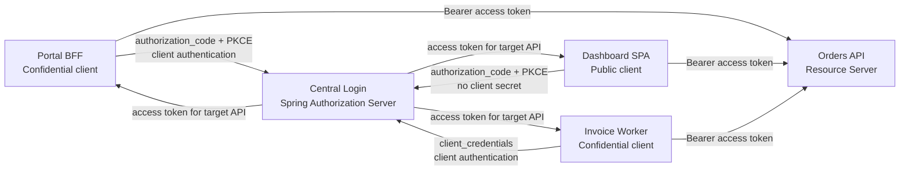
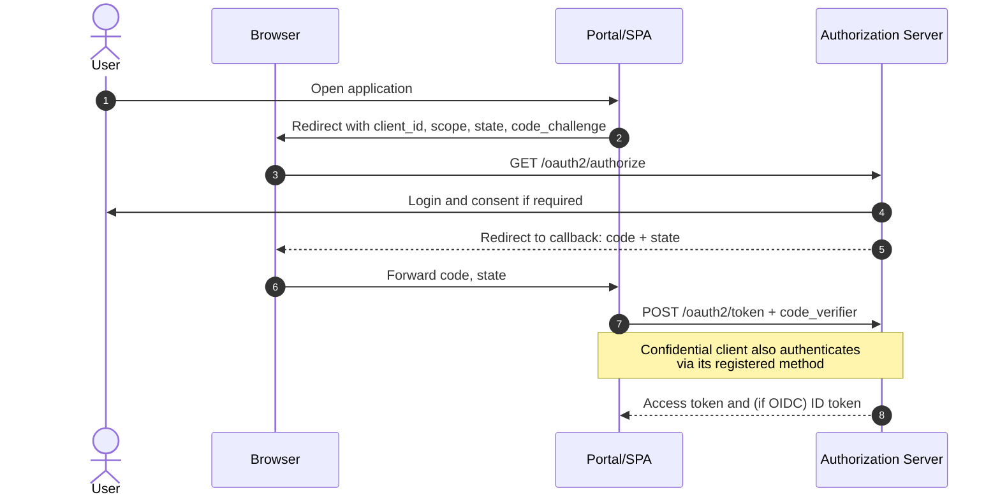
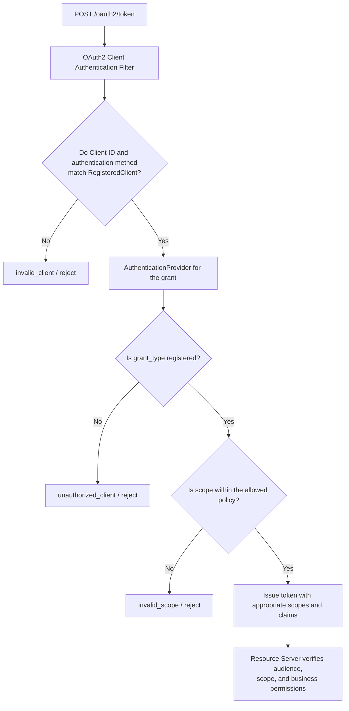

# Configuring Grant Types, Authentication Methods, and Scopes per Client

In **OAuth 2.0/OpenID Connect (OIDC)**, a **client** is not necessarily a user or a UI application. A client can be a backend web application, a Single Page Application (SPA), a mobile app, a command-line tool, an input-constrained device, or a background service. Each client type has different secret-keeping capabilities and token requirements.

Therefore, when implementing **Spring Authorization Server** with **Spring Security** in **Spring Boot**, client configuration must answer at least three questions:

1. **`authorizationGrantTypes`:** Through which flows is the client allowed to request tokens?
2. **`clientAuthenticationMethods`:** How does the client prove its identity to the Authorization Server, if it is a confidential client?
3. **`scopes`:** Which permissions is the client allowed to request, and how will the Resource Server validate those permissions?

This lesson belongs to the **Client Management** chapter of the **SPRING_SECURITY_OAUTH2_OIDC_AUTHORIZATION_SERVER** module, designed for learning how to architect, configure, secure, test, and operate an Authorization Server with Spring Security and Spring Authorization Server. The content progresses from a real-world scenario to `RegisteredClient` configuration, token issuance policies, authorization boundaries, and access-denial testing.

> **Principle:** Register only the grant types, authentication methods, and scopes that a client truly needs. Having an access token issued to a client does not mean it has unrestricted permissions over API data.

## 1. Example Scenario: Three Clients in One System

Suppose a system includes:

- **Portal BFF** at `portal.example.com`: users log in via a browser; the backend keeps the client secret and tokens on the server side.
- **Dashboard SPA** at `dashboard.example.com`: JavaScript running in the browser; cannot safely keep a client secret.
- **Invoice Worker**: a scheduled invoice export service; has no interactive user and needs access to a subset of the Orders API.
- **Central Login** at `login.example.com`: the Authorization Server that issues tokens, manages client registrations, and publishes OIDC/OAuth2 metadata.
- **Orders API**: the Resource Server that verifies access tokens and enforces data access permissions.

A sensible initial design:

| Client | Allowed grant types | Client authentication | Registered scopes |
|---|---|---|---|
| Portal BFF | `authorization_code`, `refresh_token` | `client_secret_basic` or a stronger method | `openid`, `profile`, `orders.read` |
| Dashboard SPA | `authorization_code` | `none` + mandatory PKCE | `openid`, `orders.read` |
| Invoice Worker | `client_credentials` | `client_secret_basic`, `private_key_jwt`, or mTLS depending on infrastructure | `orders.export` |

The table illustrates **per-client** configuration. Do not share a single `client_id` and secret across the Portal, SPA, and Worker. When an incident occurs, separating clients enables targeted revocation, scope restriction, and auditing of the exact actor.



The diagram shows only the logical flow. For the Authorization Code Flow, the browser and redirects to `/oauth2/authorize` are also involved; with a BFF, access tokens may be stored and used solely by the backend.

## 2. RegisteredClient Is Where Each OAuth Client's Permissions Are Declared

Spring Authorization Server uses `org.springframework.security.oauth2.server.authorization.client.RegisteredClient` to represent a registered client configuration. A client must be registered before initiating an authorization grant permitted by the server.

| `RegisteredClient` field | Meaning | Notes |
|---|---|---|
| `id` | Internal identifier key in the registered clients store | Keep stable when using persistence |
| `clientId` | Public identifier sent by the client in protocol requests | Not a secret |
| `clientSecret` | Secret for secret-based client authentication methods | Encoded with `PasswordEncoder`; issued only to confidential clients |
| `clientSecretExpiresAt` | Timestamp when the secret expires, if configured | Tie to a rotation workflow and advance notifications |
| `clientAuthenticationMethods` | List of accepted client authentication methods | Configure based on secret-keeping capability |
| `authorizationGrantTypes` | List of allowed grants | Keep minimal per use case |
| `redirectUris` | List of valid callback URIs | Must be exact for redirect-based grants |
| `postLogoutRedirectUris` | Callback after OIDC logout, when used | Does not automatically log out all clients |
| `scopes` | Set of permissions the client is allowed to request | Does not replace business authorization checks |
| `clientSettings` | PKCE, consent, JWK URL, assertion algorithm, and other settings | Per-client policy |
| `tokenSettings` | TTL, access token format, refresh token rotation, etc. | Tune based on risk and client type |

### 2.1. RegisteredClient and ClientRegistration Are Not the Same

These two similarly named objects live on **opposite sides**:

- **`RegisteredClient`** lives on the **Authorization Server**: it determines which clients are registered and which grants, methods, and scopes they are permitted to use.
- **`ClientRegistration`** lives in the Spring Security **OAuth2 Client**: it configures the client application with the issuer, authorization/token endpoints, redirect URI, its own authentication method, and the scopes it will request.

If the Portal declares `authorization-grant-type=authorization_code` on the client side while Central Login only registers `client_credentials` for the Portal, the two sides **do not synchronize automatically** and the request will be rejected. Both sides must be configured compatibly, with the Authorization Server acting as the allowlist enforcer.

### 2.2. Repository for Looking Up Clients

`RegisteredClientRepository` provides lookup operations by `clientId` or internal ID. Common Spring Authorization Server implementations include:

- **`InMemoryRegisteredClientRepository`**: suitable for demos, development, and testing; data is lost when the process exits if registrations are created dynamically.
- **`JdbcRegisteredClientRepository`**: persists client registrations durably over JDBC; requires a schema and safe update/rotation workflows.
- **Custom repository**: needed when you have an existing client/tenant catalog or organizational governance mechanism; must preserve lookup/write semantics and consistency checks.

When creating a new client in a database, assign `id` and `clientId` using a deterministic convention with lifecycle governance. Do not generate `UUID.randomUUID()` for the same client on every production startup—doing so breaks referential stability in authorization and consent records.

## 3. Grant Type: Choosing the Authorization Flow by Actor

An **authorization grant** expresses the basis on which the Authorization Server issues an access token. Not every client should use every grant.

### 3.1. Common Grant Types

| Grant type | When to use | Interactive user? | Notable conditions |
|---|---|---|---|
| `authorization_code` | Portals, web apps, SPAs, native apps needing user authorization | Yes | Registered redirect URI; PKCE; client auth depending on type |
| `refresh_token` | Renewing access tokens without re-authenticating | No during refresh | Only used when a valid refresh token was issued; rotation and TTL |
| `client_credentials` | Background services calling APIs with the workload's own authority | No | Client must prove its identity; no end-user identity |
| Device Authorization Grant (`device_code`) | TVs/input-constrained devices where the user authenticates on another device | Yes, on another device | Device flow must be supported by AS and client, with expiry/polling policy |
| Token Exchange (if supported by implementation) | Exchanging tokens per policy to call another API / on-behalf-of | Context-dependent | Requires validating subject token, audience, actor, policy, and actual support |

Additional or extended grants depend on the version and configuration. **Registering a grant name does not automatically bring full grant-handling logic into existence** if the library/application has not configured the corresponding authentication provider and token policy. For new systems, do not choose the Implicit Flow or Resource Owner Password Credentials grant as a default.

### 3.2. Authorization Code + PKCE

Used for clients where a user logs in and grants permissions:



**PKCE** binds the authorization request to the token request via `code_challenge` and `code_verifier`, mitigating the risk of stolen codes being replayed by another client. For public clients, PKCE is essential; it can also be required for confidential clients. `requireProofKey(true)` in `ClientSettings` enforces that policy per client.

**`state`** helps the client correlate the response with the prior request and defends against certain CSRF/mix-up attacks. **`nonce`** protects ID token binding in OIDC when applicable. PKCE, state, and nonce serve distinct purposes.

### 3.3. Refresh Token Is Not for Initial Authorization

`refresh_token` is declared as a grant type for clients permitted to refresh tokens. That **does not guarantee** the Authorization Server will issue a refresh token in every flow; it still depends on the initial grant, client type, server configuration, and token policy.

For a confidential BFF client, policy may allow refresh tokens with a finite TTL, rotation, and server-side storage. For public SPAs, Spring Authorization Server 1.5.x guidance notes that **refresh tokens are not issued to public clients**; verify the policy of your actual version and consider a BFF if long-lived session/token management is required.

Never use a refresh token as an access token when calling an API. A Resource Server accepts only tokens intended for its resources under the configured policy.

### 3.4. Client Credentials for Machine-to-Machine

`client_credentials` applies when **a client requests an access token using its own identity and authority**, without browser redirects or an employee account.

Conceptual request example:

```http
POST /oauth2/token HTTP/1.1
Host: login.example.com
Authorization: Basic <base64(client_id:client_secret)>
Content-Type: application/x-www-form-urlencoded

grant_type=client_credentials&scope=orders.export
```

Here, the client has `client_credentials` registered, authenticates validly, and is allowed to request `orders.export`. The access token represents **Invoice Worker**. Do not include `openid` in a client credentials scope to pretend an OIDC login occurred; `openid` is an OIDC scope for interactive user identity. The client credentials flow typically issues only an **access token**, without a refresh token.

### 3.5. When to Allow Multiple Grants on One Client?

There is a valid reason for a **BFF** to support `authorization_code` and `refresh_token`. A worker typically needs only `client_credentials`. If the same client identity serves both browser sessions and background jobs, combining grants can make tokens and permissions harder to distinguish, revoke, and audit.

Therefore, create **two separate client registrations for two workloads or trust roles**, even if they belong to the same product. This rule is especially important when part of a product runs in the browser and part runs on the backend.

## 4. Client Authentication Method: How the Client Proves Its Identity

The grant type states **what the client wants to do**, whereas the client authentication method states **how the client proves who it is** when calling endpoints that require client authentication. Registering the right grant with the wrong client authentication still results in rejection.

### 4.1. Public and Confidential Clients

- A **confidential client** can protect credentials, typically a backend, service daemon, or workload managed on secure infrastructure.
- A **public client** cannot securely hold a long-lived secret, such as browser JavaScript SPAs and apps installed on end-user devices.

**A Client ID is not a secret.** A public client has a `client_id` but uses `ClientAuthenticationMethod.NONE`, combined with PKCE and protocol checks. Putting a `client-secret` string into JavaScript or a mobile app **does not turn that client into a confidential client**.

| Method | How it works | When to choose |
|---|---|---|
| `client_secret_basic` | Sends client ID/secret via HTTP Basic to the token endpoint | Backends or workers with secret management; HTTPS mandatory |
| `client_secret_post` | Sends ID/secret in the form body | Only when compatibility requires it; higher risk if bodies are logged |
| `client_secret_jwt` | Uses a JWT assertion signed with the shared secret | Agreed algorithm/signature policy; requires secret governance |
| `private_key_jwt` | JWT client assertion signed by the client's private key | Workloads managing private keys where the AS trusts the client's public JWK |
| `tls_client_auth` / `self_signed_tls_client_auth` | Client proves identity with a TLS certificate via mTLS | When full TLS client authentication, trust, and binding are deployed |
| `none` | Uses no client secret to prove client identity | Public clients using Authorization Code + PKCE |

**Version-dependent:** default methods and how mTLS/JWT assertions are configured can vary across Spring Authorization Server and Spring Security versions. When adopting them, verify that the method is supported and properly enabled in your system. Do not treat declaring `PRIVATE_KEY_JWT`/mTLS in `RegisteredClient` as sufficient to complete certificate infrastructure, key rotation, or network policies.

### 4.2. Comparing Secret-Based, JWT Assertion, and mTLS

| Criterion | Client secret | Private Key JWT | mTLS |
|---|---|---|---|
| Core credential | Shared secret | Client's private key | Certificate + private key |
| AS-side verification | Hash/secret authentication | Assertion signature via public JWK | TLS trust chain verification and certificate matching |
| Deployment | Easy to start | Requires PKI/JWKS and assertion replay protection | Requires proper TLS termination/trust chain |
| Rotation | Change secret and distribute to client | Rotate key pair and publish public key | Manage certificate lifecycle |
| Risk if misconfigured | Secret leaked via repo/logs | Wrong audience/issuer, trusting an uncontrolled JWK URL | Proxy strips client certificate or misconfigured trust |

With `private_key_jwt`, the client sends a short-lived assertion with proper claims (such as `iss`/`sub` set to the client ID, `aud` set to the token endpoint, `exp`, and `jti` per policy) and a signature verifiable with the client's public key. **Never use the Authorization Server's token signing key as a client's private key.**

### 4.3. Client Authentication Is Not User Authentication

An OAuth client sending `Authorization: Basic ...` to `/oauth2/token` authenticates the **registered application**. An employee signing in at `/login` is authenticated via form login, MFA, or an IdP. The two concepts only overlap if boundaries are poorly designed.

In `authorization_code`, a confidential client may still have to authenticate itself at the token endpoint **after** the user has logged in. In `client_credentials`, there is no end user, so employee permissions cannot be inferred from client authentication.

## 5. Scope: Limiting the Permissions a Client May Request

A **scope** is a string describing a set of permissions that the Authorization Server allows a client to request. It helps clients and APIs share a common vocabulary about **access boundaries**, though it does not replace record-level business authorization.

### 5.1. Distinguishing Registered, Requested, and Granted Scopes

Let:

- `S_registered`: the scope allowlist in `RegisteredClient`.
- `S_requested`: the scopes sent by the client in the authorization/token request.
- `S_granted`: the scopes actually issued by the Authorization Server after validation and consent/policy checks.

In a standard allowlist model:

```text
S_granted ⊆ S_requested ⊆ S_registered
```

For example, the Portal registers `openid profile orders.read orders.write` but this time requests only `openid orders.read`; the user or policy may approve fewer scopes than requested. A token does not by default contain all registered scopes. Some flows have default rules when `scope` is omitted; test the concrete behavior rather than assuming a token has no scopes or all scopes.

**Important rule:** If a client requests `orders.admin` without having registered that permission, the Authorization Server must reject it or handle it per protocol policy and **never grant beyond the allowlist**. Adding `scope` to a request never self-expands privileges.

### 5.2. OIDC Scopes and Business Scopes

| Scope | Group | Meaning |
|---|---|---|
| `openid` | OIDC | Requests OpenID Connect; tied to the ID token/identity mechanism |
| `profile` | OIDC | Requests a set of standard profile claims if policy permits |
| `email` | OIDC | Requests email-related claims when supported by the app and policy |
| `orders.read` | Business/API | Read orders the subject is permitted to view |
| `orders.write` | Business/API | Create/update orders per policy |
| `orders.export` | Business/API | Export order data within the workload's boundaries |
| `billing.payments.read` | Business/API | Query permitted payment data |

`openid` does not mean the client can call every API. `orders.read` does not prove a user logged in via OIDC. Scopes govern **client/token permissions**, whereas the ID token serves **identity verification on the OIDC client**.

### 5.3. Scopes, Audience, and Roles Are Different

For the Orders API to accept a token, it typically needs all of the following simultaneously:

1. **Valid signature/status and timestamps**: token issued by a trusted issuer and not expired.
2. **Valid audience**: token issued for the Orders API (e.g., `aud=orders-api`), not for another API.
3. **Appropriate scope**: `orders.read` for GET, `orders.write` for POST.
4. **Resource policy**: the user/worker has access to the corresponding tenant, order, or data.

Spring Security's Resource Server can map JWT scopes to authorities like `SCOPE_orders.read`. **Roles like `ROLE_ADMIN` are not by default identical to OAuth2 scopes.** Even if a user holds a read scope, the API must still verify tenant membership, order ownership, and business rules.

Audience also does not appear as desired merely by registering a scope. The Authorization Server must be configured to issue access tokens with the right `aud`, such as through token customization/policy per client and resource; the Resource Server must validate that exact audience.

### 5.4. Guidelines for Organizing Scopes

- Prefer clear, purpose-driven names with appropriate privilege levels, such as `orders.read` and `orders.write`, rather than `all` or `superuser`.
- Avoid overly granular scopes that make consent hard to read and manage; design around genuinely meaningful operation groups.
- Separate **scopes for interactive users** from **scopes for workloads** when their data policies differ. Distinct names help prevent accidental over-granting.
- Maintain a scope catalog with owner, description, consuming APIs, risk level, and approval process.
- In multi-tenant systems, do not treat a scope as proof that a tenant in the request is valid; bind tokens and data to tenants via explicit mechanisms.

## 6. Configuring Three RegisteredClients in Spring Authorization Server

The example below uses standard **Spring Authorization Server 1.x and Spring Security 6.x** APIs. Its goal is to illustrate the three client types. The snippet focuses on `RegisteredClient` with imports and beans for readability; it does not replace the rest of the Authorization Server configuration (filter chains, signing keys, users, authorization service, consent service, issuer).

```java
package example.authorizationserver.config;

import java.time.Duration;
import java.util.UUID;

import org.springframework.context.annotation.Bean;
import org.springframework.context.annotation.Configuration;
import org.springframework.core.env.Environment;
import org.springframework.security.crypto.factory.PasswordEncoderFactories;
import org.springframework.security.crypto.password.PasswordEncoder;
import org.springframework.security.oauth2.core.AuthorizationGrantType;
import org.springframework.security.oauth2.core.ClientAuthenticationMethod;
import org.springframework.security.oauth2.core.oidc.OidcScopes;
import org.springframework.security.oauth2.server.authorization.client.RegisteredClient;
import org.springframework.security.oauth2.server.authorization.client.RegisteredClientRepository;
import org.springframework.security.oauth2.server.authorization.client.InMemoryRegisteredClientRepository;
import org.springframework.security.oauth2.server.authorization.settings.ClientSettings;
import org.springframework.security.oauth2.server.authorization.settings.TokenSettings;

@Configuration(proxyBeanMethods = false)
public class RegisteredClientConfiguration {

    @Bean
    PasswordEncoder passwordEncoder() {
        return PasswordEncoderFactories.createDelegatingPasswordEncoder();
    }

    @Bean
    RegisteredClientRepository registeredClientRepository(
            PasswordEncoder passwordEncoder,
            Environment env) {

        RegisteredClient portal = RegisteredClient.withId(UUID.randomUUID().toString())
            .clientId("portal-bff")
            .clientName("Employee Portal BFF")
            .clientSecret(passwordEncoder.encode(
                    env.getRequiredProperty("PORTAL_CLIENT_SECRET")))
            .clientAuthenticationMethod(
                    ClientAuthenticationMethod.CLIENT_SECRET_BASIC)
            .authorizationGrantType(AuthorizationGrantType.AUTHORIZATION_CODE)
            .authorizationGrantType(AuthorizationGrantType.REFRESH_TOKEN)
            .redirectUri("https://portal.example.com/login/oauth2/code/central")
            .scope(OidcScopes.OPENID)
            .scope(OidcScopes.PROFILE)
            .scope("orders.read")
            .clientSettings(ClientSettings.builder()
                    .requireProofKey(true)
                    .requireAuthorizationConsent(true)
                    .build())
            .tokenSettings(TokenSettings.builder()
                    .accessTokenTimeToLive(Duration.ofMinutes(10))
                    .refreshTokenTimeToLive(Duration.ofHours(8))
                    .reuseRefreshTokens(false)
                    .build())
            .build();

        RegisteredClient dashboard = RegisteredClient.withId(UUID.randomUUID().toString())
            .clientId("dashboard-spa")
            .clientName("Dashboard SPA")
            .clientAuthenticationMethod(ClientAuthenticationMethod.NONE)
            .authorizationGrantType(AuthorizationGrantType.AUTHORIZATION_CODE)
            .redirectUri("https://dashboard.example.com/oauth/callback")
            .scope(OidcScopes.OPENID)
            .scope("orders.read")
            .clientSettings(ClientSettings.builder()
                    .requireProofKey(true)
                    .requireAuthorizationConsent(true)
                    .build())
            .tokenSettings(TokenSettings.builder()
                    .accessTokenTimeToLive(Duration.ofMinutes(5))
                    .build())
            .build();

        RegisteredClient worker = RegisteredClient.withId(UUID.randomUUID().toString())
            .clientId("invoice-worker")
            .clientName("Invoice Export Worker")
            .clientSecret(passwordEncoder.encode(
                    env.getRequiredProperty("WORKER_CLIENT_SECRET")))
            .clientAuthenticationMethod(
                    ClientAuthenticationMethod.CLIENT_SECRET_BASIC)
            .authorizationGrantType(AuthorizationGrantType.CLIENT_CREDENTIALS)
            .scope("orders.export")
            .tokenSettings(TokenSettings.builder()
                    .accessTokenTimeToLive(Duration.ofMinutes(5))
                    .build())
            .build();

        return new InMemoryRegisteredClientRepository(
                portal, dashboard, worker);
    }
}
```

### 6.1. Reading Each Client's Policy

**Portal BFF:** confidential client, so it has a secret and client authentication; uses `authorization_code` to obtain user authorization and `refresh_token` if backend session renewal is needed. `requireProofKey(true)` adds PKCE binding; `requireAuthorizationConsent(true)` enforces consent per server policy.

**Dashboard SPA:** public client without a `clientSecret`, selects `ClientAuthenticationMethod.NONE` and **only `authorization_code` with mandatory PKCE**. Never store a client secret in a JavaScript bundle. In Spring Authorization Server 1.5.x, public clients are not issued refresh tokens per the guide; if the product requires long-lived token retention, consider a BFF and evaluate the impact on CORS, CSRF, cookies, and XSS.

**Invoice Worker:** requests only `client_credentials` and `orders.export`. Do not declare `openid`, `authorization_code`, `refresh_token`, or redirect URIs if unneeded. The worker must keep its secret in a secret manager (or migrate to an assertion/certificate mechanism per policy), never in committed files.

### 6.2. Limitations of the Example

- `InMemoryRegisteredClientRepository` is only for learning/testing. In production, use a durable repository with stable IDs; stored authorizations and consents reference the registered client ID.
- Secrets are read from the environment and encoded at startup in the example. Real systems need a secret manager and read-access controls; never write raw secrets into Git or container images.
- `requireAuthorizationConsent(true)` is meaningful only for flows with a **resource owner**. It does not trigger a consent UI for `client_credentials`.
- The TTLs in the example are **illustrative values** and must be tuned to risk and renewal capabilities. Refresh token rotation also requires secure storage of the new token on the client and appropriate replay-detection policies.
- Merely registering `orders.export` does not create an audience claim for the Orders API. You must define token customization and the corresponding Resource Server validator.
- `RegisteredClient` is separate from filter chains, token generation, user authentication, and issuer settings; they must be assembled properly into a complete Authorization Server.

## 7. If `private_key_jwt` Is Needed Instead of `client_secret_basic`

A service capable of managing private keys can prove its identity at the token endpoint using a JWT client assertion. With supporting configuration/versions, the client registration idea looks like this:

```java
RegisteredClient machineWithJwtAuth = RegisteredClient
    .withId("id-report-worker")
    .clientId("report-worker")
    .clientAuthenticationMethod(ClientAuthenticationMethod.PRIVATE_KEY_JWT)
    .authorizationGrantType(AuthorizationGrantType.CLIENT_CREDENTIALS)
    .scope("reports.generate")
    .clientSettings(ClientSettings.builder()
        .jwkSetUrl("https://report-worker.example.com/.well-known/jwks.json")
        .build())
    .build();
```

This is an **alternative registration** for a secret-based worker; the same client does not need both methods by default. The AS must fetch/identify the client's public JWK and verify the JWT assertion using a supported method; the client must protect its private key, generate short-lived assertions, and prevent replay. Publishing `jwkSetUrl` does not replace trust design: the URL must belong to a governed system, use HTTPS, and include rules against SSRF or JWK substitution.

When using mTLS, beyond declaring the authentication method, you must ensure the TLS connection forwards the client certificate to the client authentication handler, with a trusted chain, certificate-to-client mapping, and a rotation workflow. When TLS terminates at a proxy, clearly identify which proxies are trusted and how certificate details are forwarded; never trust self-asserted certificate headers from the public Internet.

## 8. Additional TokenSettings and ClientSettings for the Three Clients

### 8.1. ClientSettings

| Setting | Meaning | Guidance by client type |
|---|---|---|
| `requireProofKey(true)` | Enforces PKCE in the Authorization Code Flow | Must be enabled for public clients; recommended for BFFs that support it |
| `requireAuthorizationConsent(true)` | Requires consent when users grant permissions | Depends on policy and Portal trust level |
| `jwkSetUrl(...)` | Specifies the client's JWK source for public-key auth methods | Requires trust governance and URL access control |
| Assertion algorithm setting | Constrains the signing algorithm for JWT client assertions | Restrict allowed algorithms to prevent downgrade |
| Certificate subject setting (mTLS) | Binds client identity to a trusted certificate | Apply when using mTLS appropriately |

**PKCE is not secret-based client authentication.** A public client using `none` must still prove possession of the code verifier in the Authorization Code Flow. Conversely, confidential clients using secrets should still be protected against stolen authorization codes.

### 8.2. TokenSettings

| Setting | Impact | Operational decision |
|---|---|---|
| `accessTokenTimeToLive` | How long a token remains usable | Shorter for sensitive permissions or higher-risk workloads |
| `refreshTokenTimeToLive` | Refresh token lifetime | Applies only when grant/token policy issues refresh tokens |
| `reuseRefreshTokens` | Controls reuse/rotation on refresh | Requires updating and protecting the new refresh token |
| `accessTokenFormat` | Self-contained JWT or opaque per configuration | Trade-off between introspection, latency, and revocation |
| `idTokenSignatureAlgorithm` | Signing algorithm for OIDC ID tokens | Must be compatible with clients and the key source |
| Authorization code TTL | Window during which a code can be exchanged for a token | Keep short and enforce single-use codes |

**Do not lengthen TTLs just because a client struggles to manage tokens.** Fix the client's token storage, refresh, and re-issuance workflow instead. Misusing refresh tokens or setting overly long access token lifetimes amplifies damage if a token is compromised.

## 9. Corresponding Configuration on the Client Application Side

Authorization Server configuration is only half of the setup. Portal BFF must send the matching grant, scope, redirect, and client authentication:

```yaml
spring:
  security:
    oauth2:
      client:
        registration:
          central:
            provider: central
            client-id: portal-bff
            client-secret: "CONFIGURE_FROM_SECRET_MANAGER"
            client-authentication-method: client_secret_basic
            authorization-grant-type: authorization_code
            redirect-uri: "{baseUrl}/login/oauth2/code/{registrationId}"
            scope: openid, profile, orders.read
        provider:
          central:
            issuer-uri: https://login.example.com
```

The `client-secret` value above is a **placeholder**; never commit or deploy this string to production. Replace it with a property pulled from a managed secret store, and ensure logs and crash reports never print its value. On the Spring Security client side, `ClientRegistration` describes how the app requests tokens from a provider, distinct from the `RegisteredClient` bean on the Authorization Server.

SPAs must use `authorization_code` + PKCE with `client-authentication-method: none`; do not declare a secret. Backends acquiring tokens for workers can use `OAuth2AuthorizedClientManager` with a `clientCredentials()` provider to manage token acquisition and renewal automatically.

### 9.1. HTTP Examples Testing Client Boundaries

**Worker requesting an allowed scope:**

```bash
curl --request POST "https://login.example.com/oauth2/token" \
  --user "$WORKER_CLIENT_ID:$WORKER_CLIENT_SECRET" \
  --data-urlencode "grant_type=client_credentials" \
  --data-urlencode "scope=orders.export"
```

**Worker attempting to request an unregistered scope:**

```bash
curl --request POST "https://login.example.com/oauth2/token" \
  --user "$WORKER_CLIENT_ID:$WORKER_CLIENT_SECRET" \
  --data-urlencode "grant_type=client_credentials" \
  --data-urlencode "scope=orders.admin"
```

The second request must be rejected or never granted beyond the allowlist; a token with `orders.admin` must not be issued. In standard Spring Authorization Server configurations, an out-of-allowlist scope results in `invalid_scope`. Note that `curl --user` can expose credentials in environments that log process arguments; in real systems use appropriate tooling and secret lifecycles.

**Never send a client secret from an SPA to the token endpoint.** When exchanging the code, the SPA sends `client_id` and `code_verifier` as specified, along with `redirect_uri` if required, rather than attempting to mimic a confidential client.

## 10. SecurityFilterChain, Client Authentication, and Policy Are Not One Layer

When a request enters Spring Authorization Server:



Simplified diagram: actual processing order depends on grant type, endpoint filters/providers, PKCE, redirect URI, consent, and token policies. Do not use this diagram to predict every HTTP status code in every flow.

Distinguish clearly between:

- **Client registration policy**: which grants, methods, and scopes the AS permits the client to use.
- **Token issuance policy**: once the request is valid, which TTL, audience, claims, and scopes the issued token carries.
- **Resource Server policy**: given a Bearer access token, whether the API accepts that token for the specific action and resource.

You cannot simply register `orders.write` and conclude that the client can edit every order. The AS only governs permissions at the token-issuance boundary; the API must enforce object-level authorization.

## 11. Configuration Errors and Diagnostics

| Symptom | Common cause | How to check |
|---|---|---|
| `invalid_client` at token endpoint | Wrong secret, wrong method, or client does not exist | Compare `clientId`, secret hash, and `clientAuthenticationMethods` |
| `unauthorized_client` | Client uses a grant not in its allowlist | Check `authorizationGrantTypes` |
| `invalid_scope` | Requested scope is outside `RegisteredClient.scopes` | Check name, syntax, and consent/policy |
| Redirect URI rejected | URI does not match registration | Compare scheme/host/path/port and proxy headers |
| Authorization code rejected | Code expired, already used, or invalid PKCE/verifier | Check code, `state`, `code_verifier`, and client binding |
| SPA cannot obtain refresh token | Public client restricted by SAS policy | Check version guide; consider a BFF |
| Portal sends secret yet is still rejected | Client-side method differs from AS-allowed method | Compare `client_secret_basic` vs `client_secret_post` |
| Worker receives ID token in design | Confusing `openid`/OIDC with client credentials | Separate user flows and workload flows |
| Token has valid scope but API returns `403` | Wrong audience or missing business permission | Check `aud`, scopes, roles, and tenant |
| Token issued with too many permissions | Client registration or policy is overly broad | Audit allowlist, scope requests, and permission grants |
| Secret rotation breaks multiple clients | Secret changed without coordinating parties | Use a rollout workflow, monitor `invalid_client`, and ensure safe rollback |
| Two workloads share one client ID | Cannot trace or revoke independently | Separate registrations and credentials |

### 11.1. Security Mistakes to Avoid

**Never put secrets in SPAs or mobile binaries.** Users can inspect JavaScript code, bundles, or extract APKs/IPAs. Never rely on a secret as proof of security for a public client.

**Never enable extra grant types "just in case."** Granting authorization code to a worker or client credentials to a Portal without reason blurs authorization boundaries.

**Never rely on consent as a substitute for an allowlist.** Consent only records approval within a flow involving a resource owner; it never legitimizes out-of-policy scopes.

**Never issue multi-purpose tokens with unclear audiences.** An API must know whether a token was intended for it; when Service A calls Service B on behalf of a user, control audiences and apply appropriate token exchange/relay policies.

**Never allow wildcard redirects in production** or accept arbitrary URIs from requests. Redirect-based grants must validate callbacks against the registration to limit authorization code leakage.

## 12. Testing Every Attribute of RegisteredClient

The test suite should prove that **authorized clients succeed and unauthorized requests are rejected**, including invalid requests that look "almost right."

| Test case | Client / request | Expected outcome to verify |
|---|---|---|
| Happy path OAuth login | Portal BFF, `authorization_code` + PKCE | Receives access token/ID token with the exact granted scopes |
| Public PKCE | SPA with valid `code_challenge`/`code_verifier` | Successfully exchanges code without a secret |
| PKCE missing | SPA omits required challenge/verifier | Token is not issued |
| Wrong auth method | Portal registered with `client_secret_basic` sends `client_secret_post` | Client authentication rejected |
| Wrong secret | Worker sends wrong secret | `invalid_client`; no token returned |
| Disallowed grant | Worker sends `grant_type=authorization_code` | Grant rejected |
| Disallowed scope | Worker requests `orders.admin` | No token issued with that permission |
| Scope subset | Portal requests `openid orders.read` | Token does not automatically include unrequested/ungranted scopes |
| Redirect mismatch | Portal uses an unregistered callback URI | Does not redirect to the disallowed URI |
| No unintended ID token | Worker uses `client_credentials` | Does not receive an ID token as in OIDC user login |
| Refresh rotation | BFF uses the new token per policy, tries replaying old token | Observe rejection behavior per configured policy |
| Cross-client mix-up | Code issued to Portal is exchanged by SPA | Rejected due to code/client binding and PKCE |
| Token audience | Access token intended for another API sent to Orders API | API rejects it |
| Tenant policy | Has `orders.read` but queries another tenant's order | API rejects per business policy |
| Secret expiry | Credential expired or revoked | No token issued with the old credential |
| Rotation / cluster | New secret/key rolled out across multiple nodes | Nodes authenticate consistently throughout rollout |

You can use `MockMvc`/`spring-security-test` to verify client authentication and grant validation in Spring Security. To accurately test PKCE, callbacks, consent, refresh tokens, and JWT signatures, run integration tests against a real Authorization Server and registered clients rather than only mocking `Authentication` results.

**Note:** Security tests must also cover cases where a token is valid yet the API rejects the call due to business permissions; a test that merely asserts the token endpoint returns `200` does not prove the application is secure.

## 13. Client Governance in Production

### 13.1. Registration Lifecycle and Permission Changes

A client governance process should include:

1. **Registration request**: record owner, environment (dev/staging/prod), application, target APIs, grant/scope needs, and authentication method.
2. **Client type assessment**: public vs. confidential, ability to safeguard secrets/private keys, required PKCE and redirect URIs.
3. **Permission approval**: least-privilege scopes/audiences, OIDC vs. OAuth2-only, review of sensitive permissions and tenant policies.
4. **Credential issuance**: manage secrets/keys/certs in a secure vault, distribute to the exact workload, avoid repeated plaintext secret retrieval.
5. **Testing and rollout**: happy path, `invalid_client`, unauthorized grant, `invalid_scope`, redirect mismatch, token audience, and regressions.
6. **Monitoring / rotation**: monitor errors per client ID, secret/key TTLs, login/consent changes, and abnormal token volumes.
7. **Revocation / decommissioning**: planned disable/delete of registrations, revoking authorizations/tokens as required, cache handling, and runbook updates.

### 13.2. Environment and Tenant Isolation

Use distinct client IDs for dev, staging, and prod, and restrict callbacks to each environment's exact hostnames. Never allow production redirects to localhost. In multi-tenant systems, decide where tenant boundaries live (registration, issuer, token claims, routing) and ensure tenant A's client cannot request tenant B's permissions or redirects.

A single client can hold multiple valid redirect URIs within the same trust boundary, though each URI expands the misconfiguration surface. When tenants have different owners, legal boundaries, or trust levels, consider separating clients per tenant with matching operational controls.

### 13.3. Security Monitoring

Monitor `invalid_client`, `unauthorized_client`, `invalid_scope`, `invalid_grant`, token endpoint success rates, token issuance rates, consent rejections, and unusual scope requests. Log `client_id`, environment, correlation ID, outcome, and latency, **never logging raw secrets, authorization codes, refresh tokens, access tokens, cookies, or private keys**.

In distributed systems, ensure client/authorization/consent stores are durable, all nodes read registrations consistently, and key/secret rotation plans avoid unexpected outages.

## 14. Self-Assessment Questions

1. Why should Portal BFF and Dashboard SPA use two different `RegisteredClient` definitions even when accessing the same Orders API?
2. How do `authorizationGrantTypes` differ from `clientAuthenticationMethods`? Why is allowing `client_credentials` alone insufficient to guarantee a client can obtain a token?
3. Why must a public client have a `client_id` yet use `none` and PKCE instead of embedding a secret in JavaScript?
4. Why should `refresh_token` not be treated as an initial token-acquisition grant, and why does `client_credentials` not need a refresh token?
5. If a client has `orders.read` and `orders.write` registered but requests only `orders.read`, what is the expected scope outcome in the issued token?
6. Why does holding `orders.read` still not guarantee a user can read orders across all tenants?
7. When using `private_key_jwt`, which properties of the JWT assertion and JWK trust must be controlled?
8. If `POST /oauth2/token` returns `invalid_client`, in what order should you check the client registration, authentication method, and secret?
9. Why is it necessary to separate client IDs and secrets between test environments and production?
10. How can you prove an API properly validates audience, beyond verifying that the JWT has a valid signature?

## 15. Official References

- [Spring Authorization Server — Core Model / Components](https://docs.spring.io/spring-authorization-server/reference/core-model-components.html): definitions of `RegisteredClient`, repository, authorization, and token context.
- [Spring Authorization Server — Configuration Model](https://docs.spring.io/spring-authorization-server/reference/configuration-model.html): handling client authentication, grants, and endpoint filters.
- [Spring Authorization Server — SPA with PKCE](https://docs.spring.io/spring-authorization-server/reference/guides/how-to-pkce.html): public client patterns, PKCE, and notes on refresh tokens.
- [Spring Security — OAuth2 Client Authorization Grants](https://docs.spring.io/spring-security/reference/servlet/oauth2/client/authorization-grants.html): OAuth2 Client configuration and PKCE.

**Key takeaway:** A `RegisteredClient` is an access-control contract between a client and the Authorization Server: **grant types** restrict flows, **authentication methods** restrict how client identity is proven, and **scopes** restrict requestable permissions. `ClientSettings`, `TokenSettings`, issuer/audience, and Resource Server policies add the remaining defense layers. Configuring each client individually and testing denial paths makes a Spring Boot OAuth2/OIDC system easier to govern, audit, and operate safely.
