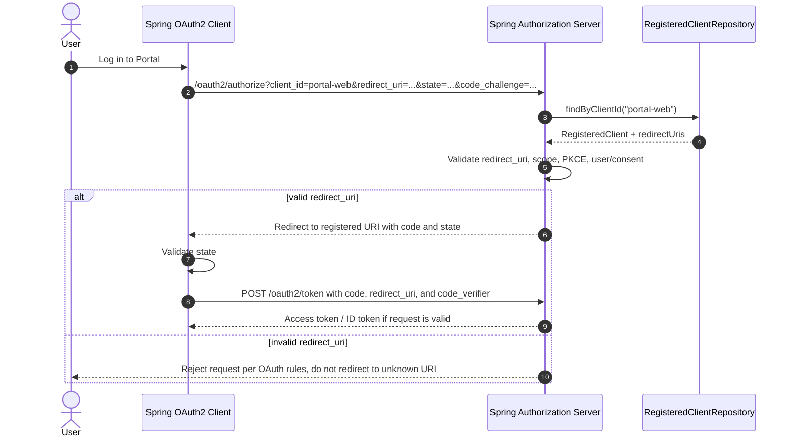
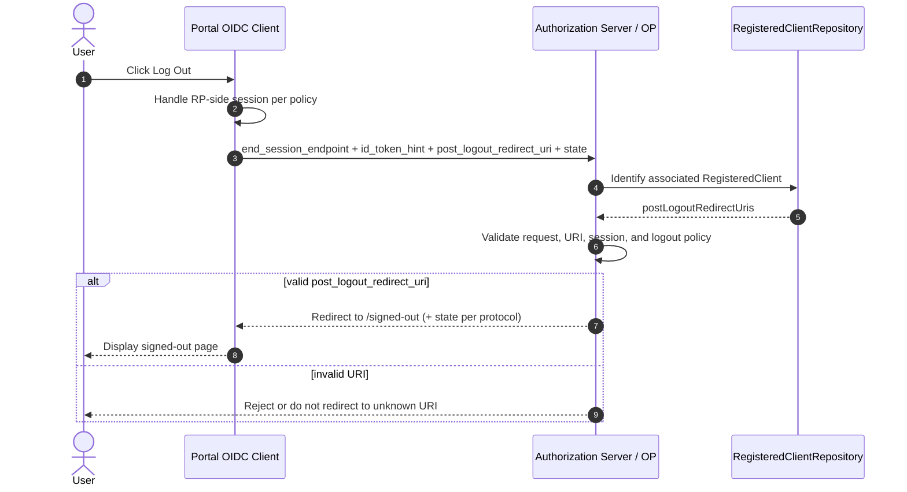

# Registering Redirect URIs and Post-Logout Redirect URIs with Allowlists

## 1. Objectives and Scope

In a Spring Boot application using **Spring Security** and **Spring Authorization Server (SAS)** to provide an OAuth 2.0/OpenID Connect (OIDC) Authorization Server, one of the most critical security decisions in **client management** is defining **which addresses the browser is allowed to return to** after authorization or logout.

For each `RegisteredClient`, SAS provides two independent sets of URIs:

- **`redirectUris`**: the addresses where a client can receive the result of a redirect-based authorization flow, typically the **Authorization Code Flow**.
- **`postLogoutRedirectUris`**: the addresses a client can request to return to after **OIDC RP-Initiated Logout** when the corresponding feature is enabled.

These are **allowlists**: a client may only propose a registered destination, which the Authorization Server validates against protocol rules. Never let a client supply an arbitrary URL to which the server redirects the browser.

After this lesson, you should be able to:

1. Distinguish the two URI lists and the HTTP parameters `redirect_uri` / `post_logout_redirect_uri`.
2. Explain the risks of authorization code leakage, open redirects, phishing, and logout redirects to untrusted websites.
3. Register exact URIs for a `RegisteredClient` using Spring Authorization Server.
4. Configure matching URLs between the Authorization Server and an OAuth/OIDC client using Spring Security.
5. Design an approval workflow for URI changes, test rejection cases, and operate across multiple environments.

## 2. Two URI Lists Solve Two Different Moments

| Characteristic | `redirectUris` | `postLogoutRedirectUris` |
| --- | --- | --- |
| Purpose | Where the browser returns to the client **after an authorization request** | Where the browser returns to the client **after an OIDC logout request** |
| Corresponding HTTP parameter | `redirect_uri` | `post_logout_redirect_uri` |
| Typically used at | The authorization endpoint, e.g., `/oauth2/authorize`; may also be validated during code exchange | The OIDC end-session/logout endpoint, e.g., `/connect/logout` in typical SAS configurations |
| Role in the protocol | Constrains where the authorization code is delivered and where the client uses the code | Constrains where the browser is sent after the OP processes the logout request |
| Java configuration | `RegisteredClient.Builder.redirectUri(...)` | `RegisteredClient.Builder.postLogoutRedirectUri(...)` |
| Can they share one combined set? | **No**: list is dedicated to authorization | **No**: list is dedicated to logout |
| Does the client handle it automatically? | No; the client must implement the callback endpoint and verify state/PKCE | No; the client must handle its own post-logout page and local session |

**Product example:**

```text
Application:      https://portal.example.com
OAuth callback:   https://portal.example.com/login/oauth2/code/portal
Post-logout page: https://portal.example.com/signed-out
```

When a user signs in, the browser returns to `/login/oauth2/code/portal` so the application can process the authorization code. When signing out via OIDC RP-Initiated Logout, the browser can return to `/signed-out` to display a confirmation. Ensuring the post-logout page exists and is accessible to unauthenticated users is the **client application's responsibility**, not SAS's.

Using a login callback as a post-logout destination can cause errors: that endpoint may expect `code` and `state` parameters. Likewise, `/signed-out` is not built to receive codes. Separating the two URIs keeps the contract clear and reduces mistakes.

## 3. Why Accept Only Registered URIs?

### 3.1. Risk of Authorization Code Theft

Suppose a legitimate client is identified by `client_id=portal-web`, but an attacker alters the `redirect_uri` parameter to:

```http
GET /oauth2/authorize?response_type=code
  &client_id=portal-web
  &redirect_uri=https%3A%2F%2Fattacker.example%2Fcollect
  &scope=openid%20orders.read
  &state=RANDOM_STATE
```

If the server accepts this URI merely because `client_id` is valid, the browser may be redirected to `attacker.example` with the code. Authorization Code + PKCE, client authentication, and code validation remain vital defense layers, but **they must never be used as an excuse to skip redirect URI validation**.

In a proper implementation, the server must reject unregistered URIs. **Never redirect an error response to the very URI that was rejected**, as that still lets the attacker control the redirect target.

### 3.2. Open Redirects and Lookalike URL Variants

Checking a string with `startsWith("https://portal.example.com")` is flawed because `https://portal.example.com.attacker.example/cb` shares that prefix. Checks like "host merely contains `example.com`," wildcards like `https://*.example.com/*`, or hastily written regexes widen the attack surface.

Even a registered callback is dangerous if the callback page itself is an **open redirector**: for example, `/callback?next=https://attacker.example` automatically redirects to a request-supplied URL. **Both** the Authorization Server and client applications must avoid open redirect endpoints driven by untrusted input.

### 3.3. Redirect Risks After Logout Too

If the OP permits an arbitrary `post_logout_redirect_uri=https://attacker.example`, an attacker can deceive users into thinking they just logged out of the official service while landing on a phishing site. OIDC RP-Initiated Logout requires the post-logout URI to **match a registered URI exactly** and redirects only when the OP has validated that destination under protocol rules.

An allowlist alone does not solve all logout CSRF, ID token exposure, session fixation, or phishing risks. It is a **targeted control at the redirect boundary** that must be paired with session validation, client controls, and safe UI design.

## 4. Exact Matching Rules

### 4.1. OAuth 2.0 Redirect URI: Prefer Exact String Matching

RFC 9700 (OAuth 2.0 Security Best Current Practice) requires Authorization Servers to perform **exact** matching between the requested URI and the registered URI. The standard exception is a **variable port on loopback redirect URIs for native apps**, under the conditions of RFC 8252. That is a special case that must be designed and tested properly; it does not mean port wildcards apply to all web clients.

Suppose the allowlist contains only:

```text
https://portal.example.com/login/oauth2/code/portal
```

| `redirect_uri` sent by the client | Expected result | Explanation |
| --- | --- | --- |
| `https://portal.example.com/login/oauth2/code/portal` | Accepted if other conditions hold | Matches registered URI |
| `http://portal.example.com/login/oauth2/code/portal` | Rejected | Scheme differs; HTTP is not implicitly equivalent to HTTPS |
| `https://portal.example.com.attacker.example/login/oauth2/code/portal` | Rejected | Host differs |
| `https://portal.example.com/login/oauth2/code/other` | Rejected | Path differs |
| `https://portal.example.com/login/oauth2/code/portal/` | Rejected | Trailing `/` changes the URI string |
| `https://portal.example.com/login/oauth2/code/portal?next=/home` | Rejected unless that exact string is registered | Query differs from registered URI |
| `https://portal.example.com@attacker.example/callback` | Rejected | `portal.example.com` is in userinfo; actual host is `attacker.example` |
| `https://portal.example.com/login/oauth2/code/portal#frag` | Do not register / do not use as redirect URI | OAuth redirect endpoint URIs must not contain fragments |

**Never "auto-fix" a request to make it match** by stripping queries, trimming paths, upgrading HTTP to HTTPS, or appending a default domain. Whichever URI the client sends must be matched against the allowlist per the registered contract.

### 4.2. URIs with Queries and Encoding

A registered URI may include a static query allowed by client policy, for example:

```text
https://portal.example.com/callback?source=corporate
```

When used as `redirect_uri` in an authorization request, this URI must be **URL-encoded as a parameter value**. A static query in a registered URI does not permit appending arbitrary `next`, `tenant`, or external URI parameters. Nor should you write custom normalization, double-decoding, or prefix-based host comparisons; such transformations easily introduce discrepancies between validation and the browser.

**Implementation principle:** register the exact URI verbatim, send the exact registered URI, and let SAS's protocol validator perform the check. If multiple valid callbacks are needed, register **each specific URI** and avoid wildcards.

### 4.3. Native App Loopback Exception

Under RFC 8252, native apps can use loopback URIs such as `http://127.0.0.1:49152/callback` to receive an authorization code. Since the OS may assign a different port on launch, OAuth 2.0 BCP carves out an exception for the **port number** of loopback redirects. This does not mean:

- Production web apps may use host, path, or scheme wildcards.
- Every form of `localhost` or custom URI scheme is automatically handled identically by every SAS version.
- Post-logout URIs automatically inherit the same exception.

When deploying native clients with SAS, verify actual version support, matcher policy, and client library behavior; test dynamic ports in the native environment instead of disabling redirect URI validation globally. For production web apps, use HTTPS and fixed URIs.

## 5. Redirect URI in the Authorization Code Flow



Illustrative request (uppercase values are placeholders):

```http
GET https://auth.example.com/oauth2/authorize?response_type=code
  &client_id=portal-web
  &redirect_uri=https%3A%2F%2Fportal.example.com%2Flogin%2Foauth2%2Fcode%2Fportal
  &scope=openid%20profile
  &state=RANDOM_STATE
  &code_challenge=BASE64URL_SHA256_VERIFIER
  &code_challenge_method=S256
```

At the token endpoint, the Authorization Server also binds the authorization code to the client, grant conditions, and `redirect_uri` per protocol; a client cannot use a different redirect URI to "redeem" an issued code. PKCE and `state` checks provide vital additional defenses, but **they do not replace the allowlist**.

## 6. Post-Logout Redirect URI in OIDC RP-Initiated Logout

### 6.1. Three Distinct Steps to Distinguish

1. **The RP (Relying Party / client)** determines the user wants to log out and directs the browser to the OP's (OpenID Provider / Authorization Server) `end_session_endpoint`.
2. **The OP** validates the request, handles the OP-side login session according to its enabled support/configuration, and decides whether to redirect back to the RP.
3. If a valid post-logout redirect is present, **the browser** returns to the registered URI. **The RP remains responsible for its own local session and UI**; merely returning to `/signed-out` does not prove all access tokens have been revoked.

OIDC RP-Initiated Logout defines these primary parameters:

| Parameter | Purpose | Notes |
| --- | --- | --- |
| `id_token_hint` | Hints the ID token previously issued to the RP and associated session/user | Recommended, especially when requesting a post-logout redirect; never substitute an access token for an ID token |
| `post_logout_redirect_uri` | Return destination at the RP after logout | Must match a registered URI exactly, never an arbitrary URL |
| `state` | Opaque value used by the RP to correlate the logout request and callback | RP should verify the returned value to prevent flow mix-up |
| `client_id` | Helps the OP identify the client per protocol rules | Depends on the request and how the OP identifies clients; can be important when `id_token_hint` is absent |

The OIDC specification emphasizes: if `post_logout_redirect_uri` **does not match** a registered URI, the OP **must not** perform a post-logout redirect to that URI. If `id_token_hint` is missing, the OP may redirect only when another mechanism validates the destination. Do not strip away these safeguards just to "make logout work."

### 6.2. RP-Initiated Logout Flow



Illustrative request:

```http
GET https://auth.example.com/connect/logout
    ?id_token_hint=ENCODED_ID_TOKEN
    &post_logout_redirect_uri=https%3A%2F%2Fportal.example.com%2Fsigned-out
    &state=RANDOM_LOGOUT_STATE
```

`ENCODED_ID_TOKEN` here is a placeholder. In operations, avoid placing ID tokens, codes, access/refresh tokens, or secrets into application logs, reverse proxy logs, and URL analytics tools. `/connect/logout` is SAS's typical path; read `end_session_endpoint` from OIDC discovery for your specific version and deployment.

### 6.3. Configuring an Allowlist Does Not Implement Cross-App Logout

`postLogoutRedirectUris` is merely metadata about the **return destination**. It does not automatically:

- Clear cookies or local sessions of any other RP/client.
- Immediately revoke JWT access tokens already accepted by Resource Servers.
- Log out all devices, synchronize browser tabs, or terminate sessions in external systems.
- Create the `/signed-out` controller in the client application.

If single logout, front-channel/back-channel logout, or session/token revocation is required, you must design dedicated flows and integration points suited to the standard and version. On SAS, the OIDC Logout endpoint must be enabled/configured alongside proper session management; merely declaring `postLogoutRedirectUri` in `RegisteredClient` does not guarantee a complete logout flow.

## 7. Configuring RegisteredClient with Spring Authorization Server

The example below is based on the `RegisteredClient` model of **Spring Authorization Server 1.x**. This is a public web OIDC client using Authorization Code + PKCE; other parts such as user login, authorization/consent persistence, signing keys, issuer, and OIDC endpoints must be configured separately.

```java
@Configuration
public class ClientRegistrationConfig {

    @Bean
    RegisteredClientRepository registeredClientRepository() {
        RegisteredClient portal = RegisteredClient.withId(
                    "64c2330e-f1a1-4c0d-84d2-aab73f692f58")
                .clientId("portal-web")
                .clientName("Portal Web")
                .clientAuthenticationMethod(ClientAuthenticationMethod.NONE)
                .authorizationGrantType(AuthorizationGrantType.AUTHORIZATION_CODE)
                .redirectUri(
                    "https://portal.example.com/login/oauth2/code/portal")
                .postLogoutRedirectUri(
                    "https://portal.example.com/signed-out")
                .scope(OidcScopes.OPENID)
                .scope(OidcScopes.PROFILE)
                .clientSettings(ClientSettings.builder()
                    .requireProofKey(true)
                    .requireAuthorizationConsent(true)
                    .build())
                .build();

        return new InMemoryRegisteredClientRepository(portal);
    }
}
```

Intentional details:

1. `redirectUri(...)` registers the **post-authorization callback**, while `postLogoutRedirectUri(...)` registers the **post-logout page**.
2. `ClientAuthenticationMethod.NONE` is for a **public client**; `requireProofKey(true)` enforces PKCE. `client_id` is not a secret; exact URI registration is still mandatory.
3. `OidcScopes.OPENID` indicates the client can request OIDC login; to use OIDC Logout, the Authorization Server must enable and configure OIDC.
4. `InMemoryRegisteredClientRepository` suits examples; for production, use a durable store (such as `JdbcRegisteredClientRepository` or another implementation) and an approval-backed URI governance process.
5. The internal ID is kept stable in the example; in practice, generate a UUID **once** and persist it. Never generate a new `id` on every startup for the same existing client.

If using a confidential client, add a client authentication method and securely managed secret/key. Being a confidential client does **not** permit skipping redirect URI validation.

### 7.1. Intentionally Declaring Multiple URIs

For example, the same client has two approved fixed callbacks:

```java
RegisteredClient portal = RegisteredClient.withId(stableInternalId)
        .clientId("portal-web")
        // ... client authentication, grants, and scopes ...
        .redirectUri("https://portal.example.com/login/oauth2/code/portal")
        .redirectUri("https://portal.example.com/oauth/callback")
        .postLogoutRedirectUri("https://portal.example.com/signed-out")
        .postLogoutRedirectUri("https://portal.example.com/logout/complete")
        .build();
```

This is a condensed snippet illustrating the builder API, **not a complete standalone configuration**. Every URI should have a clear rationale, belong to a trusted system, and have matching tests. Avoid keeping many legacy callbacks merely to avoid updating clients, since each extra callback adds another exploitable target.

### 7.2. Enabling OIDC Support on the Authorization Server

Illustrative sketch in the SAS 1.x configuration style:

```java
OAuth2AuthorizationServerConfigurer as =
        OAuth2AuthorizationServerConfigurer.authorizationServer();

http.securityMatcher(as.getEndpointsMatcher())
    .with(as, authorizationServer ->
        authorizationServer.oidc(Customizer.withDefaults()))
    .authorizeHttpRequests(authorize -> authorize.anyRequest().authenticated());
```

This is only the **OIDC endpoint configuration fragment**; it omits the full `SecurityFilterChain`, required beans, and login/session policies. In Spring Security 7.x, Authorization Server is integrated with newer configuration APIs; follow your project's exact version documentation rather than mixing APIs from different generations.

## 8. Synchronizing Callbacks with the OAuth2 Client Application

The allowlist on the Authorization Server must match the URL **actually generated** by the OAuth2 Client. For a Spring Security OAuth2 Client application, an illustrative configuration is:

```yaml
spring:
  security:
    oauth2:
      client:
        registration:
          portal:
            provider: corporate-auth
            client-id: portal-web
            authorization-grant-type: authorization_code
            redirect-uri: "{baseUrl}/login/oauth2/code/{registrationId}"
            scope: openid, profile
        provider:
          corporate-auth:
            issuer-uri: https://auth.example.com
```

Assuming the app runs at `https://portal.example.com`, `registrationId=portal`, and `{baseUrl}` resolves accurately from the public request, the final URI is:

```text
https://portal.example.com/login/oauth2/code/portal
```

This must be an entry in `RegisteredClient.redirectUris`. If behind a reverse proxy `{baseUrl}` resolves to `http://localhost:8080` or an internal hostname, the Authorization Server will reject the redirect URI. Configure forwarded headers, TLS/proxy settings, and public base URLs to match your deployment topology rather than weakening allowlist rules.

### 8.1. OIDC Client-Initiated Logout with Spring Security

Once the client application supports OIDC login, you can use `OidcClientInitiatedLogoutSuccessHandler` to navigate to the OP's published logout endpoint while supplying a contract-compliant post-logout URI:

```java
@Bean
SecurityFilterChain clientSecurityFilterChain(
        HttpSecurity http,
        ClientRegistrationRepository clientRegistrations) throws Exception {

    OidcClientInitiatedLogoutSuccessHandler logoutHandler =
            new OidcClientInitiatedLogoutSuccessHandler(clientRegistrations);
    logoutHandler.setPostLogoutRedirectUri("{baseUrl}/signed-out");

    http.authorizeHttpRequests(authorize -> authorize
            .requestMatchers("/signed-out").permitAll()
            .anyRequest().authenticated())
        .oauth2Login(Customizer.withDefaults())
        .logout(logout -> logout.logoutSuccessHandler(logoutHandler));

    return http.build();
}
```

This example illustrates the **client** side; do not place this bean in the Authorization Server just to register a post-logout URI. The generated URI must **match the `postLogoutRedirectUris` of the `RegisteredClient`** on the OP. The `/signed-out` page must actually exist and remain accessible after the session is gone. Test the logout flow across the browsers and session mechanisms your project uses.

## 9. Secure URI Registration Policy

Do not expose a form allowing arbitrary users to add new URLs to a critical client's allowlist. Client administration must follow clear policies because changing a redirect URI expands the set of places permitted to receive authorization results.

### 9.1. Checks to Perform During Registration

| Criterion | Practice and rationale |
| --- | --- |
| Ownership | Only owners/admins may manage a client; verify the domain and callback genuinely belong to the target application |
| Scheme | Prefer/enforce HTTPS for production web; handle loopback/native exceptions per standards |
| Host and path | Use exact domain names and dedicated callback paths; reject arbitrary wildcards |
| Fragment | Never use fragments in OAuth redirect URIs |
| Userinfo | Reject URIs containing `user:pass@` due to host confusion and security risks |
| Query | Allow only when necessary and registered verbatim; avoid query parameters that enable open redirects |
| Purpose separation | Keep separate labels/groups for login callbacks and post-logout destinations |
| Environments | Separate dev, staging, and production lists; never add localhost callbacks to production clients |
| Change control | Audit actor, timestamp, reason, and before/after values; require approval and testing |
| Retiring old URIs | Remove unused callbacks and evaluate impact on active sessions/flows |

### 9.2. Fixed Lists and Input Screening

For URIs proposed by an **administrator**, the admin application can validate format and ownership **before saving**. Example basic check:

```java
static void validateWebRedirectUri(String value) {
    URI uri = URI.create(value);

    if (!"https".equalsIgnoreCase(uri.getScheme())
            || uri.getHost() == null
            || uri.getRawUserInfo() != null
            || uri.getRawFragment() != null) {
        throw new IllegalArgumentException("Invalid web redirect URI");
    }

    // Continue checking managed domain ownership, valid endpoints,
    // environment rules, approval workflow, and client open redirects.
}
```

**This is input validation in an admin UI, not a replacement for SAS's validator**. A URI with HTTPS and a valid host can still belong to an attacker; never treat the snippet above as sufficient for approval. When processing authorization/logout requests, rely on SAS's standard allowlist validation instead of writing custom host comparisons or regexes. Never bypass the default validator when adding business rules.

## 10. Managing Allowlists Across Environments and Multi-Tenancy

Suggested registrations:

| Environment | Client ID | Redirect URI | Post-logout URI |
| --- | --- | --- | --- |
| Development | `portal-dev` | `http://127.0.0.1:8081/login/oauth2/code/portal` | `http://127.0.0.1:8081/signed-out` |
| Staging | `portal-staging` | `https://staging.portal.example.com/login/oauth2/code/portal` | `https://staging.portal.example.com/signed-out` |
| Production | `portal-web` | `https://portal.example.com/login/oauth2/code/portal` | `https://portal.example.com/signed-out` |

This illustrates an **environment isolation model**. Allowing HTTP for local/development clients requires its own policy; localhost is for testing environments and must never become a general exception in production. In practice, environments should isolate issuers, databases, secrets, signing keys, and deployment policies according to the required isolation level.

In **multi-tenant** systems, do not generate allowlists from an unverified template like `https://{tenant}.example.com/callback` supplied by users without verifying tenant/domain ownership. When a tenant adds a domain, verify domain ownership, create the exact registration record, and test the client against the issuer. One tenant's rules must never inadvertently open redirect URIs for another tenant.

## 11. Common Errors and Remediation

| Symptom | Common cause | How to check |
| --- | --- | --- |
| Login fails with `invalid_request` or invalid redirect URI error | Client sends a URI not in the allowlist | Compare exact scheme, host, port, path, trailing `/`, and query of the final URI |
| Redirect resolves to `http://localhost:8080` | Reverse proxy or `{baseUrl}` misconfigured | Check forwarded headers and public URL |
| Client code exchange fails with `invalid_grant` | Code expired/reused, wrong PKCE, or inconsistent redirect URI | Compare code, `code_verifier`, and redirect URI in the token request |
| Logout goes to the wrong page or does not return to RP | `post_logout_redirect_uri` unregistered, mismatched, or OP cannot validate target | Compare `RegisteredClient.postLogoutRedirectUris`, `id_token_hint`, and OIDC config |
| `/signed-out` asks to log in again | Logout completion page is protected by an authenticated rule | Permit public access to the post-logout page; check controller |
| One instance accepts a new URI while another rejects it | Client registration cache not invalidated | Verify shared repository, cache TTL, and change propagation |
| A removed URI is still accepted in some environment | Stale seed config, cache, or wrong database | Check which environment/issuer serves the request and the live record |
| OP logout succeeds yet another RP stays logged in | Only single RP-Initiated Logout is implemented | Define cross-app session/logout requirements and supported mechanisms |

URI-related errors can take different shapes depending on the endpoint and version. For an OAuth authorization request with an untrusted `redirect_uri`, the Authorization Server must not send the browser to that URI to display the error; the error may be handled at the OP. For OIDC logout, the OP must reject an **invalid return target** without redirecting to it.

## 12. Security and Compatibility Test Plan

### 12.1. Tests for OAuth Authorization Redirect URIs

| Case | Outcome to prove |
| --- | --- |
| URI matches allowlist | Request proceeds when user/client/scope/PKCE are valid |
| URI outside allowlist (different domain) | Rejected; no HTTP `Location` pointing to the external domain |
| Different scheme (`http` instead of `https`) | Rejected for production web |
| Different path or added trailing slash | Rejected unless separately registered |
| New query, altered query, or fragment | Not accepted automatically |
| Spoofed host `portal.example.com.attacker.example` | Rejected |
| Userinfo `portal.example.com@attacker.example` | Rejected |
| Another client uses the same disallowed callback | Evaluated against **that client's own** allowlist, never shared arbitrarily |
| Authorization code from client A used by client B | Rejected; code is bound to client and grant conditions |
| Wrong PKCE verifier even with valid redirect URI | Rejected, proving both validation layers work |
| Native app changes loopback port | Behavior follows RFC 8252 and committed version/configuration support |

### 12.2. Tests for OIDC Post-Logout Redirect URIs

| Case | Outcome to prove |
| --- | --- |
| Post-logout URI matches allowlist | Redirects after valid logout processing |
| Post-logout URI on a different domain | Does not send the browser to that domain |
| Post-logout URI with different path/query | Does not redirect to an unregistered URI |
| Using authorization callback as logout URI when unregistered | Not accepted merely because it appears in `redirectUris` |
| Using logout URI as `redirect_uri` when unregistered | Not accepted merely because it appears in `postLogoutRedirectUris` |
| Missing or invalid `id_token_hint` | System enforces RP/session identification and target validation without ungrounded redirects |
| `state` returned after logout | RP verifies match against the request to prevent logout mix-up |
| OP logout finishes but client has not cleared session | Detected in testing; post-logout redirect alone is not treated as clearing RP sessions |

### 12.3. Integration and Operations

Test with a real browser and real cookies, real proxy/TLS, the client's public URL, `issuer-uri`, `{baseUrl}`, `state`, and PKCE. After updating a client registration in JDBC, verify every instance applies the updated allowlist. Include end-to-end tests for both login and logout, including failure states when a URI is removed.

Never log raw `code`, `code_verifier`, access/refresh tokens, ID tokens, or client secrets. For diagnostics, log correlation IDs, `client_id`, error codes, endpoints, and non-sensitive session/record identifiers. If logging a failing URI, consider masking queries or parameters that may contain sensitive data.

## 13. Scenario Exercise

The `portal-web` system has:

```text
RegisteredClient.redirectUris:
  https://portal.example.com/login/oauth2/code/portal

RegisteredClient.postLogoutRedirectUris:
  https://portal.example.com/signed-out
```

One day, the frontend team changes the callback URL to `https://portal.example.com/auth/callback` and the logout page to `https://portal.example.com/goodbye`, without updating the client registration. A developer proposes changing the server configuration to `https://portal.example.com/*` to avoid updating it each time.

Analyze:

1. Why can login and logout fail at two different points? Name the exact `RegisteredClient` field to update for each URL.
2. Why does a path wildcard violate the exact matching principle and risk enabling open redirects?
3. Where must the URIs be updated/approved, and how do you preserve rollback capability?
4. If `portal-web` sits behind a reverse proxy, how do you verify the actual URI generated from `{baseUrl}`?
5. What minimum negative test cases are required to prove an attacker's URI is rejected?

**Solution hint:** register each exact URI in its corresponding list, test the callback before switching over, and remove the old URI after clients have upgraded. You can temporarily keep both old and new callbacks if approved and tested, then narrow the allowlist. Update only `redirectUris` for login and `postLogoutRedirectUris` for logout; never substitute one list for the other.

## 14. Production Deployment Checklist

1. **Exactness:** `redirectUris` and `postLogoutRedirectUris` are declared as full URLs with exact scheme/host/port/path/query and separated by purpose.
2. **Safety:** callbacks are not open redirectors; no wildcards or prefix matching; no user-supplied URLs accepted at authorization time.
3. **Client fitness:** Authorization Code + PKCE and `state` validation; public/confidential client configuration matches registered authentication policies.
4. **Proper OIDC roles:** OP enables RP-Initiated Logout when needed with proper session management; RP handles local sessions and post-logout pages.
5. **Environment consistency:** issuer, public base URL, TLS, and forwarded headers align; dev/staging/prod callbacks are isolated.
6. **Change governance:** only authorized personnel edit allowlists; verify URL ownership, audit changes, deploy with rollback, and retire unused URIs.
7. **Testing:** test both happy paths and rejections with foreign hosts, foreign paths, differing slashes/queries, callbacks swapped across clients, and foreign post-logout URIs.
8. **Operations:** durable client store, consistent caches, safe logging, and alerts on error spikes at authorization/logout endpoints.

## 15. Official References

- [Spring Authorization Server — Core Model Components / RegisteredClient](https://docs.spring.io/spring-authorization-server/reference/core-model-components.html#registered-client): `redirectUris` and `postLogoutRedirectUris` in client metadata.
- [Spring Authorization Server — Protocol Endpoints](https://docs.spring.io/spring-authorization-server/reference/protocol-endpoints.html): Authorization endpoint and OIDC Logout endpoint, validators, and extension points.
- [Spring Security — OAuth 2.0 Login](https://docs.spring.io/spring-security/reference/servlet/oauth2/login/core.html): how the client computes `redirect-uri`.
- [Spring Security — OIDC Logout](https://docs.spring.io/spring-security/reference/servlet/oauth2/login/logout.html): `OidcClientInitiatedLogoutSuccessHandler` and `postLogoutRedirectUri`.
- [RFC 6749 — OAuth 2.0](https://www.rfc-editor.org/rfc/rfc6749): `redirect_uri` rules and Authorization Code.
- [RFC 9700 — OAuth 2.0 Security Best Current Practice](https://www.rfc-editor.org/rfc/rfc9700): exact redirect URI matching, open redirect prevention, and native app exceptions.
- [RFC 8252 — OAuth 2.0 for Native Apps](https://www.rfc-editor.org/rfc/rfc8252): native app redirect URI choices and loopback ports.
- [OpenID Connect RP-Initiated Logout 1.0](https://openid.net/specs/openid-connect-rpinitiated-1_0.html): `id_token_hint`, `post_logout_redirect_uri`, `state`, and conditions for redirecting back to the RP.

APIs, endpoints, and exceptions must be verified against your **actual Spring Authorization Server/Spring Security version**. Protocol specs define required behavior; the specific framework and configuration determine what is active.

**Key takeaway:** `redirectUris` specifies where a client may **receive authorization results**, while `postLogoutRedirectUris` specifies where the browser may **return after OIDC logout**. Both must be separate, approved, and exact-matched allowlists. Maintaining this boundary prevents authorization code leaks, open redirects, and login/logout integration failures when applications change URLs.
