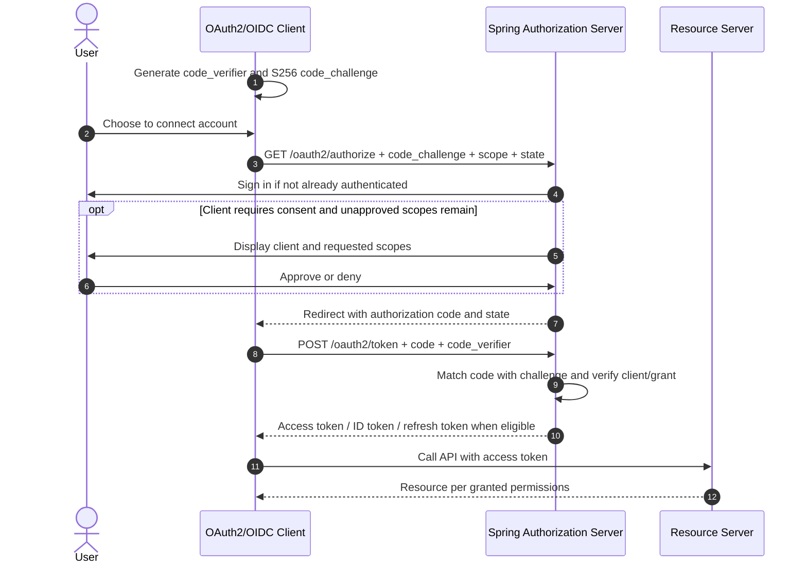

# Configuring PKCE and Consent Requirements

## Lesson Objectives

In the **Client Management** chapter of the **SPRING_SECURITY_OAUTH2_OIDC_AUTHORIZATION_SERVER** module, we explore how to require **Proof Key for Code Exchange (PKCE)** and **authorization consent** for OAuth 2.0/OpenID Connect (OIDC) clients registered in a **Spring Boot** application using **Spring Security** and **Spring Authorization Server**.

These two mechanisms often appear together in the Authorization Code flow, yet they address **two different problems**: PKCE binds the authorization code to the client that initiated the transaction; consent lets users review the scopes a client is requesting before the server grants authorization.

After this lesson, you will be able to:

- Explain the threat PKCE mitigates, the `code_verifier`/`code_challenge` mechanism, and why `S256` should be used.
- Configure `ClientSettings.requireProofKey(true)` and `ClientSettings.requireAuthorizationConsent(true)` on a `RegisteredClient`.
- Choose appropriate policies for SPAs, native apps, web backends, and machine-to-machine clients.
- Use `OAuth2AuthorizationConsentService` to persist user decisions and design a custom consent page.
- Test requests missing PKCE, mismatched challenges/verifiers, denied consent, scope changes, and consent/token revocation.
- Identify security and operational responsibilities when deploying across multiple clients, users, and replicas.

> **Technical scope:** Java examples illustrate **Spring Authorization Server 1.x** and Spring Security 6.x APIs; package names and APIs may vary depending on the Spring Boot/Spring Security version used in your project. Code snippets are explained in the context of an application that already has an Authorization Server filter chain, user authentication mechanism, issuer, signing key source, and appropriate persistence.

## 1. Where Do PKCE and Consent Fit in the Authorization Code Flow?

OAuth 2.0 enables a **client** to request authorization on a user's behalf to access a **Resource Server**. In the Authorization Code flow, the client redirects the browser to the Authorization Server, the user signs in and may approve the requested permissions, and the client then receives an authorization code to exchange for tokens.



PKCE is enforced at code issuance and code exchange: the client sends the **challenge when requesting authorization**, then proves possession of the **verifier when exchanging the code**. Consent is decided during user authorization: the Authorization Server needs to know **which client**, **which user**, and **which scopes** are approved.

### 1.1. Quick Comparison

| Criterion | PKCE | Authorization consent |
|---|---|---|
| Goal | Reduces the risk of stolen authorization codes being redeemed by another client. | Ensures users know and approve the scopes a client requests on their behalf. |
| Core data | `code_verifier`, `code_challenge`, `code_challenge_method`. | User, registered client, approved scopes/authorities. |
| Acting components | OAuth2 Client generates the verifier; Authorization Server verifies it. | Authorization Server displays/records; user approves. |
| Client configuration | `requireProofKey(true)`. | `requireAuthorizationConsent(true)`. |
| Replaces client authentication? | **No**; confidential clients still require client authentication. | **No**; consent does not prove client identity. |
| Replaces API authorization checks? | **No**. | **No**; Resource Server still validates tokens and actual permissions. |

**PKCE is not consent; consent is not PKCE.** A client can require PKCE without showing a consent screen every time; a confidential web client can also require both PKCE and consent.

## 2. What Risk Does PKCE Mitigate?

### 2.1. Authorization Code Interception Attacks

Suppose a native app uses a custom-scheme redirect URI or a browser environment is exposed to redirect hijacking. An attacker captures the **authorization code** before the legitimate client can exchange it for tokens. If only the code and public parameters were required, the attacker could try to redeem the code ahead of the client.

PKCE binds the code to a short-lived secret generated specifically for **each authorization request**:

1. The client generates a random, unpredictable `code_verifier` and keeps it secret.
2. When using `S256`, the client computes `code_challenge = BASE64URL-ENCODE(SHA256(ASCII(code_verifier)))`.
3. The client sends `code_challenge` and `code_challenge_method=S256` to the Authorization Endpoint.
4. The Authorization Server associates the challenge with the issued authorization code.
5. The client sends `code_verifier` to the Token Endpoint. The server recomputes the challenge and checks for a match before issuing tokens.

```text
Authorization request:
  code_challenge = BASE64URL(SHA256(code_verifier))
  code_challenge_method = S256

Token request:
  code_verifier = original string held only by the legitimate client

Authorization Server:
  BASE64URL(SHA256(received code_verifier)) == stored code_challenge ?
  Match    -> continue checking code, client, redirect URI, grant
  Mismatch -> reject token request
```

An attacker holding only the code and the public challenge generally cannot derive a strong enough verifier to redeem the code. PKCE is especially critical for **public clients** that cannot safeguard a `client_secret`, such as SPAs or mobile/native apps.

### 2.2. `S256`, `plain`, and Verifier Quality

According to RFC 7636, `code_verifier` is a random string of **43–128 characters** using the allowed unreserved character set: letters, digits, `-`, `.`, `_`, `~`. The recommended way to generate it is to draw 32 random bytes from a cryptographic random number generator and Base64 URL-safe encode them without padding, yielding 43 characters.

**Prefer `S256`** and do not use `plain` as a default. `plain` sends the challenge equal to the verifier directly at the Authorization Endpoint and fails against threats that can observe the authorization request containing the challenge. RFC 9700 requires Authorization Servers to support PKCE, mandates that public clients use PKCE, and recommends that confidential clients also use PKCE to harden the Authorization Code flow.

Client-side Java example showing how to generate a PKCE pair (standard OAuth2/OIDC SDKs typically handle this automatically):

```java
import java.nio.charset.StandardCharsets;
import java.security.MessageDigest;
import java.security.NoSuchAlgorithmException;
import java.security.SecureRandom;
import java.util.Base64;

public record PkcePair(String verifier, String challenge) {

    public static PkcePair generate() {
        byte[] entropy = new byte[32];
        new SecureRandom().nextBytes(entropy);

        String verifier = Base64.getUrlEncoder()
                .withoutPadding()
                .encodeToString(entropy);

        byte[] digest;
        try {
            digest = MessageDigest.getInstance("SHA-256")
                    .digest(verifier.getBytes(StandardCharsets.US_ASCII));
        } catch (NoSuchAlgorithmException ex) {
            throw new IllegalStateException("SHA-256 is required", ex);
        }

        String challenge = Base64.getUrlEncoder()
                .withoutPadding()
                .encodeToString(digest);

        return new PkcePair(verifier, challenge);
    }
}
```

The client must store the verifier in the **context of the exact pending transaction**, never log it, and never put it in the authorize URL. Never reuse the same verifier long-term across multiple transactions. In the browser, protect transaction state from XSS and injection; PKCE does not solve all risks posed by malicious JavaScript.

### 2.3. What Does PKCE Not Solve?

PKCE does **not** replace:

- Validating `state` and binding the response to the transaction to prevent CSRF/mix-up per client design.
- Validating `nonce` in OIDC flows when applicable.
- Matching `redirect_uri` against registration, blocking open redirects, or verifying `client_id`.
- Client authentication via secret/private key for **confidential clients**.
- TLS, session cookie protection, XSS defense, `issuer`/`audience` verification, and API authorization.
- Replay/reuse protection for authorization codes and token lifecycle policies.

PKCE protects **the authorization code exchange step**, not the entirety of OAuth2/OIDC security.

## 3. Consent Protects the User's Authorization Decision

When an application requests scopes such as `orders.read` or `orders.write`, the user must be able to understand what permissions the client is asking for. **Authorization consent** records the permission decision by user, client, and approved scopes.

For example, a third-party accounting app requests:

```text
scope=openid profile orders.read orders.write
```

The consent screen should explain these permissions in user-friendly language, such as "View orders" and "Modify orders." Do not simply display the raw technical string `orders.write` without explaining its impact.

### 3.1. Consent on First and Subsequent Requests

For a client configured with `requireAuthorizationConsent(true)`:

1. The user authenticates with the Authorization Server.
2. The server determines the requested scopes and whether consent is required.
3. If any scopes have not yet been approved by the user per policy, the consent UI is displayed.
4. The user approves the permitted subset of scopes or denies the request.
5. The server saves the consent via `OAuth2AuthorizationConsentService` and proceeds with or denies the authorization.

Once consent has been saved for the same user and client, the user **may not be prompted again** for already-approved scopes. If the client requests additional scopes, the system must identify and request approval for the unapproved ones via the appropriate flow.

`requireAuthorizationConsent(true)` does not mean the screen will appear **on every single login**. Behavior depends on saved consents, requested scopes, protocol/features, and the actual version/configuration.

### 3.2. Consent Differs from Scopes, Roles, and Tokens

| Concept | Meaning |
|---|---|
| **Registered scopes** | Which permissions the client is allowed to request (`RegisteredClient.scope(...)`). |
| **Requested scopes** | Which scopes the client includes in the current request. |
| **Consented scopes** | Which permissions the user has approved for the client under the consent storage model. |
| **Actually granted scopes** | The final permissions in the authorization/token, after applying server rules. |
| **Business role/permission** | Permissions the user holds over data/objects; managed by the business authorization system. |

Consenting to `orders.write` **does not grant order-management privileges** to a user who lacks them. The Resource Server must still check the user, token, target object, and actual business permissions. The server must also prevent clients from adding unregistered scopes.

### 3.3. Consent Is Not the Same as Token Revocation

If a user withdraws consent, the corresponding consent record can be removed so future authorization requests prompt again. That **does not necessarily invalidate already-issued access tokens immediately**:

- JWT access tokens verified offline by a Resource Server may remain valid until `exp` unless an additional revocation strategy exists.
- Existing refresh tokens and authorizations require a separate revocation policy.
- For sensitive data, a "Disconnect app" UI usually needs to both remove consent **and** execute the corresponding authorization/token revocation workflow.

Document this policy explicitly in product requirements rather than assuming `removeAuthorizationConsent` terminates all sessions and API access.

## 4. Configuring PKCE and Consent on `RegisteredClient`

In Spring Authorization Server, PKCE and consent requirements are attached **per `RegisteredClient`** via `ClientSettings`, allowing each application type to have an appropriate policy.

Two key methods:

```java
ClientSettings.builder()
        .requireProofKey(true)
        .requireAuthorizationConsent(true)
        .build();
```

- `requireProofKey(true)`: requires PKCE for that client's Authorization Code flow.
- `requireAuthorizationConsent(true)`: requires consent according to the server's authorization handling and stored consent records.

Do not expect an arbitrary global YAML flag like `oauth.pkce.required=true` to automatically govern every `RegisteredClient`. If your application reads custom YAML settings, you must explicitly map them into `ClientSettings`, persist them, and test the result.

### 4.1. Public Client Example: SPA with PKCE

```java
import java.util.UUID;
import org.springframework.context.annotation.Bean;
import org.springframework.context.annotation.Configuration;
import org.springframework.security.oauth2.core.AuthorizationGrantType;
import org.springframework.security.oauth2.core.ClientAuthenticationMethod;
import org.springframework.security.oauth2.core.oidc.OidcScopes;
import org.springframework.security.oauth2.server.authorization.client.RegisteredClient;
import org.springframework.security.oauth2.server.authorization.client.RegisteredClientRepository;
import org.springframework.security.oauth2.server.authorization.client.InMemoryRegisteredClientRepository;
import org.springframework.security.oauth2.server.authorization.settings.ClientSettings;

@Configuration(proxyBeanMethods = false)
class DemoClientsConfiguration {

    @Bean
    RegisteredClientRepository demoRegisteredClientRepository() {
        RegisteredClient spaClient = RegisteredClient.withId(UUID.randomUUID().toString())
                .clientId("orders-spa")
                .clientName("Orders Portal")
                .clientAuthenticationMethod(ClientAuthenticationMethod.NONE)
                .authorizationGrantType(AuthorizationGrantType.AUTHORIZATION_CODE)
                .redirectUri("https://portal.example.com/oauth/callback")
                .scope(OidcScopes.OPENID)
                .scope(OidcScopes.PROFILE)
                .scope("orders.read")
                .clientSettings(ClientSettings.builder()
                        .requireProofKey(true)
                        .requireAuthorizationConsent(true)
                        .build())
                .build();

        return new InMemoryRegisteredClientRepository(spaClient);
    }
}
```

Explanation:

- `ClientAuthenticationMethod.NONE` marks a **public client** without a secret that can be kept confidential like a backend.
- `AuthorizationGrantType.AUTHORIZATION_CODE` enables authorization codes; PKCE requires anyone redeeming the code to prove possession of the verifier.
- `redirectUri(...)` must match the registered callback; never enable wildcard redirects for development convenience.
- `scope(OidcScopes.OPENID)` enables the OIDC protocol if the Authorization Server has OIDC enabled. `orders.read` is an illustrative business scope.
- `requireAuthorizationConsent(true)` lets users review permissions under AS policy.

`InMemoryRegisteredClientRepository` and `UUID.randomUUID()` here are **only suitable for demos**: every restart generates a new internal ID and wipes client configuration. Production requires stable `RegisteredClient` identifiers, durable repositories, and controlled client provisioning/revocation workflows.

**Note on refresh tokens:** Spring Authorization Server applies specific restrictions/handling for public-client refresh tokens depending on the version; do not assume adding `AuthorizationGrantType.REFRESH_TOKEN` will issue refresh tokens just like for a confidential client. If an SPA requires long-lived sessions, evaluate refresh token rotation/sender-constraining and your framework version's guidance; a Backend-for-Frontend architecture may also be a better fit.

### 4.2. Confidential Web Client Example: PKCE Is Still Useful

A confidential client can authenticate with `client_secret_basic` or a stronger mechanism. PKCE should still be enabled because the two measures protect different aspects: client authentication verifies the client's identity, while PKCE binds the code to the transaction that created the challenge.

```java
RegisteredClient backendClient = RegisteredClient.withId("orders-web-v1")
        .clientId("orders-web")
        .clientName("Orders Web")
        .clientSecret(passwordEncoder.encode(
                environment.getRequiredProperty("CLIENT_ORDERS_WEB_SECRET")))
        .clientAuthenticationMethod(ClientAuthenticationMethod.CLIENT_SECRET_BASIC)
        .authorizationGrantType(AuthorizationGrantType.AUTHORIZATION_CODE)
        .authorizationGrantType(AuthorizationGrantType.REFRESH_TOKEN)
        .redirectUri("https://orders.example.com/login/oauth2/code/orders-web")
        .scope(OidcScopes.OPENID)
        .scope("orders.read")
        .scope("orders.write")
        .clientSettings(ClientSettings.builder()
                .requireProofKey(true)
                .requireAuthorizationConsent(true)
                .build())
        .build();
```

The snippet above is the **client construction fragment** inside a configuration that injects `PasswordEncoder` and `Environment`, excluding full imports and bean boilerplate. Input secrets must come from a secret manager or external configuration source outside the repository. Real environments require workflows for secret generation, hashed storage, rotation, and revocation; never store plaintext client secrets in Git or logs.

In this example, the authorization code requires a valid verifier **and** the confidential client must authenticate via `CLIENT_SECRET_BASIC` when calling the Token Endpoint. **PKCE does not replace client authentication**.

### 4.3. Which Configuration Fits Each Client Type?

| Client type | PKCE when using Authorization Code | Consent | Notes |
|---|---|---|---|
| SPA public client | Mandatory under modern security best practices. | Depends on trust level, scopes, and UX; evaluate explicitly. | Prevent XSS, validate callbacks, secure token handling, consider BFF. |
| Native/mobile public client | Mandatory. | Usually appropriate when requesting access to user data. | System browser, platform-standard app link/loopback redirects. |
| Web backend confidential client | Recommended to require. | Appropriate for sensitive/third-party scopes; may skip re-prompting for trusted first-party per policy. | Client authentication remains mandatory; secure cookies/sessions/CSRF. |
| Client Credentials service-to-service | PKCE does not apply since Authorization Code is not used. | User consent does not apply since there is no end user in the grant. | Protect via client authentication, restricted scopes/audiences, credential lifecycle, and Resource Server authorization. |
| Device Authorization | Authorization Code PKCE does not replace device-flow security. | User may need to confirm permissions on the device verification UI. | Protect user code, device code, polling, and rate limits. |

A sensible default policy is to **enable PKCE for all Authorization Code clients that support it**, while deciding consent based on trust level and permission sensitivity. Never use `requireAuthorizationConsent(false)` as a shortcut to grant permissions to arbitrary third-party apps without review.

## 5. Authorization Requests and Token Requests with PKCE

### 5.1. Authorization Request

The client generates `state` and a verifier/challenge pair for **each transaction**, then directs the user to the Authorization Endpoint. Illustrative request (line-wrapped for readability):

```http
GET /oauth2/authorize?response_type=code
    &client_id=orders-spa
    &redirect_uri=https%3A%2F%2Fportal.example.com%2Foauth%2Fcallback
    &scope=openid%20orders.read
    &state=STATE_RANDOM_FOR_THIS_REQUEST
    &code_challenge=BASE64URL_SHA256_CHALLENGE
    &code_challenge_method=S256 HTTP/1.1
Host: auth.example.com
```

This is a wrapped request diagram, **not a valid raw HTTP request to copy verbatim**. In real requests, query parameters must be standard URL-encoded on a single request line. If using OIDC, the client must also handle `nonce` per the applicable profile/flow.

The Authorization Server verifies:

1. `client_id` corresponds to a valid `RegisteredClient`.
2. `redirect_uri` matches a registered value (and related rules).
3. `response_type=code` and requested scopes are permitted.
4. The client supplied `code_challenge`/`code_challenge_method` satisfying PKCE requirements.
5. User authentication state and consent before issuing the code.

Do not treat receiving HTTP 302 alone as proof that PKCE succeeded; inspect whether the response is a login redirect, consent redirect, authorization callback, or error.

### 5.2. Request Exchanging the Code for Tokens

After receiving the code at the callback and verifying `state`, the client retrieves the verifier stored for that exact transaction.

```http
POST /oauth2/token HTTP/1.1
Host: auth.example.com
Content-Type: application/x-www-form-urlencoded

grant_type=authorization_code&client_id=orders-spa&code=AUTHORIZATION_CODE&redirect_uri=https%3A%2F%2Fportal.example.com%2Foauth%2Fcallback&code_verifier=ORIGINAL_CODE_VERIFIER
```

Here a **public client** is used, so there is no client secret. For a confidential client, the token request must also authenticate the client using its registered method, such as HTTP Basic with client ID/secret or an asymmetric key method. The Authorization Server checks that the verifier matches the stored challenge, the code has not been used, is still valid, and belongs to the exact client and redirect URI.

**Never send `code_verifier` to the Authorization Endpoint**, never log it, and never copy the challenge in place of the verifier when calling the Token Endpoint. The `S256` challenge goes in the authorize request, whereas the original verifier is sent only to the Token Endpoint.

### 5.3. What Happens If PKCE Is Missing or Invalid?

For a `RegisteredClient` with `requireProofKey(true)`, requests missing a challenge, using an unsupported `code_challenge_method`, or providing a non-matching verifier must be rejected at the corresponding step. The OAuth2 error may be `invalid_request` at the authorization request or `invalid_grant` at the token request, depending on the scenario and implementation.

In tests, observe the **error code, HTTP status, response location, and whether a token was issued**, rather than rigidly expecting every failure case to share one HTTP status code. In particular, no token may ever be issued when the verifier is wrong.

## 6. Organizing Consent and Persistence in Spring Authorization Server

The framework provides the `OAuth2AuthorizationConsentService` abstraction to read and write consent decisions. This differs from `OAuth2AuthorizationService`, which stores **authorization/token state**.

| Component | Responsibility |
|---|---|
| `RegisteredClientRepository` | Stores clients, grant types, redirect URIs, scopes, and `ClientSettings`. |
| `OAuth2AuthorizationConsentService` | Stores user consent for registered clients for reuse on subsequent authorizations. |
| `OAuth2AuthorizationService` | Stores authorizations, authorization codes, tokens, and related state. |
| `AuthorizationServerSettings` | Configures issuer and endpoint URLs; does not own per-client PKCE/consent policy. |
| `OAuth2AuthorizationServerConfigurer` | Wires filters and endpoint handling, including consent page customization hooks. |

### 6.1. Using JDBC So Consent Survives Restarts

For demos, `InMemoryOAuth2AuthorizationConsentService` is fine. In production, you typically need shared persistence across replicas, such as JDBC:

```java
import org.springframework.context.annotation.Bean;
import org.springframework.context.annotation.Configuration;
import org.springframework.jdbc.core.JdbcTemplate;
import org.springframework.security.oauth2.server.authorization.client.RegisteredClientRepository;
import org.springframework.security.oauth2.server.authorization.consent.JdbcOAuth2AuthorizationConsentService;
import org.springframework.security.oauth2.server.authorization.consent.OAuth2AuthorizationConsentService;

@Configuration(proxyBeanMethods = false)
class ConsentPersistenceConfiguration {

    @Bean
    OAuth2AuthorizationConsentService authorizationConsentService(
            JdbcTemplate jdbcTemplate,
            RegisteredClientRepository clients) {

        return new JdbcOAuth2AuthorizationConsentService(jdbcTemplate, clients);
    }
}
```

Prerequisites for this example to work properly:

- The database has the `oauth2_authorization_consent` schema matching the framework/JDBC implementation version.
- `RegisteredClientRepository` uses **stable** internal `registeredClientId` values rather than regenerating them on each restart.
- Migrations, transactions, indexes, backups, retention, and DB permissions are properly managed.
- All instances sharing the issuer read consent from a consistent storage backend.

The consent table typically keys records by **registered client ID + principal name** along with the approved authorities. Do not assume the consent key uses the external `client_id` rather than the internal database ID. Principal/tenant mapping must prevent users with identical usernames across different identity sources from colliding.

### 6.2. Withdrawing Consent

The service provides operations to look up and remove consent records:

```java
OAuth2AuthorizationConsent consent =
        authorizationConsentService.findById(
                registeredClient.getId(),
                principalName
        );

if (consent != null) {
    authorizationConsentService.removeAuthorizationConsent(consent);
}
```

This illustrates server-side logic **after authenticating and authorizing** the actor requesting consent withdrawal. Never expose a public HTTP endpoint that lets a client pass arbitrary `principalName`/`registeredClientId` values to delete another user's records.

If a "Disconnect" feature requires immediate effect, you must also coordinate with `OAuth2AuthorizationService` and policies to revoke/invalidate associated refresh tokens, authorizations, and access tokens. For already-issued JWTs, a Resource Server validating offline may continue accepting tokens until expiry unless a centralized revocation check or blocklist exists.

### 6.3. Does Consent Need to Be Asked Every Time?

It depends on policy, though normally if **all requested permissions have already been approved and saved**, there is no need to re-prompt merely to log in. When a client expands its request from `orders.read` to `orders.read orders.write`, `orders.write` is a new permission that must undergo consent handling.

On the UI, distinguish "previously allowed" from "newly requested permissions"; never use pre-checked defaults that trick users into granting sensitive permissions. Classify scopes by impact and define policies for re-prompting when security policies or trust relationships change.

## 7. Customizing the Consent Page

Spring Authorization Server lets you route users to an application-managed **consent page**. This helps explain permissions in product language, display verified client branding/names, and provide a clear approve/deny experience.

Example configuration in the Authorization Server filter chain:

```java
OAuth2AuthorizationServerConfigurer authorizationServer =
        OAuth2AuthorizationServerConfigurer.authorizationServer();

http.securityMatcher(authorizationServer.getEndpointsMatcher())
        .with(authorizationServer, configurer -> {
            configurer.oidc(Customizer.withDefaults());
            configurer.authorizationEndpoint(endpoint ->
                    endpoint.consentPage("/oauth2/consent"));
        });
```

This is a **condensed configuration snippet**, omitting the full `@Bean SecurityFilterChain`, authentication entry point, login filter chain, and required beans. `/oauth2/consent` is the **display route**; consent submission is processed through the Authorization Endpoint per the framework contract.

### 7.1. Where Should Consent Page Data Come From?

The controller/rendering layer should derive data from the **request state already validated by the Authorization Server**:

- Current user (principal) and issuer/tenant.
- Identified `RegisteredClient`; use `clientName` or an approved display name rather than trusting a display parameter sent by the client.
- Registered scopes, requested scopes, previously approved scopes, and newly requested scopes needing approval.
- Transaction `state` and the consent submission action matching the configured endpoint.
- Warnings or policy notices if the client is third-party or requests sensitive scopes.

**Never trust raw query string data to decide what permissions to grant.** Form inputs can be modified via DevTools; the server must validate everything against the original authorization request, `RegisteredClient`, and user permissions.

### 7.2. Illustrative Form Structure

The HTML below merely illustrates the required fields; bracketed values represent **safely server-rendered values**, not production-ready markup to copy verbatim:

```html
<form method="post" action="/oauth2/authorize">
  <!-- client_id and state come from the current authorization transaction -->
  <input type="hidden" name="client_id" value="[CLIENT_ID]">
  <input type="hidden" name="state" value="[STATE]">

  <!-- Render only scopes eligible for selection in this transaction -->
  <label>
    <input type="checkbox" name="scope" value="orders.read">
    Allow viewing orders
  </label>
  <label>
    <input type="checkbox" name="scope" value="orders.write">
    Allow modifying orders
  </label>

  <!-- Include CSRF token per Spring Security configuration when applicable -->
  <input type="hidden" name="_csrf" value="[CSRF_TOKEN]">
  <button type="submit">Allow</button>
</form>
```

In a real application, use a template engine/framework with **escaping**, submit the exact field names/values expected by your SAS version, preserve `state`, enforce CSRF protection matching your filter chain, and provide a **Deny** action. If you customized the Authorization Endpoint path, the form's `action` must match it.

The UI must never assume permissions were granted just because the user clicked submit; the final grant decision must be verified and recorded by the Authorization Server. Never render client secrets, tokens, or sensitive internals on the consent page.

### 7.3. Handling Denials and Partial Grants

When a user denies consent, the Authorization Server must complete the flow with an appropriate OAuth2/OIDC error response, such as `access_denied`, bound with `state` so the client correlates the transaction. When the UI allows selecting a subset of scopes, the client must inspect the **actually granted scopes** rather than assuming every requested scope was approved.

Never allow users to check permissions the client has not registered. All scope/approval inputs must be re-validated server-side. For scopes covering sensitive data, audit consent grants, denials, and scope additions/removals per retention policies.

## 8. Policy Application Scenarios

### Scenario A — Internal SPA Reading Personal Profile

An SPA served over HTTPS with a specific redirect URI accesses an API using the `profile.read` scope.

- `ClientAuthenticationMethod.NONE`, Authorization Code + PKCE `S256`.
- `requireProofKey(true)`.
- Consent depends on trust level, organizational policy, and UX; do not treat first-party status as a blanket grant for all scopes.
- Mitigate XSS, verify `state`/issuer and Resource Server permissions; consider Backend-for-Frontend to isolate tokens from JavaScript.

### Scenario B — Partner Application Accessing Orders

A partner's confidential web client requests `orders.read` and `orders.write`.

- Strong client authentication, Authorization Code + PKCE.
- `requireProofKey(true)` and `requireAuthorizationConsent(true)`.
- Consent UI clearly explains read and write permissions, the partner's name, and how to disconnect later.
- Persist consent durably; when `orders.write` is added later, prompt the user to approve the expanded permission.
- Audit grants/revocations, protect tokens, and enforce business authorization on each order.

### Scenario C — Backend Calling an API via Client Credentials

A billing service uses `client_credentials` to read accounting events.

- There is no Authorization Code, so PKCE **does not apply**.
- There is no end user approving access, so user consent **does not apply**.
- Protect via client authentication, restricted scopes/audiences, credential rotation, and Resource Server authorization.
- Do not try to enable a consent page for Client Credentials expecting a user prompt.

### Scenario D — Native Mobile App Connecting an Account

An iOS/Android app opens the system browser and completes a platform-appropriate redirect.

- PKCE mandatory, fresh verifier generated per attempt.
- Consent may be required when connecting or accessing data for the first time.
- Verify callbacks, `state`, and token issuer; avoid inappropriate embedded webviews.
- Never embed a confidential client secret in a mobile app package, as it can be extracted.

## 9. Testing PKCE and Consent

### 9.1. Verifying `RegisteredClient` Configuration

At the unit/configuration layer, you can verify the stored object:

```java
RegisteredClient registered = registeredClientRepository.findByClientId("orders-spa");

assertThat(registered).isNotNull();
assertThat(registered.getClientSettings().isRequireProofKey()).isTrue();
assertThat(registered.getClientSettings().isRequireAuthorizationConsent()).isTrue();
assertThat(registered.getClientAuthenticationMethods())
        .contains(ClientAuthenticationMethod.NONE);
```

This is an abbreviated assertion snippet requiring JUnit/AssertJ and an initialized `RegisteredClientRepository`. Checking configuration alone **is not enough**; real protocol requests are needed to prove enforcement.

### 9.2. Protocol Test Matrix

| Test case | Expected outcome |
|---|---|
| Public client sends Authorization Code request with valid `S256` challenge | Proceeds to login/consent; code issued when other conditions are valid. |
| Omitting `code_challenge` when `requireProofKey(true)` | Authorization request rejected; no redeemable code issued. |
| Invalid or unsupported challenge method | Rejected per protocol configuration. |
| Exchanging code with wrong `code_verifier` | Token request rejected; no access token issued. |
| Attempting to reuse an authorization code | No token issued a second time. |
| Client B attempts to redeem a code issued to Client A | Rejected because the code is bound to the client and transaction. |
| Wrong `redirect_uri` or `state` | Rejected or client detects transaction mismatch; open redirects blocked. |
| Confidential client skips client auth when exchanging code | Rejected even if PKCE verifier is valid. |
| User has never consented; client requests valid scopes | Consent prompt appears when policy requires it. |
| User already consented to all requested scopes | Consent can be reused without unnecessary re-prompting. |
| Client requests additional unapproved scope | New permissions undergo consent per policy; no silent privilege escalation. |
| Client requests unregistered scope | Request rejected / unauthorized scope never granted. |
| User denies consent | Requested permissions are not granted; client receives appropriate denial error. |
| Delete consent, send new authorization request | Flow re-evaluates consent per configuration. |
| Delete consent while old token is still unexpired | Verify actual revocation policy; do not assume JWTs are instantly invalidated. |
| Restart or fail over to another replica | Client settings, authorizations, and consents remain consistent with shared persistence. |

Security tests should verify **no token is issued when conditions are violated**, inspecting HTTP status, OAuth error codes, and persisted state. Do not assume all invalid requests share a single status code like 400/401/302: the authorize endpoint may redirect to login or return a validated error redirect to the client.

### 9.3. Testing Data Persistence

With `JdbcOAuth2AuthorizationConsentService`:

1. Create a `RegisteredClient` with a durable ID and specific scopes.
2. Have a test user consent to `orders.read`.
3. Restart the application and query `findById(registeredClientId, principalName)`.
4. Verify consent persists and repeat requests honor the approved policy.
5. Expand requested scopes to include `orders.write`; verify the new permission is not auto-approved.
6. Remove consent and verify consent is prompted again on the next request.
7. Run one step against replica A and the next against replica B when both share the database/session store by design.

Never run tests against production databases, production client secrets, or real users; multi-tenant systems must also verify that tenant A's consent is never reused for the same principal name in tenant B.

## 10. Production Security and Operations

**For PKCE:**

- Enforce PKCE for public Authorization Code clients; use `S256` with strong random verifiers generated fresh per transaction.
- Confidential clients must still authenticate with their registered method even when PKCE is enabled.
- Maintain strict validation for `redirect_uri`, `state`, `nonce` (when applicable), issuer, and TLS; never disable these controls to speed up flows.
- Restrict sensitive logging: never log `code_verifier`, authorization codes, access/refresh tokens, or client secrets.
- Use well-maintained OAuth/OIDC client libraries to handle PKCE rather than hand-rolling requests in production.

**For consent:**

- Register scopes with clear names and descriptions, enforce least privilege, and avoid overly broad scopes.
- Display controlled client names; defend against partner-name spoofing, XSS, clickjacking, and CSRF as appropriate.
- Provide ways to review and withdraw consent; distinguish withdrawing consent from revoking issued authorizations and tokens.
- Persist consent in durable storage when running multiple replicas in production; manage migrations, backups, retention, and erasure requests.
- Audit consent events at an appropriate level without logging sensitive PII or tokens.
- When users switch accounts, identity sources, or tenants, prevent reusing consent across mismatched principals. Build stable identity keys and explicit rules for multi-issuer/multi-tenant deployments.

**For client management:**

- Never let clients arbitrarily toggle `requireProofKey(false)` or `requireAuthorizationConsent(false)` via unapproved admin APIs.
- When tightening policies on active clients, test compatibility with in-flight sessions/transactions; legacy clients lacking PKCE will fail once enforcement is turned on.
- Monitor rates of `invalid_request`, `invalid_grant`, failed/denied consents, and out-of-policy scope requests without logging sensitive payloads.
- Record client version, owner, callback URLs, grant types, and PKCE/consent policies as audit evidence.

## 11. Rollout Process for Enabling PKCE and Consent on Existing Clients

Do not directly alter `RegisteredClient` records for hundreds of existing apps without a transition plan:

1. **Inventory** clients using Authorization Code, identifying public/confidential status, OAuth/OIDC libraries, and redirect URIs.
2. **Verify PKCE capability**: do clients already send valid `S256` challenges and verifiers? Schedule upgrades for legacy clients that do not.
3. **Define consent policy**: group first-party/third-party apps, sensitive scopes, UI wording, consent persistence, and denial/withdrawal flows.
4. **Test in staging**: enable `requireProofKey(true)`/`requireAuthorizationConsent(true)` on test clients, run the protocol matrix, and verify consent persistence.
5. **Update production `RegisteredClient` records** through change control, ensuring DB and cache/replica consistency.
6. **Observe post-rollout**: watch authorization/token errors, consent drop-off rates, support tickets, and in-flight transactions.
7. **Evaluate and handle rollback**: if a client is incompatible, upgrade the client per plan; never treat lowering PKCE requirements as a permanent default solution.

For greenfield systems, enabling PKCE and designing consent from day one is far simpler than tightening policies after incompatible clients are already deployed.

## 12. Hands-On Exercise

**Assignment:** In your learning project's Authorization Server, register two clients:

- `orders-spa`: public client, Authorization Code, mandatory PKCE, allowed scopes `openid` and `orders.read`, consent required.
- `orders-web`: confidential client, Authorization Code + Refresh Token, mandatory PKCE, allowed scopes `openid`, `orders.read`, `orders.write`, consent required.

Steps:

1. Create both `RegisteredClient` definitions with specific redirect URIs, grants, and authentication methods.
2. Configure `ClientSettings.builder().requireProofKey(true).requireAuthorizationConsent(true)` for both clients.
3. Start Spring Authorization Server with a test user, signing keys, issuer, and suitable persistence.
4. Use an OAuth2 Client or test tool to generate an `S256` verifier/challenge pair and complete the Authorization Code flow.
5. Send a request without `code_challenge` and a token request with a wrong `code_verifier`; verify no token is issued.
6. Test `orders-web` with a valid verifier but missing client authentication; verify it is rejected.
7. Have the user consent to `orders.read`, restart the server, and verify consent remains persisted.
8. Request `orders.write` additionally and verify the incremental consent prompt; afterward, test denying and withdrawing consent.
9. Verify the Resource Server still enforces scopes, business roles/permissions, and access token validity.

**Completion criteria:** Both clients enforce PKCE properly, the confidential client still authenticates, users are never granted unapproved scopes, consent survives restarts, and revocation/withdrawal workflows are clear.

## 13. Pre-Handover Checklist

- [ ] Distinguish PKCE (protecting authorization codes) from consent (user permission decisions).
- [ ] Public Authorization Code clients enforce `S256` PKCE.
- [ ] Confidential Authorization Code clients use PKCE alongside proper client authentication.
- [ ] `ClientSettings` are persisted on the right `RegisteredClient` and read back accurately.
- [ ] Redirect URI, `state`, `nonce` (when applicable), and issuer validation remain active.
- [ ] Registered, requested, and consented scopes are validated server-side.
- [ ] Consent UI clearly displays client name and scope meanings with a safe deny option.
- [ ] `OAuth2AuthorizationConsentService` uses durable persistence when needed; `RegisteredClient` IDs are stable.
- [ ] Consent withdrawal is clearly distinguished from revoking issued refresh/access tokens.
- [ ] Missing/mismatched PKCE, invalid client authentication, denied consent, incremental scopes, and restarts are all tested.
- [ ] Verifiers, authorization codes, client secrets, tokens, and sensitive data are never logged.
- [ ] A migration plan exists for legacy clients along with clear ownership for policy changes.

## Summary

For Spring Authorization Server, **`ClientSettings.requireProofKey(true)`** enables the PKCE requirement for Authorization Code clients, while **`ClientSettings.requireAuthorizationConsent(true)`** requires user consent handling based on scopes and persisted records. Together they strengthen the authorization flow, without replacing client authentication, token verification, or Resource Server authorization.

A complete implementation requires standards-compliant `S256` PKCE, a meaningful consent UI, durable `OAuth2AuthorizationConsentService` persistence, testing of rejected requests, and lifecycle processes for managing consent and tokens across the client lifecycle.

## References

1. [Spring Authorization Server — Core Model / Components](https://docs.spring.io/spring-authorization-server/reference/core-model-components.html): `RegisteredClient`, `ClientSettings`, `OAuth2AuthorizationConsent`, and repositories/services.
2. [Spring Authorization Server — Configuration Model](https://docs.spring.io/spring-authorization-server/reference/configuration-model.html): `OAuth2AuthorizationServerConfigurer` and customizing authorization/consent endpoints.
3. [Spring Authorization Server — Protocol Endpoints](https://docs.spring.io/spring-authorization-server/reference/protocol-endpoints.html): Authorization Endpoint, Token Endpoint, and extension points.
4. [RFC 7636 — Proof Key for Code Exchange](https://www.rfc-editor.org/rfc/rfc7636): verifier, challenge, `S256`, and authorization code protection flow.
5. [RFC 9700 — OAuth 2.0 Security Best Current Practice](https://www.rfc-editor.org/rfc/rfc9700): modern security requirements for PKCE, redirect URIs, and tokens.
6. [RFC 6749 — The OAuth 2.0 Authorization Framework](https://www.rfc-editor.org/rfc/rfc6749): Authorization Code, client authentication, scopes, and authorization grants.
7. [OpenID Connect Core 1.0](https://openid.net/specs/openid-connect-core-1_0.html): user authentication, OIDC scopes, consent, and ID Tokens.
