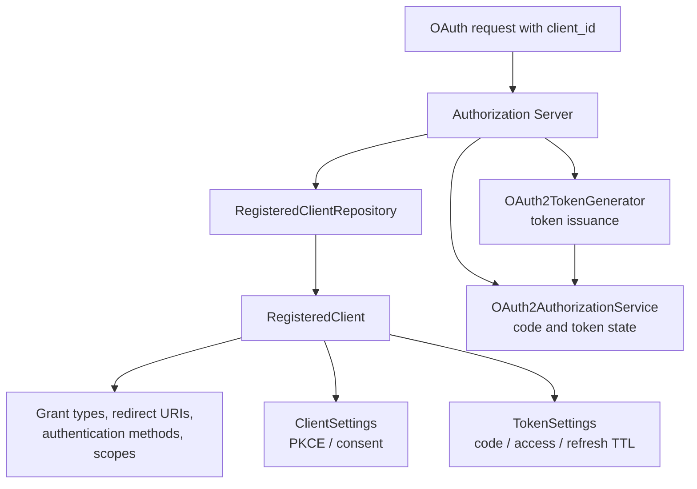
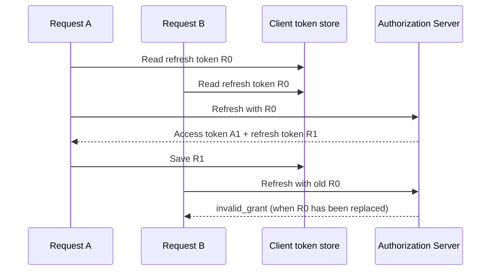

# Configuring Authorization Code, Access Token, and Refresh Token Lifetimes

In a **Spring Security OAuth2/OIDC Authorization Server**, issuing a token successfully is only the first step. The system must also decide **how long each token or authorization code remains valid**, when new values should be issued, when old values must be rejected, and how to operate that policy safely. Spring Authorization Server provides **`TokenSettings`** to configure lifetimes and certain token behaviors **per `RegisteredClient`**.

This lesson belongs to the **Client Management** chapter of the **SPRING_SECURITY_OAUTH2_OIDC_AUTHORIZATION_SERVER** module, focused on designing, configuring, securing, testing, and operating an OAuth 2.0/OpenID Connect Authorization Server with Spring Boot.

After this lesson, you will be able to:

- Distinguish the lifetimes and purposes of **authorization codes**, **access tokens**, and **refresh tokens**.
- Configure `authorizationCodeTimeToLive`, `accessTokenTimeToLive`, `refreshTokenTimeToLive`, and `reuseRefreshTokens` using `TokenSettings`.
- Design lifetime policies based on client trust level, grant type, resource sensitivity, and operational needs.
- Explain refresh token rotation, the limits of JWT revocation, and the impact of persistence stores, multiple instances, and system clocks.
- Test expired tokens, single-use codes, rotated refresh tokens, and the difference between login sessions and token lifetimes.

## 1. Three Artifact Types, Three Distinct Lifecycles

Example: a confidential web backend client `orders-portal` registered with Spring Authorization Server using **Authorization Code + PKCE**, authorized to call the Orders API.

```mermaid
sequenceDiagram
    autonumber
    actor U as User
    participant B as Browser
    participant C as orders-portal backend
    participant AS as Authorization Server
    participant API as Orders API

    U->>B: Open orders page
    B->>C: Request login
    C-->>B: Redirect to /oauth2/authorize (state, PKCE)
    B->>AS: Authorization request
    AS-->>B: Login / consent if needed
    B->>AS: Authenticate and approve
    AS-->>B: Callback with authorization code
    B->>C: Forward authorization code
    C->>AS: /oauth2/token (code, verifier, client auth)
    AS-->>C: Access token + optional refresh token
    C->>API: Authorization: Bearer access_token
    API-->>C: Authorized data
    Note over C,API: Access token expires
    C->>AS: /oauth2/token (grant_type=refresh_token)
    AS-->>C: New access token; refresh token per policy
    C->>API: Call API with new access token
```

| Artifact | Where is it used? | What do short/long lifetimes mean? | Termination conditions beyond expiry |
| --- | --- | --- | --- |
| **Authorization code** | Client exchanges it at the token endpoint after redirect from the Authorization Server. | Should be very short: the code only needs to live long enough for the client to process the callback. | Must be **single-use**; wrong client, redirect URI, or PKCE verifier must be rejected. |
| **Access token** | Client presents it to the Resource Server/API to access resources. | Typically short; limits the window of misuse if leaked, though increases renewal frequency. | May be rejected due to signature/issuer/audience/scope, status, or API policy; self-contained JWTs are not automatically invalidated immediately on revocation. |
| **Refresh token** | Client uses it at the token endpoint to obtain a new access token without repeating the full authorization flow. | Typically longer than an access token; a leaked refresh token can mint many new access tokens. | AS can reject tokens that are revoked, superseded by rotation, belong to a different client, or no longer meet policy. |

**Time-to-live (TTL)** is the duration from when an artifact is issued until that specific artifact expires. Do not confuse TTL with how long a web/SSO session remains active, how long consent stays stored, or how long a user is authorized to use an API.

### 1.1. Example Timeline

Suppose a client has this illustrative configuration:

- Authorization code TTL: **2 minutes**.
- Access token TTL: **10 minutes**.
- Refresh token TTL: **8 hours**.
- Refresh token policy: issue a new token on refresh (`reuseRefreshTokens(false)`).

The timestamps below are solely **an illustrative issuance timeline**, not Spring Authorization Server defaults:

```text
14:00  Authorization Server issues authorization code
14:01  Client successfully exchanges code at token endpoint
       -> code is consumed, cannot be exchanged again
       -> new access token expires around 14:11
       -> new refresh token expires around 22:01

14:11  Access token from code exchange has expired
       -> Orders API must reject the expired token
       -> client can obtain another access token if the refresh token is still valid

15:00  Client sends valid refresh token
       -> AS may return a new access token
       -> if rotation is enabled, AS also issues a new refresh token
       -> client must securely store it, replacing the old value
```

Successfully exchanging an authorization code after 1 minute **does not extend the code's validity**; it has been consumed. When the AS issues the access token and refresh token at 14:01, their TTLs are measured from **each token's issuance time**, not from when the authorization request began.

## 2. TokenSettings Attached to RegisteredClient

In Spring Authorization Server, client registrations are modeled as `RegisteredClient` and looked up via `RegisteredClientRepository`. Each `RegisteredClient` can carry its own `TokenSettings`.



The most relevant `TokenSettings.builder()` methods in Spring Authorization Server 1.x:

| Method | Target artifact | Meaning |
| --- | --- | --- |
| `authorizationCodeTimeToLive(Duration)` | Authorization code | How long a code remains acceptable for exchange at the token endpoint, provided it has not been used. |
| `accessTokenTimeToLive(Duration)` | Access token | Validity duration used by the AS when issuing an access token. |
| `refreshTokenTimeToLive(Duration)` | Refresh token | Validity duration of a newly issued refresh token. |
| `reuseRefreshTokens(boolean)` | Refresh token returned on refresh | `true`: existing refresh token may continue to be used per AS mechanics; `false`: a new token is issued on successful refresh to perform rotation. |
| `accessTokenFormat(OAuth2TokenFormat)` | Access token | Chooses a format such as `SELF_CONTAINED` (typically JWT) or `REFERENCE` (opaque); affects how the Resource Server validates and revokes tokens. |

Other settings, such as device code lifetime or ID token signature algorithm, may exist in `TokenSettings` depending on the version and enabled protocols. This lesson focuses on the three primary lifecycles.

**Never assume default numbers remain identical across all Spring Authorization Server versions.** Check the documentation for the library version you use, then explicitly declare desired TTLs for each critical client so library upgrades never leave operational policies ambiguous.

### 2.1. Distinguishing Three Similarly Named Objects

| Object | Scope | Examples |
| --- | --- | --- |
| `ClientSettings` | Protocol constraints of a registered client | Require PKCE, require consent, client's JWK Set URL. |
| `TokenSettings` | Token format, lifetimes, and behavior for a registered client | 2-minute code, 10-minute access token, 8-hour refresh token, rotation. |
| `AuthorizationServerSettings` | Identity/endpoints of the entire Authorization Server | Issuer, authorization/token/JWKS endpoints. |

To change `issuer`, do not edit `TokenSettings`. To mandate PKCE, edit `ClientSettings`. To shorten how long an access token remains valid at APIs, start with `TokenSettings`, while also reviewing Resource Server validators and clock skew.

## 3. Complete Java Configuration for a Confidential Client

The example below uses a compatible **Spring Boot 3.x + Spring Authorization Server 1.x** stack with `RegisteredClientRepository` and `PasswordEncoder`. This code is responsible only for **client registration and token policy**; running a complete Authorization Server still requires a `SecurityFilterChain`, users, signing keys/JWKS, `AuthorizationServerSettings`, and related services. Do not treat a client registration class as the entire application.

Configuration in `application.yml`:

```yaml
app:
  oauth:
    portal-client-secret: ${PORTAL_OAUTH_CLIENT_SECRET}
```

Supply `PORTAL_OAUTH_CLIENT_SECRET` from the runtime environment; avoid hardcoding secrets into Git.

Example class `PortalClientConfiguration.java`:

```java
package com.example.authserver.config;

import java.time.Duration;
import java.util.UUID;

import org.springframework.beans.factory.annotation.Value;
import org.springframework.context.annotation.Bean;
import org.springframework.context.annotation.Configuration;
import org.springframework.security.crypto.password.PasswordEncoder;
import org.springframework.security.oauth2.core.AuthorizationGrantType;
import org.springframework.security.oauth2.core.ClientAuthenticationMethod;
import org.springframework.security.oauth2.core.oidc.OidcScopes;
import org.springframework.security.oauth2.server.authorization.client.InMemoryRegisteredClientRepository;
import org.springframework.security.oauth2.server.authorization.client.RegisteredClient;
import org.springframework.security.oauth2.server.authorization.client.RegisteredClientRepository;
import org.springframework.security.oauth2.server.authorization.settings.ClientSettings;
import org.springframework.security.oauth2.server.authorization.settings.TokenSettings;

@Configuration(proxyBeanMethods = false)
public class PortalClientConfiguration {

    @Bean
    RegisteredClientRepository registeredClientRepository(
            PasswordEncoder passwordEncoder,
            @Value("${app.oauth.portal-client-secret}") String clientSecret) {

        TokenSettings tokenSettings = TokenSettings.builder()
            .authorizationCodeTimeToLive(Duration.ofMinutes(2))
            .accessTokenTimeToLive(Duration.ofMinutes(10))
            .refreshTokenTimeToLive(Duration.ofHours(8))
            .reuseRefreshTokens(false)
            .build();

        RegisteredClient portal = RegisteredClient.withId(
                    UUID.randomUUID().toString())
            .clientId("orders-portal")
            .clientSecret(passwordEncoder.encode(clientSecret))
            .clientAuthenticationMethod(
                ClientAuthenticationMethod.CLIENT_SECRET_BASIC)
            .authorizationGrantType(
                AuthorizationGrantType.AUTHORIZATION_CODE)
            .authorizationGrantType(
                AuthorizationGrantType.REFRESH_TOKEN)
            .redirectUri(
                "https://portal.example.com/login/oauth2/code/orders")
            .scope(OidcScopes.OPENID)
            .scope("orders.read")
            .clientSettings(ClientSettings.builder()
                .requireProofKey(true)
                .requireAuthorizationConsent(true)
                .build())
            .tokenSettings(tokenSettings)
            .build();

        return new InMemoryRegisteredClientRepository(portal);
    }
}
```

**Explanation of key points:**

1. `TokenSettings` is built first, then attached to the exact `RegisteredClient` via `.tokenSettings(tokenSettings)`. Two clients can use two different policies.
2. `authorizationCodeTimeToLive(Duration.ofMinutes(2))` expires the code two minutes after the AS issues it. A code that has already been exchanged cannot be reused even if the TTL has not elapsed.
3. `accessTokenTimeToLive(Duration.ofMinutes(10))` sets the lifetime of newly issued access tokens. APIs must validate expiration rather than merely decoding token payloads.
4. `refreshTokenTimeToLive(Duration.ofHours(8))` bounds the lifetime of new refresh tokens. It **does not guarantee** a refresh token will always be issued: the client must hold the right grant, and protocol/AS policies must permit it.
5. `reuseRefreshTokens(false)` directs the server to issue a new refresh token upon successful refresh. The client must persist the new value in its secret store and stop sending the old token.
6. `ClientSettings.requireProofKey(true)` is still needed for Authorization Code + PKCE. Short TTLs do not replace PKCE, client authentication, redirect URI allowlists, or client-side `state` checks.
7. `UUID.randomUUID()` and `InMemoryRegisteredClientRepository` are illustrative choices. Durable stores require stable IDs and governed client registration workflows.

**Execution note:** this is a confidential backend client, so `client_secret_basic` makes sense because the secret lives on the server. For SPA/native public clients, never embed a secret in JavaScript or binaries and treat them as confidential. Different SAS versions and configurations have specific rules for issuing refresh tokens to public clients; verify behavior before designing SPA refresh flows.

### 3.1. Multiple Clients Can Have Different Lifetimes

Example policies for two client types:

```java
TokenSettings portalPolicy = TokenSettings.builder()
    .authorizationCodeTimeToLive(Duration.ofMinutes(2))
    .accessTokenTimeToLive(Duration.ofMinutes(10))
    .refreshTokenTimeToLive(Duration.ofHours(8))
    .reuseRefreshTokens(false)
    .build();

TokenSettings internalServicePolicy = TokenSettings.builder()
    .accessTokenTimeToLive(Duration.ofMinutes(5))
    .build();
```

`portalPolicy` fits a confidential client using Authorization Code and Refresh Token. `internalServicePolicy` can be attached to a client using `client_credentials`; **client credentials has no user-granted authorization code and normally does not issue a refresh token**. Therefore, `authorizationCodeTimeToLive` and `refreshTokenTimeToLive` have no practical effect in that grant.

Do not apply a single arbitrary policy across all clients. Weigh trust level, access pattern, API call frequency, ability to protect refresh tokens, revocation needs, and data sensitivity.

## 4. Authorization Code: Keep It Very Short-Lived and Single-Use

The Authorization Code Flow has two distinct legs:

1. **Front-channel:** the Authorization Server redirects the browser to the client's callback with `code`.
2. **Back-channel:** the client backend (or public client with PKCE) sends the code to `/oauth2/token`; the AS validates the code and bindings before issuing tokens.

Because the code appears in the callback URL, it risks exposure via URL logs, browser history, referrers, redirect errors, or malicious client-side code. A short TTL shrinks the window during which a leaked code is usable, though it does not replace other defenses.

When you configure:

```java
TokenSettings.builder()
    .authorizationCodeTimeToLive(Duration.ofMinutes(2))
    .build();
```

you are setting an **expiration window**, not granting access to any client. The Authorization Server must also verify:

- The code belongs to the exact client it was issued to and has not expired.
- The transaction-bound `redirect_uri` matches the code exchange request.
- `code_verifier` matches `code_challenge` when PKCE is used.
- Confidential clients authenticate with their registered method.
- The code has not already been consumed. The token endpoint must reject a replayed code.

**If code exchange arrives too late:** if a user completes login and consent, yet a network delay or slow client causes the callback exchange to exceed the TTL, the token endpoint must reject it with the appropriate protocol error (usually `invalid_grant`). The client should initiate a **new authorization transaction**, never attempt to extend or reuse an expired code.

Choosing the code TTL balances redirect latency, system load, and interaction on slow networks. Around **1–5 minutes** is often a starting point for discussion, not a fixed rule for every app or a library default.

## 5. Access Token: Validity Window at the Resource Server

An access token represents permissions granted by the Authorization Server to a client and is presented to the Resource Server (API). With a self-contained JWT, the token typically carries `iat` and `exp` claims; the API must validate **signature, issuer, expiration, audience, scope, and business permissions**. With an opaque/reference token, the API typically validates via introspection per configuration.

### 5.1. Where Does the Access Token TTL Appear?

Suppose the AS issues a JWT at `2026-11-16T08:00:00Z` with a 10-minute TTL; the payload might contain:

```json
{
  "iss": "https://login.example.com",
  "sub": "alice",
  "aud": ["orders-api"],
  "scope": "orders.read",
  "iat": 1794816000,
  "exp": 1794816600
}
```

This is an **illustrative** payload, not a real signed token. The `aud` value is only an example; to emit that audience you must configure/customize token claims explicitly—never assume `TokenSettings` generates the desired audience automatically. In real JWTs, `iat` and `exp` are NumericDates (Unix seconds).

Once the token expires, the API must reject it even if the user is still logged into the web portal and the AS session remains active. To continue accessing the API, the client must obtain a new access token via a refresh token or an appropriate grant flow.

### 5.2. Self-Contained JWT vs. Opaque/Reference Token in Revocation

| Aspect | Self-contained JWT | Opaque/reference token |
| --- | --- | --- |
| How does the API verify it? | Usually verifies signature and claims locally using a trusted public key/JWKS. | Usually calls introspection or looks up state from a trusted service. |
| How is TTL represented? | Usually `exp` inside the token; validator rejects after expiry subject to clock skew policy. | AS tracks expiration in token state; introspection returns active/inactive status. |
| Early revocation | AS can record revocation, but an API doing offline JWT checks **does not automatically know** about it. | Can reflect status faster via introspection, depending on caching and infrastructure. |
| Operational cost | Easy to scale offline verification; requires key management and JWT lifecycle governance. | Requires access to the status service and managing cache/availability. |

In SAS, access token format is another `TokenSettings` property:

```java
import org.springframework.security.oauth2.server.authorization.settings.OAuth2TokenFormat;
import org.springframework.security.oauth2.server.authorization.settings.TokenSettings;

TokenSettings jwtPolicy = TokenSettings.builder()
    .accessTokenFormat(OAuth2TokenFormat.SELF_CONTAINED)
    .accessTokenTimeToLive(Duration.ofMinutes(10))
    .build();

TokenSettings opaquePolicy = TokenSettings.builder()
    .accessTokenFormat(OAuth2TokenFormat.REFERENCE)
    .accessTokenTimeToLive(Duration.ofMinutes(10))
    .build();
```

Choose the format based on verification and revocation requirements; **do not assume switching to opaque tokens guarantees instant revocation** if the Resource Server caches introspection responses for too long.

### 5.3. Impact of Short vs. Long TTLs

- **A very short TTL** limits how long a leaked token can be used, but increases calls to the refresh/token endpoint and increases failure risk during transient network blips.
- **A long TTL** lowers renewal overhead but widens the window during which a stolen token can be abused, especially with JWTs lacking pre-expiry rejection at the API.
- An app that uses refresh tokens safely can pick shorter access token lifetimes, provided token refreshing neither creates a bottleneck nor disrupts users if the AS is briefly unavailable.

Access token lifetime should align with permission sensitivity, revocation capability, and load tolerance. Never inflate access token TTLs to many hours just to mask a broken refresh design.

## 6. Refresh Token: Issuing New Access Tokens and Managing Rotation

A refresh token is a **high-value credential** because it can be exchanged for new access tokens. Normally it is sent only to the **Authorization Server token endpoint**, never to a Resource Server and never used as an access token when calling APIs.

For confidential web clients, refresh tokens should be stored server-side with access controls and encryption as appropriate. Avoid sending refresh tokens in query strings, writing them to logs, or returning them to the browser when the backend can handle refreshes on the user's behalf.

### 6.1. Refresh Token Request

A client that received a refresh token can send a request like:

```http
POST /oauth2/token HTTP/1.1
Host: login.example.com
Authorization: Basic <BASE64_OF_CLIENT_ID_COLON_SECRET>
Content-Type: application/x-www-form-urlencoded

grant_type=refresh_token&refresh_token=<REFRESH_TOKEN>
```

This example depicts a **confidential client**; production systems must use **HTTPS** and the exact registered client authentication method. Never confuse a user's password with a client secret.

The AS must verify that the refresh token exists, has not expired, has not been revoked or superseded, and belongs to that client, while applying current scope/policy constraints per protocol. If valid, the AS issues a new access token.

An abbreviated response might look like:

```json
{
  "access_token": "<NEW_ACCESS_TOKEN>",
  "token_type": "Bearer",
  "expires_in": 600,
  "refresh_token": "<NEW_REFRESH_TOKEN>",
  "scope": "orders.read"
}
```

`expires_in` is the **expected number of seconds the access token remains valid from response creation**—600 seconds in this example. It is not the refresh token's TTL. When rotation is configured and occurs, `refresh_token` contains the new value; the client must persist this new value to replace the prior token. Under policies where refresh tokens are reused, verify the exact response and behavior against your implementation.

### 6.2. `reuseRefreshTokens(true)` vs. `false`

```java
TokenSettings.builder()
    .refreshTokenTimeToLive(Duration.ofHours(8))
    .reuseRefreshTokens(false)
    .build();
```

| Configuration | Expected behavior on successful refresh | Impact on client |
| --- | --- | --- |
| `reuseRefreshTokens(true)` | Continues using the existing refresh token within its lifetime and AS rules. | Fewer token storage updates, but a leaked refresh token can be abused while still valid. |
| `reuseRefreshTokens(false)` | Issues a new refresh token and replaces the used token in authorization state. | Client must consistently store and use the new token while handling concurrent refresh requests. |

**Do not equate rotation with a full reuse-detection system that invalidates an entire "token family."** Setting `reuseRefreshTokens(false)` specifies issuing a new token on refresh; how replay detection, reactions to old refresh tokens, chain-wide revocation, and risk governance behave must be evaluated against your Spring Authorization Server version and deployment policy. Never claim a single flag satisfies all OAuth Security Best Current Practice requirements.

### 6.3. Race Conditions When Multiple Requests Refresh Simultaneously

Suppose two concurrent requests in the same client session notice the access token is about to expire:



**How to handle it:** on the client side, coordinate refreshes per session/user using locks, a single-flight mechanism, or conditional token updates so two threads never submit the same old refresh token concurrently. With distributed storage, account for atomic updates and concurrency across client instances. Never "fix" this error by turning off rotation without assessing the security risk.

### 6.4. What Does an Expired Refresh Token Mean for the User?

When a refresh token expires or is rejected, the client can no longer obtain access tokens with that refresh token. It can restart the Authorization Code Flow. If the SSO session at the Authorization Server is still valid, the user may be re-authenticated without re-entering a password; otherwise, they must sign in per policy.

**Refresh token TTL is not the maximum time a user can stay logged in** and **does not directly govern when a web session is logged out**. To enforce session lifetimes or maximum authentication age, configure the relevant session, OIDC, and authentication policies.

## 7. Choosing Policies by Client and Business Requirements

The values below are **initial starting points for evaluation**, not mandatory standards or Spring Authorization Server defaults:

| Client type | Authorization code | Access token | Refresh token and rationale |
| --- | --- | --- | --- |
| User-facing backend portal | ~1–5 minutes | ~5–15 minutes | May use several hours with rotation if stored securely by the client and continuous work sessions are needed. |
| SPA / public client | ~1–5 minutes, PKCE mandatory | Consider short per XSS/API risk | Use only if AS/standards and architecture support it safely; rotation or sender-constraining per policy. |
| Native / mobile app | ~1–5 minutes, PKCE mandatory | Short per API requirements and offline needs | Design specifically for device storage, rotation, revocation, and lost-device risk. |
| Machine-to-machine client using `client_credentials` | **Not applicable** | ~5–15 minutes or per SLA | **Normally no refresh token issued**; the service requests a new access token with its client credentials. |
| Sensitive workloads requiring high revocability | If using Authorization Code: short | May be shorter than standard portals | Needs clear revocation mechanisms; re-evaluate issuing refresh tokens and scopes/audiences. |

In real systems, reasonable numbers depend on token endpoint load capacity, session continuity needs, ability to safeguard keys/secrets, impact of token theft, and how APIs validate tokens.

### 7.1. Don't Use Access Token TTL to Solve Every Security Problem

Common misconceptions:

- **"If the access token is limited to 10 minutes, we don't need audience or scopes."** False. A token can still call the wrong API without `aud` and permission checks.
- **"Changing the TTL policy to 2 minutes makes old tokens expire in 2 minutes."** False. Already-issued tokens carry their own expiration; you need revocation/evaluation mechanisms when policies change.
- **"When a user logs out, every JWT access token is immediately invalidated."** Not automatically. If a Resource Server only verifies JWTs locally, it may still accept unexpired JWTs unless state checks, denylists, or token binding are in place.
- **"Refresh token rotation expires existing access tokens immediately."** Not automatically. Rotation applies to the refresh credential; access tokens have their own lifetimes and rejection mechanisms.
- **"Client credentials need refresh tokens to avoid logging in again."** False. Client credentials lets a confidential client obtain a new access token directly from the AS using machine credentials.

## 8. Persisting and Operating Lifetime Policies

### 8.1. `OAuth2AuthorizationService` Must Be Durable When Required

`TokenSettings` resides on `RegisteredClient` and is typically persisted via `RegisteredClientRepository`. However, **issued authorization codes, access tokens, and refresh tokens** are also tied to authorization state managed by `OAuth2AuthorizationService`.

In development, Spring Authorization Server may use in-memory stores. On restart:

- Unexchanged authorization codes can be lost from memory and become unredeemable even before their TTL expires.
- Unexpired refresh tokens may no longer be found by the AS.
- If JWT signing keys are also regenerated on startup, older JWTs may fail verification against the new JWKS.

To run multiple instances or preserve sessions and refresh tokens across restarts, use a durable/shared store (`JdbcOAuth2AuthorizationService` or a custom implementation), synchronize registrations, and manage signing keys consistently. **Lengthening TTLs never fixes state lost when the AS restarts.**

### 8.2. Expiration, Data Cleanup, and Logging

Once a token or code expires, its state record may remain in the datastore until purged. The system needs a scheduled cleanup strategy for expired records, appropriate query indexes, and retention aligned with audit policies. Never equate "expired" with "automatically deleted from the database right away."

Emit aggregate metrics on the token endpoint (issuances, refreshes, `invalid_grant` errors, latency, throughput) while **never logging raw authorization codes, access tokens, refresh tokens, or client secrets**. Logs may include error codes and sanitized transaction IDs, avoiding unnecessary PII.

### 8.3. Clocks, Clock Skew, and Expiration Moments

Checks for `exp`, `nbf`, and time-based constraints rely on each component's system clock. Synchronize clocks via NTP across the AS and Resource Servers. Some JWT validators apply a **clock skew tolerance** for minor clock drift; that value depends on your Resource Server version and configuration.

If a validator allows 60 seconds of skew, a JWT may still be accepted briefly past `exp` under the validator's policy. Therefore:

- Never write tests expecting "token expires to the exact millisecond" without accounting for clock skew.
- Never configure huge tolerances to mask misconfigured clocks.
- In tests, prefer mocked clocks or controlling time in token-issuing/validating components over long `Thread.sleep(...)` calls.

### 8.4. When Modifying Registered `TokenSettings`

Suppose today the access token TTL is 15 minutes and tomorrow you change it to 5 minutes:

- **New tokens** issued after the new policy takes effect receive the updated TTL.
- **Already-issued tokens** generally keep the expiration stamped at issuance; they are not rewritten retroactively in bulk.
- If multiple AS instances use caches or separate repositories, ensure the updated policy propagates consistently.
- If emergency revocation is needed, use revocation/denylists/introspection or API-side restrictions rather than merely changing TTLs.

The same holds for refresh token TTL: changing it to 1 hour does not automatically shorten `expiresAt` on previously issued refresh tokens. During migrations, plan how existing tokens and user session commitments are handled.

## 9. Testing TTL and Rotation Configuration

Testing should cover **success paths, expiration paths, and reuse paths**. A test that merely asserts a bean holds `Duration.ofMinutes(10)` does not prove protocol enforcement works.

| Test case | Scenario | Expected result |
| --- | --- | --- |
| Valid code | Exchange valid code with matching client, redirect, and PKCE | Token endpoint accepts per registered grant. |
| Expired code | Submit code after TTL | AS rejects; no token issued. |
| Reused code | Submit an already-consumed code | AS rejects; no second token issued. |
| Wrong PKCE | Valid code but mismatched `code_verifier` | AS rejects. |
| Valid access token | API receives token with matching issuer, audience, scope | Allowed if business permissions are satisfied. |
| Expired access token | API receives token with `exp` past allowed skew | Resource Server rejects. |
| Valid refresh token | Send valid refresh token from the owning client | AS issues new token(s) per policy. |
| Expired refresh token | Send refresh token after TTL | AS rejects, typically `invalid_grant`. |
| Superseded refresh token | Reuse old refresh token after rotated refresh | Must be rejected per AS state and policy. |
| Wrong client authentication | Refresh using mismatched client ID/secret | AS rejects. |
| Client lacks refresh grant | Attempt `grant_type=refresh_token` | Rejected for unregistered grant. |
| Changed `TokenSettings` | Old token remains valid while new token gets new TTL | Observe old token keeps original expiry and new token uses updated policy. |
| Concurrent refresh | Two requests submit the same refresh token simultaneously | Client handles consistently without losing the new refresh token or failing repeatedly due to races. |
| Revoked JWT access token | API only checks signature offline | Test highlights revocation limits; add state checks if immediate effect is required. |

### 9.1. Inspecting Lifetimes in Token Responses and Authorization State

A token response's `expires_in` field usually reports the **remaining seconds of the access token**. For JWTs, you can inspect `exp` and `iat` claims in test environments; remember that Base64 decoding alone does not verify signatures. For refresh tokens, OAuth token responses are not required to return a refresh token TTL field; verify stored authorization state in the AS or actual runtime behavior per deployment policy.

If integration tests can access `OAuth2AuthorizationService`, you can inspect metadata and expiration on `OAuth2Authorization.Token` inside the persisted authorization object. Do not assume refresh tokens can be decoded as JWTs; refresh tokens are usually opaque values.

### 9.2. Expiration Boundary Test Scenario

Example with a 10-minute token TTL:

```text
T0:        AS issues access token
T0+9m:     Token is valid; API may accept if otherwise valid
T0+10m:    Reaches exp (subject to validator clock skew)
T0+11m:    API must reject once all tolerance has elapsed
```

When testing JWT validators, inject a test clock or customize the validator if the framework permits. For Authorization Server integration tests, control the token generator's clock or configure a very short TTL policy in the test profile to avoid slow, flaky tests.

### 9.3. Policy-Change Tests Must Inspect Real Tokens

Suppose two registered clients exist:

- `orders-portal`: access token TTL 10 minutes.
- `reporting-service`: access token TTL 5 minutes.

After issuing tokens to each client, verify the actual token lifetimes rather than only reading configuration objects; verify clients cannot request arbitrary TTLs via HTTP parameters unless an explicit mechanism authorizes it. Never accept a client-supplied lifetime as AS policy.

## 10. Troubleshooting Common Errors

### `invalid_grant` Even Though the Authorization Code Was Just Issued

Possible causes include an expired code, a code already used once, a mismatched `redirect_uri`, a wrong `code_verifier`, or authorization state lost from memory after a restart. Inspect the exact transaction before raising TTLs. **Never** increase the code TTL to hours to work around PKCE or callback bugs.

### Client Calls API Successfully, Then Suddenly Receives 401

Check whether the access token expired, Resource Server clock/clock skew, issuer/JWKS, and audience. The client must acquire a fresh token via refresh or the appropriate grant; `401` can also stem from a bad signature or issuer, not solely expiration.

### A New Refresh Token Was Issued, Yet the Client Still Gets `invalid_grant`

With rotation enabled, the client must **persist the new refresh token** after every successful refresh. If multiple threads or instances refresh concurrently, one may keep sending the stale value. Check concurrency handling, persistence, and token-replacement logic.

### Refresh Token Expires Prematurely After Restart

An in-memory `OAuth2AuthorizationService` is wiped when the process stops, which differs from normal token expiration. Use durable, shared storage across instances. If JWT signing keys also change on restart, older access tokens will fail verification too.

### User Logs Out, Yet the JWT Still Calls APIs

Application session logout, OIDC logout, refresh token revocation, and access token invalidation are separate mechanisms. A JWT can still pass offline API verification until `exp`. When immediate revocation is required, design state checks or token-binding mechanisms instead of assuming logout revokes all JWTs automatically.

### Using `reuseRefreshTokens(false)` Yet Assuming All Replays Are Prevented

Rotation is only one piece. Clarify how the AS detects reuse, whether it revokes/deletes the entire authorization family, how it reacts to old refresh tokens post-rotation, and how it coordinates with distributed storage. Write integration tests replaying old tokens to verify the expected behavior.

## 11. Policy Design Exercise

A company deploys Spring Authorization Server for three applications:

| Client | App type | Requirements |
| --- | --- | --- |
| `employee-portal` | Confidential BFF | Users work continuously across an 8-hour shift; HR APIs are sensitive. |
| `analytics-spa` | Public SPA | Uses PKCE, exposed to dependency XSS risk; views reports with minimal writes. |
| `batch-exporter` | Confidential machine client | Runs a job every 15 minutes via `client_credentials`; no interactive user. |

Design the corresponding `RegisteredClient` and `TokenSettings`, then answer:

1. Which clients have authorization codes and which do not? Why is code TTL meaningless for `batch-exporter`?
2. How should `employee-portal`'s access token TTL be weighed if HR must revoke access urgently? Does offline JWT validation achieve immediate revocation?
3. Should `batch-exporter` be issued a refresh token, or should it use `client_credentials` to obtain a new access token?
4. If `employee-portal` uses rotation, how do you prevent two concurrent requests from sending the old refresh token?
5. If `analytics-spa` needs refresh tokens, what browser protections are required? Should a BFF architecture be considered?
6. Does changing `refreshTokenTimeToLive` automatically alter `expiresAt` on previously issued refresh tokens?
7. When running multiple AS replicas, which data stores and keys must be shared so refreshes and token verification do not fail intermittently?

**Answer hints:** `batch-exporter` uses client credentials and normally needs neither refresh tokens nor authorization codes. Interactive user apps can use Authorization Code + PKCE, choosing TTLs based on real risk and verification/revocation capabilities. Updating settings typically affects new tokens without rewriting recorded expirations on existing tokens.

## 12. Pre-Operations Checklist

- [ ] Agree on distinct TTLs for authorization codes, access tokens, and refresh tokens per client and grant type.
- [ ] Authorization codes have short TTLs, are single-use, and validate PKCE, client, and redirect URI.
- [ ] Access token TTLs match risk levels, with checks for `iss`, `aud`, signature/introspection, `exp`, scopes, and data permissions.
- [ ] Refresh tokens are issued only when grant/policy permits; stored as secrets and never sent to APIs.
- [ ] Decide on `reuseRefreshTokens`, test rotation, handle concurrent refreshes, and design replay responses per security standards.
- [ ] Distinguish token TTLs from web/SSO sessions, consents, and logout.
- [ ] `RegisteredClientRepository` and `OAuth2AuthorizationService` are durable across restarts and multiple instances.
- [ ] JWT signing keys are managed stably with a rotation workflow and working JWKS.
- [ ] AS and RS clocks are synchronized, with clock skew controlled and tested.
- [ ] Test expiration, code replay, old refresh tokens, wrong client, wrong PKCE, policy changes, and JWT revocation.
- [ ] Establish retention/cleanup policies for authorization state and monitoring that never leaks tokens.

**Key takeaway:** `TokenSettings` is **token policy attached to each `RegisteredClient`**. `authorizationCodeTimeToLive` governs the lifetime of the single-use code; `accessTokenTimeToLive` controls how long access tokens remain valid; `refreshTokenTimeToLive` and `reuseRefreshTokens` govern lifetime and renewal of refresh credentials. A TTL configuration is effective only when the Authorization Server, state store, OAuth client, and Resource Server all enforce their respective security boundaries properly.

**References:** Spring Authorization Server Reference — Core Model and Components (`RegisteredClient`, `TokenSettings`, `OAuth2AuthorizationService`); Spring Security Reference — OAuth2 Resource Server/JWT; RFC 6749 (OAuth 2.0), RFC 7636 (PKCE), RFC 7009 (Token Revocation), RFC 7662 (Token Introspection), RFC 9700 (OAuth 2.0 Security Best Current Practice), OpenID Connect Core 1.0.
