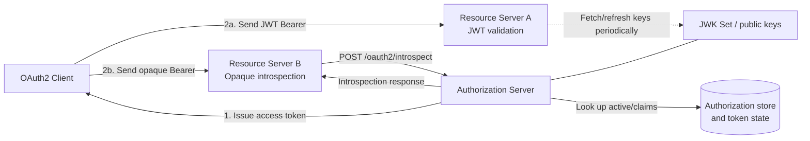
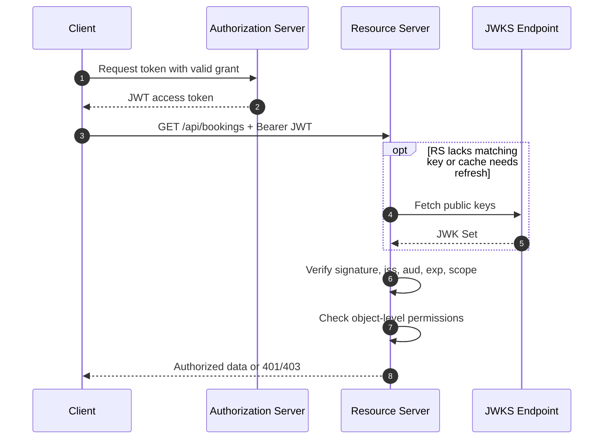
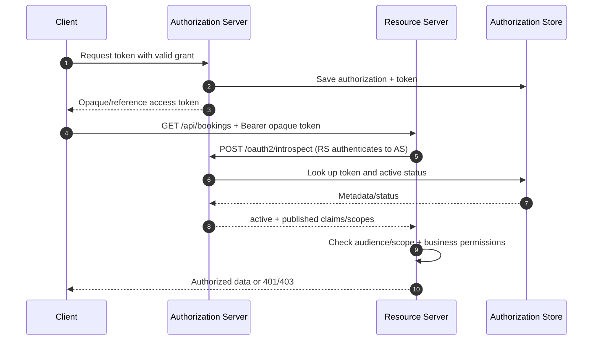
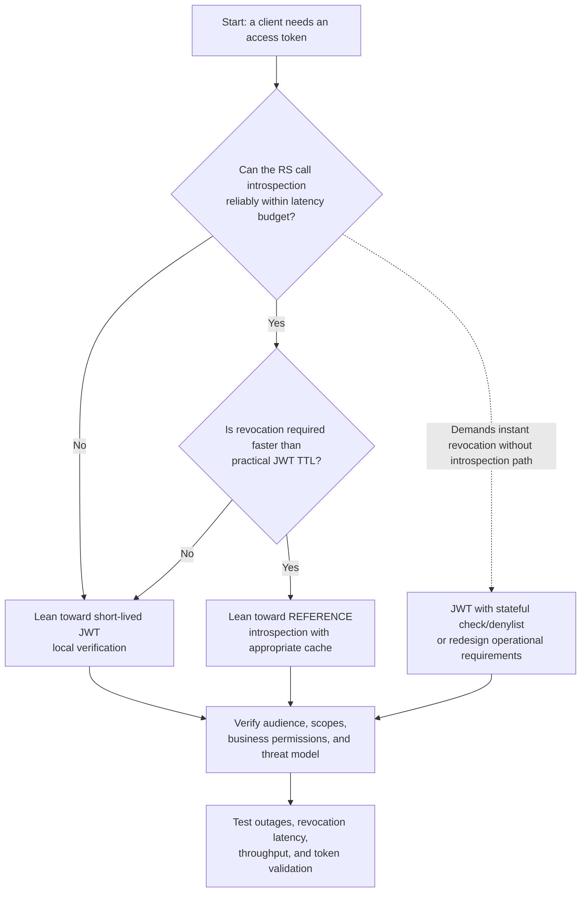

# Choosing JWT or Reference Access Tokens Based on Needs

> **Chapter:** Client Management  
> **Module:** `SPRING_SECURITY_OAUTH2_OIDC_AUTHORIZATION_SERVER`  
> **Context:** Designing, configuring, securing, testing, and operating an OAuth 2.0/OpenID Connect Authorization Server using Spring Security and Spring Authorization Server in a Spring Boot application.  
> **Technical scope:** Java API examples target Spring Authorization Server 1.x and Spring Security 6.x; when using the Spring Security 7.x branch with integrated Authorization Server, cross-check packages, dependencies, and APIs against your running version.

## 1. Learning Objectives

After this lesson, you will be able to:

1. Distinguish **self-contained JWT access tokens** from **reference (opaque) access tokens** in terms of verification, storage, revocation, and information distribution.
2. Select a token format based on security constraints, latency, availability, scale, and real-world operational models.
3. Configure `OAuth2TokenFormat.SELF_CONTAINED` or `OAuth2TokenFormat.REFERENCE` via `TokenSettings` on a `RegisteredClient` in Spring Authorization Server.
4. Configure a Resource Server to validate JWTs via a JWK Set or validate opaque tokens via token introspection.
5. Understand the limitations around token revocation, key rotation, caching, scope-based authorization, and audiences.
6. Design tests for each format and diagnose errors when a single Authorization Server issues tokens for multiple distinct clients.

**First principle:** OAuth 2.0 does not require every access token to be a JWT. From the client's perspective, an access token is normally an opaque string to send to the Resource Server; **clients should not decode access tokens and rely on internal structure to drive business logic**. The access token format and validation method are primarily an agreement between the Authorization Server (AS) and the Resource Server (RS).

## 2. Two Formats Serving the Same Purpose

After completing a valid grant (Authorization Code + PKCE, Client Credentials, or another supported grant), the AS issues an **access token** for the client to access protected resources.

### 2.1. JWT Access Token: Self-Contained Verification Data

A JWT (JSON Web Token) typically has three Base64URL-encoded parts separated by dots:

```text
<base64url(header)>.<base64url(payload)>.<base64url(signature)>
```

A JWT payload might contain claims such as:

```json
{
  "iss": "https://auth.example.test",
  "sub": "user-123",
  "aud": ["booking-api"],
  "client_id": "booking-web",
  "scope": "booking.read",
  "iat": 1893455700,
  "exp": 1893456000,
  "jti": "example-token-id"
}
```

This is an **illustrative payload**, not a usable JWT. Actual claim shapes depend on the AS, JWT profile, grant, and customizer configuration. `sub` can represent the **user** in Authorization Code or the **client** in Client Credentials; never assume `sub` is always a user ID.

A Resource Server can validate the token **locally**, given a valid public key and claim validation rules:

1. Verify the signature using a trusted key from the AS (e.g., JWKS).
2. Restrict allowed signing algorithms and key sources.
3. Verify `iss`, expiration `exp`/`nbf` if present, and appropriate time constraints.
4. Verify `aud`: the token is actually intended for this API.
5. Verify scopes/authorities and business rules, such as permission to read **the exact booking** being requested.

**A signed JWT is not an encrypted JWT.** Standard JWT headers and payloads can be read by anyone holding the token. Signatures detect tampering, but they do not hide email addresses, phone numbers, or sensitive data. Therefore, **minimize claim data** and use HTTPS; never stuff private information into a JWT simply because it is convenient for the API to read.

### 2.2. Reference Access Token: String Referencing State on the AS

With the `REFERENCE` format in Spring Authorization Server, the access token is typically an **unpredictable opaque string**. The string itself carries no claims that the RS can read and trust directly. The AS stores the corresponding token/authorization record in its datastore; the RS typically calls **OAuth 2.0 Token Introspection (RFC 7662)** so the AS confirms whether the token is active and returns permitted metadata.

Illustrative token value only:

```text
r8fV9hN4fB7mC1xK6sQ0uA2eP5vR3yZ7
```

An opaque value does not necessarily have a fixed length and should never be parsed by clients to infer identity data. The RS relies on an **authenticated introspection response from a trusted AS**, not on string syntax.

The primary benefit is that the AS can decide whether a token is still active or has been revoked at introspection time. In exchange, the RS needs a reliable network path to the AS and incurs an extra lookup cost unless an appropriate caching policy is used.

### 2.3. Reference Is a Form of Opaque; Opaque Does Not Mean a Hidden JWT

In the context of Spring Authorization Server:

- `OAuth2TokenFormat.SELF_CONTAINED`: self-contained verifiable access tokens, typically JWTs generated by `JwtGenerator`.
- `OAuth2TokenFormat.REFERENCE`: reference-string access tokens, typically generated by `OAuth2AccessTokenGenerator`; token state is linked to the authorization stored on the AS.

From a protocol perspective, opaque tokens from other providers may use their own verification mechanisms. This lesson uses **reference** for the Spring Authorization Server format option and **opaque** for the Resource Server's introspection integration style.

**Both JWT and reference access tokens are usually Bearer tokens**: whoever holds the token can use it within the token's scope unless the system adds sender-constraining proof-of-possession mechanisms. Switching to opaque tokens does not by itself solve Bearer token leakage.

## 3. Comparing Architecture and Verification Flows



The flows should be understood along two independent paths:

**JWT, local verification:**



**Reference, online introspection:**



The RS may **cache** introspection responses if policy allows. That avoids calling the AS on every request, at the cost that cached responses delay revocation visibility at the RS.

## 4. Decision Table: JWT vs. Reference

| Criterion | Self-contained JWT | Reference/opaque + introspection | Question to ask |
| --- | --- | --- | --- |
| Verification at RS | Typically verifies signature/claims locally | Queries AS for token status/metadata | Can the RS always reach the AS? |
| API latency | Usually low after keys are fetched | Adds introspection round-trip, optionally cached | Does the API have strict latency budgets? |
| Per-request dependency on AS | Not needed once matching key is cached and token is valid | Usually requires AS unless cached | How should the API behave if the AS is unreachable? |
| Pre-expiry revocation | Not immediately effective when RS only verifies locally | AS can return `active: false` on the next check | Within how many seconds must privileges be revoked? |
| Token size | Usually larger due to header, claims, and signature | Usually a shorter string, implementation-dependent | Are there header/network size limits? |
| Claim exposure to token holder | Standard signed payload can be decoded/read | Claims cannot be inferred from the opaque string alone | Are there confidentiality constraints on token data? |
| Updating privileges before expiry | Old claims may persist until expiry | Introspection can reflect changes if AS policy/implementation supports it | How fast must privilege changes propagate? |
| Load on AS | Mainly during token issuance and key/metadata fetches | Token issuance + introspection request volume | Does the AS have enough capacity and scaling headroom? |
| Authorization state storage | May still be needed for lifecycle/consent/revocation | Required so tokens remain lookable | Is the datastore HA with proper cleanup? |
| Signing key rotation | Must manage JWK/`kid` and key lifecycles | RS does not verify opaque signatures, yet still needs TLS/client auth with AS | How does ops manage key rotation? |
| Network isolation / offline RS | Better suited if public keys are cached | Difficult if RS cannot introspect | Are any RS instances at the edge or isolated? |

**JWT does not mean unrevocable:** the AS can record revocations, and an RS can use denylists or supplementary introspection. However, **an RS that only checks JWT signatures and claims locally will not automatically know a token was just revoked**. Conversely, opaque tokens do not guarantee "instant revocation" if the RS caches introspection results or the AS has not updated state.

### 4.1. When to Lean Toward JWT?

Example: a Booking API with high traffic, many instances, distributed across network zones, requiring low latency. The AS issues short-lived JWT access tokens; APIs fetch public keys from JWKS to verify them.

Additional conditions:

- APIs validate `iss`, `aud`, `exp`, and appropriate scopes/authorities.
- Signatures use approved algorithms with controlled key rotation.
- JWTs contain only necessary claims, avoiding PII.
- Either the validity window until expiry is acceptable or a separate revocation control is designed.
- Sudden permission changes have a mitigation: short TTLs, online business checks, denylists, or equivalent mechanisms.

### 4.2. When to Lean Toward Reference?

Example: an admin API with lower traffic that requires very fast token invalidation when a customer locks an account or an app's access is revoked. The RS has a reliable internal link to the AS, and ops accepts the added introspection load.

Additional conditions:

- Enable and protect the introspection endpoint.
- Give the RS its **own** credentials to call introspection; never use end-user credentials.
- Use a durable, HA authorization/token datastore.
- Configure timeouts, bounded retries, circuit breakers, or load-shedding strategies.
- Define exact cache TTLs and acceptable revocation propagation delay.
- Design to **fail closed** when a token cannot be verified, rather than letting requests through because the AS is temporarily unreachable.

### 4.3. When to Consider Using Both?

One AS can serve multiple `RegisteredClient` entries and choose the format **per client**. For instance, a web app receives JWT access tokens for high-frequency read APIs, while an internal integration client receives reference tokens so the AS verifies them online.

Note: `TokenSettings.accessTokenFormat` is set on **`RegisteredClient`**. It does not mean each Resource Server arbitrarily chooses a format for the same access token. When one client calls multiple APIs, align the design of **audience**, permissions, format, and verification mechanism; if format must vary per target API or token request, design explicit protocol flows and AS customizations.

## 5. Access Token Formats in Spring Authorization Server

In Spring Authorization Server 1.x, formats are configured via:

- `RegisteredClient`: the OAuth2 client registration record.
- `TokenSettings`: lifetime, format, and token lifecycle policies.
- `OAuth2TokenFormat.SELF_CONTAINED` or `OAuth2TokenFormat.REFERENCE`.
- `RegisteredClientRepository`: stores client registrations, e.g., in-memory or JDBC.
- `OAuth2AuthorizationService`: stores authorizations and token state; especially critical when an RS introspects opaque tokens.
- `OAuth2TokenGenerator`: component that creates access tokens, refresh tokens, and ID tokens per grant and config. Default setups typically include a JWT generator for self-contained tokens and an access-token generator for reference tokens.

### 5.1. Configuring Two Clients with Different Token Formats

The Java snippet below illustrates a **separate-client** design using `client_credentials` to focus on the token format difference. The method takes secrets from a secure configuration source; **never hardcode production secrets in source code**.

```java
import java.time.Duration;
import java.util.UUID;

import org.springframework.security.crypto.password.PasswordEncoder;
import org.springframework.security.oauth2.core.AuthorizationGrantType;
import org.springframework.security.oauth2.core.ClientAuthenticationMethod;
import org.springframework.security.oauth2.server.authorization.client.RegisteredClient;
import org.springframework.security.oauth2.server.authorization.settings.OAuth2TokenFormat;
import org.springframework.security.oauth2.server.authorization.settings.TokenSettings;

public final class ClientRegistrationFactory {

    private ClientRegistrationFactory() {}

    public static RegisteredClient createServiceClient(
            String clientId,
            String rawSecretFromSecureConfig,
            OAuth2TokenFormat format,
            PasswordEncoder passwordEncoder) {

        return RegisteredClient.withId(UUID.randomUUID().toString())
            .clientId(clientId)
            .clientSecret(passwordEncoder.encode(rawSecretFromSecureConfig))
            .clientAuthenticationMethod(
                ClientAuthenticationMethod.CLIENT_SECRET_BASIC)
            .authorizationGrantType(
                AuthorizationGrantType.CLIENT_CREDENTIALS)
            .scope("booking.read")
            .tokenSettings(TokenSettings.builder()
                .accessTokenFormat(format)
                .accessTokenTimeToLive(Duration.ofMinutes(5))
                .build())
            .build();
    }
}
```

Usage:

```java
RegisteredClient fastApiClient =
    ClientRegistrationFactory.createServiceClient(
        "reporting-service",
        reportingSecretFromVault,
        OAuth2TokenFormat.SELF_CONTAINED,
        passwordEncoder
    );

RegisteredClient revocableClient =
    ClientRegistrationFactory.createServiceClient(
        "admin-integration",
        adminIntegrationSecretFromVault,
        OAuth2TokenFormat.REFERENCE,
        passwordEncoder
    );
```

This code **illustrates creating two configurations**. A real system must persist both via an appropriate `RegisteredClientRepository` and keep IDs stable across deployments; **never regenerate client IDs with `UUID.randomUUID()` on every startup if client records already exist**. In production, signing keys, authorization/consent persistence, HTTPS, client secrets, rotation, and operational policies must also be configured.

If using Authorization Code + PKCE, the `RegisteredClient` must register the appropriate **grant types**, **redirect URIs**, scopes, and PKCE constraints. Switching from `SELF_CONTAINED` to `REFERENCE` **does not replace** security rules at the authorization endpoint.

### 5.2. Defaults and Version Control

In the Spring Authorization Server 1.x branch, `TokenSettings` defaults to **self-contained** for access tokens. Because behaviors can evolve across generations, projects requiring predictable behavior should specify the format explicitly in client configuration and verify it with tests.

`JwtGenerator` typically handles self-contained access tokens (JWTs) and OIDC ID tokens. `OAuth2AccessTokenGenerator` can generate reference access tokens. When customizing the `OAuth2TokenGenerator` bean, verify that the generator chain still supports **all token types and formats needed by your clients**. A flawed customization can cause the token endpoint to fail to issue required tokens or ID tokens.

### 5.3. Applying to JDBC-Registered Clients

`JdbcRegisteredClientRepository` persists `RegisteredClient` configurations, including `TokenSettings`. This means:

1. Format is a **client registration policy**, not a random per-HTTP-request choice.
2. When changing format from JWT to reference, save the update to the repository via a controlled administrative operation.
3. **Previously issued tokens do not automatically convert formats.** Older JWTs may remain valid until expiration; the RS needs a plan to handle the transition window.
4. If the AS has multiple instances, all must observe a consistent client configuration.
5. The new format applies to newly issued tokens; write tests to confirm policy behavior when a refresh token issues a new access token, if refreshing is enabled.

Never manually edit serialized `tokenSettings` in the database without understanding the serialization format and migration mechanics of your version. Manage configuration through applications/tooling with clear validation, auditing, and rollback.

## 6. Resource Server Verifying JWTs

A Resource Server using Spring Security OAuth2 Resource Server can configure JWT verification via the issuer:

```yaml
spring:
  security:
    oauth2:
      resourceserver:
        jwt:
          issuer-uri: https://auth.example.test
```

From issuer metadata, Spring Security can discover the JWK Set URI to fetch signature-verification keys; key discovery and startup behavior depend on version and configuration. If supplying `jwk-set-uri` explicitly, still ensure issuer and required claims are validated.

Example scope restriction on an API:

```java
@Bean
SecurityFilterChain resourceServerSecurity(HttpSecurity http)
        throws Exception {

    return http
        .authorizeHttpRequests(authorize -> authorize
            .requestMatchers(HttpMethod.GET, "/api/bookings/**")
                .hasAuthority("SCOPE_booking.read")
            .anyRequest().authenticated())
        .oauth2ResourceServer(oauth2 ->
            oauth2.jwt(Customizer.withDefaults()))
        .build();
}
```

With default mapping, a valid `scope` claim in the access token yields an authority like `SCOPE_booking.read`. However, this only checks **which type of API operation is permitted**; the Booking API must still verify whether the requested record belongs to the corresponding user/tenant.

### 6.1. Audience Validation Is Mandatory by Design

Never accept a JWT merely because it was signed by **the same Authorization Server**. Suppose the AS issues a token for `payment-api`; `booking-api` must not accept that token by default.

Verify:

- `iss` is the expected issuer.
- Signature and algorithm are trusted.
- `aud` includes the current Resource Server's audience.
- The token is unexpired and meets time constraints.
- Scopes/authorities permit the specific action.
- Subject, tenant, and business conditions match.

In Spring Security, configuring `issuer-uri` typically enables default issuer and timestamp validators, **but you should never assume audience is automatically validated**. Configure an explicit audience validator matching your Spring Security version and token format.

### 6.2. JWT Key Rotation and TTL

The RS can use a JWK Set to verify tokens signed with public keys. During scheduled key rotation:

1. The AS publishes the new public key.
2. The AS issues new tokens with the corresponding `kid`.
3. The RS fetches/refreshes JWKS according to its cache policy.
4. Keep the old public key published long enough for valid tokens signed with the old key to continue verifying, unless emergency revocation is needed.
5. Retire the old key on schedule after related tokens have expired.

If a private key is compromised, emergency response may require invalidating the key immediately and accepting that unexpired tokens will be rejected. **Key rotation is not selective revocation for a single access token**; it affects every token signed by that key.

Short TTLs limit the exposure window of self-verified JWTs, at the cost of more frequent token/refresh requests. Balance this against request durations, retries, user experience, and AS capacity.

## 7. Resource Server Verifying Reference Tokens via Introspection

With Spring Boot 3.x / Spring Security 6.x, a Resource Server accepting opaque/reference tokens can use:

```yaml
spring:
  security:
    oauth2:
      resourceserver:
        opaquetoken:
          introspection-uri: https://auth.example.test/oauth2/introspect
          client-id: booking-api-introspection
          client-secret: ${BOOKING_API_INTROSPECTION_SECRET}
```

`booking-api-introspection` here is the **client identity used by the Resource Server when calling introspection**, not necessarily the OAuth2 Client that originally obtained the access token. It must be registered, authenticated, and authorized by the AS to call introspection per policy.

This is configuration on the **Resource Server**, not `TokenSettings` on the token-requesting client. On other Spring Boot/Spring Security versions, verify exact property names and APIs.

### 7.1. How Does Introspection Work?

Per RFC 7662, the RS sends the token to the AS over HTTPS along with RS credentials using a method supported by the AS:

```http
POST /oauth2/introspect HTTP/1.1
Host: auth.example.test
Authorization: Basic <base64(introspection-client-id:client-secret)>
Content-Type: application/x-www-form-urlencoded

token=<opaque-access-token>&token_type_hint=access_token
```

The values in the example are placeholders. Never copy raw tokens, Basic headers, or real client secrets into logs or consoles. `token_type_hint` helps the AS locate the token type faster, though it **does not force the AS to trust the hint** if actual data differs.

A successful response might look like:

```json
{
  "active": true,
  "scope": "booking.read",
  "client_id": "reporting-service",
  "token_type": "Bearer",
  "sub": "reporting-service",
  "aud": ["booking-api"],
  "exp": 1893456000,
  "iss": "https://auth.example.test"
}
```

Not all of these claims **are always present**; they depend on the AS implementation and token profile. The RS must define required constraints (audience, scope, tenant, etc.) and **reject** requests if metadata is insufficient for a security decision.

For non-existent, expired, revoked, or unrecognized tokens, a valid introspection response may be:

```json
{
  "active": false
}
```

Do not leak detailed invalidation reasons in responses sent to untrusted callers. Also distinguish:

- HTTP `200` with `active: false`: the AS processed introspection and reported the token inactive.
- HTTP `401` due to bad introspection client credentials: **the RS failed to authenticate to the AS**; this is a configuration/operational error.
- Timeout / `5xx` from the AS: **no trustworthy verification result exists**; never treat a token as valid just because the AS errored.

### 7.2. Configuring the Filter Chain for Opaque Tokens

```java
@Bean
SecurityFilterChain opaqueApiSecurity(HttpSecurity http) throws Exception {
    return http
        .authorizeHttpRequests(authorize -> authorize
            .requestMatchers(HttpMethod.GET, "/api/bookings/**")
                .hasAuthority("SCOPE_booking.read")
            .anyRequest().authenticated())
        .oauth2ResourceServer(oauth2 ->
            oauth2.opaqueToken(Customizer.withDefaults()))
        .build();
}
```

This example **replaces** the `.jwt(...)` part of the JWT chain; do not register both snippets as overlapping beans on the same matcher arbitrarily. The Resource Server uses the configured introspector, builds an `Authentication` from the introspection response, and maps scopes to Spring Security authorities.

The RS does not need to understand the structure of a reference token, nor should it query the AS's authorization tables directly. **Direct RS access to the AS database is not a safe substitute for introspection**, as it couples schemas tightly, bypasses verification logic, and complicates access control.

### 7.3. The AS Must Store Tokens Properly

In Spring Authorization Server 1.x, `OAuth2AuthorizationService` manages authorization and token state. Using only `InMemoryOAuth2AuthorizationService` loses data on restart and fails to share state across multiple AS instances.

For reference tokens in production, evaluate:

- Durable or distributed storage, such as the JDBC implementation documented by Spring Authorization Server.
- Indexing and token lookup performance sufficient for introspection throughput.
- Purging expired tokens while preserving active/revoked semantics.
- Multi-instance concurrency and transactional revocation/authorization updates.
- Database security, backups, credential rotation, and access controls.
- Monitoring introspection latency and errors, with autoscaling and capacity planning.

Never treat an opaque token table like a list of plaintext credentials for admin convenience; tokens are bearer credentials and must be protected in storage, transit, and operations.

## 8. Token Revocation and Permission Changes

### 8.1. Revocation Is Not Simply Deleting a String from the Client

OAuth 2.0 Token Revocation (RFC 7009) lets clients ask the AS to revoke tokens per policy. In Spring Authorization Server, the token status associated with an authorization can be updated so it is no longer active at the AS.

However, the effect on the Resource Server depends on the **verification method**:

| Event | JWT RS verifying locally only | Reference RS introspecting every request |
| --- | --- | --- |
| AS revoked the access token | May still accept until `exp` if signature/claims remain valid | Next introspection can return `active: false` |
| User account locked | Unexpired JWT may still pass signature/claim checks | Introspection can reflect the change if AS policy/implementation checks account status |
| `RegisteredClient` scopes changed | Already-issued tokens retain issued scopes until expiry | AS can apply updated policy at introspection if designed to do so; not automatic by default |
| RS caches introspection results | Not applicable | Stale window up to the cache TTL |
| AS temporarily unreachable | RS with cached keys and valid JWTs can continue operating | RS loses online verification unless a valid cache entry exists |

**Critical note:** Reference tokens do not guarantee every permission change appears immediately if the introspection provider **only returns metadata stored at token issuance** without consulting current user policies. If business requirements demand immediate user/tenant lockouts, design explicit state synchronization or status checks at the AS or RS.

### 8.2. Combining Short JWT TTLs with Business Policies

JWTs can fit even high-security systems when:

- Access tokens have appropriately short TTLs.
- Sensitive operations verify permissions and object ownership at the Resource Server.
- Severe account/tenant changes trigger a denylist, token version check, or suitable stateful check.
- Refresh tokens have rotation/revocation policies and secure storage.
- Key rotation and incident response procedures are tested.

Trade-off: adding state or lookups for denylists/token versions reduces the "fully local verification" advantage. No single format is universally optimal for every security posture.

### 8.3. TTLs and Caching for Reference Tokens

Suppose the policy requires: "token revocation must take effect within at most 30 seconds." If the RS caches `active: true` introspection results for 5 minutes, that target is **missed**, even if the AS marks the token revoked immediately.

Determine:

- Is caching `active: true` allowed? If so, what is the maximum TTL?
- Cache TTL must never exceed the token's remaining lifetime.
- Should `active: false` be cached? Account for behavior and DoS risks.
- When the AS times out, does the system return 401 or 503 per the operational contract? Regardless of status code, **never grant access**.
- Is an invalidation mechanism pushing events to the RS to shrink stale revocation windows?
- Does the AS have enough capacity to absorb introspection traffic under peak load and retries?

For endpoints demanding near-instant revocation, certain operations may need to **bypass caching**, accepting higher round-trip latency and designing AS/DB high availability carefully.

## 9. OIDC ID Tokens and Refresh Tokens Are Separate Concerns

Do not infer the format of other tokens from your access token format choice:

| Token | Purpose | Consumer | Relationship to JWT/reference |
| --- | --- | --- | --- |
| **Access token** | Client accesses Resource Server | RS validates token | Can be self-contained JWT or reference/opaque |
| **ID token** | OIDC Client/Relying Party verifies login event and identity claims | OIDC Client | Per OIDC, ID tokens are JWTs; choosing reference access tokens does not turn ID tokens into opaque strings |
| **Refresh token** | Client requests new access tokens from AS | AS token endpoint | Has its own lifecycle/format; not a Bearer token for API calls |
| **Authorization code** | Exchanged at token endpoint after authorization | OAuth2 Client + AS | Short-lived, single-use code; not an access token |

When receiving an OIDC ID token alongside a reference access token, the application **still uses the ID token to process login in its RP role** and sends the **access token** to the RS. A Resource Server must never accept an ID token as an API credential merely because it is a validly signed JWT from the AS.

Clients using Client Credentials typically **have no logged-in Resource Owner** in the request. Never assume `sub` or `principalName` always represents a human user.

## 10. Case Study: Choosing Formats for a Multi-API System

Suppose a booking platform has three client groups:

| Client | APIs used | Primary needs | Potentially suitable choice |
| --- | --- | --- | --- |
| `booking-web` (backend/BFF) | Booking API, Profile API | High traffic, low latency, interactive user login | Short-lived JWT; minimal claims, controlled audience |
| `internal-admin` | Admin API | Needs rapid session/access cutoff when staff lose privileges | Reference + minimal/no introspection cache, paired with business permission checks |
| `reporting-service` | Reporting API | Batch job, no interactive user, stable internal network | JWT or reference depending on revocation needs and AS load |

**No decision is fixed solely by client name.** For instance, the Admin API could use JWTs plus a database permission check on every sensitive action; the Reporting API could choose reference tokens if immediate revocation is required. Define SLOs for latency, HA, revocation propagation, sensitivity, and operational cost.

### 10.1. Requirements Checklist Before Deciding

| Question | Example values to define |
| --- | --- |
| How long should a single token be usable? | 5 minutes, 15 minutes; based on goals and system load |
| Maximum time for revocation to take effect? | Seconds, 30 seconds, up to full TTL |
| Can the RS call the AS on every incoming API request? | Yes on the same network; no at the edge/offline |
| Expected API load? | Requests/sec, P95/P99 latency, peak ratios |
| Do AS/DB meet introspection SLA and capacity? | Request volume, cache TTL, failures, and retries |
| What data may the token carry? | Technical IDs, scopes, audience; minimize PII |
| How many distinct APIs does the client call? | Single or multiple audiences |
| Who is authorized to trigger revocation? | AS, security admin, business events |
| How does the RS respond if the AS fails? | Fail closed; defined error codes and retry policies |
| Are auditing and token tracing required? | Log token IDs/metadata safely; never log raw tokens |

### 10.2. Reference Decision Tree



This decision tree is an **evaluation guide**, not a replacement for formal risk assessments or industry compliance requirements if applicable to your project.

## 11. Operations: Migrating Formats Without Breaking Clients/RS

Suppose a `RegisteredClient` currently receives JWTs and the team wants to switch to reference tokens for revocation needs:

1. **Inventory Resource Servers** consuming this client's tokens. Are they configured with a JWT decoder or opaque introspection?
2. **Ensure RS understands the new format** before the AS issues tokens in that format, or roll out a controlled compatibility phase if both must be supported temporarily.
3. **Schedule the `TokenSettings.accessTokenFormat` change** and update the client registration consistently across all AS instances.
4. **Handle in-flight tokens:** already-issued JWTs may continue working until `exp` if the RS still accepts them; new opaque tokens require introspection.
5. **Test refresh/token exchange** if the client holds refresh tokens and how the change affects newly minted access tokens.
6. **Monitor post-deployment errors:** 401/403 rates, introspection failures, RTT, AS CPU/DB load, and refresh failure rates.
7. **Complete migration** once old tokens expire and the RS can retire the legacy mechanism on schedule.

This change is not always a "one-line YAML edit": Spring Authorization Server picks the format from the **registered client**, while the Resource Server needs a **compatible verification mechanism**. If updated out of sync, a JWT RS will reject new opaque tokens because they are not JWTs; an opaque RS can introspect JWTs if the AS supports and is configured for it, though this must be verified against the actual endpoint and provider.

Never issue a single access token for multiple unrelated audiences without explicit design. A token stolen from API A could be replayed against API B if B does not strictly validate audience.

## 12. Testing by Token Format

### 12.1. Token Issuance Tests

| Scenario | Expectation |
| --- | --- |
| `SELF_CONTAINED` client requests valid token | Receives configured JWT access token with verifiable signature |
| `REFERENCE` client requests valid token | Receives opaque access token with stored authorization record for introspection |
| Unregistered client or wrong credentials | AS rejects with the appropriate OAuth2 error |
| Client requests disallowed grant type/scope | AS rejects or narrows per policy; never exceeds registration |
| Changing token format on `RegisteredClient` | **New** tokens use the new format; **old** tokens follow migration policy |
| Expired token or invalid grant/code | No unauthorized new tokens issued |

Never treat "JWT contains two dots" as security proof. Verify signing/validation with trusted keys, issuer, audience, expiry, and grant policies.

### 12.2. Testing a JWT Resource Server

- Accept JWTs signed by the AS that are unexpired, with valid issuer, audience, and scope.
- Reject JWTs with a tampered payload or invalid signature.
- Reject untrusted issuers.
- Reject tokens with another API's audience.
- Reject expired tokens (accounting for configured clock skew).
- Reject tokens lacking required scopes.
- Deny records not owned by the user/tenant, even when the token holds the scope.
- Test key rotation with tokens signed by old and new keys per plan.

Mocking authentication with `spring-security-test` can verify `hasAuthority(...)` rules, but **it does not prove real JWTs pass signature/issuer/audience validators**. End-to-end validation requires real tokens or integration tests with an actual signer and decoder.

### 12.3. Testing a Reference Resource Server

- AS returns `active: true` with matching scope/audience -> request succeeds per permissions.
- AS returns `active: false` -> RS rejects.
- AS times out / returns `5xx` -> fail closed (never grant access); verify response and retry behavior.
- Invalid RS introspection credentials -> introspection auth error; token never treated as active.
- Revoked token -> verify propagation time at the RS per configured cache policy.
- AS restart / multi-instance -> valid tokens remain verifiable via durable authorization storage.
- Multiple RS apps with distinct introspection client IDs/secrets -> permissions and audit logs remain cleanly separated.
- Token with another API's `aud` -> RS rejects when audience binding is enforced.
- Valid scope but user/tenant lacks record access -> RS denies at the business layer.

### 12.4. Format Mismatch Tests

For example, `booking-api` uses `oauth2ResourceServer().jwt(...)` while the AS switches the client to `REFERENCE`. The typical result is 401 responses on API calls because the token cannot be parsed/verified as a JWT. During migration, this signals a **broken token format agreement between AS and RS**, not necessarily a scope issue.

Conversely, if the RS uses introspection while the AS lacks the matching endpoint or authorization store, requests can fail even with syntactically valid Bearer tokens. Check deployment topology and contracts rather than swapping `AuthenticationEntryPoint` to swallow errors.

## 13. Design Mistakes to Avoid

| Mistake | Consequence | Fix |
| --- | --- | --- |
| Thinking a signed JWT is encrypted/secret | Claims exposed to any token holder | Minimize claims, avoid PII; if confidentiality is required, design appropriately rather than relying on signatures |
| JWT Resource Server skips `aud` checks | Tokens meant for another API may be accepted | Validate audience for the specific API |
| Assuming revoking a JWT at AS locks out every RS instantly | Local-verifying RS accepts until expiry | Short TTLs, denylists/stateful checks, or introspection if needed |
| Caching `active: true` introspection too long | Revocation takes effect too slowly | Align cache TTL with revocation and expiry requirements |
| Letting requests pass when introspection times out | Bypasses authentication during AS outages | Fail closed, design HA/circuit breakers, and return appropriate errors |
| Using an OAuth2 user's credentials for introspection | Blurs responsibilities and exposes credentials | Issue dedicated client credentials for the Resource Server |
| Logging client secrets, JWTs, or opaque tokens | Enables Bearer token hijacking | Mask/redact; log only minimal metadata |
| Parsing opaque strings to extract user IDs | Unreliable and meaningless data | Call introspection on the trusted AS |
| Using an ID token as an access token | Wrong target recipient and token purpose | Client validates ID tokens; RS validates access tokens |
| Configuring JWT decoder on an RS receiving reference tokens | Widespread 401s after format change | Prepare and deploy the matching verification path |
| Assuming a scope grants access to every record | BOLA/IDOR vulnerabilities | Check ownership, tenant, and business permissions |
| Choosing `REFERENCE` while AS stores tokens only in single-node memory | State lost on restart; inconsistent introspection | Use HA/durable authorization storage |
| Packing sensitive DB fields into JWTs to save API calls | Cannot retract exposed data; stale claims persist | Keep claims minimal; query business data at the RS when needed |

## 14. Self-Check Questions

**Q1.** A Resource Server must continue operating during temporary loss of connectivity to the Authorization Server. Should you consider JWT or reference?

**Suggested answer:** Locally verified JWTs using cached public keys are a better fit. Still validate issuer, audience, expiry, and scopes, and account for revocation limitations.

**Q2.** Where does Spring Authorization Server store the `SELF_CONTAINED`/`REFERENCE` choice?

**Answer:** Inside each `RegisteredClient`'s `TokenSettings`, via `accessTokenFormat(...)`; the registration is persisted by `RegisteredClientRepository`.

**Q3.** If an access token is opaque, where does the Resource Server obtain its scopes?

**Answer:** From the token introspection response (or an agreed verification mechanism), never by decoding the opaque string itself.

**Q4.** Why does a reference token not guarantee "instant" revocation at the Resource Server?

**Answer:** The AS reports the token inactive upon introspection, but the RS may have cached an earlier `active: true` result and only re-queries after the cache TTL expires.

**Q5.** Can JWT Access Tokens and OIDC ID Tokens be used interchangeably since both are JWTs?

**Answer:** No. ID Tokens are for the OIDC Client/RP to verify login events; Access Tokens are for Resource Servers to authorize API access.

**Q6.** If a client's format is changed from JWT to reference, do already-issued JWTs turn into opaque tokens?

**Answer:** No. The new policy governs subsequently issued tokens; existing tokens must be handled according to their expiration and migration plan.

**Q7.** Are opaque tokens strictly more secure than JWTs in every way?

**Answer:** No. Opaque tokens avoid exposing claims directly and support online status checks, but increase network/AS coupling; both still require Bearer token protection and business-level authorization.

## 15. Pre-Production Checklist

- [ ] Identified use cases, grant types, clients, audiences, and target Resource Servers.
- [ ] Defined revocation SLA and maximum acceptable stale-authorization window.
- [ ] Evaluated latency and throughput of JWT verification vs. introspection.
- [ ] Finalized access token TTLs, refresh token policies, and key rotation requirements.
- [ ] `TokenSettings.accessTokenFormat` explicitly configured per `RegisteredClient`.
- [ ] RS configured with the matching JWT decoder or opaque introspector, including audience/scope validation.
- [ ] For opaque tokens, AS uses durable/HA authorization storage and securely managed introspection credentials.
- [ ] For JWTs, AS/JWKS has key publication/rotation procedures and RS tests cover signature/issuer/audience.
- [ ] Tested revocation, expiration, AS outages, caching, and format migration.
- [ ] Raw access tokens, refresh tokens, secrets, and unnecessary private data are never logged.
- [ ] Migration plan ensures old and new tokens are handled consistently.
- [ ] Monitoring security patches, release notes, and constraints of the deployed Spring Security/Spring Authorization Server version.

## 16. References and Standards

Always consult official documentation matching your project's **exact version**:

- [Spring Authorization Server — Core Model / RegisteredClient / TokenSettings](https://docs.spring.io/spring-authorization-server/reference/core-model-components.html)
- [Spring Authorization Server — Configuration Model](https://docs.spring.io/spring-authorization-server/reference/configuration-model.html)
- [Spring Authorization Server — Protocol Endpoints](https://docs.spring.io/spring-authorization-server/reference/protocol-endpoints.html)
- [Spring Security — OAuth 2.0 Resource Server JWT](https://docs.spring.io/spring-security/reference/servlet/oauth2/resource-server/jwt.html)
- [Spring Security — OAuth 2.0 Resource Server Opaque Token](https://docs.spring.io/spring-security/reference/servlet/oauth2/resource-server/opaque-token.html)
- [RFC 7662 — OAuth 2.0 Token Introspection](https://www.rfc-editor.org/rfc/rfc7662)
- [RFC 7009 — OAuth 2.0 Token Revocation](https://www.rfc-editor.org/rfc/rfc7009)
- [RFC 6750 — Bearer Token Usage](https://www.rfc-editor.org/rfc/rfc6750)
- [RFC 9068 — JWT Profile for OAuth 2.0 Access Tokens](https://www.rfc-editor.org/rfc/rfc9068)

## 17. Conclusion

**JWTs** fit when Resource Servers need local verification, face high throughput, or cannot guarantee continuous AS connectivity—provided claims, signing keys, audiences, TTLs, and revocation policies are properly managed. **Reference tokens** fit when centralized token state checks and straightforward revocation on subsequent introspection are required, trading off latency and availability coupling to the AS and its token store.

In Spring Authorization Server, this choice is expressed via **`TokenSettings.accessTokenFormat` on `RegisteredClient`**. Whichever format you choose, the design must simultaneously define how Resource Servers verify tokens, how they fail when the AS is unavailable, how in-flight tokens are handled, how Bearer tokens are protected, and how data permissions are enforced on every request. Only then do you have a reliable foundation for managing clients and access tokens in an OAuth 2.0/OIDC system.
