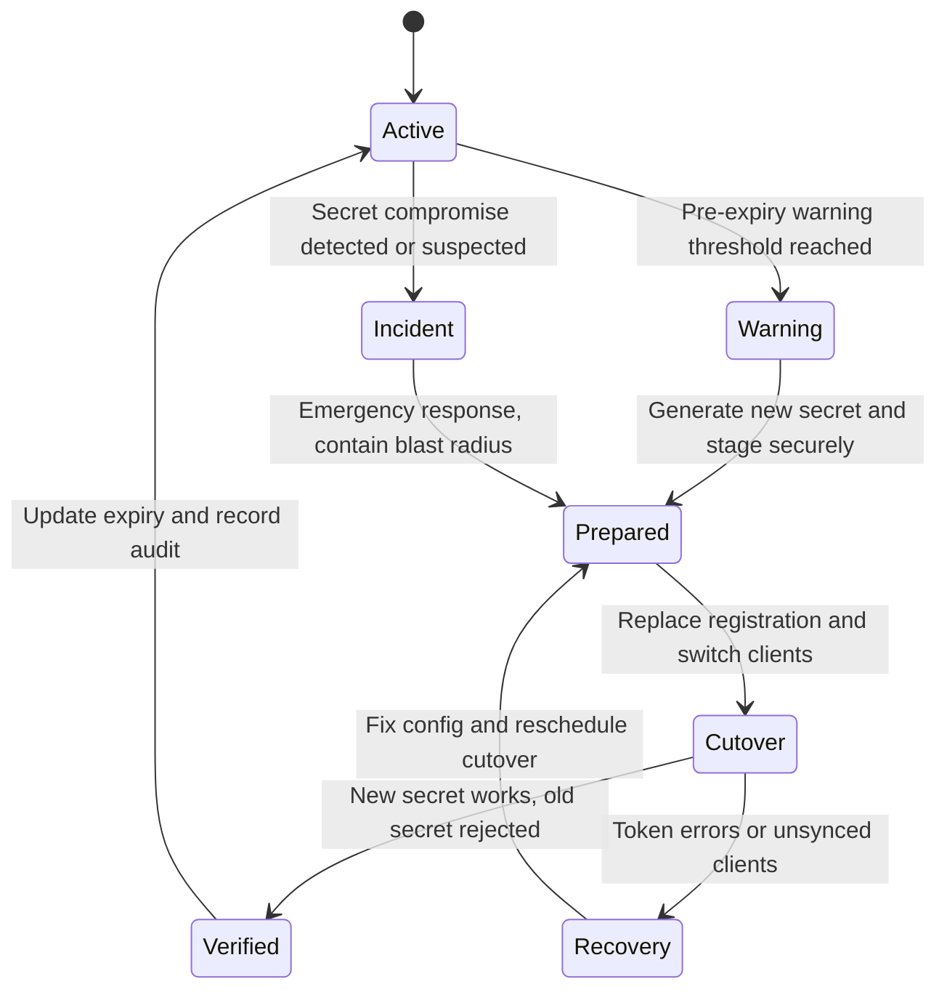

# Managing Client Secret Expiration Dates and Secret Rotation Policies

## 1. Why Does a Client Secret Need a Lifecycle?

In the **Client Management** chapter of the **SPRING_SECURITY_OAUTH2_OIDC_AUTHORIZATION_SERVER** module, an Authorization Server built with **Spring Boot, Spring Security, and Spring Authorization Server** must do more than register a client properly the first time. The system must also govern how **client secrets** are issued, stored, expired, rotated, and revoked throughout the application's operating lifetime.

A **client secret** is a shared credential between the Authorization Server and a **confidential client** capable of safeguarding secrets on the server side, such as a web application backend or a background service. It lets the Authorization Server verify the client's identity on token requests, revocation requests, or introspection requests per configuration.

Suppose the `orders-batch` service is registered for the `client_credentials` grant with a secret valid for 90 days. If an administrator sets the secret once and forgets it, at least two problems arise:

- **Exposure risk grows over time**: secrets can leak into logs, configuration files, backups, CI, or former team members' machines.
- **Risk of service outage**: if the secret has an expiration date without alerts and a replacement plan, token requests will start failing when the secret expires.

A sound policy addresses **both security and operability**: defining ownership, expiration, alerts, how new secrets are generated, cutover timing, verification, incident handling, and audit trails.

### Learning Objectives

After this lesson, you will be able to:

1. Understand the differences between **client secret expiration**, **secret rotation**, **disabling a client**, and **revoking access/refresh tokens**.
2. Configure `RegisteredClient.clientSecret` and `clientSecretExpiresAt` appropriately in Spring Authorization Server.
3. Design expiration policies and rotation schedules based on client risk levels.
4. Perform safe secret replacement with durable repositories and coordinated client rollouts.
5. Recognize the **single client secret per `RegisteredClient`** constraint in the default model and select an appropriate cutover strategy.
6. Test valid, invalid, expired, and rotating secret scenarios, as well as the impact on already-issued tokens.

## 2. Distinguishing Credentials and Expiration Dates

| Concept | Purpose | Who checks it? | Related to rotation? |
| --- | --- | --- | --- |
| **Client secret** | Authenticates a confidential client | Authorization Server | Yes, requires a replacement workflow |
| **`clientSecretExpiresAt`** | Timestamp when the registered secret ceases to be valid | Authorization Server's client authentication component | Yes, marks the secret's deadline; **does not auto-generate a new secret** |
| **Authorization code** | Short-lived code exchanged for tokens in the Authorization Code Flow | Token endpoint | Not a client secret |
| **Access token** | Authorizes Resource Server calls per claims/scopes | Resource Server | Has an independent TTL; changing the secret does not automatically expire JWTs |
| **Refresh token** | Obtains new access tokens when permitted | Token endpoint | Has its own lifecycle/revocation; confidential client refresh requests still require client authentication |
| **JWT signing key** | Signs JWTs or verifies signatures via public keys | Authorization Server / Resource Server | Has its own separate **key rotation** process |
| **User password** | Authenticates the Resource Owner | Login system | Must never be confused with a client secret |

**Example:** if a client secret expires at 10:00, new token requests sending that secret will be rejected. A JWT access token issued at 09:55 with `exp=10:10` **does not automatically lose its valid signature at 10:00 just because the client's secret expired**. An API verifying JWTs locally can still accept that access token until 10:10 if all other validation checks pass and no extra revocation mechanism is active.

For **SPAs and mobile apps**, code distributed to end-user devices cannot keep a client secret confidential. Such clients typically use `ClientAuthenticationMethod.NONE` and Authorization Code + PKCE. **Never implement a client secret policy for a public client by embedding a secret in JavaScript or an APK.**

## 3. What Does the `RegisteredClient` Model Support?

Spring Authorization Server uses `RegisteredClient` to store authentication and authorization settings for each client. The key properties for this lesson:

| Property | Purpose |
| --- | --- |
| `id` | Internal ID used by `RegisteredClientRepository` and associated authorizations |
| `clientId` | Public identifier sent by the client to the Authorization Server |
| `clientSecret` | One-way **hashed/encoded** secret matched by the server during authentication |
| `clientSecretExpiresAt` | `Instant` specifying when the secret expires; may be unset |
| `clientAuthenticationMethods` | How the client proves its identity, e.g., `client_secret_basic`, `client_secret_post`, or `private_key_jwt` |
| `authorizationGrantTypes` | Grants the client is allowed to use, e.g., `authorization_code`, `refresh_token`, `client_credentials` |
| `scopes`, `clientSettings`, `tokenSettings` | Permitted scopes and token policies, independent of secret expiry |

Key APIs:

```java
Instant expiresAt = registeredClient.getClientSecretExpiresAt();
String storedHash = registeredClient.getClientSecret();
String clientId = registeredClient.getClientId();
```

**Note on null values:** `clientSecretExpiresAt == null` means the registration **does not specify an expiration date for the client secret**. It does not mean the secret is safe forever; an organization can still enforce deadlines via operational policy. If the secret has expired, Spring Authorization Server's client-secret authentication mechanism rejects requests using that secret (typically returning the `invalid_client` protocol error).

**An important limitation:** by default, `RegisteredClient` has **one `clientSecret` field and one `clientSecretExpiresAt` field**, not a list of active secret versions. Calling `RegisteredClient.from(existing).clientSecret(newHash)` replaces the secret stored on the registration; the old secret is no longer accepted by the default mechanism even if its prior expiration date had not arrived. Accepting **two secrets simultaneously** requires additional design, covered in the rotation strategies section.

### 3.1. Example: Registering a Confidential Client with an Expiration Date

The Spring Boot configuration snippet below creates an illustrative client `orders-batch`. The password encoder produces the `{id}...` format compatible with standard client secret verification in Spring Security.

```java
import java.time.Duration;
import java.time.Instant;
import java.util.UUID;

import org.springframework.context.annotation.Bean;
import org.springframework.security.crypto.factory.PasswordEncoderFactories;
import org.springframework.security.crypto.password.PasswordEncoder;
import org.springframework.security.oauth2.core.AuthorizationGrantType;
import org.springframework.security.oauth2.core.ClientAuthenticationMethod;
import org.springframework.security.oauth2.server.authorization.client.RegisteredClient;
import org.springframework.security.oauth2.server.authorization.client.RegisteredClientRepository;
import org.springframework.security.oauth2.server.authorization.client.InMemoryRegisteredClientRepository;

@Bean
PasswordEncoder clientSecretPasswordEncoder() {
    return PasswordEncoderFactories.createDelegatingPasswordEncoder();
}

@Bean
RegisteredClientRepository registeredClientRepository(PasswordEncoder encoder) {
    // Only use this value in a lab; in production, provision from a secret manager.
    String demoSecret = "demo-only-change-me";

    RegisteredClient ordersBatch = RegisteredClient.withId(UUID.randomUUID().toString())
            .clientId("orders-batch")
            .clientSecret(encoder.encode(demoSecret))
            .clientSecretExpiresAt(Instant.now().plus(Duration.ofDays(90)))
            .clientAuthenticationMethod(ClientAuthenticationMethod.CLIENT_SECRET_BASIC)
            .authorizationGrantType(AuthorizationGrantType.CLIENT_CREDENTIALS)
            .scope("orders.read")
            .build();

    return new InMemoryRegisteredClientRepository(ordersBatch);
}
```

In real environments, prefer `JdbcRegisteredClientRepository` (or an equivalent durable store) so registrations persist. **Never deploy an in-memory bean that regenerates IDs, hashes, or expiration dates on every startup as a production data source.** The snippet above only demonstrates the fields and how secret expiry is populated.

### 3.2. Why Hash the Secret?

The Authorization Server needs to match the value sent by the client against the stored value. Never store plaintext secrets in databases, config files, or logs. Use a password encoder with proper hashing and verification:

```java
PasswordEncoder encoder = PasswordEncoderFactories.createDelegatingPasswordEncoder();

String stored = encoder.encode("temporary-secret-for-demo-only");
boolean accepted = encoder.matches("temporary-secret-for-demo-only", stored);
// accepted == true
```

With `DelegatingPasswordEncoder`, the stored value typically carries a prefix like `{bcrypt}...` so the verifier knows the algorithm. Avoid writing `.clientSecret("plaintext")` or custom unsalted SHA-256 hashing. **Hashing in the database does not eliminate the need to protect the original secret during provisioning and client configuration**: the raw secret must still travel over trusted channels, live in a secret manager, and be readable only by authorized services.

## 4. Expiration and Rotation Policy: What Must Be Decided?

OAuth 2.0 has no universal rule forcing every client secret to expire after exactly 30, 60, or 90 days. Lifetimes should reflect risk classification, organizational policy, automation maturity, and the blast radius if a client temporarily cannot obtain tokens.

A practical policy should define:

| Policy item | Example rule | Why it is needed |
| --- | --- | --- |
| **Client owner** | Clear owning team and backup contact | Someone accountable for receiving alerts and executing cutover |
| **Maximum lifetime** | 90 days for standard clients; shorter for high-risk clients | Bounds secret age while balancing deployment feasibility |
| **Advance warnings** | 30, 14, 7, 3, and 1 day before expiry | Avoids discovering expiration only after failure |
| **Time source** | Store deadlines in UTC using `Instant` | Prevents timezone mistakes and system clock shifts |
| **Secret generation** | Cryptographic RNG with at least 256 bits of entropy | Prevents guessable or reused secrets |
| **Distribution** | Access-controlled secret manager / CI | Reduces secret leakage via chat, tickets, or source code |
| **Cutover** | Planned cutover with token endpoint verification | Minimizes service disruption |
| **Failure handling** | Rehearsed rollback/recovery plan | Avoids falling back to a leaked secret |
| **Audit** | Who rotated, when, which client, outcome, key/secret version | Investigation and compliance |
| **Emergency rotation** | Immediate upon suspected compromise, off-schedule | Shrinks the window an attacker can use the secret |

An **illustrative** schedule for deadline T:

```text
T - 30 days: send warning, verify owner and consuming applications
T - 14 days: create change plan, identify environments and affected instances
T - 7  days: provision new secret in secret manager, prepare client config
T - 1  day:  verify config reload capability and recovery path
T          : execute monitored cutover, verify with real requests
T + 1 hour : review invalid_client errors, token issuance rates, record audit
```

You do not have to wait until exact day T to rotate. Rotating **ahead of the deadline** is usually better, especially when multiple teams must coordinate. Suspected secret compromise requires an immediate incident process, not this routine schedule.

## 5. Choosing an Appropriate Secret Rotation Strategy

The hardest part is not generating a new secret. You must decide **how the Authorization Server and all client instances transition from the old secret to the new secret**. With a single default `clientSecret` field, updating the registration immediately replaces the active credential.

### 5.1. Three Options and Trade-Offs

| Option | Client ID | Accepts old and new secrets simultaneously? | When to use |
| --- | --- | --- | --- |
| **Direct replacement on `RegisteredClient`** | Kept the same | **No**, under default behavior | Few instances with a coordinated cutover window |
| **Register a second client for gradual migration** | New Client ID | Yes, though technically **two separate clients** | Need parallel rollout and can accept identity/permission changes |
| **Customize client authentication to support multiple secret versions** | Can stay the same | Yes, **if custom-built and properly controlled** | Require zero downtime without changing Client ID; higher design and security cost |

**Never** concatenate a string like `"hash_old,hash_new"` into `RegisteredClient.clientSecret` expecting the framework to test both hashes. It will not act as a managed secret list. If multiple concurrent secrets are required, design a dedicated secret-version store with per-version expiration/revocation policies and a corresponding client authentication mechanism; thoroughly test replay prevention, compromised-secret handling, and unauthorized access.

**Never** register two `RegisteredClient` records with **the same `clientId`** to simulate dual secrets in a standard repository. `clientId` is the lookup key; duplicates cause conflicts or undefined behavior. With the second-client option, use a **genuinely distinct client ID** and re-evaluate scopes, token policies, audience, Resource Server integrations, and consent.

### 5.2. Cutover Workflow for One Secret per RegisteredClient

A minimal workflow with the default repository:

1. **Inventory consumers:** identify client ID, environment, owner, every instance/cron job/integration needing the secret, grant types, and endpoints used.
2. **Generate a new random secret:** generated via CSPRNG; provisioned once into the secret manager with a version ID and least-privilege read permissions. Never commit to Git.
3. **Prepare clients:** deploy the ability to read the new secret or switch secret versions via config without code changes, ensuring rapid config switching. At this step the AS still authenticates the old secret.
4. **Execute cutover:** update the secret hash and expiration date in `RegisteredClient`, then activate the new configuration across clients within a coordinated window. Under the default mechanism, **there is no overlap window** where both secrets work. Requests using the old secret during transition can fail with `invalid_client`.
5. **Verify immediately:** run a valid token request with the new secret and confirm a token is issued; run a negative test with the old secret post-cutover and confirm it is rejected. Check all instances and environments.
6. **Monitor and finalize:** watch error rates, alerts, stale secret caches, update the inventory, write audit logs, and revoke access to the old secret version.

When infrastructure supports strong automation, updating the AS and switching client configs should be coordinated inside a short window with a **recovery plan**. However, zero errors during transition cannot be guaranteed if requests still arrive using the old secret. Under strict availability requirements, consider the parallel options in the table above.



**In the Prepared state**, the new secret is only staged in the vault/client configuration with prepared access controls. **It is not yet active on the Authorization Server** until the registration is updated under the direct-replacement plan.

### 5.3. When Zero-Downtime Transition Is Required

Two common approaches:

**Approach A — Parallel Client ID.** Create `orders-batch-v2` with a new client ID, new secret, and matching grants/scopes; gradually migrate consumers to v2; monitor traffic and later disable/delete the old client per policy. Evaluate the impact of a new client ID on token claims, Resource Servers, audits, allowlists, billing/quotas, and existing authorizations. This is **migrating between two clients**, not rotating within one registration.

**Approach B — Multiple secret versions on the same Client ID.** Build a custom client authentication extension backed by `{clientId, secretVersion, secretHash, notBefore, expiresAt, revoked}` with a matching verification provider, allowing a short overlap window. Once all instances have migrated, disable the old version. This extension requires security review, rate limiting, failed-attempt controls, auditing, independent expirations, and race-condition testing. It does not come out of the box merely by setting `clientSecretExpiresAt`.

If managing shared secrets and cutovers becomes too burdensome, evaluate stronger client authentication methods like `private_key_jwt` or mTLS depending on requirements and support. They still have their **own key/certificate lifecycles** and do not eliminate rotation.

## 6. Hands-On: Generating Secrets, Storing Hashes, and Updating Registrations

The examples below illustrate **internal administrative operations** on the Authorization Server. They assume you already have a durable `RegisteredClientRepository`, proper admin authorization, and a secret manager for client distribution. Never expose public rotation endpoints from these methods without dedicated authentication, authorization, and auditing.

### 6.1. Generating a Sufficiently Random Secret

Java example using 32 random bytes (256 bits), encoded with Base64URL without padding:

```java
import java.security.SecureRandom;
import java.util.Base64;

public final class ClientSecretGenerator {
    private static final SecureRandom RANDOM = new SecureRandom();

    private ClientSecretGenerator() {
    }

    public static String generate() {
        byte[] secretBytes = new byte[32];
        RANDOM.nextBytes(secretBytes);
        return Base64.getUrlEncoder()
                .withoutPadding()
                .encodeToString(secretBytes);
    }
}
```

The returned value is 43 Base64URL characters long. **Strength comes from the 32 random bytes**, not merely character length. Never use `UUID.randomUUID()` or human-chosen strings as a 256-bit secret, and never print the output to console or logs. In production, store the generated secret in a secret manager under a version identifier and grant read access only to the relevant service.

### 6.2. Updating the Exact Existing Registration

The service below describes only **replacing the secret hash and expiration date**. At the call site, the management system must enforce authorization, verify the secret came from a trusted generator, prepare secure distribution, and coordinate cutover:

```java
import java.time.Instant;

import org.springframework.security.crypto.password.PasswordEncoder;
import org.springframework.security.oauth2.server.authorization.client.RegisteredClient;
import org.springframework.security.oauth2.server.authorization.client.RegisteredClientRepository;
import org.springframework.stereotype.Service;
import org.springframework.transaction.annotation.Transactional;

@Service
public class ClientSecretRotationService {
    private final RegisteredClientRepository clients;
    private final PasswordEncoder encoder;

    public ClientSecretRotationService(
            RegisteredClientRepository clients,
            PasswordEncoder encoder) {
        this.clients = clients;
        this.encoder = encoder;
    }

    @Transactional
    public void replaceSecret(
            String clientId,
            String newPlaintextSecret,
            Instant newExpiry) {
        if (newPlaintextSecret == null || newPlaintextSecret.isBlank()) {
            throw new IllegalArgumentException("Secret must not be empty");
        }
        if (newExpiry == null || !newExpiry.isAfter(Instant.now())) {
            throw new IllegalArgumentException("Expiry must be in the future");
        }

        RegisteredClient current = clients.findByClientId(clientId);
        if (current == null) {
            throw new IllegalArgumentException("Unknown client");
        }

        RegisteredClient updated = RegisteredClient.from(current)
                .clientSecret(encoder.encode(newPlaintextSecret))
                .clientSecretExpiresAt(newExpiry)
                .build();

        clients.save(updated);
    }
}
```

**Why use `RegisteredClient.from(current)`?** The builder copies existing client fields such as internal ID, grant types, redirect URIs, scopes, and authentication methods, then replaces only the two secret-related properties. Creating `RegisteredClient.withId(UUID.randomUUID()...)` on each rotation changes the internal ID, which can break links to persisted authorizations.

**Limitations of the snippet:** `@Transactional` alone does not guarantee safe handling of concurrent rotation requests or arbitrary custom repositories. Production systems must prevent two operators from rotating the same client simultaneously (via transaction locks or optimistic locking), write audit records, validate the new secret from the secret manager, and track rollout state. Never pass secrets from unprotected forms, never include secret strings in error messages, and never log the `newPlaintextSecret` parameter.

### 6.3. Post-Cutover Verification

The token endpoint typically authenticates clients via HTTP Basic. Illustrative `client_credentials` request:

```http
POST /oauth2/token HTTP/1.1
Host: auth.example.com
Authorization: Basic BASE64(client_id:client_secret)
Content-Type: application/x-www-form-urlencoded

grant_type=client_credentials&scope=orders.read
```

In practice, the `Authorization` value must be encoded by the client per OAuth 2.0 HTTP Basic rules; the string above is only explanatory notation. Use HTTPS and retrieve client secrets from a secret manager. Never paste requests containing authentication headers into tickets or logs. Post-cutover checks:

| Test | Expectation |
| --- | --- |
| Valid client + **new secret** + allowed grant | Token endpoint issues an access token |
| Valid client + **old secret** after replacement | Token endpoint rejects client authentication, typically `invalid_client` |
| Valid client + new secret + **disallowed grant** | Rejected per client/grant policy |
| Valid client + new secret + scope outside registration | Rejected or narrowed per server policy |
| New secret past `clientSecretExpiresAt` | Token request rejected during client authentication |
| Access token issued **before** secret rotation | Continues to be processed by Resource Server per token lifetime and separate revocation policy |

To test expiration, use a controllable clock or test data with an expiry in the past inside an isolated environment. Never intentionally expire a client serving live production traffic just to test behavior.

## 7. Tracking Expiration Dates and Proactive Alerting

You cannot run rotation reliably by manually opening the database daily to inspect expiring clients. Build an **inventory and alerting workflow** backed by registered client data.

### 7.1. Information to Track

| Inventory field | Source | Meaning |
| --- | --- | --- |
| `clientId`, `id` | `RegisteredClient` | Uniquely identifies the client/registration |
| `clientSecretExpiresAt` | `RegisteredClient` | Actual deadline enforced by the AS |
| Authentication method | `RegisteredClient` | Determines whether the client uses a shared secret |
| Owner/team and backup contact | External governance system | Routes alerts and assigns responders |
| Consuming environment/services | Deployment inventory | Identifies which apps require config updates |
| `lastRotatedAt`, `secretVersion` | Audit table / secret manager | Tracks version and most recent rotation |
| `rotationStatus`, `changeId` | Operations workflow | Tracks which step a rotation change is in |
| `lastVerifiedAt`, `lastVerifiedResult` | Verification system | Proves the new secret authenticated successfully |

**Do not assume** `RegisteredClient` includes fields like `lastRotatedAt` or `ownerTeam`. Store them in a governance system or auxiliary table keyed to the client ID/internal ID. Also **do not assume** the standard `RegisteredClientRepository` interface has `findAll()`: it focuses on `save`, `findById`, and `findByClientId`. To scan all expiring clients, you need a dedicated catalog/governance repository or an appropriate data query.

When using Spring Authorization Server's official JDBC schema, the secret expiration column is typically `client_secret_expires_at` in the registered client table. Before writing administrative SQL queries, verify the actual schema for your framework version and database engine.

### 7.2. Status Classification Based on `Instant`

Pure Java example for an alerting job:

```java
import java.time.Clock;
import java.time.Duration;
import java.time.Instant;

public final class ClientSecretDeadlinePolicy {
    public enum Status {
        NO_DEADLINE, EXPIRED, CRITICAL, WARNING, HEALTHY
    }

    private ClientSecretDeadlinePolicy() {
    }

    public static Status classify(Instant expiresAt, Clock clock) {
        if (expiresAt == null) {
            return Status.NO_DEADLINE;
        }

        Instant now = clock.instant();
        if (!expiresAt.isAfter(now)) {
            return Status.EXPIRED;
        }
        if (!expiresAt.isAfter(now.plus(Duration.ofDays(7)))) {
            return Status.CRITICAL;
        }
        if (!expiresAt.isAfter(now.plus(Duration.ofDays(30)))) {
            return Status.WARNING;
        }
        return Status.HEALTHY;
    }
}
```

A scheduled job fetches shared-secret clients from the inventory, checks deadlines, resolves owners, and dispatches alerts per internal workflow. When a deadline is absent, `NO_DEADLINE` **should not be treated as HEALTHY**: the system should require an approved exception policy or enforce setting an expiration date.

Injecting `Clock` makes boundary testing deterministic without relying on the host wall clock. When evaluating status, compute in UTC and account for clock drift across nodes. **Health classification from metadata does not replace actual secret authentication verification at the token endpoint.**

### 7.3. Operational Metrics and Alerts

At minimum, monitor:

- Counts of clients with expired secrets, expiring within 7/30 days, missing deadlines, and actively rotating.
- Token endpoint `invalid_client` error rates before and after cutover, broken down by environment or client if logging policy permits.
- Last successful authentication timestamp with the new secret per consuming app, to catch infrequently running cron jobs still holding old versions.
- Registration state drift across nodes or caches in a cluster.
- Rotation audit history: actor, outcome, timestamp, change ID, and **secret version reference**—never storing raw secrets.

Example audit event to retain:

```json
{
  "event": "client_secret_rotated",
  "client_id": "orders-batch",
  "actor": "authorized-admin-id",
  "occurred_at": "2026-11-16T08:00:00Z",
  "new_expires_at": "2027-02-14T08:00:00Z",
  "secret_version_reference": "vault-ref-version-42",
  "outcome": "verified"
}
```

This is **illustrative data**, not a default Spring Authorization Server audit format. Never add `secret_value`, Basic authorization headers, token values, or secret hashes to event logs. Protect audit metadata as well under governance rules.

## 8. Incident Handling: Expired or Compromised Secrets

### 8.1. Unexpected Secret Expiration

A common symptom is a client that previously called `/oauth2/token` successfully starting to receive `invalid_client` or HTTP 401 during authentication. However, **`invalid_client` has multiple possible causes**: wrong client ID, wrong secret, invalid client authentication method, missing registration, or an expired secret. Never conclude it is expiration solely from the external response.

Remediation workflow:

1. Check `clientId`, authentication method, `clientSecretExpiresAt`, AS clock, and data synchronization status.
2. Confirm when errors began, how many apps/instances are affected, and whether any valid token-issuance fallback exists.
3. Generate a new secret via a governed workflow, set a new expiry, and coordinate updating both clients and the registration.
4. Test a real token request from the updated environment and monitor `invalid_client` and downstream errors.
5. Record an incident postmortem and fix alerting policies so it does not recur.

**Never make extending deadlines indefinitely a habit** to mask operational failures. If a temporary exception is truly needed, assign an owner, end date, and compensating controls.

### 8.2. Suspected Secret Compromise

If a secret was pushed to public source code, written to insecure logs, exposed on a compromised host, or accessed by unauthorized parties, **emergency rotation** must prioritize blocking the attacker from authenticating further:

1. Scope the incident: which client, which environment, which secret version, exposure source, and possible exploitation window.
2. Generate and distribute a **brand-new secret** over a secure channel; replace the active secret on the AS as rapidly as incident severity demands.
3. Cut off use of the leaked secret: reject the old secret at the AS, and consider disabling/restricting the client if safe cutover is not yet ready under existing security controls.
4. Review authorizations, access tokens, and refresh tokens issued to the potentially affected client; execute revocation or mitigation policies as needed. For offline-verified JWTs, immediate invalidation across all Resource Servers requires a dedicated revocation strategy.
5. Clean up the leak source: fix pipelines, tighten permissions, purge sensitive data from affected systems, and conduct investigation/auditing.
6. Return the client to a controlled state post-incident, assess root cause, and improve tests/processes.

During a suspected compromise, **never roll back to the old suspected-compromised secret** to restore service. Recovery should use another newly generated secret or an approved alternative authentication method.

### 8.3. Replacing a Secret Is Not Token Revocation

Suppose the token endpoint issued a valid JWT access token before the secret was replaced. Updating the secret hash in `RegisteredClient` changes how **the client authenticates on future requests**; it does **not automatically**:

- modify the `exp` claim of already-issued JWTs;
- delete all stored `OAuth2Authorization` records;
- invalidate all existing refresh tokens;
- inform Resource Servers verifying JWTs locally that a token must be rejected immediately.

If a security incident requires invalidating existing tokens, address the **token lifecycle** (revocation, introspection, short lifetimes, denylists, or equivalent mechanisms) independently of secret rotation. For a confidential client's refresh tokens, exchanging them for new tokens still depends on current client authentication and token-to-client binding policies.

## 9. Common Design Mistakes

| Mistake | Consequence | Fix |
| --- | --- | --- |
| Embedding client secrets in SPAs/mobile apps | Secret can be extracted | Use public clients + Authorization Code/PKCE |
| Hardcoding secrets in Git or Docker images | Secret persists long-term in history and artifacts | Use a secret manager, runtime injection, source scanning, and rotate if leaked |
| Storing plaintext `clientSecret` | Database leak directly exposes credentials | Store hashes using a provider-compatible password encoder |
| Leaving `clientSecretExpiresAt` unset while assuming auto-rotation every 90 days | Secret has no configured technical expiry | Set deadlines and governance schedulers |
| Updating only the expiration date without changing the secret value | Old secret remains an accepted credential | Generate and swap in a real new secret per rotation policy |
| Assuming `RegisteredClient` holds two secrets | Cutover breaks while instances still use the old secret | Use synchronized cutover, parallel client IDs, or a custom multi-version verifier |
| Creating a new client ID/registered ID just to rotate a secret | Breaks links to existing data/configs | Use `RegisteredClient.from(current)` to preserve IDs |
| Using `client_secret_post` and logging request bodies | Secret leaks into logs | Prefer `client_secret_basic` over TLS; redact sensitive headers/bodies |
| Testing requests from only one instance | Low-traffic instances keep using the old secret | Verify across the entire fleet and job schedules |
| Equating rotation with token revocation | Old JWTs remain usable | Design separate token revocation/expiry controls |
| Not sharing registrations across nodes | Inconsistent `invalid_client` errors across servers | Use shared storage, manage caches, and monitor synchronization |
| Recording raw secrets/Basic headers in metrics, logs, or tickets | Credentials leak through observability tooling | Log only client ID, outcome, timestamp, and safe version references |

When diagnosing `invalid_client`, the Authorization Server must return the proper protocol error without leaking excessive details to unauthenticated callers. Internal monitoring may classify deeper causes **without storing secrets or confirming valid secrets to unauthorized callers**.

## 10. Test Plan for Secret Expiration and Rotation Policies

Test both **registration state** and **token endpoint behavior**. A helper returning `EXPIRED` does not prove the live Authentication Provider rejects the client; similarly, one successful token request does not prove every cluster instance picked up the new secret.

| ID | Scenario | Expected outcome to verify |
| --- | --- | --- |
| TC-01 | Valid client, valid secret, unexpired deadline | Authentication succeeds; valid grants/scopes are processed |
| TC-02 | Valid client, wrong secret | Rejected with appropriate client authentication error |
| TC-03 | Secret with past deadline | Token request using that secret is rejected |
| TC-04 | Deadline equal to current timestamp | Boundary behavior is consistent with implementation/clock |
| TC-05 | Deadline is `null` | Unexpiring registration behavior is understood; inventory policy still flags/governs exceptions |
| TC-06 | After replacing secret, use new secret | Authenticated via updated registration |
| TC-07 | After replacing secret, use old secret | No longer authenticated under default single-secret model |
| TC-08 | Valid new secret, unregistered grant | Grant rejected; not confused with invalid secret |
| TC-09 | Valid new secret, disallowed scope | Never granted permissions beyond registration |
| TC-10 | Access token issued before rotation | Validated independently by signature, `iss`, `aud`, `exp`, and revocation policy |
| TC-11 | Authorization Code + PKCE client exchanges code after rotation | Token request must use current client credential and valid `code_verifier` |
| TC-12 | Multiple instances using different secret versions | Requests using old secret are detected; cutover process resolves them |
| TC-13 | Two concurrent rotation operations | Neither silently overwrites/loses updates; audit reflects actual result |
| TC-14 | Authorization Server restart and failover | Shared repository retains accurate hash and deadline; caches do not serve stale state |
| TC-15 | Expiry within 30 / 7 days | Inventory alerts at exact thresholds to exact owners |
| TC-16 | Token revocation after an incident | Resource Server responds according to the chosen verification/revocation strategy |

### 10.1. Testing Alerting Logic at Time Boundaries

For `ClientSecretDeadlinePolicy` in Section 7, test with `Clock.fixed` instead of waiting in real time:

```java
import static org.junit.jupiter.api.Assertions.assertEquals;

import java.time.Clock;
import java.time.Duration;
import java.time.Instant;
import java.time.ZoneOffset;
import org.junit.jupiter.api.Test;

class ClientSecretDeadlinePolicyTest {
    private static final Instant NOW =
            Instant.parse("2026-11-16T00:00:00Z");

    private final Clock clock = Clock.fixed(NOW, ZoneOffset.UTC);

    @Test
    void classifiesExpiredAndNearExpiry() {
        assertEquals(ClientSecretDeadlinePolicy.Status.NO_DEADLINE,
                ClientSecretDeadlinePolicy.classify(null, clock));
        assertEquals(ClientSecretDeadlinePolicy.Status.EXPIRED,
                ClientSecretDeadlinePolicy.classify(NOW, clock));
        assertEquals(ClientSecretDeadlinePolicy.Status.CRITICAL,
                ClientSecretDeadlinePolicy.classify(
                        NOW.plus(Duration.ofDays(7)), clock));
        assertEquals(ClientSecretDeadlinePolicy.Status.WARNING,
                ClientSecretDeadlinePolicy.classify(
                        NOW.plus(Duration.ofDays(8)), clock));
        assertEquals(ClientSecretDeadlinePolicy.Status.HEALTHY,
                ClientSecretDeadlinePolicy.classify(
                        NOW.plus(Duration.ofDays(31)), clock));
    }
}
```

This is a unit test for the **alerting policy logic**, not a substitute for Spring Authorization Server integration tests. In integration tests, use dedicated per-scenario clients, test-environment repositories, and HTTP requests passing through the application's actual security filter chain and client authentication provider.

### 10.2. A Meaningful Post-Rotation Verification Sequence

Follow in order:

1. Record the active client secret at T0; a valid token request obtains access token A.
2. Generate new secret B and prepare a client capable of reading B.
3. Update the hash and new expiry in `RegisteredClient`; persist via durable repository.
4. Token request with B **succeeds**; request with A (old secret) **fails**.
5. With access token A issued before cutover, call the protected API and explain the outcome based on TTL/validation rather than expecting secret rotation to invalidate the token immediately.
6. Confirm all consuming applications use B, while recording metrics and audit logs.

Run the sequence above in an isolated test environment. In production, run only approved operational checks without generating out-of-policy traffic or test tokens.

## 11. Real-World Scenarios and Architectural Decisions

### Scenario A — Multiple Backend Instances Sharing One Client ID

An application has 12 instances sharing `clientId=orders-batch`; instances read the secret from a secret manager but refresh configuration caches every 15 minutes. If you replace the registration immediately and expect all instances to switch simultaneously, some instances will keep using the old value and fail with `invalid_client`.

**Approach:** shorten cache windows, support explicit refresh/reload, coordinate synchronized cutover, and monitor token requests per instance. If you cannot tolerate transient failures while part of the fleet uses the old secret, choose parallel client registrations or a well-tested multi-version secret mechanism.

### Scenario B — Client Using Authorization Code + PKCE

A backend web application is a **confidential client** with PKCE `S256` enabled, yet its secret just expired. Users may still pass login and receive an authorization code in some configurations; at token exchange, client authentication with the expired secret is rejected.

**Remember:** PKCE binds the code exchange to the initiator, **but does not replace client authentication** for a registered confidential client. To drop shared secrets, adopt an appropriate client model and authentication method rather than disabling secret checks.

### Scenario C — Client Secret Expired Yet API Still Returns HTTP 200

Metadata shows the client secret is expired while an older JWT access token still succeeds at the API. This is not necessarily a bug: the Resource Server may only validate the access token's signature and TTL. Clarify the business requirement:

- If you only want to **prevent new tokens from being requested with the old secret**, expiry/rotation already accomplishes this.
- If you want to **invalidate all previously granted access** due to a credential compromise, execute token revocation and ensure Resource Servers recognize revocations.

### Scenario D — Rotating JWT Signing Keys and Client Secrets Simultaneously

A team wants to "rotate all secrets" in a single change, including client secrets and the AS's RSA JWT signing key. These two actions have different blast radii: changing a client secret affects client authentication; changing signing keys affects JWT verification, JWKS, `kid` caching, and issued tokens.

**Decision:** plan and test them independently; they may align on a calendar schedule, but root causes must remain isolatable on failure. Old JWT public keys may still need to stay published while existing tokens remain valid, whereas old client secrets may need immediate rejection at cutover or during an incident.

### Scenario E — Secret Compromised, Rolling Back to Old Secret

After an emergency rotation, one service has not yet picked up the new secret. The quickest fix seems to be restoring the old secret so the app works. This is a dangerous decision because the credential is suspected compromised.

**Approach:** keep the old secret rejected; restore the service using another freshly generated, securely delivered credential or an approved alternative auth method. Measure impact and triage by priority instead of re-enabling a potentially leaked secret.

## 12. Operational Checklist and Self-Assessment Questions

### Pre-Production Client Checklist

- [ ] Classify confidential vs. public clients properly; never embed client secrets in SPAs/mobile apps.
- [ ] Use suitable authentication methods, preferring `client_secret_basic` over HTTPS for shared secrets.
- [ ] Generate secrets with a secure random source, sufficient entropy, and zero reuse across environments/clients.
- [ ] `RegisteredClient` stores a **hash**; clients receive plaintext only via a secret manager or secure provisioning.
- [ ] Set `clientSecretExpiresAt` or an approved policy exception, tracked in UTC.
- [ ] Record clear owner, environment, instance list, secret version reference, and rotation schedule.
- [ ] Configure advance expiry warnings, `invalid_client` runbooks, and post-cutover monitoring.
- [ ] Choose the right cutover strategy, recognizing the default single-secret-per-registration limit.
- [ ] Plan synchronized protection and updates across repositories and caches across all nodes.
- [ ] Verify new secret succeeds and old secret fails after cutover.
- [ ] Maintain emergency rotation procedures and impact assessment for issued tokens on compromise.
- [ ] Keep secrets and Authorization headers out of source code, logs, metrics, tickets, and audits.

### Questions and Explanations

**Q1.** Does setting `clientSecretExpiresAt=Instant.now().plus(90 days)` make the Authorization Server auto-generate a new secret after 90 days?  
**Answer:** No. That property defines the deadline; generating, distributing, and replacing the secret must be performed by a rotation workflow.

**Q2.** Can you store two BCrypt hashes concurrently in `RegisteredClient.clientSecret` to accept both old and new secrets?  
**Answer:** Not in the default model. You need a synchronized cutover, two `RegisteredClient` records with **different client IDs**, or a custom versioned client authentication extension.

**Q3.** After rotating a client secret, are older JWT access tokens immediately invalidated?  
**Answer:** Not automatically. Access tokens have their own lifecycle and validation rules on the Resource Server.

**Q4.** Does `invalid_client` always mean the secret expired?  
**Answer:** No. Wrong secret, non-existent client, mismatched authentication method, or expiration can all cause client authentication failures. Inspect internal systems safely.

**Q5.** Why use `RegisteredClient.from(current)` during rotation?  
**Answer:** To preserve the identifier and all active registration policies, updating only the fields that need changing such as secret hash and expiry.

**Q6.** Is a 90-day rotation schedule mandatory under OAuth 2.0?  
**Answer:** No. It is only a policy example. Lifetimes should be determined by risk assessment and operational capability.

### Summary Diagram

```text
RegisteredClient (client ID, hashed secret, expiry)
    |
    +-- client_secret_basic / client_secret_post
    |      -> Authorization Server authenticates client
    |      -> wrong / expired: reject request
    |
    +-- Inventory / deadline scanner
    |      -> alerts at 30 days / 7 days / expired
    |      -> owner schedules rotation
    |
    +-- Rotation workflow
           -> generate new random secret
           -> store and distribute via secret manager
           -> replace hash + expiry in RegisteredClient
           -> migrate consumers to new secret
           -> verify new secret and reject old secret
           -> audit and monitor

Access token / refresh token / JWT signing keys
    -> have separate lifecycles and revocation policies
```

**Key takeaway:** managing `clientSecretExpiresAt` means managing **credential usability for future client authentication attempts**. A secret rotation policy must cover provisioning, storage, distribution, cutover, testing, alerting, and incident response. Understanding `RegisteredClient` limits and the boundary between client authentication and token lifecycles forms the foundation for operating Spring Authorization Server reliably and securely.

## References

- [Spring Authorization Server Reference](https://docs.spring.io/spring-authorization-server/reference/) — `RegisteredClient`, `RegisteredClientRepository`, and client authentication models.
- [Spring Security Password Storage](https://docs.spring.io/spring-security/reference/features/authentication/password-storage.html) — `PasswordEncoder`, `DelegatingPasswordEncoder`, and hashed credential storage.
- [RFC 6749 — OAuth 2.0 Authorization Framework](https://www.rfc-editor.org/rfc/rfc6749) — client authentication, token endpoint, and distinguishing client credentials from access tokens.
- [RFC 7523 — JWT Profile for OAuth 2.0 Client Authentication and Authorization Grants](https://www.rfc-editor.org/rfc/rfc7523) — client authentication using JWT assertions.
- [RFC 8705 — OAuth 2.0 Mutual-TLS Client Authentication and Certificate-Bound Access Tokens](https://www.rfc-editor.org/rfc/rfc8705) — mTLS client authentication and related considerations.
- [RFC 7009 — OAuth 2.0 Token Revocation](https://www.rfc-editor.org/rfc/rfc7009) — token revocation, distinct from client secret replacement.
