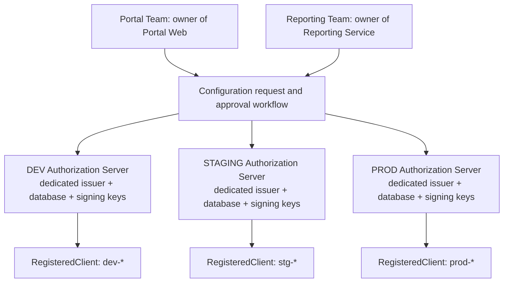
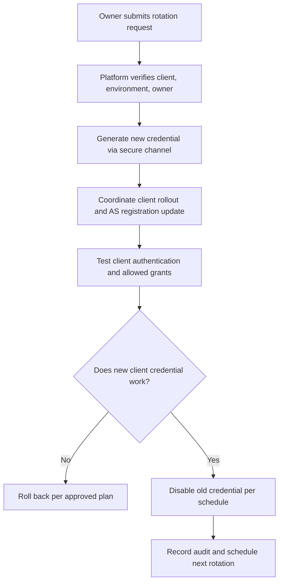

# Separating Client Configurations by Environment and Application Owner

## 1. Context and Objectives

In the **Client Management** chapter of the `SPRING_SECURITY_OAUTH2_OIDC_AUTHORIZATION_SERVER` module, we learn how to manage the applications permitted to use an **OAuth 2.0/OpenID Connect Authorization Server** in a Spring Boot system built with **Spring Security** and **Spring Authorization Server**. A critical decision is **separating client configurations by deployment environment and by the person or team responsible for the application**.

For example, an organization has three applications:

- **Portal Web**: a web app where users sign in via OIDC and call APIs.
- **Reporting Service**: a backend service obtaining Access Tokens via `client_credentials` to read reports.
- **Mobile App**: a native app using Authorization Code + PKCE.

Each application may run in `dev`, `staging`, and `prod`. Sharing a single client configuration across all environments creates risks: a test secret could authenticate against production, a developer workstation redirect URI could slip into live config, or one team could alter another application's scopes without approval.

**Lesson objectives:** you will be able to design a client catalog, define ownership, isolate environments, declare `RegisteredClient` entries, structure storage and change workflows, and test to ensure clients receive only approved grants, scopes, and endpoints. This knowledge serves design, configuration, security, testing, and operations of an Authorization Server.

## 2. Two Distinct Isolation Dimensions

### 2.1. Environment Dimension: `dev`, `staging`, `prod`

| Environment | Purpose | Required configuration characteristics |
| --- | --- | --- |
| **Development** | Feature testing and debugging on developer machines / dev infrastructure | Dedicated clients; controlled local redirect URIs; test data and test keys |
| **Staging/UAT** | Integration testing, release validation, and production-like behavior | Dedicated clients, dedicated secrets/keys, staging URLs, production-like policies |
| **Production** | Serving real users and live data | Approved registrations, official domains, HTTPS, change controls, and monitoring |

A `client_id` is meaningful only within the scope of the **Authorization Server/issuer** where it is registered. If two environments have two separate issuers and two separate datastores, they could technically share the same `client_id` string under the protocol; however, environment-distinct names help operators diagnose issues faster. **Prefixes like `dev-` or `prod-` are governance conventions, not security boundaries.**

Real security boundaries must come from deployment and access control: separate issuers, separate `RegisteredClient` stores, separate secrets/signing keys, environment-scoped access permissions, DNS/TLS setup, and change-approval workflows.

### 2.2. Ownership Dimension: Who Is Accountable for a Client?

An **application owner** is the team or individual authorized to register and maintain a client application. The owner is accountable for:

1. Business purpose, data, and APIs the application needs to access.
2. Required grant types, scopes, redirect URIs, and client authentication methods.
3. Safeguarding, rotating, and revoking client secrets/authentication keys.
4. Impact testing prior to configuration changes, incident response, and emergency contacts.
5. Periodically confirming the client is still active and granted permissions remain minimal.

**Client owner is not the same as Resource Owner.** In OAuth 2.0, the Resource Owner is typically the user or entity owning the protected resources; application owner is an internal governance concept. Spring Authorization Server has `RegisteredClient` to represent protocol settings, but **has no mandatory built-in field named `ownerTeam`**. Ownership metadata is typically tracked in a catalog table, CMDB, or change-request system linked by `client_id` and environment.

### 2.3. Environment × Application Matrix

| Application | Dev | Staging | Production | Owner (example) |
| --- | --- | --- | --- | --- |
| Portal Web | `dev-portal-web` | `stg-portal-web` | `prod-portal-web` | Portal Development Team |
| Reporting Service | `dev-reporting-svc` | `stg-reporting-svc` | `prod-reporting-svc` | Reporting Operations Team |
| Mobile App | `dev-mobile-app` | `stg-mobile-app` | `prod-mobile-app` | Mobile Application Team |

The identifiers above are **examples only**, not mandatory rules of Spring Authorization Server. Each cell corresponds to an independent client registration on that environment's issuer. Having a client approved in dev **does not automatically** permit it to operate in prod.



The diagram illustrates a **governance workflow**. Never build a system that gives application teams direct write access to the production client database merely because they are application owners. Modification privileges must be gated by platform workflows and Authorization Server permissions.

## 3. Properties to Manage for Each Client

A `RegisteredClient` record holds essential protocol and security properties:

| Property | Example | Meaning / risk if misconfigured |
| --- | --- | --- |
| `id` | Internal UUID | Record primary identifier; keep stable when using durable storage |
| `clientId` | `prod-portal-web` | Protocol client identifier; not a secret |
| `clientSecret` or associated public key | Hashed secret or JWK/X.509 depending on method | Authenticates confidential clients; must be protected and scheduled for rotation |
| `clientAuthenticationMethods` | `client_secret_basic`, `private_key_jwt`, `none` | Must match client type and secret-keeping capability |
| `authorizationGrantTypes` | `authorization_code`, `refresh_token`, `client_credentials` | Defines which flows the client may invoke |
| `redirectUris` | `https://portal.example.com/login/oauth2/code/sso` | Restricts callback targets; wrong URIs cause login failures or code leaks |
| `postLogoutRedirectUris` | Return URL after OIDC logout | Used when OIDC logout is enabled per configuration |
| `scopes` | `openid`, `profile`, `orders.read` | Bounds the permissions a client may request |
| `ClientSettings` | `requireProofKey`, `requireAuthorizationConsent` | Controls PKCE, consent, and client-level settings |
| `TokenSettings` | Access/Refresh Token TTLs, rotation policy | Balances security risk and operational UX |

These fields describe **protocol conditions**, not a replacement for business authorization checks inside APIs. For example, a client permitted to request `orders.read` still cannot read every order if the Resource Server enforces resource-owner checks.

Beyond `RegisteredClient`, an organizational **client inventory** should separately track:

| Governance metadata group | Examples |
| --- | --- |
| Identity | `environment`, `issuer`, `client_id`, application name, client type |
| Accountability | Owner team, technical contact, security approver, on-call |
| Purpose | Use case, target APIs, data classification/sensitivity, scope justification |
| Lifecycle | `requested`, `approved`, `active`, `suspended`, `retired` |
| Change control | Request ticket, approver, effective date, version history |
| Oversight | Last permission review date, next scheduled credential rotation, usage status |

Link the inventory to `RegisteredClient` with an appropriate key, such as `(environment, client_id)` or `(issuer, client_id)`. **Never use `client_id` alone** as an organization-wide key if different issuers can reuse the same identifier string.

## 4. Choosing Client Type and Authentication Method Before Splitting Environments

| Application type | Client authentication | Typical grants | How secrets/keys are stored |
| --- | --- | --- | --- |
| Web app with backend/BFF | Confidential client: `client_secret_basic`, `private_key_jwt`, or suitable method | Authorization Code + PKCE; Refresh Token if permitted | Secret/key lives on the backend and in a secret manager |
| Browser-only SPA | Public client: `none` | Authorization Code + PKCE | **Never embed a client secret in JavaScript** |
| Native/mobile app | Public client: `none` | Authorization Code + PKCE | Do not rely on embedded secrets in binaries; use system browser and proper token storage |
| Backend-to-backend | Confidential client | Client Credentials | Secret/key belongs to workload identity or service secret manager |

In `client_credentials`, there is no end-user OIDC login; do not attach `openid` or request ID Tokens by default for this flow. For Authorization Code, register exact `redirect_uri` values, PKCE (prefer `S256`), appropriate scopes, and clear consent policies.

**Never copy policies from dev to prod by simply replacing `dev` with `prod`.** In every environment, re-evaluate redirect URIs, API lists, scopes, authentication methods, and token lifetimes. For example, localhost makes sense only in development or permitted native loopback flows; an arbitrary localhost redirect URI in a production web backend registration is a red flag requiring review.

## 5. Designing Configuration Separation in Spring Boot

Separate **server configuration** (issuer, host, datastores, signing keys) from **client configuration** (grants, secrets, scopes, redirect URIs) and **governance metadata** (owner, approver, ticket).

```text
Spring Boot deployment
├── application.yml                     # Shared defaults, no secrets
├── application-dev.yml                 # Dev issuer, dev demo clients
├── application-staging.yml             # Staging issuer, staging DB/secret references
└── application-prod.yml                # Prod issuer, prod DB/secret references

Client inventory / governance
└── owner, environment, approval, lifecycle, next review

External secret/config store
└── signing keys, client credential hashes, DB credentials
```

The layout above is a **conceptual organization**. In production systems, many settings reside in Kubernetes Secrets/ConfigMaps, Vault, config servers, or databases rather than individual YAML files. **Never commit passwords, raw client secrets, private keys, or sensitive connection strings to Git.**

### 5.1. Development Configuration Example

`application-dev.yml`:

```yaml
app:
  authorization-server:
    issuer: http://localhost:9000
  clients:
    portal:
      client-id: dev-portal-web
      client-secret-hash: ${DEV_PORTAL_SECRET_HASH}
      redirect-uri: http://127.0.0.1:8080/login/oauth2/code/portal
```

This is a **custom `app.*` configuration namespace**, not properties that Spring Boot automatically converts into a `RegisteredClient`. The Java code in the next section reads these properties. `DEV_PORTAL_SECRET_HASH` must be supplied from the environment/secret store; in the `client_secret_basic` example, the stored value should carry an algorithm prefix such as `{bcrypt}...` for `DelegatingPasswordEncoder`. The client holds the **raw secret**, while the Authorization Server stores the **hash** for verification. Never put real hashes in documentation or source control.

`application-staging.yml` and `application-prod.yml` may hold only environment-specific issuer and datasource settings, while the client list is loaded from **each environment's dedicated database**:

```yaml
# application-staging.yml
app:
  authorization-server:
    issuer: https://auth-staging.example.com
```

```yaml
# application-prod.yml
app:
  authorization-server:
    issuer: https://auth.example.com
```

The two files above are abbreviated examples: `DataSource`, secret manager, signing keys, TLS/proxy settings, and operational configs must still be provided by each deployment's configuration.

### 5.2. Binding the Issuer to `AuthorizationServerSettings`

```java
import org.springframework.beans.factory.annotation.Value;
import org.springframework.context.annotation.Bean;
import org.springframework.context.annotation.Configuration;
import org.springframework.security.oauth2.server.authorization.settings.AuthorizationServerSettings;

@Configuration(proxyBeanMethods = false)
class IssuerConfiguration {

    @Bean
    AuthorizationServerSettings authorizationServerSettings(
            @Value("${app.authorization-server.issuer}") String issuer) {
        return AuthorizationServerSettings.builder()
                .issuer(issuer)
                .build();
    }
}
```

`issuer` must reflect the exact URL clients use to validate metadata, ID Tokens, and Access Tokens. Changing `issuer` is more than changing a hostname: it affects trust configuration on clients, Resource Servers, and existing tokens.

**Environment boundaries are more than Spring profiles.** If all profiles point to the same database or share the same signing key, they still share sensitive components. Ensure networks, datastores, access permissions, and secrets are genuinely isolated.

## 6. Example: Creating a Dedicated RegisteredClient for Development

The snippet below illustrates registering a **confidential web client** using Authorization Code + PKCE in the `dev` environment.

```java
import java.time.Duration;
import java.util.UUID;

import org.springframework.beans.factory.annotation.Value;
import org.springframework.context.annotation.Bean;
import org.springframework.context.annotation.Configuration;
import org.springframework.context.annotation.Profile;
import org.springframework.security.oauth2.core.AuthorizationGrantType;
import org.springframework.security.oauth2.core.ClientAuthenticationMethod;
import org.springframework.security.oauth2.core.oidc.OidcScopes;
import org.springframework.security.oauth2.server.authorization.client.InMemoryRegisteredClientRepository;
import org.springframework.security.oauth2.server.authorization.client.RegisteredClient;
import org.springframework.security.oauth2.server.authorization.client.RegisteredClientRepository;
import org.springframework.security.oauth2.server.authorization.settings.ClientSettings;
import org.springframework.security.oauth2.server.authorization.settings.TokenSettings;

@Configuration(proxyBeanMethods = false)
class DevelopmentClientsConfiguration {

    @Bean
    @Profile("dev")
    RegisteredClientRepository developmentRegisteredClients(
            @Value("${app.clients.portal.client-id}") String clientId,
            @Value("${app.clients.portal.client-secret-hash}") String secretHash,
            @Value("${app.clients.portal.redirect-uri}") String redirectUri) {

        if (!secretHash.startsWith("{bcrypt}")) {
            throw new IllegalArgumentException(
                    "Development client secret must be stored as a bcrypt hash");
        }

        RegisteredClient portalClient = RegisteredClient
                .withId(UUID.randomUUID().toString())
                .clientId(clientId)
                .clientName("Portal Web (development)")
                .clientSecret(secretHash)
                .clientAuthenticationMethod(
                        ClientAuthenticationMethod.CLIENT_SECRET_BASIC)
                .authorizationGrantType(AuthorizationGrantType.AUTHORIZATION_CODE)
                .authorizationGrantType(AuthorizationGrantType.REFRESH_TOKEN)
                .redirectUri(redirectUri)
                .scope(OidcScopes.OPENID)
                .scope(OidcScopes.PROFILE)
                .scope("orders.read")
                .clientSettings(ClientSettings.builder()
                        .requireProofKey(true)
                        .requireAuthorizationConsent(true)
                        .build())
                .tokenSettings(TokenSettings.builder()
                        .accessTokenTimeToLive(Duration.ofMinutes(10))
                        .refreshTokenTimeToLive(Duration.ofHours(8))
                        .reuseRefreshTokens(false)
                        .build())
                .build();

        return new InMemoryRegisteredClientRepository(portalClient);
    }
}
```

**Meaning:**

- `@Profile("dev")` activates this bean only when the `dev` profile is active. Other profiles require their own appropriate `RegisteredClientRepository` source.
- `clientId`, hash, and redirect URI are injected from environment configuration rather than hardcoded.
- `requireProofKey(true)` mandates PKCE for the client. `requireAuthorizationConsent(true)` enables consent testing under the demo policy.
- `TokenSettings` expresses TTL and rotation policies **specific to this client**; never apply identical TTLs across all client types when their risk profiles differ.
- `UUID.randomUUID()` and `InMemoryRegisteredClientRepository` fit dev examples that start fresh. In durable stores, `RegisteredClient.id` must be generated **once at registration** and kept stable rather than regenerated on every deploy.

The example assumes the app also configures the Authorization Server `SecurityFilterChain`, signing keys, and user login to complete the OIDC flow. The repository bean **does not enable OIDC on its own**, create the Token Endpoint, or provide an application-wide `PasswordEncoder`.

### 6.1. Why Not Register All Environments in One Repository?

Suppose code creates `dev-portal-web`, `stg-portal-web`, and `prod-portal-web` in one `InMemoryRegisteredClientRepository`, and that JAR is deployed to production. Even though each client has a different prefix, all three are recognized by the same Authorization Server and share secret exposure risk. **Client names alone create zero environment isolation.**

The right approach is to deploy only **the approved client set** for each issuer/security boundary and exclude other environments' secrets from artifacts/configs running in that environment.

## 7. Production and Staging: Durable Repositories and Provisioned Access

Beyond demos, client repositories normally require durable state to support multiple instances, restarts, and change auditing. Spring Authorization Server provides `JdbcRegisteredClientRepository` for SQL databases:

```java
import org.springframework.context.annotation.Bean;
import org.springframework.context.annotation.Configuration;
import org.springframework.context.annotation.Profile;
import org.springframework.jdbc.core.JdbcOperations;
import org.springframework.security.oauth2.server.authorization.client.JdbcRegisteredClientRepository;
import org.springframework.security.oauth2.server.authorization.client.RegisteredClientRepository;

@Configuration(proxyBeanMethods = false)
class PersistentClientsConfiguration {

    @Bean
    @Profile({"staging", "prod"})
    RegisteredClientRepository persistentRegisteredClients(JdbcOperations jdbc) {
        return new JdbcRegisteredClientRepository(jdbc);
    }
}
```

Operational conditions to remember:

1. Each environment uses its own **DataSource/database or schema and credentials** with strict least-privilege permissions. Spring profiles only select beans; they do not create data isolation by themselves.
2. The `oauth2_registered_client` table must be created/migrated using the **schema for your exact Spring Authorization Server version**; the JDBC repository does not automatically verify or create the schema.
3. Clients must be **provisioned** via a governed/migration workflow with stable `id`, issuer-appropriate `client_id`, hashed secret, and approved grant/scope settings.
4. `OAuth2AuthorizationService` and `OAuth2AuthorizationConsentService` also require appropriate durable storage to survive restarts or run across multiple instances; a JDBC client repository alone is not enough.
5. Never run blind seed scripts on every startup that overwrite production redirect URIs, secrets, or permissions. Use versioned migrations, change checks, and rollback plans.

**Example workflow for registering a new client:** owner submits request -> ops/security reviews grants, scopes, redirect URIs, auth method -> provisioning creates `RegisteredClient` in the target environment's database -> secret is delivered over a secure channel to the verified owner -> integration tests -> record audit and next review date.

### 7.1. Should YAML Be Used to Seed Production Clients?

Declarative code-based configs can work for systems with few clients and strict deployment controls, though fit should be evaluated carefully. When client counts grow or multiple teams ship on independent cadences, **a durable repository and role-gated administrative API/workflow** are usually easier to govern. The essentials are:

- A clear **source of truth**: YAML/GitOps or registry/database, avoiding two systems writing simultaneously without a defined winner.
- Changes are validated, approved, logged with history, and reversible.
- Sensitive data never appears in commits, pull requests, public audit logs, or admin API responses.
- Production enforces tighter read/write controls and change procedures separated from dev.

Spring Authorization Server includes extended OIDC/client registration endpoints depending on version and configuration. **Never enable public Dynamic Client Registration just to simplify onboarding**; if used, design authentication, authorization, client-creation policies, and lifecycle governance.

## 8. Managing Application Ownership in Workflows

### 8.1. Responsibility Model

| Role | Suggested rights and responsibilities |
| --- | --- |
| **Application owner** | Proposes clients/scopes/redirect URIs, justifies business need, receives and protects credentials, runs integration tests |
| **Authorization Server/platform owner** | Manages issuer, registry, signing keys, security baseline, endpoint operations, and production changes |
| **API/Resource owner** | Defines scopes/API audiences, approves data access permissions and API policies |
| **Security reviewer** | Reviews risks in redirect URIs, client types, grants, secrets, TTLs, and overly broad scopes |
| **Operations/on-call** | Monitors errors, handles incidents, revokes clients per runbook, and executes rollbacks |

One person or team may wear multiple hats in smaller organizations, yet **production modification rights should be segregated** with recorded approval evidence. Application owners may get self-service read views of their own configurations; sensitive modifications still require policy review and approval.

### 8.2. Client Registration and Change Request Template

Illustrative example (contains no real secrets):

```yaml
request:
  environment: prod
  application: portal-web
  requestedClientId: prod-portal-web
  ownerTeam: team-portal
  technicalContact: team-portal-oncall
  businessPurpose: User login and read own orders
  clientType: confidential-web
  clientAuthenticationMethod: client_secret_basic
  grantTypes:
    - authorization_code
    - refresh_token
  redirectUris:
    - https://portal.example.com/login/oauth2/code/sso
  scopes:
    - openid
    - profile
    - orders.read
  pkceRequired: true
  apiAudience: orders-api
  reviewPeriodDays: 90
  approvalReference: CHANGE-EXAMPLE-001
```

This is a **governance request artifact**, not a `RegisteredClient` config that Spring Boot reads automatically. `apiAudience`, `ownerTeam`, `approvalReference`, and `reviewPeriodDays` are supplementary business metadata that must be handled by a dedicated workflow/database if the system needs them. For audience, design how claims/tokens are minted and verified by the target API; putting a field in a ticket does not automatically restrict token audience.

### 8.3. Approving Least Privilege

When an owner requests `orders.read orders.write`, the API owner must decide whether the client genuinely needs both permissions. A confidential client is not automatically trusted for every API simply because it holds a secret. Evaluate:

- Do the grants match the application type and designed flow?
- Are the scopes the narrowest set needed for the business case?
- Do redirect URIs belong to domains controlled by the owner and match the callback URLs exactly?
- Are staging and production domains separated?
- Are TTL and refresh policies commensurate with data risk?
- Do APIs enforce additional resource-owner/tenant and audience authorization checks?

Restricting scopes on the Authorization Server and validating scopes/audiences on the Resource Server are **complementary layers**. Never trust a client-submitted `ownerTeam` string as authorization proof; ownership metadata must come from a trusted registry.

## 9. Protecting Client Secrets and Rotating Credentials

### 9.1. Distinguishing Client Secrets from Token Signing Keys

- **Client secret / private key for client authentication:** lets the Authorization Server verify the application calling the Token Endpoint. Confidential clients must keep these credentials in their backend or secret manager.
- **Authorization Server signing key:** signs tokens (especially JWTs/ID Tokens); the public key is published via JWKS when configured. It is an asset of the **issuer**, not of individual clients.
- **Access Tokens / Refresh Tokens:** outputs of the protocol that must be protected per their own lifecycles; never use them as client registration secrets.

Rotating a client secret **does not mean** changing the Authorization Server's signing key. Conversely, rotating signing keys does not automatically change every `client_secret`.

### 9.2. Client Secret Rotation Workflow



A standard `RegisteredClient` has a single `clientSecret` field; **do not assume Spring Authorization Server accepts two secrets simultaneously for the same client by default** during transition. If zero-downtime rotation is required, design an intentional plan: coordinate client and AS updates, register a new client ID for gradual cutover, or build an audited multi-version client authentication mechanism. Check impacts on stored authorizations, refresh tokens, and un-upgraded client instances.

Specifically:

- Deliver the raw secret **once** over a secure distribution channel; store the **hash** on the AS when using password-encoder-backed secret authentication. The hash never replaces the raw secret the client uses to authenticate.
- When troubleshooting `invalid_client`, inspect configuration without putting secrets in tickets, logs, screenshots, or traces.
- If a secret is suspected compromised, prioritize disabling/replacing the credential and investigating anomalous token issuance; authorizations and refresh tokens may need revocation depending on blast radius.
- Rotation must include **verifying the old credential no longer works**, not just verifying the new credential works.
- For confidential clients capable of `private_key_jwt` or mTLS, consider proper key/certificate management to reduce reliance on static secrets; weigh operational complexity before migrating.

## 10. Varying Redirect URIs, Scopes, and Grants Across Environments

### 10.1. Redirect URIs Are a Boundary Against Misdirected Redirects

Each environment has its own hosts and callbacks:

```text
dev:     http://127.0.0.1:8080/login/oauth2/code/portal
staging: https://portal-staging.example.com/login/oauth2/code/sso
prod:    https://portal.example.com/login/oauth2/code/sso
```

These illustrate distinct addresses; use HTTPS for public endpoints. At the Authorization Endpoint, the AS must match `redirect_uri` against the registered allowlist under supported protocol rules and configuration. Never use wildcards like `https://*.example.com/*` or caller-controlled URLs as a shared registration across all environments.

**Never add dev URIs to a production client** just to debug an issue quickly. To reproduce a production bug, use a protected staging environment with test data and appropriate access controls.

### 10.2. Scopes and Grants Must Be Reviewed Separately

A `dev-reporting-svc` client might need `reports.read` for testing, yet must not automatically receive `reports.delete` in production. Adding scopes requires identifying the API owner, business justification, and impact on Resource Servers.

Changing `authorizationGrantTypes` is equally sensitive: adding `client_credentials` to a client originally restricted to Authorization Code opens a non-interactive token path without user involvement and requires separate review.

### 10.3. TokenSettings and Consent Must Not Be Copied Unconditionally

Token lifetimes, `requireProofKey`, `requireAuthorizationConsent`, refresh policies, and OIDC permissions belong to client configuration. Dev may relax conveniences for testing, whereas production needs a hardened baseline. `reuseRefreshTokens(false)` issues a new refresh token upon refresh, **but does not automatically guarantee stolen-token reuse detection** unless tracking and token-family revocation are properly designed.

## 11. Deployment Workflow and Detecting Configuration Drift

A configuration change workflow can follow these steps:

1. **Request:** the application owner submits a ticket detailing use case, environment, scopes, grants, URIs, client type, and contacts.
2. **Review:** platform/security/API owners verify permissions, environment, domains, authentication method, and token policy.
3. **Provision:** provisioning creates/updates `RegisteredClient` in the right repository and issuer; delivers credentials via the appropriate channel.
4. **Test:** exercise allowed flows, test rejected requests, metadata/issuer, redirect URIs, and API checks.
5. **Publish:** update inventory/audit records and notify the owner of changes and the next review deadline.
6. **Monitor:** watch `invalid_client`, `invalid_grant`, token issuance, inactive clients, and per-environment anomalies.
7. **Retire:** disable the client, revoke credentials/tokens as scoped, update dependent apps, and archive retirement records.

### 11.1. Detecting Configuration Drift Between Staging and Production

Do not expect two environments to have **identical literal values**; issuers, redirect URIs, credentials, and data must differ. Instead, compare a structured set of criteria:

| Comparison criterion | Expectation |
| --- | --- |
| Grant types | Intentional, approved separately per environment |
| Client authentication method | Fits client type, never casually relaxed in prod |
| PKCE | Enforced for Authorization Code per policy |
| Scopes | Prod contains only approved business scopes |
| Redirect URIs | Exact domain and callback for each environment |
| Token TTL/refresh | Within environment baseline and use case |
| Issuer, signing keys, repository | **Distinct per environment**, never accidentally shared |
| Owner and approval | Present and active in the trusted inventory |

Build a read-only check job that pulls active configurations from the registry and diffs them against policy. Never include raw secrets or private keys in diff reports. When drift occurs, distinguish approved changes from out-of-band manual edits.

## 12. Testing Environment Isolation and Ownership

### 12.1. Testing Configuration and Beans

Using the `@Profile("dev")` example from Section 6, an illustrative integration test:

```java
import static org.assertj.core.api.Assertions.assertThat;

import org.junit.jupiter.api.Test;
import org.springframework.beans.factory.annotation.Autowired;
import org.springframework.boot.test.context.SpringBootTest;
import org.springframework.security.oauth2.server.authorization.client.RegisteredClientRepository;
import org.springframework.test.context.ActiveProfiles;

@SpringBootTest(properties = {
        "app.clients.portal.client-id=dev-portal-web",
        "app.clients.portal.client-secret-hash={bcrypt}TEST_HASH_FROM_TEST_SECRET",
        "app.clients.portal.redirect-uri=http://127.0.0.1:8080/login/oauth2/code/portal"
})
@ActiveProfiles("dev")
class DevelopmentClientIsolationTest {

    @Autowired
    RegisteredClientRepository repository;

    @Test
    void developmentRepositoryHasOnlyDevelopmentPortalClient() {
        assertThat(repository.findByClientId("dev-portal-web")).isNotNull();
        assertThat(repository.findByClientId("prod-portal-web")).isNull();
    }
}
```

`TEST_HASH_FROM_TEST_SECRET` is a **non-functional placeholder**. In real tests, generate a valid BCrypt hash for a test-only secret (never a production secret) and supply any other beans required by the `ApplicationContext`. The test above proves the **example in-memory repository** does not contain production IDs; in a real system, also verify databases, issuers, and network access controls to confirm isolation.

### 12.2. OAuth2/OIDC Test Matrix

| Test case | Expected result |
| --- | --- |
| Dev client calls production AS using dev credentials | Not authenticated / no token issued |
| Production client calls right AS with a dev redirect URI | Authorization request rejected per protocol |
| Public client tries `client_secret_basic` despite `none` registration | Not accepted as a confidential client |
| `authorization_code` client requests unregistered `client_credentials` | `unauthorized_client` or appropriate protocol rejection |
| Client requests unapproved scope | Rejected or never granted excess scope |
| Team A owner tries modifying Team B's client via admin API | Rejected by authorization / approval workflow |
| Retired client continues requesting tokens | Rejected per policy; also verify issued tokens and revocation |
| Multi-node staging and prod restarts | Each environment's client registry, signing keys, and authorization state remain internally consistent without cross-contamination |

In protocol tests, use HTTP/MockMvc with real grants rather than merely asserting beans exist. In governance API tests, mock **authenticated** requests and test owner/role authorization instead of trusting a caller-supplied `ownerTeam` field.

### 12.3. Token Endpoint Request Example

For confidential client `prod-reporting-svc` registered with `client_credentials`, an operator can test against the corresponding test environment:

```bash
curl -i -X POST https://auth-staging.example.com/oauth2/token \
  -u 'stg-reporting-svc:<staging-client-secret>' \
  -H 'Content-Type: application/x-www-form-urlencoded' \
  --data-urlencode 'grant_type=client_credentials' \
  --data-urlencode 'scope=reports.read'
```

Never send real secrets via chat, tickets, shared terminals, or CI logs. The request above **succeeds only if** the client is properly registered in staging, active, and permitted to use this grant/scope. To verify isolation, use dedicated test fixtures with dev credentials rather than probing production with live secrets.

## 13. Real-World Scenarios and How to Handle Them

### Scenario A: One Client ID Shared Across Dev, Staging, and Prod

**Symptom:** changing a redirect URI in dev breaks prod logins; all environments share one secret.

**Root cause:** the system treats environment as a mere label while sharing the same repository/issuer/secret or running overwriting seed scripts.

**Resolution:** create distinct registrations and credentials per issuer, migrate each application to its new client on schedule, verify issuer/redirects at callbacks, and block dev changes from touching the production store. Review active refresh tokens and sessions during migration.

### Scenario B: Owner Requests Adding `https://localhost/*` to Production Redirect URIs

**Problem:** creates an overly broad redirect surface and breaks environment boundaries.

**Resolution:** require exact callbacks for production apps; reproduce issues in dev/staging using appropriate domains and test data. Native apps using loopback URIs must follow the native-application profile and redirect URI rules, never extending that exception to web clients.

### Scenario C: Secret Rotation Triggers Widespread `invalid_client` Errors

**Likely causes:** the client switched secrets before the AS updated the hash, or some client replicas still hold the old credential. By default `RegisteredClient` holds one client secret, so there is no automatic overlap window.

**Resolution:** inspect audit timestamps of the swap, secret versions per workload, and Token Endpoint auth results; execute rollback or cutover per approved plan, then retire the old credential. Never log raw secrets for comparison.

### Scenario D: Two Teams Both Claim Ownership of the Same Client

**Problem:** no authoritative owner; change authority over grants/scopes is ambiguous.

**Resolution:** designate one primary owner and approved technical team, update the inventory and workflow, and require all change requests to reference `(issuer, client_id)`. If two independent applications are actually sharing one client, prioritize splitting them into separate registrations to bound permissions and monitoring.

### Scenario E: Client Disabled Yet Old JWT Access Tokens Still Call APIs

**Explanation:** disabling a registration or revoking Refresh Tokens **does not automatically invalidate already-issued JWT Access Tokens immediately** if the Resource Server checks only signatures and expirations. Near-real-time revocation requires short TTLs, state/denylist checks, or opaque tokens with introspection.

**Resolution:** incorporate revocation requirements into architecture before incidents happen; distinguish `disable client`, `revoke refresh token`, and `invalidate existing access tokens`.

## 14. Checklist and Self-Assessment Questions

**Checklist before activating a production client:**

1. Primary owner, technical contact, and approved request exist in the inventory.
2. Unique `client_id` within the issuer, with production registration isolated from dev/staging.
3. Exact client type, client authentication method, and minimal required grants.
4. Redirect/logout URIs belong to valid domains; no wildcards or unneeded dev callbacks.
5. Scopes/audiences approved by API owners; Resource Server still checks resource-level permissions.
6. PKCE/consent/token TTL/refresh policies tailored to client type and risk.
7. Credentials and signing keys protected with rotation and revocation plans; absent from Git and logs.
8. Provisioning/audits run against the exact environment database with recovery and rollback plans.
9. Tested both happy paths and denial paths, especially cross-environment client/credential misuse.
10. Next permission review date scheduled, with unused-client monitoring and an offboarding process.

**Review questions:**

1. Why does naming a client `prod-*` fail to establish a security boundary between environments?
2. How does `RegisteredClient.clientId` differ from `RegisteredClient.id` when using JDBC?
3. Why are application owner and OAuth 2.0 Resource Owner two different concepts?
4. If a client changes owning teams, which metadata should be updated, and must `client_id` change?
5. When rotating a client's secret, why must you check instances that have not yet deployed the update?
6. Can dev and prod share the same JWT signing key? Why is separating issuers/keys critical?
7. Does disabling a client registration immediately invalidate previously issued JWT Access Tokens?
8. When using `JdbcRegisteredClientRepository`, which step ensures the tables and client records are created properly?

## 15. References

- [Spring Authorization Server — Core Model / RegisteredClient](https://docs.spring.io/spring-authorization-server/reference/core-model-components.html)
- [Spring Authorization Server — Configuration Model](https://docs.spring.io/spring-authorization-server/reference/configuration-model.html)
- [Spring Authorization Server — Protocol Endpoints](https://docs.spring.io/spring-authorization-server/reference/protocol-endpoints.html)
- [Spring Security — OAuth 2.0 Client Registration](https://docs.spring.io/spring-security/reference/servlet/oauth2/client/core.html)
- [Spring Boot — Externalized Configuration](https://docs.spring.io/spring-boot/reference/features/external-config.html)
- [RFC 6749 — OAuth 2.0 Authorization Framework](https://www.rfc-editor.org/rfc/rfc6749)
- [RFC 8252 — OAuth 2.0 for Native Apps](https://www.rfc-editor.org/rfc/rfc8252)
- [RFC 7636 — Proof Key for Code Exchange (PKCE)](https://www.rfc-editor.org/rfc/rfc7636)
- [OAuth 2.0 Security Best Current Practice — RFC 9700](https://www.rfc-editor.org/rfc/rfc9700)

**Key takeaway:** every client is a security contract between **a specific application** and **a specific Authorization Server/issuer**. Isolate dev, staging, and production with real infrastructure, credentials, and datastores while recording owners, permissions, and lifecycles. Doing so lets engineering teams modify, test, and operate OAuth2/OIDC clients in Spring Authorization Server without inadvertently expanding privileges or impacting other environments.
