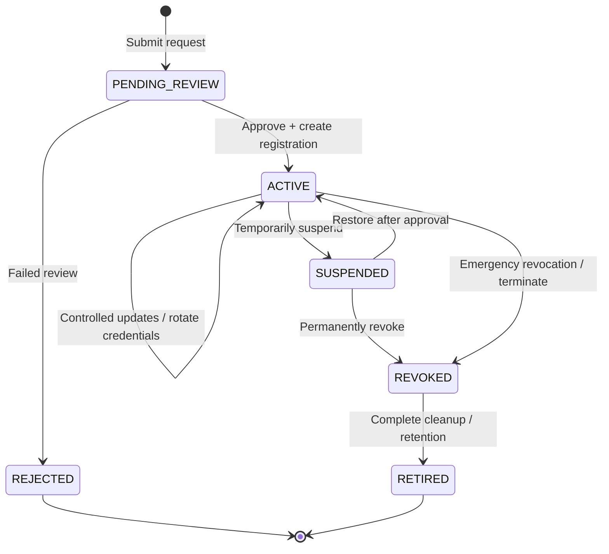
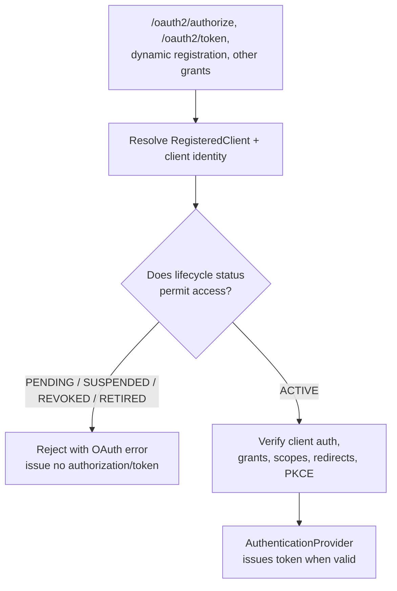
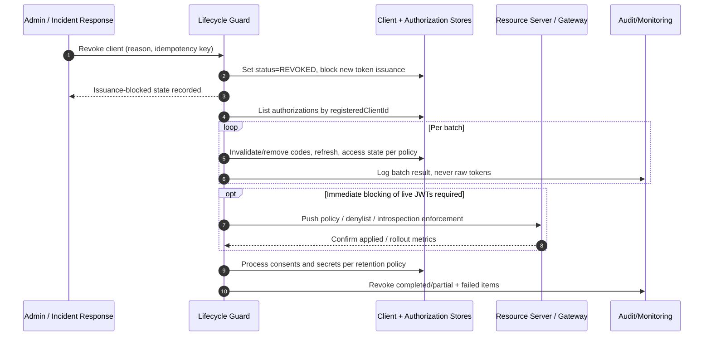

# Designing Client Provisioning, Update, Disabling, and Revocation Workflows

## 1. Context and Objectives

An **OAuth 2.0/OpenID Connect (OIDC) Authorization Server** must do more than issue tokens per protocol—it must also manage the applications authorized to request tokens across their entire lifecycle: from registration requests, issuing `client_id`, configuring permissions and credentials, updating metadata, rotating keys/secrets, temporarily suspending access, and revoking sessions/tokens to decommissioning services. This is a vital part of **designing, configuring, securing, testing, and operating a Spring Security OAuth2/OIDC Authorization Server using Spring Security and Spring Authorization Server in Spring Boot**.

In the **Client Management** chapter, this lesson proposes a practical, implementable workflow across four operation groups:

1. **Provisioning**: approving, creating a `RegisteredClient`, and securely handing over connection details.
2. **Updating**: changing redirect URIs, scopes, grants, client authentication, token policies, or ownership through a controlled workflow.
3. **Disabling**: preventing a client from using the Authorization Server, typically as a temporary measure during incidents or policy violations.
4. **Revoking / decommissioning**: revoking relevant credentials/permissions/tokens/consents, terminating the client, and handling retained data.

**Two concepts must be kept distinct:** *disabling a client* is an administrative decision governing an **application's** protocol participation; *revoking a token* is an operation that invalidates **an issued credential**. Performing one does not automatically complete the other.

### Learning Outcomes

After this lesson, you will be able to:

- Design a client management state machine, approval roles, auditing, and idempotency.
- Distinguish core `RegisteredClient` data from **application-supplied business lifecycle state**.
- Accurately describe the behavior of updating registrations via `RegisteredClientRepository.save(...)` and the limits of that interface.
- Design secret/key rotation workflows, least-privilege permission policies, and safe disabling flows.
- Test scope changes, disabled clients with still-valid JWTs, unexpired refresh tokens, and concurrent requests across multiple nodes.

**API scope:** Java examples follow the **Spring Authorization Server 1.5.x / Spring Boot 3.x / Spring Security 6.x** model unless noted otherwise. For Spring Security 7.x or other framework versions, verify the corresponding Javadoc and configuration requirements before use.

## 2. Roles and Data Categories in Client Management

### 2.1. An OAuth Client Is Not a User

A client is software requesting tokens from the Authorization Server—such as an SPA, web backend, mobile app, or batch job. **Client authentication** proves the *application's* identity via its registered mechanism; **user authentication** verifies human users; **resource authorization** decides data access permissions at the API.

| Component | What does it hold? | Responsibility |
| --- | --- | --- |
| `RegisteredClient` | Internal `id`, `clientId`, secret/key metadata, grants, redirect URIs, scopes, `ClientSettings`, and `TokenSettings` | Client configuration and capability bounds |
| `RegisteredClientRepository` | `save`, `findById`, `findByClientId` | Storing and looking up client registrations |
| **Client lifecycle registry** (custom-built) | Status PENDING/ACTIVE/SUSPENDED/REVOKED/RETIRED, owner, reason, version, approval, audit references | Governance decisions, change tracking, blocking disabled clients |
| `OAuth2AuthorizationService` | Authorization codes, access/refresh tokens, grant state | Finding and updating issued authorizations/tokens |
| `OAuth2AuthorizationConsentService` | Consents keyed by internal client ID and principal | Managing recorded user consents |
| `OAuth2TokenGenerator<?>` | Tokens per `OAuth2TokenContext` | Generating new tokens; does not decide client disabling |
| Resource Server | Validates access tokens, audience, scopes, and access policies | Protecting APIs and enforcing token validity constraints |

**Limits of Spring Authorization Server:** `RegisteredClient` has no built-in standard `enabled` or `status` field for locking an application account; `RegisteredClientRepository` declares only three methods: `save`, `findById`, and `findByClientId`. It has **no** standard `disableClient`, `deleteClient`, `listClients`, or `revokeAllTokensForClient` APIs. Therefore, self-service administration, lifecycle state, and bulk revocation must be built at the application and persistence layers.

### 2.2. Proposed Data Model

For a system with many partners or application teams, keep business governance data separate from `RegisteredClient`:

```text
client_registration (Spring Authorization Server)
  id                 -- RegisteredClient.id, stable
  client_id          -- OAuth2 client_id, unique
  client_secret      -- hashed/encoded secret, if applicable
  client_authentication_methods
  authorization_grant_types
  redirect_uris
  scopes
  client_settings
  token_settings

client_lifecycle (application-built table, example)
  registered_client_id    -- foreign key to Registration.id
  owner_id / owner_team
  tenant_id
  status                  -- PENDING_REVIEW, ACTIVE, SUSPENDED, REVOKED, RETIRED
  status_reason
  status_changed_at
  approved_by / approved_at
  version                 -- optimistic locking
  created_by / created_at / updated_by / updated_at
  data_retention_until

client_change_request (example)
  request_id / idempotency_key
  registered_client_id
  change_type
  before_snapshot_hash / after_snapshot_hash
  requested_by / approved_by
  reason / ticket / status / timestamps

client_audit_event (append-only or equivalent audit store)
  event_id, actor, action, target_client_id,
  correlation_id, timestamp, outcome, sanitized_diff
```

This is a **conceptual schema**, not a standard schema auto-created by Spring Authorization Server. Fields like `status`, `owner_id`, or `version` must be stored and enforced by your application code; merely adding database columns does not make Spring Security inspect them automatically.

**Keep `RegisteredClient.id` stable** when editing metadata. Consents and authorizations reference this internal ID; generating a new ID on each deploy or update breaks links to existing records.

## 3. State Machine for the Entire Lifecycle

### 3.1. Business States

| State | Meaning | Allowed to request new tokens? | Valid transitions |
| --- | --- | --- | --- |
| `PENDING_REVIEW` | Submission received but not yet approved or credentialed. | No | `ACTIVE` if approved; rejected if checks fail |
| `ACTIVE` | Registration approved, compliant with policy, permitted to participate in protocol flows. | Yes, **if** grant/client/user are valid | `SUSPENDED`, `REVOKED` |
| `SUSPENDED` | Temporarily paused due to incident, overdue review, or operational request. | No; must be enforced across relevant handlers | `ACTIVE` after review or `REVOKED` |
| `REVOKED` | Intentionally terminated client/credential privileges; processing related tokens. | No | `RETIRED` after cleanup |
| `RETIRED` | Decommissioned and lifecycle/retention processing completed per policy. | No | Typically not reactivated; create a new client if needed |

For rejected onboarding requests, you can use a dedicated `REJECTED` state in the provisioning workflow. OAuth/OIDC specifications **do not define** this lifecycle table; it is an **internal design convention** that must be understood and enforced consistently across the entire system.



### 3.2. Invariants to Uphold

- **Default deny:** unapproved, suspended, revoked, or retired clients must not execute new token-issuance flows.
- **Separation of requester and approver:** high-risk changes—such as widening scopes, adding redirects to new domains, enabling `client_credentials`, or switching to weaker/stronger auth methods—require appropriate approval.
- **Auditable operations:** record actor, reason, timestamp, changed values (with secrets/tokens stripped), request ID, and outcome.
- **Never reuse a revoked `client_id`** for a different application, as doing so confuses subjects, logs, and old token/consent privileges.
- **Concurrency-safe updates:** simultaneous requests from two admins must never silently overwrite each other's changes.
- **Decouple stopping token issuance from data cleanup:** writing `SUSPENDED` must block new grants immediately; cleaning up authorizations/tokens can run as a tracked independent workflow.

## 4. New Client Provisioning Workflow

### 4.1. Intake and Request Verification

Before creating a `RegisteredClient`, collect complete design details:

| Group | Example information required | How to verify |
| --- | --- | --- |
| Ownership | Operating team, technical contact, tenant, integration purpose | Authorized owner with clear accountability and support path |
| Client type | Public SPA/mobile vs. confidential backend/BFF | Can it genuinely safeguard credentials? |
| Grant types | `authorization_code`, `client_credentials`, `refresh_token` if permitted | Grant only necessary flows; user-facing code flows should enforce PKCE |
| Redirect URIs | Exact URIs per environment | Verified domain ownership, HTTPS; no wildcards/open redirects |
| Scopes / audience | `orders.read`, `orders.write`, target resources | Least privilege, approved by resource/API owners |
| Client authentication | `none`, `client_secret_basic`, `private_key_jwt`, mTLS | Matches secret/key storage boundaries and policy |
| Token policy | Access-token TTL, refresh-token policy, JWT/opaque format | Matches sensitivity, revocation SLA, and Resource Server capabilities |
| Operations | Environment, contract expiry, rotation requirements, contacts | Monitoring, review deadlines, and incident support configured |

**Avoid misclassifying public clients:** browser JavaScript, mobile apps, or desktop apps distributed to end-user devices cannot reliably protect a static shared client secret. Use `ClientAuthenticationMethod.NONE` and Authorization Code + PKCE in the appropriate flow. Never "hide" secrets in frontend bundles or mobile binaries.

### 4.2. Approval and Provisioning Flow

```mermaid
sequenceDiagram
    autonumber
    participant Owner as Application Owner
    participant Admin as Client Management API
    participant Policy as Policy + Approver
    participant Store as RegisteredClientRepository
    participant Registry as Lifecycle/Audit Store
    Owner->>Admin: Submit request + owner, grants, URIs, scopes
    Admin->>Policy: Validate + assess risk
    Policy-->>Admin: Approve / reject
    alt Approved
        Admin->>Registry: Record request, version, approval
        Admin->>Store: save(new RegisteredClient)
        Admin->>Registry: ACTIVE + audit event
        Admin-->>Owner: client_id, metadata, secure secret retrieval instructions
    else Rejected
        Admin->>Registry: REJECTED + reason
        Admin-->>Owner: Status/reason with sensitive details stripped
    end
```



Operational steps:

1. Record a `request_id`/idempotency key to prevent duplicates on client retries.
2. Validate requester authority, redirect URI ownership, scopes, grants, and required fields.
3. Generate an immutable internal **`RegisteredClient.id`** and unique **`clientId`**; never use `client_id` as a secret.
4. For confidential clients, generate a secret via CSPRNG/secret manager or register a public key; store the **encoded secret** when using shared secrets. Deliver the plaintext secret via a secure one-time channel per workflow, never into audit logs.
5. Persist registration and lifecycle state consistently; activate only once essential data is ready. Across separate stores, use an intermediate state and retryable completion/rollback logic.
6. Run smoke tests, write audit logs, and hand over issuer/discovery, endpoints, scopes, redirect URIs, token policies, and contacts.

### 4.3. Java: Registering a Client via `RegisteredClientRepository`

The example below illustrates only **persisting an already-approved client** in Spring Authorization Server 1.5.x. Approval workflows, admin authorization, idempotency, and lifecycle state must live in separate services:

```java
import java.time.Duration;
import java.time.Instant;
import java.util.UUID;

import org.springframework.security.crypto.password.PasswordEncoder;
import org.springframework.security.oauth2.core.AuthorizationGrantType;
import org.springframework.security.oauth2.core.ClientAuthenticationMethod;
import org.springframework.security.oauth2.core.oidc.OidcScopes;
import org.springframework.security.oauth2.server.authorization.client.RegisteredClient;
import org.springframework.security.oauth2.server.authorization.client.RegisteredClientRepository;
import org.springframework.security.oauth2.server.authorization.settings.ClientSettings;
import org.springframework.security.oauth2.server.authorization.settings.TokenSettings;

public class ClientRegistrationWriter {

    private final RegisteredClientRepository repository;
    private final PasswordEncoder passwordEncoder;

    public ClientRegistrationWriter(RegisteredClientRepository repository,
                                    PasswordEncoder passwordEncoder) {
        this.repository = repository;
        this.passwordEncoder = passwordEncoder;
    }

    // Call only after authorization and policy approval in the admin layer.
    public RegisteredClient registerApprovedBff(
            String clientId, String plainSecret, String redirectUri) {

        if (repository.findByClientId(clientId) != null) {
            throw new IllegalArgumentException("client_id already exists");
        }

        RegisteredClient client = RegisteredClient.withId(UUID.randomUUID().toString())
                .clientId(clientId)
                .clientIdIssuedAt(Instant.now())
                .clientSecret(passwordEncoder.encode(plainSecret))
                .clientAuthenticationMethod(
                        ClientAuthenticationMethod.CLIENT_SECRET_BASIC)
                .authorizationGrantType(AuthorizationGrantType.AUTHORIZATION_CODE)
                .authorizationGrantType(AuthorizationGrantType.REFRESH_TOKEN)
                .redirectUri(redirectUri)
                .scope(OidcScopes.OPENID)
                .scope(OidcScopes.PROFILE)
                .scope("orders.read")
                .clientSettings(ClientSettings.builder()
                        .requireProofKey(true)
                        .requireAuthorizationConsent(true)
                        .build())
                .tokenSettings(TokenSettings.builder()
                        .accessTokenTimeToLive(Duration.ofMinutes(10))
                        .build())
                .build();

        repository.save(client);
        return client;
    }
}
```

**Limitations of the example:** `plainSecret` is assumed to come from a high-entropy generator over a controlled internal channel; the method **does not generate** the secret and does not prevent race conditions if two requests concurrently register the same `clientId`. Production systems must enforce database uniqueness constraints, permission checks, redirect/domain validation, rate limits, and idempotency before saving. `PasswordEncoder` must support the algorithm prefix matching how Spring Security verifies secrets.

For public clients, create the registration with `ClientAuthenticationMethod.NONE`, omit `clientSecret`, set `requireProofKey(true)`, and grant only suitable flows. Registering a public client does not turn all distributed app installations into a single trusted identity.

## 5. Client Update Workflow

### 5.1. Categorizing Changes by Risk Level

| Change | Primary risk | Recommended workflow |
| --- | --- | --- |
| Update description, contact, owner | Loss of traceability / accountability | Verify ownership, audit before/after |
| Add redirect URI | Authorization codes sent to untrusted endpoints | Verify hostname/domain control, approve, enforce HTTPS and exact URIs |
| Narrow scopes/grants | Compatibility impact; already-issued tokens may retain old scopes | Schedule change, coordinate token revocation and API policies |
| Expand scopes/grants | Privilege escalation | Review under least privilege; require authorized API/security approvers |
| Change client type/auth method | Alters trust boundary and credential storage | Architecture review, migration plan, negative testing |
| Change token TTL, format | Impacts sessions, validation, and revocation timing | Coordinate Resource Servers, signing keys, and introspection |
| Change client secret/key | Service disruption or credential exposure | Scheduled or emergency rotation, rollout metrics, rollback plan |

**Registration updates take effect for new requests; they do not rewrite already-issued JWTs.** For instance, removing `orders.write` from `RegisteredClient.scopes` stops new grants of that scope per provider policy, yet existing JWTs carrying `scope=orders.write` may still be accepted by APIs until expiry if verified offline only.

### 5.2. Updating via Builder While Preserving ID

The Java API lets you copy an existing registration and build an updated version, preserving IDs, credentials, and grants that do not need to change:

```java
public RegisteredClient replaceRedirectUris(
        RegisteredClientRepository repository,
        String clientId,
        Set<String> approvedRedirectUris) {

    RegisteredClient current = repository.findByClientId(clientId);
    if (current == null) {
        throw new IllegalArgumentException("Unknown client");
    }
    if (approvedRedirectUris == null || approvedRedirectUris.isEmpty()) {
        throw new IllegalArgumentException("Missing approved redirect URIs");
    }

    // The admin layer must verify every URI is approved before reaching this code.
    RegisteredClient updated = RegisteredClient.from(current)
            .redirectUris(uris -> {
                uris.clear();
                uris.addAll(approvedRedirectUris);
            })
            .build();

    repository.save(updated);
    return updated;
}
```

This snippet is **approved-data update logic**, requiring imports for `Set`, `RegisteredClient`, `RegisteredClientRepository`, and a service/controller wrapper when run. `RegisteredClient.from(current)` preserves the internal `id`. `redirectUris(Consumer<Set<String>>)` is used to **replace the entire set**. Calling only `redirectUri(newUri)` **adds** the new URI to the old set, potentially leaving disallowed endpoints active.

Similarly, to *replace* all scopes or grants, use the builder consumers `scopes(scopes -> ...)` and `authorizationGrantTypes(grants -> ...)` rather than only appending. Validate that the post-update set still satisfies policies such as:

- `authorization_code` must have valid redirect URIs; public clients enforce PKCE.
- `refresh_token` is granted only when policy/flow permits; consider rotation and sender constraints per RFC 9700.
- `client_credentials` is normally reserved for confidential clients, never granted as a user login mechanism.
- New scopes must be approved for the target resource and audience.

**Concurrency caution:** `RegisteredClientRepository.save(...)` is a persistence write and does not provide ETags, versioning, or approval workflows on its own. Two actors reading the same registration and calling `save` concurrently can cause a *lost update*. Enforce versioning/optimistic locking at the admin layer, transaction locks, or compare-and-swap in storage.

### 5.3. Updating with a Rollback Plan

For impactful changes:

1. Save a secret-sanitized snapshot with version and approver trail.
2. Notify the application owner of the change window and impact scope.
3. Apply the change inside a retryable transaction or workflow without altering the internal ID.
4. Smoke test both success and rejection paths (invalid redirect, disallowed scope, old secret).
5. Monitor `invalid_client`, `invalid_scope`, callback errors, and HTTP 4xx/5xx rates.
6. If rolling back, evaluate **tokens/permissions issued during the change window**; restoring the registration does not automatically undo risks introduced during that window.

## 6. Rotating Client Secrets and Authentication Keys

### 6.1. Distinguishing Authentication Methods

| Method | Credentials to rotate | Notes |
| --- | --- | --- |
| `client_secret_basic` / `client_secret_post` | Shared secret at client and hash/encoded secret at AS | Coordinate changes; avoid leaking secrets in request logs or URLs |
| `private_key_jwt` | Client's private key and public key/JWKS trusted by AS | Prefer rotation via `kid` with overlapping keys during transition if supported |
| mTLS | Client certificate and corresponding trust chain/identity mapping | Verify TLS termination, trust store, and certificate expiration |
| `none` (public client) | No client secret to rotate | Protect authorization codes with PKCE; devices cannot prove identity using `client_id` alone |

### 6.2. Scheduled Rotation for Shared Secrets

1. Generate a strong secret via CSPRNG or secret manager with access controls.
2. Deliver the new secret via a secure channel; confirm the client updated test/staging environments.
3. Pick a cutover window and update both the encoded secret in `RegisteredClient` and live client configs.
4. Verify the new credential succeeds and confirm the old secret is rejected.
5. Remove the old secret from secret managers/deployments and check logs and audits.

**Critical limitation:** the standard `RegisteredClient` model has **one** `clientSecret`. Spring Authorization Server does not natively support **two concurrent shared secrets** for one registration merely for zero-downtime rotation. If an overlap window is needed, design and test a custom client authentication mechanism or choose a suitable migration pattern (such as a parallel client registration after evaluating token/permission impacts). Never claim "zero-downtime rotation" without a tested overlap mechanism.

Example *approved* secret update:

```java
RegisteredClient old = repository.findByClientId("orders-bff");
if (old == null) {
    throw new IllegalArgumentException("Unknown client");
}

RegisteredClient changed = RegisteredClient.from(old)
        .clientSecret(passwordEncoder.encode(newSecretFromSecureChannel))
        .clientSecretExpiresAt(Instant.now().plus(Duration.ofDays(90)))
        .build();
repository.save(changed);
```

This snippet requires corresponding variables/imports, and the secret must come from a trusted source. Never return plaintext secrets via registration read APIs, log secrets, or write secrets into database audit events.

### 6.3. Rotation on Suspected Credential Compromise

When a credential appears stolen, prioritize **cutting off new token issuance**, assessing already-issued tokens, and revoking within scope. A new secret **does not automatically invalidate old access tokens or refresh tokens**. Also identify the leak source (CI/CD, container images, source control, logs, vendors) and purge the old secret everywhere.

## 7. Disabling Clients: Fail-Closed Design

### 7.1. What Does "Disable" Precisely Mean?

For an `ACTIVE` client, a `SUSPEND` command may be issued when the app owner requests a pause, a contract expires, an attack is suspected, or config must be fixed. Once moved to `SUSPENDED`, **new token/authorization requests must be blocked before grant processing continues**.

Spring Authorization Server has no built-in `RegisteredClient.enabled` flag. Therefore, implement a **lifecycle guard** and ensure it runs across all relevant paths:



**Integration points to consider:**

- Store lifecycle state in shared server-side storage across instances; any cache must use TTL/invalidation meeting emergency-lockdown targets.
- Enforce the guard at **client authentication and grant/authorization processing**, not just in the admin UI. A public client lacks a shared secret yet must still be blocked before codes or tokens are issued.
- Newer endpoints such as token exchange, device authorization, and registration management must be audited alongside default flows.
- Introspection, revocation, reading historical authorizations, and audit tasks must be evaluated independently; never break datastore cleanup just because a client is disabled.

### 7.2. Why Not Just Delete the Client Record?

Deleting a `RegisteredClient` from the database is not a complete disabling workflow:

- It may cause new lookups to fail, yet **does not revoke already-issued JWT access tokens** at Resource Servers verifying offline.
- Existing `OAuth2Authorization` and `OAuth2AuthorizationConsent` rows still reference `registeredClientId`. Some lookup/deserialization paths depend on the repository; premature deletion can break investigations or revocation.
- `RegisteredClientRepository` defines no `delete` method; raw SQL deletes bypassing business/audit logic can leave orphaned records.
- Without a tombstone/status, you cannot tell a client that never existed from a locked client whose history must be retained.

A safer design is to **persist `SUSPENDED` status in the lifecycle layer**, enforce usage guards, and process tokens/consents per policy. Delete registration rows only once retention requirements are met and no necessary references remain.

### 7.3. Distinguishing Suspension from Revocation

| Impact | Suspend client | Revoke / terminate client |
| --- | --- | --- |
| Allow new token requests | No | No |
| Recoverable | Yes, via approval | Usually no; create a new client instead |
| Credentials | May remain quarantined or be rotated upon restoration | Cancelled/revoked per policy |
| Existing tokens | Explicit policy choice: let expire at TTL or revoke urgently | Typically revoke all associated authorizations/tokens |
| Consents | May be retained for restoration | Evaluate removal/withdrawal per policy |
| Registration/audit retention | Retained | Retained through retention period, controlled cleanup |

During secret leaks or fraud incidents, **never assume "suspending" is enough while access tokens remain active**; stopping live access may require revoking tokens or updating Resource Server policies.

## 8. Revoking a Client vs. Revoking Tokens Are Two Layers of Work

### 8.1. What Does Protocol Token Revocation Handle?

The OAuth 2.0 Token Revocation Endpoint under **RFC 7009** lets a client submit **a single token** to request revocation (subject to token type and policy). Illustrative HTTP request:

```http
POST /oauth2/revoke HTTP/1.1
Host: auth.example.com
Authorization: Basic <client-credentials>
Content-Type: application/x-www-form-urlencoded

token=<refresh-token>&token_type_hint=refresh_token
```

This operates on a **single token value**, not "delete everything belonging to `client_id`." Never send token values or secrets in URL queries or logs; execute only over TLS. RFC 7009 responses intentionally avoid distinguishing valid tokens from unfound tokens to prevent information disclosure.

### 8.2. Why Does Revoking an Entire Client Need a Custom Workflow?

`OAuth2AuthorizationService` exposes:

```java
void save(OAuth2Authorization authorization);
void remove(OAuth2Authorization authorization);
OAuth2Authorization findById(String id);
OAuth2Authorization findByToken(String token, OAuth2TokenType tokenType);
```

This interface has **no** `findAllByRegisteredClientId(...)` or `revokeAllByClientId(...)`. To revoke all tokens for a client, the system needs a **query listing authorizations by `registeredClientId`** in a custom persistence layer (paged/batched when large), followed by invalidating token state or removing authorizations per policy.

**Do not assume** `OAuth2AuthorizationService.remove(authorization)` covers every scenario:

- Deleting records prevents refresh tokens or opaque introspection lookups from finding state, yet impacts auditing, forensics, and retention.
- For JWT access tokens verified offline by Resource Servers, deleting the record **does not guarantee immediate JWT blocking**.
- Issued authorization codes must be handled so they cannot be exchanged for new tokens; refresh tokens should be revoked and token families handled per policy.
- Many grants/authorizations may belong to one client; revoking one token does not "terminate the client."

### 8.3. Recommended Client Revocation Sequence



This sequence prioritizes **blocking new issuance first**, because without a guard the system could continue minting tokens while the revocation batch runs. Updating state and cleaning up tokens across stores can be a **multi-step workflow** requiring idempotency, retries, progress tracking, and partial-failure reporting. Never report "fully revoked" if mandatory steps failed.

### 8.4. Offline JWTs, Opaque Tokens, and Response Time

| Token type | Behavior when AS state is updated | What is needed for immediate API blocking? |
| --- | --- | --- |
| **Opaque/reference** + direct introspection | Introspection can return `active=false` after state update | Shrink cache TTL and check Resource Server policy |
| **JWT access token** verified offline | JWT still carries valid signature/`exp`/`aud` despite DB update | Denylist, introspection/state check, policy push, sender constraints, or short TTLs by design |
| **Refresh token** | Token Endpoint rejects subsequent refreshes once state is invalidated | Ensure no alternate token issuance paths exist and handle refresh rotation/replay |
| **Authorization code** | Code exchange can be blocked once state is invalidated or client blocked | Guard at Token Endpoint and enforce single-use codes |

**Revocation SLAs** must be defined precisely: "stop issuing new tokens within seconds" is a different goal from "every API rejects old access tokens within seconds." When Resource Servers cache introspection or verify JWTs offline, measurable technical controls are required to achieve the second goal.

### 8.5. Consents and Associated User Accounts

`OAuth2AuthorizationConsentService` supports operations by `registeredClientId + principalName`, yet **has no standard API to list all consents for a client**. Removing all consents during termination requires an auxiliary storage query run in batches while honoring retention. Removing consents does not automatically revoke issued tokens; conversely, revoking tokens does not automatically delete stored consents.

## 9. Designing a Client Management API

A production Authorization Server often has a dedicated **admin API** or integrates with an internal governance portal. The URIs below are **illustrative application designs**, not endpoints auto-generated by Spring Authorization Server:

| Illustrative method / URI | Purpose | Rules |
| --- | --- | --- |
| `POST /admin/oauth-clients/requests` | Request new client | Validate user/owner, format, idempotency key |
| `POST /admin/oauth-clients/requests/{id}/approve` | Approve request | Independent authorized approver; two-person control if needed |
| `GET /admin/oauth-clients/{id}` | View credential-masked metadata | Authorized owner/admin; never return secret hashes or raw tokens |
| `PATCH /admin/oauth-clients/{id}` | Modify URIs/scopes/grants/policy | Version/ETag, preconditions, approval, risk checks |
| `POST /admin/oauth-clients/{id}/rotate-credential` | Manage rotation | Secret/key delivered via secure channel, audited |
| `POST /admin/oauth-clients/{id}/suspend` | Temporarily suspend | Requires reason; enforces guard and existing-token policy |
| `POST /admin/oauth-clients/{id}/resume` | Reactivate | Only after verification and approval; may force rotation |
| `POST /admin/oauth-clients/{id}/revoke` | Revoke client rights | Block issuance, revoke tokens/consents, return operation ID |
| `GET /admin/oauth-client-operations/{operationId}` | Track progress | Return completed/failed batch counts without exposing tokens |

### 9.1. Example Provisioning Request Payload

```json
{
  "name": "Orders BFF",
  "ownerTeam": "orders-platform",
  "clientType": "confidential",
  "grantTypes": ["authorization_code", "refresh_token"],
  "clientAuthenticationMethod": "client_secret_basic",
  "redirectUris": ["https://orders.example.com/login/oauth2/code/orders-bff"],
  "scopes": ["openid", "profile", "orders.read"],
  "requirePkce": true,
  "reason": "Orders Web application requires user login"
}
```

The backend must **independently validate** every property rather than treating client-submitted payloads as "pre-approved." Secure the admin API with Spring Security, authorize by role/tenant and resource ownership, enforce CSRF protection if using cookie sessions, rate limit, and log safely. Never grant admin roles to an OAuth client merely because it holds a valid access token.

### 9.2. Idempotency, Concurrency, and Authorization

- A provisioning request carries an `Idempotency-Key` unique to the actor/context; retries with the same payload return the same result without creating duplicate clients.
- For updates, use `If-Match`/versions or version-checked transactions; return `409 Conflict` on stale data to prevent lost updates.
- Approving sensitive scope/redirect changes needs clear policies, potentially separating creator and approver.
- Suspend/revoke operations should be **idempotent**: repeated calls cause no unbounded side effects and only resume incomplete steps.
- Audit records should log actor, target, event type, timestamp, correlation ID, ticket, outcome, and sanitized diffs.
- Fields readable by public callers must never expose confidential client credentials, JWKS private keys, or tokens.

## 10. Dynamic Client Registration Does Not Replace the Full Lifecycle Workflow

Spring Authorization Server supports **OIDC Dynamic Client Registration** when explicitly enabled; the endpoint is **disabled by default** because most systems do not want self-registering apps. Per Spring Authorization Server 1.5.x guidance, clients permitted to register can use `client.create`, and clients reading registrations can use `client.read`; the registration endpoint requires access tokens per endpoint policy.

Relevant specifications:

- **RFC 7591**: OAuth 2.0 Dynamic Client Registration, defining how clients submit metadata to register.
- **RFC 7592**: OAuth 2.0 Dynamic Client Registration Management, describing reading/updating/deleting registrations in a matching profile.
- **OpenID Connect Dynamic Client Registration 1.0**: metadata/protocol extensions for the OIDC ecosystem.

**Do not assume enabling OIDC Dynamic Client Registration provides full admin APIs for updating, disabling, revoking-all, approvals, or tenant isolation.** Spring Authorization Server docs describe registering and retrieving clients; full lifecycle governance and client-wide revocation belong to your application and custom extensions.

Enable dynamic registration only with a clear need, protected by appropriate tokens/roles, strict redirect URI validation, rate limits, quotas, auditing, anti-privilege-escalation checks, and credential-issuance workflows. For production partners, an out-of-band approval flow is often preferable to letting any registration-authorized actor create clients freely.

## 11. Where to Place Lifecycle Guards in Spring Authorization Server

### 11.1. Do Not Equate Registration Lookup with Full Authorization Policy

A simple approach is wrapping `RegisteredClientRepository` to return `null` when a client is not ACTIVE. **However, this requires careful scrutiny:**

- `OAuth2AuthorizationService` and the consent service may call `findById` to load related records for introspection, revocation, or cleanup.
- Returning `null` on every `findById` call can break deserialization or lookup of historical authorizations.
- Different endpoints behave differently during client authentication, request validation, and protocol error mapping.

Therefore, build an **independent lifecycle policy service** and integrate it at client authentication and authorization-grant validation points, verified by real HTTP tests. The registration repository remains intact for managing historical state. All Authorization Server nodes must observe the disable decision consistently.

```java
// Application pseudocode, NOT a Spring Authorization Server interface.
interface ClientLifecyclePolicy {
    // registeredClientId is the internal id of RegisteredClient.
    boolean canIssueNewGrant(String registeredClientId);

    // Separate rules may apply to introspection, revocation, or management.
    boolean canAccessProtocolOperation(
            String registeredClientId, String operation);
}
```

In a Spring Security implementation, place the guard inside custom authentication providers, validation steps, or suitable Authorization Server extension points. **Never claim a single hook blocks every grant and endpoint by default.** Test every enabled path: `authorization_code`, `client_credentials`, `refresh_token`, device flow, token exchange, dynamic registration, introspection, and revocation per policy.

### 11.2. Policy for Introspection/Revocation of a Disabled Client

Disabling a client typically means it cannot *request new tokens*, yet token management requires nuance:

- **Token Endpoint / Authorization Endpoint**: fail closed for non-ACTIVE clients.
- **Introspection Endpoint**: depending on policy, Resource Servers or authorized clients may still need to inspect old tokens to receive `active=false` once revoked; control who may call the endpoint.
- **Revocation Endpoint**: if a disabled client would otherwise self-revoke tokens, use an independent administrative channel for cleanup; avoid deadlocks where old tokens cannot be revoked.
- **Management API**: admins can still read metadata/audits and run cleanup even for disabled clients.

Never turn `SUSPENDED` status into HTTP 500 errors across services because a client lookup returned missing. Return contextual OAuth errors, monitor behavior, and preserve incident evidence.

## 12. Real-World Scenario: Disabling a Partner on Secret Exposure

Suppose partner `payments-integration` is a confidential client using `client_credentials` to call the Payments API. During an audit, a client secret is discovered in CI logs.

### 12.1. Response Timeline

| Stage | Action | Expected outcome |
| --- | --- | --- |
| T0 — Detection | Open incident ID and confirm affected client ID/owner and environment | Scope defined without spreading the secret further |
| T1 — Block token issuance | Change lifecycle to `SUSPENDED` in shared storage; confirm guard enforcement | New token requests rejected |
| T2 — Analysis | Find authorizations/tokens belonging to `RegisteredClient.id` in datastore | Complete invalidation list without confusing with `clientId` |
| T3 — Revocation | Invalidate refresh/opaque access state if present; block unexpired JWTs per SLA | Limits use of already-issued tokens |
| T4 — Rotate | Generate new credential and update client over secure channel after fixing leak source | Old credential is unusable |
| T5 — Verification | Test old secret, new secret, old tokens across both API and Token Endpoint | Security targets confirmed; offline JWT/cache gaps identified |
| T6 — Resume/Terminate | Approve reactivation once remediated, or move to `REVOKED` and clean up | Decision audited with clear owner and timeline |

An often-missed edge case: if Resource Servers only verify JWTs offline, disabling the client at the AS **stops new token issuance** while unexpired JWTs still succeed at APIs. Operations must enforce API-side controls or accept the TTL-bounded risk; never report "all access blocked" after completing only T1.

### 12.2. Avoiding Uncontrolled Reactivation

For a client with suspected secret exposure, never simply flip `SUSPENDED -> ACTIVE` and continue using the old credential. Before resuming, rotate credentials, handle affected tokens, verify root cause, inspect access logs/anomalies, and re-approve required permissions.

## 13. Mandatory Tests for Every Lifecycle Operation

Tests should combine policy unit tests, persistence integration tests, and HTTP-level protocol tests. In particular, merely testing `RegisteredClientRepository` CRUD **does not prove** a suspended client cannot obtain tokens.

| Group | Test case | Expected result |
| --- | --- | --- |
| Provisioning | Valid approved request | Creates exactly one ACTIVE client, findable via `findByClientId` |
| Provisioning | Retry with same idempotency key | Does not create unexpected extra clients or secrets |
| Provisioning | Unowned redirect, wildcard, excessive scope | Rejected / registration never persisted |
| Update | Replace entire redirect URI set | Old URIs removed; new URIs permitted per policy |
| Update | Two admins update same version | One transaction conflicts; no lost update |
| Update | Narrow scopes/grants | New token requests exceeding scopes/grants are rejected |
| Rotate | Old secret/key post-cutover | Rejected; new secret/key works per design |
| Suspend | New token requests on every instance | Blocked, including public client + PKCE or refresh tokens |
| Suspend | Client holding unexpired JWT | Measures actual Resource Server behavior and revocation SLA |
| Revoke | Multiple authorizations under one internal client ID | Batch processes all, idempotent retries, failed items audited |
| Revoke | RFC 7009 token revocation | Revoked token is inactive on introspection per policy |
| Revoke | Related consents | Handled per retention policy; deleting consent is not treated as revoking tokens |
| Security | Admin API called by unauthorized user / other tenant | 403/denied; no metadata or credentials leaked |
| Operations | Multi-node restart and cache loss | Disabled clients stay disabled; no unauthorized token issuance window |

### 13.1. Measuring Essential Metrics

Track per tenant/client at safe data granularity:

- New registration count and approval lead time.
- Scope/redirect URI/credential change counts and failure rates.
- Anomalous spikes in `invalid_client`, `unauthorized_client`, and `invalid_grant` after updates.
- Latency from recording `SUSPEND/REVOKE` until **every Token Endpoint instance** rejects the client.
- Latency from starting revocation until **Resource Servers** reject old tokens per SLA.
- Batch cleanup success/failure rates, expired authorization backlog, and consent retention.

Never attach raw client secrets, raw access tokens, refresh tokens, authorization codes, or private keys to metric labels, traces, or logs. For correlation, use event IDs or non-reversible hashes under proper retention policies.

## 14. Common Design Mistakes

| Misconception | Correct approach |
| --- | --- |
| "`RegisteredClient` already has `enabled=false`." | Spring Authorization Server lacks this lifecycle field in the standard model; build your own registry and enforcement. |
| "Deleting the client record revokes all tokens." | Registrations, tokens, and consents live in separate stores; offline JWTs can remain valid. |
| "`OAuth2AuthorizationService` provides list/revoke-all by client." | Standard interface has only save/remove/findById/findByToken; extend persistence for batch queries. |
| "Rotating the secret invalidates old refresh/access tokens." | Token state must be evaluated and revoked independently. |
| "Removing client scopes removes claims from old JWTs." | Signed JWTs do not mutate; rely on token lifetimes and revocation strategies. |
| "`RegisteredClient.from(...).redirectUri(uri)` replaces old URIs." | It **adds** a URI; to replace the set, use `redirectUris(Consumer<Set<String>>)`. |
| "Using a JDBC repository `@Bean` gives you an admin API." | The repository only stores/looks up registrations; it provides no admin workflow or API. |
| "Returning null on all reads by ID for SUSPENDED clients is safe." | Can break revocation, introspection, and cleanup; gate the right endpoints via policy. |
| "Giving an SPA a client secret makes it confidential." | Code on user devices/bundles cannot protect a shared secret. |
| "Enabling OIDC Dynamic Client Registration gives full create/edit/delete/approve/revoke." | Built-in functionality does not replace lifecycle management; verify exact supported endpoints. |
| "Shared secret rotation always supports two secrets in parallel." | Standard `RegisteredClient` has one `clientSecret`; overlap requires custom design. |
| "Revoking in DB means APIs immediately reject the JWT." | Offline Resource Servers do not automatically observe AS revocation flags. |
| "Audit logs can store secrets for investigation." | Audits store sanitized diffs and event IDs only; never log credentials or tokens. |

## 15. Production Readiness Checklist

**Provisioning and updates**

- [ ] Clear owner, tenant, environment, scopes/audience/grants, redirect ownership, review period, and support channel.
- [ ] URL/grant/scope validators, approvals, and idempotent creation; database uniqueness constraint on `clientId`.
- [ ] Stable `RegisteredClient.id`; secret/key metadata protected; secrets never copied into logs or admin read APIs.
- [ ] Updates use versioning/transactions, sanitized audits, privilege-escalation reviews, and rollback plans.

**Disabling and revocation**

- [ ] Lifecycle status persisted durably and enforced across every Authorization Server instance.
- [ ] Token/Authorization Endpoints block new grants when client is not ACTIVE; other endpoints governed per policy.
- [ ] Ability to list authorizations by `registeredClientId` and revoke/clean up in batches with retries and idempotency.
- [ ] Distinct handling per token type, verifying revocation effectiveness at both Authorization Server and Resource Server.
- [ ] Consents, credentials, retention, and audits handled without premature data deletion.
- [ ] Incident response runbook for secret leaks, token TTL policies, and offline JWT controls.

**Operations and testing**

- [ ] Tested invalid redirects, scopes, grants, client credentials, token replay, and suspended/revoked states.
- [ ] Measured client-lockout propagation latency across nodes, caches, DB/reverse proxies, and API Gateways.
- [ ] Monitored OAuth2/OIDC errors, rotations, batch cleanups, and unauthorized admin attempts.
- [ ] Documented "stop new token issuance" vs. "all APIs block old tokens" goals along with verification mechanisms for each.

## 16. References

- [Spring Authorization Server — Core Model / Components](https://docs.spring.io/spring-authorization-server/reference/core-model-components.html): `RegisteredClient`, `RegisteredClientRepository`, `OAuth2AuthorizationService`, and consent service.
- [Spring Authorization Server 1.5 — RegisteredClient.Builder API](https://docs.spring.io/spring-authorization-server/reference/api/java/org/springframework/security/oauth2/server/authorization/client/RegisteredClient.Builder.html): `from(...)`, `redirectUris(...)`, `scopes(...)`, and `clientSecret(...)`.
- [Spring Authorization Server 1.5 — RegisteredClientRepository API](https://docs.spring.io/spring-authorization-server/reference/api/java/org/springframework/security/oauth2/server/authorization/client/RegisteredClientRepository.html): `save`, `findById`, `findByClientId` only; secrets must be encoded/hashed outside the repository.
- [Spring Authorization Server — Register a client dynamically](https://docs.spring.io/spring-authorization-server/reference/guides/how-to-dynamic-client-registration.html): enabling OIDC registration as needed, `client.create`/`client.read`.
- [Spring Authorization Server — Protocol Endpoints](https://docs.spring.io/spring-authorization-server/reference/protocol-endpoints.html): endpoints, customization hooks, and default dynamic registration limits.
- [RFC 7591 — OAuth 2.0 Dynamic Client Registration](https://www.rfc-editor.org/rfc/rfc7591): how clients register with metadata.
- [RFC 7592 — OAuth 2.0 Dynamic Client Registration Management](https://www.rfc-editor.org/rfc/rfc7592): profile for managing issued registrations.
- [RFC 7009 — Token Revocation](https://www.rfc-editor.org/rfc/rfc7009): revoking tokens via protocol endpoint.
- [RFC 7662 — Token Introspection](https://www.rfc-editor.org/rfc/rfc7662): inspecting token status.
- [RFC 9700 — OAuth 2.0 Security Best Current Practice](https://www.rfc-editor.org/rfc/rfc9700): PKCE, refresh token protection, client authentication, and least-privilege tokens.

**Conclusion:** managing clients safely with Spring Authorization Server requires designing **a lifecycle with ownership, approvals, status tracking, auditing, and enforcement** wrapped around `RegisteredClientRepository`. Provisioning and updates manage the **registration**; disabling blocks **client usage**; revocation handles **tokens, credentials, consents, and Resource Server enforcement**. Only when all of these layers work consistently does "disabling or revoking a client" carry real operational weight.
