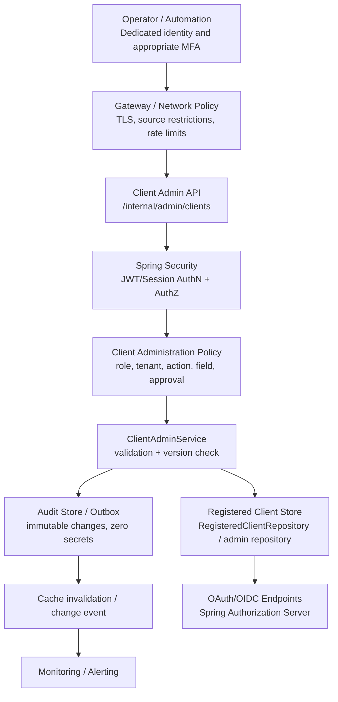
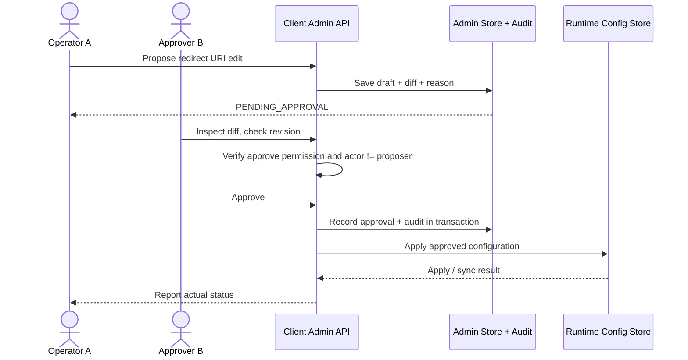

# Securing Client Management APIs and Auditing Configuration Changes

## 1. Why Is Client Management a Particularly Sensitive Attack Surface?

In an **OAuth 2.0/OpenID Connect Authorization Server** built with **Spring Security** and **Spring Authorization Server** on Spring Boot, client registration data defines how an application may participate in authorization flows. A seemingly simple administrative action—such as editing a `redirectUri` or adding a grant type—can alter the trust boundary of the entire platform.

For example, a booking system has a `booking-bff` client using Authorization Code + PKCE and one official redirect URI. If an attacker compromises the management API and adds a redirect URI they control, they can enable redirecting authorization responses to a malicious destination. If they can also alter the client authentication method or scopes, they can expand how the client is used beyond approved policy.

Therefore, **the client management API is a security control plane**. It must be protected with rigor commensurate with its power to modify Authorization Server policy.

This lesson belongs to the **Client Management** chapter and focuses on how to **design, configure, secure, test, and operate** administrative operations in Spring Boot. After this lesson, you will be able to:

1. Define the boundary between standard OAuth/OIDC endpoints and application-built client management APIs.
2. Design authentication, authorization, tenant isolation, and operation permissions for operators.
3. Protect sensitive properties: redirect URIs, grant types, scopes, authentication methods, secrets, JWKs, and token policies.
4. Record complete audit trails without leaking credentials, tokens, or unnecessary personal data.
5. Structure configuration updates with version control, approvals, rollback capability, and consistent propagation across multiple instances.
6. Build a test matrix for security and correctness of the management API.

## 2. Distinguishing Client Management from OAuth/OIDC Protocols

**OAuth Client Registration** can be implemented in several ways: configuration files, databases, internal tools, custom admin APIs, or standards-based **Dynamic Client Registration** per RFC 7591 and **Dynamic Client Registration Management** per RFC 7592.

Spring Authorization Server provides the `RegisteredClient` and `RegisteredClientRepository` models. However, **storing clients in a repository does not mean the system automatically provides a complete, secure CRUD admin API with authorization, approvals, change history, and rollback**. Those features are the application's architectural and business responsibility when required.

| Endpoint group | Who uses it? | Purpose | Risk if confused |
|---|---|---|---|
| `/oauth2/authorize`, `/oauth2/token` | OAuth clients and user browsers per flow | Executing authorization requests and issuing tokens | Mistaking admin APIs for grant/client validation |
| `/.well-known/openid-configuration`, JWKS | Clients / Relying Parties / Resource Servers | Publishing metadata and public keys | Exposing sensitive administrative info via metadata |
| Dynamic client registration endpoints, if enabled | Clients/actors per the corresponding RFC's authorization mechanism | Registering/managing clients via standard protocol | Allowing registration or metadata edits without proper credentials/policy |
| **Internal client management API** | Authorized operators, automation, or admins | Creating, viewing, editing, disabling, rotating secrets, approving configs | Abused to hijack clients or escalate privileges |
| Client management UI | Authenticated operators | Interface for the admin API and approval workflows | CSRF, XSS, secret leaks, or frontend-only authorization checks |

A reference design uses a dedicated prefix `/internal/admin/clients` and separates its policies from OAuth endpoints. A prefix is only an organizational convention, **not a security control**. Every request must still pass authentication, authorization, and backend data validation.

> If the system does not need self-service client registration over API, do not enable or build Dynamic Client Registration simply because an OAuth/OIDC standard exists for it. Every administrative endpoint enlarges the attack surface.

## 3. Threat Model: What Does an Attacker Want to Change?

Identify configurations that can introduce severe security changes:

| Client property | Example dangerous change | Potential consequence |
|---|---|---|
| `redirectUris` | Adding an attacker-controlled URL | Authorization responses/codes sent to an unintended destination |
| `clientAuthenticationMethods` | Switching a confidential client to `none` | Weakens client authentication enforcement at the Token Endpoint |
| `authorizationGrantTypes` | Enabling an inappropriate grant | Opens additional paths to obtain tokens |
| `scopes` | Adding administrative or sensitive-data scopes | Client can request broader permissions |
| `clientSecret` | Reading or replacing with a known secret | Impersonating a confidential client |
| `jwkSetUrl` / client keys | Pointing to a malicious key source | Subverts trust in client authentication keys |
| `ClientSettings` | Disabling `requireProofKey` or consent | Weakens Authorization Code protection and user approval |
| `TokenSettings` | Lengthening refresh tokens or enabling unsafe reuse | Extends the window to exploit stolen tokens |
| OIDC logout/redirect metadata | Writing untrusted URIs | Dangerous redirects or broken logout flows |
| Client status/ownership | Re-enabling a disabled client or transferring tenant | Restoring or granting privileges outside governance bounds |

Common attack patterns include:

- **Broken object-level authorization (BOLA/IDOR):** an operator authorized for client A swaps the ID in the URL to edit client B.
- **Broken function-level authorization:** a read-only viewer can invoke the secret-rotation or scope-expansion endpoint.
- **Mass assignment/overposting:** the API accepts full JSON and binds directly onto `RegisteredClient`, letting unintended fields be overwritten.
- **Cross-tenant access:** a tenant X admin modifies a client belonging to tenant Y.
- **Replay or lost update:** an older request overwrites a subsequently approved change.
- **Credential leakage:** returning secrets in JSON, logging request bodies, or storing old secrets in audit diffs.
- **Policy bypass:** enforcing checks in the UI or gateway while the backend service skips re-validation.
- **Configuration drift:** multiple nodes read different client configs or stale caches remain unrefreshed.

## 4. Recommended Protection Architecture

A production system can separate the **management layer**, the **client configuration layer**, and the **protocol layer**:



Ideal update flow:

1. Authenticate the human/automation caller at the **management boundary**.
2. Authorize both the **action and the exact target client/tenant**.
3. Validate input data, policy rules, and object revision.
4. For high-risk changes, execute an approval workflow.
5. Persist configuration and audit/outbox records atomically/consistently.
6. Emit cache-invalidation/config-refresh signals to nodes.
7. Record outcome, metrics, and alerts for sensitive changes.

**Never let controllers write directly to the database or call `RegisteredClientRepository.save(...)` without validation, authorization, and auditing layers.**

## 5. Designing Access Control for the Management API

### 5.1. Separating Administrators from Regular OAuth Clients

An access token issued to a client with `bookings.read` **must never allow** calling the management API merely because the token is valid. The management API needs explicit policies for:

- **Trusted issuer:** tokens from the identity system designated for operators or automation.
- **Specific audience:** tokens must target the Admin API; a Bookings API access token cannot substitute.
- **Authority/role/action:** e.g., `clients.read`, `clients.write`, `clients.rotate-secret`, `clients.approve`.
- **Ownership scope:** which tenants, projects, or environments the caller may manage.
- **Authentication assurance:** sensitive actions may require MFA, a recent authentication session, or step-up auth.
- **Separation of duties:** the person proposing a high-risk change must not be the one approving it.

For automation, use dedicated workload identities and infrastructure-appropriate credentials (such as `private_key_jwt` or mTLS where supported). Never share a single admin secret across all tools.

### 5.2. Granular Permission Model

A minimal model can define:

| Action | Example permission | Additional constraints |
|---|---|---|
| List clients in tenant | `clients.read` | Restricted to assigned tenants |
| View masked configuration | `clients.read` | Never return secrets or private keys |
| Create client | `clients.create` | Allowed templates, quotas, tenant owner |
| Edit low-risk metadata | `clients.write` | Action scope + field allowlist |
| Edit redirect URI/grant/scope | `clients.security-write` | Approval or step-up per policy |
| Rotate secret | `clients.rotate-secret` | New credential delivered only via secure channel |
| Disable client | `clients.disable` | Incident runbook and live-token review |
| Approve changes | `clients.approve` | Cannot self-approve own proposal |
| Read audit logs | `clients.audit-read` | Scoped by tenant; minimize PII |

These are **policy design examples**, not built-in Spring scopes. HTTP-chain checks reject callers lacking functional permissions, while **domain services must still enforce resource-level authorization** based on client ID, owner, tenant, and modified fields.

### 5.3. Default-Deny and Least Privilege

An operator managing only tenant A must not write to tenant B's clients. A caller allowed only to update display names must not by default be able to edit every field.

Never trust a caller-supplied header or query parameter specifying the target tenant as authorization proof. A request parameter can identify the target object, but the final authorization decision must verify **trusted tenant claims from the identity alongside the client's stored ownership data**.

## 6. Spring Security: Isolating a Dedicated `SecurityFilterChain` for the Admin API

An admin API that accepts **Bearer access tokens**, uses no session cookies, and handles HTTP statelessly can have its own filter chain. Structural example:

```java
@Configuration
@EnableWebSecurity
@EnableMethodSecurity
class ClientAdminSecurityConfig {

    @Bean
    @Order(1)
    SecurityFilterChain clientAdminApiChain(HttpSecurity http)
            throws Exception {

        http
            .securityMatcher("/internal/admin/**")
            .authorizeHttpRequests(authorize -> authorize
                .requestMatchers(
                    HttpMethod.GET, "/internal/admin/clients/**"
                ).hasAuthority("SCOPE_clients.read")
                .anyRequest().hasAuthority("SCOPE_clients.write"))
            .oauth2ResourceServer(oauth2 ->
                oauth2.jwt(Customizer.withDefaults()))
            .sessionManagement(session -> session
                .sessionCreationPolicy(SessionCreationPolicy.STATELESS))
            .csrf(csrf -> csrf.disable());

        return http.build();
    }
}
```

**Snippet scope:** this illustrates **only the Bearer-only admin chain**, not the complete Authorization Server configuration. Because `/internal/admin/**` does not use login cookies, disabling CSRF in that chain is acceptable. **If the API uses browser cookies/sessions, do not copy this pattern**; keep appropriate CSRF protection enabled.

In a real application, add and verify:

1. A `JwtDecoder` trusting the exact issuer/keys for the Admin API.
2. Explicit **audience validation**, because signature and issuer checks alone do not prove the token was meant for the Admin API.
3. Action-specific scope/role checks; the snippet above simplifies GET vs. write requests.
4. Tenant and field-level policy enforcement in services/method security.
5. CORS restricted to necessary origins if an external frontend exists; never combine `*` with credentials.
6. Rate limits, timeouts, auditing, and network controls.
7. Separate filter chains for OAuth/OIDC endpoints and login per Spring Authorization Server documentation.

Pay attention to `@Order` and `securityMatcher`: Spring Security selects the first matching chain. A catch-all chain ordered ahead of the Authorization Server or Admin API chain routes endpoints through the wrong security rules. Include routing tests for `/internal/admin/**`, `/oauth2/**`, `/.well-known/**`, and login UIs.

### 6.1. URL Scopes Alone Are Not Enough

Suppose a user holds `SCOPE_clients.write` but only manages tenant `acme`. The endpoint below must still reject the request if `targetClient` belongs to another tenant:

```http
PATCH /internal/admin/clients/registered-client-123
Authorization: Bearer ADMIN_ACCESS_TOKEN
If-Match: "rev-18"
Content-Type: application/json

{
  "displayName": "Booking Portal"
}
```

A service-layer check can be expressed as:

```java
// Illustrative service/policy method, not a built-in Spring API.
void authorizeUpdate(
        Authentication actor,
        ManagedClient current,
        ClientChangeRequest request) {

    clientAdminPolicy.assertCanManageTenant(
        actor, current.tenantId());

    clientAdminPolicy.assertCanChangeFields(
        actor, current, request.changedFields());
}
```

`clientAdminPolicy` and `ManagedClient` are application-defined abstractions. Checking against the object **loaded from trusted storage** prevents privilege escalation via tampering with a tenant ID in JSON.

## 7. Designing the Management API: CRUD with Clear Boundaries

You do not need a REST CRUD endpoint that lets callers PUT any field arbitrarily. Model operations and their risk explicitly.

| Illustrative endpoint | Semantics | Specific safeguards |
|---|---|---|
| `GET /internal/admin/clients` | List authorized clients | Pagination, policy-driven tenant filtering, never list unauthorized clients |
| `GET /internal/admin/clients/{id}` | View masked configuration | Client- and tenant-scoped authorization |
| `POST /internal/admin/clients` | Intentionally create client | Validate template, redirects, grants, scopes, ownership |
| `PATCH /internal/admin/clients/{id}` | Edit an allowed subset of fields | Field allowlist, version precondition, risk checks |
| `POST /internal/admin/clients/{id}/rotate-secret` | Rotate secret | Step-up/approval; new credential returned at most once |
| `POST /internal/admin/clients/{id}/disable` | Suspend client usage | Distinguish effect from already-issued tokens |
| `POST /internal/admin/client-changes/{changeId}/approve` | Approve proposal | Separation of duties, revision check |
| `GET /internal/admin/clients/{id}/changes` | Retrieve history | Audit permission, mask sensitive data |

**This is an application-defined internal API**, not endpoints published by default by Spring Authorization Server. RFC 7591/7592 define a separate registration/management protocol; if you implement those RFCs, honor their credentials, authorization flows, and contracts instead of altering semantics arbitrarily.

### 7.1. Use Stable IDs

`RegisteredClient` has an internal `id` and a protocol `clientId`. The management API can use the **internal ID** as the resource key, independent of display names or policy-driven client IDs.

Prevent callers from altering the object's `id` to hijack another record. When handling PATCH:

1. Load the client by ID from the path.
2. Authorize access to the loaded record.
3. Apply patches strictly to allowlisted fields.
4. Validate the entire resulting configuration.
5. Check revision and persist atomically alongside audit records.

Never bind caller-submitted JSON directly onto an entity that also holds secret hashes, tenant ownership, approval status, or other security fields.

### 7.2. Useful Business States

A system requiring approvals might use:

```text
DRAFT -> PENDING_APPROVAL -> APPROVED -> ACTIVE
                  |               |
                  v               v
               REJECTED         CANCELLED

ACTIVE -> DISABLED -> ARCHIVED
```

This is a proposed **client management layer** model, not built-in `RegisteredClient` states. Never equate "stored in the repository" with "approved for production use."

You can keep drafts/approvals in a separate management store and sync only approved **ACTIVE** configurations into the repository read by the Authorization Server. If the same repository holds drafts too, ensure drafts can never execute grants.

## 8. Validating Configuration Data Before Persistence

### 8.1. Redirect URIs

For Authorization Code/OIDC, redirect URIs are core security assets. Validation should follow standards and client models:

- Validate scheme, host, port, path, and permitted URI components.
- In production web environments, prefer/require **HTTPS** and approved hosts.
- Never allow wildcards like `https://*.example.com/callback` without an explicit protocol contract; best practice favors exact matching to prevent open redirects.
- Reject URIs containing a `fragment` in registered authorization redirect URIs.
- Native/loopback clients have specific exceptions and rules by app type; apply the relevant standards accurately (e.g., RFC 8252).
- Separate authorization redirect URIs from OIDC post-logout redirect URIs when supported.
- When promoting across dev/staging/prod, never carry internal dev redirect URIs into production clients.

**Never implement a "host contains company name" check with `String.contains(...)`.** Parse and normalize the URI, validate full origin/host/path against trusted policy, and defend against lookalike hostnames, trailing dots, or multi-hop redirects.

### 8.2. Grant Types and Authentication Methods

Invariants to enforce:

| Combination | Design rule |
|---|---|
| Public client + Authorization Code | Must enforce PKCE; never treat the client as having a safe shared secret |
| Confidential client | Require an appropriate client authentication method at the Token Endpoint |
| Client Credentials | Issue tokens representing the client only; never mint user ID tokens |
| Refresh Token | Enable only when matching grant/client and refresh-token protection capabilities |
| `client_secret_basic` | Secret must have sufficient entropy, protection, and proper hashed encoding |
| `private_key_jwt` / mTLS | Manage keys/certificates, bindings, and rotation per supported configuration |

Never let an operator accidentally downgrade a confidential client to a public client or enable an outdated grant merely because a DTO exposes `authorizationGrantTypes`.

### 8.3. Scopes and Token Policies

Never permit scope updates beyond what the organization approved; for instance, a tenant allowed only `bookings.read` and `bookings.write` must not be able to add `admin.superuser`.

Enforce sensible TTL bounds:

- Cap access token lifetime per risk and revocation capabilities.
- Match refresh token timeouts and rotation to client type.
- Keep authorization code TTL short and enforce PKCE.
- Prevent client policy from disabling consent or PKCE in violation of baseline security rules.

Shortening TTLs in a new configuration normally affects only **tokens issued after the change**, without rewriting lifetimes on live tokens. Decide separately how to handle existing tokens.

## 9. Managing Client Secrets, Keys, and Credentials

### 9.1. Never Return Stored Secrets

A critical API rule: **GET/LIST endpoints must never return `clientSecret`**, even when stored as a hash. Hashes are unnecessary for operators and increase risk if leaked.

Safe response example:

```json
{
  "id": "registered-client-123",
  "clientId": "booking-bff",
  "status": "ACTIVE",
  "authenticationMethods": ["client_secret_basic"],
  "redirectUris": [
    "https://booking.example.com/login/oauth2/code/booking-bff"
  ],
  "scopes": ["openid", "bookings.read"],
  "hasClientSecret": true,
  "secretLastRotatedAt": "2026-11-01T02:00:00Z",
  "revision": 18
}
```

This is a management-API DTO structure, not a default Spring Authorization Server response.

### 9.2. Generating and Storing Secrets

When creating a confidential client:

1. Generate a random secret using a CSPRNG with adequate entropy.
2. Deliver the new credential over a secure channel to the exact authorized human/automation.
3. Display it once by design; never expose it again in GETs or audits.
4. Persist it encoded via a `PasswordEncoder` or credential store compatible with the client authentication method.
5. Ensure the token endpoint uses a matching encoder/matcher.
6. Scrub/mask secrets from logs, traces, exceptions, and observability systems.

For `client_secret_basic`, Spring Authorization Server typically validates secrets using `PasswordEncoder` during client authentication. When using different hash prefixes or encoders, verify the exact `PasswordEncoder` behavior of your running version.

### 9.3. Secret Rotation and Transition Windows

Changing `RegisteredClient.clientSecret` can immediately break authentication for clients still sending the old secret. **`RegisteredClient` normally has a single active `clientSecret` field; never assume Spring natively supports two concurrent secrets with an overlap window.**

A secret rotation workflow must specify:

- Who is authorized to initiate and approve rotation.
- Which channel delivers the new credential to the client.
- When the new secret becomes active.
- Whether clients can deploy synchronously, or if a tested overlap mechanism is needed.
- When the old secret is retired and how operators confirm clients switched over.
- How to roll back on failure without restoring a compromised secret.

For clients using `private_key_jwt` or mTLS, key/certificate replacement follows a different process accounting for JWKS/certificate trust, cache windows, and key rotation.

**Never include client secrets in audit diffs.** Instead of storing values, log `CLIENT_SECRET_ROTATED`, client identifier, actor, timestamp, and non-sensitive metadata.

## 10. Auditing Configuration Changes: What Must Audits Answer?

A strong audit record answers:

- **Who** performed it? Which admin or workload, via which verified identity?
- **What did they do?** Create, update, approve, reject, rotate secret, disable?
- **Which client was affected?** Internal client ID, tenant, environment?
- **When?** Consistent UTC timestamp and correlation/request ID.
- **From what state to what state?** Before/after revisions and changed fields.
- **Why?** Change reason, ticket, approval reference if required by policy.
- **Outcome?** Success, policy rejection, revision conflict, system error?
- **Has it taken effect?** Config persisted, approved, and which nodes received the update?

### 10.1. Illustrative Audit Schema

```json
{
  "eventId": "evt-93a1",
  "eventType": "CLIENT_CONFIGURATION_UPDATED",
  "occurredAt": "2026-11-16T03:12:00Z",
  "actor": {
    "subject": "operator-417",
    "kind": "HUMAN",
    "authMethod": "MFA"
  },
  "target": {
    "registeredClientId": "registered-client-123",
    "clientId": "booking-bff",
    "tenantId": "tenant-a",
    "environment": "production"
  },
  "change": {
    "fromRevision": 18,
    "toRevision": 19,
    "fields": {
      "redirectUris": {
        "before": [
          "https://booking.example.com/login/oauth2/code/booking-bff"
        ],
        "after": [
          "https://booking.example.com/oauth2/callback"
        ]
      }
    }
  },
  "decision": {
    "outcome": "APPROVED_AND_APPLIED",
    "approvalId": "approval-442",
    "reasonCode": "APP_CALLBACK_MIGRATION"
  },
  "correlationId": "req-80e2"
}
```

The values and identifiers above are illustrative only. Before writing real audits, classify the data: sometimes hostnames, tenant IDs, or operator identities also require access controls and retention limits.

### 10.2. What Never to Log

**Never record in audits or logs**:

- Raw `clientSecret`, secret hashes, private keys, admin tokens, refresh tokens, or authorization codes.
- `Authorization` headers, `Cookie` headers, or `Set-Cookie` values.
- Unredacted full request or response bodies.
- Personal data unnecessary to prove the configuration change.
- Old or new secrets inside diff `before`/`after` fields.

When rotating a secret, the audit entry should look like:

```json
{
  "eventType": "CLIENT_SECRET_ROTATED",
  "targetId": "registered-client-123",
  "field": "clientSecret",
  "newSecretValueRecorded": false
}
```

### 10.3. Auditing Attempts vs. Auditing State Changes

Two complementary event categories:

| Category | When emitted | Purpose |
|---|---|---|
| **Security/access audit** | Rejected admin requests, failed logins, denied tenant access | Detecting attacks and privilege abuse |
| **Configuration change audit** | Proposals, approvals, commits, rollbacks | Reconstructing history and change accountability |

An unauthorized attempt may need auditing even though no database row changed. However, **never write an "applied successfully" audit record before the transaction actually commits**.

## 11. Atomic Updates and Contention Control

### 11.1. Why Is Last-Write-Wins Dangerous?

Suppose two operators open revision 7 simultaneously:

1. A plans to update the redirect URI to a vetted URL.
2. B plans to disable an unused grant.
3. A saves revision 8.
4. B submits an old object from revision 7 and overwrites the whole client, accidentally restoring the old redirect URI or wiping A's change.

This is a **lost update**, especially hazardous in client registrations because security settings can silently revert.

Use **optimistic concurrency control**:

- GET returns `revision` or HTTP `ETag`.
- PATCH/PUT requires `If-Match` or the expected revision.
- The service commits only if the revision matches.
- On mismatch, return **HTTP 412 Precondition Failed** (for `If-Match`) or an appropriate conflict error and ask the caller to reload.
- Check the revision inside the same transaction/CAS operation, not merely in a separate pre-read check.

```http
PATCH /internal/admin/clients/registered-client-123
Authorization: Bearer ADMIN_ACCESS_TOKEN
If-Match: "rev-18"
Content-Type: application/json

{
  "redirectUris": [
    "https://booking.example.com/oauth2/callback"
  ],
  "reason": "Callback migration"
}
```

If the revision is already 19, this request must be rejected instead of overwriting.

### 11.2. Audited Service Structure

Hexagonal/service-style Java pseudocode showing business ordering:

```java
@Transactional
public ClientView updateClient(
        AuthenticatedAdmin actor,
        String registeredClientId,
        ClientUpdateCommand command,
        long expectedRevision) {

    ManagedClient current =
        clientAdminStore.findForUpdate(registeredClientId)
            .orElseThrow(ClientNotFoundException::new);

    clientAdminPolicy.checkCanUpdate(
        actor, current, command.changedFields());

    revisionPolicy.requireMatch(
        current.revision(), expectedRevision);

    ManagedClient proposed =
        clientConfigurationValidator.applyAndValidate(
            current, command);

    approvalPolicy.requireApprovalIfNeeded(
        actor, current, proposed);

    ManagedClient saved =
        clientAdminStore.saveNextRevision(proposed);

    auditStore.append(
        ClientChangeAudit.maskedDiff(
            actor, current, saved, command.reason()));

    outboxStore.enqueue(
        ClientConfigurationChanged.of(
            saved.id(), saved.revision()));

    return ClientView.redacted(saved);
}
```

`AuthenticatedAdmin`, `ManagedClient`, `ClientAdminStore`, `ClientConfigurationValidator`, `AuditStore`, and `OutboxStore` are **illustrative application abstractions to implement**, not built-in Spring Authorization Server APIs.

A real implementation must ensure the database transaction spans configuration, revision, and audit/outbox **when they reside in the same transactional store**. Across disparate stores, use sagas, retries, or equivalent consistency patterns; never assume a single `@Transactional` makes arbitrary external services atomic.

### 11.3. Outbox for Multi-Instance Synchronization

If a client update commits yet publishing to a message broker fails, nodes caching clients may serve stale state. The **transactional outbox** pattern helps:

1. Commit both the config update and outbox record in one transaction.
2. A worker publishes events from the outbox to consumers.
3. Consumers process idempotently by `clientId/internalId` + revision.
4. Track failed deliveries, retries, and dead-letter queues.
5. For high-risk changes, verify when nodes actually observe the new revision.

Eventual consistency still exists whenever caches and distributed systems are involved. The admin API should distinguish **committed** from **synced/active on all nodes** if the product needs to surface both states.

## 12. Change Effect: Client Registration vs. Already-Issued Tokens

A new client configuration governs **subsequent requests**, whereas existing tokens, sessions, and consents may persist independently.

| Change | Typically affected immediately at the AS | What does not change automatically |
|---|---|---|
| Remove a redirect URI | New Authorization Requests using the old URI are rejected | Previously issued authorization codes/tokens do not vanish |
| Remove a grant type | Future grant requests are checked against the new config | Already-issued access tokens stay valid until expiry |
| Remove a scope | New requests cannot obtain the removed scope | Unexpired JWTs may still carry the old scope |
| Shorten access token TTL | Newly minted tokens use the new policy | `exp` on existing JWTs remains unchanged |
| Rotate client secret | Future client auth requires the new secret | Already-issued tokens may stay valid |
| Disable client | Blocks new flows where status checks run | Old tokens may still work; requires separate revocation |
| Delete client from registration | May cause lookups to fail on some endpoints | Offline-verifying Resource Servers may still accept signed JWTs |
| Change owner/tenant | Future governance uses new ownership | Old consents and authorizations must be reviewed/migrated/revoked per policy |

Specifically, `RegisteredClient` **has no built-in disable status that instantly invalidates all tokens across every version and every Resource Server**. If your app adds `status=DISABLED` in the management layer, define where it is enforced and how it synchronizes.

### 12.1. Emergency Disabling

When the goal is to block a compromised client:

1. Block issuing new authorizations/tokens for the client via policy and consistent data updates.
2. Revoke/invalidate associated refresh tokens as needed.
3. Determine how live access tokens are handled at Resource Servers.
4. For self-contained JWTs, rely on short TTLs, denylists/token versions, or supplementary revocation checks; logout or registration edits alone are insufficient.
5. Monitor client activity and alert on continued attempts with old credentials.
6. Update incident audit/tickets and define conditions for restoration.

**Never display "client disabled immediately" in the UI when the system actually only blocks new registrations or new token issuance.**

### 12.2. Consent After Changing Scopes or Ownership

Consents saved by `registeredClientId` and `principalName` may persist after registration updates. When sensitive scopes are added to a client, old consents **do not automatically approve the new scopes**. When retiring a client or transferring ownership, define policies for handling old consents and audit those decisions.

## 13. Approvals, Rollbacks, and Security Changes

Not every update requires multi-person approval, yet fields capable of escalating privileges or exposing credentials should be risk-tagged.

| Change tier | Examples | Suggested policy |
|---|---|---|
| Low | Edit display description | Owner can edit; audited on commit |
| Medium | Edit contact or non-protocol metadata | Owner + field and revision checks |
| High | Add production redirect URI, grant, sensitive scope | Separate approver, policy review, pre-testing |
| High | Disable PKCE or consent | Default deny if violating security baseline |
| High | Change client auth method/JWK | Review, key verification, staged rollout |
| Emergency | Disable suspected compromised client | Dedicated high-privilege path, audit, alerts, drills |

### 13.1. Two-Step Workflow



Never assume approving an old draft is always safe. If the client's revision changed while awaiting approval, require **rebase/re-review** instead of applying changes against stale state.

### 13.2. Rollback Does Not Undo Everything

Rolling back a configuration can restore a prior redirect URI or grant type, yet:

- A compromised secret **must never be restored**.
- Tokens issued under the old policy **are not automatically revoked**.
- Clients that already switched callback URIs may break on rollback.
- New consents or approvals created since the old config still need handling.

Therefore, rollback must create a **new revision** and audit a new change rather than deleting history or rewriting old revisions as if nothing happened.

## 14. Error Handling and Safe Responses

The management API must use clear HTTP statuses and avoid revealing client existence outside authorized scopes.

| Scenario | Appropriate response | Notes |
|---|---|---|
| Unauthenticated | `401 Unauthorized` | Reveal nothing about the client |
| Authenticated but unauthorized | `403 Forbidden` | Some designs return `404` to hide object existence |
| Client missing or policy-hidden | `404 Not Found` | Prevents enumeration |
| Invalid config input | `400 Bad Request` or `422 Unprocessable Content` | Return field error codes without exposing sensitive data |
| Revision mismatch on `If-Match` | `412 Precondition Failed` | Prevent overwriting |
| Missing required precondition | `428 Precondition Required` | Useful when API mandates ETags |
| Config conflicts with policy | `409 Conflict` or appropriate validation error | E.g., incompatible scope/grant |
| Rate limited | `429 Too Many Requests` | Expose no internal technical details |
| Server failure | `5xx` | Error ID referencing redacted logs |

Example response:

```json
{
  "type": "https://api.example.com/problems/client-policy-violation",
  "title": "Client configuration rejected",
  "status": 422,
  "code": "CLIENT_REDIRECT_URI_NOT_ALLOWED",
  "correlationId": "req-80e2"
}
```

Error details should help operators troubleshoot without exposing client secrets, access tokens, stack traces, SQL queries, or another tenant's configuration. For client creation and secret rotation, enforce **idempotency** so retries do not create duplicate clients or multiple secrets unexpectedly.

## 15. Security Testing the Client Management API

### 15.1. Authentication and Authorization Tests

| Test case | Setup | Expected result |
|---|---|---|
| Missing Bearer token | Call `GET/PATCH` | `401` |
| Expired token or invalid signature | Call API | `401` |
| Valid issuer but wrong audience | Token issued for Bookings API | Rejected |
| Read-only permission calls PATCH | `SCOPE_clients.read` | `403` |
| Write permission on wrong tenant | Modify another tenant's client | Rejected; no data altered |
| Missing rotate permission | Call `rotate-secret` | Rejected; no credential generated |
| Operator self-approves proposal | Same actor ID | Rejected per SoD policy |
| Automation lacks required step-up | Sensitive change | Blocked per policy |
| Probe non-existent ID | GET/PATCH | Reveals no other clients or system internals |
| Request includes non-allowlisted field | JSON `{"clientSecretHash":"..."}` | Rejected or safely ignored, never persisted |

### 15.2. Protocol Validation Tests

| Operation | Outcome to prove |
|---|---|
| Add disallowed redirect URI | Not persisted |
| Add wildcard or URI with fragment | Rejected when non-compliant with standard/policy |
| Public client disables PKCE | Rejected per baseline |
| Enable grant outside allowlist | Rejected |
| Add cross-tenant scope | Rejected |
| Set token TTL beyond cap | Rejected |
| Change auth method incompatible with client type | Rejected |
| Rotate secret | Old/new secrets follow policy; never leaked in GET/audit |
| Disable client | New token requests blocked per design; old tokens handled per policy |

### 15.3. Consistency and Audit Tests

1. **Successful write:** config revision increments, audit and outbox commit, zero secrets present.
2. **Failed transaction:** config unchanged, no false "applied" audit entry.
3. **Concurrent PATCH:** only one request wins revision/CAS; the other is cleanly rejected.
4. **Stale approval:** proposal built on an old revision is not auto-applied.
5. **Multi-instance sync:** one node updates; others observe the new revision within SLA.
6. **Outbox retry:** replayed events do not duplicate configs or corrupt audit history.
7. **Secret redaction:** responses, logs, traces, audits, and analytics contain zero raw secrets or hashes.
8. **Audit queries:** authorized callers see history only within their permitted tenant/scope.
9. **Rollback:** creates a new revision and audit entry; preserves history.
10. **OAuth/OIDC regressions:** after edits, Authorization Code + PKCE, Client Credentials, Refresh Token, and OIDC flows still conform to permitted grants.

### 15.4. HTTP Testing with Spring Security

Integration tests should run through `MockMvc` or full HTTP integration tests rather than calling service methods directly. Tests for 401/403/tenant checks must verify **the right `SecurityFilterChain` is selected** and that services still enforce policy if invoked outside controllers.

When testing JWTs, explicitly test issuer/audience checks, scope/authority mapping, and token expiration boundaries. Policy unit tests can use mocked principals, yet unit tests never substitute for tests exercising the real filter chain.

You do not need to start by testing random permutations; prioritize **paths that escalate privileges or leak credentials**, then add regression tests driven by incidents and policy updates.

## 16. Operations, Monitoring, and Incident Response

### 16.1. Recommended Metrics and Alerts

- Counts of client create/update/disable/rotate operations by environment and action type.
- Counts of `401`, `403`, `412`, and validation errors on the Admin API.
- Edits to sensitive redirect URIs, grants, scopes, or authentication methods.
- Proposals pending approval too long or repeatedly rejected.
- Configuration revision lag across nodes/instances.
- Client authentication failure spikes after secret rotations.
- Outbox backlogs, sync failures, and audit write failures.
- Off-hours or out-of-process changes, where policy applies.

Alerts should target meaningful conditions—such as **adding a production redirect URI to a sensitive client** or **sustained failures during secret rotation**—and never include credentials in alert payloads.

### 16.2. Incident Response Procedure

When an admin account compromise is suspected:

1. Block the identity from further admin operations; revoke admin sessions/tokens.
2. Inspect audits to identify affected clients, fields, revisions, timestamps, and change sources.
3. Assess each change for potential code/token exposure, scope escalation, or altered auth methods.
4. Restore configurations to a safe state via a new audited revision.
5. Rotate credentials/keys if needed; invalidate authorizations/tokens within incident scope.
6. Verify empirically whether Resource Servers still accept suspect tokens.
7. Restore operations, monitor closely, and update policies/tests to prevent recurrence.

Rolling back configuration alone is insufficient if authorization codes, access tokens, or refresh tokens were issued while the client configuration was altered.

### 16.3. Preserving Evidence

Store audits in a repository with clear access controls, suitable retention, anti-tampering protections, and exportability for audits. Where strong evidentiary integrity is required, consider append-only storage, hash chaining, signatures, or WORM storage; never treat a SQL table with broad UPDATE/DELETE privileges as an immutable log.

## 17. Common Misconceptions

**"The admin API sits behind a VPN, so permission checks aren't needed."** False. Network controls help, yet never replace authentication and authorization per action, client, and tenant.

**"Having `SCOPE_clients.write` lets you edit any client."** False. You must still check target object, environment, tenant, ownership, and fields.

**"`RegisteredClientRepository` has `save`, so full admin CRUD is already built."** False. Repository APIs persist/retrieve client models; admin workflows require validation, approvals, auditing, revisions, and lifecycle state.

**"Checking permissions in the frontend is enough."** False. Attackers call APIs directly, bypassing the UI.

**"HTTP gateway access logs are enough for auditing."** Unlikely. Gateways rarely know the committed config diff, while raw request logs risk capturing secrets. You need domain-level audits with redacted values.

**"Updating a client automatically invalidates old tokens."** False. JWTs, authorizations, sessions, and consents have independent lifecycles.

**"After rotating a secret, you can read the old secret back from the database."** You should not. Secrets must be stored securely and displayed only at issuance per design.

**"Rollback means deleting the audit record just written."** False. Rollback creates a new event and revision, preserving history for traceability.

**"Rate limiting and CORS are enough to protect the API."** False. CORS is not an authorization mechanism; rate limiting curbs abuse without stopping authenticated users who lack permissions.

## 18. Pre-Production Review Checklist for Admin APIs

- **Boundaries:** Are management endpoints separated from OAuth/OIDC protocol endpoints and not exposed publicly beyond need?
- **Identity:** Are issuer, audience, signature, and expiration validated on admin tokens?
- **Authorization:** Are role/scope, tenant, owner, action, and field checks enforced on the backend?
- **Step-up:** Do sensitive operations require MFA, approval, or two-person control?
- **Inputs:** Are redirect URIs, grants, scopes, auth methods, PKCE, TTLs, and metadata validated against policy?
- **Credentials:** Are secrets safely generated, hashed/protected at rest, and absent from GETs, audits, and logs?
- **Concurrency:** Does every update carry revisions, preconditions, and CAS/transactional checks?
- **History:** Do audits record actor, target, redacted diff, reason, outcome, and revision?
- **Synchronization:** Are node caches refreshed cleanly with visible propagation status?
- **Token impact:** Are the effects of disabling/editing clients on issued access/refresh tokens documented and handled?
- **Testing:** Have 401, 403, cross-tenant, overposting, concurrent updates, rollbacks, and secret rotations been tested?
- **Response:** Are procedures ready to lock out compromised admins, disable clients, revoke tokens, and inspect audits?

### Core Takeaway

The client management API controls **who can alter the trust conditions of the Authorization Server**. Securing this API requires more than an authentication filter: it demands trusted identities, fine-grained authorization, configuration validation, credential governance, revision control, approvals for sensitive changes, redacted auditing, and runtime synchronization.

With Spring Security and Spring Authorization Server, use `RegisteredClient`/`RegisteredClientRepository` as the client persistence foundation, build a **policy-enforced management service**, and keep OAuth/OIDC protocol endpoints standards-compliant. **Auditing configuration changes, enforcing lifecycle state, and revoking tokens are related responsibilities—none of them substitutes for another.**

## References

- [Spring Authorization Server — Core Model / Components](https://docs.spring.io/spring-authorization-server/reference/core-model-components.html)
- [Spring Authorization Server — Reference](https://docs.spring.io/spring-authorization-server/reference/)
- [Spring Security — Authorization Architecture](https://docs.spring.io/spring-security/reference/servlet/authorization/architecture.html)
- [Spring Security — Multiple HttpSecurity Instances](https://docs.spring.io/spring-security/reference/servlet/configuration/java.html#_multiple_httpsecurity_instances)
- [Spring Security — OAuth 2.0 Resource Server JWT](https://docs.spring.io/spring-security/reference/servlet/oauth2/resource-server/jwt.html)
- [RFC 6749 — The OAuth 2.0 Authorization Framework](https://www.rfc-editor.org/rfc/rfc6749)
- [RFC 7591 — OAuth 2.0 Dynamic Client Registration Protocol](https://www.rfc-editor.org/rfc/rfc7591)
- [RFC 7592 — OAuth 2.0 Dynamic Client Registration Management Protocol](https://www.rfc-editor.org/rfc/rfc7592)
- [RFC 7009 — OAuth 2.0 Token Revocation](https://www.rfc-editor.org/rfc/rfc7009)
- [RFC 7636 — Proof Key for Code Exchange](https://www.rfc-editor.org/rfc/rfc7636)
- [RFC 8252 — OAuth 2.0 for Native Apps](https://www.rfc-editor.org/rfc/rfc8252)
- [RFC 9700 — Best Current Practice for OAuth 2.0 Security](https://www.rfc-editor.org/rfc/rfc9700)
- [OWASP API Security Top 10 (2023)](https://owasp.org/API-Security/editions/2023/en/0x11-t10/)
