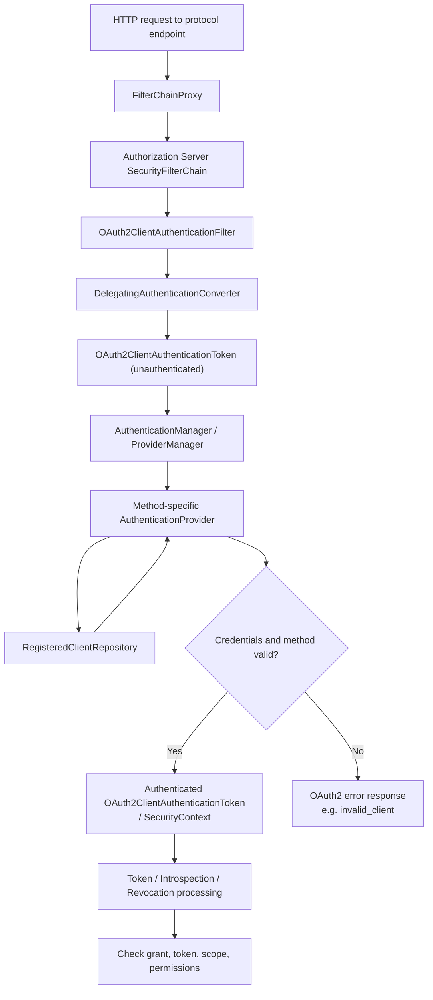
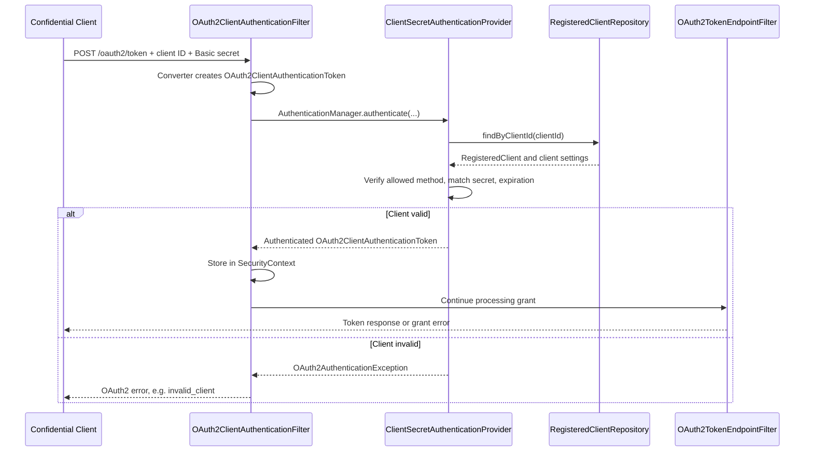

# Client Authentication Endpoint Filter and the Client Identification Process

## 1. Why Must the Authorization Server Identify Clients?

Suppose a platform has two applications calling APIs: **Orders Web** for user logins and **Reports Service** for running automated reports. Both request tokens from the same OAuth 2.0 Authorization Server, yet they have different trust levels:

- **Orders Web** may be an application running in the browser that cannot hold a long-term secret. It uses Authorization Code + PKCE to bind the code exchange to the initial request.
- **Reports Service** runs on a controlled server and can hold a client secret, private key, or certificate. It uses Client Credentials to obtain an access token for the service itself.

The Authorization Server must determine **which client is making the request**, **which authentication method** the client registered, whether the presented evidence is valid, and whether the client is permitted to use the associated **grant type, scope, and redirect URI**.

In Spring Security and Spring Authorization Server, the client authentication step is organized around **`OAuth2ClientAuthenticationFilter`**, configured by **`OAuth2ClientAuthenticationConfigurer`**. This lesson belongs to the **Client Authentication** chapter in the `SPRING_SECURITY_OAUTH2_OIDC_AUTHORIZATION_SERVER` module; the goal is to learn how to design, configure, secure, test, and operate client authentication in Spring Boot.

**Key takeaway:** `client_id` is an **identifier** used to look up configuration, **not a secret**. Knowing a client ID does not prove that the sender actually possesses the client's credentials. The proof step depends on the client type and the registered authentication method.

### After this lesson, you should be able to

1. Distinguish between **client identification**, **client authentication**, **user authentication**, **authorization grant validation**, and **token validation**.
2. Explain the path from an HTTP request through `OAuth2ClientAuthenticationFilter`, `AuthenticationConverter`, and `AuthenticationProvider` to `SecurityContext`.
3. Recognize the `client_secret_basic`, `client_secret_post`, `private_key_jwt`, `client_secret_jwt`, mTLS, and `none` methods.
4. Configure `RegisteredClient` and the `clientAuthentication(...)` extension point in Spring Authorization Server.
5. Test failure cases involving wrong client secrets, JWT assertion signatures, certificates, PKCE, and authentication method configuration.

## 2. Five Easily Confused Concepts

| Concept | Question it answers | Example |
| --- | --- | --- |
| **Client identification** | Who does the client claim to be? | `client_id=reports-service` |
| **Client authentication** | What does the client use to prove its declared identity? | HTTP Basic with secret, signed JWT assertion, TLS certificate |
| **End-user authentication** | Who is the user logging in? | Form login, MFA, authentication via IdP |
| **Authorization grant validation** | Does this token request have a valid grant, code, PKCE, and granted permissions? | `grant_type=authorization_code`, unexpired code, matching `code_verifier` |
| **Access token verification at Resource Server** | Should the API accept this token and allow the operation? | Verifying signature, issuer, audience, scope, and data-level permissions |

**Successful client authentication does not equate to being issued a token**: the token endpoint still has to verify the registered grant type, request validity, scope, authorization code or refresh token, and other policies.

Conversely, a user logging in successfully at `/oauth2/authorize` **does not replace client authentication** when a confidential client exchanges a code at `/oauth2/token`.

### Confidential client vs. public client

According to the OAuth 2.0 model:

- A **confidential client** is capable of keeping credentials secret from users and untrusted parties, such as a web backend or server-side service. It typically must authenticate at the token endpoint.
- A **public client** cannot hold long-term secrets, such as a pure browser-based SPA or a mobile app distributed to users. It typically registers `ClientAuthenticationMethod.NONE` and uses **Authorization Code + PKCE**.

A client registering `none` **does not mean the application has proved its identity using a password or key**. PKCE proves that the party exchanging the code holds the `code_verifier` for that transaction, helping prevent code interception; it does not turn an application running on a user's device into a confidential client.

## 3. Where Does OAuth2ClientAuthenticationFilter Live?

In an Authorization Server application, Spring Security selects the `SecurityFilterChain` matching the request. The client authentication filter resides in the protocol chain installed by `OAuth2AuthorizationServerConfigurer`.



Main steps:

1. **Filter** determines whether the request is of a type that requires client authentication.
2. **Converter** extracts the client ID, secret, JWT assertion, certificate, or public client parameters from the HTTP request and creates an `OAuth2ClientAuthenticationToken` object.
3. **AuthenticationManager** selects the `AuthenticationProvider` appropriate for the method the client is using.
4. **Provider** retrieves the `RegisteredClient` and validates the registered method, credentials, and required conditions.
5. **Success handler** places the client authentication result into the `SecurityContext` for downstream protocol endpoint processing.
6. **Failure handler** returns an appropriate OAuth 2.0 error and prevents the request from continuing as if the client were trusted.

Success at step 5 **is not yet a successful token response**. For example, the token endpoint can still return `invalid_grant` if the authorization code has expired.

### 3.1. Which Endpoints Does the Filter Operate On?

In the default configuration described in Spring Authorization Server, client authentication is applied to appropriate requests to:

- **`/oauth2/token`** — issues tokens according to supported grant types.
- **`/oauth2/introspect`** — queries token status, requiring caller authentication per policy.
- **`/oauth2/revoke`** — requests token revocation according to protocol rules.

Other features such as **Device Authorization** or **Pushed Authorization Requests** may involve client authentication depending on the version, endpoint, client type, and how the feature is enabled. Always check the **actual matcher** and the reference guide for the version in use.

At **`/oauth2/authorize`**, the browser carries `client_id` so the server can identify the client configuration and validate `redirect_uri`, scope, and PKCE. Never send a **client secret** through the browser in an attempt to "authenticate the client" at the authorization endpoint.

At **`/userinfo`**, the application normally uses an OIDC **access token** to retrieve user claims. That is the endpoint's resource protection mechanism, not identical to client secret authentication at the token endpoint.

## 4. Default Converters and Providers

In modern Spring Authorization Server/Spring Security releases, `OAuth2ClientAuthenticationConfigurer` typically sets up a **`DelegatingAuthenticationConverter`** and multiple **`AuthenticationProvider`** instances:

| Converter | Input recognized | Corresponding provider |
| --- | --- | --- |
| `ClientSecretBasicAuthenticationConverter` | `Authorization: Basic ...` | `ClientSecretAuthenticationProvider` |
| `ClientSecretPostAuthenticationConverter` | `client_id` and `client_secret` in form body | `ClientSecretAuthenticationProvider` |
| `JwtClientAssertionAuthenticationConverter` | `client_assertion_type` + `client_assertion` | `JwtClientAssertionAuthenticationProvider` |
| `X509ClientCertificateAuthenticationConverter` | Client certificate validated by the TLS stack and securely forwarded to the application | `X509ClientCertificateAuthenticationProvider` |
| `PublicClientAuthenticationConverter` | Public client information and evidence tied to the code/PKCE transaction | `PublicClientAuthenticationProvider` |

Converters **only turn HTTP inputs into an authentication request object**; they are not where credential validity is decided. Providers perform the verification. X.509 components and mTLS methods depend on the version and configuration; the table describes the API in modern releases and does not claim that every older version includes X.509 by default.

At a high-level interface view:

```java
// Pseudocode for understanding the flow, not a replacement for Spring's implementation.
Authentication candidate = authenticationConverter.convert(request);
Authentication result = authenticationManager.authenticate(candidate);
SecurityContextHolder.getContext().setAuthentication(result);
// Request continues through the filter chain to the endpoint.
```

Notably, `OAuth2ClientAuthenticationToken` can represent **an initially unauthenticated client** and then **a client accepted by a provider**. This token belongs to the **OAuth client** authentication step, not the JWT access token sent to a Resource Server.

## 5. Looking Up RegisteredClient and the Authentication Decision

`RegisteredClientRepository` is the source of truth the Authorization Server uses to look up registered clients:



A `RegisteredClient` typically contains:

| Field / setting | Role |
| --- | --- |
| `id` | Internal key of the client record, not necessarily `client_id` |
| `clientId` | Public identifier used when the client sends requests |
| `clientSecret` and `clientSecretExpiresAt` | Stored encoded secret value and expiration timestamp if any |
| `clientAuthenticationMethods` | Allowed methods, e.g. `client_secret_basic` or `private_key_jwt` |
| `authorizationGrantTypes` | Grants the client is allowed to use |
| `redirectUris` | Registered callbacks for redirect flows |
| `scopes` | Permissions the client may request |
| `clientSettings` | PKCE, consent, JWKS URL, JWT assertion signing algorithm, certificate, etc. |
| `tokenSettings` | Token lifetimes and format, refresh token policy, etc. |

A request with a `client_id` that exists in the database can still be rejected if **the authentication method is not in the registered set**, the secret is expired, the signature is invalid, or the client fails policy checks.

### 5.1. Client Identification and Token Issuance Are Two Decisions

For example, `reports-service` authenticates successfully with Basic auth but tries to use `grant_type=password` even though the client only registered `client_credentials`. The client `AuthenticationProvider` may accept the client's identity; **the token endpoint must reject the disallowed grant**.

Similarly, a client permitted `orders.read` that requests scope `orders.admin` must be rejected or handled according to protocol scope rules and registered policy. Never grant extra scopes merely because the client authenticated successfully.

## 6. Client Authentication Methods

### 6.1. `client_secret_basic` — HTTP Basic

A confidential client sends credentials in the header:

```http
POST /oauth2/token HTTP/1.1
Host: auth.example.com
Authorization: Basic <base64-of-client-credentials>
Content-Type: application/x-www-form-urlencoded

grant_type=client_credentials&scope=reports.read
```

In OAuth 2.0, Basic uses `client_id` and `client_secret` according to RFC 6749 encoding rules; Base64 **is only a representation encoding, not security encryption**. HTTPS is mandatory. The server extracts the client ID from Basic auth, looks up `RegisteredClient`, verifies that `client_secret_basic` is allowed, and compares the secret using the appropriate `PasswordEncoder`.

This method is usually easy to integrate for backend-to-backend communication when both sides can protect the secret. Do not log the Basic header or send secrets in the URL/query string.

### 6.2. `client_secret_post` — Secret in Form Body

```http
POST /oauth2/token HTTP/1.1
Host: auth.example.com
Content-Type: application/x-www-form-urlencoded

grant_type=client_credentials&
client_id=reports-service&
client_secret=<secret-value>&
scope=reports.read
```

This method is used when the client does not support Basic auth or has compatibility requirements. Its drawback is that the secret may be recorded by HTTP/body logging, APMs, or proxies. Allow it only when `ClientAuthenticationMethod.CLIENT_SECRET_POST` is registered, with TLS and sensitive-data masking policies in place. According to OAuth 2.0, authenticating by sending the secret in the request body **should not be the preferred choice**.

**Do not send multiple client authentication mechanisms simultaneously** in the same request, such as a Basic header alongside a `client_secret` body parameter, to avoid ambiguity or inconsistent handling across components.

### 6.3. `private_key_jwt` — Proof of Private Key Possession

The client creates a **JWT client assertion** signed with its private key. The Authorization Server verifies the signature using the public key/JWKS associated with the client. Typical request:

```http
POST /oauth2/token HTTP/1.1
Host: auth.example.com
Content-Type: application/x-www-form-urlencoded

grant_type=client_credentials&
scope=reports.read&
client_assertion_type=urn%3Aietf%3Aparams%3Aoauth%3Aclient-assertion-type%3Ajwt-bearer&
client_assertion=<signed-client-assertion-JWT>
```

Illustrative assertion claims:

```json
{
  "iss": "reports-service",
  "sub": "reports-service",
  "aud": "https://auth.example.com/oauth2/token",
  "iat": 1780000000,
  "exp": 1780000060,
  "jti": "unique-assertion-id-42"
}
```

These are illustrative values, not a valid assertion because there is no signature attached. `iss` and `sub` typically both identify the client, `aud` must match a value accepted by the Authorization Server, and `exp` limits the lifetime. The provider verifies the algorithm and signature against the **`RegisteredClient` configuration**, never trusting a key self-presented by the client in the request if that key is not registered/trusted.

**`jti` and replay protection:** Do not assume by default that every implementation stores used `jti` values to reject replays. If your threat model requires single-use assertions, verify the capabilities of your current version and add an appropriate replay store, validator, or policy.

`private_key_jwt` is suitable when you need to avoid shared secrets and want tighter key lifecycle control. In return, the client must protect its private key, publish/register trusted public keys, and handle key rotation as well as clock skew.

### 6.4. `client_secret_jwt` — JWT Assertion Signed with a Shared Secret

The client also sends a JWT assertion, but signed with a symmetric key derived from the client secret. The Authorization Server verifies it using the registered secret and appropriate algorithm.

This is still **shared-secret authentication**: anyone who holds the secret can mint new assertions. It provides the advantage of short-lived JWT assertions, but does not offer the asymmetric security of `private_key_jwt`. Manage secret length/entropy, allowed algorithms, clock skew, and replay per policy.

### 6.5. `tls_client_auth` and `self_signed_tls_client_auth` — mTLS

With **mutual TLS**, the client presents a certificate during the TLS handshake; the server verifies the trust chain/certificate and binds it to the `RegisteredClient`. Two forms in RFC 8705:

- **`tls_client_auth`:** authenticates using a PKI-issued certificate; client configuration can bind the subject DN or appropriate certificate attributes.
- **`self_signed_tls_client_auth`:** uses a registered self-signed certificate; can be bound via a JWKS containing the public certificate.

Modern Spring Authorization Server releases include `X509ClientCertificateAuthenticationConverter` and `X509ClientCertificateAuthenticationProvider`; verify support in your **exact version** and configure the TLS/certificate verifier before use. If TLS terminates at a gateway, the Authorization Server must never trust a certificate header set by an Internet client; certificate details must be forwarded over a **protected channel and only from a trusted proxy**.

The client certificate can also be used alongside **certificate-bound access tokens** when both sides support and properly configure it; the Resource Server must verify the certificate binding upon receiving the token. Do not assume enabling mTLS client authentication automatically turns all access tokens into sender-constrained tokens.

### 6.6. `none` — Public Clients with PKCE

A SPA/mobile app has no trustworthy secret. The client registers `ClientAuthenticationMethod.NONE` and, when using the Authorization Code Flow, must design PKCE properly:

```text
1. Client generates code_verifier and code_challenge = S256(code_verifier).
2. /oauth2/authorize receives client_id, code_challenge, redirect_uri...
3. Authorization Server binds the challenge to the authorization code.
4. Callback returns the code to the client.
5. /oauth2/token receives client_id, code, and code_verifier.
6. Authorization Server validates code/PKCE, redirect URI, and policy.
```

Having **no client secret** for a public client is an expected protocol design, not a bug to "fix" by embedding a secret into JavaScript or a mobile app. A secret embedded in a client bundle can be extracted and does not prove the application is trustworthy.

## 7. Method Selection Table by Client Type

| Client type | Commonly considered methods | Security notes |
| --- | --- | --- |
| Backend web (BFF / server-side session) | `client_secret_basic`, `private_key_jwt`, or stronger suitable method | Secret/private key must remain server-side; use PKCE alongside Authorization Code |
| Internal machine-to-machine API services | `client_secret_basic`, `private_key_jwt`, mTLS | Restrict scopes/grants and protect credentials with a secret manager/KMS where appropriate |
| Pure browser-based SPA | `none` + Authorization Code + PKCE | Do not embed secrets; defend against XSS and protect token storage |
| User-distributed mobile app | `none` + Authorization Code + PKCE | Use system browser / securely configured deep links or app links |
| Input-constrained devices | Device Authorization Grant policy and appropriate client type | Check exact endpoint/version client authentication requirements, polling, and user-code abuse |
| External partners requiring strong attestation | `private_key_jwt` or mTLS when both sides support it | Bind keys/certificates, trust JWKS, plan rotation and revocation procedures |

Do not choose a method just because it is "available." Evaluate the client's ability to keep secrets, deployment model, credential theft risk, credential lifetime, and key/certificate operational capability.

## 8. Configuring RegisteredClient in Spring Authorization Server

The following example uses **Spring Authorization Server 1.x** to illustrate the policies for two clients. Imports are omitted for focus; the `encodedSecret` variable is a secret **already encoded by PasswordEncoder**, not a hardcoded password.

```java
// Confidential backend: Reports Service
RegisteredClient reports = RegisteredClient.withId(
                UUID.randomUUID().toString())
        .clientId("reports-service")
        .clientSecret(encodedSecret)
        .clientAuthenticationMethod(
                ClientAuthenticationMethod.CLIENT_SECRET_BASIC)
        .authorizationGrantType(AuthorizationGrantType.CLIENT_CREDENTIALS)
        .scope("reports.read")
        .build();

// Public app: Orders Mobile / SPA
RegisteredClient ordersPublic = RegisteredClient.withId(
                UUID.randomUUID().toString())
        .clientId("orders-public")
        .clientAuthenticationMethod(ClientAuthenticationMethod.NONE)
        .authorizationGrantType(AuthorizationGrantType.AUTHORIZATION_CODE)
        .redirectUri("https://app.example.com/oauth2/callback")
        .scope("orders.read")
        .clientSettings(ClientSettings.builder()
                .requireProofKey(true)
                .build())
        .build();

RegisteredClientRepository repository =
        new InMemoryRegisteredClientRepository(reports, ordersPublic);
```

This snippet creates an **in-memory repository for demo purposes**. In production, use `JdbcRegisteredClientRepository` or a store appropriate for your environment; ensure stable client IDs, governed authorization policies, and no secret logging.

For secret-based methods, the Authorization Server stores the value processed by **`PasswordEncoder`**, and the provider compares what the client sends against the stored value. An illustrative way to generate `encodedSecret`:

```java
PasswordEncoder encoder =
        PasswordEncoderFactories.createDelegatingPasswordEncoder();

// rawSecret is retrieved from a secret manager or secure configuration,
// never written directly into source code.
String encodedSecret = encoder.encode(rawSecret);
```

Do not roll your own plain SHA-256 hash to replace `PasswordEncoder` when verifying client secrets. When credentials change, manage updating the client store and migrating clients still using the old secret.

### 8.1. Registering `private_key_jwt`

Example registration for a client using asymmetric JWTs:

```java
RegisteredClient partner = RegisteredClient.withId(
                UUID.randomUUID().toString())
        .clientId("partner-service")
        .clientAuthenticationMethod(
                ClientAuthenticationMethod.PRIVATE_KEY_JWT)
        .authorizationGrantType(AuthorizationGrantType.CLIENT_CREDENTIALS)
        .scope("reports.read")
        .clientSettings(ClientSettings.builder()
                .jwkSetUrl("https://partner.example.com/.well-known/jwks.json")
                .tokenEndpointAuthenticationSigningAlgorithm(
                        SignatureAlgorithm.RS256)
                .build())
        .build();
```

`jwkSetUrl` must belong to a **registered and controlled** domain/resource. Never take an arbitrary JWKS URL from the client assertion and fetch keys from it to trust the signature; doing so can turn the system into an oracle that accepts an attacker's keys or introduces SSRF. Account for caching, timeouts, JWKS unavailability, and `kid` rotation.

## 9. Configuring the Client Authentication Endpoint Filter

### 9.1. Placement Inside `OAuth2AuthorizationServerConfigurer`

In Spring Authorization Server 1.x, `OAuth2ClientAuthenticationConfigurer` is configured via `clientAuthentication(...)`:

```java
@Bean
@Order(1)
SecurityFilterChain authorizationServerSecurityFilterChain(
        HttpSecurity http) throws Exception {

    OAuth2AuthorizationServerConfigurer authorizationServer =
            OAuth2AuthorizationServerConfigurer.authorizationServer();

    http
        .securityMatcher(authorizationServer.getEndpointsMatcher())
        .with(authorizationServer, server ->
            server.clientAuthentication(clientAuthentication ->
                clientAuthentication
                    // Add a custom converter/provider only if truly needed.
                    // .authenticationConverter(customConverter)
                    // .authenticationProvider(customProvider)
                    // .errorResponseHandler(customErrorHandler)
            )
        )
        .authorizeHttpRequests(authorize ->
            authorize.anyRequest().authenticated()
        );

    return http.build();
}
```

This is a **configuration skeleton focused on client authentication**; running a real Authorization Server also requires beans such as `RegisteredClientRepository`, `OAuth2AuthorizationService`, `AuthorizationServerSettings`, signing keys for JWT/OIDC, and a user login filter chain if supporting Authorization Code. Use the API and imports matching the installed Spring Boot and Spring Authorization Server versions.

In **Spring Security 7.x**, the DSL entry point differs:

```java
http.oauth2AuthorizationServer(server ->
    server.clientAuthentication(clientAuthentication -> {
        // Customize authenticationConverter/provider/handler if needed.
    })
);
```

Do not arbitrarily mix 7.x DSL patterns with 1.x imports; follow the reference guide for your project's exact version.

### 9.2. Exact Extension Points

| DSL | Phase | When to use? |
| --- | --- | --- |
| `authenticationConverter(...)` | Before authentication | Add a converter that turns credentials from the request into `OAuth2ClientAuthenticationToken` |
| `authenticationConverters(...)` | Before authentication | Inspect, add to, or reorder the default converter list |
| `authenticationProvider(...)` | Authentication | Add a provider handling a new method/credential |
| `authenticationProviders(...)` | Authentication | Customize the provider list and specialized validators |
| `authenticationSuccessHandler(...)` | After authentication success | Handle the result, ensuring `SecurityContext` holds the accepted client |
| `errorResponseHandler(...)` | After authentication failure | Return a standard OAuth 2.0 error and hide sensitive details |

These methods are translated by `OAuth2ClientAuthenticationConfigurer` into `OAuth2ClientAuthenticationFilter` configuration. There is no need to write a new servlet filter just to verify Basic secrets when the framework already provides `ClientSecretAuthenticationProvider`.

### 9.3. Customizing the JWT Assertion Validator

For `private_key_jwt`, Spring provides `JwtClientAssertionDecoderFactory` and default validators for key claims such as `iss`, `sub`, `aud`, `exp`, and `nbf` (if present). When you need custom policy—such as restricting assertion age or checking a contract claim—configure a **validator factory** on `JwtClientAssertionAuthenticationProvider`.

This is a much better extension point than building a custom token endpoint. When writing a custom validator, **keep all standard checks**; do not accidentally replace the entire default validator with a function that only reads the extra claim.

### 9.4. Customizing mTLS Authentication

When using `tls_client_auth`, Spring provides verifier extension points in `X509ClientCertificateAuthenticationProvider`. You may need to match the Subject Distinguished Name or Subject Alternative Name against the `RegisteredClient` configuration. The certificate must reach the provider from a trusted TLS stack, never from a self-declared client header.

## 10. Error Handling: `invalid_client` vs. `invalid_grant`

When client authentication fails, the filter's handler returns the corresponding OAuth 2.0 response, usually **`invalid_client`**. Per RFC 6749, the token endpoint may return **HTTP 401** on client authentication failure; if the client attempted authentication via an HTTP `Authorization` header, the server must respond appropriately for that scheme (e.g., the `WWW-Authenticate` header).

An illustrative response:

```http
HTTP/1.1 401 Unauthorized
Content-Type: application/json
Cache-Control: no-store
Pragma: no-cache

{
  "error": "invalid_client"
}
```

Never disclose to external clients whether a `client_id` exists, whether a secret was wrong or expired, which key was found, or stack trace details. Operational diagnostic details belong in controlled internal logs, without credentials.

| Scenario | Primary handling layer | Common error / investigation direction |
| --- | --- | --- |
| Missing credentials when a confidential client requires authentication | Client auth filter/provider | `invalid_client` |
| Wrong or expired client secret | Client auth provider | `invalid_client` |
| Client uses `client_secret_post` when only `client_secret_basic` is registered | Client auth provider | `invalid_client` |
| Invalid JWT assertion signature or unacceptable `aud` | JWT client assertion provider | `invalid_client` |
| Client authenticates successfully, but `authorization_code` is expired | Grant provider at token endpoint | `invalid_grant` |
| Client authenticates successfully, but uses an unauthorized grant | Token endpoint/provider | `unauthorized_client` or context-appropriate error |
| Requested scope exceeds allowed range | Token endpoint/provider | `invalid_scope` or response per applicable scope rules |
| Wrong PKCE verifier during code exchange | Authorization code / public client validation | `invalid_grant` or protocol error appropriate to the check location |
| JWT access token lacks permissions to call API | Resource Server | HTTP 403 or appropriate bearer-token error, **not a client-auth error** |

Actual error codes also depend on the grant, framework version, and stage where the error occurs. Therefore, when diagnosing issues, inspect the **endpoint, HTTP status, OAuth error code, and correlation logs** rather than guessing from a generic message.

## 11. Security Risks Requiring Defensive Design

### 11.1. Credential Exposure

For secret-based authentication, the biggest risk is credential leakage through source code, configuration files, CI/CD logs, request body logs, APMs, crash dumps, or a compromised host. **TLS is mandatory when transmitting credentials**, but it does not protect credentials already written to logs. Use a secret manager, least-privilege access control, rotation, and disable logging of sensitive headers/bodies.

### 11.2. Method Confusion

Do not accept a secret in the form body merely because a converter can read that field; the provider must enforce the registered methods. If multiple methods are temporarily enabled on the same client for migration, set clear deadlines and policies. Never let a weaker configuration become a bypass for a client intended to use strong authentication.

### 11.3. JWT Assertion Replay

A properly signed JWT assertion stolen within its validity window can still be replayed if there is no replay policy. Set short `exp` lifetimes, verify `iss`/`sub`/`aud`, restrict clock skew, and evaluate storing used `jti` values. Also restrict signing algorithms to the registration, never trusting a self-declared `alg` if that algorithm is not permitted.

### 11.4. Key and Certificate Rotation

With `private_key_jwt`, manage key versions (`kid`), JWKS caching, temporary acceptance of previous keys during rollover, and revocation procedures. With mTLS, monitor certificate expiration, CRL/OCSP, or system PKI policy; if TLS terminates at a proxy, protect the hop that forwards the verified certificate to the backend.

### 11.5. Client Authentication Does Not Protect Issued Access Tokens

Once an access token is issued, the Resource Server must still verify issuer, audience, expiration, scope, and business permissions. PKCE and client secrets do not automatically make access tokens theft-resistant. If proof-of-possession is required, consider sender-constrained access tokens such as mTLS-bound tokens or DPoP when supported by your stack/version and properly configured.

## 12. Test Matrix for Client Authentication Methods

| Test case | Target | Expected outcome |
| --- | --- | --- |
| Confidential client uses valid Basic auth, valid grant/scope | `client_secret_basic` | Client is authenticated; token endpoint proceeds and returns token per policy |
| Wrong, missing, or expired Basic secret | Client auth | Rejected with `invalid_client`, no token issued |
| Basic auth and body secret both present | Client auth | Rejects invalid request or follows safe handling rules; does not treat them as two independent credentials |
| Only Basic registered, but body secret sent | `RegisteredClient` method validation | Unregistered method is rejected |
| Unknown client ID | Repository/provider | No token issued; external message does not leak client existence |
| Valid secret, but disallowed `grant_type` | Token endpoint | Grant rejected even though client auth succeeded |
| Valid `private_key_jwt` assertion | JWT provider | Authenticated if issuer, audience, signature, algorithm, and lifetime are valid |
| Assertion with wrong `aud`, `exp`, or signature | JWT provider | Client rejected, no token issued |
| Assertion reusing `jti` | JWT provider / replay policy | Behavior matches configured replay-protection policy; tests must prove whether checking is enabled |
| mTLS certificate does not match registration | X.509 provider | Client rejected |
| Public client uses valid Authorization Code + PKCE | `none` + PKCE | Can exchange valid code; no client secret needed |
| Public client missing/wrong verifier | PKCE validation | Cannot exchange code |
| Reused authorization code | Grant validation | Rejected, no second token issued |
| Introspection/revocation without proper auth | Protocol endpoint client auth | Rejected per policy, without leaking token state |
| Secret appears in logs when debug is enabled | Logging/observability | Test detects and fixes sensitive data logging |

These scenarios should combine **real HTTP integration tests** with converter/provider unit tests. For mTLS and JWT assertions, maintain a controlled test key/certificate environment to distinguish **TLS handshake** errors, **client authentication** errors, and **grant validation** errors.

### 12.1. Measure the Exact Layer Under Test

- To test **Basic authentication**, use a registered client with a valid secret and grant, modifying only the Basic header.
- To test **PKCE**, use a public client and a valid authorization code, changing only `code_verifier` in the token request.
- To test **JWT assertion claims**, sign the assertion with a **trusted test key** while modifying the target claim; if you only edit the payload of an old JWT, the signature will fail before specialized validators run.
- To test **grant authorization**, keep valid client credentials and request an unregistered grant or scope.

Separating layers pinpoints the actual root cause and prevents an `invalid_client` test from being mistaken for a PKCE or scope test.

## 13. Observability and Safe Operations

Monitor failure rates for `/oauth2/token`, `/oauth2/introspect`, and `/oauth2/revoke` by **error code, authentication method, anonymized client group, and time**, without collecting credentials. Flag sudden spikes in `invalid_client`, JWT assertion failures due to clock drift, expiring certificates, JWKS fetch failures, or brute-force client ID attempts.

Some real-world scenarios:

| Symptom | Where to check first |
| --- | --- |
| All Basic clients suddenly fail | Secret rotation, client repository, `PasswordEncoder`, proxy/TLS configuration |
| Only one `private_key_jwt` client fails | JWKS URL, `kid`, signature, algorithm, issuer/audience, and clock |
| Only mTLS clients fail after an ingress change | Certificate forwarding from TLS stack/proxy, trust chain, certificate→client mapping |
| A `none` client cannot exchange codes | PKCE, redirect URI, code expiration, and authorization state |
| Endpoint returns an HTML login page instead of JSON OAuth error | Filter chain matcher, `@Order`, client-auth handler, and configurer |
| Introspection responds differently across nodes | Shared repository/authorization storage and consistency |

Ensure all instances share the **same registered client policy**, encoded secrets, and key/certificate verification rules. If each node has a different in-memory repository, requests routed to another node may fail intermittently. When rotating a client secret or signing key, establish a bounded transition window and a suitable rollback procedure.

Logs should contain only correlation IDs, endpoints, methods, error codes, and minimal operational metadata. **Never log** the `Authorization` header, client secrets, raw client assertion JWTs, authorization codes, `code_verifier`, refresh tokens, or access tokens.

## 14. A Synthesis Scenario

The system has:

- **Orders Web**, a web backend capable of holding a secret, using OIDC Authorization Code + PKCE.
- **Orders Mobile**, a public client using Authorization Code + PKCE with no client secret.
- **Reports Service**, a confidential client using Client Credentials with `private_key_jwt`.
- **Orders API**, a Resource Server validating access tokens.

Processing flow design:

1. Register **three separate `RegisteredClient` entries**, each with appropriate methods, grant types, scopes, and redirect URIs.
2. The Authorization Server uses `OAuth2ClientAuthenticationFilter` to verify the client when processing requests within the filter's scope.
3. For Orders Web, the client authenticates with its secret/key at the token endpoint; the server also checks code, PKCE, redirect URI, and consent.
4. For Orders Mobile, use `none` and PKCE. Do not embed any secret in the user-distributed app.
5. For Reports Service, the provider verifies the JWT assertion via the client's public key/JWKS, and then the token endpoint validates `client_credentials` and scope `reports.read`.
6. Orders API does **not** reuse client secret authentication for access decisions. It independently verifies the access token, audience, scope, and business rules.

This scenario shows that **client identification**, **client authentication**, **token issuance**, and **API protection** are connected steps with independent responsibilities.

## 15. Summary

`OAuth2ClientAuthenticationFilter` is the OAuth client authentication entry point in the Authorization Server's `SecurityFilterChain`. It coordinates:

1. **`AuthenticationConverter`** to read credentials from HTTP.
2. **`AuthenticationProvider`** to look up `RegisteredClientRepository` and authenticate against registered methods.
3. **`SecurityContext`** to pass the authentication result to downstream grant-processing or protocol endpoints.
4. **Error handler** to return a standard error when the client is invalid.

Remember: **`client_id` is only for identification; credentials prove authorization to use the client; grants and scopes determine which tokens can be issued; the Resource Server validates tokens before granting data access.**

### References

- [Spring Authorization Server — Configuration Model / Configuring Client Authentication](https://docs.spring.io/spring-authorization-server/reference/configuration-model.html)
- [Spring Authorization Server — Core Model Components](https://docs.spring.io/spring-authorization-server/reference/core-model-components.html)
- [Spring Security — Authorization Server Configuration Model](https://docs.spring.io/spring-security/reference/servlet/oauth2/authorization-server/configuration-model.html)
- [RFC 6749 — OAuth 2.0 Authorization Framework, Client Authentication](https://www.rfc-editor.org/rfc/rfc6749)
- [RFC 7523 — JWT Profile for OAuth 2.0 Client Authentication and Authorization Grants](https://www.rfc-editor.org/rfc/rfc7523)
- [RFC 8705 — OAuth 2.0 Mutual-TLS Client Authentication and Certificate-Bound Access Tokens](https://www.rfc-editor.org/rfc/rfc8705)
- [RFC 7636 — Proof Key for Code Exchange (PKCE)](https://www.rfc-editor.org/rfc/rfc7636)
- [RFC 9700 — Best Current Practice for OAuth 2.0 Security](https://www.rfc-editor.org/rfc/rfc9700)
