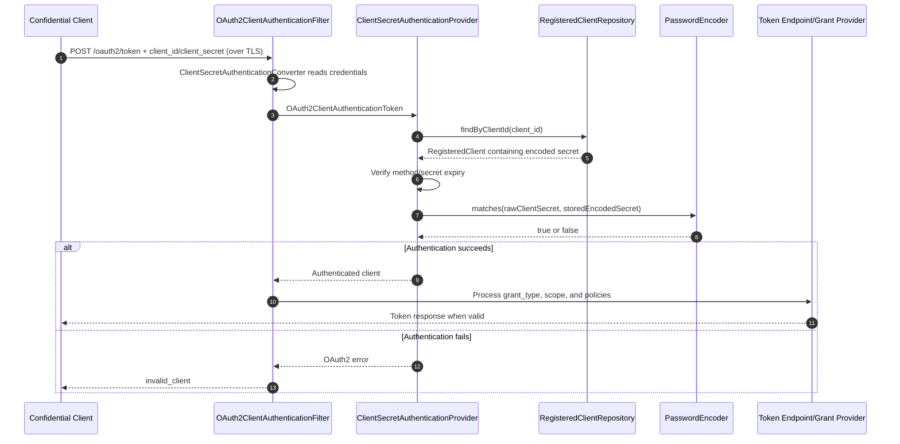
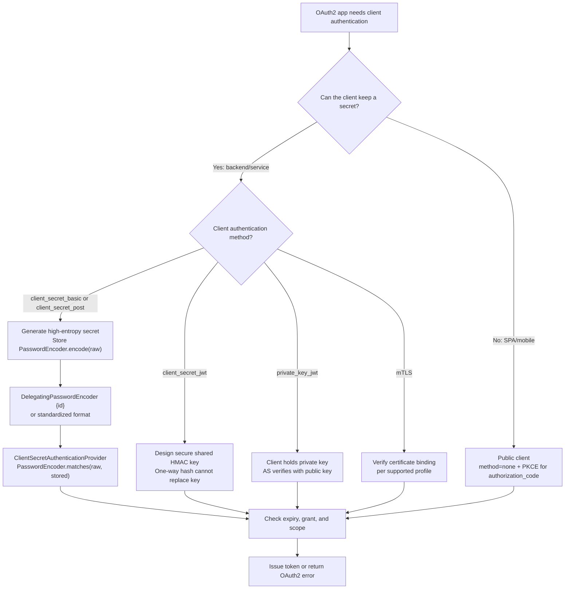

# Encoding Client Secrets with PasswordEncoder and Choosing the Right Algorithm

## 1. Objectives and Scope

In the **Client Authentication** chapter of the **SPRING_SECURITY_OAUTH2_OIDC_AUTHORIZATION_SERVER** module, protecting **client secrets** is a crucial part of designing, configuring, securing, testing, and operating an OAuth 2.0/OpenID Connect (OIDC) Authorization Server with **Spring Security and Spring Authorization Server (SAS)** on **Spring Boot**.

This lesson explains how to store client secrets with `PasswordEncoder`, choose algorithms, configure the client authentication mechanism, and operate secrets safely. After completing it, you will be able to:

- Distinguish between a **raw secret**, a **one-way encoded hash**, and **reversible encryption**.
- Know when to use `ClientAuthenticationMethod.CLIENT_SECRET_BASIC`, `CLIENT_SECRET_POST`, or methods that **cannot use the same secret-hashing approach**.
- Register a `PasswordEncoder`, create a `RegisteredClient` with a hashed secret, and understand how `ClientSecretAuthenticationProvider` verifies it.
- Compare `BCrypt`, `PBKDF2`, `SCrypt`, and `Argon2` to choose parameters suited to traffic and security policies.
- Design expiration, rotation, algorithm upgrades, error handling, and a test suite for client credentials.

**Technical assumptions:** The Java examples use common APIs from Spring Security 6.x / Spring Authorization Server 1.x combined with Spring Boot 3.x. In newer generations, verify class names, methods, defaults, and auto-configuration mechanisms against your project's dependency versions. In particular, configuring `PasswordEncoder` for user logins and configuring the encoder for SAS client authentication are **two integration points that must be verified separately**.

> **Terminology:** Although the title uses the word "encoding" (or "encryption" in casual phrasing), `PasswordEncoder` performs a **one-way transformation to verify secrets** via `matches`, not reversible encryption. There is no `decode` API to recover the original client secret from the hash.

## 2. What Does a Client Secret Prove?

In OAuth 2.0, a client is an application registered with the Authorization Server. A **confidential client** can keep secrets safe, such as a backend application or machine-to-machine service. A client secret is a **shared credential** for the client to prove its identity to the AS at endpoints requiring client authentication, usually the token endpoint.

An example:

- `client_id`: `orders-backend` — client identifier, **not a secret**.
- `client_secret`: a sufficiently strong random string known only to the client and the secret management system.
- `clientAuthenticationMethod`: `client_secret_basic`.
- `authorizationGrantType`: `client_credentials`.
- `scope`: `orders.read`.

When the backend calls `POST /oauth2/token` with `grant_type=client_credentials`, SAS authenticates the client before deciding whether to issue an access token. A client being authenticated **does not automatically grant all scopes or grants**: the server still has to check `RegisteredClient` and related policies.

**Distinguishing security objects:**

| Object | What is it used for? | Should it be stored with `PasswordEncoder`? |
| --- | --- | --- |
| `client_id` | Identifies the client when querying the repository | No; it is an identifier and needs to be looked up directly. |
| `client_secret` for `client_secret_basic/post` | Authenticates a confidential client via secret comparison | **Yes**, store a one-way hash when the server only needs to match the secret. |
| End-user password | Authenticates the resource owner during login | Yes, with an appropriate password encoder/policy; this is a different data domain from client secrets. |
| Authorization code | Proves a short-lived authorization flow bound to PKCE and the client | Part of authorization state; **do not store or compare by manually applying `PasswordEncoder` to individual SAS fields**. |
| Access token / refresh token | Bearer credential or profile-specific token | Stored and looked up via `OAuth2AuthorizationService`; do not manually hash fields in the default JDBC service. |
| Private key for `private_key_jwt` | Assertion signing key held on the client side | The client must protect the private key; the AS verifies using the public key and does not store a hash of the private key. |
| Shared key for `client_secret_jwt` | HMAC key to sign/verify client assertions | Requires access to the original key material or an equivalent cryptographic mechanism to verify signatures; **standard one-way hashes cannot replace an HMAC key**. |

## 3. Client Secret Authentication Map in SAS



The diagram shows component **responsibilities**, without requiring every framework version to follow the exact same internal check order. Key milestones:

1. `OAuth2ClientAuthenticationFilter` receives the request and invokes the converter matching the client authentication method.
2. `ClientSecretAuthenticationProvider` fetches the `RegisteredClient` by `client_id` and verifies that the client is allowed to use the requested method.
3. The provider compares the **raw secret sent by the client** with the **encoded secret in the repository** using `PasswordEncoder.matches(raw, encoded)`; it may also check `clientSecretExpiresAt`.
4. Only after client authentication succeeds does the grant provider evaluate `grant_type`, scopes, token state, and other conditions.
5. If credentials are invalid, the endpoint returns an OAuth2 error such as `invalid_client` without issuing a token.

**HTTP Basic is not encryption:** Base64 in `Authorization: Basic ...` is a data representation, not confidentiality protection on the wire. **TLS/HTTPS is mandatory** when transmitting client secrets over a network. Plain HTTP on loopback should only be used in isolated local labs.

## 4. What Does `PasswordEncoder` Store and How Does It Verify?

### 4.1. `encode` and `matches`

Spring Security's core contract:

```java
public interface PasswordEncoder {
    String encode(CharSequence rawPassword);
    boolean matches(CharSequence rawPassword, String encodedPassword);
    default boolean upgradeEncoding(String encodedPassword) {
        return false;
    }
}
```

`encode(raw)` produces an encoded string suitable for the algorithm. `matches(raw, stored)` returns `true` when the raw input matches the stored hash. `upgradeEncoding(stored)` indicates **whether upgrading the storage format should be considered** under the current encoder configuration; calling it does not update the database by itself.

Example (with no real secret in source code):

```java
PasswordEncoder encoder =
        PasswordEncoderFactories.createDelegatingPasswordEncoder();

String rawSecret = System.getenv("LOCAL_OAUTH_CLIENT_SECRET");
String storedSecret = encoder.encode(rawSecret);

boolean accepted = encoder.matches(rawSecret, storedSecret);
boolean rejected = encoder.matches("wrong-secret", storedSecret);
```

With the encoder returned by the factory in common Spring Security 6.x versions, new hashes are generated with BCrypt and prefixed with `{bcrypt}`. The output of each `encode` call can differ because of a random salt, yet `matches` still returns `true` for the corresponding raw secret.

### 4.2. Salt, Work Factor, and Why Plain SHA-256 Is Not Used

A suitable password-hashing algorithm typically provides:

- A **unique, random salt** per value to reduce the effectiveness of matching identical hashes or precomputed lookup tables.
- A tunable **work factor/cost** to increase the expense of bulk guessing attempts.
- A storage format that embeds the parameters needed for verification; the application does not need to manage salts manually when the encoder supports it.

Do not use `SHA-256(rawSecret)` or `MD5(rawSecret)` as a `PasswordEncoder` credential storage strategy. General-purpose hash functions compute far too fast and do not provide the same offline brute-force resistance as dedicated algorithms. Even when a client secret is randomly generated, choosing a sound and consistent mechanism remains essential to avoid credential management errors and later algorithm changes.

**One-way hashing differs from encryption:** `PasswordEncoder` provides no decryption key. When a client loses its secret, the system must **issue a new secret / rotate it**—there is no feature to "view the old secret" from the hash.

### 4.3. `DelegatingPasswordEncoder` and the `{id}` Prefix

`DelegatingPasswordEncoder` uses the syntax:

```text
{id}encodedPassword
```

Illustrative examples, with hash portions shortened:

```text
{bcrypt}$2a$12$.....................................................
{pbkdf2@SpringSecurity_v5_8}....
{scrypt@SpringSecurity_v5_8}....
{argon2@SpringSecurity_v5_8}....
```

The part inside curly braces identifies the encoder used to **verify** the value; these are example IDs supported by the map in certain configurations/versions, not a guarantee that every application supports all of them. `PasswordEncoderFactories.createDelegatingPasswordEncoder()` provides a set of IDs according to the Spring Security version in use.

When calling:

```java
PasswordEncoder encoder =
        PasswordEncoderFactories.createDelegatingPasswordEncoder();

String encoded = encoder.encode("example-only-not-a-real-secret");

boolean valid = encoder.matches(
        "example-only-not-a-real-secret", encoded);
```

The encoder typically parses the `{bcrypt}` prefix and delegates the remainder to `BCryptPasswordEncoder`. This makes it possible to keep verifying legacy hashes while transitioning to a new format, provided decoders are configured for the corresponding IDs.

**Do not strip the `{bcrypt}` prefix arbitrarily.** If you use the default `DelegatingPasswordEncoder` to check a `$2a$...` string lacking `{id}`, encoder lookup by ID can fail. Conversely, if you use `new BCryptPasswordEncoder()` directly, it expects raw bcrypt format, not a `{bcrypt}`-prefixed string. Ensure that the encoder **at hash creation** and the encoder **at `matches` time** share a compatible storage contract.

## 5. Choosing an Algorithm by Client Type and Operational Needs

| Algorithm | Characteristics | Best suited when | Points to evaluate |
| --- | --- | --- | --- |
| **BCrypt** | Slow derivation function, self-managed salt, adjustable cost; broad Java ecosystem | Practical default for `client_secret_basic/post` with sufficiently random secrets | BCrypt's **72-byte input limit**; pick secrets shorter than the limit; benchmark cost under high token-request volume. |
| **PBKDF2** | Based on many iterations of a cryptographic function; CPU-bound | Systems with compliance requirements or cryptographic stacks preferring PBKDF2 | Choose appropriate PRF, iteration count, hash length, and configuration version; CPU-intensive, less memory hardness than scrypt/Argon2. |
| **scrypt** | Designed to consume both CPU and memory | You want to raise the cost of parallel-hardware brute forcing | Memory cost can heavily impact the AS when many clients authenticate concurrently. |
| **Argon2 / Argon2id** | Modern memory-hard function supporting memory/time/parallelism parameters | Good deployment, monitoring, and benchmarking capability; fits policies prioritizing memory-hard hashing | Requires supporting libraries/versions, RAM resources, and tuning in a real runtime environment. |
| **NoOp / plaintext** | Unhashed; zero secret protection if database leaks | Only for identifying misconfigured legacy/test data | **Never choose** this to store client secrets in real systems. |
| **Plain SHA-256** | Very fast general-purpose hash | Signatures/integrity checks for other purposes | Do not use for password hashing in place of the algorithms above. |

**Reasonable starting choice:** `PasswordEncoderFactories.createDelegatingPasswordEncoder()` for algorithm prefixes and Spring Security's compatible default hashing mechanism, typically BCrypt. Then benchmark client authentication cost, review security regulations, and tune the algorithm or cost as needed.

### 5.1. Given That Client Secrets Usually Have High Entropy, What Should Be Considered?

Backend client secrets should be **system-generated using a CSPRNG** with high entropy (e.g., 32 random bytes = 256 bits before Base64URL encoding). Secrets differ from human-chosen passwords: dictionary-guessing risk is much lower if secrets are generated and managed properly.

Even so, hashing helps reduce raw secret exposure if the database is read improperly. Equally important priorities include:

1. Generate strong secrets; never use patterns like `company123`, app names, or predictable UUIDs.
2. Deliver secrets to confidential clients only over protected channels.
3. Never store raw secrets in logs, committed configurations, or analytics.
4. Restrict the number of places that can access hashes and client metadata.
5. Set TTLs, rotation, rate limiting, and authentication failure monitoring.
6. Choose a hash cost that does not turn the token endpoint into a bottleneck or DoS vector.

### 5.2. BCrypt's 72-Byte Limit

Traditional BCrypt only processes roughly the first **72 bytes** of input. Two secrets that differ only beyond this limit may not be distinguished as expected. Do not manually pre-hash with SHA-256 before BCrypt because that alters the format and compatibility. Instead, when using BCrypt for client secrets, generate random secrets whose encoded length stays **under 72 bytes**. For instance, 32 random bytes Base64URL-encoded become roughly 43 ASCII characters, safely within the limit.

### 5.3. Performance and Load Capacity

`matches` having CPU/memory cost is intentional for password hashing, yet the token endpoint may handle heavy machine-to-machine traffic. When increasing BCrypt strength or Argon2 memory cost:

- Measure P50/P95/P99 latency of `/oauth2/token` and CPU/RAM cost per authentication.
- Load-test concurrent requests, with both wrong and right secrets.
- Apply rate limiting/abuse protection at the gateway or AS per policy, rather than logging raw secrets to detect attacks.
- Roll out parameter changes via an upgrade plan rather than ad-hoc tweaks that cause capacity drops.

There is no single fixed cost value suited to every machine and library version. Benchmarking on target infrastructure is the basis for parameter selection.

## 6. Generating Client Secrets Safely

Never create secrets using short human-picked strings or `Math.random()`. An administrative app can use Java's `SecureRandom`:

```java
import java.security.SecureRandom;
import java.util.Base64;

public final class ClientSecretGenerator {
    private static final SecureRandom RANDOM = new SecureRandom();

    private ClientSecretGenerator() {
    }

    public static String generate() {
        byte[] bytes = new byte[32]; // 256 bits before encoding
        RANDOM.nextBytes(bytes);
        return Base64.getUrlEncoder()
                .withoutPadding()
                .encodeToString(bytes);
    }
}
```

The result is a Base64URL string of roughly 43 characters, fitting well within BCrypt's input length. In production systems, **never print the output to logs for "debugging."** Admin client-creation workflows should:

- Generate the secret on the backend via a CSPRNG.
- Store the **encoded hash** in `RegisteredClientRepository`.
- Return the original secret **once** over a secure administrative channel to an authorized recipient.
- Require administrators to store the secret in a secret manager or secure client configuration system.
- If a secret is lost, issue a new one through the rotation process rather than trying to recover it from the hash.

If accepting a secret generated by an integrating party, still validate its length/quality and store it using the same encoder format, optionally enforcing policies that reject weak secrets or secrets too long for the algorithm's constraints.

## 7. Registering `PasswordEncoder` and `RegisteredClient`

### 7.1. Minimal Spring Boot Configuration

With Spring Boot and compatible SAS libraries, you can use the dependency:

```xml
<dependency>
    <groupId>org.springframework.boot</groupId>
    <artifactId>spring-boot-starter-oauth2-authorization-server</artifactId>
</dependency>
```

The example below declares a **confidential machine-to-machine client** `orders-backend` using `client_secret_basic`. The client secret is supplied via an environment variable at runtime, never embedded as a literal in code.

```java
@Configuration(proxyBeanMethods = false)
public class ClientRegistrationConfig {

    @Bean
    PasswordEncoder passwordEncoder() {
        return PasswordEncoderFactories
                .createDelegatingPasswordEncoder();
    }

    @Bean
    RegisteredClientRepository registeredClientRepository(
            PasswordEncoder passwordEncoder,
            @Value("${LOCAL_OAUTH_CLIENT_SECRET}") String rawSecret) {

        if (rawSecret == null || rawSecret.isBlank()) {
            throw new IllegalStateException(
                    "LOCAL_OAUTH_CLIENT_SECRET must be configured");
        }

        RegisteredClient client = RegisteredClient
                .withId("orders-backend-local-001")
                .clientId("orders-backend")
                .clientSecret(passwordEncoder.encode(rawSecret))
                .clientAuthenticationMethod(
                        ClientAuthenticationMethod.CLIENT_SECRET_BASIC)
                .authorizationGrantType(
                        AuthorizationGrantType.CLIENT_CREDENTIALS)
                .scope("orders.read")
                .clientSecretExpiresAt(
                        Instant.now().plus(Duration.ofDays(90)))
                .build();

        return new InMemoryRegisteredClientRepository(client);
    }
}
```

Required imports include `org.springframework.security.crypto.password.PasswordEncoder`, `org.springframework.security.crypto.factory.PasswordEncoderFactories`, the `RegisteredClient`/`RegisteredClientRepository`/`InMemoryRegisteredClientRepository` classes, `ClientAuthenticationMethod`, `AuthorizationGrantType`, `java.time.Instant`, and `java.time.Duration`. In larger applications, separate client registration from startup using an authorized admin service backed by durable persistence.

**Read this key line carefully:**

```java
.clientSecret(passwordEncoder.encode(rawSecret))
```

`RegisteredClient` stores the **hash**, while the actual client uses the **raw secret** to authenticate. If a client sends the `{bcrypt}...` string copied from the database instead of the raw secret, normal `matches` calls will not treat it as the original secret.

**Note on the example:** `Instant.now().plus(Duration.ofDays(90))` only illustrates setting an expiration timestamp; it does not mean every client must have a 90-day TTL. After each restart, this example generates a hash with a new salt and resets the expiration date; in production, such changes must be managed through durable registration/rotation workflows rather than arbitrarily recreating clients on startup.

### 7.2. Setting Environment Variables Without Putting Secrets in Source Code

Local PowerShell example:

```powershell
$secret = Read-Host "Local OAuth2 client secret" -AsSecureString
$pointer = [Runtime.InteropServices.Marshal]::SecureStringToBSTR($secret)
try {
    $env:LOCAL_OAUTH_CLIENT_SECRET =
        [Runtime.InteropServices.Marshal]::PtrToStringBSTR($pointer)
} finally {
    [Runtime.InteropServices.Marshal]::ZeroFreeBSTR($pointer)
}
```

This avoids writing the secret directly into PowerShell command history, though **the process environment variable still holds plaintext**. For operational systems, use a secrets manager or controlled credential-injection solution. Never commit `.env` files containing secrets or print raw values in CI output.

### 7.3. Does `@Bean PasswordEncoder` Automatically Affect SAS?

**Do not infer solely from having a `PasswordEncoder` bean that every provider in the Authorization Server will automatically use that bean.** In SAS 1.x, `ClientSecretAuthenticationProvider` has its own encoder setup (the default configuration is typically a delegating encoder). If the application chooses a custom encoder and format, you must **ensure the hashing side and the verification side are compatible**.

You can explicitly configure the provider in the SAS DSL to wire in the encoder used at registration:

```java
@Bean
@Order(1)
SecurityFilterChain authorizationServerChain(
        HttpSecurity http,
        PasswordEncoder passwordEncoder) throws Exception {

    OAuth2AuthorizationServerConfigurer as =
            OAuth2AuthorizationServerConfigurer.authorizationServer();

    http
        .securityMatcher(as.getEndpointsMatcher())
        .with(as, authorizationServer ->
                authorizationServer.clientAuthentication(
                        clientAuthentication ->
                                clientAuthentication
                                    .authenticationProviders(providers -> {
                                        for (AuthenticationProvider provider
                                                : providers) {
                                            if (provider instanceof
                                                    ClientSecretAuthenticationProvider secretProvider) {
                                                secretProvider.setPasswordEncoder(
                                                        passwordEncoder);
                                            }
                                        }
                                    })))
        .authorizeHttpRequests(auth ->
                auth.anyRequest().authenticated());

    return http.build();
}
```

This example illustrates only the **client authentication integration point**; it is not a full configuration for Authorization Code, login pages, OIDC, or token generators. Those pieces must be combined with other AS configurations based on application goals and your exact SAS version.

If you use `PasswordEncoderFactories.createDelegatingPasswordEncoder()` consistently on both sides, `{bcrypt}...` hashes can be verified without custom converters or providers. When using an encoder that only accepts raw BCrypt, ensure both the provider and storage format use that same encoder.

## 8. Basic, POST, and Methods That Do Not Use Shared-Secret Hashing

### 8.1. `client_secret_basic`

The client sends client credentials via HTTP Basic at the token endpoint. Protocol-level request example:

```http
POST /oauth2/token HTTP/1.1
Host: auth.example.com
Authorization: Basic <BASE64_OF_CLIENT_ID_AND_SECRET>
Content-Type: application/x-www-form-urlencoded

grant_type=client_credentials&scope=orders.read
```

In OAuth 2.0 HTTP Basic, client ID and secret follow form-URL-encoding rules before being concatenated and Base64-encoded; an appropriate OAuth2 client library usually handles this. The Base64 string is a **sensitive credential**—do not log it or send it to third parties. Requests must travel over TLS.

`client_secret_basic` is generally preferred over `client_secret_post` because credentials reside in a header that can be handled/redacted separately, avoiding passing secrets in the form body when integrating systems that log request payloads.

### 8.2. `client_secret_post`

The client sends `client_id`/`client_secret` as form fields in the request to the token endpoint:

```http
POST /oauth2/token HTTP/1.1
Host: auth.example.com
Content-Type: application/x-www-form-urlencoded

grant_type=client_credentials&client_id=orders-backend&client_secret=<RAW_SECRET>
```

If the AS allows `client_secret_post`, `RegisteredClient` must register it accordingly:

```java
.clientAuthenticationMethod(
        ClientAuthenticationMethod.CLIENT_SECRET_POST)
```

Enable only the methods genuinely needed; never indiscriminately accept every client authentication method for the same client. `client_secret_post` is prone to exposure when reverse proxies, APMs, or middleware log bodies; apply redaction and protections equivalent to those for the Basic header.

### 8.3. Public Clients Have No Trustworthy Client Secret

Browser SPAs and mobile apps cannot protect a shared secret embedded in source code or packages. For public clients, use:

```java
.clientAuthenticationMethod(
        ClientAuthenticationMethod.NONE)
.authorizationGrantType(
        AuthorizationGrantType.AUTHORIZATION_CODE)
.clientSettings(ClientSettings.builder()
        .requireProofKey(true)
        .build())
```

The client must also declare appropriate redirect URIs and scopes, such as using Authorization Code + PKCE S256. Never issue a secret and consider it safe just because it is hashed on the AS: a raw copy still sits in the user-distributed application and can be extracted.

**PKCE and client authentication are different:** PKCE binds an authorization code to a client-held verifier; `client_secret_basic` authenticates a confidential client. For a confidential client using Authorization Code, both can be used together.

### 8.4. `client_secret_jwt` Requires Careful Key Material Handling

`client_secret_jwt` uses a **shared symmetric key** to sign and verify JWT-style client assertions. To verify an HMAC signature, the server needs access to the appropriate key material; a one-way hash of the raw secret produced by `BCryptPasswordEncoder` **cannot directly substitute for the original HMAC key**.

Therefore:

- The one-way hash storage configuration in this lesson targets `client_secret_basic` and `client_secret_post`.
- Do not switch a client to `client_secret_jwt` while keeping `{bcrypt}...` and expect signature verification to work.
- If `client_secret_jwt` is truly required, design a protected shared-key storage/retrieval mechanism and support the right provider/algorithm; typically you should evaluate `private_key_jwt` so the AS only needs a public key.
- With `private_key_jwt`, the client holds the private key and the AS verifies assertions using the client's public key/JWKS; it does not rely on `PasswordEncoder.matches` for a client secret.
- Mutual TLS (if supported by infrastructure) is another client authentication method that may fit your security requirements.

## 9. Registering New Clients and Safely Changing Secrets

### 9.1. Registering Clients with JDBC

When persistence is required, use `JdbcRegisteredClientRepository` or a custom repository. Example:

```java
@Bean
RegisteredClientRepository registeredClientRepository(
        JdbcTemplate jdbcTemplate) {
    return new JdbcRegisteredClientRepository(jdbcTemplate);
}
```

This snippet is an **alternative** to the in-memory bean above. Before using it, apply the schema matching your SAS version. An authorized administrative workflow can create a record:

```java
public void registerMachineClient(
        RegisteredClientRepository repository,
        PasswordEncoder encoder,
        String rawSecret) {

    RegisteredClient client = RegisteredClient
            .withId(UUID.randomUUID().toString())
            .clientId("orders-backend")
            .clientSecret(encoder.encode(rawSecret))
            .clientAuthenticationMethod(
                    ClientAuthenticationMethod.CLIENT_SECRET_BASIC)
            .authorizationGrantType(
                    AuthorizationGrantType.CLIENT_CREDENTIALS)
            .scope("orders.read")
            .build();

    repository.save(client);
}
```

In a real application, add authorization checks for client creation, duplicate `clientId` prevention, lifecycle/expiry handling, auditing, and secure secret delivery. Never expose this administrative method as a public endpoint.

### 9.2. Setting a Secret Expiration

`RegisteredClient.Builder#clientSecretExpiresAt(Instant)` lets you configure an expiration timestamp:

```java
RegisteredClient updated = RegisteredClient.from(existing)
        .clientSecretExpiresAt(
                Instant.now().plus(Duration.ofDays(90)))
        .build();

registeredClientRepository.save(updated);
```

Extend expiration only when approved by policy; never extend lifetimes automatically to silence errors. Once a client secret expires, client authentication is rejected per provider rules. Monitor and alert ahead of expiration to avoid outages.

### 9.3. Rotation Workflow

A controlled client secret rotation workflow:

1. **Preparation:** confirm client owner, dependent systems, deadlines, delivery path for the new secret, and rollback plan.
2. **Generate new secret:** use a CSPRNG with sufficient entropy; never reuse old secrets.
3. **Hash and update:** use the right `PasswordEncoder`; store only the encoded hash in the repository per the chosen mechanism.
4. **Distribution:** deliver the new raw secret to the client via a secret manager or secure admin channel; update relevant instances/partners.
5. **Cutover:** confirm the client has switched to the new secret, monitor authentication errors, and bound how long the old secret remains active.
6. **Revocation and post-check:** invalidate the old secret per policy, record safe audit metadata, and confirm systems remain healthy.

**Limitation of the default model:** `RegisteredClient` typically holds **one** active `clientSecret` field at a time. Updating the hash can immediately break clients that have not yet switched over. If an overlap period with two secrets is required, design a supported mechanism: a custom repository/provider supporting multiple credentials, or a controlled dual-registration strategy. Never assume SAS supports old and new secrets simultaneously out of the box.

Changing a client secret **does not automatically revoke** already-issued JWT access tokens: APIs may keep accepting valid tokens if they only verify offline via JWKS. If secret compromise is suspected, evaluate revocation, TTLs, and impact scoping for issued tokens.

## 10. Upgrading Algorithms and Cost When Clients Already Exist in the Database

### 10.1. Versioned Formats Enable Incremental Migration

Suppose the repository currently stores hashes like:

```text
{bcrypt}...
{pbkdf2@SpringSecurity_v5_8}...
```

If `DelegatingPasswordEncoder` is configured to recognize both IDs, it can `matches` older hashes while the system begins `encode`-ing new secrets with the newer algorithm. Ensure every AS instance supports the new ID **before** creating hashes in the new format.

### 10.2. Rehashing Does Not Happen Automatically During `matches`

Calling:

```java
boolean verified = encoder.matches(rawSecret, storedSecret);
boolean upgradeSuggested = encoder.upgradeEncoding(storedSecret);
```

does not automatically persist an updated `RegisteredClient`. Upgrading a hash requires **having the raw secret at an authorized moment** and an appropriate repository update flow, or asking the client to rotate its secret. For credentials issued to third parties, the raw secret may not exist on the server outside the request window; never attempt to decrypt a hash to rehash it.

If you choose to rehash automatically after verification, handle concurrency and auditing because the same client may send parallel requests; never weaken secret checks or corrupt client registration state. In practice, managed rotation is usually easier to control than silent mutations inside the token endpoint flow.

### 10.3. Cross-Instance Compatibility

For multi-instance Authorization Servers:

- Every instance must use an encoder capable of `matches` on all currently stored hash formats.
- Schema/repository versions must be consistent.
- Algorithm changes must roll out read-support first, then write-support.
- Maintain a rollback plan that does not leave older instances unable to read newly written hashes.
- Monitor the `invalid_client` rate after rollout without logging raw secrets.

Never apply a "quick fix" that allows plaintext fallback for credentials, as that can turn a migration hiccup into a security vulnerability.

## 11. Security and Integration Testing

### 11.1. Unit Testing `PasswordEncoder`

A test containing no real secrets:

```java
@Test
void encodesAndMatchesClientSecret() {
    PasswordEncoder encoder =
            PasswordEncoderFactories.createDelegatingPasswordEncoder();

    String raw = "local-test-only-randomized-secret-value";
    String stored = encoder.encode(raw);

    assertNotEquals(raw, stored);
    assertTrue(stored.startsWith("{bcrypt}"));
    assertTrue(encoder.matches(raw, stored));
    assertFalse(encoder.matches("incorrect-secret", stored));
}
```

If your project changes the default encoder or algorithm, update the prefix assertion to reflect the chosen format policy rather than relying forever on defaults when custom rules apply.

Additional cases to test:

| Scenario | Expectation |
| --- | --- |
| Same raw secret passed to `encode` twice | Hashes usually differ due to random salt, and both `matches` the raw secret. |
| Wrong raw secret | `matches` returns `false`. |
| Hash with unsupported `{id}` | Rejected / throws appropriate exception; absolutely no automatic fallback to plaintext. |
| BCrypt hash missing prefix when using delegating encoder | Detected as incompatible format; fix migration/encoder rather than bypassing verification. |
| Empty secret / missing input source | Registration and startup workflows fail safely. |
| Cost / algorithm change | Old hashes verify according to configured ID and compatibility policy. |
| Raw value exceeding BCrypt limit | Secret generation/acceptance policy handles it explicitly without ambiguous matching past byte 72. |

### 11.2. Integration Testing via the Token Endpoint

With client `orders-backend` and the `client_credentials` grant, you can use `curl.exe` on Windows. Omitting the password from `--user` makes curl prompt interactively instead of putting the secret on the command line:

```powershell
curl.exe --user orders-backend --data-urlencode "grant_type=client_credentials" --data-urlencode "scope=orders.read" http://localhost:9000/oauth2/token
```

Prerequisites: the AS is fully configured, the client is registered, and token generation works. Plain HTTP on `localhost` is only for learning in an isolated loopback environment; over a network you must switch to HTTPS.

The success expectation is a standard token response for the granted flow. Your test suite should also cover error branches:

| Scenario | Expected outcome |
| --- | --- |
| Correct client ID, secret, authentication method, and grant | Client authenticates; token processed per grant/scope. |
| Wrong secret | `invalid_client` error or corresponding security response; no token issued. |
| Missing secret for confidential client | Client authentication rejected. |
| Expired secret | Authentication rejected; no new token issued. |
| Client uses `client_secret_post` when only `client_secret_basic` is registered | Disallowed method rejected. |
| Client disabled by administrative policy | No token issued; depends on implementation checks. |
| Valid secret, unregistered grant requested | Grant rejected, no token issued. |
| Valid secret, over-privileged scope | Token not issued with unauthorized scope. |
| Corrupted stored hash / missing encoder ID | Fails safely; never passes via plaintext fallback. |
| Algorithm change and rolling deployment | Every active instance can verify the formats in use. |
| Secret rotation | New secret succeeds; old secret rejected after overlap/cutover policy ends. |

### 11.3. Metrics to Monitor

Useful operational signals include request count to `/oauth2/token`, `invalid_client` rate, authentication latency, CPU/memory during password hashing, repository backend health, clients nearing expiration, and rotation count. Attach correlation IDs and client IDs per data policy; never log raw secrets, authorization headers, access/refresh tokens, or password hashes.

Do not over-distinguish in public responses between "client does not exist," "wrong secret," and "secret just expired" if that risks aiding client enumeration. Protected internal logs can use more specific event codes for investigation.

## 12. Common Pitfalls

| Pitfall | Consequence | Fix |
| --- | --- | --- |
| Storing raw `clientSecret` in the repository | Database leak immediately exposes usable credentials | Store `passwordEncoder.encode(rawSecret)` for basic/post. |
| Using `new BCryptPasswordEncoder()` to check `{bcrypt}...` strings | Mismatch due to prefix format | Use the corresponding delegating encoder or perform controlled format migration. |
| Using delegating encoder while DB hashes lack `{id}` | Cannot determine encoder; authentication fails | Standardize format/migration; avoid `NoOp` fallback. |
| Using overly long raw secrets with BCrypt | Differences past byte 72 may be ignored | Generate 32 random bytes encoded as Base64URL, or pick another suitable algorithm. |
| Putting confidential client secrets in JavaScript/mobile apps | Users can extract the raw secret | Use public client + Authorization Code + PKCE. |
| Using `client_secret_post` while logging request bodies | Credentials leak through proxy/APM/logs | Disable or redact body logs, prefer Basic when possible, use HTTPS. |
| Only registering a `PasswordEncoder` bean and assuming SAS automatically uses custom settings | Stored format and verification format diverge | Check `ClientSecretAuthenticationProvider` and wire the encoder when needed. |
| Using a hashed secret as the HMAC key for `client_secret_jwt` | Cannot verify JWT assertions | Design proper key storage or move to `private_key_jwt`. |
| Setting a high BCrypt cost without benchmarking | Token endpoint bottlenecks or easy resource DoS | Benchmark performance and deploy appropriate rate limits/capacity. |
| Rotating secrets directly before all instances update | Mass `invalid_client` errors | Controlled cutover/overlap process, tested before rollout. |
| Calling `matches` and treating it as permission to issue tokens | Bypasses grant/scope/client policies | Let SAS run full token endpoint and grant provider checks. |
| Passing client secrets in the query string | Leaked in logs, browser history, analytics | Use standard client authentication methods over HTTPS. |

## 13. Pre-Production Design Checklist

- [ ] Determine whether the client is **confidential** or **public** and choose the matching client authentication method.
- [ ] For `client_secret_basic/post`, generate raw secrets with a CSPRNG with sufficient entropy and algorithm-compatible length.
- [ ] Store only encoded hashes via `PasswordEncoder`; never store plaintext in the database.
- [ ] Verify that the write-time encoder and `matches`-time provider support the same format.
- [ ] Use `DelegatingPasswordEncoder` with `{id}` prefixes or a consistently governed hash format strategy.
- [ ] Pick BCrypt/PBKDF2/scrypt/Argon2 based on compliance requirements and real performance benchmarks.
- [ ] For BCrypt, ensure secret generation/acceptance stays within the 72-byte limit.
- [ ] Use HTTPS for client authentication over the network; protect the token endpoint and restrict sensitive logs.
- [ ] Declare grant types, scopes, client secret expiry, and redirect URIs appropriate to the client type.
- [ ] Establish secret generation, one-time delivery, rotation, revocation, and expiration alerting mechanisms.
- [ ] Never use basic/post password hashes as the HMAC key for `client_secret_jwt`.
- [ ] Test wrong secrets, expired secrets, mismatched methods, over-privileged grants/scopes, and hash migrations.
- [ ] When running multiple AS instances, ensure encoder/provider and repository compatibility across nodes.
- [ ] Never expose raw secrets, tokens, hashes, or authentication materials in logs, traces, or public responses.

## 14. Strategy Decision Diagram



When authenticating confidential clients with secrets, what matters is not only calling `PasswordEncoder.encode`, but maintaining a **consistent contract from generation, storage, and distribution through verification and rotation**. Hashing client secrets with an appropriate algorithm mitigates repository leak risks, while TLS, least-privilege client permissions, PKCE (where applicable), rate limiting, and operational policies complete the defense for an Authorization Server built with Spring Security and Spring Authorization Server.
