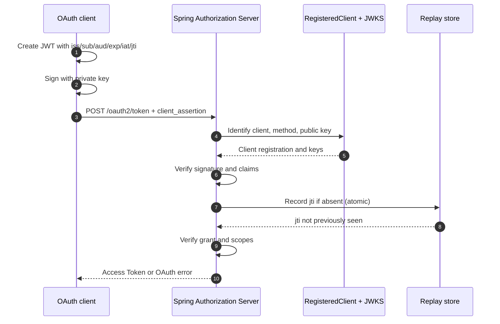
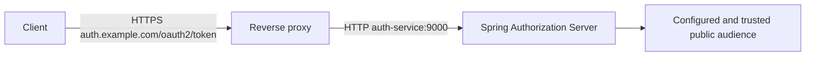

# Verifying Issuer, Subject, Audience, Lifetime, and Assertion Replay Protection

## 1. Objectives and Context

In the **Client Authentication** chapter of the **SPRING_SECURITY_OAUTH2_OIDC_AUTHORIZATION_SERVER** module, we learn how to design, configure, secure, test, and operate an OAuth 2.0/OpenID Connect Authorization Server using Spring Security and Spring Authorization Server in a Spring Boot application. This lesson dives deep into **verifying JWT client assertions**: the evidence signed by an OAuth client and sent to the Authorization Server to prove the client's own identity.

For example, the `invoice-service` service uses the `private_key_jwt` method. It constructs a short-lived JWT, signs it with its private key, and sends the assertion to `/oauth2/token`. The Authorization Server looks up the registered client, verifies the signature using a trusted public key, and validates the claims before issuing a token.

An assertion should only be accepted when **all** relevant conditions hold:

- **Signature and key**: the JWT is signed with a key matching the registered client and an allowed algorithm.
- **Issuer (`iss`)**: the party creating the client assertion is the OAuth client being authenticated.
- **Subject (`sub`)**: the assertion subject matches the client's `client_id`.
- **Audience (`aud`)**: the assertion targets the right accepted Authorization Server/endpoint.
- **Lifetime (`exp`, `nbf`, `iat`)**: the assertion is currently valid and does not have an excessively long lifespan.
- **Replay protection (`jti`)**: when replay protection is required, the assertion ID has never been accepted before and is atomically recorded.

**A valid signature is not enough.** A JWT with a valid signature that was intended for another server, has expired, or is replayed can still be an unauthorized request.

After this lesson, learners will be able to explain these verification rules, configure a sample `private_key_jwt` client, test failures with hands-on requests, build a multi-instance replay store, and design a negative test suite.

## 2. Where Do JWT Client Assertions Operate?

### 2.1. Client Assertions Are Not Access Tokens

| Artifact | Creator | Receiver / verifier | Purpose |
| --- | --- | --- | --- |
| **JWT client assertion** | OAuth client, using the client's key. | Authorization Server. | Authenticates the client application's identity. |
| Authorization code | Authorization Server. | Exchanged by client at token endpoint; server verifies. | One-time proof of an authorization transaction. |
| Access Token | Authorization Server. | Resource Server / API. | Permission to access resources. |
| ID Token | OpenID Provider / Authorization Server. | OIDC client. | User authentication result. |
| Refresh Token | Authorization Server. | Used by client at token endpoint. | Obtain new tokens while still eligible. |

A JWT can also serve as an **authorization grant assertion** under RFC 7523 with `grant_type=urn:ietf:params:oauth:grant-type:jwt-bearer` and the `assertion` parameter. That is a **different** function from a JWT used for client authentication. This lesson covers the `client_assertion` parameter together with `client_assertion_type`.

Two JWT-based client authentication methods:

| Method | Signing material | How the Authorization Server verifies |
| --- | --- | --- |
| `private_key_jwt` | Client holds a private key and signs the JWT asymmetrically. | Uses the public key/JWKS bound to `RegisteredClient`. |
| `client_secret_jwt` | Client signs/MACs the JWT with a shared client secret. | Uses the matching secret key managed on the server side. |

With `private_key_jwt`, the private key **is never sent to the Authorization Server**. For `client_secret_jwt`, HMAC verification requires appropriate key material; never assume a one-way password hash string can act as the raw HMAC key. Both methods still require TLS, secret controls, and anti-spoofing safeguards.

### 2.2. Token Request Carrying an Assertion

Example for `invoice-service` with the `client_credentials` grant:

```http
POST /oauth2/token HTTP/1.1
Host: auth.example.com
Content-Type: application/x-www-form-urlencoded

grant_type=client_credentials&
client_id=invoice-service&
scope=invoices.read&
client_assertion_type=urn%3Aietf%3Aparams%3Aoauth%3Aclient-assertion-type%3Ajwt-bearer&
client_assertion=<signed-jwt>
```

After URL decoding, `client_assertion_type` must equal:

```text
urn:ietf:params:oauth:client-assertion-type:jwt-bearer
```

This is the **client authentication** portion of the request; `grant_type`, `scope`, and token-issuance policies must be validated **separately**. Line breaks in the HTTP example are for readability; real requests require proper form encoding.



The replay store in the diagram is a **hardening policy**. Do not assume by default that Spring Authorization Server automatically tracks `jti` across requests and across multiple instances.

## 3. Structure and Meaning of a JWT Client Assertion

The JWT is signed in standard JWS compact serialization:

```text
BASE64URL(header).BASE64URL(payload).BASE64URL(signature)
```

Illustrative protected header:

```json
{
  "alg": "RS256",
  "typ": "JWT",
  "kid": "invoice-key-2026-11"
}
```

Illustrative payload (timestamps are example data, **not** an actively valid assertion):

```json
{
  "iss": "invoice-service",
  "sub": "invoice-service",
  "aud": "https://auth.example.com/oauth2/token",
  "iat": 1790000000,
  "nbf": 1790000000,
  "exp": 1790000060,
  "jti": "64f79c9c-4a2a-4fe5-8b19-0110d2b62047"
}
```

| Field | Meaning and verification requirement |
| --- | --- |
| `alg` | Accept only algorithms in the allowlist tied to the client's method/key; reject `none` and out-of-policy algorithms. |
| `kid` | Only a hint to select a key within the trusted key set registered for the client. |
| **`iss`** | Issuer of the assertion. For JWT client authentication under RFC 7523, it must identify the client, usually via `client_id`. |
| **`sub`** | Subject of the assertion; must equal `client_id` of the authenticating client. |
| **`aud`** | Intended recipient of the assertion; must contain an accepted Authorization Server/endpoint identifier. |
| **`exp`** | Expiration time, NumericDate in Unix seconds. Required. |
| `nbf` | Earliest time the assertion is valid; if present, must be checked. |
| `iat` | Creation time; check reasonableness when present and require it in strict profiles. |
| `jti` | Assertion identifier; prevents replay when backed by a mandatory policy and a used-token store. |

**Standards scope:** RFC 7523 specifies core fields such as `iss`, `sub`, `aud`, and `exp` for JWT client authentication. Whether `iat`, `nbf`, and `jti` are mandatory depends on the applicable specification/profile. In this lesson we design a **strict security profile** that additionally requires `iat`, `jti`, short TTLs, and replay detection. Do not claim that every default provider enforces all of those hardening rules out of the box.

## 4. Verifying Issuer and Subject: Exact Client Identity

### 4.1. Assertion Issuer Differs from Server-Issued Token Issuer

A common mistake is setting the client assertion's `iss` to the Authorization Server's issuer URL. Distinguish clearly:

```text
Authorization Server issuer = https://auth.example.com
OAuth client_id            = invoice-service

In a JWT client assertion:
    iss = invoice-service
    sub = invoice-service

In a JWT Access Token / OIDC ID Token issued by the AS:
    iss = https://auth.example.com
```

During client authentication, these logical checks must hold:

```text
request.client_id == registeredClient.clientId
assertion.iss     == registeredClient.clientId
assertion.sub     == registeredClient.clientId
```

Where a request omits a separate `client_id` and the protocol/implementation version can infer the client from the assertion, the Authorization Server still must resolve the exact `RegisteredClient` and bind issuer, subject, authentication method, and signing key to that same client. An unverified payload is **not** evidence to trust a client.

| Client declared in request | `iss` | `sub` | Identity check outcome |
| --- | --- | --- | --- |
| `invoice-service` | `invoice-service` | `invoice-service` | Passes identity check; still must verify signature and remaining claims. |
| `invoice-service` | `other-client` | `invoice-service` | Rejected. |
| `invoice-service` | `invoice-service` | `other-client` | Rejected. |
| `invoice-service` | `https://auth.example.com` | `invoice-service` | Rejected due to confusing it with the Authorization Server's issuer. |
| `invoice-service` | Missing | `invoice-service` | Rejected. |
| `invoice-service` | `invoice-service` | Missing | Rejected. |

Client A's signature cannot authenticate client B just because both call the same token endpoint. The public key used for verification must belong to **the exact registered client**.

## 5. Verifying Audience: Right Authorization Server and Endpoint

### 5.1. Accepting Configured Audiences

The assertion's `aud` must identify the intended Authorization Server. Under RFC 7523, the token endpoint URL can be a valid audience; OIDC profiles and system policies may also support the OP's issuer URL within specific scopes.

Example where server and client agree on using the token endpoint URL:

```text
Accepted audience: https://auth.example.com/oauth2/token
Assertion audience: https://auth.example.com/oauth2/token
Result: accepted for the audience check
```

`aud` may also be an array:

```json
{
  "aud": [
    "https://auth.example.com/oauth2/token"
  ]
}
```

Proper verification checks that **a trusted expected value appears in the audience**, not merely that `aud` exists or contains the substring `auth.example.com`. Never strip ports/paths, alter schemes, or arbitrarily accept any endpoint on the same hostname.

For Spring Authorization Server, verify **which audience rules are actually accepted by the provider/validator of the version in use**, as whether issuer URL or token endpoint is accepted can depend on configuration and profile. Do not assume a single string works across every version.

### 5.2. Do Not Mix Audiences

| JWT | `iss` | `aud` |
| --- | --- | --- |
| **Client assertion** | OAuth client identifier (`client_id`). | Authorization Server or token endpoint matching the profile. |
| OIDC ID Token | OpenID Provider issuer. | OIDC client ID. |
| JWT Access Token | Authorization Server issuer. | Intended Resource Server / API. |

Never reuse an Access Token audience validator as a client assertion validator. They have different **recipients and purposes**.

### 5.3. Audience with Reverse Proxies or Multi-Tenancy



The backend may see `http://auth-service:9000` because the proxy terminates TLS. Do not use that internal hostname as the default audience if clients call a different public URL. With multiple issuers/tenants, routing and audience must derive from trusted tenant configuration so assertions intended for tenant A cannot be used at tenant B.

Never allow caller-supplied `Host`, `Forwarded`, or `X-Forwarded-Host` headers to alter the permitted audience. The proxy must strip/overwrite untrusted forwarded headers, and the application should use a managed issuer/public origin.

## 6. Time Validation: exp, nbf, iat, and Clock Skew

### 6.1. Mandatory Expiration

`exp` is the expiration timestamp as a NumericDate. The server accepts the assertion only if it has not expired within the allowed clock-skew policy. Example:

```text
iat = 10:00:00
exp = 10:01:00
now = 10:00:30   => may proceed to remaining checks
now = 10:04:00   => must reject as expired
```

An expired assertion must never be accepted just because its signature is still valid. Conversely, an **unexpired** assertion can still be replayed multiple times if the server does not track `jti`.

### 6.2. Not-Before and Issued-At

- `nbf` prevents using an assertion too early. If `nbf` is in the future beyond clock skew, reject it.
- `iat` helps detect JWTs marked as created far in the future or carrying abnormal lifetimes.
- `exp - iat` indicates an assertion's lifetime. You can enforce a max TTL threshold to keep clients from minting overly long-lived assertions.
- Cluster instances and OAuth clients must maintain reasonably synchronized clocks; do not configure huge clock skews to mask operational drift.

An **illustrative** security profile might require:

```text
exp present
iat present
jti present, non-empty
0 < exp - iat <= 120 seconds
iat <= now + 30 seconds
nbf <= now + 30 seconds (if nbf is present)
exp > now - 30 seconds
```

Values like `120 seconds` and `30 seconds` are not defaults or mandatory constants from RFC 7523; each system must select them according to policy, risk, and deployment environment.

### 6.3. Java Example Validating Claims After Signature Verification

The following snippet is only an **additional claims validation step**. The input `Jwt` must already have had its signature verified using the key registered for the right client. This code **neither verifies the signature nor stores `jti` in a replay cache**:

```java
import java.time.Clock;
import java.time.Duration;
import java.time.Instant;
import java.util.List;

import org.springframework.security.oauth2.jwt.Jwt;

public final class ClientAssertionClaimsPolicy {

    private ClientAssertionClaimsPolicy() {}

    public static void validate(
            Jwt verifiedJwt,
            String registeredClientId,
            String acceptedAudience,
            Clock clock) {

        if (!registeredClientId.equals(verifiedJwt.getClaimAsString("iss"))
                || !registeredClientId.equals(verifiedJwt.getClaimAsString("sub"))) {
            throw new IllegalArgumentException("Invalid client assertion identity");
        }

        List<String> audiences = verifiedJwt.getAudience();
        if (audiences == null || !audiences.contains(acceptedAudience)) {
            throw new IllegalArgumentException("Invalid client assertion audience");
        }

        Instant now = clock.instant();
        Duration skew = Duration.ofSeconds(30);
        Duration maxLifetime = Duration.ofMinutes(2);
        Instant iat = verifiedJwt.getIssuedAt();
        Instant nbf = verifiedJwt.getNotBefore();
        Instant exp = verifiedJwt.getExpiresAt();

        if (iat == null || exp == null
                || !exp.isAfter(iat)
                || !exp.isAfter(now.minus(skew))
                || iat.isAfter(now.plus(skew))
                || Duration.between(iat, exp).compareTo(maxLifetime) > 0) {
            throw new IllegalArgumentException("Invalid client assertion timestamps");
        }

        if (nbf != null && nbf.isAfter(now.plus(skew))) {
            throw new IllegalArgumentException("Client assertion not active yet");
        }

        String jti = verifiedJwt.getId();
        if (jti == null || jti.isBlank()) {
            throw new IllegalArgumentException("Missing client assertion jti");
        }
    }
}
```

In a real application, `registeredClientId` and `acceptedAudience` must come from **trusted** metadata, not directly from unverified claims. Use the JWT client authentication provider extension point compatible with your Spring Authorization Server version, preserve default checks, and run replay checks after signature/claims succeed.

## 7. Verifying Signatures and Trusted Key Sources

### 7.1. Configuring RegisteredClient with private_key_jwt

Spring Authorization Server 1.x example with compatible APIs:

```java
import java.util.UUID;

import org.springframework.security.oauth2.core.AuthorizationGrantType;
import org.springframework.security.oauth2.core.ClientAuthenticationMethod;
import org.springframework.security.oauth2.server.authorization.client.RegisteredClient;
import org.springframework.security.oauth2.server.authorization.settings.ClientSettings;

RegisteredClient invoiceClient = RegisteredClient.withId(UUID.randomUUID().toString())
        .clientId("invoice-service")
        .clientAuthenticationMethod(ClientAuthenticationMethod.PRIVATE_KEY_JWT)
        .authorizationGrantType(AuthorizationGrantType.CLIENT_CREDENTIALS)
        .scope("invoices.read")
        .clientSettings(ClientSettings.builder()
                .jwkSetUrl("https://client.example.com/.well-known/jwks.json")
                .build())
        .build();
```

This snippet illustrates **client registration only**, not a full Authorization Server configuration: you also need `RegisteredClientRepository`, `SecurityFilterChain`, issuer, token generator, authorization services, and other components.

`jwkSetUrl` is the **OAuth client's** JWKS so the server can verify JWT client assertions. It is **different** from the Authorization Server's own JWKS endpoint (usually used by Resource Servers/OIDC clients to verify tokens issued by the Authorization Server).

### 7.2. Algorithm, kid, and JOSE Headers

The server must pick the verification algorithm according to the client authentication method and trusted key policy. Reject `alg=none`, weak algorithms, and key confusion between HMAC and RSA/ECDSA. The `kid` header is only a hint to select within **the client's registered key set**.

Example client public JWKS:

```json
{
  "keys": [
    {
      "kty": "RSA",
      "use": "sig",
      "kid": "invoice-key-2026-11",
      "alg": "RS256",
      "n": "<base64url-rsa-modulus>",
      "e": "AQAB"
    }
  ]
}
```

`n` here is a placeholder; this JSON **does not** contain a usable public key. The private key must stay in the client's signing system. Never allow `jku`, `x5u`, or `jwk` headers sent by a request to override the authorized key source.

When fetching JWKS from `jwkSetUrl`, ensure you:

- Use HTTPS, verify certificates/hostnames, and control redirects.
- Manage an allowlist of source URLs, blocking unwanted internal network destinations and SSRF risks.
- Set timeouts, JWKS size limits, caching policies, and error monitoring.
- Plan key rotation with `kid` and appropriate public-key publication overlap.
- Reject whenever signature verification fails; never fall back to skipping verification.

## 8. Replay Protection with jti and a Shared Store

### 8.1. Why Does jti Need State?

Suppose a client sends an assertion at 10:00:05; the JWT has `exp` at 10:01:00. The first request succeeds. If an attacker captures the raw JWT and replays it at 10:00:10, its signature, `iss`, `sub`, `aud`, and `exp` are all still valid. Without tracking prior use, the server may treat this as a fresh client authentication.

`jti` is just an identifier. **Having `jti` in a JWT does not automatically equal replay protection.** The server must enforce a policy rejecting any `jti` already accepted.

A tracking key can be constructed from:

```text
authoritative_issuer + registered_client_id + assertion_jti
```

The issuer and registered client ID must come from trusted context and client registration; you can hash `jti` to bound key length and character set in cache keys. Scope uniqueness across the entire Authorization Server/tenant rather than narrowing keys per endpoint, which could let replays slip through a different endpoint.

### 8.2. Safe Processing Order

1. Bound JWT/request size before parsing.
2. Identify the registered client and allowed client authentication method.
3. Verify the signature using the client's key and an allowed algorithm.
4. Check `iss`, `sub`, `aud`, `exp`, `nbf`, `iat`, TTL cap, and `jti`.
5. **Atomically** record `jti` **if absent** in a shared replay store; if already present, reject.
6. Only when all steps above succeed, accept client authentication and continue grant validation.

Never record `jti` for an **unverified** JWT because forged requests could pre-claim the ID of a legitimate assertion. Likewise, never use separate `exists(jti)` followed by `save(jti)` steps: two concurrent requests can both read `exists=false` before either writes.

### 8.3. Redis SET NX with TTL

With Redis, the conceptual operation is:

```text
SET client-assertion:<issuer-id>:<client-id>:<jti-hash> 1 NX PX <ttl-ms>
```

`NX` creates the key only if it does not exist, and `PX` sets the millisecond expiration. The marker's TTL must last **at least until the assertion can no longer be accepted**, usually `exp + allowedClockSkew`. Evicting the key too early while the server could still accept the JWT due to clock skew reopens the replay window.

Pseudocode:

```java
// PSEUDOCODE: invoke after signature and claims have been verified.
String key = replayKey(serverIssuer, registeredClientId, jwt.getId());
Duration ttl = Duration.between(
        clock.instant(),
        jwt.getExpiresAt().plus(allowedClockSkew));

if (ttl.isZero() || ttl.isNegative()) {
    throw invalidClient();
}

boolean firstUse = replayStore.putIfAbsent(key, "1", ttl);
if (!firstUse) {
    throw invalidClient();
}
// Only the request that successfully records the marker may proceed.
```

This pseudocode is not a built-in Spring Authorization Server API. An alternative is an SQL table with a **unique constraint** on `(issuer, client_id, jti)` and atomic insert, paired with expired-row cleanup. A local `ConcurrentHashMap` is insufficient in multi-node deployments or across restarts.

### 8.4. Edge Cases to Design For

| Scenario | Expected behavior |
| --- | --- |
| Client resends the exact same JWT after a timeout. | If the first attempt recorded the marker, reject; the client must mint a **new assertion with a new `jti`** to retry. |
| Two requests with the same `jti` hit two nodes concurrently. | At most one atomic insert succeeds. |
| Replay store experiences an outage. | If policy requires replay protection, never silently skip the check; fail closed / return controlled errors. |
| JWT has not expired, but replay key was evicted early. | Must not be re-accepted during the skew window; size TTL properly. |
| Attacker floods invalidly signed JWTs with guessed `jti` values. | Never record markers before signature/claims succeed; apply rate limits and size caps. |
| Multiple issuers/tenants exist. | Include trusted issuer/tenant in keys; never mix state or allow cross-tenant replay. |

To protect the system, log only client ID, issuer, normalized error type, and necessary trace metadata; never log raw assertions, private keys, client secrets, or Access Tokens.

## 9. Integrating Spring Authorization Server and Generating Client Assertions

### 9.1. Client Authentication Pipeline

Spring Authorization Server provides components to convert requests, resolve `RegisteredClient`, and process client authentication methods. In versions supporting JWT assertions, the provider is typically named `JwtClientAssertionAuthenticationProvider`. Validation extension APIs and how default validators are composed vary by version.

When integrating the policies in this lesson:

1. Register `ClientAuthenticationMethod.PRIVATE_KEY_JWT` or `CLIENT_SECRET_JWT` explicitly.
2. Verify the provider checks the JWS signature against the client's right key source and required claims.
3. Add `iat`, maximum lifetime, and `jti` policies if your deployment requires strict enforcement.
4. Attach the replay store **after signature and claims succeed**, before client authentication completes.
5. Never replace default validators with custom code missing critical checks; verify extension points for your exact version.

Do not build a custom `/oauth2/token` controller to parse JWTs ad hoc when the framework already provides the client authentication pipeline.

### 9.2. Client Generating Fresh Assertions with JwtEncoder

This Java code runs **on the OAuth client side**, where the private key and `JwtEncoder` matching the registered public JWKS reside. Each invocation must generate a new `jti`:

```java
import java.time.Clock;
import java.time.Instant;
import java.util.List;
import java.util.UUID;

import org.springframework.security.oauth2.jose.jws.SignatureAlgorithm;
import org.springframework.security.oauth2.jwt.JwtClaimsSet;
import org.springframework.security.oauth2.jwt.JwtEncoder;
import org.springframework.security.oauth2.jwt.JwtEncoderParameters;
import org.springframework.security.oauth2.jwt.JwsHeader;

public final class ClientAssertionFactory {

    private final JwtEncoder jwtEncoder;
    private final Clock clock;

    public ClientAssertionFactory(JwtEncoder jwtEncoder, Clock clock) {
        this.jwtEncoder = jwtEncoder;
        this.clock = clock;
    }

    public String create(String clientId, String audience, String keyId) {
        Instant now = clock.instant();

        JwtClaimsSet claims = JwtClaimsSet.builder()
                .claim("iss", clientId)
                .subject(clientId)
                .audience(List.of(audience))
                .issuedAt(now)
                .notBefore(now)
                .expiresAt(now.plusSeconds(60))
                .id(UUID.randomUUID().toString())
                .build();

        JwsHeader header = JwsHeader.with(SignatureAlgorithm.RS256)
                .keyId(keyId)
                .build();

        return jwtEncoder.encode(JwtEncoderParameters.from(header, claims))
                .getTokenValue();
    }
}
```

With a token-endpoint audience example, the app calls `create("invoice-service", "https://auth.example.com/oauth2/token", "invoice-key-2026-11")`. The private key used on the client **differs** from the private key the Authorization Server uses to sign its own tokens.

Test the request in PowerShell once the client has generated a validly signed JWT:

```powershell
$assertion = '<jwt-signed-by-invoice-service>'

curl.exe -i -X POST 'https://auth.example.com/oauth2/token' --data-urlencode 'grant_type=client_credentials' --data-urlencode 'scope=invoices.read' --data-urlencode 'client_id=invoice-service' --data-urlencode 'client_assertion_type=urn:ietf:params:oauth:client-assertion-type:jwt-bearer' --data-urlencode "client_assertion=$assertion"
```

If all client authentication and token issuance conditions are met, the server can return:

```json
{
  "access_token": "<issued-access-token>",
  "token_type": "Bearer",
  "expires_in": 900,
  "scope": "invoices.read"
}
```

The assertion used to authenticate the client **does not become the Access Token** in the response. Never send a client assertion to a Resource Server as a Bearer Token.

If client authentication fails, the token endpoint typically returns an OAuth error such as `invalid_client`. HTTP status and details depend on the endpoint/version, yet the server should never leak key-classification details, raw assertions, or sensitive data in the response.

## 10. Comprehensive Test Matrix

| Category | Case | Expectation |
| --- | --- | --- |
| Happy path | Valid signed JWT, `iss=sub=client_id`, valid `aud`, unexpired, fresh `jti`. | Client authenticated; continues to grant and scope validation. |
| Issuer | `iss` is the Authorization Server's issuer URL instead of client ID. | Rejected. |
| Issuer | JWT has client A's `iss` while request `client_id` is B. | Rejected; never verify B with A's key. |
| Subject | `sub` mismatches client ID or is missing. | Rejected. |
| Audience | `aud` is a Resource Server URL, not an accepted audience for the AS. | Rejected. |
| Audience | `aud` is another tenant's endpoint. | Rejected. |
| Audience | `aud` array does not contain an allowed audience. | Rejected. |
| Expiration | Missing `exp` or `exp` already expired. | Rejected. |
| Not-before | `nbf` too far in the future. | Rejected. |
| Issued-at | `iat` too far in the future or missing when required by profile. | Rejected per policy. |
| Lifetime | `exp - iat` exceeds 2 minutes when that is max lifetime. | Rejected per policy. |
| JWT ID | Missing `jti` in a profile that requires it. | Rejected. |
| Replay | Resend **the same JWT** after the first request succeeded. | Subsequent request rejected. |
| Replay variant | Same client signs a new JWT reusing an old `jti`. | Rejected if `jti` was already recorded. |
| Concurrency | Two nodes receive the same `jti` simultaneously. | At most one request succeeds in recording the marker. |
| Signature | Payload tampered after signing or wrong key used. | Rejected. |
| JOSE | `alg=none`, disallowed algorithm, or `kid` not in client's key set. | Rejected; no fallback skipping verification. |
| Method | Client registered only `private_key_jwt` but uses `client_secret_basic`. | Rejected. |
| Grant | Client authenticated, but not permitted the requested grant. | No token issued for disallowed grant. |
| JWKS | Cannot load trusted key source. | Rejects unverifiable JWT; controlled error handling. |
| Replay store | Anti-replay cache unavailable. | Never bypasses check when policy mandates it. |
| Reverse proxy | Backend sees internal HTTP instead of public HTTPS. | Audience matches trusted configuration; not unexpectedly altered. |

**Automated testing:** separate claims unit tests (with a controllable `Clock`), signature/client-key integration tests, and concurrency tests against a real replay store. In integration tests, verify that successful client authentication **does not automatically imply** permission for every grant or scope.

## 11. Common Design and Operational Mistakes

### 11.1. Using One Shared Issuer Validator for Every JWT

`iss` of a client assertion is usually the **client ID**; `iss` of an Access Token/ID Token issued by the Authorization Server is the **Authorization Server issuer**. Using the wrong validator rejects valid requests or tempts developers to weaken validation to work around errors.

### 11.2. Checking Only the Signature

A signature alone does not prove an assertion targets the right audience, has not expired, or has not been used before. Signature verification and claim validation are complementary requirements.

### 11.3. Trusting Arbitrary `kid`/`jku` Values

Never let JWT headers pick a JWKS URL or verification key outside the client's registered source. That introduces key substitution and SSRF risks.

### 11.4. Setting `exp` Too Far Ahead Without a Replay Store

Long TTLs widen the window an attacker can exploit a leaked assertion; without a replay cache, reusing an old `jti` remains acceptable. Use short TTLs and a replay store when replay protection is required.

### 11.5. Non-Atomic Check-Then-Save

Reading `exists=false` and writing in a separate step is unsafe under concurrent requests. Use unique inserts or `SET NX` and shared state across nodes.

### 11.6. Assuming the Library Fully Blocks Replays Automatically

A JWT validator may check signatures, audience, and timestamps without storing used `jti` values. Verify policy and runtime behavior of your version and add a store when needed. Merely having a `jti` claim in a JWT **does not block replays by itself**.

### 11.7. Logging Assertions or Secret Keys

An unexpired JWT client assertion is live authentication proof that can be abused if leaked. Never log raw assertions, private keys, shared secrets, or tokens in logs, traces, analytics, or URLs. Track failures using client ID, correlation ID, and normalized error codes.

## 12. Hands-On Exercises

**Exercise 1 — Distinguish issuers.** Given server issuer `https://auth.example.com` and client ID `invoice-service`, write valid `iss`, `sub`, and `aud` values for a client assertion targeting the token endpoint URL. Then explain why `iss` in a server-issued ID Token differs.

**Exercise 2 — Wrong audience.** Sign an assertion with valid signature and timestamps, but set `aud=https://other-as.example.com/oauth2/token`. Send it to the current server and inspect the error; do not modify the server to accept arbitrary audiences.

**Exercise 3 — Lifetimes.** Build assertions with `exp` in the past, `nbf` in the future, `iat` far in the future, and `exp - iat` exceeding max TTL. Identify the corresponding rejection rule for each.

**Exercise 4 — Distributed replay.** Send the same JWT twice. Then send two concurrent requests sharing the same `jti` to two instances backed by a Redis/SQL replay store. Prove at most one request passes the atomic recording step.

**Exercise 5 — Key rotation.** Register old and new public keys during a rollover window. Sign assertions with both `kid`s, verify key selection policy, and test behavior once the old key is retired.

**Exercise 6 — Request analysis.** A request has `iss=https://auth.example.com`, `sub=invoice-service`, and `aud=invoice-service`. Identify at least two errors and how to fix them on the client without disabling server validation.

### Completion Checklist

- [ ] Distinguish JWT client assertions from JWT Access Tokens, ID Tokens, and JWT bearer grants.
- [ ] Know that `private_key_jwt` uses the client's private key and registered public JWKS.
- [ ] Verify `iss`/`sub` bind strictly to `client_id`.
- [ ] Verify `aud` against the allowed Authorization Server/endpoint identifier.
- [ ] Verify `exp`, `nbf`, `iat`, and maximum lifetime per policy.
- [ ] Understand that `jti` prevents replay only when backed by an atomic store with proper TTL.
- [ ] Never trust arbitrary `kid`/`jku` or algorithms from the JWT header.
- [ ] Can design replay tests across multiple instances and concurrent requests.
- [ ] Know how to configure `RegisteredClient`, generate fresh assertions, and send token requests.
- [ ] Know how to preserve Spring Authorization Server's default checks when adding custom validators.

## 13. References

- [RFC 7523 — JSON Web Token (JWT) Profile for OAuth 2.0 Client Authentication and Authorization Grants](https://www.rfc-editor.org/rfc/rfc7523) — JWT assertion rules and `iss`/`sub`/`aud`/`exp` requirements.
- [RFC 7521 — Assertion Framework for OAuth 2.0 Client Authentication and Authorization Grants](https://www.rfc-editor.org/rfc/rfc7521) — assertion framework in OAuth 2.0.
- [RFC 7519 — JSON Web Token](https://www.rfc-editor.org/rfc/rfc7519) — registered claim definitions.
- [RFC 7515 — JSON Web Signature](https://www.rfc-editor.org/rfc/rfc7515) — protected headers, signatures, and JWS.
- [RFC 7517 — JSON Web Key](https://www.rfc-editor.org/rfc/rfc7517) — JWK/JWKS and key representation.
- [RFC 9700 — OAuth 2.0 Security Best Current Practice](https://www.rfc-editor.org/rfc/rfc9700) — modern OAuth 2.0 security.
- [OpenID Connect Core 1.0 — Client Authentication](https://openid.net/specs/openid-connect-core-1_0.html#ClientAuthentication) — `private_key_jwt` and `client_secret_jwt`.
- [Spring Authorization Server Reference](https://docs.spring.io/spring-authorization-server/reference/) — RegisteredClient, client authentication, and extension points.
- [Spring Security Reference](https://docs.spring.io/spring-security/reference/) — JWT verification, signatures, and servlet security configuration.

**Core outcome:** to authenticate clients securely with JWT assertions, the Authorization Server must verify signatures with trusted keys, bind `iss` and `sub` to the right client, validate `aud` and lifetimes, and record `jti` when replay protection is required. Each check addresses a distinct risk; skipping an essential check can cause the server to issue tokens to unauthorized requests.
