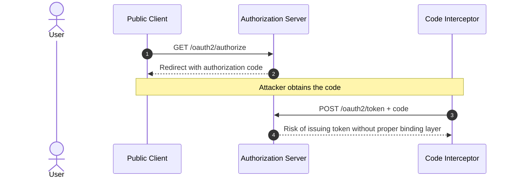
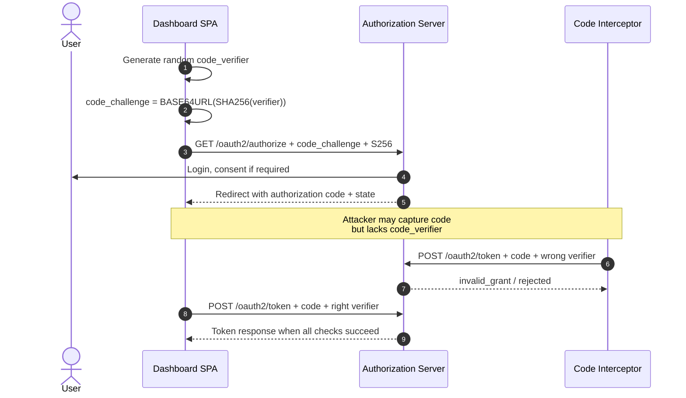
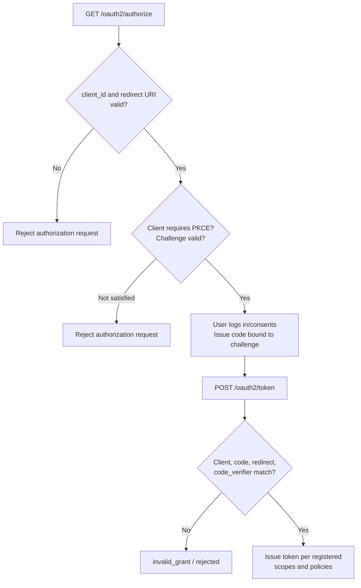

# Public Clients with Authentication Method `none` and PKCE Requirements

When implementing OAuth 2.0/OpenID Connect (OIDC), a **public client** is an application that **cannot reliably protect a shared secret credential**. Typical examples are browser-based JavaScript applications (Single Page Applications — SPAs), mobile apps installed on user devices, and desktop apps distributed to user machines. Their source code or installation packages can be inspected, copied, or modified; therefore **embedding a `client_secret` in the application does not turn it into a confidential client**.

In Spring Authorization Server, a public client uses **`ClientAuthenticationMethod.NONE`** to declare that it has no secret-based client authentication method at the token endpoint. With the **Authorization Code** flow, the configuration must combine **Proof Key for Code Exchange (PKCE)**, ideally with the **`S256`** method. PKCE binds the authorization code received at the redirect step to the exact request that initiated it, reducing the chance an attacker can exchange an intercepted code.

This lesson belongs to the **Client Authentication** chapter of the **SPRING_SECURITY_OAUTH2_OIDC_AUTHORIZATION_SERVER** module, on the path to designing, configuring, securing, testing, and operating an OAuth 2.0/OIDC Authorization Server with Spring Security and Spring Authorization Server in Spring Boot. The focus is on configuring `none` and PKCE accurately, understanding protection boundaries, implementing examples, and testing both success and failure flows.

## 1. What Is a Public Client and Why Does It Need a Separate Mechanism?

An OAuth client consists of a `client_id` identifier, registration metadata at the Authorization Server, and how it initiates token requests. The public/confidential classification is based on **credential protection capability** and operational architecture, not merely the application's UI.

| Criterion | Public client | Confidential client |
|---|---|---|
| Examples | SPA, native/mobile app, desktop app distributed to users | Web backend, BFF, worker running in controlled infrastructure |
| Keep `client_secret` safe? | Cannot be assumed | Possible, if secrets/keys are managed and never exposed to browsers |
| `client_id` | Public identifier | Public identifier |
| Authentication method | `none` for public clients | `client_secret_basic`, `private_key_jwt`, or supported mechanism |
| Interactive login flow | Authorization Code + PKCE | Authorization Code + PKCE is also recommended |
| Trade-offs to manage | Tokens and protocol state on devices/browsers are harder to protect | Server-side secrets, sessions, token stores, and backend operations |

**`ClientAuthenticationMethod.NONE` does not mean "skip security."** It means the Authorization Server does not use a separate client secret to authenticate the client at the token endpoint. **User** authentication, **client registration** matching, **redirect URI**, **grant**, **scope**, **authorization code**, and **PKCE** checks must still run in full.

### 1.1. Three Identities Not to Confuse

- **`client_id`:** OAuth client registration identifier, which others can know or copy.
- **End user:** authenticated at the Authorization Server, for example via login + MFA.
- **API caller:** Resource Server verifies the **access token**, audience, scope, and resource policies.

PKCE **does not prove exclusive identity of a public application**; any copy of the software can know `client_id`. PKCE primarily proves that the party exchanging the authorization code holds the `code_verifier` matching the original request's challenge. Never treat PKCE as anti-malware/XSS protection or a replacement for token verification at the API.

## 2. The Threat PKCE Addresses

Suppose a user logs in through Dashboard SPA at `dashboard.example.com`. The app redirects the browser to `login.example.com/oauth2/authorize`. After authentication and consent, the Authorization Server redirects the browser back to the registered callback with an **authorization code**.

If an attacker obtains the code from an unintended place (such as a device redirect mechanism or URL leakage), they can attempt to send the code to the token endpoint to receive tokens.

### 2.1. With Authorization Code Alone



This diagram illustrates only the **authorization code interception** threat. Real deployments also enforce redirect URI binding, client ID checks, and other controls; PKCE adds a critical layer of defense for public clients.

### 2.2. Adding a Proof Key to Bind the Two Steps

The client generates a **random, high-entropy `code_verifier`**, computes `code_challenge`, and sends the challenge in the authorization request. When exchanging the code, the client sends the **original verifier**. The Authorization Server verifies whether the verifier matches the challenge bound to the authorization code.



**Security meaning:** the challenge is a public value that can appear on the authorization request URL; the verifier is a value that must remain in the client's transaction session and be sent only to the **token endpoint**. An attacker who obtains only the code and challenge without the verifier cannot exchange the code for valid tokens.

PKCE **does not stop** malicious scripts on the same origin from reading the verifier or tokens, nor does it stop an attacker who compromises the entire device or browser session. Hence SPAs still need XSS defenses, dependency control, strict callback URLs, an appropriate CSP, and token lifetime management.

## 3. How Does PKCE Work in Detail?

PKCE is standardized in **RFC 7636**. The two central parameters are:

| Parameter | Where it appears | Value |
|---|---|---|
| `code_verifier` | Created by client before redirect; sent in token request | Random string kept solely by the client across the transaction |
| `code_challenge` | Authorization request | Transformed verifier used to bind the code |
| `code_challenge_method` | Authorization request | Should be `S256` |
| `client_id` | Both steps per protocol requirements | Registered client identifier; not a secret |
| `code` | Callback from Authorization Server | Short-lived, single-use authorization code |
| `redirect_uri` | Authorization request and token request when applicable | Must match the URI accepted when the code was issued |

### 3.1. Generating a High-Entropy Verifier

Under RFC 7636, `code_verifier` is **43 to 128 characters** long, using only unreserved characters: `A-Z`, `a-z`, `0-9`, `-`, `.`, `_`, `~`. A straightforward approach is drawing **32 bytes** from a cryptographically secure random generator and encoding as unpadded Base64URL, yielding a **43-character** string.

Never construct a verifier from:

- `Math.random()`, timestamps, or predictable strings;
- a client ID, username, fixed password, or hardcoded secret;
- a global verifier reused across all login sessions.

Generate a fresh verifier each time a new authorization request begins and bind it strictly to that request. When the callback completes or is canceled, clean up transaction state per application policy.

### 3.2. The S256 Transformation

With `S256`, the formula is:

```text
code_challenge = BASE64URL-ENCODE(SHA256(ASCII(code_verifier)))

BASE64URL-ENCODE = Base64URL without "=" padding characters
```

Because the verifier uses only the ASCII character set above, hashing the ASCII string is deterministic and reproducible. The Authorization Server checks:

```text
BASE64URL-ENCODE(SHA256(ASCII(received_code_verifier)))
    == stored_code_challenge
```

The `plain` method exists in the RFC for legacy compatibility, yet `S256` is the recommended choice. **`requireProofKey(true)` requires PKCE; do not infer from this setting alone that every client/request is restricted exclusively to S256.** A policy rejecting `plain` must be verified against your server version or customized and explicitly tested.

### 3.3. JavaScript Generating Verifier and Challenge in a SPA

Example using the Web Crypto API in a browser secure context:

```javascript
function base64url(bytes) {
  const binary = String.fromCharCode(...bytes);
  return btoa(binary)
    .replace(/\+/g, "-")
    .replace(/\//g, "_")
    .replace(/=+$/g, "");
}

function createCodeVerifier() {
  const randomBytes = new Uint8Array(32);
  crypto.getRandomValues(randomBytes);
  return base64url(randomBytes); // 43 chars, 256-bit entropy
}

async function createCodeChallenge(verifier) {
  const bytes = new TextEncoder().encode(verifier);
  const digest = await crypto.subtle.digest("SHA-256", bytes);
  return base64url(new Uint8Array(digest));
}

// Call at the start of EACH authorization request.
const verifier = createCodeVerifier();
const challenge = await createCodeChallenge(verifier);
```

In real applications, place this logic inside an `async` function or appropriate module; the final snippet uses ES module top-level await. Store the verifier only in necessary transaction state and defend against XSS. `sessionStorage` can help preserve state across full-page redirects, yet it is **not immune to malicious JavaScript on the same origin**. When tokens/verifiers need backend protection, consider the BFF pattern.

### 3.4. PKCE, state, and nonce Do Not Replace Each Other

| Value | Main problem solved | Who verifies? |
|---|---|---|
| `code_verifier` / `code_challenge` | Binds the authorization code to the party initiating the request | Authorization Server during code exchange |
| `state` | Ties callback to the initial OAuth request, helping prevent CSRF/response swap | OAuth client |
| `nonce` in OIDC | Links the ID token to the initial authentication request, preventing ID token replay | OIDC client when validating ID token |
| Authorization Server session cookie | Maintains the authenticated user across requests | Authorization Server |
| Redirect URI registration | Restricts where the Authorization Server sends the code | Authorization Server |

With OIDC, the client must also validate the ID token for signature, issuer, audience, lifetime, and nonce where applicable. **Never use an ID token instead of an access token** to call a Resource Server.

## 4. Authorization Code + PKCE Flow with a Public Client

Scenario: Dashboard SPA is registered with `client_id=dashboard-spa`, exact callback `https://dashboard.example.com/auth/callback`, and scopes `openid` and `orders.read`. The Authorization Server has issuer `https://login.example.com`.

### 4.1. Step A — Requesting the Authorization Code

The SPA generates a verifier, challenge, `state`, and (if OIDC requires) `nonce`, then sends the browser to a URL like:

```http
GET /oauth2/authorize?response_type=code
  &client_id=dashboard-spa
  &redirect_uri=https%3A%2F%2Fdashboard.example.com%2Fauth%2Fcallback
  &scope=openid%20orders.read
  &state=<fresh-random-state>
  &nonce=<fresh-random-nonce>
  &code_challenge=<S256-code-challenge>
  &code_challenge_method=S256 HTTP/1.1
Host: login.example.com
```

Angle brackets `<...>` denote placeholder values; queries must be properly URL-encoded when built in practice. Once the user authenticates and approves consent if needed, the Authorization Server redirects to the **exact registered callback**:

```text
https://dashboard.example.com/auth/callback
  ?code=<single-use-authorization-code>
  &state=<original-state>
```

The SPA matches `state` against the value stored for the transaction before exchanging the code; if it does not match, abort the flow. The SPA must not accept unexpected callbacks or use a code when no matching verifier is found.

### 4.2. Step B — Exchanging the Code at the Token Endpoint

The public client sends `code`, `code_verifier`, `client_id`, and the matching redirect URI (when required):

```http
POST /oauth2/token HTTP/1.1
Host: login.example.com
Content-Type: application/x-www-form-urlencoded

grant_type=authorization_code
&client_id=dashboard-spa
&code=<authorization-code-from-callback>
&redirect_uri=https%3A%2F%2Fdashboard.example.com%2Fauth%2Fcallback
&code_verifier=<original-random-verifier>
```

This is line-wrapped for readability, **not a verbatim HTTP body to paste and run**; real requests must encode `application/x-www-form-urlencoded` properly. A public client **does not send `client_secret`** and **does not send HTTP Basic client credentials**. For a client registered as `none`, the token endpoint identifies the client under public-client rules; binding the code, redirect URI, and PKCE are the core checks of the flow.

If all conditions hold, the Authorization Server returns a token response. When the request includes `openid` and OIDC is enabled, the response typically contains `id_token` alongside `access_token`:

```json
{
  "access_token": "<opaque-or-jwt-access-token>",
  "token_type": "Bearer",
  "expires_in": 300,
  "scope": "openid orders.read",
  "id_token": "<signed-oidc-id-token>"
}
```

Values above are illustrative, not real tokens. **Do not assume a refresh token is returned by default**: Spring Authorization Server 1.x policies generally do not issue refresh tokens to public clients following the SPA + PKCE pattern; check your exact version and configuration for specific behavior. Never try to embed a secret in a SPA just because refresh tokens are not issued.

### 4.3. Step C — Calling the Resource Server

The SPA calls the Orders API using the access token:

```http
GET /api/orders HTTP/1.1
Host: api.example.com
Authorization: Bearer <access-token>
```

The Orders API must verify the issuer/signature or token state, expiration, **audience meant for the API**, `orders.read`, and user/tenant business authorization. Registering scope `orders.read` at the Authorization Server does not mean the user is allowed to read every order.

### 4.4. HTTP 401/403 and Protocol Errors

- Missing or invalid authorization code, mismatched verifier, expired/used code: the token endpoint rejects, usually with `invalid_grant`.
- Authorization request with invalid PKCE parameters, redirect URI, grant, or scope: error response depends on step and error type; never redirect to an unverified redirect URI.
- API missing/invalid Bearer token: usually `401`; valid token lacking permissions: usually `403`.

Do not attribute every PKCE error to `invalid_client`. A public client has no secret for confidential client authentication; code/verifier and grant policies must be checked at the right layer.

## 5. Configuring RegisteredClient with NONE and Requiring PKCE

In Spring Authorization Server, `RegisteredClient` describes the conditions the Authorization Server allows for **a single client**. Spring Boot example using common Spring Authorization Server 1.x / Spring Security 6.x APIs:

```java
package example.authserver.config;

import java.time.Duration;

import org.springframework.context.annotation.Bean;
import org.springframework.context.annotation.Configuration;
import org.springframework.security.oauth2.core.AuthorizationGrantType;
import org.springframework.security.oauth2.core.ClientAuthenticationMethod;
import org.springframework.security.oauth2.core.oidc.OidcScopes;
import org.springframework.security.oauth2.server.authorization.client.RegisteredClient;
import org.springframework.security.oauth2.server.authorization.client.RegisteredClientRepository;
import org.springframework.security.oauth2.server.authorization.client.InMemoryRegisteredClientRepository;
import org.springframework.security.oauth2.server.authorization.settings.ClientSettings;
import org.springframework.security.oauth2.server.authorization.settings.TokenSettings;

@Configuration(proxyBeanMethods = false)
public class PublicClientRegistrationConfig {

    @Bean
    RegisteredClientRepository registeredClientRepository() {
        RegisteredClient dashboard = RegisteredClient
            .withId("dashboard-spa-registration")
            .clientId("dashboard-spa")
            // Public client has no client secret.
            .clientAuthenticationMethod(ClientAuthenticationMethod.NONE)
            .authorizationGrantType(AuthorizationGrantType.AUTHORIZATION_CODE)
            .redirectUri("https://dashboard.example.com/auth/callback")
            .scope(OidcScopes.OPENID)
            .scope("orders.read")
            .clientSettings(ClientSettings.builder()
                .requireProofKey(true)
                .requireAuthorizationConsent(true)
                .build())
            .tokenSettings(TokenSettings.builder()
                .accessTokenTimeToLive(Duration.ofMinutes(5))
                .build())
            .build();

        return new InMemoryRegisteredClientRepository(dashboard);
    }
}
```

**Attributes to understand accurately:**

1. **`ClientAuthenticationMethod.NONE`:** declares the client holds no secret credential; never add `.clientSecret("...")` to a SPA build just to exchange codes.
2. **`AuthorizationGrantType.AUTHORIZATION_CODE`:** permits the redirect flow and authorization code exchange. Never enable `CLIENT_CREDENTIALS` for a public SPA.
3. **`.requireProofKey(true)`:** requires PKCE for authorization codes. Test that the server rejects missing/wrong verifiers; ensure clients use `S256`.
4. **`.redirectUri(...)`:** registers the exact callback explicitly. Never use wildcards or open callbacks to receive codes.
5. **`.scope(...)`:** restricts which scopes the client can request; `openid` makes the flow OIDC when OIDC is enabled on the server.
6. **`.requireAuthorizationConsent(true)`:** policy to display consent when required; does not replace user authentication or PKCE checks.
7. **`TokenSettings`:** caps access token TTL. A `5`-minute TTL is only an example; tune per security and operational needs.

For production, use a durable `RegisteredClientRepository` and govern client IDs, redirects, and scopes per environment. `InMemoryRegisteredClientRepository` here is for learning and testing. Avoid regenerating internal IDs on every startup if authorizations/consents are persisted.

### 5.1. Grant, Method, and PKCE Each Have Distinct Roles

| Attribute | Question it answers | Value for Dashboard SPA |
|---|---|---|
| `authorizationGrantType` | Can it follow this flow? | `authorization_code` |
| `clientAuthenticationMethod` | Does the client authenticate with a credential at the token endpoint? | `none` |
| `requireProofKey` | Must the code be bound to a verifier? | `true` |
| `redirectUri` | Where is the code sent? | Registered HTTPS callback |
| `scope` | Which permissions may the client request? | `openid`, `orders.read` |
| Token policy | How long do tokens live, and in what format? | Short TTL suited to risk |

Getting one field right while neglecting the rest can still be insecure. For example, a client using `none` without PKCE increases the risk of stolen-code exchange; a client with PKCE but an overly broad redirect URI still risks code leakage and other attacks.

## 6. Configuring the Authorization Server Around RegisteredClient

`RegisteredClient` **does not build a complete Authorization Server on its own**. The application also needs security filter chains, user authentication, issuer settings, a `JWKSource`/signing key when issuing ID tokens/JWTs, authorization/consent storage, token generation, and OAuth2/OIDC endpoints.

Common two-chain configuration example:

```java
@Bean
@Order(1)
SecurityFilterChain authorizationServerSecurityFilterChain(
        HttpSecurity http) throws Exception {
    OAuth2AuthorizationServerConfigurer authorizationServer =
            OAuth2AuthorizationServerConfigurer.authorizationServer();

    http
        .securityMatcher(authorizationServer.getEndpointsMatcher())
        .with(authorizationServer, configurer ->
            configurer.oidc(Customizer.withDefaults()))
        .authorizeHttpRequests(authorize -> authorize
            .anyRequest().authenticated())
        .exceptionHandling(exceptions -> exceptions
            .defaultAuthenticationEntryPointFor(
                new LoginUrlAuthenticationEntryPoint("/login"),
                new MediaTypeRequestMatcher(MediaType.TEXT_HTML)))
        .oauth2ResourceServer(oauth2 -> oauth2
            .jwt(Customizer.withDefaults()));

    return http.build();
}

@Bean
@Order(2)
SecurityFilterChain applicationSecurityFilterChain(HttpSecurity http)
        throws Exception {
    http
        .authorizeHttpRequests(authorize -> authorize
            .anyRequest().authenticated())
        .formLogin(Customizer.withDefaults());
    return http.build();
}
```

This snippet illustrates wiring with imports omitted. The protocol chain handles `/oauth2/authorize` and `/oauth2/token`; the application chain serves the login page. If a user lacks a session, an authorize request redirects to login and then returns to finish issuing the code.

When OIDC is enabled, beans such as `JwtDecoder` and `JWKSource` may be needed for the corresponding OIDC endpoints. Verify APIs and configuration for your exact Spring Security and Spring Authorization Server versions. Adding `.oidc(...)` or `.requireProofKey(true)` without the underlying beans will not produce a complete application.

### 6.1. Where Is PKCE Checked?

Conceptual flow:



Spring Authorization Server's endpoint filters, client authentication providers, and authorization-code authentication providers perform the appropriate protocol checks. This diagram is only a **functional model** and does not promise the exact ordering of every filter/provider or error code across all versions.

### 6.2. The Server Must Bind Authorization Codes to the Client

PKCE is one layer of defense; the server must also check:

- The authorization code exists, is unexpired, and **is used only once**.
- The code was issued to the exact **`client_id`**, authorization request, and recorded redirect URI.
- `code_verifier` is syntactically valid and matches the challenge bound to **that exact code**.
- Issued scopes do not exceed the allowlist and consent policy.
- Tokens carry proper issuer/audience/TTL and the Resource Server enforces final authorization.

Never match against a single app-wide `code_verifier` or a PKCE value stored per client ID. Each **authorization request** must have its own independent verifier and challenge.

## 7. Using Public Clients from SPAs and Native Apps

### 7.1. Browser SPAs

A browser JavaScript SPA can talk directly to the token endpoint if the Authorization Server configures an appropriate **CORS** policy. CORS must allow the **specific origin** and required methods/headers, avoiding overly broad `*` wildcards alongside sensitive credentials.

However, CORS does not protect tokens from XSS. If malicious script runs in the SPA's origin, it can interact with application state and tokens. Practical guidelines:

- Prefer keeping tokens in memory when viable; avoid placing access tokens or verifiers in URLs, consoles, logs, or analytics.
- Avoid long-term token storage in `localStorage`; assess XSS risks and session recovery mechanisms. `sessionStorage` is also not safe against malicious scripts on the same origin.
- Enforce CSP, govern third-party scripts, audit dependencies, HTML-encode output, and prevent open redirects.
- Use exact redirect URIs, HTTPS, and distinct origins across environments.
- Ensure `state`, `nonce`, and transaction state are randomly generated, matched, and cleaned up.
- APIs must still verify access tokens; never trust requests solely because they originate from a CORS-allowed origin.

### 7.2. Native/Mobile Apps

Native apps are also usually public clients. Use the **system browser or an OS-approved browser**, avoiding collecting passwords in embedded WebViews. Authorization Code + PKCE is far better than giving passwords to the app or embedding secrets in an APK/IPA.

Native apps can use app-claimed HTTPS redirects, private-use URI schemes, or loopback redirects depending on security profile and platform capabilities. Redirect URI registration and callback handling must align with Authorization Server policy. **Do not assume** every Spring Authorization Server version automatically allows every loopback URI or dynamic port pattern without verifying supported configuration.

For both SPAs and native apps, an installed app can be modified or spoofed. PKCE protects against code interception and **does not provide app attestation**. If your use case requires stronger workload/device trust, add appropriate attestation or authorization models.

### 7.3. When to Consider a BFF?

A **Backend for Frontend (BFF)** keeps OAuth client credentials and access/refresh tokens on the server side while the browser interacts with the BFF over a cookie-protected session. A BFF helps keep access tokens out of JavaScript and supports token rotation and logout control.

Yet a BFF introduces its own responsibilities: cookie CSRF protection, `SameSite`, session fixation, XSS, server-side credential storage, horizontal scaling, and mapping browser sessions to tokens. **You do not need to force every SPA into a BFF**; choose based on risk, infrastructure, and session requirements.

| Scenario | Design to consider |
|---|---|
| Small SPA, short sessions, acceptable risk | Public client + `none` + Authorization Code + PKCE |
| SPA handling sensitive data needing strict token control | BFF confidential client with hardened session cookies |
| Native/mobile | Public client + PKCE, system browser, and platform-specific redirects |
| Background job without a user | Confidential client + `client_credentials`, never simulate login with `none` |

## 8. Limitations PKCE Does Not Solve

PKCE defends against one specific attack class in the authorization code exchange flow. Your design still needs independent defenses:

| Threat | Why PKCE is insufficient | Additional controls |
|---|---|---|
| **XSS in SPA** | Same-origin scripts can read verifiers and tokens | CSP, output encoding, dependency governance, BFF when needed |
| **Uncontrolled Redirect URI** | Code can still be sent to an attacker's endpoint | Exact callback registration, eliminate open redirects |
| **Login CSRF / response mix-up** | PKCE does not replace full callback checks | Random `state`, issuer checking, transaction binding |
| **OIDC ID token replay** | Verifier does not replace nonce/ID token validation | Check `nonce` where applicable, `iss`, `aud`, `exp`, signature |
| **Stolen access token** | PKCE's job ends after code exchange | Short TTL, secure storage, API policies, token-binding solutions when supported |
| **Over-broad API permissions** | PKCE does not enforce business authorization | Least-privilege scopes, audience, tenant/object authorization |
| **Impersonated client binary** | Public clients have no secret to prove a unique build | Registration/consent policies, redirect controls, attestation if needed |
| **Refresh token abuse** | PKCE does not protect long-lived tokens after issuance | Refresh token policy, rotation/revocation where applicable, consider BFF |

### 8.1. State and Nonce Must Bind to the Right Transaction

A SPA opening two login windows in parallel can have two sets of `state`/`nonce`/`code_verifier`. If the app stores only **one global variable** and the second window overwrites the first, the first callback may fail or be paired with the wrong transaction.

Key parameter sets by authorization transaction and clean up state after code exchange or timeout. Never accept an arbitrary callback just because `code` appears in the query string.

### 8.2. Distinguish Scope and Audience

A token with scope `orders.read` **is not automatically valid for every API**. APIs must verify audience (e.g., `aud=orders-api`) and trusted issuer. When a public client calls multiple APIs, enforce token policies targeting the right Resource Server; never forward API A's token to API B if audience disallows it.

An OIDC `id_token` is issued to the **OAuth client** to verify login; never use it as a Bearer access token at the Orders API.

## 9. Testing with Spring Authorization Server

A good test suite does more than prove the happy path works. It must prove the Authorization Server **rejects** requests missing PKCE or failing binding checks.

| Test case | Input / setup | Expected outcome |
|---|---|---|
| Valid Authorization Code + S256 | Client `none`, S256 challenge, matching verifier | Token issued when user, code, and scope are valid |
| Missing `code_challenge` | Client with `requireProofKey(true)` | Authorization request rejected |
| Missing `code_verifier` | Code issued with PKCE, token request omits verifier | No token issued |
| Wrong verifier | Hash does not match challenge | Typically `invalid_grant`; no token issued |
| Predictable verifier | Low-entropy or malformed verifier | Client tests must catch this; server validates syntax and policy |
| Code used twice | Second token request with the same code | Second attempt rejected |
| Wrong client ID | Code issued to client A, client B sends token request | Rejected |
| Different Redirect URI | Token request mismatches URI bound to code | Rejected |
| `plain` method | Client attempts `plain` instead of `S256` | Verify intended policy; reject only if server configuration supports/enforces that rule |
| Adding secret to `none` client | Send Basic/client secret not in registration | Must not silently promote client to confidential |
| Scope outside allowlist | SPA requests unregistered `orders.admin` | Over-privileged scope not granted |
| Wrong callback `state` | Returned value mismatches request | OAuth client rejects callback |
| Wrong OIDC `nonce` | ID token nonce mismatches | OIDC client rejects login |
| ID token wrong issuer/audience | Forged ID token or from another client | OIDC client rejects |
| Access token sent to wrong API | Audience not intended for Resource Server | API rejects |
| Tampered callback | URI outside allowlist or open redirect | Authorization Server does not send code to invalid URI |
| XSS / token exposure | Inspect frontend and logs in test environment | Verifier/tokens never accidentally leak into URLs, logs, or analytics |

**Never mark a test successful just because `/oauth2/token` returns HTTP 200.** Inspect token claims, scopes, lifetimes, audience, and ensure invalid requests receive no tokens. Tests that merely mock authentication can skip signature, PKCE, and real redirect validation.

### 9.1. Configuration-Level and Protocol-Level Tests

**On the Authorization Server**, use the test context and `MockMvc`/`spring-security-test` to verify registered clients, redirect URIs, filter chains, login CSRF, grants, and error handling. Pair these with HTTP integration tests against a real server to confirm authorization codes are generated, persisted, and exchanged strictly once.

**On the SPA/OIDC client**, verify:

1. Does it generate a verifier from a cryptographic RNG and an S256 challenge per session?
2. Does it isolate each `state`/verifier/nonce during parallel redirects?
3. Does a callback with a bad state or missing transaction state abort immediately?
4. Does it send the verifier in the token request without leaking it via URLs/analytics?
5. Does it validate ID tokens for issuer, audience, expiry, and nonce?
6. When tokens expire, does the app trigger re-login or session handling per policy?

### 9.2. Illustrative curl Request to Test Failures

Because browser login is involved, the authorization code must be obtained via the authorization endpoint with a valid user session. Once a **test** obtains a code and verifier, you can simulate the token exchange:

```bash
curl --request POST "https://login.example.com/oauth2/token" \
  --header "Content-Type: application/x-www-form-urlencoded" \
  --data-urlencode "grant_type=authorization_code" \
  --data-urlencode "client_id=dashboard-spa" \
  --data-urlencode "code=$AUTHORIZATION_CODE" \
  --data-urlencode "redirect_uri=https://dashboard.example.com/auth/callback" \
  --data-urlencode "code_verifier=$CODE_VERIFIER"
```

Notice **there is no `--user CLIENT_ID:CLIENT_SECRET`**: public clients use `none`. To test a wrong verifier, replace `CODE_VERIFIER` with an invalid string and verify no token is issued; generate a **fresh** authorization code for each independent test case since codes are single-use. Run only against test accounts and environments, and never put real codes/tokens in logs or public tickets.

## 10. Implementation Mistakes and Troubleshooting

| Symptom | Possible cause | Where to check |
|---|---|---|
| SPA token request returns `invalid_client` | Server registered `client_secret_basic` instead of `none`, or missing/mismatched client ID | Check `RegisteredClient.clientAuthenticationMethods` |
| `/oauth2/authorize` fails when PKCE is omitted | Client requires `requireProofKey(true)` | Generate S256 challenge and proper method |
| `/oauth2/token` returns `invalid_grant` | Wrong verifier, expired/reused code, wrong redirect | Trace transaction ID, match challenge, check code binding |
| Browser token request blocked by CORS | CORS/origin not configured accurately | Check origin, preflight, and allowed methods/headers |
| Dashboard receives no refresh token | SAS version's public client policy does not issue refresh tokens | Redesign session handling or consider a BFF |
| Has ID token yet API still returns `401` | Using ID token as access token or wrong audience on access token | Send the right API access token and inspect claims |
| `/login` redirect loop | Login chain matcher misconfigured or login route locked down | Check `SecurityFilterChain` order and entry point |
| Callback cannot find verifier | Lost `sessionStorage`, multiple tabs overwriting, or transaction timeout | Store per-transaction state cleanly |
| Verifier appears in callback URL | Broken PKCE implementation: sent verifier in authorization request | Send only challenge in authorize; send verifier in token request |
| Removing PKCE to "fix" errors | Buggy client generator or server/client rule mismatch | Fix transaction and policy, never relax security |
| Token exposed in console/storage | Frontend logging, dependency, or XSS | Audit sensitive data handling and CSP |
| Wrong issuer/redirect through proxy | Public URL, forwarded headers, or callback mismatch | Align issuer and trusted proxy settings |

### 10.1. Safe Operations for Public Clients

- Manage `client_id`, redirect URIs, and scopes per **environment** (dev/staging/prod), keeping hosts and callbacks exact.
- Limit authorization code and access token TTLs; never grant validity longer than business needs.
- Monitor `invalid_grant` rates, rejected redirects, `invalid_scope`, and anomalous per-client traffic, **without logging codes, verifiers, access/refresh tokens, or cookies**.
- Review CORS/HTTPS policies, CSP, XSS, third-party assets, and open-redirect prevention when deploying SPAs.
- Always run PKCE regression tests when upgrading Spring Authorization Server, Spring Security, or OAuth client libraries.
- Distinguish logging out of the SPA, ending the OIDC session at the Authorization Server, and access token expiration; do not assume logout instantly invalidates every token.

## 11. Choosing Architecture by Scenario

Suppose an organization builds three applications:

**App A — Dashboard SPA:** runs entirely in the browser, signs in via OIDC, calls the Orders API. Choose `authorization_code` + `ClientAuthenticationMethod.NONE` + `requireProofKey(true)`, enforcing `S256` by client design and tested policy. Scope `openid orders.read`; exact HTTPS callback; no embedded secret. Evaluate XSS/CORS/token storage and consider moving to a BFF if requirements tighten.

**App B — Employee Portal BFF:** web frontend with a backend controlling tokens and sessions. The BFF is a confidential client and can use `client_secret_basic` or stronger methods, still alongside Authorization Code + PKCE. Tokens stay protected on the backend; the browser holds a session cookie with appropriate CSRF/`SameSite` protections.

**App C — Invoice Worker:** scheduled job without user interaction. Use a confidential client + `client_credentials` with credentials protected via a secret manager, keys, or mTLS when properly integrated; never use `none` to fake a user-facing public client.

| Decision question | If yes | Direction |
|---|---|---|
| Is app code distributed to untrusted devices/browsers? | Yes | Treat as a public client |
| Do users need OIDC sign-in? | Yes | Authorization Code + PKCE and scope `openid` |
| Does the app have a backend controlling credentials? | Yes | Consider a BFF confidential client |
| No users, strictly a background job? | Yes | Client Credentials with client authentication |
| Need long-lived tokens in JavaScript? | Yes | Re-evaluate architecture; prefer BFF or appropriate session policy |

## 12. Self-Assessment Questions

1. Why is `client_id` considered public? Why must `client_secret` never be embedded in a SPA?
2. Which check does `ClientAuthenticationMethod.NONE` actually skip, and which checks does it **not** skip?
3. How does PKCE bind `code_verifier` and `code_challenge`? Why choose `S256`?
4. Why generate a new verifier for every authorization request? What risks arise from reusing a fixed verifier?
5. When a callback includes a code but `state` mismatches, what must the SPA do before sending a token request?
6. What configuration does Spring Authorization Server need in `RegisteredClient` to require PKCE for a public client?
7. Why does `requireProofKey(true)` not automatically guarantee an **S256-only** policy check?
8. Which fields must a public client send to the token endpoint when exchanging a code, and which field is strictly unnecessary?
9. Why does PKCE fail to protect verifiers/tokens when an application suffers from XSS?
10. What must an API verify beyond the fact that a token was issued to a registered public client?
11. If a sensitive web app needs refresh tokens/extended sessions, what problem does a BFF solve and what security responsibilities does it introduce?
12. In a system with native apps, a SPA, and a worker, by what criteria would you separate client registrations?

## 13. Foundational References

- [RFC 7636 — Proof Key for Code Exchange](https://www.rfc-editor.org/rfc/rfc7636): defines verifier/challenge, S256, and authorization code binding.
- [RFC 8252 — OAuth 2.0 for Native Apps](https://www.rfc-editor.org/rfc/rfc8252): using system browsers, public clients, PKCE, and redirects in native apps.
- [RFC 9700 — OAuth 2.0 Security Best Current Practice](https://www.rfc-editor.org/rfc/rfc9700): modern security recommendations for authorization flows, redirect URIs, and PKCE.
- [Spring Authorization Server — SPA using PKCE](https://docs.spring.io/spring-authorization-server/reference/guides/how-to-pkce.html): guide to registering public clients in Spring Authorization Server.
- [Spring Authorization Server — Core Model](https://docs.spring.io/spring-authorization-server/reference/core-model-components.html): `RegisteredClient`, `ClientSettings`, and token policies.

**Key takeaway:** Public clients use **`ClientAuthenticationMethod.NONE`** because they cannot reliably protect secret credentials. With Authorization Code, **PKCE S256** binds the code to the exact originating request using a random verifier sent only to the token endpoint. Spring Authorization Server expresses this policy via `RegisteredClient` with `AUTHORIZATION_CODE`, `NONE`, and `requireProofKey(true)`. That configuration must be combined with exact redirect URIs, `state`, OIDC validation, scopes/audience, token protection, and negative access testing so the public client architecture is both usable and secure.
