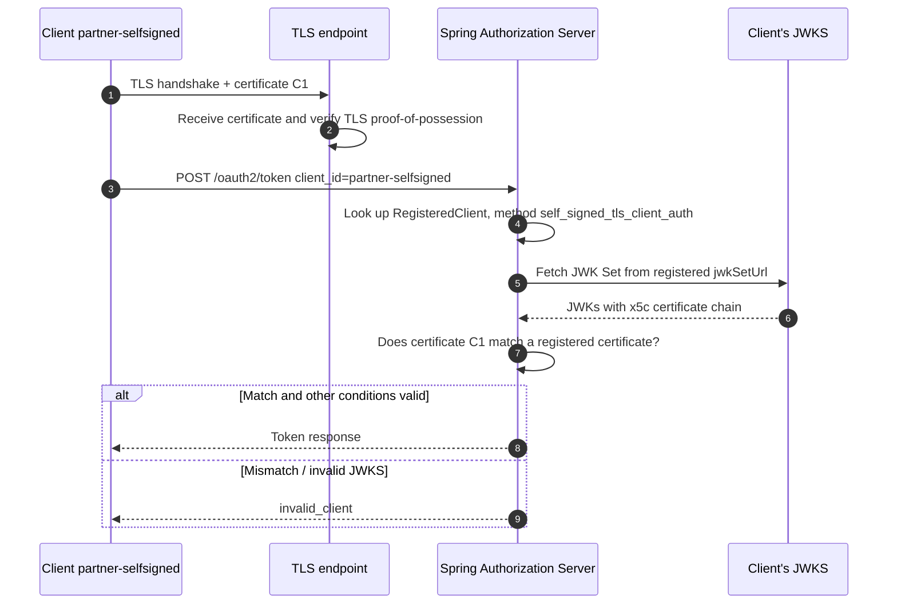
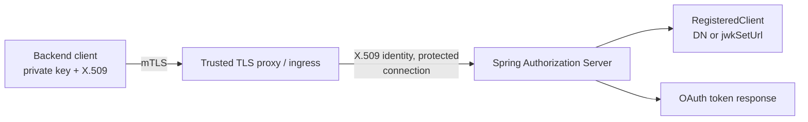
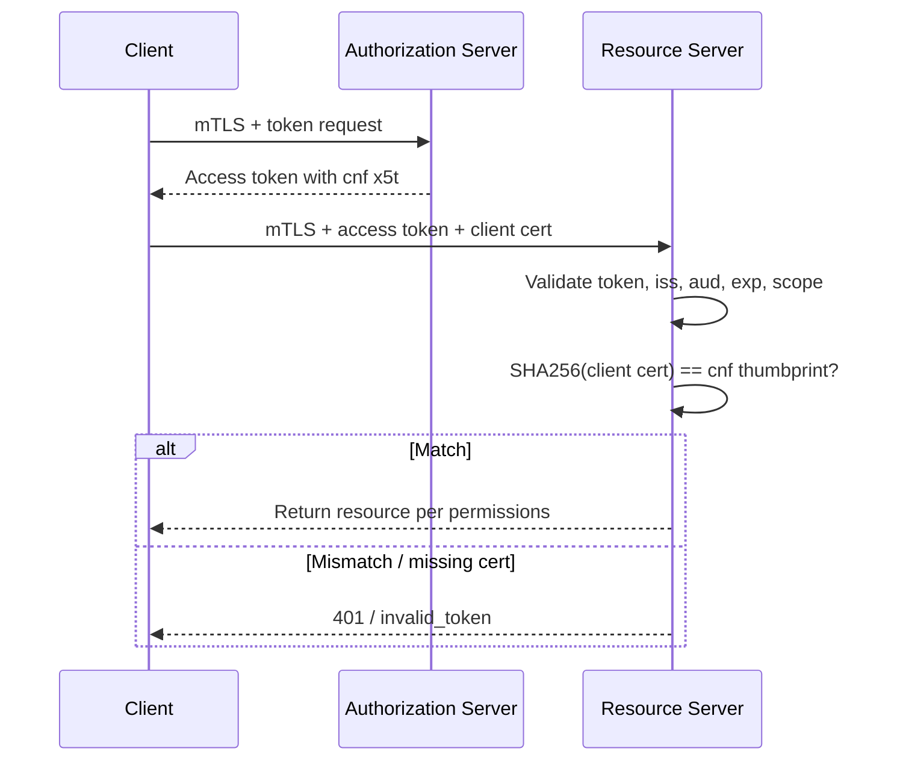

# `tls_client_auth` and `self_signed_tls_client_auth`

In OAuth 2.0/OpenID Connect, **client authentication** is the Authorization Server (AS) verifying that the application calling a protocol endpoint is genuinely a registered client. Alongside `client_secret_basic` or `private_key_jwt`, Spring Authorization Server supports two X.509 certificate client authentication methods over **mutual TLS (mTLS)**:

- **`tls_client_auth`**: relies on Public Key Infrastructure (PKI), where the certificate chain is validated against a trusted CA and a registered certificate identity.
- **`self_signed_tls_client_auth`**: the client uses a certificate registered in a JWK Set; the AS matches the exact certificate presented on the TLS connection against the certificates in the client's JWK Set.

This lesson belongs to the **Client Authentication** chapter of the **SPRING_SECURITY_OAUTH2_OIDC_AUTHORIZATION_SERVER** module, focused on designing, configuring, securing, testing, and operating an OAuth 2.0/OIDC Authorization Server with Spring Security and Spring Authorization Server in Spring Boot.

After this lesson, you will be able to:

1. Explain why mTLS client authentication differs from standard HTTPS, OAuth bearer tokens, PKCE, and user authentication.
2. Distinguish trust boundaries among the **TLS handshake**, **client registration**, and the **OAuth token endpoint** across both RFC 8705 methods.
3. Configure `RegisteredClient`, `ClientSettings`, and `TokenSettings` for both methods in Spring Authorization Server.
4. Organize certificate validation when running directly or behind a reverse proxy, and understand why `client_id` or an HTTP header containing a DN is not proof.
5. Design tests for certificate mismatches, missing certificates, certificate rotation, and **certificate-bound access tokens**.

> **Scope:** Java examples use Spring Authorization Server **1.x** APIs with compatible Spring Security/Spring Boot versions. The guide uses illustrative hostnames, certificates, and configurations; do not assume a client registration snippet automatically configures TLS, PKI, or a Resource Server.

## 1. Position of mTLS in the OAuth 2.0 Model

With **one-way TLS**, a browser or HTTP client checks the server's TLS certificate to confirm it is connecting to the right server over an encrypted channel. With **mutual TLS**, the server also requires the client to present a certificate and prove possession of its corresponding **private key** during the TLS handshake.

In OAuth, that certificate only becomes **OAuth client authentication** when the Authorization Server verifies that the certificate matches the **`RegisteredClient` identified by `client_id`**.

```mermaid
sequenceDiagram
    autonumber
    participant C as Backend OAuth client
    participant TLS as AS TLS endpoint
    participant AS as Spring Authorization Server
    participant R as RegisteredClientRepository

    C->>TLS: Open HTTPS, start TLS handshake
    TLS-->>C: Server certificate; request client certificate
    C->>TLS: Present X.509 and prove private key possession
    TLS->>TLS: Complete TLS checks per method
    C->>AS: POST /oauth2/token + client_id + grant
    AS->>R: Look up client by client_id
    R-->>AS: RegisteredClient + ClientSettings
    AS->>AS: Verify authentication method and certificate binding
    alt Valid
        AS-->>C: Access token per grant and policy
    else Invalid
        AS-->>C: invalid_client (or rejected prior to OAuth if TLS fails)
    end
```

**Two verification layers to keep distinct:**

- **TLS layer:** secures the connection and verifies the client holds the private key; for PKI methods, the CA chain and certificate validity must also be checked at the TLS layer. If the TLS handshake fails, the HTTP request usually **never reaches** Spring Authorization Server.
- **OAuth layer:** the request carries `client_id`; the AS resolves the registration, verifies the registered authentication method, and matches the TLS certificate against the trusted identity/key of **that exact client**. If they do not match, OAuth client authentication fails.

Never assume that merely seeing a valid certificate entitles the sender to use any arbitrary `client_id`. Binding the certificate to the client registration is central to RFC 8705.

### 1.1. Client Authentication Differs from User Authentication and PKCE

| Concept | What does it verify? | Does it replace mTLS client authentication? |
| --- | --- | --- |
| **User login** | Who is using the system; e.g., via form login, MFA, IdP. | No; a backend client can call `client_credentials` with no user. |
| **`client_id`** | Identifies which client record to look up. | No; public ID, can be spoofed. |
| **PKCE** | The party exchanging the authorization code holds the `code_verifier` matching the submitted challenge. | No; PKCE does not prove a confidential client's identity. |
| **`client_secret_basic`** | The client knows the registered secret. | It is a different method; does not use mTLS certificates. |
| **`private_key_jwt`** | The client signs a JWT assertion with a registered key. | It is a different method; a JWT assertion signature is not TLS handshake proof. |
| **`tls_client_auth` / `self_signed_tls_client_auth`** | The client holds the certificate's private key and the certificate matches registration. | These are the two mTLS methods covered in this lesson. |
| **Certificate-bound access token** | When calling an API, the client proves possession of the certificate key bound to the token. | This protects **resource access after token issuance**; it can be paired with client authentication but is a separate decision. |

mTLS client authentication is typically suited to **confidential clients** running on servers, B2B partners, or internal services able to manage keys. It is not a default choice for general browser SPAs.

## 2. Comparing `tls_client_auth` and `self_signed_tls_client_auth`

RFC 8705 defines both methods:

| Criterion | `tls_client_auth` — PKI mTLS | `self_signed_tls_client_auth` — self-signed mTLS |
| --- | --- | --- |
| Certificate chain | Server verifies certificate chain against trusted PKI CAs. | Does not rely on CA chain trust to identify the client; AS checks the certificate registered in the client's JWKS. |
| Client binding | Registered Subject DN or SAN attribute (depending on config/implementation). | Actual certificate must match a certificate in the registered `jwks`/`jwks_uri`. |
| OAuth metadata | `tls_client_auth_subject_dn` or a matching SAN value per RFC. | `jwks` or `jwks_uri` carrying a JWK with `x5c`. |
| Spring default verifier in SAS 1.x | Matches `ClientSettings.x509CertificateSubjectDN(...)`. | Uses `ClientSettings.jwkSetUrl(...)` to fetch JWKS and match the certificate. |
| Required infrastructure | CA/truststore, issuance, revocation, and rotation policies. | Client manages certificates and trusted JWKS source; TLS layer accepts/forwards certificate for OAuth checks. |
| Certificate rotation | Can swap to a CA-issued certificate with the same registered subject; must manage trust/revocation. | Update JWKS with the new cert and allow overlap if needed; AS must see the new cert before cutover. |
| Dangerous pitfalls | Trusting an overly broad CA, skipping DN/SAN checks, ignoring certificate revocation, or trusting Internet headers. | Accepting any self-signed certificate, letting requests specify the JWKS URL, or weakening global TLS validation. |

The most confusing part is the word "self-signed." **`self_signed_tls_client_auth` does not mean the AS accepts any self-signed certificate.** It still requires the presented certificate to be **pre-registered** for that exact OAuth client in its JWKS, and the client must prove possession of the corresponding private key.

Conversely, **`tls_client_auth` does not merely check "signed by a CA."** If multiple clients share a trusted CA, the AS must still check the **certificate identity bound to the requesting client**; otherwise client A's certificate could impersonate client B's `client_id`.

## 3. `tls_client_auth` Flow: PKI and Subject DN

Suppose an organization registers backend `billing-partner` for the `client_credentials` grant. The partner receives a certificate from a CA trusted by the AS. In the registration, the AS stores the **expected subject DN**:

```text
client_id: billing-partner
client_authentication_method: tls_client_auth
registered certificate subject DN:
  CN=billing-partner,OU=Integrations,O=Example Corp,C=VN
```

When calling the token endpoint:

1. The partner backend connects to `https://login.example.com/oauth2/token` over HTTPS and presents its client certificate.
2. The TLS endpoint validates the certificate chain against allowed CAs/truststores, signature, validity period, and certificate constraints. Revocation checking (CRL/OCSP) should be designed appropriately.
3. The backend sends `client_id=billing-partner` in the token request body along with the grant and scope.
4. Spring Authorization Server looks up that `RegisteredClient`.
5. `X509ClientCertificateAuthenticationProvider` inspects the certificate from TLS and compares its subject DN against `ClientSettings.x509CertificateSubjectDN(...)` using the default verifier.
6. If valid, the AS proceeds with grant, scope, and token policies; otherwise it returns a client authentication error.

### 3.1. Configuring RegisteredClient for PKI mTLS

```java
import java.time.Duration;
import java.util.UUID;

import org.springframework.security.oauth2.core.AuthorizationGrantType;
import org.springframework.security.oauth2.core.ClientAuthenticationMethod;
import org.springframework.security.oauth2.server.authorization.client.RegisteredClient;
import org.springframework.security.oauth2.server.authorization.settings.ClientSettings;
import org.springframework.security.oauth2.server.authorization.settings.TokenSettings;

RegisteredClient billingPartner = RegisteredClient.withId(
        UUID.randomUUID().toString())
    .clientId("billing-partner")
    .clientAuthenticationMethod(ClientAuthenticationMethod.TLS_CLIENT_AUTH)
    .authorizationGrantType(AuthorizationGrantType.CLIENT_CREDENTIALS)
    .scope("invoices.read")
    .clientSettings(ClientSettings.builder()
        .x509CertificateSubjectDN(
            "CN=billing-partner,OU=Integrations,O=Example Corp,C=VN")
        .build())
    .tokenSettings(TokenSettings.builder()
        .accessTokenTimeToLive(Duration.ofMinutes(10))
        .build())
    .build();
```

**Explanation:**

- `ClientAuthenticationMethod.TLS_CLIENT_AUTH` selects the PKI mTLS method. Do not add `CLIENT_SECRET_BASIC` if you want client authentication strictly via certificate.
- `x509CertificateSubjectDN(...)` is the registered DN of **the client**, not the AS's DN or the server certificate's CN. A DN is an identifier, **not a secret**.
- `CLIENT_CREDENTIALS` is used for backend-to-backend services and requires no user login, `redirect_uri`, or authorization code.
- `TokenSettings` only bounds token lifetime; it does not configure TLS or CAs.
- `RegisteredClient` must be stored in an appropriate `RegisteredClientRepository`; in real products use durable storage and stable registration IDs.

One `client_id` can represent a service, yet subject DNs must be governed so two different clients cannot obtain accepted certificates with the same identity within the same trust domain.

### 3.2. DN or SAN?

RFC 8705 allows the PKI method to identify a client using **one** registered attribute: subject DN or a SAN of type DNS, URI, IP, or email. The system must pick the exact trusted identifier type for the client.

In **Spring Authorization Server 1.x**, `X509ClientCertificateAuthenticationProvider`'s default certificate verifier uses `x509CertificateSubjectDN`. If an organization chooses a SAN as the identity (such as a workload URI), you must **customize the certificate verifier** per Spring documentation; never assume SAS checks SANs automatically just because the certificate contains a SAN.

When checking subject DNs, account for X.500 DN representation/canonicalization rules. Avoid naive string comparisons in custom verifiers because attribute order, escaping, and encoding can differ; prefer checking via X.500 principals or proper X.509 libraries.

### 3.3. A Valid Certificate Chain Alone Is Not Enough

Suppose two services are signed by an internal CA:

```text
Service A: CN=billing-partner,OU=Integrations,O=Example Corp,C=VN
Service B: CN=analytics-worker,OU=Integrations,O=Example Corp,C=VN
```

Both certificates can pass the TLS handshake because they share a trusted CA. Yet when Service B sends `client_id=billing-partner`, the AS still must **reject** it: Service B's certificate DN does not match the DN registered for client A. Checking only the CA would allow any certificate issued by that CA to impersonate any other client.

## 4. `self_signed_tls_client_auth` Flow: Certificates in JWKS

The `self_signed_tls_client_auth` method uses mTLS without relying on a trusted CA to identify the OAuth client. Instead, the client registers a **JWK Set** containing its permitted certificates; the AS verifies that the certificate presented over TLS matches a certificate in that set.

Logical flow:



In SAS 1.x, the default verifier resolves the JWKS via **`RegisteredClient.getClientSettings().getJwkSetUrl()`**. This JWKS is the source of **the OAuth client's public certificates**, completely distinct from `/oauth2/jwks` published by the Authorization Server for Resource Servers to verify access tokens/ID tokens.

### 4.1. Configuring RegisteredClient for Self-Signed mTLS

```java
import java.util.UUID;

import org.springframework.security.oauth2.core.AuthorizationGrantType;
import org.springframework.security.oauth2.core.ClientAuthenticationMethod;
import org.springframework.security.oauth2.server.authorization.client.RegisteredClient;
import org.springframework.security.oauth2.server.authorization.settings.ClientSettings;

RegisteredClient partnerSelfSigned = RegisteredClient.withId(
        UUID.randomUUID().toString())
    .clientId("partner-selfsigned")
    .clientAuthenticationMethod(
        ClientAuthenticationMethod.SELF_SIGNED_TLS_CLIENT_AUTH)
    .authorizationGrantType(AuthorizationGrantType.CLIENT_CREDENTIALS)
    .scope("reports.export")
    .clientSettings(ClientSettings.builder()
        .jwkSetUrl("https://partner.example.com/oauth-client-jwks.json")
        .build())
    .build();
```

The AS must be configured to **actually receive the certificate from the TLS handshake**. Registering `jwkSetUrl` without a certificate from the TLS connection cannot authenticate the client.

**Caution:** `jwkSetUrl` is an **administratively governed registration parameter**. Never use an arbitrary URL supplied in a token request to fetch keys, and never fetch metadata from private/loopback addresses or disallowed redirects. If the AS fetches an external partner URL, apply SSRF defenses, domain and path allowlists, timeouts, response size limits, caching, server TLS validation, and change-approval workflows.

### 4.2. Structure of a JWKS with `x5c`

X.509 certificates in a JWK Set are represented via the `x5c` field (an array of Base64-encoded DER certificates, not base64url). For RSA, the JWK must also include the public key parameters `n` and `e`; the key in the first certificate of `x5c` must match the JWK's public key.

An illustrative JWKS **containing placeholders**, not usable production data:

```json
{
  "keys": [
    {
      "kty": "RSA",
      "kid": "cert-2026-01",
      "n": "<RSA_MODULUS_BASE64URL>",
      "e": "AQAB",
      "x5c": [
        "<BASE64_OF_DER_CLIENT_CERTIFICATE>"
      ]
    }
  ]
}
```

Key requirements:

- `x5c[0]` must represent the client certificate presented during the TLS handshake, and its public key must match the JWK's `n`/`e`.
- Never publish **private keys**, `d`, RSA CRT parameters, or keystore passwords in a JWKS.
- The JWKS endpoint must be available and present a valid TLS server certificate; the AS must not disable HTTPS validation just because the **client certificate** follows the self-signed model.
- If the certificate changes while the JWKS has not yet been updated or the cache has not refreshed, the AS must reject the unregistered certificate.
- Do not equate the server's **ability to reach** `jwks_uri` with that URL being **trusted**; onboarding/approval workflows establish trust.

### 4.3. Why Does Self-Signed mTLS Require Careful TLS Configuration?

This is an easy place to misconfigure. In `tls_client_auth`, the TLS endpoint typically verifies certificate chains against a CA truststore. With `self_signed_tls_client_auth`, the standard does not rely on CA trust for **OAuth client authentication**; instead it uses certificates registered in JWKS.

Consequently, a TLS endpoint configured to **only accept certificates chained to a CA in its truststore** may **reject a self-signed certificate during the handshake**, before Spring ever sees the request to check JWKS. Setting `server.ssl.client-auth=need` with a standard PKI truststore **does not automatically implement** `self_signed_tls_client_auth`.

To use self-signed certificates, the TLS/ingress layer must allow the AS to obtain the client certificate and proof-of-possession while ensuring **only certificates matching the registration are accepted at the OAuth layer**. Implementation depends on your Servlet container, TLS termination, or proxy. Never turn on "trust all certificates" globally for public services or disable **server** certificate verification on clients. If your infrastructure lacks a safe path to handle self-signed certificates, choose PKI mTLS instead.

## 5. How Spring Authorization Server Verifies X.509

At the token endpoint, Spring Authorization Server uses the following components:

| Component | Responsibility |
| --- | --- |
| `X509ClientCertificateAuthenticationConverter` | Extracts client credentials and the X.509 chain from a TLS-authenticated request (when properly configured/integrated). |
| `X509ClientCertificateAuthenticationProvider` | Authenticates clients with `TLS_CLIENT_AUTH` or `SELF_SIGNED_TLS_CLIENT_AUTH` based on registration and the certificate verifier. |
| `RegisteredClientRepository` | Retrieves registered methods and trust settings by `client_id`. |
| `ClientSettings.x509CertificateSubjectDN(...)` | Expected client DN for the default PKI method. |
| `ClientSettings.jwkSetUrl(...)` | JWKS source containing client certificates for the default self-signed method. |
| `TokenSettings.x509CertificateBoundAccessTokens(...)` | **Optional** policy to bind issued access tokens to the client's certificate. |

The default verifier for the PKI method checks **subject DN**; the self-signed method matches the certificate from the **JWK Set**. To match a SAN or apply another advanced certificate policy, customize the verifier inside `OAuth2AuthorizationServerConfigurer.clientAuthentication(...)`. Any customization must **preserve mandatory checks** rather than accidentally replacing the whole verifier with permissive logic.

### 5.1. Example Configuring Two Clients in One Repository

A complete Java configuration **within the registration scope** (assuming AS infrastructure beans and TLS are already configured):

```java
package com.example.authserver.config;

import java.time.Duration;
import java.util.UUID;

import org.springframework.context.annotation.Bean;
import org.springframework.context.annotation.Configuration;
import org.springframework.security.oauth2.core.AuthorizationGrantType;
import org.springframework.security.oauth2.core.ClientAuthenticationMethod;
import org.springframework.security.oauth2.server.authorization.client.InMemoryRegisteredClientRepository;
import org.springframework.security.oauth2.server.authorization.client.RegisteredClient;
import org.springframework.security.oauth2.server.authorization.client.RegisteredClientRepository;
import org.springframework.security.oauth2.server.authorization.settings.ClientSettings;
import org.springframework.security.oauth2.server.authorization.settings.TokenSettings;

@Configuration(proxyBeanMethods = false)
public class MtlsClientRegistrationConfig {

    @Bean
    RegisteredClientRepository registeredClientRepository() {
        RegisteredClient pkiClient = RegisteredClient
            .withId(UUID.randomUUID().toString())
            .clientId("billing-partner")
            .clientAuthenticationMethod(
                ClientAuthenticationMethod.TLS_CLIENT_AUTH)
            .authorizationGrantType(
                AuthorizationGrantType.CLIENT_CREDENTIALS)
            .scope("invoices.read")
            .clientSettings(ClientSettings.builder()
                .x509CertificateSubjectDN(
                    "CN=billing-partner,OU=Integrations,O=Example Corp,C=VN")
                .build())
            .tokenSettings(TokenSettings.builder()
                .accessTokenTimeToLive(Duration.ofMinutes(10))
                .build())
            .build();

        RegisteredClient selfSignedClient = RegisteredClient
            .withId(UUID.randomUUID().toString())
            .clientId("partner-selfsigned")
            .clientAuthenticationMethod(
                ClientAuthenticationMethod.SELF_SIGNED_TLS_CLIENT_AUTH)
            .authorizationGrantType(
                AuthorizationGrantType.CLIENT_CREDENTIALS)
            .scope("reports.export")
            .clientSettings(ClientSettings.builder()
                .jwkSetUrl(
                    "https://partner.example.com/oauth-client-jwks.json")
                .build())
            .tokenSettings(TokenSettings.builder()
                .accessTokenTimeToLive(Duration.ofMinutes(5))
                .build())
            .build();

        return new InMemoryRegisteredClientRepository(
            pkiClient, selfSignedClient);
    }
}
```

How to use this:

1. **Create only one `RegisteredClientRepository`** if this is your active AS configuration; if the app already has a database repository, register both clients there instead of defining a duplicate in-memory bean.
2. Each client declares **one** matching TLS authentication method. This lists methods permitted by the server; it does not automatically issue a client secret.
3. `client_credentials` requires client authentication and fits backend-to-backend calls. If a client uses the Authorization Code Flow, also configure redirect URIs, state/PKCE, user authentication, and other policies.
4. The in-memory example is only for local/testing. Production requires durable registration storage, DN/JWKS URL governance, and certificate issuance/revocation.
5. Each `RegisteredClient` can carry its own `TokenSettings`; token lifetime does not determine which certificate is accepted.

### 5.2. What If You Need SAN Verification?

Spring Authorization Server exposes an extension point on `X509ClientCertificateAuthenticationProvider` to customize the certificate verifier; you can extract the certificate from `OAuth2ClientAuthenticationContext` and check the registered SAN type.

Example **code illustrating the verifier hook mechanism**, without complete SAN parsing logic:

```java
import java.security.cert.X509Certificate;
import java.util.List;
import java.util.function.Consumer;

import org.springframework.security.authentication.AuthenticationProvider;
import org.springframework.security.oauth2.server.authorization.authentication.OAuth2ClientAuthenticationContext;
import org.springframework.security.oauth2.server.authorization.authentication.OAuth2ClientAuthenticationToken;
import org.springframework.security.oauth2.server.authorization.authentication.X509ClientCertificateAuthenticationProvider;

// Used inside clientAuthentication(...) configuration:
Consumer<List<AuthenticationProvider>> configureX509Verifier() {
    return providers -> providers.forEach(provider -> {
        if (provider instanceof X509ClientCertificateAuthenticationProvider x509) {
            Consumer<OAuth2ClientAuthenticationContext> verifier = context -> {
                OAuth2ClientAuthenticationToken auth = context.getAuthentication();
                X509Certificate[] chain = (X509Certificate[]) auth.getCredentials();
                X509Certificate leaf = chain[0];

                // MANDATORY: match the registered SAN for the corresponding client;
                // missing / mismatched SAN => throw OAuth2AuthenticationException(invalid_client).
                // Also preserve all other relevant binding checks.
                throw new UnsupportedOperationException(
                    "Implement strict client-specific SAN validation");
            };
            x509.setCertificateVerifier(verifier);
        }
    });
}
```

Do not deploy this snippet into a live application before implementing SAN validation. Calling `setCertificateVerifier(...)` can replace the default verifier logic; omitting required checks can inadvertently allow invalid certificates. In many systems, SAS's default subject DN check is simpler and easier to govern.

## 6. TLS Configuration and Reverse-Proxy Boundaries

A valid `RegisteredClient` **is not enough** for a TLS handshake to produce a certificate chain accessible in Spring. You must configure the server, client, CA/truststore (for PKI), and/or proxy.

### 6.1. Direct Boot TLS Example for PKI mTLS

In an environment with the server certificate in a keystore and client CAs in a truststore, an **illustrative** Spring Boot configuration might look like:

```yaml
server:
  port: 9443
  ssl:
    enabled: true
    key-store: classpath:server.p12
    key-store-type: PKCS12
    key-store-password: ${SERVER_KEYSTORE_PASSWORD}
    trust-store: classpath:trusted-client-ca.p12
    trust-store-type: PKCS12
    trust-store-password: ${CLIENT_TRUSTSTORE_PASSWORD}
    client-auth: need
```

- `server.p12` holds **the AS's server certificate and private key**, enabling HTTPS so clients verify the server.
- `trusted-client-ca.p12` holds the CA certificates used by the server to verify OAuth client certificates.
- `client-auth: need` requires a client certificate on every request to this listener, including login pages if served on the same port.
- This is a **PKI TLS** configuration, not a guide to "enabling self-signed" at the TLS layer.
- Keystore/truststore passwords must come from environment secrets, never hardcoded in the repository. Real infrastructure must also manage certificate expiration, root CA rotation, and TLS cipher/protocol policies.

Because an Authorization Server typically serves **browsers at `/oauth2/authorize`** and **backend clients at `/oauth2/token`**, setting `client-auth: need` on a single shared listener can prompt end-user browsers for client certificates. Design a dedicated mTLS listener/hostname, use RFC 8705 endpoint aliases, or configure a proxy protecting the protocol path properly. **Never enforce mTLS on a shared listener serving interactive user-agent flows** unintentionally.

### 6.2. When TLS Terminates at a Reverse Proxy



If a proxy terminates mTLS and forwards HTTP requests to Spring:

1. **The proxy itself must verify** the certificate and private-key possession during the mTLS connection according to the chosen method.
2. **Only a trusted proxy** may send certificate details to the backend; isolate the backend on the network or use internal TLS/mTLS between proxy and backend.
3. Never trust HTTP headers like `X-Client-Cert`, `X-SSL-CERT`, or `X-Forwarded-Client-Cert` sent arbitrarily from the Internet. The proxy must strip/overwrite client-supplied headers and never merge multiple values.
4. Integrate Spring Authorization Server so `X509ClientCertificateAuthenticationConverter` receives a certificate whose provenance **is attested by the TLS connection**, not an unverified string value.
5. Test directly whether your Spring version's converter/provider receives the certificate chain on the request. Scheme/host forwarded headers **do not securely forward** X.509 certificates on their own.

Many Servlet containers expose the TLS-authenticated client certificate chain under a request attribute such as `jakarta.servlet.request.X509Certificate`. When TLS terminates at a proxy, that attribute **is not automatically populated**. You need a trusted integration or direct TLS termination at Spring. **Never add a filter accepting arbitrary certificate headers and consider mTLS complete.**

### 6.3. A Specific Note for Self-Signed

Self-signed mTLS has stricter requirements than standard PKI TLS: the TLS layer must capture the certificate that the OAuth layer will match against JWKS without rejecting it solely for lacking a trusted CA chain. How this is achieved depends on proxy/termination technology and must be designed explicitly with the security team. Enabling broad chain-verification bypasses on a shared endpoint serving multiple applications weakens TLS boundaries and can affect other flows.

Consider a dedicated **mTLS token endpoint**, restrict network access, and design a verified certificate/identity forwarding path. Never assume a single flag in `application.yml` handles the entire flow.

## 7. Real Token Requests with a Client Certificate

Suppose Spring Authorization Server exposes the token endpoint at `https://login.example.com/oauth2/token` and PKI client `billing-partner` has its certificate.

A request using `curl`:

```bash
curl --fail-with-body --verbose \
  --cert ./billing-partner.crt \
  --key ./billing-partner.key \
  --cacert ./trusted-auth-server-ca.pem \
  --request POST 'https://login.example.com/oauth2/token' \
  --header 'Content-Type: application/x-www-form-urlencoded' \
  --data-urlencode 'grant_type=client_credentials' \
  --data-urlencode 'client_id=billing-partner' \
  --data-urlencode 'scope=invoices.read'
```

**This is an illustrative command**; certificate and key files must be issued by trusted infrastructure, with matching hostname and CA trust. Never use `-k`/`--insecure` to skip **server** certificate verification in security-meaningful tests.

The authentication request has no `Authorization: Basic ...` and no `client_secret`: the certificate presented during the TLS handshake proves private-key possession, and the AS binds it to `client_id`.

For `self_signed_tls_client_auth`, the token request looks similar, except the client certificate must match a certificate in the registered JWKS and TLS termination must pass the certificate to the AS for comparison. Running `--cert` and `--key` alone does not prove the AS verified it properly if the proxy or Spring lacks the verifier; run negative tests rejecting unknown certificates.

### 7.1. At Which Layer Do Errors Occur?

| Scenario | Where first detected | Typical outcome |
| --- | --- | --- |
| Client does not trust server certificate | HTTPS client | TLS does not complete; no OAuth response. |
| PKI client certificate expired / untrusted CA | AS/proxy TLS endpoint | Handshake rejected or connection closed before HTTP. |
| Self-signed client certificate rejected by proxy before OAuth | TLS endpoint | Handshake fails, even if JWKS registration is correct. |
| Client certificate valid at TLS, but DN mismatches `client_id` | Spring X.509 client authentication | OAuth error `invalid_client`. |
| Self-signed certificate absent from client's JWKS | Spring X.509 client authentication | OAuth error `invalid_client`. |
| Client auth succeeds, but scope is unregistered | Spring token endpoint | Grant/scope OAuth error, such as `invalid_scope`. |
| Client auth succeeds, but grant is unregistered | Spring token endpoint | OAuth error such as `unauthorized_client`. |

Do not expect HTTP 401 in every case: TLS errors happen **before** the endpoint can generate an OAuth HTTP response, while protocol errors carry specific OAuth error codes.

## 8. Certificate-Bound Access Tokens: Separate from Client Authentication

RFC 8705 also defines **certificate-bound access tokens**. This binds an access token to a certificate so an attacker who steals the token **without the private key** cannot reuse it.

The two concepts can both use mTLS, yet serve different goals:

- **mTLS client authentication at the AS:** verifies the client requesting a token.
- **Certificate-bound access token at the Resource Server:** on API calls, checks whether the client holds the private key of the certificate bound to the token.

A certificate-bound JWT token typically contains a confirmation claim:

```json
{
  "iss": "https://login.example.com",
  "sub": "billing-partner",
  "aud": ["billing-api"],
  "cnf": {
    "x5t#S256": "<BASE64URL_SHA256_CERTIFICATE_THUMBPRINT>"
  },
  "exp": 1980003600
}
```

This is an illustrative payload, not a signed JWT. `x5t#S256` is the certificate's SHA-256 thumbprint per RFC 8705, distinct from embedding the raw certificate or private key in the token.

### 8.1. Enabling Certificate Binding in TokenSettings

Spring Authorization Server can configure this per client:

```java
RegisteredClient certificateBoundClient = RegisteredClient
    .withId(UUID.randomUUID().toString())
    .clientId("billing-partner")
    .clientAuthenticationMethod(
        ClientAuthenticationMethod.TLS_CLIENT_AUTH)
    .authorizationGrantType(AuthorizationGrantType.CLIENT_CREDENTIALS)
    .scope("invoices.read")
    .clientSettings(ClientSettings.builder()
        .x509CertificateSubjectDN(
            "CN=billing-partner,OU=Integrations,O=Example Corp,C=VN")
        .build())
    .tokenSettings(TokenSettings.builder()
        .x509CertificateBoundAccessTokens(true)
        .build())
    .build();
```

**Note:** `TokenSettings.x509CertificateBoundAccessTokens(true)` is a **separate** flag; not all mTLS client authentication automatically issues proof-of-possession tokens. Verify the token format and confirmation claims/introspection structure produced by your version.

### 8.2. What Additional Verification Must the Resource Server Perform?

The Resource Server receives the request alongside the **mTLS client certificate** (or certificate identity securely forwarded by a trusted proxy). In addition to verifying issuer, signature or introspection, expiration, audience, scope, and resource permissions, the RS must:

1. Extract the certificate of the **TLS connection calling the API**.
2. Compute the certificate's SHA-256 thumbprint per standard rules.
3. Compare it against `cnf["x5t#S256"]` in the JWT or confirmation data from introspection.
4. Reject the request if no certificate is present or the thumbprint mismatches.



An API that merely enables Spring Security JWT validation **does not automatically** enforce mTLS certificate thumbprint checks. Without checking `cnf`, a stolen token can still be used as a bearer token even though the AS included the binding claim.

Nor does this replace record/tenant authorization logic in the API. Certificate binding proves the caller holds the key, not that they may access every piece of data.

## 9. Certificate, Key, and Operational Lifecycle Security

### 9.1. Managing Private Keys

A client's private key must be protected like a strong authentication secret. Ideally store it in an HSM/KMS or tightly permissioned keystore; exporting private keys to files increases leakage risk. For development workflows, restrict file permissions, never commit keys to Git, and never bake them into Docker images.

An X.509 certificate holds a public key and is not secret, though publishing subject/SAN details can affect privacy or reveal organizational structure. Never log private keys, raw tokens, or mTLS authentication strings.

### 9.2. Rotation with PKI

When using `tls_client_auth`:

1. The client requests a new certificate from a CA trusted by the AS, preserving the **registered subject DN/SAN** if policy allows.
2. If changing CAs, the AS/proxy must trust the new CA; plan overlapping trust roots.
3. Verify the new certificate against certificate verifier rules, expiration, and revocation.
4. After cutover, revoke the old certificate per policy and monitor new TLS connections.

If policy relies solely on DN and the CA allows multiple certificates with the same DN, both certificates can remain valid during rotation. Restrict CA scope and issuance workflows so unauthorized parties cannot obtain certificates with the same DN.

### 9.3. Rotation with Self-Signed

When using `self_signed_tls_client_auth`:

1. The client generates a new keypair/certificate and builds a JWK with the matching `x5c`.
2. Update the registered JWKS to contain **both old and new certificates** during the transition window (if needed), with appropriate cache/TTL settings.
3. Confirm the AS has loaded/seen the new certificate via `jwkSetUrl` before switching the client to the new certificate.
4. Verify requests using the new certificate succeed and unregistered certificates are rejected.
5. Remove the old certificate from JWKS, refresh AS caches, and monitor for clients still using the old certificate.

If the JWKS URL changes, enforce registration change approval and SSRF controls; never allow clients to send a new URL in a token request and trust it automatically.

### 9.4. Multi-Instance Authorization Server

When running multiple AS instances, every instance must:

- Share the same list of `RegisteredClient` records, mTLS methods, and registered DN/JWKS URLs.
- Apply identical CA trust rules, TLS validation, and certificate verifiers.
- Maintain consistent JWKS caching policies with acceptable refresh latency, and never issue tokens when a certificate is invalid.
- Synchronize issuers, signing keys, authorization state, and token policies. mTLS alone does not solve these HA concerns.
- Monitor TLS handshake failures, `invalid_client`, expiring certificates, JWKS fetch failures, and rotation anomalies without logging secret details.

**Note on revocation:** certificate expiration or PKI revocation alone does not immediately revoke previously issued JWT access tokens, especially if an RS validates tokens offline. With certificate-bound access tokens, token usage still depends on presenting the certificate and private key to the API; you still need token/session/key revocation policies and a way for the RS to update trust/revocation if immediate effect is required.

## 10. Mandatory Test Matrix

To prove the configuration is sound, running only a valid request is not enough. Test rejection branches **across the TLS layer, OAuth layer, and Resource Server**.

| Scenario | Expected outcome | Boundary |
| --- | --- | --- |
| PKI client with right CA, DN, `client_id`, grant/scope | AS may issue token. | TLS + OAuth. |
| PKI certificate from right CA, but DN belongs to another client | OAuth `invalid_client`. | OAuth registration. |
| PKI certificate signed by unknown CA / expired | Handshake fails per TLS policy. | TLS. |
| No client certificate sent | Rejected at TLS or OAuth; no token issued. | TLS/OAuth. |
| Client sends valid `client_id`, does not hold private key | Fails TLS possession check; no token issued. | TLS. |
| Self-signed cert present in client's JWKS | Authenticated when TLS integration and other OAuth checks succeed. | TLS + JWKS. |
| Self-signed cert absent from JWKS | `invalid_client`; no token issued. | OAuth registration. |
| Self-signed JWKS has `x5c`, but JWK public key mismatches | Rejected per RFC/JWK validation. | JWKS verification. |
| JWKS URL unreachable, returns errors, or redirects against policy | Never fail-open; no token issued when unverifiable. | External metadata. |
| Certificate placed in an HTTP header by an attacker | Never accepted as proof-of-possession. | Proxy trust boundary. |
| Client uses `client_secret_basic` with an mTLS-only registration | Client authentication rejected. | OAuth. |
| Client auth succeeds, but scope is unregistered | Out-of-policy scope not granted. | Token endpoint. |
| Self-signed cert rotation with JWKS containing two certificates | Old/new certs work during transition; certs outside JWKS rejected. | JWKS cache/rotation. |
| Access token has `cnf`, but API request does not use mTLS | RS rejects if certificate-bound tokens are properly implemented. | Resource Server. |
| Token has `cnf` for cert A, but API sees cert B | RS rejects due to thumbprint mismatch. | Resource Server. |
| Two AS instances have mismatched CA/JWKS caches | Test catches inconsistent accept/reject behavior. | HA/operations. |

### 10.1. Concrete Test Scenarios

**PKI scenario:** register `billing-partner` with a fixed DN. Issue or obtain two certificates from the same CA—one with the expected DN and one with a different DN. Both may pass TLS if the chain is valid, yet only the certificate with the matching DN authenticates for `client_id=billing-partner`.

**Self-signed scenario:** register `partner-selfsigned` with the client's `jwkSetUrl`. Publish certificate C1 in the JWKS. Send token requests with C1, then with C2 (absent from JWKS). Only C1 authenticates. Then add C2 to JWKS, refresh caches, and verify C2 begins succeeding.

**Proof-of-possession token scenario:** enable `x509CertificateBoundAccessTokens(true)` and obtain an access token with `cnf.x5t#S256`. Call the API with the same certificate and with a different certificate. The API must distinguish the two cases **beyond** JWT signature validation.

### 10.2. Layer-by-Layer Troubleshooting

When an mTLS request fails, check in order:

1. **Handshake:** did the client send a certificate? Are truststore/CA and TLS settings right? Any chain/expiration errors before HTTP?
2. **Transport to Spring:** does the certificate reach the app behind the proxy? Are there signs an attacker could forge certificate headers?
3. **Client registration:** does `client_id` exist, and are the right TLS method, DN, or `jwkSetUrl` configured?
4. **Verifier:** does DN/SAN match? Does JWKS have a matching `x5c` certificate, is the endpoint reachable, and is the cache fresh?
5. **Grant/token:** are grant and scopes valid? Are token generator/signing keys/authorization service available?
6. **Resource Server:** if using certificate-bound tokens, does the API receive the TLS client certificate and check the `cnf` thumbprint?

Never "fix" mTLS failures by disabling client authentication, skipping DN checks, or adding a weak client-secret method to registration as a temporary workaround.

## 11. Design Exercise for a Spring Boot System

Suppose an organization has three OAuth clients:

| Client | Nature | Requirement |
| --- | --- | --- |
| `finance-api-worker` | Internal backend issued a certificate from the corporate CA. | `client_credentials` with `tls_client_auth`, scope `finance.read` only. |
| `vendor-exporter` | Partner backend, no shared CA, manages its own self-signed certificate. | `client_credentials` with `self_signed_tls_client_auth`, scope `exports.write` only. |
| `portal-web` | Interactive user-login web application. | Authorization Code + PKCE and form login/OIDC; mTLS not required. |

Sketch the implementation, then answer:

1. For `finance-api-worker`, what certificate info does the AS store in `ClientSettings`? Does CA trust live at the TLS layer or inside `RegisteredClient`?
2. For `vendor-exporter`, what fields must the JWKS contain and how can the client rotate certificates while requests continue authenticating?
3. Why must the AS not trust `X-Client-Cert` from the Internet if TLS terminates at a proxy?
4. When the entire OAuth token endpoint enables `client-auth=need`, what can happen to the web user-login flow on the same listener?
5. If the AS enables `x509CertificateBoundAccessTokens(true)` while the API only validates JWT signature, issuer, and scope, what check is the API missing?
6. Does a certificate signed by a trusted CA automatically grant access to scope `finance.write` if the client only registered `finance.read`?
7. How can you test the difference between a TLS handshake failure and an OAuth `invalid_client` error?

**Answer guidance:** PKI requires CA chain verification at the TLS layer **and** client identity verification at OAuth; self-signed requires matching the actual certificate in the registered JWKS. The Resource Server must compare `cnf` against the mTLS certificate when using sender-constrained access tokens; grants and scopes remain independently enforced. Every certificate read from a request must originate from a trusted TLS/proxy source.

## 12. Checklist Before Bringing mTLS Client Authentication into Operations

- [ ] Decide for each client whether it uses PKI mTLS or self-signed mTLS; never treat them as interchangeable.
- [ ] Clearly define where TLS terminates, how the client proves private-key possession, and how Spring receives the certificate safely.
- [ ] For `tls_client_auth`, ensure valid CA chain/truststore and matching registered DN/SAN; check expiration and revocation per policy.
- [ ] For `self_signed_tls_client_auth`, ensure an approved JWKS URL, valid `x5c` matching the certificate, and protected client private keys.
- [ ] Allow only necessary grants, scopes, and auth methods in `RegisteredClient`.
- [ ] Proxies strip/overwrite client-sent certificate headers; the backend accepts traffic only from trusted proxies.
- [ ] Test missing certificates, registration mismatches, JWKS errors, TLS handshake failures, and fail-closed code paths.
- [ ] Establish rotation, cache invalidation, DN/JWKS URL change auditing, and certificate revocation processes.
- [ ] If using certificate-bound tokens, ensure tokens contain `cnf.x5t#S256` and **the Resource Server actually matches the thumbprint against the API connection's certificate**.
- [ ] AS instances share registrations/trust policies, certificate rotation awareness, and required state for stable operations.
- [ ] Never write private keys, tokens, or sensitive authentication details to source code or logs.

**Key takeaway:** `tls_client_auth` relies on a **CA-trusted certificate chain** plus a **registered DN/SAN**; `self_signed_tls_client_auth` relies on a **certificate matching a registered JWKS**, still requiring TLS to prove private-key possession. Spring Authorization Server handles the OAuth verification part via `X509ClientCertificateAuthenticationProvider`, while TLS, proxies, client registration, and the Resource Server must all be configured properly to preserve trust boundaries.

**References:**

- [RFC 8705 — OAuth 2.0 Mutual-TLS Client Authentication and Certificate-Bound Access Tokens](https://www.rfc-editor.org/rfc/rfc8705.html): sections 2.1/2.2 on the two client authentication methods, section 3 on certificate-bound access tokens.
- [Spring Authorization Server Reference — Configuration Model](https://docs.spring.io/spring-authorization-server/reference/configuration-model.html): `X509ClientCertificateAuthenticationProvider`, `ClientSettings`, `TokenSettings.x509CertificateBoundAccessTokens`.
- [Spring Authorization Server Reference — Core Model and Components](https://docs.spring.io/spring-authorization-server/reference/core-model-components.html): `RegisteredClient` and per-client settings.
- [RFC 7517 — JSON Web Key (JWK)](https://www.rfc-editor.org/rfc/rfc7517): `x5c` and public key representation.
- [RFC 6749 — OAuth 2.0 Authorization Framework](https://www.rfc-editor.org/rfc/rfc6749.html): client authentication model and token endpoint.
