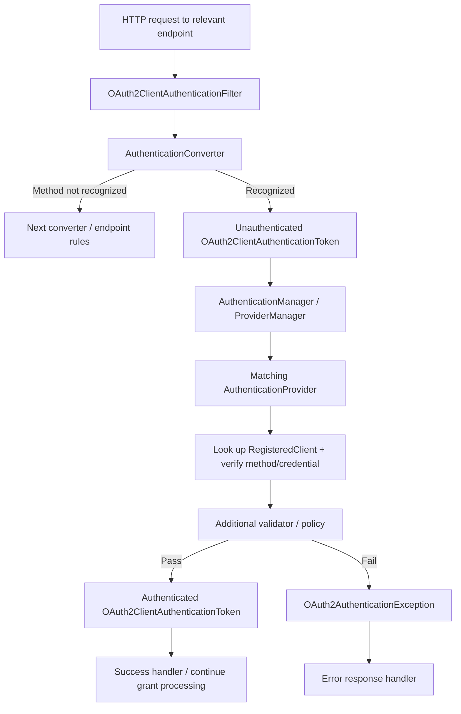
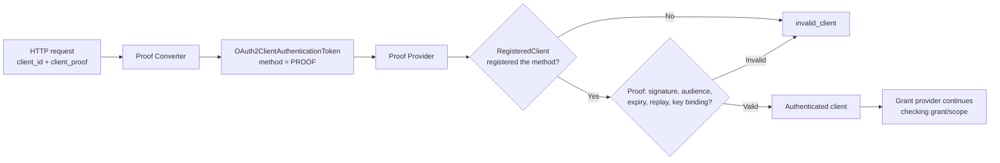

# Customizing Converters, Providers, and Validators for Client Authentication

## 1. Problem Statement and Learning Outcomes

In a **Spring Security OAuth 2.0/OIDC Authorization Server** built with Spring Boot and **Spring Authorization Server (SAS)**, client authentication answers the question: *is the application requesting a token or calling a protected endpoint genuinely a registered client, and is it permitted to use that authentication method?* This differs from end-user login and also differs from deciding whether to grant a specific scope.

Real-world systems often need more than the defaults:

- A client may authenticate only after completing internal approval, while not suspended, and while belonging to an active organization.
- A partner system uses a client assertion or certificate under an agreed profile.
- Default methods need stricter input validation while still preserving the framework's client secret or signature verification.
- A specialized authentication method strictly requires a custom converter, provider, and anti-spoofing, expiration, and replay checks.

In the **Client Authentication** chapter, this lesson focuses on selecting and implementing **three extension points** properly: `AuthenticationConverter`, `AuthenticationProvider`, and validators/authentication policies. Learners should be able to explain the path from an HTTP request to `OAuth2ClientAuthenticationToken`, pick the right extension point, avoid dropping default protections, and write negative test cases for custom methods.

> **Version note:** Class names and configuration APIs in the examples reference the structure of **Spring Authorization Server 1.x / Spring Security 6.x**. Newer Spring Security releases integrating Authorization Server capabilities may change configuration APIs or support levels. Verify documentation and Javadoc for your exact version before copying code. Examples omit imports and infrastructure beans to focus on architecture.

## 2. Where Does Client Authentication Live?

On endpoints requiring client authentication (such as the token endpoint for confidential clients, introspection, or revocation per protocol conditions), SAS uses `OAuth2ClientAuthenticationFilter` together with `AuthenticationManager` and its associated providers. The filter determines whether the request carries a supported client authentication mechanism, converts it into an `Authentication` object, invokes the manager, and runs success/failure handlers.



This diagram is a logical model. Depending on the method and version, some checks occur inside the provider while others happen in the converter or JWT/certificate verification layer. `AuthenticationManager` may also hold multiple providers; a provider can return `null` if it does not handle the method under consideration.

### 2.1. Distinguishing the Three Stages

| Component | Question handled | Should this happen here? | Examples |
| --- | --- | --- | --- |
| **Converter** | *Which authentication mechanism is the request proposing? Are all parameters present to represent it?* | Read and validate the shape of the HTTP request; create an unauthenticated `Authentication` | Parsing Basic header, form body, JWT assertion |
| **Provider** | *Is the client valid and does it actually possess the presented proof?* | Look up `RegisteredClient`, verify registered method, credentials/signature, and security conditions | Verifying secret with `PasswordEncoder`; verifying client assertions |
| **Validator / policy** | *Are there additional conditions to enforce during authentication?* | Verify claim attributes, issuer/audience, approval state, tenant, expiration policy | Rejecting suspended clients; requiring claims for exact target |

**Never treat a converter as the place to authenticate credentials.** An `OAuth2ClientAuthenticationToken` built from an HTTP request can carry a forged `client_id` and invalid credentials. Only a provider, after verification, may produce a trusted `authenticated` result.

### 2.2. Common Authentication Methods

| Method | Proof data | Notable points |
| --- | --- | --- |
| `client_secret_basic` | HTTP Basic with client ID/secret | Common for confidential backend clients; requires TLS |
| `client_secret_post` | `client_id` and `client_secret` in form body | Must control logs/bodies; never put secrets in URLs |
| `client_secret_jwt` | JWT client assertion signed with a symmetric secret | Check algorithm, `aud`, lifetime, subject, and key policy |
| `private_key_jwt` | JWT client assertion signed with the client's private key | Server must hold trusted public keys; validate JWT per profile |
| `none` | No client secret | For public clients; does not remove PKCE or grant checks |
| TLS-based or extension methods | Certificate/credential per profile | Support depends on version and deployment; never trust Internet-sent certificate headers directly |

This list describes **mechanisms across the OAuth standards and ecosystem**. Do not assume every method has an active provider enabled in every version. In particular, `none` is not a way to "skip security": clients unable to keep secrets remain subject to `redirect_uri`, client-side `state`, PKCE, and grant-level authorization checks.

## 3. Key SAS Components to Understand

### 3.1. `OAuth2ClientAuthenticationToken`

This is the Java `Authentication` implementation used in **OAuth client authentication**. It differs from `OAuth2AccessToken` issued for calling APIs.

At the request stage, the object typically holds:

- `clientId` / principal identifying the client;
- the `ClientAuthenticationMethod` proposed by the client;
- credentials such as a secret or signed assertion;
- additional parameters needed by converters/providers.

After verification by a provider, the result may hold the `RegisteredClient` and `isAuthenticated() == true`. The provider must guarantee that the resolved `RegisteredClient` matches `client_id` and **permits the authentication method being used**.

### 3.2. `RegisteredClientRepository` and `RegisteredClient`

The repository exposes `findByClientId(String clientId)`. `RegisteredClient` defines `clientAuthenticationMethods`, `authorizationGrantTypes`, `clientSecret`, `clientSecretExpiresAt`, URIs, and `ClientSettings`.

A request presenting `client_id=reporting-service` does not mean it can use any method. If the client registered only `private_key_jwt`, a request sending `client_secret_basic` must not be accepted even if it includes a secret-like string.

### 3.3. `OAuth2ClientAuthenticationConfigurer`

In SAS 1.x API style, the configuration point typically looks like:

```java
OAuth2AuthorizationServerConfigurer authorizationServer =
        OAuth2AuthorizationServerConfigurer.authorizationServer();

http.securityMatcher(authorizationServer.getEndpointsMatcher())
    .with(authorizationServer, server -> server
        .clientAuthentication(clientAuth -> clientAuth
            .authenticationConverters(converters -> {
                // Customize the converter list used for client authentication.
            })
            .authenticationProviders(providers -> {
                // Customize the provider list used for client authentication.
            })
        ))
    .authorizeHttpRequests(auth -> auth.anyRequest().authenticated());
```

This is a **configuration snippet**, not a standalone runnable `SecurityFilterChain`. For example, it omits the client repository, authorization/consent services, token generator, signing keys, user login, and OIDC endpoints.

Common configuration APIs:

| API | Purpose |
| --- | --- |
| `authenticationConverter(converter)` | Adds a converter for a client authentication method |
| `authenticationConverters(Consumer<List<AuthenticationConverter>>)` | Customizes the converter list, including preconfigured defaults |
| `authenticationProvider(provider)` | Adds a provider handling an `Authentication` type |
| `authenticationProviders(Consumer<List<AuthenticationProvider>>)` | Customizes the provider list; useful for wrapping providers to add policy |
| `authenticationSuccessHandler(...)` | Handles post-authentication success |
| `errorResponseHandler(...)` | Produces protocol-compliant client authentication error responses |

The order of converters and providers can affect behavior. Never delete default components without knowing which features rely on them; after changes, test methods you did **not** intend to alter as well.

## 4. Customizing AuthenticationConverter

### 4.1. What Should a Converter Handle?

`AuthenticationConverter` has the contract:

```java
public interface AuthenticationConverter {
    Authentication convert(HttpServletRequest request);
}
```

Return `null` when the converter **does not recognize** the mechanism it handles so another matching converter can process the request. When a request clearly targets this mechanism yet is malformed (missing required parameters, ambiguous duplicate parameters, invalid encoding), reject with an appropriate protocol error rather than returning `null` and letting another method ignore the error.

A converter **must never**:

- Set `authenticated=true` on an unverified result.
- Trust a `client_id` solely because the request contains it.
- Log client secrets, assertions, or bearer tokens.
- Bypass the rule "one request must not use multiple client authentication methods simultaneously."
- Infer methods from headers lacking provenance guarantees.

### 4.2. Example: Strictly Validating the `client_secret_post` Body

Suppose you need to catch a body containing two `client_secret` values, duplicated `client_id` fields, or an invalid `Content-Type` before the default converter runs. A safe approach is to **wrap the original converter**, delegate valid requests to it, and **replace the original converter in place** in the list. Merely prepending a new converter while leaving the old converter down the list can let requests bypass your new checks.

```java
final class StrictClientSecretPostConverter implements AuthenticationConverter {
    private final AuthenticationConverter delegate =
            new ClientSecretPostAuthenticationConverter();

    @Override
    public Authentication convert(HttpServletRequest request) {
        // Not a client_secret_post request; let other converters handle it.
        String[] secrets = request.getParameterValues("client_secret");
        if (secrets == null) {
            return null;
        }

        // Recognized as client_secret_post: malformed inputs must be rejected.
        String[] clientIds = request.getParameterValues("client_id");
        if (!"POST".equalsIgnoreCase(request.getMethod())
                || clientIds == null || clientIds.length != 1
                || secrets.length != 1
                || clientIds[0].isBlank()
                || secrets[0].isBlank()) {
            throw invalidRequest();
        }

        String contentType = request.getContentType();
        boolean formEncoded;
        try {
            formEncoded = contentType != null
                    && MediaType.APPLICATION_FORM_URLENCODED.isCompatibleWith(
                            MediaType.parseMediaType(contentType));
        } catch (InvalidMediaTypeException ex) {
            throw invalidRequest();
        }
        if (!formEncoded) {
            throw invalidRequest();
        }

        // Delegate continues building AuthenticationToken per SAS contract.
        return delegate.convert(request);
    }

    private static OAuth2AuthenticationException invalidRequest() {
        return new OAuth2AuthenticationException(
                new OAuth2Error(OAuth2ErrorCodes.INVALID_REQUEST));
    }
}
```

**Scope of this example:** it checks `client_secret_post` syntax, without secret verification policies, avoiding credentials in URL/query strings, or detecting every combination of Basic header and form body. Those requirements must be added and tested consistently across **all inputs**; the converter above is **not a complete security filter** to drop straight into production.

Replace the default converter via the configurer API:

```java
.clientAuthentication(clientAuth ->
    clientAuth.authenticationConverters(converters -> {
        for (int index = 0; index < converters.size(); index++) {
            if (converters.get(index)
                    instanceof ClientSecretPostAuthenticationConverter) {
                converters.set(index, new StrictClientSecretPostConverter());
                return;
            }
        }
        throw new IllegalStateException(
                "Expected ClientSecretPostAuthenticationConverter");
    }))
```

The snippet above sits **inside** the Authorization Server configuration, not as a standalone Java snippet. Intentionally throwing if the converter is missing catches version API/default changes instead of starting up silently without the check. After replacing the converter, test both `client_secret_basic` and `private_key_jwt` to confirm they remain unaffected.

## 5. Customizing AuthenticationProvider and Post-Authentication Policies

### 5.1. When Should You Keep Standard Providers?

If you want to "block suspended clients," "allow only clients of active tenants to call the token endpoint," or "require partners to be on an approved list," you usually **do not need to rewrite client secret or JWT verification**. Keeping the standard provider and applying extra policy **after the provider authenticates successfully** carries far less risk than reimplementing secret comparisons or signature checks.

Why: standard providers already handle details such as registered methods, secret encoding, secret expiration, client assertion issuer/audience/algorithm checks, and version-appropriate OAuth errors. Skipping one of those steps can allow client impersonation.

### 5.2. Example: Wrapping Providers to Block Suspended Clients

Suppose the application implements a `ClientAdmissionPolicy` backed by an approved-status store:

```java
interface ClientAdmissionPolicy {
    boolean isAllowed(String clientId);
}

final class ClientAdmissionProvider implements AuthenticationProvider {
    private final AuthenticationProvider delegate;
    private final ClientAdmissionPolicy admission;

    ClientAdmissionProvider(
            AuthenticationProvider delegate,
            ClientAdmissionPolicy admission) {
        this.delegate = delegate;
        this.admission = admission;
    }

    @Override
    public boolean supports(Class<?> authentication) {
        return delegate.supports(authentication);
    }

    @Override
    public Authentication authenticate(Authentication authentication)
            throws AuthenticationException {
        Authentication result = delegate.authenticate(authentication);

        // null means this provider does not handle the request; preserve contract.
        if (result == null) {
            return null;
        }

        if (result instanceof OAuth2ClientAuthenticationToken client
                && client.isAuthenticated()) {
            RegisteredClient registration = client.getRegisteredClient();
            if (registration == null
                    || !admission.isAllowed(registration.getClientId())) {
                throw new OAuth2AuthenticationException(
                        new OAuth2Error(OAuth2ErrorCodes.INVALID_CLIENT));
            }
        }
        return result;
    }
}
```

Register the wrapper around **client authentication** providers:

```java
.clientAuthentication(clientAuth ->
    clientAuth.authenticationProviders(providers ->
        providers.replaceAll(provider ->
            new ClientAdmissionProvider(provider, clientAdmissionPolicy))))
```

`clientAdmissionPolicy` is an application-provided bean and must enforce *deny-by-default* when status cannot be read or the client is absent from the list. This example enforces policy **after** a provider returns a result; it does not re-check secrets. Each provider remains responsible for verifying the appropriate proof.

When using this in real systems:

- Verify which providers are wrapped, avoid wrapping the wrong endpoint, and ensure the policy applies across **every client authentication method** you intend to govern.
- Consider cache consistency after suspending a client; an instance holding stale state might continue accepting the client.
- Never turn approval-store timeouts into "temporary allowance."
- Avoid logging secrets carried inside `Authentication`; log only client ID and controlled error codes.
- Check provider ordering to guarantee no alternate path returns a valid result bypassing the policy.

### 5.3. Do Not Use the Provider to Decide All OAuth Permissions

An authenticated `OAuth2ClientAuthenticationToken` answers "does the client have a valid identity?" The token endpoint **still must** verify `authorization_grant_type`, scopes, authorization codes, PKCE, refresh tokens, consent, and grant-specific conditions. The Resource Server **still must** verify audience, API permissions, and data ownership. Never cram all of those checks into the client authentication provider.

## 6. Validators: Placement and Standards to Preserve

The word "validator" may refer to an `OAuth2TokenValidator<Jwt>`, a validation callback accepted by a provider/configurer, or custom policy logic. **There is no single `ClientAuthenticationValidator` interface that every SAS method must implement.** Choose the extension point provided by your version.

| Check group | Appropriate place | What must not be skipped |
| --- | --- | --- |
| Valid HTTP parameters, no duplicates/ambiguity | Converter or pre-auth request validator | Right HTTP method, Content-Type, encoding, and parameter counts |
| Client is registered | Provider + `RegisteredClientRepository` | Never trust a self-declared client ID |
| Client authentication method permitted | Provider | Never accept a method merely because credentials are present |
| Valid secret or signature | Provider, `PasswordEncoder`, JWT decoder/verifier | Proper cryptographic verification; never naive secret comparisons |
| JWT assertion claims | JWT validator within JWT client authentication | `iss`, `sub`, `aud`, `exp`, algorithm, trusted keys, replay protection per policy |
| Client still allowed to operate | Provider wrapper or post-auth policy | Approval, suspension, tenant, credential status |
| Grant type, scope, authorization code, PKCE | **Grant provider / token endpoint** | Exact client, grant, permissions, and proof |
| Access to individual API resources | **Resource Server** | Audience, scopes, roles, tenant, and ownership |

### 6.1. Example JWT Client Assertion Policy

For `private_key_jwt` or `client_secret_jwt`, do not verify only "does the JWT have a valid signature?" Depending on the profile, the server must bind the assertion to the exact client and token endpoint, checking:

1. `iss` and `sub` identify the exact client per accepted profile.
2. `aud` matches the Authorization Server/token endpoint per the client assertion contract; never accept audiences from another environment.
3. `exp` has not passed; `iat`/`nbf` and clock skew are handled per policy.
4. The signing algorithm is permitted and the verification key belongs to the registered client; reject `alg=none` or arbitrary request-supplied keys.
5. `jti` or anti-replay controls are checked per policy/profile; if needed, maintain a TTL-backed store of used assertion IDs.
6. Never log the full assertion or expose verification details to callers.

If your version offers a hook to set a JWT validator/decoder, **add business constraints only after retaining all standard checks**. Replacing the entire default validator with one that checks only `tenant_id` can accidentally drop `aud` or `exp` checks.

### 6.2. Policies Must Have Consistent Semantics

For example, client `partner-billing` is suspended at 10:00. If you add a check only on the admin UI while the token endpoint keeps accepting credentials until 10:30 due to caching, the policy fails to take effect on time. Decide:

- Does suspension block issuing **new** tokens, or must it also revoke **already-issued** tokens?
- If APIs validate JWTs offline, how will immediate revocation be achieved if required?
- Do introspection/revocation endpoints enforce the same policy? You may need to allow certain cleanup operations for a suspended client, designed explicitly.
- When the policy service is unavailable, is the client rejected or is there an approved incident-handling strategy?

Client authentication policies and token lifecycle policies are related, though not identical.

## 7. When a Custom Authentication Method Is Strictly Required

**Prefer standard mechanisms** such as `private_key_jwt`, `client_secret_basic`, or framework-supported certificate-binding methods. Custom methods should only be used when an integration contract demands it and existing standards cannot express the requirement.

To understand the relationship, consider a **hypothetical** method named `urn:example:oauth:client-auth:proof`, where the client sends `client_id` and a signed proof in the form body. The snippet below only outlines wiring the converter/provider; **verifying signatures, replay, key trust, and profile rules must be implemented by an audited `ClientProofVerifier`**.

### 7.1. Custom Converter Creating an Unauthenticated Request

```java
static final ClientAuthenticationMethod PROOF_METHOD =
        new ClientAuthenticationMethod("urn:example:oauth:client-auth:proof");

final class ProofClientAuthenticationConverter implements AuthenticationConverter {
    @Override
    public Authentication convert(HttpServletRequest request) {
        String[] proofValues = request.getParameterValues("client_proof");
        if (proofValues == null) {
            return null; // Not this method.
        }

        String[] clientIds = request.getParameterValues("client_id");
        if (!"POST".equalsIgnoreCase(request.getMethod())
                || clientIds == null || clientIds.length != 1
                || proofValues.length != 1
                || clientIds[0].isBlank()
                || proofValues[0].isBlank()) {
            throw new OAuth2AuthenticationException(
                    new OAuth2Error(OAuth2ErrorCodes.INVALID_REQUEST));
        }

        return new OAuth2ClientAuthenticationToken(
                clientIds[0], PROOF_METHOD, proofValues[0], Collections.emptyMap());
    }
}
```

**Note:** form proof is only a modeling example; a real implementation must validate `Content-Type`, enforce single-method-per-request rules, cap payload size, check credential source, and standardize canonicalization. The converter **never** calls `setAuthenticated(true)`.

### 7.2. Custom Provider Verifying Proof

```java
interface ClientProofVerifier {
    // Must throw if signature, key binding, audience, timestamps,
    // jti/nonce, or anti-replay checks are invalid.
    void verify(RegisteredClient client, String proof);
}

final class ProofClientAuthenticationProvider implements AuthenticationProvider {
    private final RegisteredClientRepository clients;
    private final ClientProofVerifier verifier;

    ProofClientAuthenticationProvider(
            RegisteredClientRepository clients, ClientProofVerifier verifier) {
        this.clients = clients;
        this.verifier = verifier;
    }

    @Override
    public boolean supports(Class<?> authentication) {
        return OAuth2ClientAuthenticationToken.class.isAssignableFrom(authentication);
    }

    @Override
    public Authentication authenticate(Authentication authentication)
            throws AuthenticationException {
        OAuth2ClientAuthenticationToken request =
                (OAuth2ClientAuthenticationToken) authentication;
        if (!PROOF_METHOD.equals(request.getClientAuthenticationMethod())) {
            return null; // Yield to other providers when method does not match.
        }

        Object principal = request.getPrincipal();
        if (!(principal instanceof String clientId)) {
            throw invalidClient();
        }

        RegisteredClient client = clients.findByClientId(clientId);
        if (client == null
                || !client.getClientAuthenticationMethods().contains(PROOF_METHOD)) {
            throw invalidClient();
        }

        try {
            verifier.verify(client, (String) request.getCredentials());
        } catch (RuntimeException ex) {
            // Never leak detailed verification info in the OAuth response.
            throw invalidClient();
        }
        return new OAuth2ClientAuthenticationToken(client, PROOF_METHOD, null);
    }

    private static OAuth2AuthenticationException invalidClient() {
        return new OAuth2AuthenticationException(
                new OAuth2Error(OAuth2ErrorCodes.INVALID_CLIENT));
    }
}
```

**Security boundary of this pattern:** `ClientProofVerifier` is intentionally an **unimplemented** contract. Never implement it as `proof != null`, static string equality, or decoding a JWT without signature verification; none of those constitute secure authentication. If policy needs to distinguish system failures from invalid credentials, define separate handling and alerts while still withholding sensitive details from clients.

### 7.3. Registering the Converter and Provider Properly

```java
.clientAuthentication(clientAuth -> clientAuth
    .authenticationConverter(new ProofClientAuthenticationConverter())
    .authenticationProvider(new ProofClientAuthenticationProvider(
            registeredClientRepository, clientProofVerifier)))
```

On the corresponding `RegisteredClient`, the new method must be registered deliberately:

```java
RegisteredClient partner = RegisteredClient.withId(stableInternalId)
        .clientId("partner-billing")
        .clientAuthenticationMethod(PROOF_METHOD)
        .authorizationGrantType(AuthorizationGrantType.CLIENT_CREDENTIALS)
        .scope("invoices.read")
        .build();
```

This snippet also covers only the builder details of interest. A real project must define `stableInternalId`, repository, keys/certificates, the proof verifier, and client approval policies. Do not implement this provider to replace `private_key_jwt` when a standard mechanism already fits.

### 7.4. A Custom Method Has Two Independent Mandatory Halves



The converter decides **how to recognize input**. The provider decides **whether to trust input** after verification. An extension with only a converter or only a provider does not form a complete client authentication method.

## 8. Choosing Integration Approaches by Requirement

| Real requirement | Preferred approach | Reason |
| --- | --- | --- |
| Backend can hold a secret | `client_secret_basic` with secret management and TLS | Standard mechanism, straightforward to operate when secrets are protected |
| Partner signs assertions with a private key | `private_key_jwt` | Clear profile; avoids inventing custom protocols |
| Must require contract claims on JWT assertions | Version-appropriate JWT validator | Keeps default signature/time/audience checks, adds policy |
| Must disable suspended clients | Policy in repository/provider and lifecycle governance | No need to alter credential verification algorithms |
| Must block malformed `client_secret_post` bodies | Converter wrapper replacing original converter in place | Catches malformed input before the provider |
| Public SPA/mobile | `none` + Authorization Code + PKCE, registered redirect URIs | Secrets embedded in frontends cannot be kept secret |
| mTLS / client certificate | Matching standard mechanism if supported by version | Certificates must be verified by the TLS stack and bound to the client |
| Specialized proof strictly required | Converter + provider + verifier + dedicated tests | Justified only when standards cannot fit and security design is approved |

For **mTLS behind a proxy**, a header like `X-Client-Cert` is trustworthy only when the proxy verified TLS, strips forged headers from the Internet, and the proxy → app connection is protected. Never treat a certificate string sent directly by an HTTP client as authentication proof.

## 9. Distinguishing Converter, Provider, and Grant Provider Errors

| Layer | Scenario | Common OAuth error / interpretation |
| --- | --- | --- |
| Converter | Duplicate parameters, bad encoding, missing fields after recognizing method | `invalid_request` |
| Provider | Unknown `client_id`, wrong secret, invalid assertion, unregistered method | `invalid_client` |
| Provider / policy | Client suspended or disallowed by policy | Usually rejects client auth without exposing internal status |
| Token endpoint / grant provider | Valid client, but `client_credentials` grant not registered | `unauthorized_client` |
| Token endpoint / grant provider | Valid client requesting scope outside allowed range | `invalid_scope` |
| Authorization Code provider | Expired code, reused code, wrong PKCE | `invalid_grant` |
| Resource Server | Invalid access token or insufficient permissions | 401 or 403 at API depending on cause |

Actual error codes depend on the endpoint and standard context. `invalid_client` often yields HTTP 401 with the appropriate authentication challenge, whereas `invalid_request` or `invalid_scope` may return 400. Never return HTTP 200 with a fake token payload for "compatibility."

**Debugging practice:** log correlation ID, endpoint, client ID where safe, recognized method, handling provider, and error code. Strictly avoid logging `Authorization: Basic ...`, client secrets, client assertions, private keys, authorization codes, or access/refresh tokens.

## 10. Mandatory Testing When Customizing

A change in the client authentication layer can break every downstream grant. Therefore test **through the HTTP endpoint**, not merely by unit-testing a converter/provider directly.

### 10.1. Success and Failure Test Matrix

| Test case | Input | Expectation |
| --- | --- | --- |
| Valid Basic | Confidential client registered for `client_secret_basic` with right secret | Client authenticated; matching grant proceeds |
| Wrong Basic secret | Right client ID, wrong secret | `invalid_client`; no token |
| Valid Post | Valid form body, one `client_id` and one `client_secret` | Converter wrapper does not break valid usage |
| Post wrong Content-Type | Has `client_secret` but body is not valid form-encoded | Rejected |
| Post duplicate parameters | Two `client_secret` or two `client_id` values | Rejected; never arbitrarily pick first element |
| Two methods in one request | Both Basic header and body secret/assertion | Never interpreted ambiguously or accepted as a bypass |
| Unregistered method | Client registered only Basic, sends POST/JWT assertion | `invalid_client` |
| Suspended client | Valid credentials, disallowed by policy | Rejected; test across every auth method |
| Policy service unavailable | Approval state cannot be determined | Fail-closed rejection with monitoring |
| Valid JWT assertion | Valid signature/claims/key binding | Authenticated per agreed profile |
| JWT wrong audience | Assertion targets another AS | Rejected |
| Expired or overly future-dated JWT | Invalid `exp`/`nbf`/`iat` | Rejected |
| Replayed JWT | Resend assertion with used `jti` when policy requires replay cache | Rejected |
| Assertion signed with unknown key | Valid signature with key not belonging to client | Rejected |
| Custom proof missing verifier | No active verifier/bean | Configuration prevented from serving traffic |
| Custom proof method unregistered | Valid proof signature, method absent from `RegisteredClient` | `invalid_client` |
| Valid client auth, wrong grant | Authenticated confidential client requesting unregistered grant | Rejected by token endpoint |
| Public client with `none` | Valid Authorization Code + PKCE | Valid flow continues working; no fake secret needed |
| Other endpoints | Introspection/revocation after provider changes | No bypass introduced and endpoint policies stay intact |

### 10.2. Specific Tests for Converter Wrappers

After replacing `ClientSecretPostAuthenticationConverter`, add regression tests proving: valid requests still delegate cleanly, malformed syntax is blocked, Basic/JWT converters continue working properly, and multi-credential requests cannot pick an "easier" path to bypass checks. Also test requests sending sensitive fields in the query string, since `getParameterValues` reads both query and body in the Servlet API.

### 10.3. Testing Provider Wrappers

In a test environment, switch the same client between allowed and suspended states. Call the token endpoint using every method the client actually registered; verify consistent results. Update status in the DB, invalidate caches, and confirm instances apply the new policy. When the policy service fails, verify the framework fails closed and logs alerts without exposing credentials.

## 11. Common Mistakes

### 11.1. Treating `client_id` as Authentication Proof

`client_id` is a public OAuth identifier, not a secret. Providers must prove the client holds appropriate credentials or meets public-client constraints. Code like `return new OAuth2ClientAuthenticationToken(client, method, null);` before verifying proof is a critical flaw.

### 11.2. Hand-Rolling Secret Comparisons Instead of Using `PasswordEncoder`

Secrets stored in `RegisteredClient` may be one-way hashed. Replacing the default provider and comparing raw strings directly against the stored secret will either fail consistently or lead to plaintext storage. Use SAS-supported providers and proper secret management/rotation policies.

### 11.3. Using Converters as Policy Engines

A converter sees only an untrusted request; it usually has not verified key possession. Tenant checks, approval state, and method permissions must be verified against trusted data in providers/policies, not merely from claims or headers read in a converter.

### 11.4. Extending by Replacing the Entire Default Provider List

Overwriting `authenticationProviders` and dropping unrelated providers can break `client_secret_basic`, `private_key_jwt`, or public clients. If replacement is unavoidable, account for all remaining providers and run regression tests for every committed method.

### 11.5. Overly Broad Provider `supports()` That Always Throws

Because multiple providers handle `OAuth2ClientAuthenticationToken`, custom providers must **check the method first**. When the method does not match, return `null` so the manager can try the next provider; when the method matches but proof is invalid, throw an error rather than returning `null` to search for an easier authentication path.

### 11.6. Dropping Built-In JWT Validation When Adding Custom Claims

A validator checking only `tenant` does not replace signature, `iss`, `sub`, `aud`, `exp`, timestamp, or replay checks. Replacing validators without keeping standard checks can cause assertions issued for another server to be accepted.

### 11.7. Confusing Client Authentication with User Authentication

Client Credentials may involve no user at all. A public web app authenticating users via Authorization Code + PKCE still cannot claim confidential client privileges. User login's `AuthenticationManager` and client authentication mechanisms serve different purposes.

## 12. Design and Analysis Exercise

An Authorization Server serves:

- `reports-backend`: confidential client using `client_secret_basic`, permitted to request `reports.read`;
- `partner-finance`: uses `private_key_jwt`, partner has `approved/suspended` state in DB;
- `mobile-public`: public client using Authorization Code + PKCE, no client secret.

The security team requires: (1) accept `client_secret_post` only with proper form encoding and no duplicate fields; (2) suspended clients must never obtain new tokens regardless of method used; (3) client assertions must target the right issuer/token-endpoint audience and have short lifetimes; (4) do not break the mobile flow.

Answer:

1. Should requirement (1) live in a converter or provider? Which default converters must be watched when replacing a converter?
2. Where should requirement (2) be checked so a client cannot switch methods to bypass policy? How should DB status lookup timeouts be handled?
3. Which JWT validator/provider does requirement (3) belong to? Besides `aud`, which fields/conditions must be verified?
4. Why does `mobile-public` not use `client_secret_post`? Is PKCE checked in the client authentication layer or the grant provider?
5. Design at least six negative test cases, including two where client authentication succeeds yet the grant or scope is denied.

**Hint:** the converter validates request syntax, standard providers verify secrets/signatures, a policy wrapper checks authenticated client status, JWT validators retain all standard rules, and the token endpoint/grant provider checks grants and scopes. Mobile public clients continue using `none` with Authorization Code + PKCE; PKCE is bound inside authorization/code-grant handling, not a reason to treat `client_id` as a secret.

## 13. Pre-Production Deployment Checklist

1. **Bound scope:** clearly identify which method needs extending, why standard providers fall short, and which endpoints are affected.
2. **Preserve defaults:** retain client registration, method, credential, signature, expiry, issuer/audience, and appropriate replay checks.
3. **Safe converters:** never call `setAuthenticated(true)`, disallow ambiguous requests, validate method/form/encoding, and reject malformed parameters.
4. **Right provider responsibilities:** query trusted `RegisteredClient`, enforce registered methods, verify proof, check client status, and fail safely.
5. **Appropriate validators:** never replace standard validators with a single business check; test both valid tokens and invalid variants.
6. **Credentials and keys:** use a secret manager, `PasswordEncoder`, trusted JWKs/certificates, rotation, TTLs, and log protection.
7. **Consistency:** synchronize suspended/approved policies across instances; assess impact on already-issued tokens.
8. **Regression:** test every supported authentication method, grants/PKCE, token revocation/introspection, and rejection cases.
9. **Operations:** log correlation IDs and controlled error codes; monitor rising `invalid_client` rates, verifier errors, and policy store incidents.

## 14. References to Consult

- [Spring Authorization Server — Protocol Endpoints](https://docs.spring.io/spring-authorization-server/reference/protocol-endpoints.html): OAuth 2.0 Client Authentication section, `OAuth2ClientAuthenticationFilter`, default converters/providers, and configuration hooks.
- [Spring Authorization Server — Core Model Components](https://docs.spring.io/spring-authorization-server/reference/core-model-components.html): `RegisteredClient`, `clientAuthenticationMethods`, and repositories.
- [Spring Security — Authentication Architecture](https://docs.spring.io/spring-security/reference/servlet/authentication/architecture.html): `Authentication`, `AuthenticationManager`, `ProviderManager`, and `AuthenticationProvider`.
- [RFC 6749 — OAuth 2.0](https://www.rfc-editor.org/rfc/rfc6749): client authentication, token endpoint, and protocol errors.
- [RFC 7523 — JWT Bearer Assertion Profiles](https://www.rfc-editor.org/rfc/rfc7523): JWT assertions as a client authentication method.
- [OpenID Connect Core — Client Authentication](https://openid.net/specs/openid-connect-core-1_0.html#ClientAuthentication): client authentication methods and related OIDC rules.
- [RFC 9700 — OAuth 2.0 Security BCP](https://www.rfc-editor.org/rfc/rfc9700): modern protection requirements, token binding, and abuse mitigation.

**Key takeaway:** `AuthenticationConverter` turns an HTTP request into an **authentication request**, `AuthenticationProvider` verifies proof and produces an **authentication result**, and validators/policies enforce extra conditions required by your trust model. In Spring Authorization Server, customizing only the right layer while keeping standard checks intact lets you add client governance without weakening OAuth 2.0/OIDC.
