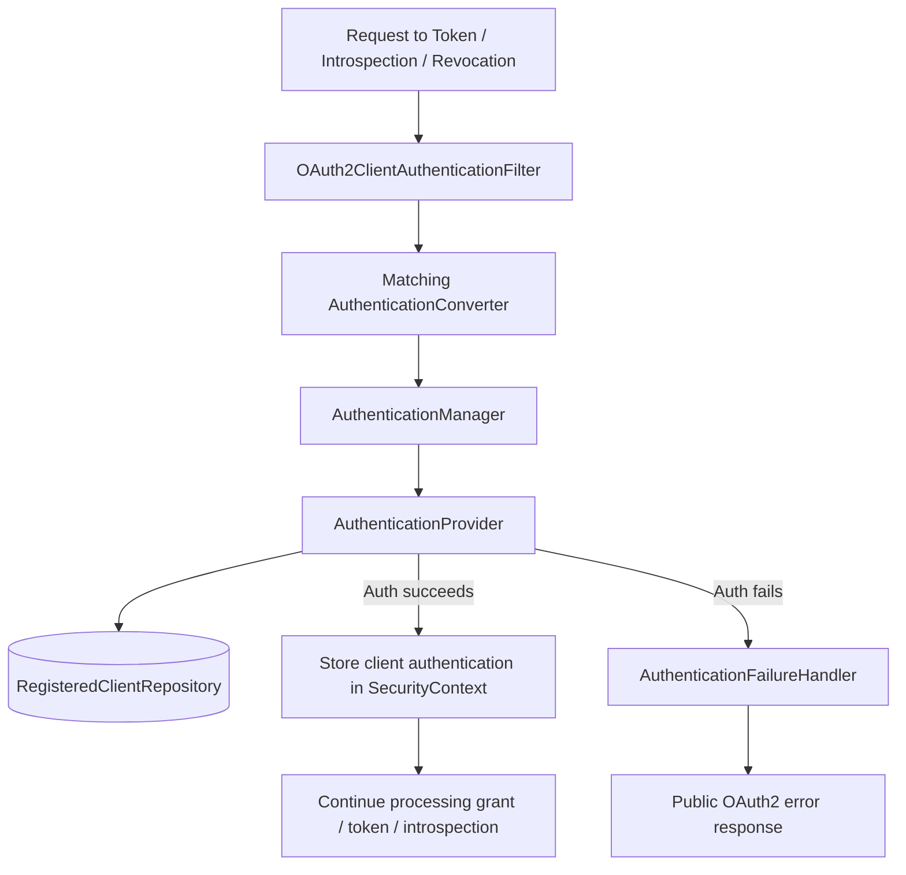

# Handling `invalid_client` and Minimizing Client Identity Leakage

## Lesson Objectives

In the **Client Authentication** chapter of the **SPRING_SECURITY_OAUTH2_OIDC_AUTHORIZATION_SERVER** module, this lesson focuses on the OAuth 2.0 `invalid_client` error and protecting client-related information when building, configuring, testing, and operating an **Authorization Server** with **Spring Security** and **Spring Authorization Server** in **Spring Boot**.

A valid client may use `client_secret_basic`, `client_secret_post`, `private_key_jwt`, mTLS, or other server-supported methods. A client may also be a **public client** using `ClientAuthenticationMethod.NONE` in an appropriate flow with PKCE. When client authentication fails, the Authorization Server must respond per standard, yet must never inadvertently disclose which client IDs are registered, whether a secret was partially correct, which tenants use the system, or internal keystore/DB details.

After this lesson, you will be able to:

- Distinguish `invalid_client` from `invalid_request`, `invalid_grant`, `unauthorized_client`, and Resource Server token errors.
- Apply HTTP statuses, `WWW-Authenticate`, and OAuth2 error responses per RFC 6749.
- Understand `OAuth2ClientAuthenticationFilter`, authentication converters/providers, and `errorResponseHandler` in Spring Authorization Server.
- Design consistent public responses, safe logging/auditing, rate limiting, and troubleshooting workflows without leaking credentials or identifying data.
- Test scenarios including non-existent clients, wrong secrets, wrong authentication methods, public clients, JWT client assertions, and reverse-proxy setups.
- Build practical operational procedures to detect client enumeration, credential stuffing, and deployment misconfigurations.

> **Principle:** Responses returned to clients must give enough information for legitimate clients to fix protocol issues while keeping the existence and secret configuration of registered clients on the server side. Do not collapse every error type into one code: OAuth 2.0 defines distinct errors with specific HTTP requirements.

## 1. What Does `invalid_client` Mean?

RFC 6749 Section 5.2 defines `invalid_client` when **client authentication failed**. Typical cases include:

- `client_id` not found when client authentication is required.
- Registered client with a wrong secret or invalid client assertion signature.
- Request requiring client authentication omits credentials.
- Client authentication method not accepted by the server or client registration.
- Invalid mTLS certificate or one mismatching registered details in an mTLS flow.

For example, a confidential client registered `client_secret_basic`, yet a request to `/oauth2/token` uses HTTP Basic with the wrong client secret. The Authorization Server cannot authenticate the client's identity and returns `invalid_client`.

**A client ID is usually an identifier, not a secret.** It can appear in authorization requests or OAuth2 Client configurations. However, confirming whether a client ID exists, which tenant owns it, whether it is active or disabled, or which authentication method it uses can leak useful intelligence to attackers. Therefore, never return those details in public errors.

### 1.1. How Does `invalid_client` Differ from Other Common Errors?

| Error | Nature | Example | Should sensitive details be disclosed? |
|---|---|---|---|
| `invalid_client` | Client authentication failed. | Unknown client, wrong secret, invalid assertion. | No; use generic descriptions. |
| `invalid_request` | Request has invalid structure/parameters. | Duplicate parameters, using two client auth mechanisms simultaneously, missing required field. | Report only necessary protocol info; never echo credentials. |
| `invalid_grant` | Authorization grant / refresh token is invalid. | Expired/used code, code belongs to another client, revoked refresh token, wrong PKCE. | Never return grant codes/values; avoid revealing token state unnecessarily. |
| `unauthorized_client` | Client was identified, but is not allowed to use the grant. | Confidential client allowed only `client_credentials` sends `authorization_code`. | Follow standard; never turn the error into a pre-auth client lookup oracle. |
| `unsupported_grant_type` | Server does not support the requested grant type. | Request asks for a grant type the server does not implement. | Respond per standard without exposing internal config. |
| `invalid_scope` | Invalid / out-of-range scope. | Client requests an unregistered scope. | Never expose hidden tenant/permission metadata. |
| `invalid_token` | Resource Server rejects Bearer token per RFC 6750. | Expired access token or invalid signature. | Distinct from `invalid_client` at the token endpoint. |

**Check order matters.** A request with both a wrong client secret and a disallowed grant should normally fail at **client authentication** before anything is said about the client's permissions. Never implement "check if client exists and return `unauthorized_client`" prior to authentication, as that leaks the client list through errors.

### 1.2. Which Endpoints Involve Client Authentication?

In a typical Spring Authorization Server setup, `OAuth2ClientAuthenticationFilter` handles client authentication at:

- **Token Endpoint** (`/oauth2/token`) when a client authentication method applies.
- **Token Introspection Endpoint** (`/oauth2/introspect`).
- **Token Revocation Endpoint** (`/oauth2/revoke`).
- Other endpoints/extensions, such as PAR or dynamic client registration, when the feature and protocol policy require client authentication.

Do not conflate `invalid_client` at the Token Endpoint with **user login** failures at `/login` or Resource Server Bearer token errors. Each has its own contract, filters, and error handling.

For a **public client** using `ClientAuthenticationMethod.NONE`, there is no client secret to verify. It still must be identified properly, use an appropriate grant, a valid redirect URI, and PKCE for Authorization Code flows. **Never treat every request lacking a secret as `invalid_client`**, since public clients are valid under the protocol.

## 2. HTTP Status and RFC 6749-Compliant Error Responses

### 2.1. OAuth2 Error Structure

A token error response contains a mandatory `error` field; `error_description` and `error_uri` are optional. Safe response example for failed client authentication:

```http
HTTP/1.1 401 Unauthorized
Content-Type: application/json
Cache-Control: no-store
Pragma: no-cache
WWW-Authenticate: Basic realm="oauth2-client"

{"error":"invalid_client"}
```

This illustrates a **request that attempted authentication via an HTTP Basic `Authorization` header**. The `realm` value is a generic label chosen by the organization, containing no client ID, tenant ID, or secret admin URL. In real deployments, verify the default behavior of your Spring Authorization Server version.

Avoid returning:

```json
{
  "error": "invalid_client",
  "error_description": "Client acme-admin exists, but its secret expired at 2026-10-31"
}
```

This description confirms to an attacker that the client exists, the exact error reason, and the secret's lifecycle state. Internally you may log a reason code in access-controlled audits, but never publish such details over HTTP.

### 2.2. When to Use 400 vs. 401?

Under RFC 6749 `5.2`:

1. Token error responses normally use **HTTP 400**, unless the specification states otherwise.
2. For `invalid_client`, the Authorization Server **may** return **HTTP 401** to indicate the supported HTTP authentication scheme.
3. If the client attempted to authenticate via the **`Authorization` request header**, the Authorization Server **must** return **HTTP 401** and include **`WWW-Authenticate` matching the scheme used**.

Therefore, never write middleware that forces **every** Token Endpoint error to HTTP 200 or 400. For example, returning 400 instead of 401 and dropping `WWW-Authenticate: Basic ...` for `client_secret_basic` can violate the RFC requirement.

Conversely, for requests sending credentials via `client_secret_post` form fields, 400 `invalid_client` can be valid; exact response behavior should stay consistent with the protocol and framework version. **Never rely solely on 400 vs. 401 to leak whether a client ID exists.**

### 2.3. What Response Content Should Be Restricted?

| Response element | Recommendation |
|---|---|
| `error` | Use standard error codes such as `invalid_client`. |
| `error_description` | May be omitted; if used, keep it generic and uniform—never say "unknown ID" or "wrong secret." |
| `error_uri` | If present, point only to public docs on client configuration; never embed client IDs, accounts, or internal codes. |
| `WWW-Authenticate` | Satisfy RFC rules for HTTP Authorization header attempts; do not leak client-specific methods. |
| Custom headers | Avoid `X-Client-Exists`, `X-Secret-Expired`, `X-Tenant-ID`, and leaky diagnostic headers. |
| Cache / Content-Type | Use valid OAuth2 JSON; consider `Cache-Control: no-store`, `Pragma: no-cache` for sensitive endpoints. |
| Redirect | The Token Endpoint responds directly per protocol; never redirect clients to a login page with secrets in query strings. |

Never reflect `client_id`, `client_secret`, `client_assertion`, tokens, or the raw request inside `error_description`. If using a correlation ID, generate it randomly on the server and avoid encoding identifying data into it.

## 3. Client Authentication Flow in Spring Authorization Server

### 3.1. Main Components

Spring Authorization Server uses `OAuth2ClientAuthenticationFilter` to convert credential data in requests into an `Authentication` and dispatch it to matching `AuthenticationProvider`s.



Supported methods per version docs include: `client_secret_basic`, `client_secret_post`, `client_secret_jwt`, `private_key_jwt`, `tls_client_auth`, `self_signed_tls_client_auth`, and `none` for public clients.

Components to recognize:

| Component | Role |
|---|---|
| `RegisteredClientRepository` | Looks up client configuration and registered authentication methods. |
| `ClientSecretAuthenticationProvider` | Authenticates confidential client secrets. |
| `JwtClientAssertionAuthenticationProvider` | Verifies JWT client assertions per supported methods and policies. |
| `X509ClientCertificateAuthenticationProvider` | Authenticates clients via mTLS certificates when configured. |
| `PublicClientAuthenticationProvider` | Handles public client / PKCE authentication flows. |
| `OAuth2ClientAuthenticationConfigurer` | Configuration point for converters, providers, and success/failure handlers. |
| `OAuth2ErrorAuthenticationFailureHandler` | Produces standard OAuth2 error responses on supported endpoints. |

**Do not rewrite client authentication from scratch** just to alter the `invalid_client` message. The framework already provides converters/providers for standard methods. To tighten security, prioritize configuring `RegisteredClient` properly, protecting secret stores, and hardening logging/proxies before customizing failure handlers when tests show a real need.

### 3.2. `SecurityFilterChain` Skeleton Using Defaults

The example below uses **Spring Authorization Server 1.x and Spring Security 6.2+** configuration style:

```java
@Configuration(proxyBeanMethods = false)
class AuthorizationServerSecurityConfiguration {

    @Bean
    @Order(1)
    SecurityFilterChain authorizationServerSecurityFilterChain(HttpSecurity http)
            throws Exception {

        OAuth2AuthorizationServerConfigurer authorizationServer =
                OAuth2AuthorizationServerConfigurer.authorizationServer();

        http.securityMatcher(authorizationServer.getEndpointsMatcher())
            .with(authorizationServer, configurer ->
                configurer
                    .clientAuthentication(clientAuthentication -> {
                        // Keep default converters/providers and failure handler.
                        // Replace only when required and verified against RFC.
                    })
                    .oidc(Customizer.withDefaults()))
            .authorizeHttpRequests(authorize -> authorize
                    .anyRequest().authenticated());

        return http.build();
    }
}
```

This snippet is an illustrative skeleton omitting imports and required beans such as `RegisteredClientRepository`, `OAuth2AuthorizationService`, `JWKSource`, login configuration, and `AuthorizationServerSettings`. Production also needs durable storage, signing keys, TLS, auditing, and network defense layers.

If your project uses a Spring Security version with integrated Authorization Server APIs, check packages/methods for your exact dependency version; never mix imports across different release lines.

### 3.3. Configuring `RegisteredClient` with the Right Authentication Method

Example machine-to-machine client using HTTP Basic:

```java
RegisteredClient inventoryClient = RegisteredClient
        .withId("inventory-job-v1")
        .clientId("inventory-job")
        .clientSecret(passwordEncoder.encode(
                environment.getRequiredProperty("INVENTORY_CLIENT_SECRET")))
        .clientAuthenticationMethod(ClientAuthenticationMethod.CLIENT_SECRET_BASIC)
        .authorizationGrantType(AuthorizationGrantType.CLIENT_CREDENTIALS)
        .scope("inventory.read")
        .build();
```

`passwordEncoder` and `environment` are injected from application configuration; this is a client declaration snippet, **not a complete Java source file**. You can use `PasswordEncoderFactories.createDelegatingPasswordEncoder()` or an encoder configured appropriately for the app. Never store plaintext secrets in Git or log submitted secrets in request logs.

For real deployments, use a durable `RegisteredClientRepository`, avoid regenerating internal IDs or secret hashes arbitrarily on every startup, enforce secret provisioning/rotation workflows, and govern owners/scopes/expirations. When using JWT client assertions or mTLS, switch authentication methods and configure keys/certificates accordingly; never continue assuming every client has a `client_secret`.

If the server supports `client_secret_post`, allow it only for clients registered with that method; never accept multiple methods simultaneously in the same request. **Never pass client secrets in URLs/query strings** because they leak easily into browser histories, access logs, and monitoring systems.

## 4. Where Does Client Identity Leakage Occur?

### 4.1. Distinguishing "Client Does Not Exist" from "Wrong Secret"

An attacker has a candidate list of client IDs:

```text
billing-service
inventory-job
company-acme-production
admin-console
```

They send identical requests with a bogus secret to the Token Endpoint and observe:

- HTTP status: `404` for non-existent IDs versus `401` for existing IDs.
- JSON body: `unknown_client` versus `secret_invalid` (custom codes).
- `error_description`: "client is disabled" vs. "client is valid; certificate expired."
- Headers: `X-Registered-Client: true` or varying `WWW-Authenticate` values per ID.
- Body size, response template, cache policy, or latency differences.
- Auxiliary endpoints or admin APIs allowing unauthenticated client lookups.

If the same **client authentication failure** category yields different responses based on client existence, the system becomes a client-enumeration oracle.

**Mitigation:** for requests using the same authentication method and same failure class, normalize `error`, descriptions, and HTTP policies per RFC; never disclose registration status, expiry, tenant, or signing-key method. Protocol-mandated distinctions—such as `invalid_request` for malformed syntax—must still be preserved.

### 4.2. Timing Side-Channel Leakage

Even when status and body match, code paths can diverge:

```text
Unknown client:
    SELECT not found -> immediately return invalid_client

Known client, wrong secret:
    SELECT found -> BCrypt.matches(secret, hash) -> return invalid_client
```

If processing times differ noticeably and systematically, an attacker can **statistically infer** client existence over many requests. Rate limits, network jitter, caching, and DB load complicate timing measurements, yet it remains a risk worth evaluating for high-value systems.

Remediation directions:

- Use proper `PasswordEncoder.matches(...)`, never hand-rolled `String.equals(...)` secret checks.
- Avoid creating endpoints that look up `client_id` and return different responses before authentication.
- Under strict anti-enumeration policies, you can evaluate performing a dummy hash verification when a client is not found; any such design **must undergo security review, benchmarking, and DoS protection**. Never generate a fresh BCrypt hash per request arbitrarily, as that spikes CPU usage and invites abuse.
- Combine rate limits, quotas, monitoring, and controlled statistical timing tests. Never claim "absolute constant time" across the entire HTTP/DB stack.

**Adding random sleeps alone does not fix the root leak.** Branching differences can still be inferred with enough samples; slowing down every request can also turn token issuance into a DoS target.

### 4.3. Leakage Through Logs, Tracing, and Telemetry

Token requests can contain:

- `Authorization: Basic ...`, which is Base64 encoding of client ID and secret; **Base64 is not security encryption**.
- Form fields `client_secret`, `client_assertion`, `code`, `refresh_token`, `code_verifier`.
- Session cookies, certificates, proxy headers, introspection and revocation request bodies.

Verbose HTTP logging from gateways, ingress controllers, reverse proxies, APMs, or exception handlers can capture these fields even when your application code never logs them explicitly. Govern **the entire observability pipeline**, not just Java loggers.

Strictly avoid:

```java
log.warn("Client auth failed: clientId={}, secret={}, request={}",
        clientId, rawClientSecret, request);
```

Replace with structured auditing using approved fields, for example:

```json
{
  "event_type": "oauth.client_auth.failure",
  "event_time": "2026-11-16T00:00:00Z",
  "request_id": "opaque-request-id",
  "endpoint": "/oauth2/token",
  "method": "POST",
  "auth_method_category": "client_secret_basic",
  "error_code": "invalid_client",
  "reason_category": "credential_validation_failed",
  "source_ip_category": "public-network",
  "environment": "staging"
}
```

This is an **illustrative audit template**, not a schema auto-generated by Spring Authorization Server. When a client identifier is needed for investigations, use an access-controlled internal ID or **an HMAC with a dedicated audit key** instead of plain hashes that are easy to brute-force for low-entropy client IDs. Never log secrets, assertion JWTs, private keys, raw tokens, authorization codes, passwords, or `Authorization` headers.

### 4.4. Leakage Through UI Screens, Routes, and Client Error Pages

Support pages such as "Check client ID," "Forgot client secret," or "Client already exists" can leak the registry if callers are unauthenticated. Require admin permissions, verify ownership, throttle name guessing, and restrict per-tenant metadata visibility.

**Authorization Endpoint differs from Token Endpoint:** if `client_id` is invalid or `redirect_uri` cannot be verified, **never redirect the browser to an attacker-supplied URI** just to deliver an error to the client. RFC 6749 requires handling invalid redirect URIs safely; display a generic error on the server after validating inputs without reflecting sensitive request fields into URLs.

## 5. Designing Consistent Public Responses

A decision table helps keep protocol compliance accurate while minimizing disclosure:

| Scenario | External error class | Details retained server-side |
|---|---|---|
| Unknown client with HTTP Basic | `invalid_client`; 401 + `WWW-Authenticate: Basic`. | Client ID not found. |
| Known client, wrong secret with HTTP Basic | `invalid_client`; identical public shape as above. | Hash mismatch; may flag internal credential failure. |
| Known client, expired secret | `invalid_client`, do not disclose expiry date. | Secret expired / rotation state. |
| Basic client missing header or credentials in wrong place | `invalid_client` or `invalid_request` per exact request shape and policy. | Indicate missing/wrong mechanism in protected logs. |
| Two auth mechanisms in one request | `invalid_request` per RFC 6749; never merge blindly. | Duplicate/multiple authentication mechanisms. |
| Client authenticated validly, disallowed grant | `unauthorized_client`. | List of registered grants. |
| Client authenticated validly, expired authorization code | `invalid_grant`. | Grant state and issuer/client association. |
| Public client Authorization Code + PKCE | Handle per valid `NONE`/PKCE; never demand a secret by default. | PKCE binding, redirect/client registration. |
| Introspection: valid client auth, inactive token | `active:false` per RFC 7662, no token details leaked. | Actual token state. |
| Revocation: valid client auth, unknown token | Success response per RFC 7009 where applicable; do not confirm token existence. | Token/authorization state. |

This table reflects **protocol principles**; verify exact status mappings against your framework version. Never expose a custom HTTP endpoint like `GET /clients/{clientId}/exists` without admin authentication and proper tenant authorization.

### 5.1. Should You Customize `errorResponseHandler`?

Spring Authorization Server provides `OAuth2ClientAuthenticationConfigurer.errorResponseHandler(AuthenticationFailureHandler)` to customize responses when client authentication fails. By default, the framework already builds OAuth2 error responses. **Prefer keeping the default** when it already conforms to standards and leaks nothing. Replace it only when you have explicit error-normalization or telemetry requirements backed by RFC 6749 verification tests.

The extension point appears in configuration as:

```java
OAuth2AuthorizationServerConfigurer authorizationServer =
        OAuth2AuthorizationServerConfigurer.authorizationServer();

http.securityMatcher(authorizationServer.getEndpointsMatcher())
    .with(authorizationServer, configurer ->
        configurer.clientAuthentication(clientAuthentication ->
            clientAuthentication.errorResponseHandler(
                new OAuth2ErrorAuthenticationFailureHandler()
            )
        )
    );
```

This is an **illustrative integration-point snippet** using the standard failure handler itself (matching the default behavior in supported versions). To use it in a real class, add imports, filter chain setup, supporting beans, and verify package names for your version. If installing a custom handler, never **drop the `401 + WWW-Authenticate` requirement** for HTTP Authorization headers or write `exception.getMessage()` into the body.

### 5.2. Rules for a Custom Handler

A compliant custom failure handler must:

1. Identify client authentication errors; normalize details **only when the error is `invalid_client`**, without swallowing `invalid_request`/`unauthorized_client`/`invalid_grant`.
2. Preserve HTTP 401 and `WWW-Authenticate` for requests authenticating via `Authorization` headers per RFC; match the scheme, e.g. Basic.
3. Keep `error: invalid_client` consistent for the same failure class without putting client/secret state into `error_description`.
4. Return JSON Content-Type and appropriate cache headers, never redirecting to a login page or request-supplied URL.
5. Record safe internal audits without dumping full request bodies/headers; bound event cardinality to avoid overloading telemetry.
6. Keep rate-limiting/DoS controls separate from core OAuth2 error formatting; enforce uniform policies and contract-compliant throttling responses.
7. Include integration tests for HTTP Basic, form secret, JWT assertion, mTLS, and public clients across every actually supported method.

**Never blindly call `response.setStatus(400)` for every exception**: that strips information required by legitimate clients and can violate the RFC. Likewise, never turn all errors into HTTP 200 to "hide details"; clients could mistake it for a valid response and OAuth2 libraries will reject the format.

### 5.3. Response Example and HTTP Basic Test

Request with wrong credentials:

```http
POST /oauth2/token HTTP/1.1
Host: auth.example.com
Authorization: Basic [BASE64_OF_TEST_CLIENT_ID_AND_WRONG_TEST_SECRET]
Content-Type: application/x-www-form-urlencoded

grant_type=client_credentials&scope=inventory.read
```

`[BASE64_OF_TEST_CLIENT_ID_AND_WRONG_TEST_SECRET]` is only a placeholder; never use in real requests. For requests authenticating via the `Authorization` header, the response must match:

```http
HTTP/1.1 401 Unauthorized
WWW-Authenticate: Basic realm="oauth2-client"
Content-Type: application/json

{"error":"invalid_client"}
```

Both cases—(1) unregistered client ID and (2) real client ID with wrong secret—must produce a **consistent public response shape** for the same method. In systems supporting other authentication methods, required statuses and headers may differ per spec; test **equivalence classes** rather than forcing every error to return identical responses across different protocols.

## 6. Authentication Methods and Method-Specific Leakage Surfaces

### 6.1. `client_secret_basic`

With Basic, the HTTP `Authorization` header carries Base64-encoded client ID and secret. Common risks:

- Gateways/APMs logging the raw header.
- Copying `curl` commands with secrets into shell history or process arguments.
- Retry handlers or logging interceptors recording requests repeatedly.
- Clients sending secrets to the wrong hostname or over HTTP instead of HTTPS.

Enforce end-to-end TLS matching trust boundaries, redact headers in logs, use high-entropy secrets, appropriate storage encoders, and policy-driven rotation/revocation. On wrong credentials, return non-disclosing responses while adhering to 401 + `WWW-Authenticate`.

### 6.2. `client_secret_post`

With form credentials, the secret travels in the request body:

```text
grant_type=client_credentials&client_id=inventory-job&client_secret=[REDACTED]
```

If using this method, shield the body from wire logging, tracing, APMs, debug request dumps, and testing-tool histories. RFC 6749 recommends HTTP Basic over sending client secrets in request bodies whenever feasible; never pass secrets in query parameters.

Never allow a client to send both `client_secret_basic` and `client_secret_post` at once; using multiple authentication mechanisms in one request is an `invalid_request` structural error under RFC 6749.

### 6.3. `private_key_jwt` and `client_secret_jwt`

With JWT client assertions, the server validates allowed algorithms, signatures, client-matching issuer/subject, audience/token endpoint, `exp`/`nbf`/`iat` per policy, and `jti` for replay reduction when required. Validation details must conform to your active JWT client authentication standard and framework version.

Forbidden public errors: "client has JWK ID X but signature Y failed," "key Z was rotated," "valid JWT but principal belongs to tenant A." Return generic `invalid_client` for matching authentication failures; internal audits store safely categorized reason codes. Never log raw assertions, as they remain reusable credentials within their validity window.

### 6.4. mTLS Client Authentication

With `tls_client_auth` or `self_signed_tls_client_auth`, verify certificates from a **trusted TLS channel**; if TLS terminates at a proxy, establish a strict contract for forwarded client identity and anti-spoofing defenses. Never trust client-supplied `X-Client-Cert` from the Internet.

Never publicly distinguish "client ABC exists but certificate fingerprint mismatches." TLS verification can fail **before the request reaches Spring Boot**, so wire-level errors may be TLS/proxy errors rather than OAuth2 JSON. Design monitoring to observe both layers.

### 6.5. `none` with Public Clients

`ClientAuthenticationMethod.NONE` is the choice for clients unable to protect secrets, such as native apps or SPAs in supported flows. It **does not** mean "skip authentication for all grants." The Authorization Code flow must validate client registration, redirect URI, PKCE, and code/client binding. Never issue tokens for `client_credentials` requests carrying only `client_id` without valid confidential client authentication.

Evaluate `invalid_grant`, `invalid_request`, and `invalid_client` separately for public-client flows; never copy Basic examples verbatim onto SPAs.

## 7. Mitigating Client ID Enumeration and Credential Stuffing

### 7.1. Practical Threat Model

An attacker can harvest client IDs from public JavaScript, integration docs, or leaked logs and then:

- Spray multiple secrets to guess credentials.
- Enumerate client IDs following organization/service naming patterns.
- Measure timing and error codes to infer which clients are real.
- Flood expensive hash-verification requests to exhaust CPU.
- Target high-privilege clients or expiring credentials.

A generic response alone is insufficient. **Defense in depth** is required.

### 7.2. Gateway and Server Controls

| Layer | Recommended controls |
|---|---|
| Network / Ingress | TLS, risk-based WAF, IP/ASN controls where suitable, connection limits, request size limits. |
| Rate limiting | Quotas per network source and normalized hashed/HMAC'd client ID; account for NAT and multi-instance deployments. |
| Authentication | Strong secrets, reject unregistered methods, use JWT assertions/mTLS for high-assurance needs. |
| Client registry | Govern owners, permissions, scopes, client/credential state, and audited rotations. |
| Token issuance | Restrict scopes/audiences, detect anomalies, enforce grant types, revoke/disable clients via workflows. |
| Logging / monitoring | `invalid_client` rates, spikes per IP or identifier, failure bursts, success after repeated failures. |
| Incident response | Alerting, locking/rotating credentials, reviewing clients, and investigating via secret-free trace IDs. |

**Special note on per-client-ID rate limits:** if the server applies noticeably different policies to existing versus non-existent IDs, `429` errors and rate-limit headers can themselves become an enumeration oracle. Design consistent policies across the request layer and assess leakage from the limiter itself. Avoid throttling unrelated clients sharing a NAT IP or letting an attacker lock out a victim's ID deliberately.

Do not implement rate limiting via arbitrary `Thread.sleep` calls inside filters, which can starve threads needed by legitimate clients. Prefer scalable edge/gateway limiters with consistent shared state across replicas.

### 7.3. Which Audit Events Are Useful?

Fields useful for observability that typically avoid logging credentials:

- Server-generated timestamp and correlation/request ID.
- Endpoint, HTTP method, grouped auth method category, environment.
- Public OAuth2 error code and **internal reason category** (unknown registration, secret mismatch, invalid assertion, unsupported auth method, etc.).
- Normalized/HMAC'd internal identifier if per-client tracking is needed while protecting raw names.
- Privacy-compliant IP representation; never trust `X-Forwarded-For` from untrusted sources.
- Rate-limit outcome, failure count in window, incident signals.

Restrict access to reason categories to authorized personnel and systems. Bound retention, cardinality, and searchability by client identity. Never mix privileged audit events into public logs.

## 8. Security Testing for `invalid_client`

Testing aims to verify two requirements simultaneously: **protocol compliance** and **no client identity/secret leakage**.

### 8.1. Test Matrix

| Scenario | External expectation |
|---|---|
| Unregistered client ID using Basic with bogus secret | `invalid_client`; 401 + `WWW-Authenticate` for Basic. |
| Real client with wrong Basic secret | Same public response class as unknown client in the row above. |
| Client with right ID/secret | Proceeds to grant processing; no `invalid_client`. |
| Client missing credentials when auth is required | Rejected with `invalid_client` matching request/method. |
| Real client sending an unregistered method | Auth fails; body never leaks the client's specific registered methods. |
| Request carrying both Basic and form secret | `invalid_request`; rejects conflicting methods. |
| JWT client assertion with wrong signature or audience | `invalid_client`; never leaks specific key/tenant/subject details. |
| Invalid mTLS certificate | Rejected at the right TLS/proxy or client-auth layer; no registration details leaked. |
| Public client with valid Authorization Code + PKCE | Completes flow if other conditions pass. |
| Public client calling Client Credentials without valid auth | Rejected; no token issued. |
| Valid client, invalid grant / refresh token | Appropriate grant error response, not confused with `invalid_client`. |
| Introspection: invalid client | Does not reveal token state; returns client authentication error. |
| Introspection: valid client, unknown token | Per RFC 7662, returns inactive state where appropriate. |
| Revocation: valid client, unknown token | Per RFC 7009, never confirms whether the token existed. |
| 100+ requests probing fake IDs | No leakage via body/headers; limiter/alerting behave per test plan. |
| Unknown ID vs. wrong secret with same method | Equivalent error/status/headers; evaluate timing with controlled measurements. |

Never use production credentials for testing; create dedicated fixture client IDs, secrets, and keys. The test suite must know **which errors belong to client authentication** versus **grant processing** to avoid false positives.

### 8.2. Spring MockMvc Integration Test Example

The test below is an abbreviated example for a token endpoint using `client_secret_basic`. It assumes the application context has a complete Authorization Server, fixture client `integration-client`, and test secret `test-secret`. Imports and fixture setup are omitted.

```java
@SpringBootTest
@AutoConfigureMockMvc
class InvalidClientResponseTest {

    @Autowired
    MockMvc mvc;

    @Test
    void wrongBasicSecretReturnsGenericInvalidClient() throws Exception {
        mvc.perform(post("/oauth2/token")
                .with(httpBasic("integration-client", "wrong-secret"))
                .contentType(MediaType.APPLICATION_FORM_URLENCODED)
                .param("grant_type", "client_credentials"))
            .andExpect(status().isUnauthorized())
            .andExpect(header().string(
                    HttpHeaders.WWW_AUTHENTICATE,
                    org.hamcrest.Matchers.startsWith("Basic")))
            .andExpect(jsonPath("$.error").value("invalid_client"))
            .andExpect(jsonPath("$.error_description").doesNotExist());
    }

    @Test
    void unknownClientHasSamePublicErrorCategory() throws Exception {
        mvc.perform(post("/oauth2/token")
                .with(httpBasic("unknown-integration-client", "wrong-secret"))
                .contentType(MediaType.APPLICATION_FORM_URLENCODED)
                .param("grant_type", "client_credentials"))
            .andExpect(status().isUnauthorized())
            .andExpect(header().string(
                    HttpHeaders.WWW_AUTHENTICATE,
                    org.hamcrest.Matchers.startsWith("Basic")))
            .andExpect(jsonPath("$.error").value("invalid_client"));
    }
}
```

**Note when running on the real framework:** depending on version, the default handler may include an error description, challenge header, or formatting differences. The test target is your **chosen public policy**; if a test expects no `error_description` while the default framework emits a safe generic description, either adjust the assertion to verify **absence of sensitive data** or apply a normalized handler after review. Never remove status 401 or `WWW-Authenticate` just to make a test pass.

### 8.3. Checking Leakage Beyond JSON

Tests should compare **the same authentication method** between an unknown client and a wrong secret:

1. Capture status, `error`, `error_description`, `WWW-Authenticate`, body size, and custom headers.
2. Verify responses never contain client IDs, tenant names, secret fragments, DB/table names, stack traces, internal exception types, or private URLs.
3. Verify gateway/access logs and APMs redact `Authorization`, `client_secret`, `client_assertion`, `code`, and `refresh_token`.
4. Test requests from two distinct test IPs/identities, confirming the limiter emits no client-existence signal.
5. Measure latency repeatedly in a controlled environment to check for significant gaps; interpret statistically considering cache/JIT/DB effects rather than judging from a single request.
6. Test credential rotation, client disabling, and multiple replicas to ensure state changes do not leak via response differences.

**Never add real credentials to test logs for "easy debugging."** Use isolated dummy markers/test secrets and scan logs/artifacts after tests finish.

## 9. Operational Runbook for Investigating `invalid_client`

When a legitimate client reports being unable to obtain tokens, operations must help them **without exposing client registry details in public errors**.

Procedure:

1. **Intake:** ask for timestamp, environment, request/correlation ID, and grant/auth method type; never ask customers to send client secrets or raw assertions over chat/tickets.
2. **Cross-check:** verify `/oauth2/token` endpoint and issuer, HTTP method, right tenant, and client registration via an authenticated admin channel.
3. **Verify method:** is the client registered for `client_secret_basic`, `private_key_jwt`, mTLS, etc.? Is it accidentally sending both Basic and form secrets?
4. **Verify credential lifecycle:** was the secret rotated/expired, does the JWT assertion have the right audience/expiry, and is the certificate valid and properly forwarded by proxies?
5. **Check privileged logs:** look up the request ID's reason category in the audit system; never surface sensitive root causes in public responses.
6. **Fix root cause:** update client configuration/secrets via a secure channel, verify rollback/rotation, and monitor `invalid_client` rates post-deploy.
7. **If an attack is suspected:** throttle bad traffic, investigate client probing, rotate affected credentials, review access logs/monitoring and permissions; never enable debug logging of full requests.

For example, a developer switches from `client_secret_basic` to `client_secret_post` but forgets to update `RegisteredClient.clientAuthenticationMethod(...)`. The public response stays `invalid_client`; over an authenticated support channel, operations can instruct them to check method configuration—rather than opening a public API letting developers probe every method by trial and error based on error messages.

### 9.1. Common Incidents

| Symptom | Possible cause | Appropriate check |
|---|---|---|
| `invalid_client` after deploy | Wrong environment secret injection, out-of-sync secret rotation, stale config repository. | Compare secret versions and client registrations over internal channels. |
| Only one replica returns errors | Stale cache/DB, divergent client config, mismatched mTLS context. | Compare deployment config, registry, and per-instance audits. |
| Client fails after Token Endpoint hostname change | JWT assertion audience still points to old endpoint; issuer/metadata changed. | Align assertion audience with token endpoint policy. |
| "Correct" Basic rejected by server | Incorrect URL-encoding of client ID/secret or HTTP tool header formatting; mismatched server hash. | Check client SDK and encoding rules; never log raw headers. |
| Machine-to-machine client blocked unexpectedly | Overly strict rate limits or shared NAT throttling. | Inspect metrics against policy, IP/NAT, and legitimate traffic. |
| Client ID leaked in error | Custom handler returns `exception.getMessage()` or echoes request. | Use generic errors; test response diffs and redaction. |
| User login receives JSON `invalid_client` | Request routed to wrong endpoint/filter chain. | Check `SecurityFilterChain`, matchers, grants, and login routes. |

## 10. Misconceptions to Avoid

| Misconception | Accurate understanding |
|---|---|
| "`client_id` is always as secret as a password." | Many client types treat client IDs as public; what matters is not confirming registry, tenant, credentials, and internal state in responses. |
| "Changing `invalid_client` to `404` is more secure." | Status differences between unknown and known clients increase enumeration risk and violate the OAuth2 contract. |
| "All errors must return HTTP 200." | OAuth2 and RFC 6749 mandate specific error codes/statuses, especially for `Authorization` header attempts. |
| "If a secret is wrong, return the expiry date so the client can fix it fast." | Secret lifecycle details belong strictly in authenticated admin channels, never public token errors. |
| "Just hide secrets in app logs." | Gateways/APMs/proxies and client SDKs can also log Basic headers, form bodies, and assertions. |
| "Adding random `sleep` stops timing attacks." | You need consistent check paths, rate limiting, statistical testing, and minimized processing divergence. |
| "A public client without a secret is `invalid_client`." | `none` and PKCE have dedicated flows; still enforce grants, redirect URIs, and standard security rules. |
| "`invalid_token` is a client authentication error." | Resource Server Bearer `invalid_token` differs from Authorization Server `invalid_client`. |

## 11. Hands-On Exercise

**Context:** A Spring Boot Authorization Server has two `RegisteredClient` entries: `inventory-job` authenticating via Basic and `partner-api` authenticating via `private_key_jwt`. The security team discovers a custom handler returns different messages when a client ID does not exist versus when the secret is wrong.

Follow these steps in order:

1. Create two fixture clients in a test repository with separate scopes/grants; use **test-only** secrets/hashes and signing keys.
2. Send HTTP Basic requests with (a) a non-existent client, (b) an existing client with wrong secret, (c) a valid client. Record status, headers, `error`, and body length.
3. Classify `invalid_client`/`invalid_request`/`unauthorized_client`/`invalid_grant` errors to avoid conflating them.
4. Fix the custom handler or remove it to use framework defaults, ensuring client existence is not disclosed while preserving `401 + WWW-Authenticate` for Basic.
5. Enable redaction on gateway/test logs; search logs after running tests for secrets, JWT assertions, `Authorization`, and refresh tokens.
6. Test a JWT assertion with wrong audience/signature and observe the generic response; verify detailed support data appears only in privileged audits.
7. Test the rate limiter with bounded synthetic requests in a test environment, verifying it creates no new client-existence oracle.
8. Write a deployment checklist and request-ID investigation guide; describe how to help a failing legitimate client without asking them to send secrets.

**Acceptance criteria:** requests with invalid credentials receive no tokens; unknown clients and wrong-secret clients using the same method are indistinguishable via unnecessary public messages; Basic failures return proper status/challenge; logs contain no credentials; operations still retain sufficient audit context to diagnose issues.

## 12. Pre-Deployment Checklist

- [ ] Clearly distinguish when an error belongs to client authentication versus grant validation.
- [ ] `invalid_client` follows RFC 6749; HTTP Basic failures preserve `401`/`WWW-Authenticate`.
- [ ] Unknown clients and wrong secrets show no unnecessary differences in bodies/headers.
- [ ] Never disclose client existence, disabled/expired state, tenant, credentials, or keys in `error_description`.
- [ ] `RegisteredClient` has valid authentication methods, grants, scopes, and secrets/certificates/JWKs.
- [ ] Public clients use `none`/PKCE in appropriate flows; never demand secrets inappropriately.
- [ ] Gateway/APM/ingress/server logs redact Basic headers, `client_secret`, assertions, and tokens.
- [ ] Evaluated timing leakage risks and avoided DoS-inducing delay workarounds.
- [ ] Rate limiting/alerting configured to mitigate credential stuffing without creating a new oracle.
- [ ] Audits capture request IDs and internal reason categories under access control, never exposed in responses.
- [ ] Tests cover Basic, form, JWT assertion, mTLS, and public clients according to active features.
- [ ] Introspection/revocation and redirect URI validation preserve protocol contracts.
- [ ] Client credential rotation, integrator support, and incident response have clear ownership.

## Summary

In Spring Authorization Server, `invalid_client` is the standard error code for **client authentication** failures. Return compliant OAuth2 error responses, especially **HTTP 401 with `WWW-Authenticate` for requests attempting authentication via an HTTP `Authorization` header**. Public messages must never reveal whether a client exists, whether a secret is wrong or expired, the tenant, or internal reasons.

Effective leakage prevention requires alignment from `RegisteredClientRepository`, Spring Security converters/providers, and failure handlers all the way through gateways, logging, auditing, rate limiting, and response/timing tests. A solid implementation protects identifying details while preserving diagnostic capability for legitimate clients via authenticated support channels.

## References

1. [RFC 6749, Section 5.2 — OAuth 2.0 Error Response](https://www.rfc-editor.org/rfc/rfc6749#section-5.2): `invalid_client`, `invalid_request`, `invalid_grant`, and status/`WWW-Authenticate` rules.
2. [Spring Authorization Server — Configuration Model](https://docs.spring.io/spring-authorization-server/reference/configuration-model.html): `OAuth2ClientAuthenticationConfigurer`, authentication converters/providers, and `errorResponseHandler`.
3. [Spring Authorization Server — Protocol Endpoints](https://docs.spring.io/spring-authorization-server/reference/protocol-endpoints.html): token, introspection, revocation, and failure handling.
4. [OAuth2ErrorAuthenticationFailureHandler API](https://docs.spring.io/spring-authorization-server/docs/current/api/org/springframework/security/oauth2/server/authorization/web/authentication/OAuth2ErrorAuthenticationFailureHandler.html): OAuth2 error response generation mechanism.
5. [Spring Authorization Server — Core Model Components](https://docs.spring.io/spring-authorization-server/reference/core-model-components.html): `RegisteredClient`, `ClientAuthenticationMethod`, repositories, and token/authorization models.
6. [RFC 7662 — OAuth 2.0 Token Introspection](https://www.rfc-editor.org/rfc/rfc7662): client authorization and `active:false` response for inactive tokens.
7. [RFC 7009 — OAuth 2.0 Token Revocation](https://www.rfc-editor.org/rfc/rfc7009): handling revocation and unknown tokens.
8. [RFC 9700 — OAuth 2.0 Security Best Current Practice](https://www.rfc-editor.org/rfc/rfc9700): modern OAuth2 security recommendations.
9. [RFC 7523 — JWT Profile for OAuth 2.0 Client Authentication](https://www.rfc-editor.org/rfc/rfc7523): JWT client assertion format and verification.
