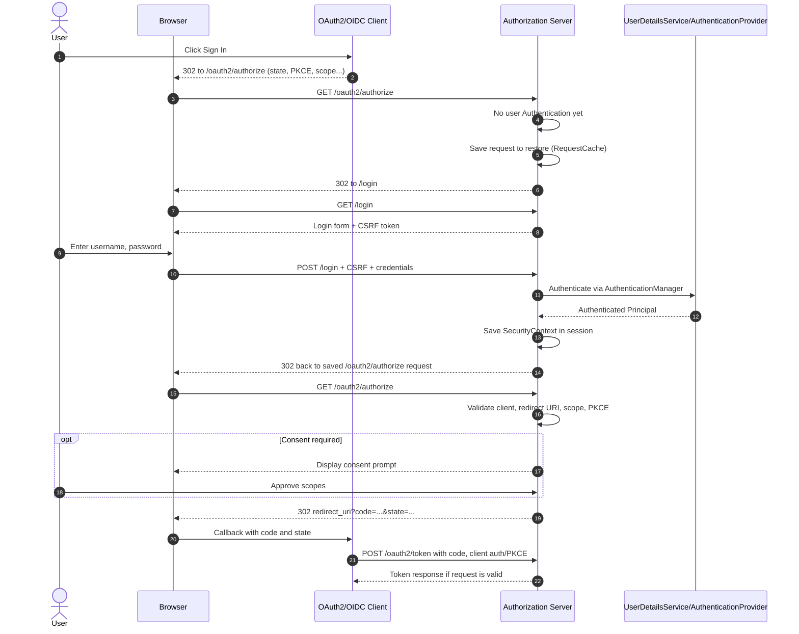
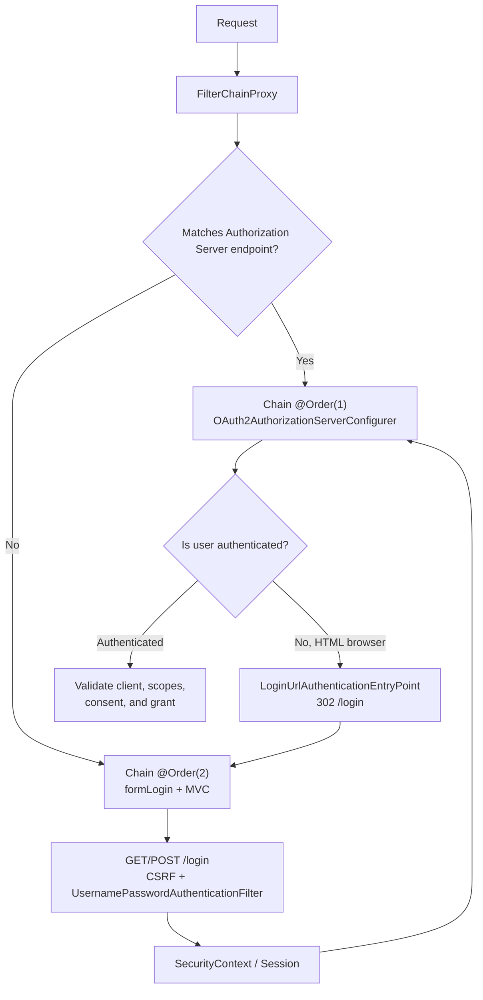

# Integrating Form Login into the Authorization Server

## 1. Why Does an Authorization Server Still Need a Login Screen?

An **OAuth 2.0 Authorization Server** issues tokens to clients, but in the **Authorization Code** flow it also needs to know who the **end user (resource owner)** is before deciding whether to grant the client access to resources. If the user does not yet have an authenticated session at the Authorization Server, the system needs an interactive login mechanism, such as **form login**, passkey, or federated login.

With **Spring Security**, `formLogin()` provides browser-based username/password authentication. With **Spring Authorization Server**, `OAuth2AuthorizationServerConfigurer` handles authorization requests and protocol endpoints. The two components **work together** rather than replacing each other.

For example, the **Orders Web** application sends the browser to `https://auth.example.com/oauth2/authorize`. If the user is not signed in yet, the Authorization Server redirects the browser to `/login`, authenticates the account, returns the user to the authorization request, and may display a **consent** screen. Only after that does it return an **authorization code** to Orders Web's `redirect_uri`.

This lesson belongs to the **User Authentication** chapter in the `SPRING_SECURITY_OAUTH2_OIDC_AUTHORIZATION_SERVER` module. The goal is to learn how to **design, configure, secure, test, and operate** form login alongside an OAuth 2.0/OpenID Connect (OIDC) Authorization Server in Spring Boot.

### After This Lesson, You Should Be Able To

1. Distinguish **user** authentication from **OAuth client** authentication, grant validation, and access token verification.
2. Properly configure **two SecurityFilterChain beans** so OAuth 2.0/OIDC endpoints work alongside the login page.
3. Explain the **entry point → request cache → form login → session → return to authorization request** flow.
4. Build a custom login page with **CSRF protection**, error handling, logout, and safe URLs.
5. Test the happy path, wrong password, consent, expired session, reverse proxy, and common redirect errors.

> **API Scope:** Examples use Spring Boot 3.x, Spring Security 6.2+, and **Spring Authorization Server 1.x** featuring `HttpSecurity.with(...)` along with `OAuth2AuthorizationServerConfigurer.authorizationServer()`. In the Spring Security 7.x line, the Authorization Server DSL API may differ; consult the documentation for your exact version and do not mix imports mechanically.

## 2. Understanding the Three Principals and Two Login Sessions

| Principal | Responsibility | Proof of Identity |
| --- | --- | --- |
| **User** | Signs in at the Authorization Server and decides on consent if needed | Username/password, MFA, or another authentication method |
| **OAuth2 Client** | Initiates authorization requests, receives callbacks, exchanges authorization codes | Client secret/private key if confidential client; PKCE for code flow |
| **Resource Server** | Receives access tokens and protects APIs | Signature/issuer/audience/scope and authorization policies |

Form login at the Authorization Server creates a **user authentication session on the Authorization Server's domain**. The OAuth2 Client may create **its own session on its own domain** after receiving and verifying tokens. These two sessions are not the same; logging out of one side does not automatically terminate all sessions on the other side.

Keep these distinctions clear:

- **`GET /login`** is the page where the user enters credentials; **`POST /login`** is typically processed by `UsernamePasswordAuthenticationFilter`.
- **`GET /oauth2/authorize`** is a browser-based authorization request handled by Authorization Server components.
- **`POST /oauth2/token`** is where the client exchanges a code or uses another grant; it is not an endpoint for submitting a user's username/password in a form-login style.

**Specifically:** Using `formLogin()` **does not mean enabling the Resource Owner Password Credentials grant**. The password grant has been dropped from recommendations in modern OAuth security guidelines. With Authorization Code, the password is only submitted to the Authorization Server's login page and **never passes through the OAuth2 Client**.

## 3. Flow from Authorization Request to Login Session



The actual flow also depends on whether the user is already signed in, the consent policy, OIDC `prompt` parameters, and client configuration. If the Authorization Server session is already valid and policy permits, displaying the login form can **be skipped**, though grant/redirect/consent checks must still be verified.

### 3.1. What Is Stored Where?

| Data | Managing Component | Purpose |
| --- | --- | --- |
| User `SecurityContext` / `Authentication` | Spring Security, usually tied to HTTP session | Tells the Authorization Server who is signed in |
| Pending request to restore | `RequestCache`, typically `HttpSessionRequestCache` | Returns to the `/oauth2/authorize` URL after login |
| OAuth Client `state`, `nonce`, `code_verifier` | **OAuth2/OIDC Client** side | Binds callback, ID token, and code exchange |
| Authorization code, token state | `OAuth2AuthorizationService` | Issues/exchanges/revokes tokens per protocol |
| User consent for a client | `OAuth2AuthorizationConsentService` | Persists approved permissions when needed |

Note: **RequestCache is not OAuth2AuthorizationService**; the login session is not the token store. In a multi-instance environment, these data types have different sharing and lookup requirements.

## 4. Why Should There Be Two SecurityFilterChains?

Spring Security selects the **first `SecurityFilterChain` whose matcher matches**. Therefore, a common configuration is:

- **Priority 1** chain handles OAuth 2.0/OIDC protocol endpoints.
- **Priority 2** chain handles `/login`, `/logout`, MVC pages, and application endpoints outside the protocol chain.



**`securityMatcher(...)`** restricts which URLs a chain accepts. It differs from `requestMatchers(...)` inside `authorizeHttpRequests`: the latter only decides authorization **after a chain has already been selected**. If you put `/login` into the wrong chain, set the wrong `@Order`, or make a matcher too broad, form login can enter a redirect loop or return 404.

## 5. Configuring Two Chains in Spring Boot

The following example focuses on the user authentication structure. Use the same `HttpSecurity` instance provided by Spring for each filter chain bean.

```java
import org.springframework.context.annotation.Bean;
import org.springframework.context.annotation.Configuration;
import org.springframework.core.annotation.Order;
import org.springframework.http.MediaType;
import org.springframework.security.config.Customizer;
import org.springframework.security.config.annotation.web.builders.HttpSecurity;
import org.springframework.security.config.annotation.web.configuration.EnableWebSecurity;
import org.springframework.security.oauth2.server.authorization.config.annotation.web.configurers.OAuth2AuthorizationServerConfigurer;
import org.springframework.security.web.SecurityFilterChain;
import org.springframework.security.web.authentication.LoginUrlAuthenticationEntryPoint;
import org.springframework.security.web.util.matcher.MediaTypeRequestMatcher;

@Configuration
@EnableWebSecurity
public class SecurityConfig {

    @Bean
    @Order(1)
    SecurityFilterChain authorizationServerSecurityFilterChain(HttpSecurity http)
            throws Exception {

        OAuth2AuthorizationServerConfigurer authorizationServer =
                OAuth2AuthorizationServerConfigurer.authorizationServer();

        http
            .securityMatcher(authorizationServer.getEndpointsMatcher())
            .with(authorizationServer, configurer ->
                configurer.oidc(Customizer.withDefaults())
            )
            .authorizeHttpRequests(authorize ->
                authorize.anyRequest().authenticated()
            )
            .exceptionHandling(exceptions -> exceptions
                .defaultAuthenticationEntryPointFor(
                    new LoginUrlAuthenticationEntryPoint("/login"),
                    new MediaTypeRequestMatcher(MediaType.TEXT_HTML)
                )
            )
            // Support OIDC endpoints that require Bearer JWT verification, such as UserInfo.
            .oauth2ResourceServer(resourceServer ->
                resourceServer.jwt(Customizer.withDefaults())
            );

        return http.build();
    }

    @Bean
    @Order(2)
    SecurityFilterChain applicationSecurityFilterChain(HttpSecurity http)
            throws Exception {

        http
            .authorizeHttpRequests(authorize ->
                authorize.anyRequest().authenticated()
            )
            .formLogin(Customizer.withDefaults());

        return http.build();
    }
}
```

**This is not a complete standalone project:** a real Authorization Server also needs `RegisteredClientRepository`, `OAuth2AuthorizationService`, `OAuth2AuthorizationConsentService` (if using consent), `AuthorizationServerSettings`, `JWKSource`/`JwtDecoder` for OIDC/JWT, and a user authentication source. If you enable `oauth2ResourceServer().jwt()` without a valid decoder, the application may fail to start or JWT endpoints may not behave as expected.

### 5.1. Explaining the Key Choices

1. **`@Order(1)`** for protocol endpoints: `/oauth2/authorize`, `/oauth2/token`, and endpoints managed by the configurer must enter this chain.
2. **`getEndpointsMatcher()`** prevents the protocol chain from capturing `/login`. Do not use `anyRequest` at the `securityMatcher` level of chain 1.
3. **`oidc(Customizer.withDefaults())`** enables OIDC when the system needs ID tokens/discovery/UserInfo; if you only implement pure OAuth 2.0, enabling it is not strictly necessary.
4. **`anyRequest().authenticated()`** requires authentication within the chain; protocol filters still execute endpoint-specific logic, such as client authentication at the token endpoint.
5. **`defaultAuthenticationEntryPointFor(..., TEXT_HTML)`** redirects unauthenticated browsers to `/login`, instead of turning every protocol request into an HTML redirect. The token endpoint must continue returning appropriate protocol errors for machine-to-machine clients.
6. **`formLogin(Customizer.withDefaults())`** provides the default login page (`GET /login`) and form processing (`POST /login`) in the application chain, protected by CSRF according to Spring Security configuration.

For systems supporting OIDC, `/userinfo` accepts a bearer token and is not equivalent to requiring the user to have an active browser session. Place the appropriate resource server configuration in the Authorization Server chain according to your version's guide.

## 6. How Username/Password Authentication Actually Happens

Form login is a feature of **Spring Security authentication**, not of `OAuth2AuthorizationServerConfigurer`.

### 6.1. Path of a POST Login

1. The browser sends `POST /login` with form fields (default `username`, `password`) and a CSRF token.
2. `CsrfFilter` verifies the token if the endpoint requires CSRF protection.
3. `UsernamePasswordAuthenticationFilter` creates an unauthenticated `UsernamePasswordAuthenticationToken`.
4. `AuthenticationManager` (typically `ProviderManager`) invokes the corresponding provider, such as `DaoAuthenticationProvider`.
5. The provider uses `UserDetailsService` to look up the account and `PasswordEncoder` to verify the password.
6. On success, Spring Security creates an authenticated `Authentication`, saves the `SecurityContext` via the configured persistence/session mechanism, applies the session fixation policy, and invokes the success handler.
7. The success handler typically redirects the browser back to the URL saved by the request cache; if no saved request exists, it uses the application's default target.

If login fails, the browser is typically redirected to `/login?error` or a configured error page. **Do not send plaintext passwords to the token endpoint** simply because the Authorization Server needs to know the user principal.

### 6.2. User Store and PasswordEncoder

Example configuration for a **test account**:

```java
@Bean
PasswordEncoder passwordEncoder() {
    return PasswordEncoderFactories.createDelegatingPasswordEncoder();
}

@Bean
UserDetailsService userDetailsService(PasswordEncoder passwordEncoder) {
    UserDetails alice = User.withUsername("alice")
            .password(passwordEncoder.encode("change-me-in-test-only"))
            .roles("USER")
            .build();

    return new InMemoryUserDetailsManager(alice);
}
```

This example is **for learning and testing only**; never hardcode accounts or passwords in production. For real systems, integrate `UserDetailsService` or `AuthenticationProvider` with a database/IdP, and manage account locking, enabled status, MFA, auditing, and account recovery mechanisms.

**Passwords must be stored using a suitable password hashing function**, not symmetric encryption for decryption on login and not plain SHA-256 as a substitute for password hashing. `DelegatingPasswordEncoder` allows attaching an algorithm prefix and managing algorithm upgrades via configuration.

### 6.3. How Does the Principal Affect Authorization?

After login, `Authentication.getName()` is typically the principal identifier used by the Authorization Server when associating authorizations/consents. In OIDC, the `sub` claim should represent a stable user identifier according to the provider's policy.

If the application allows changing usernames/emails, consider using a **stable, non-reassigned subject ID** rather than relying on a mutable email address. When customizing `sub`/claims, ensure sources like UserInfo, consent, authorization storage, and authorization rules remain consistent.

## 7. Why Does the User Return to `/oauth2/authorize` After Login?

### 7.1. RequestCache and the Success Handler

When the browser calls an endpoint requiring authentication and Spring Security finds no principal, `ExceptionTranslationFilter` and the authentication entry point coordinate to:

- save the original request to return to, usually with `HttpSessionRequestCache`;
- redirect the browser to the login form;
- upon success, allow `SavedRequestAwareAuthenticationSuccessHandler` to redirect back to the saved request.

Example:

```text
GET /oauth2/authorize?response_type=code&client_id=orders-web
    &scope=openid%20profile&state=...&code_challenge=...

  -> 302 /login
  -> GET /login
  -> POST /login (CSRF + username + password)
  -> 302 /oauth2/authorize?response_type=code&client_id=orders-web...
  -> Continue authorization/consent checks and issue code
```

This is the conceptual model: the framework/version and request cache configuration determine the exact restoration behavior. If writing custom integration logic, verify that the saved path only points to a valid application resource; do not turn an arbitrary client-supplied `redirect` query parameter into an **open redirect** after login.

**Do not inadvertently use `defaultSuccessUrl("/home", true)`** when the Authorization Server needs to restore an authorization request: the `alwaysUse=true` parameter forces every login to redirect to `/home`, preventing the client from ever receiving the authorization code.

### 7.2. Why Can Multiple Tabs Be Tricky?

If a user opens multiple concurrent OAuth login flows, each client stores its own `state`/PKCE, whereas **the HTTP session on the Authorization Server may hold only one active saved request** depending on how the request cache is configured. Test two-tab scenarios and avoid assuming every redirect round-trip is independent if you customize `RequestCache` or the success handler.

If complex multi-tab workflows are needed, choose a design that accounts for transaction binding, expiration, and post-login routing; never store `redirect_uri` or `state` in a shared global variable.

## 8. Customizing Form Login: A Dedicated `/signin` Page

The default login page is useful for testing. When you need branded UI, accessibility, CAPTCHA, or policy notices, create a custom page while **keeping Spring Security's POST processing filter and CSRF protection**.

### 8.1. Changing the Login Page and Entry Point Consistently

To avoid redirecting to `/login` when the real page is `/signin`, you must change **both**:

In the **Authorization Server chain**:

```java
.exceptionHandling(exceptions -> exceptions
    .defaultAuthenticationEntryPointFor(
        new LoginUrlAuthenticationEntryPoint("/signin"),
        new MediaTypeRequestMatcher(MediaType.TEXT_HTML)
    )
)
```

In the **application chain**:

```java
.authorizeHttpRequests(authorize -> authorize
    .requestMatchers("/signin", "/assets/**").permitAll()
    .anyRequest().authenticated()
)
.formLogin(form -> form
    .loginPage("/signin")
    .loginProcessingUrl("/signin")
    .failureUrl("/signin?error")
    .permitAll()
)
```

These are **abbreviated DSL snippets** to substitute inside the two beans from section 5, not standalone beans. In real configurations, keep the rest of each chain's settings intact. `loginPage` is the URL serving the HTML via GET; `loginProcessingUrl` is the URL where `UsernamePasswordAuthenticationFilter` accepts POST requests — **there is no need to write your own controller to handle password POST submissions**.

### 8.2. A Controller That Only Serves the HTML Page

```java
@Controller
class LoginPageController {

    @GetMapping("/signin")
    String loginPage() {
        return "signin";
    }
}
```

If using Thymeleaf, create `signin.html` in the application's templates directory (this is a **design illustration**, not an instruction to create files outside the lesson):

```html
<!doctype html>
<html lang="en" xmlns:th="http://www.thymeleaf.org">
<head>
  <meta charset="utf-8">
  <title>Sign In</title>
</head>
<body>
  <main>
    <h1>Sign In</h1>
    <p th:if="${param.error}" role="alert">
      Invalid username or password.
    </p>
    <form th:action="@{/signin}" method="post">
      <label for="username">Username</label>
      <input id="username" name="username" autocomplete="username" required>

      <label for="password">Password</label>
      <input id="password" name="password" type="password"
             autocomplete="current-password" required>

      <input type="hidden"
             th:name="${_csrf.parameterName}"
             th:value="${_csrf.token}">
      <button type="submit">Sign In</button>
    </form>
  </main>
</body>
</html>
```

In this example, `${_csrf.parameterName}` and `${_csrf.token}` are Thymeleaf expressions that read the request's CSRF data. `th:action="@{/signin}"` generates a form action that includes the context path when deployed with the appropriate servlet configuration. Avoid hardcoding `action="/signin"` if the application runs under `/auth` without corresponding URL rewriting. With Thymeleaf/Spring MVC integrations that automatically inject a CSRF field into POST forms, pick one method of adding the token to avoid producing duplicate hidden inputs with the same name.

**Requirements for a custom form:**

- Serve `GET /signin` without requiring authentication, otherwise it will cause a redirect loop.
- Only allow `POST` processing through `UsernamePasswordAuthenticationFilter`; do not process passwords yourself in an MVC controller.
- Keep the **CSRF token**. The example shows an explicit hidden field to explain the mechanism; if Thymeleaf already auto-inserts the CSRF input, do not add a duplicate field.
- Never echo back passwords, untrusted user input, or sensitive details in error responses.
- Minimize JavaScript, use CSP/HTML escaping, and keep CSS/JS asset paths accessible.
- Ensure keyboard tab navigation, labels, error announcements, and appropriate accessibility requirements.

### 8.3. Login CSRF Differs from OAuth `state`

The **form CSRF token** binds a credential-submitting POST to the page context received by the browser. **OAuth `state`** binds the authorization response callback to the OAuth transaction initiated by the client. They mitigate two different attack vectors; never use `state` as a replacement for the login POST's CSRF token.

Do not disable `csrf()` globally just because `POST /oauth2/token` does not send a form CSRF token. Spring Authorization Server and Spring Security can manage CSRF policies for protocol endpoints separately; form login and consent must remain properly protected.

## 9. What Else Must Be Checked on the Authorization Request After Login?

Form login only establishes that the user principal is authenticated. The Authorization Server must still verify the **authorization request**:

| Check | Performed By | Example |
| --- | --- | --- |
| Does the client exist and is it registered? | Authorization Server | `client_id=orders-web` |
| Is the grant/response type permitted? | Authorization Server | `response_type=code` |
| Is the redirect URI an exact match? | Authorization Server | `https://app.example.com/login/oauth2/code/orders` |
| Which scopes are allowed? | Authorization Server, consent policy | `openid profile orders.read` |
| Is PKCE valid? | Authorization Server | `code_challenge_method=S256` |
| Does the user need to give consent? | Authorization Server | Approve `orders.read` |
| Does the callback belong to the original transaction? | **OAuth Client** | Verify `state` |
| Does the ID token belong to the login request? | **OIDC Client** | Verify `nonce` when used |

In particular, **the Authorization Server must never accept an unregistered `redirect_uri`** just because the user entered the right password. That check enforces a boundary between the client and the authorization server, independent of user authentication.

With OIDC, the `openid` scope signals an identity authentication request; the Authorization Server issues an ID token when the flow is valid. **An ID token is not an access token** and must not be used by APIs in place of an access token for authorization.

## 10. Consent and Form Login Are Two Separate Steps

**Login** answers: *Who is the user?* **Consent** answers: *Does the user approve this client receiving the requested scopes?*

Example:

1. Alice enters her password and signs in successfully at the Authorization Server.
2. Orders Web requests `orders.read` and `orders.write`.
3. The server determines the client requires consent and displays the consent screen.
4. Alice approves only the permissions permitted by the deployment policy.
5. The Authorization Server only grants permissions/tokens according to the valid outcome.

Client configuration might look like:

```java
RegisteredClient client = RegisteredClient.withId(UUID.randomUUID().toString())
        .clientId("orders-web")
        .clientSecret(encodedClientSecret)
        .clientAuthenticationMethod(
                ClientAuthenticationMethod.CLIENT_SECRET_BASIC)
        .authorizationGrantType(AuthorizationGrantType.AUTHORIZATION_CODE)
        .authorizationGrantType(AuthorizationGrantType.REFRESH_TOKEN)
        .redirectUri("https://app.example.com/login/oauth2/code/orders-web")
        .scope(OidcScopes.OPENID)
        .scope("profile")
        .scope("orders.read")
        .clientSettings(ClientSettings.builder()
                .requireProofKey(true)
                .requireAuthorizationConsent(true)
                .build())
        .build();
```

This is a shortened `RegisteredClient` example; `encodedClientSecret` must be an encoded value supplied from a secure secret source, never hardcoded. When `requireAuthorizationConsent(true)` is enabled, the consent screen and storage must be configured so users can complete the flow. For real clients, scopes, redirect URIs, authentication methods, and TTLs must be defined according to system requirements.

**Do not auto-approve all scopes** after login to "save a step" by bypassing governance policies. If customizing the consent page, protect POST requests with CSRF, display client names and scopes from registered sources, and never trust permission labels self-declared by the client.

## 11. Securing Form Login in Production

### 11.1. HTTPS, Cookies, and Session Fixation

- The form page, password POST, authorization endpoint, callback, and public token endpoints all require **HTTPS**.
- Session cookies should have `Secure`, `HttpOnly`, and a `SameSite` attribute appropriate for the flow. `Path` must be consistent with the context path and reverse proxy.
- On successful login, Spring Security applies **session fixation protection**; do not disable it without a clear security reason.
- Establish policies for session timeouts, reauthentication when needed, and secure session termination on logout.
- In multi-node environments, you need a **shared session** strategy or carefully designed sticky routing, especially when pre-login and post-login requests may hit different nodes.

Reference cookie configuration in Spring Boot:

```yaml
server:
  servlet:
    session:
      cookie:
        secure: true
        http-only: true
        same-site: lax
  forward-headers-strategy: framework
```

If TLS terminates at a proxy, ensure the proxy supplies trusted scheme/host information and never allow the public Internet to spoof `X-Forwarded-*` headers. Do not merely override the issuer to mask a login redirect falling back from HTTPS to HTTP.

### 11.2. Defending Against Password Guessing and Credential Stuffing

- Use **rate limiting** at the gateway/application, appropriate backoff, and multi-signal monitoring; avoid relying solely on IP addresses due to NAT/shared networks.
- Block or challenge high-risk login attempts, while designing account lockout controls carefully to avoid enabling Denial of Service (DoS).
- Use **MFA**, passkeys, or strong authentication policies for privileged accounts; retain authentication evidence to enforce step-up policies when needed.
- Return a generic login error message such as "Invalid username or password" instead of confirming whether an account exists.
- Never log passwords, CSRF tokens, session IDs, or related credentials.

### 11.3. CSRF, XSS, and Response Headers

Do not skip CSRF for login and consent forms. Escape all data rendered in the UI, minimize inline JavaScript, configure CSP wherever possible, and protect assets loaded by the page. Validate `returnUrl`/`continue` paths to prevent **open redirects** after authentication.

### 11.4. Logout Has Multiple Layers

Spring Security's `POST /logout` normally terminates the Authorization Server session as configured; OIDC RP-Initiated Logout has its own endpoint and rules when enabled. Logging out of the Authorization Server session **does not automatically revoke** all issued access tokens and does not necessarily log the user out of every client application.

Logout design must account for client sessions, access token lifetimes, refresh tokens, revocation, and OIDC logout when used. Avoid claiming "system-wide logout" if you only clear the Authorization Server cookie.

## 12. Integrating Internal Accounts, SSO, and MFA

Form login is one way to **collect user credentials**; `OAuth2AuthorizationServerConfigurer` does not mandate using this exact approach. A system can:

- use `UserDetailsService` with an internal user directory;
- use a custom `AuthenticationProvider` integrated with LDAP/Active Directory or an existing identity system;
- use **Spring Security OAuth2 Login** to federate to an external identity provider, then establish the user's `Authentication` at the Authorization Server;
- integrate MFA/step-up mechanisms, passkeys, or risk-based adaptive authentication.

When the Authorization Server acts as an **OIDC Provider** for clients, how it authenticates the user is an **internal detail**. Clients receive tokens/protocol results and should not be handed the user's password.

Integrating an external IdP requires additionally protecting the `state`, `nonce`, issuer, and callback flows of **the Authorization Server itself when it acts as a client to the external IdP**. Do not confuse those federated transactions with the OAuth transaction between Orders Web and the Authorization Server.

## 13. End-to-End Test Matrix

| Test Case | Step to Observe | Expected Result |
| --- | --- | --- |
| Unauthenticated user calls `/oauth2/authorize` | AS chain selection, entry point, redirect | `302` to HTTPS login without losing transaction parameters |
| GET default login page | Application chain | Login page is usable; CSS/JS assets are accessible |
| POST valid username/password and CSRF | `UsernamePasswordAuthenticationFilter` | Session created/updated securely, returns to authorization request |
| POST wrong password | User authentication provider | No authenticated session created; appropriate error message |
| POST missing/invalid CSRF | `CsrfFilter` | Rejected, login does not succeed |
| GET `/signin` in custom form while unauthenticated | Matcher and permit rules | Accessible, does not cause a 302 loop |
| After login, client requires consent | Authorization endpoint | Displays correct scopes/client and processes approval |
| Client redirect URI is unregistered | Authorization endpoint | Rejects request, does not send code to wrong URI |
| OAuth client receives wrong state on callback | **OAuth2 Client** | Rejects callback, does not create client login session |
| Exchange authorization code with wrong PKCE | Token endpoint | Does not issue token |
| `POST /oauth2/token` with wrong client secret | Client authentication filter | Proper OAuth error; does not redirect to HTML login |
| Session expires before returning to `/oauth2/authorize` | AS + login chain | Re-authenticates safely, does not issue token before authentication |
| Open two login flows in two tabs | RequestCache, session, client state | Does not mix up callbacks/transactions or lose security data |
| Cookies disabled or wrong `Secure/Path` | Browser/network | Detects login loop and identifies cookie error |
| Running behind `/auth` reverse proxy | Context path/forwarded headers | Redirects, POST actions, login, and consent all use the correct public URL |
| Two nodes handle different steps | Session store, authorization service | No loss of Authentication, code, or consent |

### 13.1. MVC Tests vs. Protocol Tests

**Unit/MockMvc tests** can verify `GET /signin`, `POST /signin` missing CSRF, valid/invalid authentication, and redirect handlers. When using `Spring Security Test`, you can use `csrf()` with MockMvc to verify POST protection; mocking with `@WithMockUser` only verifies behavior with a pre-existing principal and **does not test the real password-processing path**.

**Integration/end-to-end tests** must execute the entire flow through a browser or cookie-managing HTTP client, performing:

1. Construct a valid authorization request for a registered `RegisteredClient`.
2. Observe the redirect to login, extract the CSRF token, and preserve the session cookie.
3. Submit a valid login POST to the proper URL.
4. Follow the redirect back to the authorization request and handle consent if prompted.
5. Receive the code and state at the test client's callback.
6. Exchange the code with PKCE/credentials according to client type; verify the token and issuer.

You cannot conclude a configuration is correct just because `/login` returns HTTP 200. Tests must prove **the user returns to the authorization flow and the client receives a valid result**.

## 14. Diagnosing Common Errors

| Symptom | Possible Cause | Where to Check |
| --- | --- | --- |
| `/oauth2/authorize` returns 401/403 instead of 302 login | Missing HTML entry point or mismatched matcher/chain | Check priority-1 chain and MediaType matcher |
| Browser loops `/login` ↔ `/oauth2/authorize` | Login URL is protected, session cookie dropped, or request cache broken | Open Network tab, inspect `Set-Cookie`/`Cookie`/`Location` |
| `GET /signin` returns 404 | Missing controller/view or template in wrong location | Check GET controller, template engine, mappings |
| `POST /signin` returns 404/405 | `loginProcessingUrl` mismatches form action or hits wrong chain | Check DSL, `th:action`, servlet context |
| `POST /login` returns 403 | Missing/invalid CSRF token or lost session | Check `_csrf` and cookies; do not disable CSRF globally |
| Redirects to `/` after login instead of returning to OAuth authorize | Success handler forces target or RequestCache did not save | Check `defaultSuccessUrl(..., true)` and `SavedRequest` |
| Login succeeds but Authorization Server still sees anonymous | `SecurityContext` not saved or session not sent | Check security context repository, session policy, multi-node setup |
| POST token redirects to login page | Wrong request matcher, filter chain, or error handling | Client authentication needs an OAuth error, not HTML |
| Login redirect uses `http://localhost` behind TLS proxy | Wrong forwarded headers or context path | Lock down canonical issuer, fix proxy/header strategy and links |
| Login succeeds but ID token `sub` is unstable | Principal name depends on mutable username/email | Design a stable subject ID, check OIDC claim mapping |
| Consent repeats on every request | Non-persistent consent service or changing consent policy | Check `OAuth2AuthorizationConsentService` and client settings |

### 14.1. Safe Log Observation

Only log **correlation IDs**, endpoints, selected filter chains, error categories, and minimal operational metadata. Never log passwords, CSRF tokens, session cookies, authorization codes, access tokens, refresh tokens, or client secrets. When debugging, distinguish a **form login failure** from an **OAuth client `invalid_client`** and a **token endpoint `invalid_grant`**.

## 15. Practical Scenario: Orders Web Signing In via Spring Authorization Server

The system consists of three components:

- **Orders Web**: a confidential OAuth2/OIDC Client receiving callbacks at `https://orders.example.com/login/oauth2/code/orders-web`.
- **Authorization Server**: `https://auth.example.com`, authenticating staff via form login and providing consent.
- **Orders API**: a Resource Server accepting only access tokens with the expected issuer, audience, and scopes.

Expected flow:

1. Orders Web generates `state`, `nonce`, and a PKCE verifier/challenge, redirecting the browser to the Authorization Server.
2. The AS chain receives `/oauth2/authorize`, detects no user `Authentication`, saves the request to restore, and redirects to `/login`.
3. The application chain handles `GET /login`/`POST /login`. The provider validates the password and user policies; Spring Security stores the `SecurityContext` in the session.
4. The user returns to `/oauth2/authorize`. The Authorization Server validates the client, redirect URI, scopes, PKCE, and consent if required.
5. The code is sent to Orders Web's registered callback. Orders Web verifies `state` and exchanges the code along with PKCE and client authentication.
6. Orders Web verifies the ID token/`nonce` and opens an application session; Orders API validates the access token and permissions on accessed orders.

If the staff member is already signed in at the Authorization Server, a new OAuth request may not need to show the login form again. If the client wants to require re-authentication by policy, OIDC provides parameters like `prompt=login` or `max_age`; enforcement must be tested against your exact server version and policy.

A common real-world mistake: a team customizes form login and sets `defaultSuccessUrl("/dashboard", true)`. Users sign in successfully, yet **Orders Web never receives the authorization code** because the saved authorization request is bypassed. The fix is to keep or adapt the success handler in a way that preserves the request cache and flow, rather than merely checking whether the dashboard page opens.

## 16. Pre-Production Checklist

- **Filter chain structure:** AS chain receives protocol endpoints; application chain receives login/logout and views; `@Order`/matchers tested.
- **User authentication:** appropriate provider/identity store; passwords securely hashed; account lockout and MFA where needed.
- **Form login:** login URL consistent with authentication entry point; POST uses CSRF; error messages disclose no sensitive data.
- **Sessions:** HTTPS/`Secure`/`HttpOnly`/`SameSite` cookies, timeouts, session fixation protection, `RequestCache`, multi-node compatibility.
- **Protocol:** client registration, redirect URIs, PKCE, scopes, consent, issuer/JWK, and OIDC claims verified.
- **Redirects & proxy:** no open redirects; login/consent actions use the right public URL even with context paths and TLS termination.
- **Operations:** failed login rate limits, audits free of credentials, session/consent error monitoring, rotation and revocation plans.
- **Testing:** covers both the happy path from `/oauth2/authorize` through form login to token issuance, and failure cases for CSRF/session/password/redirect.

## 17. Summary

**Form login is Spring Security's user authentication mechanism; Spring Authorization Server uses that authentication result to resume an OAuth 2.0/OIDC request.** Two `SecurityFilterChain` beans separate protocol endpoints from the login UI, while `LoginUrlAuthenticationEntryPoint` and `RequestCache` bridge the user's journey back after signing in.

To verify your understanding, always answer four questions:

1. **Who is logging in?** — The user at `/login`, not the OAuth client.
2. **Where is the successful login stored?** — In the `SecurityContext`/session according to Spring Security configuration.
3. **Why return to `/oauth2/authorize`?** — Because the pending authorization request is restored after login.
4. **Is a token issued immediately after login?** — No. The Authorization Server still validates the client, grant, redirect URI, PKCE, consent, and policies before issuing a code/token.

### References

- [Spring Authorization Server — Getting Started](https://docs.spring.io/spring-authorization-server/reference/getting-started.html)
- [Spring Authorization Server — Configuration Model](https://docs.spring.io/spring-authorization-server/reference/configuration-model.html)
- [Spring Authorization Server — Core Model Components](https://docs.spring.io/spring-authorization-server/reference/core-model-components.html)
- [Spring Security — Form Login](https://docs.spring.io/spring-security/reference/servlet/authentication/passwords/form.html)
- [Spring Security — Multiple SecurityFilterChain](https://docs.spring.io/spring-security/reference/servlet/configuration/java.html)
- [Spring Security — CSRF Protection](https://docs.spring.io/spring-security/reference/servlet/exploits/csrf.html)
- [Spring Security — Session Management](https://docs.spring.io/spring-security/reference/servlet/authentication/session-management.html)
- [RFC 6749 — The OAuth 2.0 Authorization Framework](https://www.rfc-editor.org/rfc/rfc6749)
- [RFC 9700 — Best Current Practice for OAuth 2.0 Security](https://www.rfc-editor.org/rfc/rfc9700)
- [OpenID Connect Core 1.0](https://openid.net/specs/openid-connect-core-1_0.html)
