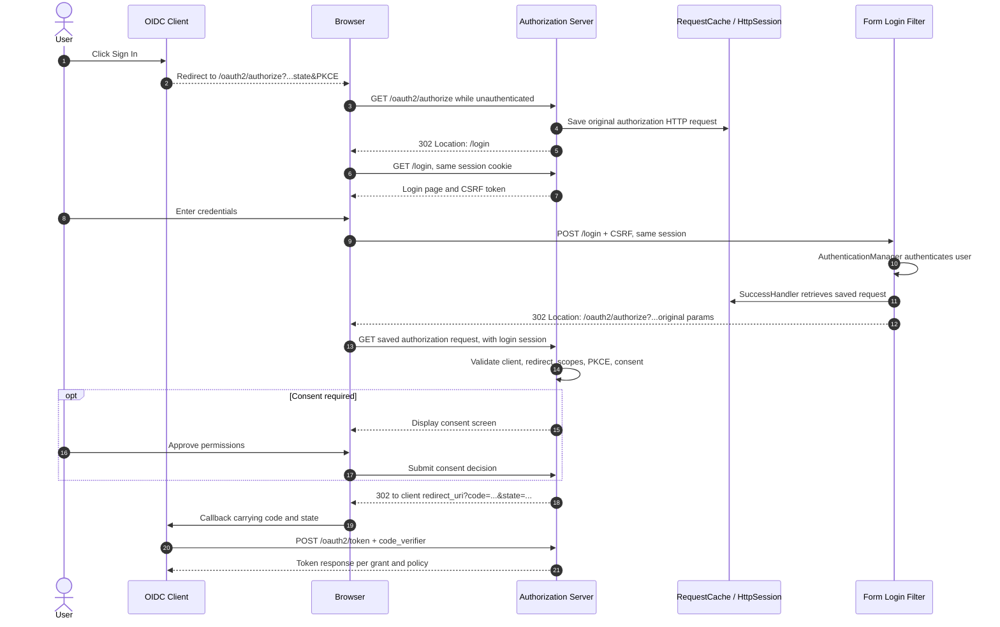

# Restoring the Authorization Request After Successful Login

## 1. The Problem: Unauthenticated User When a Client Requests Authorization

In the **User Authentication** chapter of the `SPRING_SECURITY_OAUTH2_OIDC_AUTHORIZATION_SERVER` module, we focus on a critical handoff: **the OAuth 2.0/OpenID Connect Authorization Server must resume the original authorization request after the user finishes logging in**.

The goal of this module is to learn how to design, configure, secure, test, and operate an Authorization Server using **Spring Security** and **Spring Authorization Server** in a **Spring Boot** application. If restoring the request fails, the user might log in successfully only to land on the home page, get stuck in a login loop, or encounter missing `client_id`/`response_type` errors when returning to the OAuth2/OIDC flow.

Suppose an OIDC client is the web application `portal.example.com`. When the user clicks "Sign In", the browser is redirected to the Authorization Server:

```http
GET /oauth2/authorize?response_type=code
    &client_id=portal-web
    &redirect_uri=https%3A%2F%2Fportal.example.com%2Flogin%2Foauth2%2Fcode%2Fas
    &scope=openid%20profile%20orders.read
    &state=<client-generated-state>
    &nonce=<client-generated-nonce>
    &code_challenge=<pkce-code-challenge>
    &code_challenge_method=S256
Host: auth.example.com
```

If the user does not yet have a login session at `auth.example.com`, the server must:

1. Receive and preserve the **original `/oauth2/authorize` request**.
2. Redirect to `/login` and authenticate the user.
3. After successful login, redirect the browser back to the saved `/oauth2/authorize` request.
4. Proceed to validate the client, redirect URI, scopes, PKCE, and consent, issuing an **Authorization Code** when all conditions are met.
5. Redirect the browser to the registered `redirect_uri` with `code` and `state`; the **OIDC client** then exchanges the code for tokens at the Token Endpoint.

Never generate an Authorization Code inside a login success handler: **user authentication** and **authorization decision/code issuance** are two separate responsibilities. Restoring the request ensures OAuth2/OIDC processing passes through the Authorization Server's standard filters and `AuthenticationProvider` components.

## 2. Which Authorization Request Needs to Be Restored?

In Spring Security documentation, the term "authorization request" appears in several contexts:

| Concept | Managing Component | When Is It Used? |
| --- | --- | --- |
| **HTTP `GET /oauth2/authorize` request** sent to the Authorization Server | Servlet request, `SecurityFilterChain`, optionally cached by `RequestCache` | **Main topic of this lesson:** returning to the pending request after the user logs in |
| **Parsed and validated OAuth2 authorization request** | `OAuth2AuthorizationEndpointFilter`, Converter/Provider, and when appropriate `OAuth2AuthorizationService` | Validating client, scopes, user, consent; generating the authorization code |
| **`OAuth2AuthorizationRequest` on the OAuth2 Client side** | Typically `OAuth2AuthorizationRequestRepository` in Spring Security OAuth2 Client | The client remembers `state`/redirect when **the client itself** redirects to another identity provider |

These three mechanisms are **not interchangeable**. When building an Authorization Server application using internal form login, you usually need to understand **Spring Security Servlet's `RequestCache`**. Do not use OAuth2 Client's `HttpSessionOAuth2AuthorizationRequestRepository` as a default substitute for restoring `GET /oauth2/authorize` on the Authorization Server.

An Authorization Code has not been issued yet at the moment the user is redirected to login. Therefore, "restoring the authorization request" does not mean "replaying an already-issued code." Normally, the server **sends the browser back to the endpoint** to continue processing with an authenticated principal.

## 3. Full Flow: From Authorization Endpoint to Login and Back



**Note the two redirect targets:**

- **After login**: the browser returns to the **Authorization Server** at `/oauth2/authorize` with the original parameters.
- **After successful authorization**: the browser then goes to the **client's callback** at `redirect_uri`, receiving `code` and `state`.

If the login success handler redirects straight to the client's callback, the client will have no valid code issued by the Authorization Server. If it redirects to `/oauth2/authorize` but drops `state` or `code_challenge`, the transaction may be rejected or lose protections established by the client.

## 4. Which Spring Security Components Save and Replay the Request?

### 4.1. `ExceptionTranslationFilter` and `AuthenticationEntryPoint`

Inside a Servlet `SecurityFilterChain`, when a request hits a resource requiring user authentication without a valid session, security handling flows through `ExceptionTranslationFilter`:

1. Identifies that the request needs to initiate authentication.
2. Uses `RequestCache.saveRequest(...)` to save the original HTTP request **if configured and the request matches save criteria**.
3. Invokes `AuthenticationEntryPoint` to direct the user to `/login` or return an appropriate authentication challenge.

For interactive web applications, `LoginUrlAuthenticationEntryPoint("/login")` typically issues an HTTP redirect to the login page. Actual processing may involve Spring Authorization Server's filters and providers, yet the principle remains the same: the original request must be preserved until the browser returns.

### 4.2. `HttpSessionRequestCache` and `DefaultSavedRequest`

`HttpSessionRequestCache` is a Spring Security `RequestCache` implementation. It stores details of the interrupted request in `HttpSession` as a `SavedRequest` (typically `DefaultSavedRequest`), including the URL/URI, query string, and metadata needed to reconstruct the request.

```text
Browser HTTP session
  ├── Session data managed by Spring Security
  ├── SavedRequest: GET /oauth2/authorize?client_id=...&state=...
  └── Other CSRF/application data per configuration
```

There is no need to stuff the entire Authorization Server query string into a hidden input on the login form. When `RequestCache` is used properly, the browser can authenticate at a clean `/login` URL and then be redirected back to the original request.

**The same HTTP session is required** across steps. With `HttpSessionRequestCache`, if the session cookie is not sent back after login, the session is cleared, or the application uses a stateless policy, the saved request may be lost. Spring Security changing the session ID for session fixation protection normally **does not wipe all session attributes**; errors typically occur when custom code invalidates/recreates the session without migrating required state.

### 4.3. `SavedRequestAwareAuthenticationSuccessHandler`

Once the user authenticates successfully via form login, `SavedRequestAwareAuthenticationSuccessHandler` can:

1. Look up `SavedRequest` in `RequestCache`.
2. If a matching request exists, redirect the browser to the saved URL.
3. Otherwise, fall back to the default navigation behavior (`defaultTargetUrl` and other handler options).

In standard Spring Security form login setups, post-authentication navigation already supports saved requests. A custom `successHandler` can accidentally break this behavior if it always calls `sendRedirect("/")` or forces `alwaysUseDefaultTargetUrl=true`.

**`SavedRequestAwareAuthenticationSuccessHandler` does not generate codes, tokens, or consent.** It simply returns the browser to the HTTP flow where the request was interrupted.

### 4.4. `RequestCacheAwareFilter` and Handling the Returning Request

When the browser revisits the saved URL, `RequestCacheAwareFilter` retrieves the saved request and wraps the current request per Spring Security's mechanism. The Authorization Endpoint receives the request and reads the OAuth2 parameters as usual.

At this step, Spring Authorization Server components such as `OAuth2AuthorizationEndpointFilter`, `OAuth2AuthorizationCodeRequestAuthenticationConverter`, and `OAuth2AuthorizationCodeRequestAuthenticationProvider` process the protocol request, validating user and client state. Having a saved request **must never bypass** any OAuth2/OIDC validation check.

### 4.5. `SecurityContext` Must Exist Upon Return

After login, the user's `Authentication` must be persisted for subsequent requests according to the application's `SecurityContextRepository` and session strategy. If login appears to succeed yet the next request is treated as anonymous, the Authorization Server will bounce the browser back to login again.

Saving the request and saving the `SecurityContext` are **two separate tasks**: the request cache holds the return destination; the security context holds the authenticated identity. Both must work properly in an interactive login architecture.

## 5. Two-SecurityFilterChain Pattern for Spring Authorization Server

In Spring Boot using Spring Security 6.x and Spring Authorization Server 1.x, a common configuration has:

- **Chain 1** for OAuth2/OIDC endpoints, selected first via matcher and `@Order(1)`.
- **Chain 2** for the rest of the application, including `/login`, form login, and related pages.

The abbreviated example below uses the configurer API supporting `OAuth2AuthorizationServerConfigurer.authorizationServer()`. Necessary imports and logic for other infrastructure setup are noted in the explanation:

```java
import org.springframework.context.annotation.Bean;
import org.springframework.context.annotation.Configuration;
import org.springframework.core.annotation.Order;
import org.springframework.http.MediaType;
import org.springframework.security.config.Customizer;
import org.springframework.security.config.annotation.web.builders.HttpSecurity;
import org.springframework.security.oauth2.server.authorization.config.annotation.web.configurers.OAuth2AuthorizationServerConfigurer;
import org.springframework.security.web.SecurityFilterChain;
import org.springframework.security.web.authentication.LoginUrlAuthenticationEntryPoint;
import org.springframework.security.web.util.matcher.MediaTypeRequestMatcher;

@Configuration
public class AuthorizationServerSecurityConfiguration {

    @Bean
    @Order(1)
    SecurityFilterChain authorizationServerSecurityFilterChain(HttpSecurity http)
            throws Exception {
        OAuth2AuthorizationServerConfigurer authorizationServer =
                OAuth2AuthorizationServerConfigurer.authorizationServer();

        http
            .securityMatcher(authorizationServer.getEndpointsMatcher())
            .with(authorizationServer, configurer ->
                    configurer.oidc(Customizer.withDefaults()))
            .authorizeHttpRequests(authorize ->
                    authorize.anyRequest().authenticated())
            .exceptionHandling(exceptions ->
                    exceptions.defaultAuthenticationEntryPointFor(
                            new LoginUrlAuthenticationEntryPoint("/login"),
                            new MediaTypeRequestMatcher(MediaType.TEXT_HTML)));

        return http.build();
    }

    @Bean
    @Order(2)
    SecurityFilterChain applicationSecurityFilterChain(HttpSecurity http)
            throws Exception {
        http
            .authorizeHttpRequests(authorize ->
                    authorize.anyRequest().authenticated())
            .formLogin(Customizer.withDefaults());

        return http.build();
    }
}
```

**Why does this pattern directly affect request restoration?**

1. A `GET /oauth2/authorize` request belongs to Authorization Server endpoints and is not intercepted prematurely by the application chain's `anyRequest`.
2. When the browser needs to sign in, the HTML entry point directs the browser to `/login`; the standard request cache mechanism saves the original request.
3. `/login` is handled by the application chain via form login; on successful authentication, the default success handler redirects the browser back to the saved request.
4. The browser returns to the Authorization Endpoint in an authenticated state, proceeds through client/authorization checks, and then issues a code.

The snippet above is a **filter chain skeleton**, not a complete Authorization Server. To run a real flow, you also need `RegisteredClientRepository`, authorization/consent state, user authentication configuration, issuer, signing keys/JWK, and supporting beans. OIDC endpoints like UserInfo may require corresponding Resource Server/JWT decoder configuration; follow the documentation for your version.

**Do not set `securityMatcher("/**")` on chain 1 and expect chain 2 to handle login.** `FilterChainProxy` picks the first matching chain; if the Authorization Server chain captures `/login`, login may loop or lack the form login filter altogether.

## 6. When You Need to Customize the Login Success Handler or RequestCache

If you only need to return to the authorization request URL, **prefer keeping the default `SavedRequestAwareAuthenticationSuccessHandler`**. Customize only when the application needs extra post-login logic, uses a different login mechanism, or replaces the request cache.

### 6.1. Sharing a RequestCache Between Both Chains

When you want explicit control over the request cache, declare a shared bean for both the Authorization Server chain and the form login chain:

```java
import org.springframework.context.annotation.Bean;
import org.springframework.context.annotation.Configuration;
import org.springframework.security.web.savedrequest.HttpSessionRequestCache;
import org.springframework.security.web.savedrequest.RequestCache;

@Configuration(proxyBeanMethods = false)
class RequestCacheConfiguration {

    @Bean
    RequestCache authorizationRequestCache() {
        return new HttpSessionRequestCache();
    }
}
```

Wire that bean into both `SecurityFilterChain` beans:

```java
// Snippet to add to chain 1, alongside securityMatcher and AuthorizationServerConfigurer:
http.requestCache(cache -> cache.requestCache(authorizationRequestCache));

// Snippet to add to chain 2:
http.requestCache(cache -> cache.requestCache(authorizationRequestCache));
```

In both chain builder methods, add a `RequestCache authorizationRequestCache` parameter injected by Spring. These are **two snippets to insert into section 5's configuration**, not a separate complete Java file. Sharing the cache ensures filters in the Authorization Server chain and redirect logic in the login chain access the same saved request in the session.

If your application configures `HttpSessionRequestCache` with a custom matching parameter, request matcher, or session attribute name, ensure those settings match at both save and restore sites. Avoid creating two separate storage mechanisms and assuming the login success handler will automatically see the saved request.

### 6.2. Attaching a Success Handler Intentionally

If you need to configure the success handler explicitly, you can still use `SavedRequestAwareAuthenticationSuccessHandler`:

```java
import org.springframework.security.web.authentication.SavedRequestAwareAuthenticationSuccessHandler;
import org.springframework.security.web.savedrequest.RequestCache;

// Inside applicationSecurityFilterChain(..., RequestCache requestCache):
SavedRequestAwareAuthenticationSuccessHandler successHandler =
        new SavedRequestAwareAuthenticationSuccessHandler();
successHandler.setRequestCache(requestCache);
successHandler.setDefaultTargetUrl("/");

http
    .requestCache(cache -> cache.requestCache(requestCache))
    .formLogin(login -> login.successHandler(successHandler));
```

`setDefaultTargetUrl("/")` in this example specifies a **fallback target when there is no saved request**; it must not override a saved authorization request. Do not call `setAlwaysUseDefaultTargetUrl(true)` when you want resumption. Note that this **replaces the form login configuration section** inside the corresponding method; combine it with `authorizeHttpRequests` and the chain from section 5.

If your login success handler needs to write an audit log, update last-login timestamps, or trigger MFA, complete that logic first and then **delegate navigation** to the saved-request-aware handler instead of concatenating URLs from client-supplied parameters.

### 6.3. Saving Only Necessary Requests

A default request cache can save other requests if they also require authentication. For complex systems, consider restricting which requests are saved using an appropriate `RequestMatcher` or separating routes—for example, saving only `GET /oauth2/authorize` requests that need resumption.

However, customizing the matcher must account for **context paths, customized endpoint paths**, active login flows, and clients initiating authorization from multiple tabs. A misconfigured matcher can cause the saved request to vanish. Do not replace the default `RequestCache` merely as an "optimization" without request-restoration tests in place.

## 7. HTTP Example Before, During, and After Login

### Step 1 – Browser Visits the Authorization Endpoint

```http
GET /oauth2/authorize?response_type=code&client_id=portal-web&redirect_uri=https%3A%2F%2Fportal.example.com%2Fcallback&scope=openid%20profile&state=st-123&nonce=n-456&code_challenge=challenge-value&code_challenge_method=S256 HTTP/1.1
Host: auth.example.com
Accept: text/html
```

While unauthenticated, the server saves the request in the session and redirects:

```http
HTTP/1.1 302 Found
Location: /login
Set-Cookie: JSESSIONID=<session-id>; Path=/; HttpOnly; Secure; SameSite=Lax
```

`Set-Cookie` here is an **illustration of secure session and cookie configuration**, not a header guaranteed to appear identically in every response or environment. Cookie name, `Secure`, `SameSite`, and session creation depend on the Servlet container, proxy, and application configuration.

### Step 2 – User Completes Form Login

```http
POST /login HTTP/1.1
Host: auth.example.com
Cookie: JSESSIONID=<same-session>
Content-Type: application/x-www-form-urlencoded

username=alice&password=<password-from-form>&_csrf=<valid-csrf-token>
```

This example illustrates the HTTP flow only; never put real passwords into logs or shared test tools. If the CSRF token is invalid, Spring Security returns `403`, and the success handler will **not be invoked**.

### Step 3 – Success Handler Returns Browser to the Authorization Endpoint

```http
HTTP/1.1 302 Found
Location: https://auth.example.com/oauth2/authorize?response_type=code&client_id=portal-web&redirect_uri=...&scope=...&state=st-123&nonce=n-456&code_challenge=...&code_challenge_method=S256
```

The browser uses the authenticated session to resubmit the authorization request. When consent is required, the server may render the consent page before issuing a code.

### Step 4 – Server Completes the Authorization Flow

```http
HTTP/1.1 302 Found
Location: https://portal.example.com/callback?code=<authorization-code>&state=st-123
```

The client **must verify `state`** against the value it generated; when exchanging the code at `/oauth2/token`, it must send the **original `code_verifier`** matching `code_challenge`. For OIDC, the client also validates the ID Token and `nonce` per protocol rules.

**Do not confuse `state` with the HTTP session ID.** `state` is managed by the OAuth2/OIDC client to bind requests and responses; the HTTP session at the Authorization Server holds the browser's login state and saved request. They solve different problems.

## 8. Which Parameters Must Be Preserved Upon Resumption?

| Value in `/oauth2/authorize` | Meaning | If Lost or Altered |
| --- | --- | --- |
| `client_id` | Identifies the registered client | Valid client cannot be identified |
| `response_type=code` | Requests Authorization Code Flow | Response type cannot be determined properly |
| `redirect_uri` | Callback bound to the client | Redirect URI error or wrong destination risk |
| `scope` | Access scopes and `openid` for OIDC | Does not match original transaction or rejected |
| `state` | Binds callback to client-initiated request | Client may reject callback or lose CSRF protection |
| `code_challenge` and `code_challenge_method` | PKCE binding between Authorization Code and verifier holder | Code exchange fails or required binding is lost |
| `nonce` | Binds ID Token to OIDC request | Client cannot verify requested nonce |
| `prompt`, `max_age`, `login_hint`, `acr_values` (if supported) | Hints or requirements for OIDC authentication level/freshness | Authentication behavior no longer matches request intent |

These parameters **are not trustworthy merely because they were cached**. Upon return, Spring Authorization Server must still validate them against OAuth2/OIDC rules and the `RegisteredClient` configuration. Never skip protocol validation by trusting that the request was previously saved in the session.

Never place `client_secret` or `code_verifier` in the authorization request URL. `code_verifier` must remain on the **client** side until code exchange; the server receives only `code_challenge` during authorization and `code_verifier` at the token step.

## 9. When Consent Is Required, How Does the Request Continue?

**Successful login does not mean the user has consented to grant every permission.** For instance, `portal-web` requests `openid profile orders.read`, while the server sets `requireAuthorizationConsent(true)` for that client.

The proper flow is:

1. Receive the initial authorization request and redirect to login if unauthenticated.
2. Authenticate the user and return to `/oauth2/authorize`.
3. The Authorization Server determines that consent is required for the client and requested scopes.
4. Render the consent page, receive valid approval, and persist state via `OAuth2AuthorizationConsentService`.
5. Only after all checks and the consent decision does it finish issuing the authorization code.

If your application redirects straight to the callback after login, it can **bypass consent** or drop scopes. If building a custom consent form, preserve client, state, permissions, and CSRF protection per Authorization Server guidelines; never trust scopes posted arbitrarily by the browser without validation.

Some OIDC flows include `prompt=none` requesting no user interaction. If no session satisfies the requirement, the server must follow **appropriate OIDC error rules** (such as `login_required`) rather than forcing an interactive login prompt. Therefore, do not assume every unauthenticated authorization request must show the login form.

## 10. Sessions, Cookies, and Multi-Instance Deployments

### 10.1. Session Is a Real Dependency of HttpSessionRequestCache

`HttpSessionRequestCache` requires the browser to resend the same session cookie. The following changes can break resumption:

- Switching to `SessionCreationPolicy.STATELESS` on the chain that needs form login and saved requests.
- Calling `session.invalidate()` or deleting `SPRING_SECURITY_SAVED_REQUEST` before the handler retrieves the request.
- Setting a cookie `Path` so narrow that `/login` or `/oauth2/authorize` requests do not receive the same cookie.
- Misconfiguring `SameSite`, domain, or `Secure` relative to the HTTPS/proxy topology so the browser withholds the session cookie.
- The user clearing cookies or the session expiring mid-login.

**Session fixation protection** is a security feature to preserve; Spring Security normally migrates required attributes according to session management configuration. Do not disable fixation protection just to keep saved requests alive. If using a custom session strategy, test that both the saved request and security context remain valid after session migration.

### 10.2. Load Balancers and Shared Sessions

In multi-node systems, the initial request may land on node A while the login POST lands on node B. If both use independent in-memory HTTP sessions, node B will not see node A's saved request.

Operational approaches depend on architecture:

- Use **Spring Session** with a shared repository when HA is required and requests may hit different instances.
- Sticky sessions can reduce cross-node hops, but do not replace a session recovery strategy if a node fails.
- Configure cookie attributes, session TTLs, clocks, and session serialization consistently.
- Test through a real load balancer across the full `/oauth2/authorize -> /login -> /oauth2/authorize` redirect chain.

The session store used for resumption is **distinct from** `OAuth2AuthorizationService` (storing authorizations/codes/tokens) and `OAuth2AuthorizationConsentService` (storing consents). In multi-node setups, evaluate all three state stores against availability requirements.

### 10.3. Reverse Proxies, Issuer, and URLs Inside Saved Requests

A common bug: the browser visits `https://auth.example.com`, while the backend behind a proxy sees `http://auth-internal:9000`. If the saved/restored URL uses the internal host, the login success handler can redirect to the wrong address.

Verify `AuthorizationServerSettings.issuer`, Spring Boot's forwarded-headers configuration, ingress/proxy rules, and redirect URLs; trust forwarded headers only from controlled proxies. Never allow external clients to spoof `X-Forwarded-Host` to hijack system redirects.

## 11. Single Saved Request in Session and the Multi-Tab Problem

A default `HttpSessionRequestCache` typically stores one **active saved request** per session. If a user opens two tabs concurrently:

```text
Tab A: /oauth2/authorize?client_id=portal-A&state=aaa
Tab B: /oauth2/authorize?client_id=portal-B&state=bbb
```

the later request can overwrite the earlier saved request depending on security flow and cache configuration. When the user finishes logging in on Tab A, the browser may be redirected to Tab B's request. Keep this limitation in mind for apps with concurrent logins or multi-tab workflows.

Do not fix this by adding an arbitrary user-supplied `returnUrl` parameter and redirecting directly to it: that introduces an **open redirect** or breaks OAuth2 state. If a product genuinely needs concurrent transaction tracking, design a mechanism storing requests under a random transaction ID bound to the session/browser, with TTL, replay protection, callback restrictions, and thorough testing before replacing the framework's mechanism.

For most standard applications, understanding the default cache's limitation and testing real behavior is sufficient at this stage.

## 12. Diagnosing Errors by Symptom

| Symptom | Common Cause | How to Verify |
| --- | --- | --- |
| Login succeeds but always redirects to `/` | Custom success handler ignores saved request; `alwaysUseDefaultTargetUrl=true` | Check `formLogin`, session, and `RequestCache` configuration |
| Browser returns to `/oauth2/authorize` missing query params | Manual redirect uses path only, not `SavedRequest.getRedirectUrl()` | Inspect `Location` header on login response |
| Redirect loop `/login -> /oauth2/authorize -> /login` | Security context not saved; cookie not sent; wrong chain | Check `SecurityContextRepository`, cookies, and filter chains |
| `GET /oauth2/authorize` handled by application chain | Incorrect matcher or `@Order` | Check which filter chain matches the request first |
| `POST /login` returns 403 | Missing/invalid CSRF token; POST targets wrong login endpoint | Check CSRF token, cookie/session, and `loginProcessingUrl` |
| Login returns 404 | Missing form login or custom login page not exposed | Check `formLogin`, `/login` route, and application chain |
| Client callback receives `error=invalid_request` | Invalid `client_id`, redirect URI, scope, PKCE, nonce, or other parameter | Inspect OAuth2 error, initial request, and client config |
| Token exchange at Token Endpoint fails with `invalid_grant` | Code expired/already used, mismatched client/redirect, or wrong `code_verifier` | Check token request and transaction PKCE |
| Redirect uses internal host/port | Misconfigured reverse proxy/issuer/forwarded headers | Compare external URL and `Location` after login |
| Fails only in multi-node setup | HTTP session not shared / unstable sticky sessions | Trace which node handles each step and where sessions are stored |
| Tab A gets redirected to Tab B's client | Saved request overwritten inside the same session | Test concurrent tabs and review `RequestCache` strategy |
| `prompt=none` shows login page | Unhandled OIDC non-interactive authentication requirement | Check OIDC policy and `login_required` error handling |

### 12.1. Effective Debugging Sequence

1. **Confirm the initial request** arrives at `/oauth2/authorize` with valid `client_id`, `response_type`, `redirect_uri`, `state`, and PKCE.
2. **Confirm chain selection**: Authorization Server chain for `/oauth2/authorize`, application login chain for `/login`.
3. **Confirm saved request exists** after the login redirect; inspect only redacted endpoint/host and parameter names without printing full sensitive request values.
4. **Confirm HTTP session persistence** across GET login, POST login, and the subsequent GET authorization.
5. **Confirm the success handler** uses the saved request rather than a hardcoded URL.
6. **Confirm the Authorization Server resumes processing** with the same client/redirect/PKCE and displays consent if applicable.
7. **Confirm callback and token exchange** with a real client in the test environment.

Do not conclude "the request was restored" simply because `POST /login` returns 302: verify that **`Location` points to the exact authorization request** and that the next request actually hits the endpoint.

## 13. Integration Testing with MockMvc

### 13.1. Test Objectives

A meaningful test must verify the **same HTTP session**, the **right post-login redirect URL**, and **preservation of transaction parameters**. Set up the following fixtures in your test environment:

- A `RegisteredClient` with `client_id=portal-web`, `authorization_code` grant, redirect URI `https://portal.example.com/callback`, `openid` scope, and PKCE enabled.
- A test user `alice` with a test-only password.
- Required Authorization Server beans; if OIDC is enabled, configure appropriate signing keys/decoders.
- `POST /login` form login and session-backed request cache.

### 13.2. Example Test Verifying Resumption After Form Login

```java
import org.junit.jupiter.api.Test;
import org.springframework.beans.factory.annotation.Autowired;
import org.springframework.boot.test.autoconfigure.web.servlet.AutoConfigureMockMvc;
import org.springframework.boot.test.context.SpringBootTest;
import org.springframework.mock.web.MockHttpSession;
import org.springframework.test.web.servlet.MockMvc;
import org.springframework.test.web.servlet.MvcResult;

import static org.assertj.core.api.Assertions.assertThat;
import static org.springframework.security.test.web.servlet.request.SecurityMockMvcRequestPostProcessors.csrf;
import static org.springframework.test.web.servlet.request.MockMvcRequestBuilders.get;
import static org.springframework.test.web.servlet.request.MockMvcRequestBuilders.post;
import static org.springframework.test.web.servlet.result.MockMvcResultMatchers.status;

@SpringBootTest
@AutoConfigureMockMvc
class AuthorizationRequestResumeTest {

    @Autowired
    MockMvc mockMvc;

    @Test
    void afterLoginRedirectsBackToOriginalAuthorizationRequest() throws Exception {
        MvcResult start = mockMvc.perform(get("/oauth2/authorize")
                        .param("response_type", "code")
                        .param("client_id", "portal-web")
                        .param("redirect_uri", "https://portal.example.com/callback")
                        .param("scope", "openid")
                        .param("state", "state-for-test")
                        .param("nonce", "nonce-for-test")
                        .param("code_challenge", "E9Melhoa2OwvFrEMTJguCHaoeK1t8URWbuGJSstw-cM")
                        .param("code_challenge_method", "S256")
                        .header("Accept", "text/html"))
                .andExpect(status().is3xxRedirection())
                .andReturn();

        assertThat(start.getResponse().getRedirectedUrl()).contains("/login");

        MockHttpSession session =
                (MockHttpSession) start.getRequest().getSession(false);
        assertThat(session).isNotNull();

        MvcResult login = mockMvc.perform(post("/login")
                        .session(session)
                        .with(csrf())
                        .param("username", "alice")
                        .param("password", "test-password"))
                .andExpect(status().is3xxRedirection())
                .andReturn();

        String location = login.getResponse().getRedirectedUrl();
        assertThat(location).contains("/oauth2/authorize");
        assertThat(location).contains("client_id=portal-web");
        assertThat(location).contains("state=state-for-test");
        assertThat(location).contains("code_challenge=");
    }
}
```

This is a **reference integration test pattern** that must be run against real beans and test fixtures. The `code_challenge` value in the test is a valid RFC 7636 S256 example corresponding to the sample `code_verifier` `dBjftJeZ4CVP-mB92K27uhbUJU1p1r_wW1gFWFOEjXk`. In real applications, generate a fresh random verifier per transaction and derive `code_challenge = BASE64URL(SHA256(ASCII(code_verifier)))`. This test checks the **post-login URL resumption** part, not yet verifying code issuance or token responses; `state` and `nonce` here are static fixtures, whereas production clients must generate unpredictable values for each transaction.

To prove the full flow, issue a follow-up `GET` to the returned URL (preserving the logged-in session) and verify that an authorization code is issued or consent is requested. When consent is enabled, complete the consent step before checking the callback. Finally, exchange the code using the matching verifier at `/oauth2/token`.

### 13.3. Negative Tests to Include

| Test Case | Expectation |
| --- | --- |
| Login with wrong password | Does not resume flow as an authenticated user |
| POST login missing valid CSRF | Rejected per CSRF configuration |
| Session lost before POST login | Cannot resume old request; app handles via proper fallback |
| User logs in with no saved request | Redirects to valid default URL, does not fabricate a meaningless `/oauth2/authorize` |
| Invalid Client ID/redirect URI | Authorization Server rejects request, does not issue code |
| Mismatched PKCE challenge/verifier | Token Endpoint does not issue tokens |
| Concurrent multi-tab requests | Measure actual cache behavior and constrain parallel transactions |
| Proxy/multi-node profile | Public redirects use right host and request survives across nodes |
| OIDC `prompt=none` while unauthenticated | Appropriate OIDC error instead of violating non-interactive rule |

In protocol testing, `state` and `nonce` are verified by the **client fixture**; the Authorization Server's `RequestCache` only enables resuming the request. Never treat a saved request as a trusted source of permissions or identity.

## 14. Security When Restoring the Authorization Request

### 14.1. Avoiding Open Redirects

A common mistake is adding a `returnUrl` parameter to the login form and calling:

```java
// INSECURE ILLUSTRATION — DO NOT USE
response.sendRedirect(request.getParameter("returnUrl"));
```

If `returnUrl` is user-supplied, an attacker can redirect the browser to an external domain after login. A safer approach is relying on the session-stored saved request managed by the security framework, while still letting the Authorization Endpoint verify the OAuth2 client's `redirect_uri`. If a product requires a custom return target, enforce allowlists, origin checks, and replay protection, designed independently of OAuth2's `redirect_uri` parameter.

### 14.2. Preventing Login CSRF and Session Fixation

`POST /login` forms require CSRF protection when using cookie/session authentication. Session fixation protection must remain enabled and tested. Never disable CSRF globally just because certain OAuth2 protocol endpoints like the Token Endpoint accept POST requests.

After authentication, ensure the security context belongs to the **exact user who just logged in**, and that all subsequent steps still validate permissions and consent. A saved request is not proof of user authentication.

### 14.3. Do Not Log Sensitive Data

Avoid logging full authorization or callback URLs because they may contain `state`, `nonce`, `login_hint`, or `code`. These values can leak transaction details and assist replay attacks while still valid. In operational logs, prefer correlation IDs, endpoint paths, redirect status codes, normalized error reasons, and processing latency; never log tokens, passwords, verifiers, or client secrets.

### 14.4. Avoid Confusing User and Client

A user successfully signing in at the Authorization Server does not mean any client is allowed to receive tokens. After resumption, the server must still check:

- `client_id` exists and is registered with the issuer.
- `redirect_uri` matches the registered URI.
- Grant, response type, scopes, and PKCE/OIDC requirements are satisfied.
- Principal and consent satisfy policy.
- The Authorization Code is short-lived, single-use, and bound to client/redirect/PKCE.

That is why **you never redirect directly to `redirect_uri` inside the login success handler**.

## 15. Operational Checklist

Before promoting the OAuth2/OIDC login flow to staging or production, verify:

1. **Authorization Server chain** takes precedence for OAuth2/OIDC endpoints; the application chain handles `/login`.
2. Form login, success handler, `RequestCache`, and `SecurityContextRepository` work consistently with the chosen session strategy.
3. After login, `Location` points back to `/oauth2/authorize` and preserves all required transaction parameters.
4. The Authorization Endpoint continues checking client, redirect URI, scopes, PKCE, user status, and consent.
5. The OAuth2 client verifies `state`; for OIDC, verifies `nonce`/ID Token; exchanges the code with the exact `code_verifier`.
6. No forced redirect to home page or direct redirect to callback from the login success handler.
7. Secure session cookies, CSRF protection, and session fixation defense have been verified.
8. Reverse proxy advertises the proper HTTPS URL and issuer; spoofed forwarded headers are rejected.
9. Multi-node setups use a suitable session solution; test flows where requests land on different nodes.
10. Multi-tab behavior, session expiration, consent failures, and `prompt=none` are tested against product requirements.
11. Logs and tracing help diagnose redirects without leaking passwords, tokens, or sensitive URL parameters.

## 16. Exercises and Self-Assessment Questions

**Exercise 1 – Debugging a Redirect Bug.** A user visits `/oauth2/authorize?client_id=portal-web&state=abc`, logs in successfully, yet gets redirected to `/`. Show how to inspect `RequestCache`, `SavedRequestAwareAuthenticationSuccessHandler`, and `defaultSuccessUrl("/", true)`.

**Exercise 2 – Fixing a Broken SecurityFilterChain.** An application places an `anyRequest()` chain before the Authorization Server chain. Fix the matchers and `@Order`, then explain why `/login` must be handled by the application chain.

**Exercise 3 – Preserving PKCE Parameters.** Write an integration test starting with `GET /oauth2/authorize` containing `state`, `nonce`, and `code_challenge`, and verify the browser is redirected back to the full URL after login. Then simulate exchanging the code with a valid `code_verifier`.

**Exercise 4 – Multi-Node Behavior.** Reproduce the scenario where the initial request hits node A and POST login hits node B. Explain why an unshared session prevents request restoration and propose a session storage architecture.

**Review Questions:**

1. What data does `HttpSessionRequestCache` store, and where does it live?
2. How does `SavedRequestAwareAuthenticationSuccessHandler` differ in responsibility from `OAuth2AuthorizationEndpointFilter`?
3. Why shouldn't you use `redirect_uri` directly as the post-login redirect target?
4. When can a client see `invalid_grant` even after the authorization request was restored?
5. How does `state` differ from the HTTP session ID and from `nonce`?
6. Why isn't the OAuth2 Client's `HttpSessionOAuth2AuthorizationRequestRepository` the default solution for the Authorization Server's problem?
7. Can a request be restored via session mechanisms if the chain uses `SessionCreationPolicy.STATELESS`?
8. A user opens two tabs to sign into two different clients; what request cache limitation applies?
9. Why might `prompt=none` require returning an error instead of sending the user to the login form?
10. Which test proves not only that login succeeded, but that the **Authorization Code Flow resumed**?

## 17. References

- [Spring Security — Request Cache](https://docs.spring.io/spring-security/reference/servlet/architecture.html)
- [Spring Security — Authentication Success Handler](https://docs.spring.io/spring-security/reference/servlet/authentication/architecture.html)
- [Spring Security — Form Login](https://docs.spring.io/spring-security/reference/servlet/authentication/passwords/form.html)
- [Spring Security — Session Management](https://docs.spring.io/spring-security/reference/servlet/authentication/session-management.html)
- [Spring Authorization Server — Getting Started](https://docs.spring.io/spring-authorization-server/reference/getting-started.html)
- [Spring Authorization Server — Protocol Endpoints](https://docs.spring.io/spring-authorization-server/reference/protocol-endpoints.html)
- [RFC 6749 — OAuth 2.0 Authorization Framework](https://www.rfc-editor.org/rfc/rfc6749)
- [RFC 7636 — Proof Key for Code Exchange (PKCE)](https://www.rfc-editor.org/rfc/rfc7636)
- [OpenID Connect Core 1.0](https://openid.net/specs/openid-connect-core-1_0.html)

**Key takeaway:** after the user logs in, the Authorization Server must send the browser back to the **original `/oauth2/authorize` request** within the authenticated session, and then proceed through the protocol's client, scope, consent, and PKCE checks. `RequestCache` retains the return address; the success handler performs the redirect; and the Authorization Endpoint decides whether an Authorization Code may be issued.
