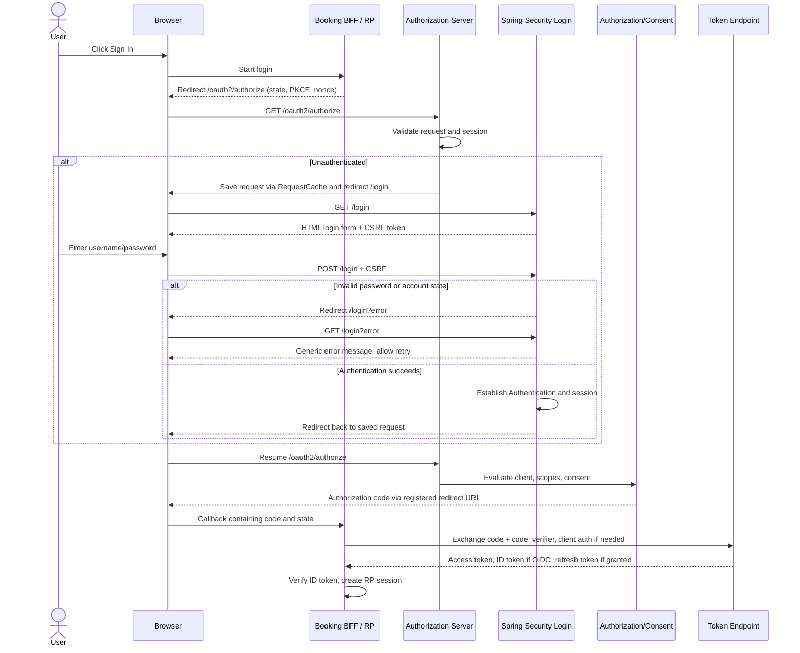
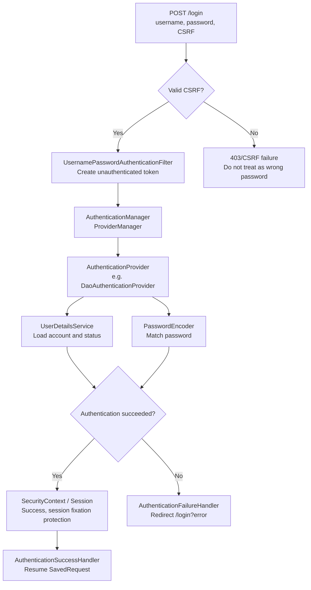
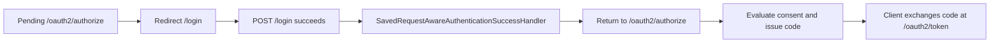

# Building a Login Page and Handling Authentication Errors

## 1. Context and Goals

In an **OAuth 2.0/OpenID Connect (OIDC) Authorization Server** built with **Spring Security**, **Spring Authorization Server**, and Spring Boot, the login screen is where the user proves their identity before the Authorization Server evaluates granting permissions to a client. A login page with a polished UI that mishandles sessions, authentication errors, or redirects can still break the Authorization Code + PKCE flow or introduce security vulnerabilities.

For example, a user opens a booking app, clicks **Sign In**, and is redirected to the Authorization Server. The user enters the wrong password once, gets it right on the next attempt, and expects to be returned to the app waiting for the authorization code. When building a custom login page, the system must simultaneously get all of the following right:

- Render the `GET /login` page and handle the `POST /login` form submission.
- Keep passwords, CSRF tokens, session cookies, and error messages secure.
- Respect the user authentication mechanism and account status checks.
- Preserve the original authorization request so the browser returns to `/oauth2/authorize` after successful login.
- Distinguish **user login errors** from **OAuth client, grant, or token validation errors**.
- Never issue an authorization code, ID token, or access token before completing authentication and authorization requirements.

This lesson belongs to the **User Authentication** chapter and focuses on how to **design, configure, secure, test, and operate** the login page and authentication error handling. After this lesson, you will be able to build a custom form login, explain the roles of the filters/handlers involved, and thoroughly test both happy and failure paths.

## 2. Distinguishing User Login from OAuth Client Authentication

Inside an Authorization Server, there are at least two distinct types of authentication:

| Activity | Principal Authenticated | Typical Components | Outcome |
|---|---|---|---|
| **User authentication** | End-User, e.g., `user-42` | `formLogin`, `AuthenticationProvider`, `UserDetailsService`, and session | User `Authentication` in Spring Security context |
| **Client authentication** | OAuth client, e.g., `booking-bff` | Token Endpoint mechanism and client authentication providers | Proves the client is allowed to use the grant and token endpoint |
| **OIDC authentication** | User authenticated by the OpenID Provider for a Relying Party | OIDC flow, ID token, claims | RP verifies the ID token and establishes an application session |
| **Authorization/consent** | Decision to grant permissions to a client | Authorization Endpoint, consent page/policy | Authorization code or appropriate grant |

**Successful user login does not mean the client has been granted an access token.** At the Authorization Endpoint, the AS must still verify client registration, redirect URI, scopes, PKCE, grant state, and consent if required. At the Token Endpoint, the client must satisfy all requirements to exchange the code for tokens.

Likewise, **a user password error is not `invalid_client`**. An `invalid_client` error relates to OAuth client authentication; an `invalid_grant` error can occur when exchanging an invalid authorization code or refresh token. Those protocol errors must be returned per the OAuth contract rather than rendered as an "Invalid password" screen.

### 2.1. Which Chain Owns the Login Page?

Spring Authorization Server provides OAuth/OIDC endpoints and their corresponding security configuration, while the user login page typically relies on **Spring Security form login** in the application. When using multiple `SecurityFilterChain` beans:

- **Authorization Server chain** handles OAuth/OIDC endpoints such as `/oauth2/authorize` and `/oauth2/token`.
- **Application/login chain** handles `GET /login`, `POST /login`, and related web pages.
- If there is an **Admin API** or Resource Server in the same application, it may need a separate chain with different policies.

`FilterChainProxy` selects the matching chain in order; if a catch-all chain is ordered ahead of the AS chain, requests may never reach the required endpoint filters.

## 3. Flow from Authorization Request to Login Page

Suppose:

- **Client/RP:** `booking-bff` at `https://app.example.com`.
- **Authorization Server/OP:** `https://auth.example.com`.
- **Resource Server:** `https://api.example.com`.
- **Grant:** Authorization Code + PKCE.
- **Scope:** `openid profile bookings.read`.



This diagram outlines both happy and failure paths. Request saving, login redirection, OIDC prompts, and consent depend on the actual configuration; not every request to `/oauth2/authorize` creates a session or always displays the login screen.

### 3.1. Why Must the Authorization Request Be Preserved?

The initial authorization request contains parameters such as:

```http
GET /oauth2/authorize?response_type=code&client_id=booking-bff
    &redirect_uri=https%3A%2F%2Fapp.example.com%2Flogin%2Foauth2%2Fcode%2Fbooking-bff
    &scope=openid%20profile%20bookings.read
    &state=OPAQUE_RANDOM_STATE
    &nonce=OPAQUE_RANDOM_NONCE
    &code_challenge=PKCE_CHALLENGE
    &code_challenge_method=S256
```

If the user is not logged in, a standard form-login flow sends the user to the login page while preserving the ability to **resume the exact original request**. Spring Security provides components like `RequestCache` and `SavedRequestAwareAuthenticationSuccessHandler` to restore the pre-authentication request.

Do not blindly read a `returnUrl` query parameter and redirect the browser to it after login; without strict validation, that creates an **open redirect**. Nor should you reconstruct the authorization request by manually assembling `client_id`, `state`, and `redirect_uri` from browser-submitted fields after login.

### 3.2. What If the User Enters the Wrong Password?

Spring Security must not treat that as a client-caused `/oauth2/authorize` protocol error. Normally:

1. `UsernamePasswordAuthenticationFilter` receives `POST /login`.
2. `AuthenticationManager` invokes the appropriate provider.
3. The provider rejects the credentials.
4. `AuthenticationFailureHandler` redirects to `/login?error` or handles it as configured.
5. The login page displays a **generic message**, allowing the user to retry.
6. When a subsequent login attempt succeeds, the saved request is resumed if the session and request cache remain valid.

**Never include usernames/passwords, exception messages, or stack traces in the redirect URL.**

## 4. Configuring Two `SecurityFilterChain` Beans for AS and Login

The following Java snippet illustrates modern Spring Security configuration structure. It must be combined with the rest of the Authorization Server beans in a real application.

```java
@Configuration
@EnableWebSecurity
public class AuthorizationServerLoginSecurityConfig {

    @Bean
    @Order(1)
    SecurityFilterChain authorizationServerSecurityFilterChain(
            HttpSecurity http) throws Exception {

        OAuth2AuthorizationServerConfigurer authorizationServer =
            OAuth2AuthorizationServerConfigurer.authorizationServer();

        http
            .securityMatcher(authorizationServer.getEndpointsMatcher())
            .with(authorizationServer, as ->
                as.oidc(Customizer.withDefaults()))
            .authorizeHttpRequests(authorize ->
                authorize.anyRequest().authenticated())
            .exceptionHandling(exceptions -> exceptions
                .defaultAuthenticationEntryPointFor(
                    new LoginUrlAuthenticationEntryPoint("/login"),
                    new MediaTypeRequestMatcher(MediaType.TEXT_HTML)))
            .oauth2ResourceServer(resourceServer ->
                resourceServer.jwt(Customizer.withDefaults()));

        return http.build();
    }

    @Bean
    @Order(2)
    SecurityFilterChain loginSecurityFilterChain(
            HttpSecurity http) throws Exception {

        http
            .authorizeHttpRequests(authorize -> authorize
                .requestMatchers("/assets/**").permitAll()
                .anyRequest().authenticated())
            .formLogin(form -> form
                .loginPage("/login")
                .loginProcessingUrl("/login")
                .failureUrl("/login?error")
                .permitAll());

        return http.build();
    }
}
```

Java imports are omitted to focus on architecture. You still need compatible dependencies, `RegisteredClientRepository`, `OAuth2AuthorizationService`, `OAuth2AuthorizationConsentService`, `AuthorizationServerSettings`/issuer configuration, signing keys/JWK, and a user authentication mechanism for the system to run. The snippet above is not a complete production configuration.

**Note on `oauth2ResourceServer().jwt()`:** This pattern is commonly used when the Authorization Server enables OIDC features that process Bearer tokens, such as UserInfo. In a real project, provide an appropriate `JwtDecoder` and check your framework version's requirements.

### 4.1. Why Does This Configuration Work?

- `@Order(1)` prioritizes the AS chain for endpoints managed by `authorizationServer.getEndpointsMatcher()`.
- `LoginUrlAuthenticationEntryPoint("/login")` redirects unauthenticated **interactive browser** requests to the login page.
- `@Order(2)` assigns the login chain to remaining requests, including `GET /login` and `POST /login`.
- `formLogin().loginPage("/login")` declares the custom login page served by the application.
- `loginProcessingUrl("/login")` is the POST endpoint processed by Spring Security's filter.
- `failureUrl("/login?error")` configures the target upon authentication failure.
- `permitAll()` allows unauthenticated access to the URLs serving form login per `formLogin` rules.

The `/assets/**` rule allows browsers to fetch CSS and images needed before signing in. Only make genuinely required resources public; never expose sensitive APIs just because they sit near the login route.

### 4.2. Common Chain Configuration Mistakes

| Mistake | Symptom |
|---|---|
| An `anyRequest()` chain has higher precedence than the AS chain | `/oauth2/authorize` or `/oauth2/token` routes to the wrong handler |
| `GET /login` still requires authentication | Redirect loop between `/login` and itself |
| `POST /login` is not handled by the chain with form login | `404`, `405`, or authentication never runs |
| Defining a `@PostMapping("/login")` controller alongside the login filter | Processing conflict and risk of bypassing Spring Security |
| Setting `SessionCreationPolicy.STATELESS` on a form login chain needing sessions | Login succeeds but context/saved request cannot persist |
| Disabling CSRF across the entire application | Form login/consent and web actions become vulnerable to request forgery |
| Writing a manual `/oauth2/**` matcher for the AS | May miss OIDC endpoints under `/.well-known/**` or other endpoints |
| Hardcoding `defaultSuccessUrl("/", true)` | Post-login redirect bypasses the original authorization request |

Remember that `securityMatcher` selects the chain; `authorizeHttpRequests` enforces authorization within the chain. They do not replace one another.

## 5. Creating the Controller to Render the Login Page

With custom `formLogin`, the controller usually only needs to serve **GET**:

```java
@Controller
public class LoginPageController {

    @GetMapping("/login")
    public String loginPage() {
        return "login";
    }
}
```

In an example using Thymeleaf, the `"login"` view maps to the template `src/main/resources/templates/login.html`. The controller does not handle POST submissions containing passwords; Spring Security's `UsernamePasswordAuthenticationFilter` handles that at `/login` when the request enters the right chain.

To display a banner after logout or failure, the page can inspect standard query parameters like `error` and `logout`, strictly for UI presentation. Never treat `?error` as audit evidence that authentication actually failed: a user can type that URL manually.

### 5.1. A Production-Ready Thymeleaf Template

```html
<!doctype html>
<html lang="en" xmlns:th="http://www.thymeleaf.org">
<head>
  <meta charset="utf-8">
  <meta name="viewport" content="width=device-width, initial-scale=1">
  <title>Sign In</title>
</head>
<body>
  <main>
    <h1>Sign In</h1>

    <p th:if="${param.error != null}"
       role="alert">
      Unable to sign in. Please check your credentials and try again.
    </p>

    <p th:if="${param.logout != null}"
       role="status">
      You have been signed out.
    </p>

    <form th:action="@{/login}" method="post">
      <div>
        <label for="username">Username</label>
        <input id="username"
               name="username"
               type="text"
               autocomplete="username"
               required>
      </div>

      <div>
        <label for="password">Password</label>
        <input id="password"
               name="password"
               type="password"
               autocomplete="current-password"
               required>
      </div>

      <button type="submit">Sign In</button>
    </form>
  </main>
</body>
</html>
```

Key details:

- `method="post"` avoids placing the password in the URL/query string.
- `name="username"` and `name="password"` match form login's default parameter names. If you configure `usernameParameter(...)` or `passwordParameter(...)`, update the template to match.
- `th:action="@{/login}"` generates a context-path-aware action URL. With proper Thymeleaf/Spring Security integration, form processing automatically injects the hidden CSRF token.
- `role="alert"` helps assistive technologies announce errors.
- A generic error message avoids disclosing whether an account exists or internal failure reasons.

### 5.2. The CSRF Token Must Actually Appear in the Rendered HTML

In a Servlet application with CSRF protection enabled, the POST form must submit a valid token. When using Thymeleaf with `th:action` and Spring Security, the request data value processor normally inserts the hidden field automatically. **Inspect the rendered HTML in an integration test** to confirm the form actually contains the token.

If using a template engine without automatic CSRF integration, add a hidden input using the token provided by the backend:

```html
<input type="hidden"
       th:name="${_csrf.parameterName}"
       th:value="${_csrf.token}">
```

Choose **one clean CSRF integration method** to avoid generating unnecessary duplicate fields. The parameter name and token source must match Spring Security's `CsrfTokenRepository`/CSRF setup. Never hardcode a static token or reuse a token from another request. For a standard login page, keeping default CSRF enabled is far safer than disabling protection just to make POST work.

### 5.3. UI and Usability

The login page must serve users cleanly without weakening security:

- Use HTTPS, with content and links hosted on the Authorization Server's trusted origin.
- Display the AS logo/name and only render client metadata loaded from trusted registration records if needed; never trust an application name passed in a query parameter.
- Provide clear form labels, keyboard navigation, focus management, appropriate `autocomplete` attributes, and clear error messages.
- Never retain password values in HTML/JavaScript, sessions, hidden inputs, or error messages.
- Do not embed unnecessary third-party scripts on pages with password fields.
- Provide account/password recovery links, MFA support per policy, and a support path when accounts are blocked.

## 6. Authentication Pipeline on POST /login

`formLogin` relies on Spring Security components. Understanding each layer helps you customize at the right seam and diagnose failures.



`UsernamePasswordAuthenticationFilter` extracts form parameters and delegates authentication to `AuthenticationManager`. `DaoAuthenticationProvider` is a common implementation when using `UserDetailsService` and `PasswordEncoder`. Applications may use different providers for LDAP, SSO, MFA, or custom authentication mechanisms while honoring the Spring Security contract.

### 6.1. Configuring Users and Password Encoding

You can use `UserDetailsService` to load users from a trusted store and `PasswordEncoder` to match hashed passwords. Standalone bean example:

```java
@Bean
PasswordEncoder passwordEncoder() {
    return PasswordEncoderFactories.createDelegatingPasswordEncoder();
}
```

`DelegatingPasswordEncoder` distinguishes hashing algorithms via a configured prefix (such as a hash with an encoder prefix). This is a convenient way to manage algorithm migrations; production systems must select modern algorithms with proper parameters, hash upgrade policies, and user data protection.

Never:

- Store passwords in plaintext or use reversible "two-way encryption" for comparison.
- Compare passwords manually via `storedPassword.equals(rawPassword)`.
- Log the `POST /login` request body.
- Read passwords from query strings or custom headers and treat them as equally safe.
- Treat an `Authentication` object constructed with `authenticated=true` in a controller as valid authentication without going through a trusted provider.

### 6.2. Account Status Is Part of Authentication

Providers can check whether an account is locked, disabled, expired, or requires a credential update. Common Spring Security exceptions include:

| Exception or Situation | Typical Meaning | Public UI Handling |
|---|---|---|
| `BadCredentialsException` | Invalid credentials | Generic message |
| `UsernameNotFoundException` | User not found in data store | Do not reveal whether the username exists |
| `DisabledException` | Account not yet / no longer enabled | Neutral message; handle via dedicated support workflow |
| `LockedException` | Account is locked | Avoid unnecessary details; provide support workflow |
| `AccountExpiredException` | Account validity expired | Handle per policy with appropriate message |
| `CredentialsExpiredException` | Credentials expired / require change | Optionally start a secure recovery flow after verifying context |
| `AuthenticationServiceException` or backend error | Problem processing authentication | Non-disclosing message; alert/monitor server-side |
| Missing/invalid CSRF token | Request blocked prior to authentication | Appropriate `403`/error page; do not count as a bad password |

Exceptions depend on the provider and execution path; not every application produces all of them. Generally, record detailed classifications in **internal logs/audits**, while returning neutral public responses to prevent **username enumeration**.

## 7. Successful Login: Returning to the OAuth Flow

After authenticating the user, Spring Security populates the `SecurityContext` and updates the session as configured. The success handler normally redirects the browser back to the pre-login pending request if a `SavedRequest` exists.



This behavior is vital for the OIDC Authorization Code Flow: the client already generated `state`, `nonce`, and PKCE before redirecting. The client must receive the authorization response for that exact request and validate `state`. Changing context or sending the user to an unrelated URL breaks the client's correlation between the response and the initiated request.

### 7.1. Avoid Forcing Redirects to the Home Page

Configuration example likely to break the flow:

```java
// Example you should NOT copy when SavedRequest is needed.
.formLogin(form -> form
    .loginPage("/login")
    .defaultSuccessUrl("/", true));
```

The `true` flag forces a redirect to the specified URL after every login, discarding any pending authorization request. Keep the default saved-request-aware success behavior or use a custom handler that still **honors `SavedRequest`**.

If you need a fallback landing page when users visit `/login` directly, configure the fallback **without forcing `SavedRequest` to be ignored**, and test the flow end-to-end.

### 7.2. Never Accept Arbitrary Redirect URLs from the User

A form containing `<input name="returnUrl" value="https://...">` does not prove that destination is safe. For custom post-login navigation, pull targets from the request cache or a validated internal allowlist; never redirect to arbitrary user-supplied external URLs.

An **OAuth redirect URI** must be validated by the Authorization Server against the client's registered URIs. It is distinct from an **internal post-form-login redirect**. Do not conflate the two or allow a login controller to bypass OAuth redirect URI validation.

## 8. Handling Authentication Errors with `AuthenticationFailureHandler`

For typical needs, the following configuration suffices to route the user back to the error screen:

```java
.formLogin(form -> form
    .loginPage("/login")
    .loginProcessingUrl("/login")
    .failureUrl("/login?error")
    .permitAll());
```

Spring Security applies standard form login failure handling. The page receives `GET /login?error` and displays a generic notice as shown in the template.

### 8.1. When Do You Need a Custom Failure Handler?

A custom `AuthenticationFailureHandler` may be needed if your product requires:

- Updating failed-login alert counters per policy.
- Recording an authentication event correlation ID.
- Selecting an appropriate view for the login method while still masking sensitive reasons.
- Supporting an account recovery flow once proper proof is established.
- Integrating observability without altering authentication logic.

Example wiring a standard handler into the configuration:

```java
@Bean
AuthenticationFailureHandler genericLoginFailureHandler() {
    return new SimpleUrlAuthenticationFailureHandler("/login?error");
}

// Inside formLogin:
.formLogin(form -> form
    .loginPage("/login")
    .failureHandler(genericLoginFailureHandler())
    .permitAll());
```

These are illustrative configuration snippets—**do not place `.formLogin(...)` standalone outside an `HttpSecurity` builder**. When using a custom handler, ensure it issues the right redirect or response without leaking credential failure details or losing necessary request context.

Consider using `AuthenticationEventPublisher` or Spring Security authentication events to emit login success/failure audits instead of stuffing every side effect into a failure handler. Verify that events are published by the actual provider/manager and that audit records never contain passwords or tokens.

### 8.2. Separating Internal Error Classification from External Messages

| Server-Side Cause | User-Facing Message | Internal Action |
|---|---|---|
| Wrong username/password | "Unable to sign in. Please check your credentials and try again." | Increment failure count and detect anomalies |
| Account locked/disabled | Neutral message or safe support instructions | Inspect status; do not leak via response |
| Database/LDAP/IdP outage | "Temporarily unable to sign in. Please try again later." | Incident alert, correlation ID |
| Invalid CSRF | Appropriate error/refresh page; do not count as password failure | Inspect CSRF token, session, and proxy/cookies |
| Too many attempts | Generic message and wait guidance per policy | Rate limiting, alerts, DoS-resistant lockout protection |
| Session expired during login | Prompt to reload page or restart flow | Inspect session/request cache |
| MFA failure | Message disclosing no sensitive data | Track attempts and enforce MFA policy |

Avoid exposing server exception class names like `BadCredentialsException` or `LockedException` in public messages. Detailed causes belong in access-controlled security monitoring systems.

### 8.3. JSON/API Login and Form Login Are Not the Same

For browser form login, Spring Security normally **redirects** to `/login?error`. If your product implements login via AJAX/JSON, design handlers returning appropriate HTTP statuses and bodies, backed by proper CSRF/cookie protections or a thoroughly evaluated token architecture.

**Never make `POST /oauth2/token` return an HTML login page by default.** The Token Endpoint serves OAuth clients and must return OAuth error responses such as `invalid_client` or `invalid_grant`. A catch-all handler returning `200 OK` with `{"message":"Wrong password"}` across all endpoints breaks protocol compliance and hampers testing.

## 9. Distinguishing Login, Authorization, and Token Errors

The three processing paths follow different contracts:

| Error Location | Example | Appropriate Response/Behavior |
|---|---|---|
| **Form login** `POST /login` | Wrong password | Spring Security failure handler; redirect to login page or dedicated response |
| **Authorization Endpoint** `/oauth2/authorize` | Invalid client, wrong redirect URI, consent denied | Per OAuth rules; only redirect errors to an allowed URI when safe |
| **Token Endpoint** `POST /oauth2/token` | Expired code, wrong PKCE, invalid client credentials | OAuth error responses such as `invalid_grant`, `invalid_client` |
| **OIDC Authentication Request** | `prompt=none` when silent authentication is impossible | Handle OIDC errors like `login_required` per spec and actual support |
| **Resource Server API** | Missing/expired access token or insufficient scope | Appropriate `401`/`403`, Bearer challenge per RS mechanism |

### 9.1. Redirect URI Errors Must Not Redirect Arbitrarily

If an OAuth Authorization Request specifies an invalid redirect URI, the Authorization Server **must not send the browser to that URI to report the error**, as doing so creates an open redirect. The OAuth specification defines when errors may be redirected and when they must be displayed locally.

A custom login page must never read `redirect_uri` from the URL and redirect there assuming it is safe. Validating that URI is the Authorization Request processor's responsibility.

### 9.2. OIDC `prompt` and `max_age`

In OIDC, clients can request specific authentication behavior:

- `prompt=login` requests the OP to re-authenticate the user.
- `prompt=none` prohibits interactive UI; if silent completion is not possible, the OP must return an appropriate error such as `login_required`.
- `max_age` caps the acceptable age of the authentication; the ID token may need an `auth_time` claim per OIDC rules.

**Do not blindly enforce "every request without a session redirects to `/login`"** if your system must honor `prompt=none`. Verify your Spring Authorization Server version's capabilities and configuration for these OIDC parameters; handle them at the appropriate OIDC/provider layer rather than patching around them with a servlet filter or login-page JavaScript.

### 9.3. What Kind of Error Is Consent Denial?

A user may authenticate cleanly yet decline scopes requested by the client. That is an **authorization denial**, typically mapped to `access_denied` in OAuth; it is not a `BadCredentialsException`. Neither the login page nor audit logs should record "login failed" when the user simply declined consent.

## 10. Mandatory Security Controls for the Login Page

### 10.1. HTTPS, Cookies, and Sessions

The entire browser login flow requires HTTPS. Session cookies should set `Secure`, `HttpOnly`, and a `SameSite` attribute compatible with redirect/SSO flows; test how `SameSite` interacts with client-to-OP redirects. Sessions need timeouts, ID rotation upon authentication, and concurrent session policies where appropriate.

With multiple instances:

- Choose a session sharing or affinity strategy; **Spring Session** can provide a shared session store.
- `OAuth2AuthorizationService` and `OAuth2AuthorizationConsentService` are separate stores from HTTP sessions. Persisting authorizations in JDBC **does not automatically share login sessions**.
- Test the effect of restarts, TTLs, request cache, and load balancers on pending requests.

Avoid `SessionCreationPolicy.STATELESS` for browser form login if the application relies on sessions to hold authentication and `SavedRequest`. If building a genuinely sessionless system, redesign the flow and security requirements accordingly.

### 10.2. CSRF and Request Forgery Prevention

`POST /login` forms, consent submissions, logout, and other cookie/session-backed state changes require CSRF protection per Spring Security's model. A login POST missing or carrying an invalid CSRF token is normally rejected **before credential verification**.

If someone "fixes" a 403 error by calling `csrf.disable()` globally, they open additional attack paths. Verify the HTML token, cookies/session, proxy, context path, and filter chain before altering CSRF policy.

### 10.3. Defending Against Brute Force and Credential Stuffing

Appropriate measures include:

- Rate limiting using combined signals such as account, IP, and device characteristics, with safeguards to prevent attackers from triggering mass account lockouts.
- Risk-based lockout/throttling policies with monitoring and safe recovery workflows.
- MFA or passkeys matching user segments and required assurance levels.
- Alerting on anomalous login activity.
- Separating public messages from internal causes to curb account enumeration.
- Protecting password recovery and email verification endpoints at a level commensurate with login.

Gateway rate limits help but do not replace per-account policies; account policies should not rely solely on IP addresses, which can be shared or rotated.

### 10.4. XSS, Clickjacking, and External Resources

The login page handles credentials; therefore:

- Escape all rendered values such as client names, error messages, or URL parameters.
- Enforce a strict Content Security Policy, minimizing inline scripts and external resources.
- Protect against clickjacking with appropriate headers (such as `frame-ancestors`).
- Avoid third-party scripts that could read password fields unless strictly necessary and tightly controlled.
- Never log full form bodies, query strings, authorization headers, or session cookies.

### 10.5. Password Policies and MFA

The UI is strictly presentation. All password checks, account status rules, MFA enforcement, and assurance levels must be decided by **`AuthenticationManager`/providers** or trusted authentication services—never via hidden fields or client-side JavaScript that can be tampered with.

If the system requires MFA to log in or grant sensitive scopes, ensure authorization codes are issued only after required authentication steps complete. Never issue tokens after "valid password" while treating MFA as an optional UI step.

## 11. Logout, Session Timeout, and Re-Authentication

Logging out of the Authorization Server is not the same as revoking previously issued access tokens. Similarly, logging out of a Relying Party may leave an active SSO session at the OP.

| Scenario | Typical Behavior | What to Verify |
|---|---|---|
| First login with no AS session | Displays login form | `SavedRequest` and CSRF |
| Wrong credentials entered | Displays error message | Required context preserved; no user existence leak |
| Login succeeds | Creates/rotates session and resumes saved request | Safe redirect; code issued only after policy/consent |
| AS session expires | New authorization request may require login | Cookies, timeout, `RequestCache` |
| User logs out at RP | RP clears its own session | AS session may still remain active |
| User logs out at AS | AS session is terminated | Existing RP sessions/tokens may persist; coordinate logout if needed |
| Client requests `prompt=login` | May require re-authentication | OIDC policy, `auth_time` |
| Client requests `prompt=none` | Must not show interactive UI | OIDC error if silent login is not possible |

If a product requires "sign out of all devices," explicitly define how **AS sessions**, **RP sessions**, **refresh tokens**, and/or **access tokens** are invalidated or revoked. Clearing a login cookie does not automatically cause Resource Servers to reject unexpired JWT access tokens.

## 12. Telemetry and Auditing Authentication Errors

The login page sees high-sensitivity activity. Auditing should answer "what happened?" without exposing credentials.

### 12.1. Data Safe to Record

- Event types: `LOGIN_SUCCESS`, `LOGIN_FAILURE`, `LOGIN_THROTTLED`, `SESSION_EXPIRED`, `MFA_FAILED`.
- Standardized timestamps and request/correlation IDs.
- Trusted principal ID upon success; for failed logins, constrain storing raw usernames per privacy policy.
- Internal reason category: bad credentials, account state, backend error, CSRF.
- Normalized traffic source and risk signals, if needed.
- Client/flow context at a safe granularity, avoiding query strings carrying secrets or tokens.

### 12.2. Data You Must Never Record

- Raw passwords, password hashes, OTPs, recovery codes.
- Authorization headers, refresh/access tokens, authorization codes, ID tokens.
- Session cookies, CSRF tokens, or unredacted form bodies.
- Stack traces or SQL queries in user-facing responses.
- Overly specific UI messages that reveal whether an account exists.

Useful metrics: login success/failure rates, login latency, CSRF 403 counts, redirect loop counts, MFA failure rates, mid-authorization session expirations, and anomalies following new releases.

Audits may be emitted from authentication events, handlers, or services depending on design. **Auditing must never leak data itself and needs a failure strategy when the audit store is unavailable**: sensitive flows must choose fail-open or fail-closed deliberately by policy rather than silently swallowing errors.

## 13. Practical Testing with Spring Security and Spring Authorization Server

For a custom login page, test the **controller/template**, **`SecurityFilterChain`**, **authentication providers**, and **OAuth/OIDC flow**.

### 13.1. Minimum Test Matrix

| Test Case | Setup | Expected Outcome |
|---|---|---|
| `GET /login` | No session | `200`, renders form, required CSS loads |
| Template CSRF | Render `GET /login` | POST form contains valid CSRF token per integration |
| Successful login | Valid credentials, valid CSRF | Authentication succeeds, valid session, redirects to saved request or fallback |
| Wrong password | POST wrong credentials, valid CSRF | Redirects to `/login?error`; no authenticated session created |
| Non-existent username | POST unknown username | Public message does not leak user existence |
| Locked/disabled account | POST credentials for blocked account | Login denied; accurate audit and appropriate UI |
| Missing/invalid CSRF | Invalid POST `/login` | Rejected; not counted as a password failure |
| Login page missing `permitAll` | Attempt `GET /login` | Test catches redirect loop |
| Unauthenticated Authorization Request | Valid `GET /oauth2/authorize` | Redirects to login and saves request to resume |
| Post-login with OAuth request | Authentication succeeds | Returns to exact request, proceeds to consent/code |
| Failure then success | Wrong password, then valid retry | Required authorization context is not lost |
| Session fixation | Before and after login | Session ID/protection applied as configured |
| Session timeout | Wait for session expiration | No longer authenticated; new flow prompts for login properly |
| User-supplied external redirect | Malicious `returnUrl` param | No open redirect |
| OIDC `prompt=none` | No valid session | No interactive login shown; proper protocol error if supported |
| Wrong Token Endpoint client auth | `/oauth2/token` | Proper OAuth error; no redirect to HTML login |
| Multiple filter chains | AS endpoints and login | Each request enters the right chain |
| Multi-instance | Login on node A, authorize on node B | Behaves consistently per session/storage strategy |

### 13.2. Example Test for Form Login Failure

With `MockMvc` and `spring-security-test`, a test scenario might look like:

```java
@Test
void wrongPasswordRedirectsToGenericLoginError() throws Exception {
    mockMvc.perform(post("/login")
            .with(csrf())
            .param("username", "alice")
            .param("password", "wrong-password"))
        .andExpect(status().is3xxRedirection())
        .andExpect(redirectedUrl("/login?error"));
}

@Test
void missingCsrfIsRejected() throws Exception {
    mockMvc.perform(post("/login")
            .param("username", "alice")
            .param("password", "wrong-password"))
        .andExpect(status().isForbidden());
}
```

These tests assume the app already configures `MockMvc`, form login with CSRF protection, and the user store/test fixtures. Do not treat them as complete login coverage. Add integration tests verifying **the authorization request is preserved and resumed after login**, as that is the seam most easily broken when customizing an Authorization Server's login page.

### 13.3. Testing Login Page Messages

When using `?error`, verify that the rendered HTML contains **one generic message** with no exception classes, passwords, access tokens, or stack traces. If localized, verify the wording stays neutral across every locale. A test that only checks HTTP `200` is not enough to prove the login page is secure.

### 13.4. Testing and Protecting the Happy Path

In a complete Authorization Code + PKCE + OIDC flow, verify:

1. Client generates `state`, `nonce`, and PKCE verifier/challenge.
2. Unauthenticated browser is redirected to `/login`.
3. After login, the Authorization Server processes the original authorization request.
4. Consent is evaluated per policy.
5. Client receives the authorization code at the **registered redirect URI**.
6. Client exchanges the code with PKCE and appropriate client authentication.
7. RP verifies the ID token and `state`/`nonce` per OIDC.
8. Resource Server accepts only valid access tokens and never accepts ID tokens in place of access tokens.

These steps prove the custom login page does not break OAuth/OIDC boundaries. None of them requires the login page to mint tokens itself.

## 14. Diagnosing Common Errors

| Symptom | Likely Cause | Check First |
|---|---|---|
| `/login` returns `404` | Missing controller/template | `GET /login` mapping, view resolver, template location |
| `/login` redirects to itself | Missing `permitAll` or wrong chain | `@Order`, matcher, `formLogin().permitAll()` |
| POST login returns `403` | Missing/invalid CSRF token or other policy | Rendered HTML form, CSRF repository, session cookie |
| POST login returns `404`/`405` | Mismatched `loginProcessingUrl` or chain | `loginProcessingUrl`, filter chain, HTTP method |
| Always reports wrong password | `PasswordEncoder` mismatch, wrong provider/user store | `UserDetailsService`, password hash, provider |
| Redirects to home page instead of returning to client | Success handler forces redirect | `SavedRequestAware` behavior, `defaultSuccessUrl(..., true)` |
| Login succeeds yet `/authorize` still prompts for login | Lost session, bad cookie, stateless chain, different node | Cookies, session store, `SameSite`, load balancer |
| Authorization fails after login | Invalid redirect URI/client/scope/PKCE | Redacted OAuth validation logs, registered client |
| `/oauth2/token` returns HTML login | Wrong chain or entry point | AS matcher, token endpoint client auth/error handling |
| User sees stack trace or `LockedException` | Rendering raw exception in view | Failure handler/view model, error redaction |
| Consent prompt keeps repeating | Consent state not saved/read properly | `OAuth2AuthorizationConsentService`, principal, client |
| Login CSS fails to load | Static assets protected | Static resource matcher and cache policy |

### 14.1. Step-by-Step Investigation Process

For a specific bug, answer in order:

1. What **URL and HTTP method** did the request hit?
2. Which **`SecurityFilterChain`** selected it?
3. Was it blocked by **CSRF** before reaching the login filter?
4. If credentials were submitted, which **`AuthenticationProvider`** received and accepted/rejected them?
5. What status, `Location`, and cookies did the failure/success handler return?
6. Did the browser send the right session cookie on the next redirect?
7. Does `SavedRequest` still hold the original authorization request?
8. If login succeeded yet no code/token was issued, is the failure in **authorization/consent/grant** rather than login?

This layered isolation saves you from wasting time tweaking templates when the real root cause is client registration, CSRF, or the request cache.

## 15. Advanced Scenario: Re-Authentication and MFA

An enterprise Authorization Server may require stronger authentication when a client requests sensitive scopes such as `payments.approve` or access to personal data.

A sound flow:

- Policy determines the required authentication assurance level.
- Spring Security's authentication flow checks whether the user already satisfies that level.
- If not, the user completes the appropriate MFA/re-authentication step.
- Only once authentication requirements are satisfied does the Authorization Server proceed to issue permissions/tokens.
- When using OIDC and signaling assurance/time, claims such as `acr`, `amr`, and `auth_time` must reflect verifiable authentication facts and conform to OP/RP support.

**Never issue an ID token with `amr=["mfa"]` just because the frontend sent `mfa=true`.** Authentication claims must be constructed from the outcome of a trusted server-side mechanism.

MFA failures are also authentication errors at the appropriate layer, though UX and session state may require a multi-step flow. When adapting the login flow, preserve the authorization request, prevent CSRF/replay, and bound lifetimes for partially authenticated sessions.

## 16. Implementation Checklist

When reviewing a custom login page for Spring Authorization Server, check:

- **Routing scope:** `/oauth2/authorize` and `/oauth2/token` in the AS chain; `/login` in the login chain in the right order?
- **GET/POST:** Controller only renders the page; `POST /login` handled by Spring Security?
- **CSRF:** Form includes a valid token and protection is not disabled globally?
- **Credentials:** Passwords submitted only over HTTPS POST, proper hashing/encoder, no raw input logged?
- **Session:** Successful authentication establishes proper context/session, defends against session fixation, and works across multiple nodes?
- **SavedRequest:** Login returns to the original authorization request without forcing redirects to arbitrary URLs?
- **Failure UX:** Neutral message with no disclosure of user existence, account status, or stack traces?
- **Backend errors:** Bad credentials, CSRF failures, service outages, and OAuth errors separated at the right layer?
- **Account policy:** Throttling, MFA, lockout, recovery, and auditing enforced on the backend?
- **OAuth/OIDC:** Client auth, redirect URI, PKCE, `state`, consent, and token generation remain in the standard flow?
- **OIDC parameters:** `prompt`, `max_age`, and re-authentication semantics handled properly for your version?
- **Observability:** Correlation IDs/metrics/audits in place, tokens/credentials redacted, alerts wired?
- **Tests:** Integration tests cover login failure, success, request cache, CSRF, chain routing, and multi-instance behavior?

### Core Takeaways

The `GET /login` page is strictly presentation. **Spring Security form login** handles `POST /login`, verifies credentials via `AuthenticationManager`/providers, decides success or failure via handlers, and persists authentication/session state as configured. **Spring Authorization Server** remains responsible for validating clients, authorization requests, consent, PKCE, codes/tokens, and protocol responses.

A proper design returns the user after login to the **safely preserved authorization request**, displays **neutral login errors**, and keeps user authentication errors distinct from OAuth `invalid_client`/`invalid_grant`. Enforcing CSRF, cookies/sessions, password security, redirects, and safe logging is mandatory for operating a custom login page safely.

## References

- [Spring Authorization Server — Reference](https://docs.spring.io/spring-authorization-server/reference/)
- [Spring Authorization Server — Protocol Endpoints](https://docs.spring.io/spring-authorization-server/reference/protocol-endpoints.html)
- [Spring Security — Form Login](https://docs.spring.io/spring-security/reference/servlet/authentication/passwords/form.html)
- [Spring Security — Servlet Authentication Architecture](https://docs.spring.io/spring-security/reference/servlet/authentication/architecture.html)
- [Spring Security — Session Management](https://docs.spring.io/spring-security/reference/servlet/authentication/session-management.html)
- [Spring Security — CSRF](https://docs.spring.io/spring-security/reference/servlet/exploits/csrf.html)
- [Spring Security — Multiple SecurityFilterChain](https://docs.spring.io/spring-security/reference/servlet/configuration/java.html#_multiple_httpsecurity_instances)
- [RFC 6749 — The OAuth 2.0 Authorization Framework](https://www.rfc-editor.org/rfc/rfc6749)
- [RFC 7636 — Proof Key for Code Exchange (PKCE)](https://www.rfc-editor.org/rfc/rfc7636)
- [RFC 9700 — Best Current Practice for OAuth 2.0 Security](https://www.rfc-editor.org/rfc/rfc9700)
- [OpenID Connect Core 1.0](https://openid.net/specs/openid-connect-core-1_0.html)
