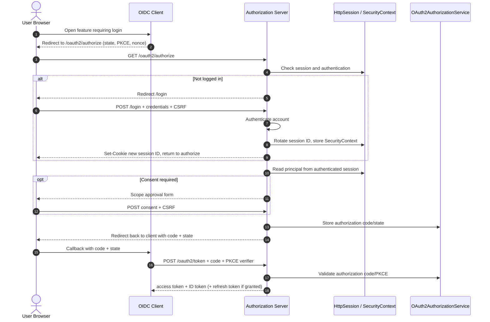
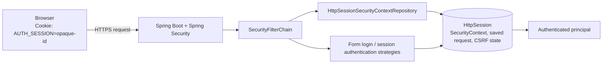
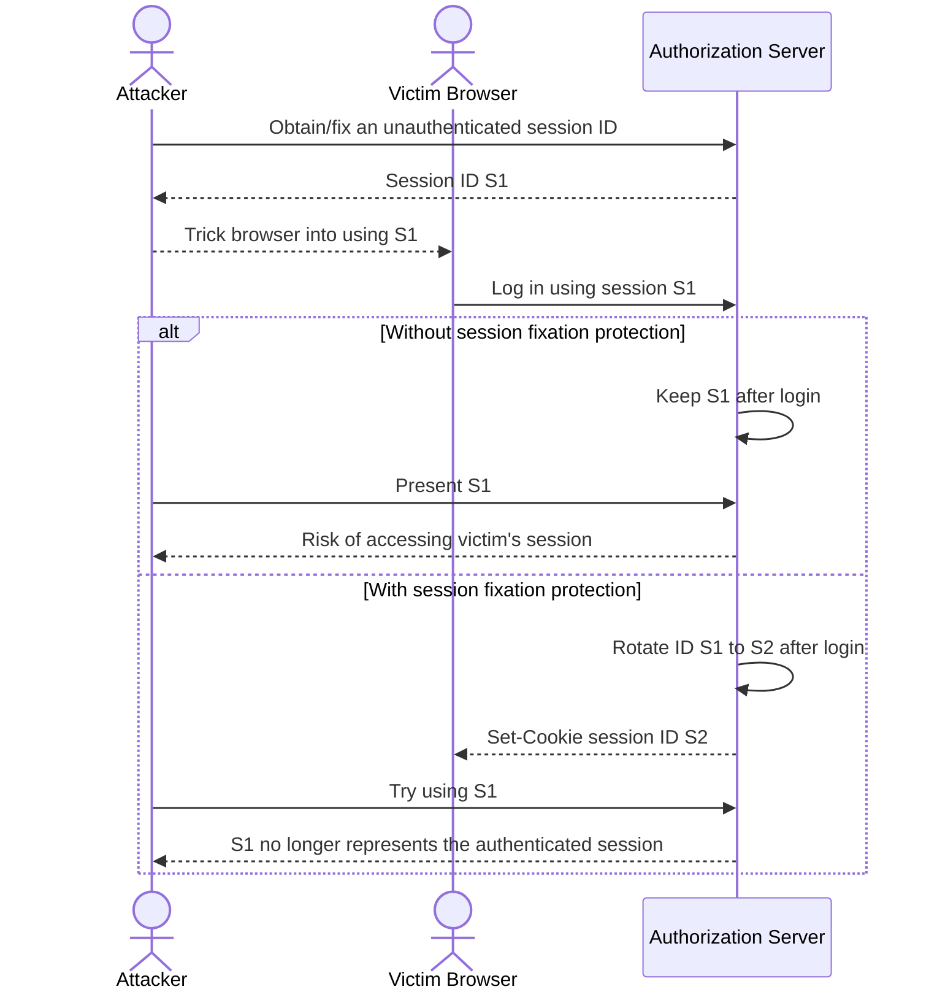
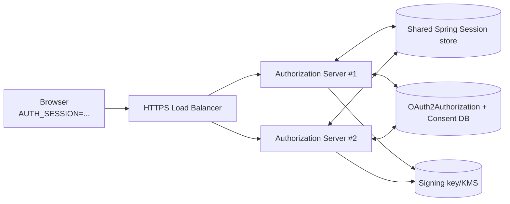
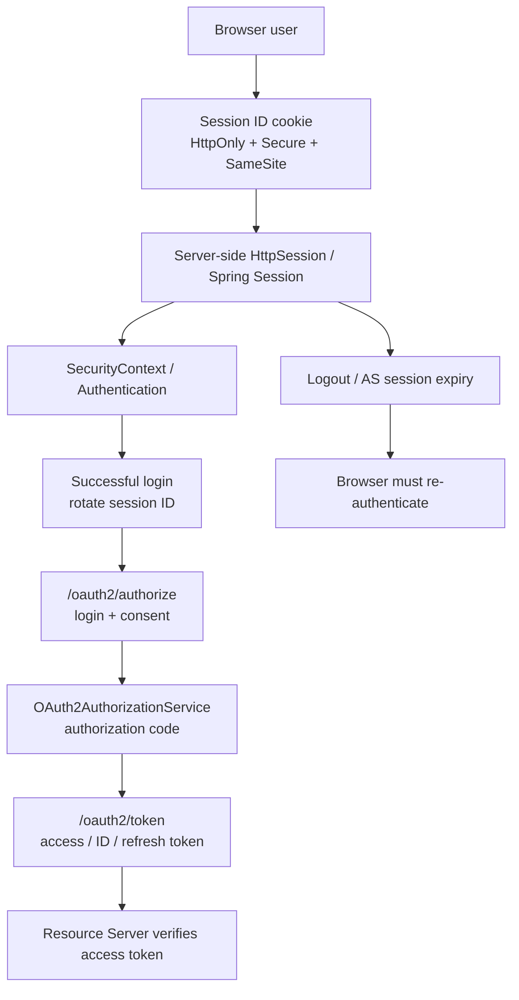

# Session Policies, Cookies, and Session Fixation Protection

## 1. Why Does an Authorization Server Need Login Session Management?

In the **User Authentication** chapter of the **SPRING_SECURITY_OAUTH2_OIDC_AUTHORIZATION_SERVER** module, Spring Boot and Spring Security must not only verify usernames and passwords accurately, but also manage a secure **browser login session**. Spring Authorization Server (SAS) provides endpoints and handles OAuth 2.0/OpenID Connect (OIDC) protocol processing, yet maintaining login state, managing cookies, preventing session fixation, and handling logout tie directly into the application's session mechanism.

After this lesson, you will be able to:

- Distinguish **HTTP login session**, **authorization code**, **access token**, **ID token**, and **refresh token**.
- Choose session creation and expiration policies suited for an Authorization Server with interactive login.
- Configure session cookies with `Secure`, `HttpOnly`, `SameSite`, `Path`, `Domain`, and lifetimes.
- Understand **session fixation** attacks and changing the session ID after successful authentication via `changeSessionId()`.
- Configure `SecurityFilterChain`, `SessionCreationPolicy`, logout, concurrent session management, and distributed session storage as needed.
- Test sessions before/after login, OAuth2/OIDC callbacks, CSRF, cookies, and behavior behind a reverse proxy.

**Scope:** This material focuses on flows where users access the Authorization Server via a browser. Code snippets illustrate common APIs in **Spring Boot 3.x / Spring Security 6.x / Spring Authorization Server 1.x**; check your exact framework version when applying them. For servers that only run `client_credentials` without interactive user login, browser session requirements differ.

> "Session," "token," and "cookie" are not synonyms. A cookie usually holds only a session identifier, while the server-side session holds login state; OAuth2 tokens are protocol credentials with their own lifecycles.

## 2. State Map in the Authorization Code + OIDC Flow

Suppose a user opens a web app that signs in through an Authorization Server at `https://auth.example.com`. The web app is the **OIDC Client**, while the Authorization Server authenticates the user and issues tokens according to policy.



The diagram highlights two independent groups of state:

| State | Where Is It Stored? | Purpose |
| --- | --- | --- |
| **AS HTTP session** | Servlet container, Spring Session, or other session store | Associates the browser with an authenticated `SecurityContext` and interactive context such as saved request/CSRF. |
| **Session cookie** | Browser, usually carrying an opaque session ID | Lets the AS recognize the session on subsequent requests. |
| **Authorization code and token metadata** | `OAuth2AuthorizationService` | Used when exchanging authorization codes, refreshing tokens, revoking, or introspecting. |
| **Consent** | `OAuth2AuthorizationConsentService` | Records scopes approved by the user per policy. |
| **OIDC ID token** | Token response for the OIDC Client | Client verifies user identity using `iss`, `aud`, signature, and claims. |
| **Access token** | Carried by Client to Resource Server | API verifies token and permissions; never accepts AS session cookies as API credentials. |

**Key point:** A browser may remain signed in at the AS even after the client's access token expires; conversely, logging out of the AS session does not automatically invalidate every already-issued JWT access token. Design logout and token lifecycles separately.

## 3. When Is the HTTP Session Created and Used?

HTTP is stateless across requests. When the browser returns to the AS, the servlet container reads the session ID from the cookie, locates the corresponding `HttpSession`, and supplies server-side state. Spring Security can store the `SecurityContext` in a session-backed `SecurityContextRepository`.



Note that the diagram only illustrates the participating components. Depending on configuration, CSRF tokens may be stored or lazily generated in the session; saved requests are managed by `RequestCache`; and `SecurityContext` persistence can vary if a custom repository is used.

### 3.1. When Is a Session Created?

A session can be created **before login**, for example to preserve the initial `/oauth2/authorize` request or to hold a CSRF token. After successful login, the session continues with a **new ID**. Do not assume only `POST /login` creates a session.

For example:

1. An unauthenticated browser calls `/oauth2/authorize?...`.
2. The AS redirects the browser to `/login`; the request cache may store the authorize URL in the session.
3. The browser loads the login page and submits the form with a CSRF token.
4. Spring Security authenticates the user, runs session fixation protection, and saves the authentication.
5. The request cache restores the authorize URL so the user can proceed with consent/code issuance.

If configuration drops the session or request cache between steps, the user may land on the wrong page, lose authorize parameters, or loop back to login.

### 3.2. Session-Related Policies

| Policy | Question to Answer | Guidance |
| --- | --- | --- |
| **Session creation** | Do we need to store browser login state? | For interactive form login/OIDC authorization, sessions are typically needed. |
| **Idle timeout** | How long without activity before the session expires? | Choose based on application sensitivity and login/consent interaction time. |
| **Absolute lifetime** | Should a session live indefinitely if continuously active? | If a hard cap is required, implement an absolute-lifetime policy beyond idle timeout. |
| **Fixation protection** | Does the session ID rotate after login? | On modern Servlet containers, prefer `changeSessionId()`. |
| **Concurrent sessions** | How many places can one user be logged in simultaneously? | Depends on security and UX policies; limiting to one session is not always mandatory. |
| **Logout** | On logout, does the server invalidate the session and clear the cookie? | Invalidate AS session and clear authentication context; evaluate OIDC logout separately. |
| **Distributed sessions** | With multiple AS instances, can requests hit another instance? | Use a shared session store or suitable topology; manage keys and authorization state separately. |

## 4. Choosing the Right `SessionCreationPolicy` for the Context

Spring Security provides `SessionCreationPolicy`, with common values:

| Policy | Primary Behavior | Fits When |
| --- | --- | --- |
| `ALWAYS` | Spring Security proactively creates an HTTP session | Flows requiring a session before a certain step; consider resource cost and unneeded sessions. |
| `IF_REQUIRED` | Creates a session only when needed | Standard choice for apps with form login and browser-based OAuth2/OIDC authorization. |
| `NEVER` | Does not create a session itself, but can use an existing one | Specialized scenarios; can make login/saved-request flows unpredictable without extra design. |
| `STATELESS` | Does not create or use HTTP sessions to load/save `SecurityContext` | Fits Bearer-token Resource Server APIs; generally **unsuitable for an AS with browser login**. |

For an **Authorization Server with form login**, `IF_REQUIRED` is a sensible starting point. Do not apply `STATELESS` to every filter chain just because the OAuth2 token endpoint is an API.

**Why?** The token endpoint receives back-channel HTTP requests and authenticates clients without browser cookies. By contrast, the interactive authorization endpoint must know who is signed in, preserve the pre-login request, and handle consent—which normally relies on sessions.

### 4.1. Separating the Protocol Chain and Application Chain

A Spring Authorization Server application typically defines:

- **AS chain** with higher priority: handles `/oauth2/authorize`, `/oauth2/token`, JWKS, discovery, and enabled OIDC endpoints.
- **Application chain**: handles `/login`, logout, error pages, and application resources.

Both chains run inside the same servlet application and share sessions/security context as appropriate. Verify `securityMatcher` and `@Order` so requests enter the right chain.

## 5. What Is a Session Fixation Attack?

**Session fixation** occurs when an attacker tricks a victim into using a session ID that the attacker already knows or controls **before the victim logs in**. If the server keeps the same session ID after authentication, the attacker can reuse that ID to access the newly authenticated session.



### 5.1. Spring Security's Default Mechanism

On Servlet 3.1+ containers, Spring Security defaults to `changeSessionId()` upon successful login. This **changes the existing session's ID** while retaining necessary attributes rather than merely swapping the username under the old ID.

Other historical/configuration options:

- `changeSessionId()`: asks the servlet container to change the existing session's ID; ideal on modern servlet containers.
- `migrateSession()`: creates a new session and copies attributes from the old session; observe any listener/state effects.
- `newSession()`: creates a fresh session without copying all application attributes; can drop flow-critical state if unprepared.
- `none()`: disables session fixation protection; **avoid** for interactive login applications unless there is a compelling technical reason and an evaluated alternative.

**Avoid two misconceptions:** Session fixation protection runs at **successful authentication time**, not on every request; and rotating the session ID **does not log the user out, delete authorization codes, or revoke access tokens**.

### 5.2. Explicit Configuration

In the application security chain:

```java
http.sessionManagement(session -> session
        .sessionCreationPolicy(SessionCreationPolicy.IF_REQUIRED)
        .sessionFixation(fixation -> fixation.changeSessionId()));
```

When using `formLogin()` with standard Spring Security components, the session authentication strategy executes during login. If the application implements a custom authentication filter or endpoint that sets `SecurityContext` manually, ensure **`SessionAuthenticationStrategy` is invoked** and the `SecurityContext` is persisted via `SecurityContextRepository`. Calling `SecurityContextHolder.getContext().setAuthentication(...)` alone does not ensure session protection mechanisms run in modern configurations.

### 5.3. Why Rotate IDs and Still Defend Against XSS and CSRF?

Session fixation differs from session hijacking:

- **Fixation:** the attacker knows an unauthenticated ID beforehand and forces the victim to authenticate under it.
- **Hijacking:** the attacker steals an already valid session ID (e.g., via cookie leak, malicious script, or unencrypted channel).

`changeSessionId()` defends against **fixation**, but does not replace HTTPS, `HttpOnly`, XSS defenses, CSRF tokens, session timeouts, or anomaly detection. If the new session ID is stolen after login, hijacking risk still remains.

## 6. Configuring Secure Session Cookies

A cookie usually carries an opaque session ID, such as:

```http
Set-Cookie: AUTH_SESSION=<opaque-session-id>; Path=/; HttpOnly; Secure; SameSite=Lax
```

The browser sends the cookie back on matching requests:

```http
GET /oauth2/authorize HTTP/1.1
Host: auth.example.com
Cookie: AUTH_SESSION=<opaque-session-id>
```

**Never stuff access tokens, refresh tokens, client secrets, or the entire `SecurityContext` into the session cookie.** The session ID is itself a sensitive credential even though it does not directly encode identity.

### 6.1. Key Attributes

| Attribute | Effect | Baseline Policy |
| --- | --- | --- |
| `Secure` | Browser sends the cookie only over HTTPS (with browser-specific loopback nuances). | **Enable in production**; local HTTP may need a dedicated profile. |
| `HttpOnly` | Browser JavaScript cannot read the cookie directly via `document.cookie`. | **Enable** to reduce session ID exposure via XSS. |
| `SameSite=Lax` | Withholds cookies on many cross-site requests while allowing top-level navigations. | Pragmatic choice for SSO relying on top-level GET redirects; test real flows. |
| `SameSite=Strict` | Stricter cross-site restriction | Can break client-to-AS navigation and some SSO flows. |
| `SameSite=None` | Allows sending in cross-site contexts subject to browser policy | Must include `Secure`; increases CSRF/third-party cookie compatibility concerns. |
| `Path` | Restricts which paths receive the cookie | `/` if login and OAuth2 endpoints on the same host share the session. |
| `Domain` | Hostname scope allowed to receive the cookie | Prefer **omitting** it for a host-only cookie; do not broaden to all subdomains unnecessarily. |
| `Max-Age`/`Expires` | Browser-side cookie lifetime | Not equivalent to server-side session lifetime; default session cookies are usually suitable. |

**`HttpOnly` does not stop all XSS:** malicious scripts can still issue requests on the user's behalf within the same origin. Output encoding, CSP where appropriate, injection prevention, and CSRF tokens are still needed.

**`SameSite` does not replace CSRF tokens:** browsers, top-level navigations, "same-site" subdomains, and certain POST flows behave differently; form login, logout, and consent still require proper CSRF protection.

### 6.2. Impact of `SameSite` on OIDC

In a standard **Authorization Code Flow**, the browser is redirected from the client app via a **top-level GET** to `/oauth2/authorize`. An Authorization Server's `SameSite=Lax` cookie is typically sent on this navigation, allowing an active SSO session to continue seamlessly.

Cases requiring extra testing:

- Client uses `response_mode=form_post`: the cross-site POST **back to the client** may omit the **client's** `SameSite=Lax` cookie even when the AS works fine. That is a relying-party cookie policy issue and should not be solved by weakening AS cookie protections broadly.
- AS embedded in an iframe or performing silent authentication in a third-party context: `Lax` cookies may not be sent, and browsers increasingly restrict third-party cookies.
- When an application truly requires `SameSite=None`, the cookie must carry `Secure`, and browser third-party cookie blocking policies still apply.
- `SameSite=Strict` can prevent the initial request arriving at the AS from another site from carrying the session cookie, forcing another login screen.

Do not pick `None` simply because "OIDC uses redirects." For common top-level redirect flows, `Lax` is a solid starting point; relax it only after identifying a clear requirement and testing thoroughly.

### 6.3. Host-Only Cookies and the `__Host-` Prefix

In HTTPS production deployments, naming the cookie `__Host-AUTH_SESSION` enforces strict cookie attributes in supporting browsers:

- Has the `Secure` attribute.
- Has `Path=/`.
- **Omits** the `Domain` attribute.

The `__Host-` prefix scopes the cookie strictly to the issuing host. If your system spans multiple subdomains, design SSO around redirects and issuer boundaries rather than sharing the AS session cookie across client apps.

### 6.4. Spring Boot Configuration for Servlet Sessions

A baseline configuration in `application.yml`:

```yaml
server:
  port: 9000
  servlet:
    session:
      timeout: 20m
      tracking-modes: cookie
      cookie:
        name: AUTH_SESSION
        http-only: true
        secure: true
        same-site: lax
        path: /
```

Here:

- `timeout: 20m` is normally the **inactivity (idle) timeout** before server-side session expiration; it does not enforce a 20-minute "absolute lifetime" from login time.
- `tracking-modes: cookie` enforces cookie-based session tracking instead of URL rewriting like `;jsessionid=...`, which can leak in links and logs.
- `secure: true` fits HTTPS. For local runs over `http://localhost:9000`, use a separate profile and verify cookie behavior in the browser.

Local profile example:

```yaml
# application-local.yml — use only on loopback HTTP
server:
  servlet:
    session:
      cookie:
        secure: false
```

Activate the local profile only via local machine environment settings; in production, keep `Secure=true`, enforce HTTPS, and inspect real `Set-Cookie` headers. Never hardcode `secure: false` in default configurations exposed to the public Internet.

**Frequently overlooked:** `server.servlet.session.cookie.max-age` controls browser cookie lifetime; `server.servlet.session.timeout` controls server-side idle timeout. A cookie remaining in the browser does not mean the server-side session is still alive, and vice versa.

## 7. Spring Security Configuration Example for the Authorization Server

Below is a core configuration example highlighting the **two chains** and session policies. Imports are omitted to focus on the API; compatible Spring Boot/Spring Security/SAS dependencies are required.

### 7.1. Chain for OAuth2/OIDC Protocol Endpoints

```java
@Configuration(proxyBeanMethods = false)
@EnableWebSecurity
public class AuthorizationServerSecurityConfig {

    @Bean
    @Order(1)
    SecurityFilterChain authorizationServerChain(HttpSecurity http)
            throws Exception {

        OAuth2AuthorizationServerConfigurer authorizationServer =
                OAuth2AuthorizationServerConfigurer.authorizationServer();

        http
            .securityMatcher(authorizationServer.getEndpointsMatcher())
            .with(authorizationServer, configurer ->
                    configurer.oidc(Customizer.withDefaults()))
            .authorizeHttpRequests(authorize ->
                    authorize.anyRequest().authenticated())
            .exceptionHandling(exceptions ->
                    exceptions.defaultAuthenticationEntryPointFor(
                            new LoginUrlAuthenticationEntryPoint("/login"),
                            new MediaTypeRequestMatcher(MediaType.TEXT_HTML)))
            .oauth2ResourceServer(oauth2 ->
                    oauth2.jwt(Customizer.withDefaults()));

        return http.build();
    }

    @Bean
    @Order(2)
    SecurityFilterChain applicationChain(HttpSecurity http)
            throws Exception {

        http
            .authorizeHttpRequests(authorize ->
                    authorize
                        .requestMatchers("/login", "/error").permitAll()
                        .anyRequest().authenticated())
            .formLogin(Customizer.withDefaults())
            .sessionManagement(session -> session
                    .sessionCreationPolicy(
                            SessionCreationPolicy.IF_REQUIRED)
                    .sessionFixation(fixation ->
                            fixation.changeSessionId()))
            .logout(logout -> logout
                    .logoutUrl("/logout")
                    .invalidateHttpSession(true)
                    .deleteCookies("AUTH_SESSION")
                    .logoutSuccessUrl("/login?logout"));

        return http.build();
    }
}
```

**Explanation:**

- The AS chain is selected first to capture OAuth2/OIDC endpoints cleanly.
- The application chain provides form login (typically at `/login`) and enforces session fixation protection upon successful user authentication.
- `IF_REQUIRED` allows creating a session when needed, preserving login state and saved requests.
- Logout invalidates the HTTP session and deletes the cookie named `AUTH_SESSION` (configured in Boot).
- `logoutUrl("/logout")` uses Spring Security's default POST logout rule when CSRF is enabled. Do not arbitrarily expose GET logout, as it is vulnerable to logout CSRF.
- With SAS/OIDC UserInfo enabled, `oauth2ResourceServer().jwt()` on the AS chain handles bearer token verification as configured.

This example is **not a complete Authorization Server**: you still need `RegisteredClientRepository`, `OAuth2AuthorizationService`, `OAuth2AuthorizationConsentService`, `AuthorizationServerSettings`, signing keys/JWK, `JwtDecoder` (when OIDC is needed), and a user authentication source. This snippet only demonstrates how sessions fit into the security configuration.

### 7.2. Local Identity Source

If you have not integrated an identity provider yet, you can configure a demo account with its password injected from an environment variable:

```java
@Bean
PasswordEncoder passwordEncoder() {
    return new BCryptPasswordEncoder();
}

@Bean
UserDetailsService userDetailsService(
        PasswordEncoder encoder,
        @Value("${LOCAL_AS_USER_PASSWORD}") String password) {

    UserDetails alice = User.withUsername("alice")
            .password(encoder.encode(password))
            .roles("USER")
            .build();

    return new InMemoryUserDetailsManager(alice);
}
```

Never commit real passwords, cookie IDs, or tokens into source code, public test fixtures, or logs. In production, replace in-memory users with a managed identity source along with MFA/lockout/password-reset controls as required.

### 7.3. Do Not Configure the Entire AS as Stateless

If you apply:

```java
http.sessionManagement(session ->
        session.sessionCreationPolicy(
                SessionCreationPolicy.STATELESS));
```

to all chains, the application will not store the `SecurityContext` in an HTTP session after form login, causing the subsequent `/oauth2/authorize` request not to see an authenticated principal. Stateless configuration fits **Resource Server APIs** accepting Bearer tokens; a system can use separate chains for different request groups.

For an AS, avoid configuring the token endpoint and authorize endpoint under conflicting session/security-context assumptions without testing the entire flow. When custom token-endpoint policies are needed, evaluate matchers and design chains explicitly.

## 8. Session Expiration: Idle, Absolute, and Re-Authentication

### 8.1. Idle Timeout

A 20-minute session timeout means that after 20 minutes of **no relevant activity** as tracked by the session store, the server can expire that session. It is not a hard 20-minute cap measured from login time.

| Time | Scenario | Outcome |
| --- | --- | --- |
| 09:00 | User logs into AS | Session enters authenticated state. |
| 09:10 | Browser interacts with AS; session accessed | Idle timeout is renewed per store/container rules. |
| 09:35 | No requests to AS for over 20 minutes | Session expires; next authorize requires logging in again. |
| 10:00 | Client still holds an unexpired access token | API may still accept the token per token policy, independent of AS session. |

This table illustrates typical behavior; exact timing depends on how last-accessed timestamps are updated, the container/session store, and security requirements.

### 8.2. Absolute Session Lifetime

Many systems require forcing re-login after a maximum duration even if the user remains continuously active. `server.servlet.session.timeout` is only an inactivity timeout and **does not enforce an absolute lifetime**.

If your product requires an absolute limit, record the login/authentication timestamp, validate it at a trusted enforcement point, and trigger re-authentication when exceeded. Account for MFA, most recent authentication time, and UX impact across OAuth2/OIDC flows.

### 8.3. OIDC `max_age` and `auth_time`

OIDC provides the `max_age` parameter for clients to express freshness requirements on authentication; `auth_time` in the ID token indicates when authentication occurred per request and profile rules. This is **distinct from** session cookie lifetime.

Do not assume that configuring a cookie/session timeout alone satisfies every `max_age` or step-up authentication requirement. Verify your SAS version's capabilities and current authentication policies, and implement re-authentication handling if required by the business.

## 9. Limiting Concurrent Login Sessions

Some systems require each account to hold at most one or a few active sessions. Spring Security supports concurrent-session control, though its operation depends on the session registry and deployment topology.

Single-instance local example:

```java
http.sessionManagement(session -> session
        .sessionFixation(fixation -> fixation.changeSessionId())
        .sessionConcurrency(concurrency -> concurrency
                .maximumSessions(1)
                .maxSessionsPreventsLogin(false)
                .expiredUrl("/login?expired")));
```

Meaning in this sample config:

- `maximumSessions(1)`: caps active sessions at one per Spring Security's tracking mechanism.
- `maxSessionsPreventsLogin(false)`: when a new login arrives, invalidates an older session rather than blocking the new login.
- `expiredUrl("/login?expired")`: redirects an invalidated session to an informational URL on its next request.

With servlet container sessions and `SessionRegistryImpl`, registering `HttpSessionEventPublisher` is normally required so the registry receives session destruction events:

```java
@Bean
HttpSessionEventPublisher httpSessionEventPublisher() {
    return new HttpSessionEventPublisher();
}
```

**Important limitation:** concurrent session control is an optional policy, not an OAuth2/OIDC default requirement. With multiple instances, an in-memory registry only enforces limits per instance. You need a shared session registry—such as an integration with Spring Session—and cross-node login/logout testing.

If multiple legitimate users share an account (a business case requiring careful review), strict limits can cause frequent unexpected logouts. Do not blindly adopt "1 session" as a universal rule across all products.

## 10. Logout and the Difference Between AS Sessions and Tokens

### 10.1. Local Logout

A clean logout typically performs:

1. Validate the logout request and enforce HTTP method/CSRF policy.
2. Clear authentication from the security context.
3. Invalidate the HTTP session at the AS.
4. Delete the session cookie matching the configured `Path`/`Domain`.
5. Redirect to a confirmation page or login screen.

Use `logout(...).invalidateHttpSession(true).deleteCookies("AUTH_SESSION")` in the application chain for standard handling. If using Spring Session's default `SESSION` name or another custom cookie name, update `deleteCookies(...)` to match.

### 10.2. OIDC Logout Has Broader Boundaries

OIDC **RP-Initiated Logout** may expose `/connect/logout` when supported and configured. The AS must validate parameters and redirect conditions per the profile in use; clients also maintain their own login sessions, so behavior requires cross-party coordination.

**Deleting the AS cookie does not automatically:**

- Clear session cookies belonging to OIDC Clients on other hostnames.
- Revoke all refresh tokens previously issued to clients.
- Cause unexpired JWT access tokens to be rejected by Resource Servers performing offline verification.
- Terminate sessions at an external identity provider if the AS federates via SSO to an upstream IdP.

Therefore, "logging out of the AS," "logging out of the client," "revoking tokens," and "logging out of an upstream IdP" are related operations with distinct protocols and scopes.

### 10.3. Stale Cookies After Logout

Even after session invalidation, a browser might still send an old cookie in edge cases (for example, cookie deletion attributes mismatching `Path`/`Domain`). The server must treat that ID as invalid. Verify both **server-side invalidation** and the **`Set-Cookie` deletion header**, rather than checking only one of them.

## 11. Spring Session and Multiple Authorization Server Instances

### 11.1. When Do You Need a Shared Session Store?

If an AS runs multiple instances behind a load balancer, a browser might log in on instance A and then send the follow-up authorize request to instance B. With servlet sessions kept only in A's memory, B will not see the authenticated `SecurityContext`.



**Important:** A shared HTTP session store solves browser login sessions, while a shared `OAuth2AuthorizationService` solves authorization code/access/refresh token state. The two state stores serve different purposes. Signing keys and issuer settings must also be consistent across instances.

Sticky sessions at the load balancer can reduce failures with in-memory sessions, but carry risks during failovers, scaling, or rolling deployments. For HA requirements, establish an explicit session persistence/distribution plan.

### 11.2. Spring Session Example with Redis

A common Spring Boot approach adds compatible Spring Session Redis and Spring Data Redis dependencies, then configures the connection:

```xml
<dependency>
    <groupId>org.springframework.session</groupId>
    <artifactId>spring-session-data-redis</artifactId>
</dependency>
<dependency>
    <groupId>org.springframework.boot</groupId>
    <artifactId>spring-boot-starter-data-redis</artifactId>
</dependency>
```

```yaml
spring:
  data:
    redis:
      host: localhost
      port: 6379
  session:
    timeout: 20m
```

On Spring Boot versions with matching auto-configuration, these dependencies register `SessionRepositoryFilter` to replace container-native sessions with Spring Session. Verify the bean/condition report and actual behavior for your version, including `SecurityContext`/principal serialization, TTL, and failure behavior during Redis outages.

**Cookie serializers can differ** between native servlet sessions and Spring Session. Do not assume every `server.servlet.session.cookie.*` property applies identically when switching implementations; inspect real `Set-Cookie` headers and configure a `CookieSerializer` if needed.

Example configuring the cookie explicitly **only when using Spring Session** in HTTPS production:

```java
@Bean
@Profile("prod")
CookieSerializer cookieSerializer() {
    DefaultCookieSerializer serializer = new DefaultCookieSerializer();
    serializer.setCookieName("__Host-AUTH_SESSION");
    serializer.setUseHttpOnlyCookie(true);
    serializer.setUseSecureCookie(true);
    serializer.setSameSite("Lax");
    serializer.setCookiePath("/");
    return serializer;
}
```

For the `__Host-` prefix, **do not configure a cookie Domain**. If your logout config deletes a cookie named `AUTH_SESSION`, update it to `__Host-AUTH_SESSION` in production to match the real name. Do not register this Spring Session `CookieSerializer` bean if the app uses container sessions without Spring Session dependencies.

### 11.3. Data and Operational Considerations

- **Securing Redis/session store:** restrict access to trusted networks, enable authentication/authorization, and encrypt connections if required.
- **Avoid stuffing tokens into sessions:** bound stored state, object sizes, and lifetimes; avoid serialized class changes that break deserialization of live sessions during rollouts.
- **Data partitioning:** use environment-specific key namespaces to prevent collisions with other applications' sessions.
- **Fault tolerance:** define behavior when the shared store is slow or unavailable; never silently treat an unverifiable session as authenticated.
- **Concurrent sessions:** if limiting sessions across nodes, pick a registry compatible with your session store and test cross-node login/logout.
- **Monitoring:** track session creations/expirations, auth failures, storage latency, and re-login spikes; never log session IDs.

## 12. Cookies Behind Reverse Proxies, HTTPS, and CORS

### 12.1. HTTPS Termination at the Gateway

When an ingress or load balancer terminates TLS and forwards internal HTTP to Spring Boot, the application must trust appropriate forwarded headers to know the public scheme and host. Otherwise, redirect URLs, issuer values, or cookie `Secure` flags may break.

Spring Boot configuration example:

```yaml
server:
  forward-headers-strategy: framework
```

This is safe only when a **trusted proxy sets and sanitizes** `Forwarded`/`X-Forwarded-*` headers before requests reach the app. Never trust headers sent directly by Internet clients. Pin the OAuth2/OIDC issuer to the public HTTPS URL in `AuthorizationServerSettings`.

### 12.2. CORS Does Not Replace Cookie Policies

CORS governs whether browser JavaScript may read cross-origin responses; `SameSite` and cookie attributes govern whether the browser sends cookies; CSRF protects state-changing actions. The three mechanisms serve different purposes.

Authorization Code + OIDC redirect flows rely on top-level browser navigations and generally do not require opening CORS to all origins. Never enable `Access-Control-Allow-Origin: *` with credentials or open CORS broadly just to fix login cookies. If cross-origin XHR with cookies is genuinely needed, design CORS, `SameSite`, CSRF, and origin allowlists carefully.

## 13. Testing Session Fixation and Cookie Behavior in Practice

### 13.1. Pre- and Post-Login Scenario

When a pre-login session exists, verify:

1. Open an isolated browser profile and visit the authorization endpoint for a valid client.
2. Capture the **old session ID** in the server/test harness or inspect the cookie ID in DevTools in a safe test environment. Never copy real IDs into public logs.
3. Submit a valid `POST /login` with a CSRF token.
4. Confirm the browser receives a **new** session ID and the old session ID no longer grants authenticated access.
5. Confirm the principal and saved authorization request are still restored properly after the ID rotation.
6. Complete consent, redirect the code back to the client, and exchange the code with PKCE.
7. Replay the old ID in an isolated test to confirm it cannot access the new session's authentication.

**Do not assert "the ID must change" if no session existed beforehand.** The test must deliberately establish a pre-auth session, such as via a saved authorize request or CSRF flow. `changeSessionId()` rotates the ID of an existing session.

### 13.2. Integration Test Example with Spring Security Test

With `MockMvc`, you can verify login works and redirects:

```java
@Test
void successfulLoginRedirectsAfterAuthentication() throws Exception {
    mockMvc.perform(post("/login")
            .param("username", "alice")
            .param("password", testPassword)
            .with(csrf()))
        .andExpect(status().is3xxRedirection());
}
```

This is a **partial test**. To verify session fixation, add a scenario that creates a session before login, compares session IDs before and after authentication, and verifies the old ID no longer represents the authenticated session. Running tests inside a real servlet container or end-to-end browser verifies real `Set-Cookie` behavior that mocks may not fully capture.

### 13.3. Test Matrix

| Scenario | What to Verify |
| --- | --- |
| Login from an unauthenticated session | Session ID rotates on successful login; authentication is persisted. |
| Failed login | Session is not promoted to authenticated; no authorization code issued on a failed session. |
| Saved request to `/oauth2/authorize` | After login, user resumes the exact flow with OAuth2 and PKCE parameters intact. |
| Production cookie over HTTPS | `Secure`, `HttpOnly`, `SameSite`, `Path`, and cookie name match configuration. |
| Local cookie over loopback HTTP | Local profile works; `Secure` is never accidentally disabled on public hostnames. |
| `SameSite=Lax` with OIDC redirects | Top-level browser GET still carries valid SSO sessions per target browser behavior. |
| `SameSite=None` if truly required | Includes `Secure` and tested against browser third-party cookie policies. |
| Form login without CSRF token | State-changing request is rejected per policy. |
| Consent POST without CSRF token | Unauthorized consent submission is rejected. |
| Idle timeout | Session expires per policy; authorize prompts for login again. |
| Logout | AS session invalidated, cookie cleared, and follow-up requests are unauthenticated. |
| Tokens after logout | Matches TTL/revocation policy; do not assume JWTs are auto-revoked. |
| Concurrent login | Session cap and eviction behavior match policy if enabled. |
| Multiple AS instances | Login on A, authorize on B still recognizes the session via shared store. |
| Store unavailable | Unverifiable sessions are not blindly accepted; proper error and monitoring emitted. |
| Reverse proxy | Issuer, redirects, scheme, `Secure`, and hostname are consistent on public URLs. |

### 13.4. Observing Errors Without Leaking Session IDs

Useful logs include correlation IDs, login error categories, authentication failures/lockouts, new/expired session counts, timeouts, and session store errors. Fields that must be **completely redacted**: `Cookie`, `Set-Cookie`, session IDs, raw authorization codes, tokens, and passwords. Keep audit metadata aligned with data retention policies and never turn logs into a credential store.

## 14. Common Errors

| Symptom | Common Cause | How to Diagnose |
| --- | --- | --- |
| Redirects back to login right after logging in | `STATELESS` applied to browser flow, wrong security chain, dropped cookie, or unreadable session store | Check `SecurityFilterChain`, session policy, `Set-Cookie`, and request `Cookie`. |
| Session ID does not change after login | No pre-auth session existed or custom auth bypassed session strategy | Create a pre-login session in tests; check `changeSessionId()` and auth filter. |
| Local HTTP login keeps losing session | `Secure=true` cookie withheld by browser under current local access method | Check active profile, DevTools, and loopback browser behavior. |
| OIDC prompts for login again when navigated from client | `SameSite=Strict` or cookie domain/host mismatch | Try `Lax`, keep issuer/hostname consistent, and trace redirects. |
| `form_post` callback loses client session | **Client's** cookie uses `SameSite=Lax/Strict` and is omitted on cross-site POST | Inspect relying party's cookie; do not reflexively weaken AS cookie protection. |
| Consent submit returns 403 | Missing CSRF token or session/CSRF token rotated after login | Inspect form and CSRF lifecycle; never disable CSRF globally. |
| Old session still active after logout | Logout didn't invalidate session or deleted wrong cookie name/`Path`/`Domain` | Verify server-side state and `Set-Cookie` deletion headers. |
| OAuth JWT still works on API after logout | AS logout does not auto-revoke JWTs | Design access token TTLs and revocation per requirements. |
| Users lose login after scaling out | In-memory node sessions or incompatible serializer | Deploy shared sessions and test cross-node requests. |
| Concurrent-session limit doesn't work | Local-only registry or missing session lifecycle events | Check `SessionRegistry`, `HttpSessionEventPublisher`, and distributed registry. |
| Production cookie lacks `Secure` or redirects to HTTP | Misconfigured trusted proxy headers, TLS termination, or config | Inspect responses through public HTTPS gateway and forwarded-header settings. |
| URL contains `;jsessionid=...` | URL-based session tracking enabled | Restrict tracking modes to cookies only and test redirects/logs. |

## 15. Implementation Checklist

- [ ] Distinguish AS sessions, client sessions, and OAuth2 authorization/token state.
- [ ] AS with browser login uses an appropriate session policy, typically `IF_REQUIRED`.
- [ ] AS filter chain and login chain have accurate matchers, `@Order`, and request cache so authorize flows are not lost.
- [ ] Session ID rotates after successful authentication via `changeSessionId()` or an equivalent safe strategy.
- [ ] Custom authentication (if any) invokes the session authentication strategy and saves `SecurityContext` properly.
- [ ] AS cookies use `HttpOnly`, `Secure` in HTTPS production, suitable `SameSite`, and minimal `Path`/`Domain` scope.
- [ ] Prevent session IDs from appearing in URLs/logs; enforce cookie tracking.
- [ ] Form login, logout, and consent maintain appropriate CSRF protection.
- [ ] Idle timeout configured; absolute timeout and re-authentication designed separately if required.
- [ ] Concurrent session limits enabled only when needed with a topology-appropriate registry.
- [ ] Logout invalidates AS session and clears the exact cookie; impact on tokens and client sessions is documented.
- [ ] Multi-instance deployments align session stores, authorization stores, issuers, and signing keys.
- [ ] Cookies tested through the public HTTPS reverse proxy, including metadata/redirects/issuer.
- [ ] Tested pre-auth ID → login → ID rotation → authorize/consent and logout.
- [ ] Never log real cookies, session IDs, credentials, authorization codes, or tokens.

## 16. Security Model Summary



**Session policies, cookies, and session fixation protection form the layer that safeguards the active browser identity.** Spring Security handles session ID rotation, `SecurityContext` persistence, and logout; Spring Boot and Spring Session support cookie configuration, timeouts, and shared session stores; Spring Authorization Server builds on that authentication to complete OAuth2/OIDC flows. Operating securely requires governing both sessions and tokens, testing redirects/CSRF/logout, and ensuring consistency when scaling the Authorization Server across multiple instances.
