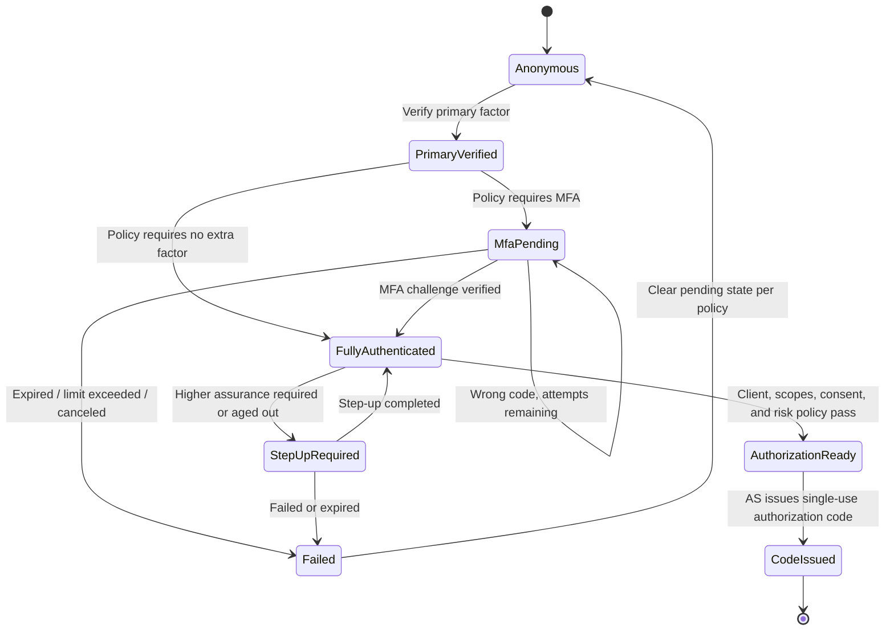

# Integrating MFA and Pre-Code Authentication Completion Gates

In an **OAuth 2.0/OpenID Connect (OIDC) Authorization Server**, a user may be required to complete multiple authentication steps before the application is issued an **authorization code**. For instance, after successfully entering a password, the user must also verify via TOTP, a passkey/WebAuthn, or another second factor per policy. Signing in with the first factor only proves **part of the authentication requirement**; if the system issues an authorization code immediately at that point, the OAuth2 Client can exchange the code for tokens even though the user never completed MFA.

This lesson belongs to the **User Authentication** chapter of the **SPRING_SECURITY_OAUTH2_OIDC_AUTHORIZATION_SERVER** module and explains how to design, configure, secure, test, and operate MFA gates when using **Spring Security and Spring Authorization Server in Spring Boot**. The content focuses on distinguishing user authentication, client authentication, consent, and authorization code issuance; modeling multi-step authentication state; placing enforcement gates at the right seam; connecting with OIDC; and testing potential MFA bypass paths.

> **Guiding principle:** The Authorization Server issues a code only once **all active user authentication requirements** are satisfied, alongside required client, request, and consent checks. Never rely on `Authentication.isAuthenticated() == true` or the mere presence of a session cookie to infer that MFA is complete.

## 1. What Is MFA in an OAuth 2.0/OIDC Flow?

**Multi-Factor Authentication (MFA)** requires verification using independent factors from distinct categories, typically:

| Factor Category | Examples | What to Understand |
|---|---|---|
| **Knowledge – something the user knows** | Password, independent PIN | Two passwords or PINs do not automatically constitute two distinct factor categories |
| **Possession – something the user has** | Security key, authenticator app with TOTP, device holding a cryptographic key | Must prove genuine possession; codes can still be phished or intercepted |
| **Inherence – something the user is** | Biometrics verified through an appropriate mechanism | Must evaluate authentication architecture; raw biometric data should never be sent arbitrarily to the AS |

MFA **is not the same as two login screens**. If the first form asks for a password and the second asks a security question, both steps still rely largely on the same knowledge category. Some mechanisms can satisfy multiple factors in a **single interaction**, such as an authenticator holding a hardware-bound key unlocked by user verification. However, **never assume every passkey automatically satisfies every MFA policy**: you must evaluate the authenticator type, user verification result, credential source, and assurance level defined by your system.

### 1.1. Who Does the Authorization Server Authenticate?

In the Authorization Code flow:

- **The user (resource owner)** signs in at the Authorization Server/OpenID Provider (OP), potentially requiring MFA.
- **The OAuth2 Client / OIDC Relying Party** initiates the authorization request and receives the authorization code via redirect.
- **The Authorization Server** validates the client, redirect URI, scopes, authentication policy, and consent before issuing a code.
- **The Resource Server** verifies the access token and API permissions; it does not replace user authentication at the AS.

**Client authentication** using `client_secret_basic`, `client_secret_post`, mTLS, or `private_key_jwt` only proves the **application's** identity at the corresponding endpoint. It does not prove the user completed MFA. Similarly, **PKCE** protects the authorization code exchange and does not serve as a second authentication factor.

### 1.2. When Does a Flow Have No User MFA?

The `client_credentials` grant operates under the client's identity and **does not involve a resource owner login** under the standard flow. Therefore, never impose a user TOTP prompt on a `client_credentials` token request. If strong authentication is needed for machine clients, apply an appropriate client authentication policy instead of conflating it with user MFA.

Refreshing tokens or exchanging an authorization code for tokens also normally occurs over the **back channel**. In the Authorization Code flow, user factors must be resolved **before issuing the code**; do not wait until the token endpoint to ask a browser for an OTP. For refresh tokens, establish a dedicated policy governing authentication assurance lifetimes and when re-interaction is required.

## 2. Completion Conditions Before Issuing an Authorization Code

An authorization request should only advance to code issuance when all relevant conditions hold:

| Condition | Responsible Party | Verification Examples |
|---|---|---|
| **Valid request and client** | Authorization Server | `client_id` exists, `redirect_uri` is registered, response type/grant/scopes are allowed |
| **User has been identified** | User authentication mechanism | Primary factor verifies the right account; never treat client-supplied data as proof of login |
| **MFA completed per policy** | Authentication flow and AS assurance gate | Valid non-reused TOTP, valid WebAuthn assertion, or approved alternative |
| **Evidence is fresh and context-bound** | AS session/assurance policy | Same subject and session, MFA timestamp within window for requested action |
| **No pending interaction requirements** | AS/OP | If re-authentication or step-up is needed, code cannot be issued yet |
| **Consent handled if mandatory** | Authorization Server | User approved the requested scopes per policy |
| **Security policies remain valid** | AS and identity system | Account not disabled; login not blocked by lockout or risk policy |

**Not every flow shares the exact same MFA requirement.** For instance, policy might require MFA on every authorization request, or require higher assurance when a client requests `payments.write`, on risky devices, when the session is too old, or when an RP requests elevated authentication. The non-negotiable rule is: **never issue a code if actual assurance falls short of the level required for that transaction**.

## 3. Multi-Step Authentication State: Designing as a State Machine

A safe model separates first-factor login state from fully completed state:



In practice, login and consent prompts can be ordered in various ways; the diagram expresses **preconditions before issuing a code**, rather than forcing every screen into a rigid sequence. Even if consent was already processed in an earlier step before MFA, the AS must still block code issuance until assurance meets requirements.

### 3.1. Meaning of Each State

| State | What Is Known | What Is **Not Yet** Allowed |
|---|---|---|
| `Anonymous` | No verified principal for authorization | Issuing codes requiring a resource owner |
| `PrimaryVerified` | Primary factor passed; expected identity known | Claiming MFA is complete |
| `MfaPending` | Active MFA challenge bound to login transaction | Issuing codes or establishing a final session if policy requires MFA |
| `FullyAuthenticated` | Evidence satisfies current policy | Automatically bypassing step-up policies for higher-risk transactions |
| `StepUpRequired` | Current session may be valid at a lower level, insufficient for new request | Issuing codes for requests needing higher assurance |
| `AuthorizationReady` | All required authorization conditions hold | Granting permissions beyond client/scope/consent |

A critical mistake occurs when, right after a valid password, code calls `SecurityContextHolder.getContext().setAuthentication(...)` with an already `authenticated=true` `UsernamePasswordAuthenticationToken` and merely redirects to an MFA page as an **optional UI step**. If the authorization endpoint only checks for an "authenticated" session, a user can call `/oauth2/authorize` directly to skip the MFA screen entirely.

**Two strategies that can be combined:**

1. **Keep authentication state incomplete:** after the first factor, store a server-side `MfaPending` transaction without establishing a final authenticated principal usable by the AS.
2. **Enforce an assurance gate in front of the authorization endpoint:** even if the app holds a lower-assurance session, block code issuance whenever policy requires higher assurance.

Relying solely on `isAuthenticated()` is insufficient because that boolean says nothing about **how authentication happened**, **how recent it is**, or **what assurance level it achieved**.

## 4. Full Flow: Authorization Code + PKCE and MFA

Suppose `https://portal.example.com` is a confidential OAuth2 Client, `https://identity.example.com` is the Authorization Server and OpenID Provider, and `https://api.example.com` is the Resource Server.

```mermaid
sequenceDiagram
    autonumber
    actor U as User
    participant B as Browser
    participant C as Portal (OAuth2 Client/RP)
    participant AS as Identity (Authorization Server/OP)
    participant M as MFA verifier / Evidence store
    participant API as Resource Server

    U->>B: Access feature requiring login
    B->>C: GET /documents
    C-->>B: Redirect authorization request (state, PKCE, nonce)
    B->>AS: GET /oauth2/authorize?... 
    AS-->>B: Login page
    U->>B: Enter primary factor
    B->>AS: POST login over HTTPS
    AS->>AS: Verify primary factor; create MfaPending
    AS-->>B: Redirect to /mfa/challenge
    U->>B: Provide MFA proof
    B->>AS: POST /mfa/verify + CSRF token
    AS->>M: Verify challenge, nonce/expiry, anti-replay
    alt MFA invalid or incomplete
        M-->>AS: Reject
        AS-->>B: Bounded retry / safe error; NO code issued yet
    else MFA valid
        M-->>AS: Evidence bound to subject, session, timestamp, method
        AS->>AS: Mark assurance satisfies policy
        AS->>AS: Re-validate authorization request, consent if needed
        AS-->>B: Redirect to registered URI with code, state
        B->>C: GET callback?code=...&state=...
        C->>AS: POST /oauth2/token (code, code_verifier, client auth)
        AS-->>C: Access token and ID Token if OIDC
        C->>API: GET /documents + Bearer access token
        API-->>C: Resource if token and permissions valid
        C-->>B: Authorized content
    end
```

**The critical checkpoint sits right before the AS issues the authorization code.** The client receives a code only after assurance state is verified and accepted by policy. Afterward, the token endpoint still enforces code validation, PKCE, client authentication, grant permissions, and standard constraints.

### 4.1. Illustrative Authorization Request

```http
GET /oauth2/authorize?response_type=code&client_id=portal-web&redirect_uri=https%3A%2F%2Fportal.example.com%2Flogin%2Foauth2%2Fcode%2Fcompany&scope=openid%20profile%20documents.read&state=STATE_RANDOM&code_challenge=PKCE_CHALLENGE&code_challenge_method=S256&nonce=NONCE_RANDOM HTTP/1.1
Host: identity.example.com
```

`STATE_RANDOM`, `PKCE_CHALLENGE`, and `NONCE_RANDOM` are placeholders; real applications must use cryptographically random values. The AS must validate the client and redirect URI against registration records. **Never trust a client-supplied parameter like `mfa=true`** as proof the user passed MFA.

When MFA is incomplete, the AS directs the user to an MFA interface hosted on the **AS's own trusted origin**. Once verified, the system resumes the securely session-bound authorization transaction and lets the standard flow complete—avoid manually minting codes inside an MFA controller.

## 5. Designing MFA Data and Authentication Evidence

MFA requires richer state than a single boolean in a session. For each transaction, the system should distinguish:

| Data | Purpose | Control |
|---|---|---|
| `subjectId` | Binds MFA to the right user | Never accept a self-declared subject from an MFA request as authoritative |
| `sessionId` or session binding | Prevents borrowing evidence from another session | Tied to server-side session; handle session fixation |
| `challengeId`/nonce | Identifies the pending challenge | Random, short TTL, strictly single-use |
| `method`/factor type | Records which factor was actually verified | Never read from an unverified hidden form field |
| `completedAt`/`mfaTime` | Measures MFA freshness | Server timestamp; compared against step-up policy |
| `assuranceLevel`/internal `acr` | Reflects assurance level per organizational policy | Never elevate merely because a client requested it via a parameter |
| `attemptCount` and retry cap | Defends against brute force or push fatigue | Stored/synchronized server-side with rate limiting |
| `pendingAuthorizationId` | Links to the pending authorization request | Never trust a redirect URI read from a new unverified request |
| `outcome`/audit metadata | Tracks successes, failures, enrollment/recovery | Never log OTPs, seeds, recovery codes, or raw credentials |

### 5.1. MFA Evidence Must Originate from Real Verification

The application must never accept:

```http
POST /mfa/verify HTTP/1.1
Content-Type: application/x-www-form-urlencoded

userId=alice&mfaCompleted=true&assurance=high
```

Browser-submitted `mfaCompleted` and `assurance` parameters are **completely untrusted**. The backend must verify the OTP/WebAuthn assertion or equivalent mechanism and only then generate session/user-bound evidence itself. For TOTP, enforce attempt limits, tight clock-skew tolerance, and replay prevention on accepted codes. For WebAuthn, validate the challenge, origin, RP ID, signature, and required authenticator flags.

### 5.2. TTL, One-Time Challenges, and Anti-Replay

Pending state must expire. Once a challenge is consumed or canceled, disallow reuse. The "verify then mark consumed" step should be **atomic as supported by your storage** so two concurrent requests cannot consume the same challenge.

If the user switches accounts, rotates sessions, logs out, resets their password, or triggers session invalidation, related MFA evidence and pending authorizations must be refreshed/revoked per policy. In multi-node clusters, never keep challenges in node-local memory if requests can route to other nodes.

### 5.3. "Freshly Completed MFA" Differs from "MFA Completed Long Ago"

A session may have passed MFA in the morning yet request permission to transfer funds in the evening. Sensitive policies may require **step-up** or MFA within a shorter freshness window. Therefore:

- Record and evaluate when critical factors were verified, **not just a permanent `mfa=true` flag**.
- Bind evidence to subject, session, factor type, assurance level, and timestamp.
- When policy changes, evaluate actual evidence to decide whether a new challenge is required.
- Never assume a **new access token or refresh token** proves the user just completed MFA.

## 6. Spring Security Integration: Where to Place the Gate

Spring Authorization Server builds atop the Spring Security filter chain. User login typically resides in a `SecurityFilterChain` for form login/identity services, while OAuth2/OIDC endpoints are configured via `OAuth2AuthorizationServerConfigurer` in a higher-precedence chain.

**Common integration risk:** Once the password is valid, Spring Security's form login can establish an authenticated `Authentication`. If MFA is only presented as a post-login redirect page, a fresh request to `/oauth2/authorize` can be processed by the authorization endpoint before the MFA controller finishes.

Apply **one of these proven designs**:

1. **Make MFA part of authentication before producing the final `Authentication`**: the first factor produces an `MfaPending` state rather than issuing a final principal to the AS.
2. **Place an assurance gate before the authorization endpoint processor**: every authorization request must verify server-side MFA evidence before reaching the code-issuing filter.
3. **Combine both approaches** to eliminate blind spots when either login or MFA flows evolve.

A UI route guard or `@PreAuthorize` on an MVC controller **does not automatically protect** OAuth2 endpoints handled by Spring Security filters. Nor should you assume `authorizeHttpRequests(...authenticated())` implies MFA: that rule knows nothing about authentication method or freshness, and filter ordering may place it **after** the authorization endpoint filter.

### 6.1. Authorization Server Configuration Skeleton with an MFA Gate

The example below illustrates **where to attach the gate** in a Spring Authorization Server version using `OAuth2AuthorizationServerConfigurer.authorizationServer()` and `HttpSecurity.with(...)`:

```java
@Bean
@Order(1)
SecurityFilterChain authorizationServerChain(
        HttpSecurity http,
        MfaAuthorizationGateFilter mfaGate) throws Exception {

    OAuth2AuthorizationServerConfigurer authorizationServer =
        OAuth2AuthorizationServerConfigurer.authorizationServer();

    http.securityMatcher(authorizationServer.getEndpointsMatcher())
        .with(authorizationServer, server ->
            server.oidc(Customizer.withDefaults()))
        .authorizeHttpRequests(auth -> auth
            .anyRequest().authenticated())
        .exceptionHandling(ex -> ex
            .defaultAuthenticationEntryPointFor(
                new LoginUrlAuthenticationEntryPoint("/login"),
                new MediaTypeRequestMatcher(MediaType.TEXT_HTML)))
        .addFilterBefore(
            mfaGate, OAuth2AuthorizationEndpointFilter.class);

    return http.build();
}
```

`MfaAuthorizationGateFilter` is a **hypothetical custom class**, not built into Spring Authorization Server. A real application must supply the bean and verify its filter ordering within the **exact chain** handling the authorization endpoint. This is not yet a standalone runnable config: you still need `RegisteredClientRepository`, `JWKSource`/token generators, `AuthorizationServerSettings`/issuer, authorization/consent storage, and the login chain for your version.

**Do not treat this configuration snippet as proof that MFA bypass is blocked.** You must write integration tests sending real HTTP requests through the filter chain, including calling the authorization endpoint directly after passing only the first factor.

### 6.2. Pseudocode for the Pre-Authorization-Endpoint Gate

Logical pattern for a custom `OncePerRequestFilter`:

```java
// PSEUDOCODE: MfaPolicy, AuthorizationTransactionStore, and
// AssuranceEvidenceService are application-implemented services.
protected void doFilterInternal(
        HttpServletRequest request,
        HttpServletResponse response,
        FilterChain chain) throws IOException, ServletException {

    if (!authorizationEndpointMatcher.matches(request)) {
        chain.doFilter(request, response);
        return;
    }

    Authentication user =
        SecurityContextHolder.getContext().getAuthentication();

    // User not signed in yet: let standard login/AS handling run.
    if (user == null || !user.isAuthenticated()) {
        chain.doFilter(request, response);
        return;
    }

    RequiredAssurance required = mfaPolicy.forAuthorizationRequest(request);

    if (!assuranceEvidenceService.isSatisfied(
            user, request.getSession(false), required)) {
        transactionStore.rememberPendingAuthorization(
            request, user, required);
        response.sendRedirect(
            request.getContextPath() + "/mfa/challenge");
        return;
    }

    chain.doFilter(request, response);
}
```

This is **architectural pseudocode**, not verbatim compilable Java; variables, matchers, and services must be implemented. Key points:

- **The gate must sit ahead of any filter capable of issuing codes**, and must cover all configured request variants hitting the authorization endpoint (not just one login page).
- `mfaPolicy.forAuthorizationRequest` must never trust self-asserted parameters like `mfa=true` or `acr=high`; it must consult the registered client, scopes, server policies, and verified request details.
- `isSatisfied` verifies **server-side evidence bound to subject, session, assurance level, and timestamp**. Never merely check a session attribute any controller could set arbitrarily.
- `rememberPendingAuthorization` stores only necessary metadata in a server-side transaction with a TTL and session binding; it never issues codes or redirects to an unvalidated request-supplied URI.
- Once MFA completes, **route the transaction back through the standard authorization handler** so Spring Authorization Server validates the request, consent, and issues the code. Never invoke a custom "mint code" helper from the MFA controller.
- Real code must also handle POST consent requests, CSRF/session interactions, and safe transaction resumption; never blindly replay stale request bodies.

If an `AnonymousAuthenticationToken` exists in the context, its `isAuthenticated()` returns `true`. Therefore, when checking "is a user logged in," **properly detect anonymous principals** using Spring Security's mechanisms rather than relying solely on `isAuthenticated()`; the pseudocode above omits that detail. Likewise, if using an incomplete authentication token that the framework still marks `authenticated`, the gate must inspect **actual assurance** to block code issuance.

### 6.3. Verifying the Second Factor at /mfa/verify

A secure MFA handler must:

1. Accept only a pending challenge bound to a session that completed the primary factor; never trust a `userId` or method submitted in the form.
2. Enforce **CSRF protection** on POST, attempt caps, and challenge expiration.
3. Verify the challenge through a trusted service, prevent replay, and record consumption atomically.
4. When valid, record server-side evidence **bound to subject, session, timestamp, and factor/method**; if using a pending token architecture, promote to the final authenticated principal at the right point.
5. Handle session fixation, update sessions/cookies, and clear the pending challenge.
6. Resume the protected authorization transaction, letting the AS re-validate client, redirect URI, scopes, consent, and active requirements.

**Never set `MFA_DONE=true` in an unsigned/unverified cookie and trust it.** Cookies and request parameters can be tampered with. With distributed storage, evidence records need integrity protection, TTLs, principal/session keys, and cleanup on logout.

## 7. OIDC: `acr`, `amr`, and `auth_time` Express Authentication Level

OIDC defines claims describing the authentication event. They are meaningful **to the Relying Party (RP)**, but do not replace enforcing MFA at the OP.

| Claim | Meaning | Proper Usage |
|---|---|---|
| `auth_time` | When the user was authenticated, as a Unix timestamp | Reflects authentication time per OIDC semantics; required when honoring `max_age` |
| `acr` | Authentication Context Class Reference: agreed assurance context/level | Used by RP to understand assurance level; AS only asserts what was **actually achieved** |
| `amr` | Authentication Methods References: methods used | E.g., `["pwd","otp"]` when backed by real evidence; never fabricate unverified methods |

Example **illustrative payload** of an ID Token:

```json
{
  "iss": "https://identity.example.com",
  "sub": "user-42",
  "aud": "portal-web",
  "iat": 1794850000,
  "exp": 1794850600,
  "auth_time": 1794849900,
  "acr": "urn:example:authn:mfa",
  "amr": ["pwd", "otp"]
}
```

This payload is not a signed JWT. `urn:example:authn:mfa` merely illustrates an **internal assurance class name**; before production, AS and RP must agree on exact mapping rules. Never casually emit standard labels like AAL2 without evaluating the corresponding evidence and mechanisms.

**Important:** The Relying Party must verify signature, issuer, audience, expiration, and nonce where applicable before trusting an ID Token. Putting `amr=["pwd","otp"]` in a token **does not prove the system actually enforced MFA** if the login flow can be bypassed.

### 7.1. `max_age`, `prompt`, and `acr_values`

OIDC parameters commonly tied to authentication strength:

| Parameter | Primary Meaning | Relationship to MFA |
|---|---|---|
| `max_age` | Maximum allowable age since user authentication; OP must honor OIDC re-authentication | Does not equal "MFA must be within N seconds"; combine with dedicated MFA policy |
| `prompt=login` | Requests the OP to re-authenticate the user | Does not itself dictate which MFA factor must be used |
| `prompt=none` | Prohibits user interaction | If new MFA/step-up is needed, return an appropriate OIDC error instead of showing UI |
| `acr_values` | ACR values requested by RP in order of preference | **Not automatically mandatory**; OP handles according to contract/policy |
| `claims` requesting essential `acr` | RP may request a specific claim/context per OIDC | Handle per specification and agreed policy, never blindly trusting input |

When a client sends `acr_values=urn:example:authn:mfa`, the OP must not infer MFA occurred; it is a **request input**, not **authentication proof**. The AS decides whether that ACR value is supported, which factors are required, and whether to reject the request if policy cannot satisfy it.

With `prompt=none`, if the current session is insufficient and MFA interaction is required, the OP must **not show an MFA challenge page**. Depending on cause and OIDC rules, respond with `login_required` or `interaction_required` (or another appropriate code) via a safe authorization error response. When the request carries `state`, preserve and return it as required.

### 7.2. ID Token vs. Access Token

- **ID Token** is for the OIDC RP: attests to the authentication event and may carry `acr`, `amr`, and `auth_time`.
- **Access token** is for the Resource Server: governs API access via issuer, audience, expiry, scopes/permissions, and business policy.

If an API requires high assurance for sensitive operations, design a **verifiable contract with the API** rather than trusting frontend-supplied flags. You can include controlled assurance claims in the access token when appropriate or implement step-up/centralized policy checks; the Resource Server must verify the token and evaluate freshness/policy.

### 7.3. Customizing Claims in Spring Authorization Server

Spring Authorization Server supports customizing JWT claims via `OAuth2TokenCustomizer<JwtEncodingContext>`. Illustrative example, **not a complete implementation**:

```java
@Bean
OAuth2TokenCustomizer<JwtEncodingContext> oidcAssuranceClaims(
        AuthenticationEvidenceReader evidenceReader) {

    return context -> {
        if (!OidcParameterNames.ID_TOKEN.equals(
                context.getTokenType().getValue())) {
            return;
        }

        // Read verified evidence from the auth transaction / session
        // per your design, NEVER from client input claims.
        AuthenticationEvidence evidence = evidenceReader.forContext(context);
        if (evidence == null) {
            return; // Do not claim MFA occurred.
        }

        context.getClaims().claim("acr", evidence.acr());
        context.getClaims().claim("amr", evidence.amr());
        context.getClaims().claim(
            "auth_time", evidence.authTime().getEpochSecond());
    };
}
```

`AuthenticationEvidenceReader`, `AuthenticationEvidence`, and `forContext` are **application-defined components**. This snippet only shows the **customization hook** and claim mapping intent. In practice, ensure the evidence is still valid and bound to the right authorization/subject—including during token re-issuance or requests lacking a browser session. OIDC requires accurate `auth_time` handling whenever `max_age` is used; missing evidence is never an excuse to skip mandatory flow requirements.

Never hardcode `acr=high` or `amr=["pwd","otp"]` on every ID Token just to "pass MFA compliance." Claims must reflect **authentication reality**, not desired state.

## 8. Mandatory MFA, Risk-Based MFA, and Step-Up

| Policy | When Triggered | Example |
|---|---|---|
| **Mandatory per-session MFA** | Every login session must complete MFA prior to authorization | Sensitive internal portal |
| **Client/scope-based MFA** | Specific clients or requested permissions demand high assurance | `payments.write` requires second-factor verification |
| **Risk-based MFA** | Risk context: unknown device, anomalous location, login IP/context, suspicious behavior | Require extra factor when risk rises |
| **In-session step-up** | User already signed in at a lower tier, but new request needs higher assurance | Reading documents first, then signing a transaction |
| **Time-based re-authentication** | Elapsed time since authentication/MFA evidence exceeds threshold | Require fresh verification before high-impact action |

Policies should be determined by **server-side policy** checking registered client, scopes, risk signals, and existing evidence. Never allow clients to downgrade MFA requirements with parameters like `mfa=false` or self-assert achieved `acr`.

### 8.1. Example: One User, Two Clients

Suppose a user authenticated with password + TOTP when signing into portal A. Later they open portal B, which requires phishing-resistant WebAuthn and MFA verified within the last 5 minutes.

The OP's SSO session suffices for portal A, yet **may not suffice for portal B**. The OP must compare actual assurance and freshness against portal B's policy; if insufficient, require step-up before issuing an authorization code for B. Once step-up finishes, the OP issues an ID Token reflecting the fresh elevated evidence.

**Having an SSO session** does not imply every client receives the same assurance level by default.

### 8.2. Refresh Tokens and MFA Validity Windows

A refresh token issued after MFA can outlive the second factor's freshness window. When a client uses a refresh token to obtain a new access token, **that is not an event where the user just entered an OTP**. If an app or API requires fresh assurance, policy can require interactive authorization/step-up or restrict granted permissions once expired.

Never set `auth_time=now` on every refresh token use or access token mint. `auth_time` describes the user authentication event, not token issuance time.

## 9. Common MFA Methods and Secure Integration

### 9.1. TOTP per RFC 6238

TOTP relies on a user-enrolled shared secret and time:

- During enrollment, generate a strong server-side secret over a protected channel; require verifying an initial code before activating the factor.
- During verification, validate against server time with a tightly bounded clock-drift window.
- Rate-limit attempts by account, challenge, session, and request source to prevent brute-forcing short codes.
- Prevent accepting the same valid code/challenge repeatedly when one-time use is required.
- Protect stored TOTP seeds with access controls and recovery workflows; never write seeds or OTPs to logs, analytics, or events.
- Account for phishing: users can be tricked into entering TOTP codes on fake sites. TOTP **is not phishing-resistant MFA**.

Consider two systems both using TOTP, where one accepts the same code multiple times within the window with no attempt limit: despite having "MFA" in the UI, its replay and guessing resistance remain weak.

### 9.2. WebAuthn/FIDO2 and Passkeys

WebAuthn uses asymmetric keys, challenges, RP ID/origin binding, and authenticator flags to verify users in web contexts. When used for MFA/step-up:

- Bind a single-use challenge to the exact subject/session/transaction with a TTL.
- Verify assertion signature, challenge, origin, RP ID hash, and authenticator policies.
- Check user presence/user verification flags and additional attributes per required assurance level.
- Manage credential lifecycle: registration, device naming, deletion/revocation, device replacement, lost authenticators, and backups.
- Never treat a frontend-submitted "WebAuthn success" flag as proof; the backend must verify the cryptographic assertion.

This approach resists phishing far better than OTP codes when implemented properly, though **whether a specific deployment satisfies a given MFA policy depends on the authenticator and applicable standard/evaluation**.

### 9.3. Push Approval, SMS, and Email OTP

- **Push approval:** vulnerable to push fatigue or accidental taps. Use number matching/transaction binding when appropriate, rate-limit prompts, and display clear context.
- **SMS OTP:** depends on telecom networks, carrying SIM swap, porting, phishing, and channel reliability risks; evaluate against organizational regulations and assurance levels.
- **Email OTP:** email accounts can be compromised or share the same device/environment as the first factor; do not automatically treat email OTP as a strong independent factor for every policy.

Select factors based on your **threat model and assurance policy**, not merely integration convenience.

### 9.4. Recovery Codes and Lost Factors

MFA recovery is part of authentication design, because a weak "forgot OTP" flow becomes an **MFA bypass path**. For recovery codes:

1. Generate strong random codes and distribute them over a secure channel during MFA setup.
2. Store hashes only and accept each code **once**.
3. Rate-limit, audit, and notify the user whenever recovery is used or factors change.
4. Apply distinct assurance policies: using a recovery code may require re-enrolling a factor and must not assert the same `acr` as WebAuthn.
5. Require extra verification when changing phone numbers, devices, TOTP seeds, or resetting all factors.

Never allow an "MFA skip" path backed only by an unprotected email while still recording `MFA_SUCCESS`.

## 10. Protecting Sessions, CSRF, and Authorization Transactions

### 10.1. Sessions and Cookies

For browser-facing Spring Boot applications:

```yaml
server:
  servlet:
    session:
      cookie:
        secure: true
        http-only: true
        same-site: lax
```

This is a **baseline suggestion for HTTPS web apps**, not a complete MFA configuration. Adjust `SameSite` if OIDC uses different response modes (such as `form_post`), cross-site callbacks, iframes, or special interactive flows. Enable CSRF protection on state-changing actions, especially `POST /mfa/verify`, factor enrollment/removal, and consent.

After successful login/MFA, handle **session fixation** and ensure pending evidence cannot be used in a new session without a trusted link. On logout or session expiration, clear pending state and MFA evidence per policy.

### 10.2. CSRF and Browser Redirects

Clients send `state` in authorization requests to bind callbacks to client transactions. Yet **`state` does not replace CSRF protection on the AS's login/MFA forms**.

Additionally:

- Never redirect to a `redirect_uri` taken from an MFA form's query string; only the AS, after validating registration, may emit the authorization response.
- Never put OTPs, seeds, credentials, session secrets, or private raw challenge data in URLs.
- Store the authorization transaction server-side bound to the session/challenge; avoid open redirects or unauthenticated CSRF-less POST replays.
- On MFA errors, display only safe messages; never echo passwords, OTPs, or system internals.
- Enforce HTTPS/TLS; set a strict `Referrer-Policy` and minimize analytics/trackers on login/MFA pages.

### 10.3. Pending MFA Across Multiple AS Instances

If the AS runs multiple nodes, store sessions, challenges, and evidence in shared storage or use strict sticky sessions with failover handling. Completing the primary factor on node A and submitting an OTP to node B must never produce ambiguous state.

Pay attention to atomic challenge consumption and retry caps. When policies or MFA enrollments change, all nodes must observe updates promptly so revoked factors are never accepted.

## 11. Handling Errors When MFA Is Incomplete

### 11.1. Distinguishing User Authentication Errors from OAuth Errors

| Situation | Appropriate Handling |
|---|---|
| Wrong password | At login step, reject safely without creating a final authenticated session |
| Wrong OTP/WebAuthn assertion | At MFA step, reject/allow bounded retry; **do not issue code** |
| Challenge expired | Cancel pending transaction or issue fresh challenge per policy; never issue old code |
| User cancels MFA in interactive flow | Terminate/cancel transaction; authorization endpoint returns protocol error response if possible |
| Client has invalid redirect URI | Never redirect results to an unregistered/untrusted URI |
| OIDC `prompt=none` when MFA needed | Return appropriate OIDC error via safe authorization response, **no UI shown** |
| Invalid client authentication at token endpoint | OAuth `invalid_client` error; never redirect to user MFA page |
| Missing/expired API access token | Resource Server returns appropriate Bearer error; never fix by setting AS MFA session |

Not every OTP mistake maps to OAuth `access_denied`. While the user is on the MFA page, the system can display an invalid-OTP message to allow retrying **without terminating the authorization transaction**. Only if the transaction is canceled and a valid redirect URI exists should the AS emit an authorization error response. Turning every MFA error into an HTTP 500 or raw OAuth JSON on a login form breaks UX and testing.

### 11.2. Preventing Information Disclosure and Guessing Attacks

Avoid overly specific messages like "code is correct but account is locked at step 4," disallow unlimited brute-force retries, never log raw OTPs, and avoid observable timing differences across non-existent accounts if doing so leaks sensitive info. Apply rate limiting, controlled lockouts, telemetry, and attack alerts—designed carefully to prevent trivial account-lockout DoS.

## 12. Example Use Case: Step-Up for Sensitive Transactions

Suppose `portal-web` defines two permission groups:

- `documents.read`: policy permits an authenticated session at standard assurance.
- `payments.approve`: policy requires WebAuthn or MFA meeting a defined assurance level verified within the last 5 minutes.

**Scenario A — user freshly authenticated with password only:** Client requests `documents.read` and the AS evaluates policy. If policy permits, the AS issues a code; if system policy mandates MFA for every session, MFA is still required first. When the client requests `payments.approve`, the AS triggers step-up and **refuses to issue a code for the sensitive scope before requirements are met**.

**Scenario B — user passed MFA earlier, now stale:** The session may still be valid for routine operations, yet MFA evidence has aged out. The AS prompts for fresh verification per policy for `payments.approve`.

**Scenario C — client requests high `acr_values`:** The AS only asserts an elevated assurance outcome when matching evidence exists; if unsupported, handle per OIDC contract and policy. Never elevate `acr` just because a request parameter asked for `"high"`.

**Scenario D — token refreshed after 30 minutes:** Never treat a refresh token grant as a fresh MFA event. The Resource Server must check assurance/freshness per API contract if the operation demands high assurance.

These scenarios yield a clear design rule: **"MFA complete" is always relative to an assurance level and a point in time**, never a blanket flag valid forever across all scopes and clients.

## 13. Integration Testing: Proving Early Code Issuance Is Impossible

This is the most critical section when implementing in practice. Unit testing a TOTP verification function is not enough. You need **integration tests exercising the real SecurityFilterChain and authorization endpoint** to prove a code is issued only when policy is satisfied.

### 13.1. Test Matrix

| Scenario | Mandatory Outcome |
|---|---|
| Unauthenticated, valid client request | Goes through login; **no authorization code yet** |
| Right password, MFA pending | No redirect to client with `code`; authorization endpoint blocks/routes to MFA |
| Direct call to `/oauth2/authorize` after first factor | Still blocked; cannot bypass via direct URL |
| Valid MFA and policy satisfied | AS may proceed to consent if needed; code issued only after all conditions pass |
| Invalid MFA | No code issued; attempt counter incremented safely |
| Expired MFA challenge | No code issued; must create new challenge or re-authenticate |
| Reusing an already-consumed OTP/challenge | Rejected per anti-replay policy |
| MFA for user A, authorization for user B | A's evidence cannot authorize code issuance for B |
| Expired/logged-out session | Old pending MFA and evidence cannot complete the transaction |
| Two concurrent verify requests on one challenge | Only one succeeds; no unintended duplicate grants |
| Incomplete consent | Even after MFA passes, no code issued while consent is required |
| Invalid client/redirect URI | Never redirects codes or errors to untrusted URIs |
| `prompt=none` when MFA needed | Appropriate OIDC authorization error, no interactive UI |
| `max_age` exceeded | Performs OIDC re-authentication before issuing code |
| New scope requiring step-up | Does not issue code for that request until assurance is met |
| Refresh token used when MFA is stale | Does not mark "MFA freshly completed"; applies freshness policy |
| `client_credentials` | Does not prompt for user OTP; still validates client/grant/scope |
| ID Token with `acr`/`amr` | Claims reflect actual factors/levels; never overstated when evidence is missing |

### 13.2. Key Test Sketch: Request Before and After MFA

Below is a **fixture-backed test scenario** written in pseudocode since MFA domain types vary per project. The focus is observing the real authorization endpoint without mocking code issuance:

```text
Given:
  - Registered client "portal-web" for authorization_code + PKCE.
  - User "alice" passed the primary factor.
  - Session "S1" holds MfaPending without policy-satisfying evidence.
  - Authorization request includes state and registered redirect URI.

When:
  - GET /oauth2/authorize with S1's cookie.

Then:
  - Response does not contain Location=redirect_uri?code=...
  - User is routed to /mfa/challenge or appropriate blocking response.
  - OAuth2AuthorizationService stores no issued code for this request.

When:
  - POST /mfa/verify with valid challenge, CSRF, and session.
  - Resume the same authorization transaction through the AS flow.

Then:
  - MFA evidence bound to alice/S1 and verification timestamp.
  - After policy/consent checks, AS redirects to trusted redirect URI.
  - Redirect carries single-use code and matching transaction state.
  - Token endpoint still enforces valid code, PKCE, and client authentication.
```

If the application rotates the session ID after MFA for session fixation protection, the test must follow the **post-rotation session binding** rather than rigidly asserting the literal string `S1` stayed unchanged. Likewise, the blocking response does not have to be an HTTP 302 to `/mfa/challenge` if your app uses a different error/UI mechanism; what must be proved is **no code is issued while evidence is missing**.

### 13.3. Testing APIs and Claims

If RPs or Resource Servers rely on `acr`/`amr` for security decisions, test:

1. ID Token after password-only login does not claim `amr=["pwd","otp"]`.
2. ID Token after MFA contains only claims matching actually verified factors.
3. Old/refreshed tokens do not overwrite `auth_time` with the new token mint time.
4. Clients cannot tamper with `acr` via query parameters, headers, or self-asserted claims.
5. Resource Servers accept assurance claims only from trusted access tokens/sources after verifying issuer, audience, signature/expiry, and permissions.

### 13.4. Testing UI and Resilience

Do not test only on sunny-day networks. Verify:

- User opens two tabs with two distinct authorization requests.
- User submits an OTP after challenge expiration or with clock skew.
- Browser reload/back/forward during `MfaPending`.
- Client disconnects mid-verify after the request was already processed server-side.
- WebAuthn/TOTP provider unavailable; app fails safely or uses a policy-approved fallback.
- User modifies or removes an MFA device while another session is pending.
- Multiple AS nodes handle the same session/challenge.

Every failure path must **never issue a code violating policy**, while displaying clear enough guidance for the user to restart a valid transaction.

## 14. Operational Observability and Troubleshooting

A sound MFA implementation must make it easy to see why authorization did not advance without collecting sensitive secrets.

| Metric/Event | Purpose | What to Avoid |
|---|---|---|
| `primary_auth_success` / `failure` | Distinguish password failures from second-factor issues | Logging passwords |
| `mfa_challenge_issued` | Confirm challenges trigger per policy | Exposing raw challenges/OTPs |
| `mfa_verify_success` / `failure` | Track success rates and spot abuse | Logging TOTP seeds or WebAuthn private data |
| `mfa_step_up_required` | Observe why requests triggered higher assurance | Logging sensitive transaction payloads |
| `authorization_code_issued` | Confirm codes issue only post-policy/consent | Logging raw authorization codes |
| `mfa_recovery_used` | Spot fallback usage or takeover risk | Logging recovery codes |
| `challenge_expired/replayed` | Catch timeouts, replays, or clock drift | Dumping full request bodies |

Emit a transaction correlation ID, privacy-compliant subject ID, client ID, policy outcome, and timestamps. **Never store OTPs, TOTP seeds, raw secrets, credentials, authorization codes, access tokens, or refresh tokens** in logs, traces, or error responses. Configure rate limits and alerts on abnormal attempt spikes; distinguish failures caused by missing node affinity, clock drift, or expired caches/evidence.

For TOTP, keep server clocks synchronized. For WebAuthn, monitor challenge/origin/RP ID/attestation errors at an appropriate granularity without capturing biometric data. In multi-node environments, test session stores and revocation/expiration jobs during rolling upgrades.

## 15. Implementation Mistakes That Create MFA Bypasses

| Mistake | Consequence | Prevention |
|---|---|---|
| Valid password creates final authenticated session and merely redirects to MFA page | Users can call authorization endpoint directly to grab a code | Pending state and assurance gate before code issuance |
| Checking MFA only inside a login controller | OAuth2 filter can process authorization outside that controller | Enforce checks across every path leading to code issuance |
| Storing `mfa=true` in an unverified form field or cookie | Forged request marks MFA complete | Server-side evidence bound to user, session, time, and challenge |
| Accepting reused TOTP codes or challenges | Replay and concurrency races | One-time consumption with atomicity |
| No OTP retry limit | Brute-forcing short codes | Rate limiting and proper lockout/attempt caps |
| Allowing weaker recovery while keeping high `acr` | RP trusts overstated assurance | Classify recovery separately and compute accurate assurance |
| Assuming `acr_values=high` means the user completed MFA | Client dictates security claims | Server validates evidence/policy and asserts only actual outcomes |
| Using `Authentication.isAuthenticated()` as the MFA check | Ignores factor, level, and freshness | Dedicated authentication/assurance context model |
| Rendering MFA UI on `prompt=none` | Violates OIDC non-interactive requirement | Return proper OIDC error |
| Treating a new refresh token grant as fresh MFA | Extends assurance session against policy | Track real `auth_time`/`mfaTime` and enforce freshness |
| Testing only UI without testing the filter chain | Misses direct HTTP bypasses | Integration tests before and after MFA |
| Minting codes inside the `/mfa/verify` controller | Bypasses AS client, PKCE, and consent validation | Return to standard authorization flow |

## 16. Pre-Implementation Design Checklist

1. **Define assurance policy:** when is MFA mandatory, which factors satisfy which levels, what is the freshness window, and which scopes/clients require step-up?
2. **Clarify pending/final state:** could completing the first factor accidentally create a final authenticated session usable by the AS?
3. **Gate at the right seam:** is every authorization request protected before Spring Authorization Server can mint a code?
4. **Context-bound evidence:** are subject, session, challenge, timestamp, method, and assurance verified server-side?
5. **Anti-replay/brute-force:** are one-time challenges, rate limits, TTLs, TOTP drift, and WebAuthn checks sufficient?
6. **Consent and client checks:** after MFA succeeds, does the flow still enforce `RegisteredClient` validation, redirect URI, scopes, PKCE/consent, and single-use codes?
7. **Accurate OIDC semantics:** do `acr`, `amr`, and `auth_time` reflect real authentication? Are `prompt=none`, `max_age`, and re-authentication requirements handled?
8. **Recovery and factor changes:** do enrollment, device replacement, lost factors, backup codes, and account recovery share commensurate controls?
9. **Browser/session protection:** HTTPS, secure cookies, CSRF, session fixation, open-redirect prevention, and keeping credentials out of URLs/logs?
10. **Tested against bypasses:** direct `GET /oauth2/authorize` after primary login, multi-tab, session expiry, replay, step-up, multi-node, and refresh tokens?
11. **Operational observability:** structured event classification and anomaly alerts while redacting OTPs/tokens/secrets?
12. **Version compatibility:** verified DSL, security filter ordering, and OIDC/token customization APIs for your exact Spring version?

## 17. Summary

MFA in a Spring Security OAuth2/OIDC Authorization Server is a **condition of user authentication and assurance policy**, not an OTP page tacked onto form login. The Authorization Server may issue an authorization code only once the user achieves the **actual required assurance level** and consent, client, and request validations all pass.

Your design should feature **clear pending state**, **session- and time-bound server-side authentication evidence**, **an enforcement gate ahead of code-issuing components**, and filter-chain tests proving no bypass exists. OIDC allows communicating authentication events via `acr`, `amr`, and `auth_time`, yet those claims must be backed by real evidence; a client requesting a high level never means that level was achieved.

Combining these principles with TLS, PKCE, client authentication, session/CSRF protection, anti-replay, recovery policies, and operational observability enables **Spring Authorization Server** to handle multi-factor login securely and verifiably.

## 18. Authoritative References

- [RFC 6749 — OAuth 2.0 Authorization Framework](https://www.rfc-editor.org/rfc/rfc6749): authorization code, AS/Client roles, and endpoint requirements.
- [RFC 7636 — PKCE](https://www.rfc-editor.org/rfc/rfc7636): protecting the authorization code during token exchange.
- [RFC 9700 — OAuth 2.0 Security Best Current Practice](https://www.rfc-editor.org/rfc/rfc9700): modern OAuth2 security recommendations.
- [OpenID Connect Core 1.0](https://openid.net/specs/openid-connect-core-1_0.html): `acr`, `amr`, `auth_time`, `max_age`, `prompt`, `acr_values`, and ID Token.
- [RFC 6238 — TOTP](https://www.rfc-editor.org/rfc/rfc6238): time-based one-time password algorithm.
- [Web Authentication: WebAuthn](https://www.w3.org/TR/webauthn-3/): assertion/challenge verification, RP ID, origin, and authenticators.
- [NIST SP 800-63B — Authentication and Authenticator Management](https://pages.nist.gov/800-63-4/sp800-63b.html): authenticator management and authentication assurance principles.
- [Spring Security Reference](https://docs.spring.io/spring-security/reference/servlet/authentication/index.html): security filters, authentication, and session security.
- [Spring Authorization Server Reference](https://docs.spring.io/spring-authorization-server/reference/): Authorization Server configuration, OIDC, and token customization.
