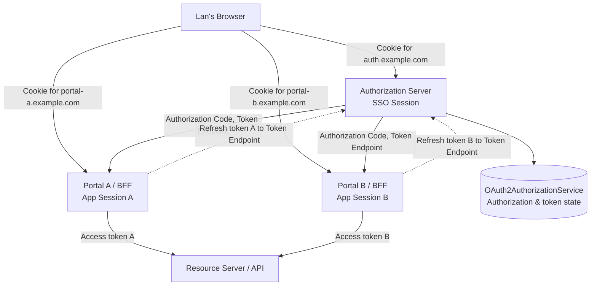
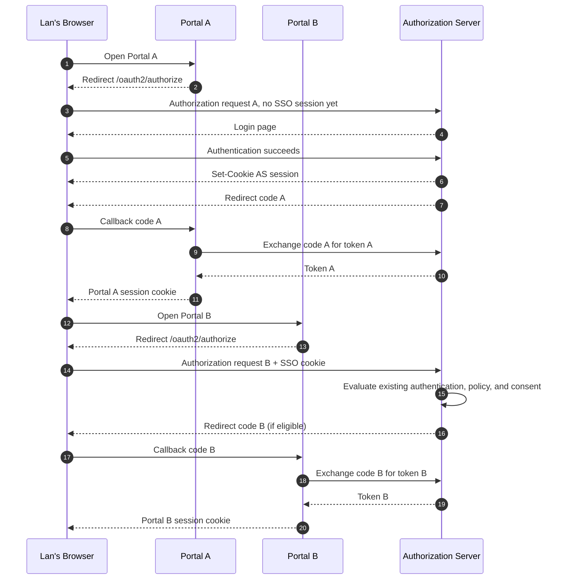
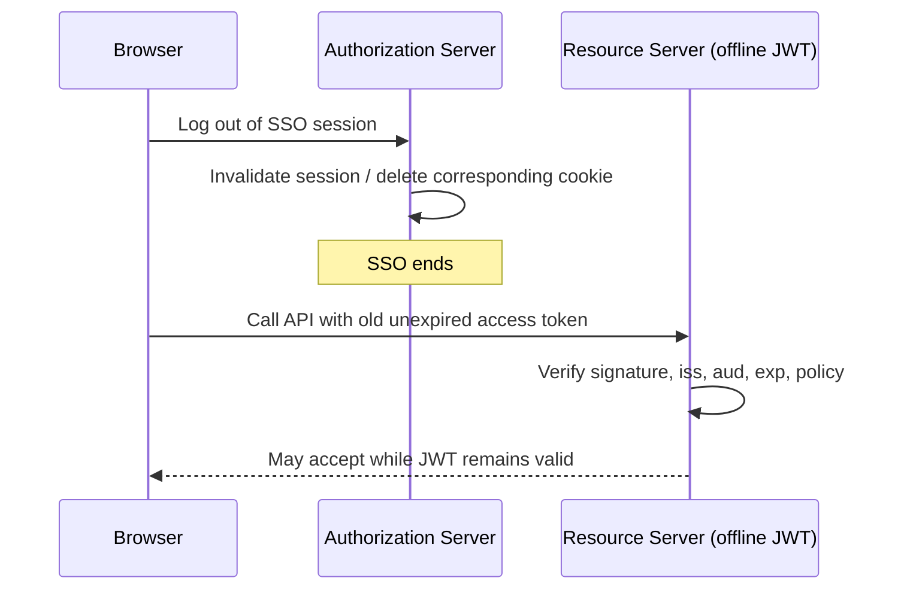
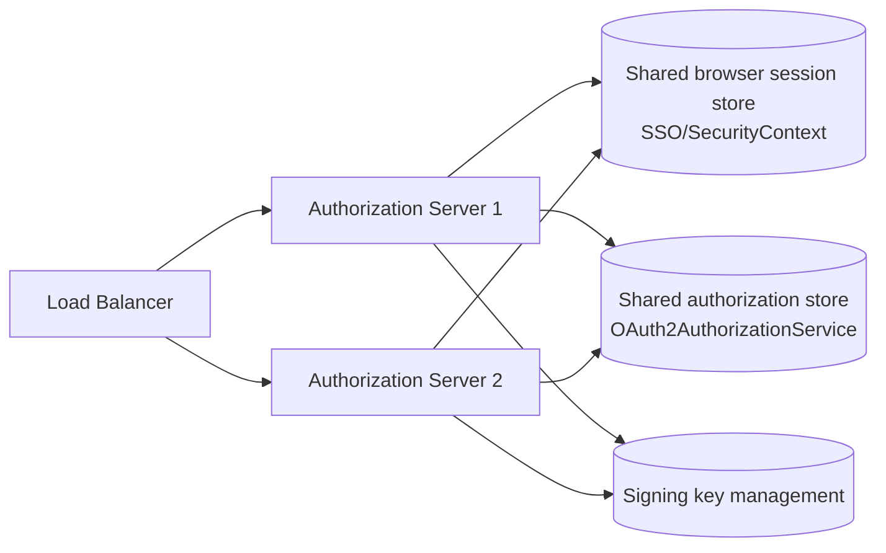

# Distinguishing SSO Login Sessions from Access Token and Refresh Token Lifecycles

## 1. Real-World Puzzle: Logged Out Yet the API Still Accepts the Token?

In an **OAuth 2.0 / OpenID Connect (OIDC)** system, a user can sign in once at the **Authorization Server**, open multiple applications without re-entering their password, and later close the browser or log out of one application. Yet an already-issued access token may still be accepted by an API, and a valid refresh token may keep exchanging for new access tokens. This is not necessarily a bug: **the SSO login session, application session, access token, and refresh token each have separate management mechanisms**.

In the **SPRING_SECURITY_OAUTH2_OIDC_AUTHORIZATION_SERVER** module, we learn how to design, configure, secure, test, and operate an OAuth2/OIDC Authorization Server using **Spring Security**, **Spring Authorization Server**, and **Spring Boot**. This lesson belongs to the **User Authentication** chapter and focuses on the relationship between the **single sign-on (SSO) session** and **token lifecycles**, showing how to design logout, session controls, token revocation, and testing consistently.

A running scenario throughout this lesson:

- User **Lan** opens **Portal A** and is redirected to `https://auth.example.com` to sign in.
- Later, Lan opens **Portal B**, which also uses this Authorization Server. Because the SSO session at the Authorization Server is still valid, Lan may not have to re-enter credentials.
- Portal A and Portal B receive **separate authorizations and tokens** per `client_id`, scopes, and policy.
- Lan clicks **Sign Out** in Portal A. That does not automatically mean Lan has logged out of Portal B, terminated the SSO session at the Authorization Server, or revoked tokens for either application.

### After This Lesson, You Should Be Able To Answer

1. Is the Authorization Server's SSO session cookie the same as Portal A/B's session cookies?
2. Does an expired access token force the user to log in again?
3. Why can a refresh token keep working after the SSO session has expired?
4. How does logging out of an application differ from logging out of the Identity Provider/Authorization Server?
5. When you need "log out of all devices" or to block a leaked JWT, what additional layers must be implemented?

## 2. Distinguishing Four Independent States

| Component | Where Does It Live? | What Is It For? | Typical Expiration / Invalidation Mechanism |
| --- | --- | --- | --- |
| **SSO session at the Authorization Server** | User authentication session at `auth.example.com`, usually tied to a browser cookie and server-side session state | Recognizes the user is already authenticated to process subsequent **authorization requests** without always re-prompting for a password | Session timeout, AS logout, missing/expired cookie, authentication policy change |
| **Application session (RP/client session)** | Portal A, Portal B, or BFF, usually via origin-specific cookies | Maintains login state inside **that application**, mapping to server-side user/token data when needed | Local logout, session timeout, session invalidation |
| **Access token** | Obtained by the Client from the Token Endpoint and sent to the Resource Server | Authorizes API access within its granted lifetime, scopes, audience, and policy | `exp`/TTL, revocation/status check, Resource Server policy, sender-constrained token bounds |
| **Refresh token** | Held by the Client per allowed architecture; state managed by the Authorization Server | Obtains new access tokens via the **Refresh Token grant** without forcing another browser authorization flow | TTL, rotation/invalidation, explicit revocation, client/grant policy, or linked session if explicitly bound |

The **OIDC ID token** is a fifth artifact to understand properly: it conveys facts about a **user authentication event** to the OIDC Client. An ID token does not replace a session cookie, is not an access token for calling APIs, and does not prove the SSO session **is still alive right now** merely because an earlier ID token bears a valid signature.

Boundary diagram:



Dashed lines indicate refresh token requests. In a direct SPA, tokens might be managed in the browser rather than a BFF; the diagram uses a **backend/BFF** to emphasize that browser cookies and OAuth tokens are distinct objects.

### 2.1. Cookies Do Not Automatically Become Access Tokens

Browsers send cookies based on domain, path, and cookie attributes. APIs typically check **Bearer access tokens** (or another system-designed resource mechanism). A cookie like `JSESSIONID` on the Authorization Server **is not** a valid access token for an API, nor is it automatically attached to requests targeting a Resource Server on another origin.

Even identical cookie names like `JSESSIONID` represent **completely different sessions on different hosts**. Never conclude from a cookie name that Portal A, Portal B, and the Authorization Server share one session.

### 2.2. Which Combinations of States Can Coexist?

| SSO Session | Portal A Session | Access Token A | Refresh Token A | Meaning |
| --- | --- | --- | --- | --- |
| Active | Active | Valid | Valid | User is operating normally |
| Active | Logged out | Valid | Valid | Local logout does not automatically revoke issued tokens |
| Expired | Active | Valid | Valid | Application can keep calling APIs and refreshing if policy permits |
| Expired | Expired | Valid | Revoked | Resource Server verifying JWTs offline **may** still accept the access token until it expires |
| Active | Active | Expired | Valid | Can refresh for a new access token without showing a login screen |
| Active | Active | Expired | Expired or revoked | Client needs a new authorization flow; since SSO is still active, a password prompt may be skipped |

This table shows states **possible in a properly configured system**, without claiming every Spring Authorization Server issues refresh tokens to every client by default. In particular, for public SPAs, refresh token issuance is governed by implementation and version-specific policy.

## 3. When Is the AS SSO Session Created and Reused?

SSO is about **reusing a user authentication event** across trusted applications sharing an identity provider (Identity Provider / OpenID Provider). It does not mean every application shares a single session object.

### 3.1. First Login

1. Lan opens Portal A. Portal A sees no application session or requires authentication.
2. Portal A directs the browser to the Authorization Server's **Authorization Endpoint** via the Authorization Code flow, typically with `client_id`, `redirect_uri`, `scope=openid`, `state`, PKCE, and `nonce` as designed.
3. The Authorization Server checks whether the user is already authenticated at **the Authorization Server itself**. If not, Spring Security redirects to the login page.
4. Once authentication succeeds, Spring Security stores the `SecurityContext` in the session; the browser receives the Authorization Server's session cookie.
5. The Authorization Server validates the client, consent, and related policies, issuing an authorization code for Portal A.
6. Portal A exchanges the code at the Token Endpoint, receives tokens, and establishes **application session A**.

### 3.2. Opening a Second Application

When Lan opens Portal B and is redirected to the Authorization Endpoint on the same Authorization Server, the browser sends the **Authorization Server's session cookie** if cookie and browser policies permit. The Authorization Server recognizes Lan already holds a qualifying authentication and **may** complete the authorization request without prompting for a password again.

Even so, the Authorization Server still evaluates **client B** independently: redirect URI, grant, PKCE, scopes, consent requirements, MFA/step-up policies, and other constraints. "Having SSO" **does not** mean "skipping consent" or "handing Portal B the exact same token as Portal A."



Tokens A and B belong to **separate authorizations** and policies. They may share `sub` (same user), while `aud`, scopes, client, expiration, and session metadata differ.

### 3.3. Factors That Can Force Re-Authentication Despite an SSO Cookie

- The SSO session expired due to idle timeout, absolute timeout, or invalidation.
- The identity provider requires a stronger authentication method (MFA/passkey), re-verification for a sensitive action, or a change in assurance level.
- The OIDC request specifies `prompt=login` or `max_age`, enforcing freshness on the authentication; `max_age=0` demands re-authentication in the appropriate context.
- The current session does not satisfy requested `acr_values` or provider policy.
- Client B lacks consent or requests new scopes.
- The browser withholds the SSO cookie due to cookie attributes, browser policies, cross-site tracking prevention, or user cookie clearing.

For `prompt=none`, the OIDC client demands **no interactive UI**. If the Authorization Server cannot authenticate/authorize under current state, it returns an appropriate OIDC error such as `login_required` or `interaction_required` rather than silently prompting the user via UI.

## 4. Application (Relying Party) Sessions Differ from the SSO Session

In OIDC, an application consuming authentication results from an OpenID Provider is called a **Relying Party (RP)**. After verifying the ID token and finishing the OAuth2/OIDC flow, the RP creates **its own cookie/session** to keep the user logged into that application.

For example:

```text
Host                     State
auth.example.com         Authorization Server SSO session (Lan)
portal-a.example.com     Portal A RP session (Lan)
portal-b.example.com     Portal B RP session (Lan)

If Portal A clears its own cookie/HttpSession:
  - RP session A ends;
  - SSO session at auth.example.com may remain active;
  - RP session B may remain active;
  - access/refresh tokens A and B are not automatically deleted/revoked.
```

An RP does not have to use `HttpSession`: it might use an external session store, gateway session, or another architecture. The essence remains: **the RP manages its application session**, the Authorization Server manages authentication at the Identity Provider, and OAuth tokens have their own lifecycle.

### 4.1. Why Can Re-Entering an App After Local Logout Skip the Password Prompt?

After Portal A performs a local logout, Lan opens Portal A again:

1. Portal A sees no RP session and starts a new OIDC authorization request.
2. The browser is redirected to the Authorization Server.
3. The SSO session at the Authorization Server **is still active**, so the server authenticates Lan without showing a login screen.
4. Portal A receives a fresh authorization code and creates a new RP session.

This is SSO working as designed. If a requirement states "logging out must require re-entering a password," determine whether it demands **local logout**, **logout at the OpenID Provider**, **forced re-authentication**, or **global session revocation**; each requires a different implementation.

## 5. Access Tokens Have a Lifecycle Independent of the Browser Session

An **access token** is a credential for accessing a Resource Server. It typically carries constraints:

- `exp` or lifetime derived from `TokenSettings.accessTokenTimeToLive(...)`.
- `iss`, `aud`, scopes/authorities, and other claims depending on token format and policy.
- Revocation/status-lookup support at the Authorization Server, depending on implementation and token type.
- Resource Server enforcement: audience, action, tenant, subject, resource ownership, token format, keys, and revocation policy.

### 5.1. Does an Expired Access Token Force Re-Login?

**Not necessarily.** When an access token expires:

- If the client holds a valid refresh token and is permitted to use it, it can call the Token Endpoint with `grant_type=refresh_token` to receive a new access token.
- Without a refresh token—or if refresh fails—the client can initiate a new **Authorization Code flow**.
- If the Authorization Server's SSO session is still valid, the new flow can complete **without asking for a password** (though consent or step-up may still be prompted).
- Only if the SSO session has also expired does the Authorization Server require re-authentication per policy.

Access token expiration is a **token-level** event, not evidence that the Authorization Server's `SecurityContext` was cleared.

### 5.2. Why Doesn't Logging Out at the Authorization Server Block Existing JWTs?

If a Resource Server verifies JWTs offline, it validates the signature and claims like `iss`, `aud`, `exp`, and `nbf` **without calling the Authorization Server on every request**. Therefore:



**Logging out of a session does not alter a JWT's signature.** If near-instant revocation is required, design **revocation/status checks** at the API layer: short access token TTLs, opaque/reference tokens + introspection, token/session denylists, centralized status checks, or an equivalent mechanism. Introspection/denylist caches also govern enforcement latency. Test actual Resource Server behavior rather than claiming logout "blocked all APIs" solely from deleting a cookie.

### 5.3. How Are Opaque Tokens Different?

Opaque tokens are typically checked by Resource Servers via the **Token Introspection Endpoint**. The Authorization Server uses `OAuth2AuthorizationService` to determine whether the token is still active. Once revoked, introspection returns `active=false`. However, if the Resource Server **caches introspection responses**, the token may still be accepted during the configured cache TTL.

This establishes a concrete operational metric: **the latency from revocation until every Resource Server rejects the token**.

## 6. A Refresh Token Is Not a Packaged SSO Session

Refresh tokens let clients obtain new access tokens without sending the browser to the Authorization Endpoint on every expiration. They are sensitive credentials—typically longer-lived than access tokens—managed by **`OAuth2AuthorizationService`** and **`RegisteredClient`** policies.

### 6.1. Refresh Token Lifecycle

```mermaid
sequenceDiagram
    autonumber
    participant C as Confidential client / BFF
    participant AS as Token Endpoint
    participant R as RegisteredClientRepository
    participant S as OAuth2AuthorizationService
    participant G as OAuth2TokenGenerator
    C->>AS: POST grant_type=refresh_token + client authentication
    AS->>R: Authenticate client, validate grant/policy
    AS->>S: findByToken(refresh_token)
    S-->>AS: Authorization + refresh token state
    AS->>AS: Check validity, client, scopes, and policy
    AS->>G: generate(access token; new refresh token if rotated)
    G-->>AS: New tokens
    AS->>S: save(updated authorization)
    AS-->>C: New access token (+ refresh token if rotated)
```

**Notice there is no browser sending an SSO cookie** in this diagram. The Token Endpoint validates the **refresh token + client authentication (or appropriate client binding) + grant policy**. Thus, **a refresh token can remain operational after the SSO session expires** unless your application adds explicit session binding or revocation workflows.

Conversely, **an active SSO session cannot rescue a revoked refresh token**. The client must start a new authorization flow if policy allows.

### 6.2. Refresh Token Policy in Spring Authorization Server

In `RegisteredClient.TokenSettings`, you can configure TTLs and rotation/reuse policies:

```java
import java.time.Duration;
import org.springframework.security.oauth2.server.authorization.settings.TokenSettings;

TokenSettings tokenSettings = TokenSettings.builder()
        .accessTokenTimeToLive(Duration.ofMinutes(10))
        .refreshTokenTimeToLive(Duration.ofHours(8))
        .reuseRefreshTokens(false)
        .build();
```

This snippet configures **token policy**, not a complete Authorization Server bean. When setting `reuseRefreshTokens(false)`, verify the exact refresh-token issuance and old-token handling behavior of your framework version. **Rotation does not automatically provide replay attack detection, full token-family revocation, or binding to the SSO cookie**; detection and response rules must be verified and added according to your threat model.

For confidential clients, grant `refresh_token` only when needed and backed by strong client authentication. For public clients, enforce PKCE, sender-constraining/rotation, and Authorization Server policies; never assume every Spring Authorization Server issues refresh tokens to SPAs. In Spring Authorization Server 1.5.x's SPA-with-PKCE guide, public clients **are not issued refresh tokens by default**, so a direct SPA architecture must design session renewal accordingly or consider a BFF.

### 6.3. How Dangerous Is a Stolen Refresh Token?

Because a refresh token can mint new access tokens, long lifetimes amplify exposure risk. Mitigations:

- Store server-side in a backend/BFF or secure vault; never place refresh tokens in URLs, logs, telemetry, or third-party scripts.
- Require HTTPS, client authentication, or sender constraints where applicable.
- Bound scopes/TTLs, use rotation, detect reuse/replay per policy, and revoke on suspected compromise.
- Ensure the Token Endpoint verifies authorization and registered client status, rejecting disabled clients.
- Define explicit responses for password changes, account lockouts, sign-out-all-devices, consent revocation, and admin client disablement.

## 7. Spring Security Sessions and OAuth2AuthorizationService Store Different State

A Spring Boot Authorization Server normally maintains **two distinct storage layers** that must not be confused:

| Component | Data Managed | Responsibility |
| --- | --- | --- |
| **Spring Security session / SecurityContextRepository** | `Authentication` and security state of the user's HTTP session at the AS | Identifies the user during **browser interactions** after login |
| **OAuth2AuthorizationService** | Authorization codes, access tokens, refresh tokens, ID tokens, and authorization metadata | Manages state of **OAuth2/OIDC grants and tokens** |
| **OAuth2AuthorizationConsentService** | Recorded consent per client-user pair | Supports deciding whether to re-prompt for permissions |
| **RegisteredClientRepository** | Client ID, grants, scopes, redirect URIs, auth methods, token settings | Supplies client policy for both authorization and token requests |

In session-based Spring Security login, the `SecurityContext` is stored via `HttpSessionSecurityContextRepository` or another configured `SecurityContextRepository`. Depending on application/session config, the HTTP session may live in the servlet container, Spring Session with a shared store, or another backend.

**Note:** having `JdbcOAuth2AuthorizationService` does not give users a shared multi-instance SSO session. If the SSO session sits in process A's memory while the next request lands on process B, you need session clustering, bounded sticky routing, or a shared session store. Likewise, having Spring Session Redis/JDBC does not persist authorization codes and refresh tokens; configure `OAuth2AuthorizationService` separately.



Beyond session and authorization stores, keep **issuer, signing keys/JWKS, consent, and client data** consistent across instances. If each node generates its own signing keys, JWTs and JWKS will diverge even with shared session and authorization stores.

## 8. Three Types of Logout Commonly Lumped Together as "Logout"

### 8.1. Local Logout at the RP

Goal: end **one application's session**.

- The RP clears or invalidates its own session cookie and server-side session.
- With a BFF, decide whether to purge server-side token storage and call the Token Revocation Endpoint.
- Does not automatically end the Authorization Server's SSO session.
- Does not automatically log out other RPs.

Result: the user can revisit the RP and be authenticated again via SSO at the Authorization Server without entering a password.

### 8.2. Logout at the Authorization Server / OpenID Provider

Goal: end the **SSO authentication session** at the OP/AS.

- The browser's authentication session at the AS is invalidated per logout configuration.
- Subsequent authorization requests may require logging in again, subject to other auth mechanisms and policies.
- Does not automatically terminate live RP sessions without a **logout propagation** mechanism.
- Does not automatically revoke issued access/refresh tokens unless the application explicitly implements that policy.

### 8.3. Single Logout (SLO) / Coordinated OIDC Logout

OIDC defines mechanisms for RPs and OPs to coordinate logout:

| Mechanism | Primary Function | What Must Be Designed |
| --- | --- | --- |
| **RP-Initiated Logout** | RP asks OP to end the session, usually by navigating the browser to the end-session endpoint | RP reads endpoint metadata, supplies `id_token_hint`/supported params, valid `post_logout_redirect_uri` |
| **Front-Channel Logout** | OP instructs RPs to log out via the browser, typically using registered URIs | Browsers may block third-party cookies/iframes; sending requests does not guarantee every session closed |
| **Back-Channel Logout** | OP sends a logout token to an RP endpoint over server-to-server HTTP | Verify signature, issuer/audience, logout event, `sid`/`sub`, replay, and RP session mapping |

**Not all of these mechanisms are automatically enabled** simply by adding `spring-boot-starter-oauth2-authorization-server` or calling `oidc(Customizer.withDefaults())`. Verify which endpoints your version/provider supports, advertised metadata, client registration, and RP-side handlers.

### 8.4. What Does "Log Out of All Devices" Mean?

This is a **business requirement going well beyond local logout**. A complete solution maintains an index of sessions and authorizations by user/client/device, plus:

1. Invalidate/close relevant SSO sessions at the Authorization Server.
2. Notify/revoke sessions at RPs/BFFs if back-channel/front-channel logout is supported.
3. Revoke refresh tokens, unused authorization codes, and related authorizations per policy.
4. Address live access tokens at Resource Servers, especially offline-verified JWTs.
5. Measure and record propagation latency across nodes, caches, and APIs when global logout is triggered.

You cannot prove "logged out everywhere" simply by calling `request.getSession().invalidate()` on one request or deleting a single browser cookie.

## 9. Spring Security Configuration Example: Session Logout Does Not Revoke Tokens

### 9.1. At the Authorization Server Itself

Assume the system already configures a dedicated **Authorization Server `SecurityFilterChain`** at `@Order(1)` for OAuth2/OIDC protocol endpoints. A lower-priority application/login chain can configure form login and local session logout as follows:

```java
import org.springframework.context.annotation.Bean;
import org.springframework.core.annotation.Order;
import org.springframework.security.config.Customizer;
import org.springframework.security.config.annotation.web.builders.HttpSecurity;
import org.springframework.security.web.SecurityFilterChain;

@Bean
@Order(2)
SecurityFilterChain userLoginSecurityFilterChain(HttpSecurity http)
        throws Exception {

    http
        .authorizeHttpRequests(auth -> auth
            .requestMatchers("/assets/**").permitAll()
            .anyRequest().authenticated())
        .formLogin(Customizer.withDefaults())
        .logout(logout -> logout
            .logoutUrl("/logout")
            .invalidateHttpSession(true)
            .clearAuthentication(true)
            .deleteCookies("JSESSIONID"));

    return http.build();
}
```

This snippet only demonstrates **session logout for Spring Security form login**. It does not replace the Authorization Server chain, OIDC logout endpoints, persistence, or other beans. Under default CSRF protection, `POST /logout` should be preferred; never expose GET logout for state-changing actions.

**What you must not infer from this snippet:** that `OAuth2AuthorizationService` deleted all refresh tokens, that portals were logged out, or that old JWT access tokens will be rejected by Resource Servers. Those outcomes require additional design.

### 9.2. At an OIDC Client (Relying Party) Application

In a **Spring Boot RP** using `oauth2Login()`, you can use `OidcClientInitiatedLogoutSuccessHandler` for RP-Initiated Logout when the provider supports the endpoint:

```java
import org.springframework.context.annotation.Bean;
import org.springframework.security.config.Customizer;
import org.springframework.security.config.annotation.web.builders.HttpSecurity;
import org.springframework.security.oauth2.client.registration.ClientRegistrationRepository;
import org.springframework.security.oauth2.client.oidc.web.logout.OidcClientInitiatedLogoutSuccessHandler;
import org.springframework.security.web.SecurityFilterChain;

@Bean
SecurityFilterChain rpSecurityFilterChain(
        HttpSecurity http,
        ClientRegistrationRepository registrations) throws Exception {

    OidcClientInitiatedLogoutSuccessHandler logoutHandler =
            new OidcClientInitiatedLogoutSuccessHandler(registrations);
    logoutHandler.setPostLogoutRedirectUri("{baseUrl}/");

    http
        .authorizeHttpRequests(auth -> auth
            .requestMatchers("/").permitAll()
            .anyRequest().authenticated())
        .oauth2Login(Customizer.withDefaults())
        .logout(logout -> logout.logoutSuccessHandler(logoutHandler));

    return http.build();
}
```

This snippet belongs to the **RP application**, not the Authorization Server configuration. It relies on OIDC provider metadata exposing `end_session_endpoint` and an allowed post-logout redirect URI. Verify `post_logout_redirect_uri` registration, ID token storage, logout CSRF protection, and RP session cleanup; this handler does not automatically revoke access/refresh tokens or log out other applications.

## 10. Designing Explicit Session and Token Policies

### 10.1. Do Not Use a Single TTL to Describe the Entire Experience

Suppose product requirements state: "Active users may keep working for 8 hours; locking an account must block new token requests quickly; sensitive APIs must reject old tokens within 30 seconds."

You cannot satisfy this purely with `accessTokenTimeToLive(8h)` or `server.servlet.session.timeout=8h`. Separate the concerns:

| Goal | Layer to Configure/Implement | What to Measure |
| --- | --- | --- |
| Users avoid repeated password prompts | SSO session, idle/absolute timeouts, step-up | SSO remains valid across RPs per policy |
| Apps retain state across requests | RP session / BFF session storage | Session TTL, cookies, logout, and scaling |
| APIs use short-lived credentials | Access token TTL, issuer/audience/scopes | APIs reject expired access tokens |
| Apps can obtain new access tokens | Refresh token grant/rotation and authorization state | Refresh succeeds/fails per policy |
| Account lock stops new token issuance | User status/lifecycle guard at the Authorization Server | All Token/Authorization Endpoint instances reject invalid requests |
| Circulating tokens blocked near-immediately | Introspection/denylist/session-bound checks at APIs | Old tokens rejected by APIs within SLA |

### 10.2. Why Doesn't `server.servlet.session.timeout` Control Token TTL?

`server.servlet.session.timeout` governs HTTP sessions per servlet configuration, without altering expiration times of issued access/refresh tokens. `RegisteredClient.TokenSettings` defines `accessTokenTimeToLive(...)` and `refreshTokenTimeToLive(...)` independently. Each layer also carries separate rules for refresh rotation, step-up, idle timeout, and absolute lifetime.

Example:

```yaml
server:
  servlet:
    session:
      timeout: 30m  # This app's HTTP session, not access-token TTL
```

And token settings registered for **one client**:

```java
TokenSettings tokenSettings = TokenSettings.builder()
        .accessTokenTimeToLive(Duration.ofMinutes(10))
        .refreshTokenTimeToLive(Duration.ofHours(8))
        .reuseRefreshTokens(false)
        .build();
```

Here, an API request carrying a valid access token **does not extend the SSO session**. Likewise, a successful refresh token grant **does not automatically update the user's authentication timestamp** in the SSO session.

### 10.3. Cookies and CSRF

When using session cookies, configure HTTPS, `Secure`, `HttpOnly`, and `SameSite` to fit RP-to-OP navigations, noting that certain OIDC front-channel/silent-login flows are affected by browser third-party cookie blocking. Enforce CSRF protection on cookie-backed state-changing requests. For OAuth Authorization Code flows, validate `state`, PKCE, and `nonce` where applicable for OIDC.

**Never store raw access/refresh tokens in logs, URLs, traces, or unprotected cookies.** With a BFF, keep tokens server-side and issue an `HttpOnly` session cookie to the browser while maintaining XSS/CSRF and API endpoint protections.

## 11. Illustrative Timeline: When Must the User Log In Again?

Suppose a system enforces these policies:

- SSO session idle timeout is 30 minutes per deployment configuration.
- Portal A RP session is 20 minutes.
- Access token A lives for 10 minutes.
- Refresh token A lives for 8 hours and permits refreshes per policy.
- API verifies JWTs offline with no centralized revocation state.

These are **hypothetical numbers for analysis only**, not Spring Authorization Server defaults.

```mermaid
timeline
    title Example Session and Token Timeline
    09:00 : Lan logs in at Authorization Server
          : SSO session and Portal A created
          : Initial Access token A issued
    09:10 : Access token A expires
          : Portal A uses valid refresh token
    09:15 : Lan opens Portal B
          : Can reuse AS SSO session
    09:40 : SSO session expires from idle timeout
          : RP session and tokens may remain active separately
    09:45 : Portal A refreshes if credentials/state remain valid
    10:00 : Lan starts a new authorization flow
          : AS prompts for login if no valid session remains
```

From this timeline:

1. **09:10**, the access token expires, yet no browser re-login is needed because a valid refresh token exists.
2. **09:15**, Portal B gets its own authorization. Reusing SSO never means reusing access token A.
3. **09:40**, SSO session expiration does not immediately invalidate Portal A/B access tokens or valid refresh tokens.
4. **09:45**, refresh can succeed without an SSO cookie unless the Authorization Server explicitly binds refreshes to an active session.
5. **10:00**, a new authorization flow checks user state again; without an active SSO session, a fresh login is required.

**Timestamps in the table depend on actual activity and idle timeouts.** The 09:40 mark assumes no activity kept the idle SSO session alive during the preceding window. In real systems, redirects or requests can refresh session idle timers depending on design.

## 12. Logout Scenarios and Their Impact on Tokens

| Event | AS SSO Session | RP Session | Issued Access Token | Issued Refresh Token |
| --- | --- | --- | --- | --- |
| Local logout at Portal A | Typically unchanged | Portal A ends; Portal B may stay active | May remain valid | May remain valid; revoke if policy requires |
| Logout at AS | Terminated per session/OP policy | Does not auto-close all RPs | Not auto-revoked | Not auto-revoked |
| RP-Initiated Logout | May be ended by OP when handled properly | Initiating RP logged out locally; other RPs depend on SLO | Not auto-revoked | Not auto-revoked |
| Back-Channel Logout to RP | OP session/logout event per context | RP notified to terminate matching session | Depends on token revocation policy | Depends on policy; usually must be handled explicitly |
| Access token expires | Unchanged | Unchanged | Expired; API must reject | May still be valid |
| Refresh token revoked | Unchanged unless extra policy applies | Unchanged unless extra policy applies | Old JWT may stay valid until expiry | Cannot refresh with revoked token |
| User account locked | **Depends on lifecycle enforcement** | Does not auto-close without propagation | Depends on Resource Server checks | Depends on token/authorization revocation and AS policy |
| Admin disables OAuth client | Does not necessarily end user SSO | May require separate policy | Issued JWT may still be accepted by APIs | Token Endpoint must reject per client policy and revoke accordingly |

This table describes **typical behavior without custom extensions**; a product can intentionally couple sessions and tokens under a stricter policy. When writing specifications, state the **exact conditions and effects** of each action instead of overloading the word "logout."

## 13. Integration Testing in Spring Boot

Testing only that form login succeeds is insufficient. Write scenarios involving **two RPs**, real HTTP sessions, protocol-issued tokens, and a Resource Server validating tokens.

### 13.1. Minimum Test Matrix

| Scenario | Steps to Execute | Expected Result |
| --- | --- | --- |
| SSO across two RPs | Log into A, then start authorization for B in same browser | B skips login prompt if AS session and policy allow; B receives its own tokens |
| Local logout A | Log out of A, then open B | B/AS sessions remain per policy; token A is not automatically marked revoked |
| Local logout A then re-login | Reopen A while AS SSO cookie remains | Can sign back into A via SSO without entering password |
| OP logout | Log out at AS, then initiate a new authorization | Prompts for authentication when no valid SSO remains |
| Expired access, valid refresh | Wait/use expired access token fixture, then refresh | Token Endpoint mints new token if refresh is valid and client authorized |
| Expired AS session, valid refresh | Expire AS session, then call refresh from backend | Refresh succeeds per policy without requiring browser cookies |
| Revoked refresh | Revoke refresh token and retry refresh | `invalid_grant` or appropriate endpoint error |
| Offline JWT after logout | Log out of AS/RP, call API with unexpired JWT | Observe real validity; do not assume instant blocking |
| Opaque token introspection | Revoke opaque token and call API | API rejects once introspection/cache policy updates |
| SLO | Trigger RP-Initiated/Back-Channel Logout | Target RP closes matching session per event/`sid`/`sub` after verifying authenticity |
| Multi-instance | Log in on node A, redirect/token on B | Shared session and authorization state or proper routing |
| Browser policy | Test `SameSite`/cookies/third-party blocking | SSO and logout flows work in supported browsers |

### 13.2. Example Test Assertions

The assertions below express **testing intent**, not built-in Spring Authorization Server helper methods:

```text
Given: user logged into AS, Portal A holds an RP session
When:  Portal B starts an authorization request
Then:  if AS session qualifies, user is not prompted for password
And:   B gets its own authorization/tokens, not A's token

Given: Portal A holds an unexpired access JWT and active refresh token
When:  user performs local logout at Portal A
Then:  Portal A RP session ends
And:   refresh/token revocation follows application policy
And:   do not claim the API rejected the JWT if it verifies offline only

Given: AS SSO cookie expired while refresh token remains active
When:  BFF calls Token Endpoint with refresh token + client authentication
Then:  outcome follows grant and token policy, not mechanically coupled
       to an SSO cookie on the backend request
```

### 13.3. Verification Tools and Operational Metrics

- Inspect responses from the Authorization Endpoint (redirects and login), Token Endpoint (grants/scopes/errors), Token Revocation, and Introspection.
- In tests, verify which host owns each session cookie without printing real cookie values into shared logs.
- Track re-login rates, refresh successes/failures, `invalid_grant` errors, logout events, and revocation propagation latency.
- For offline JWTs, measure latency from global lock/logout until APIs reject old tokens—this security metric is independent of AS session state.
- Test races between refresh rotation, logout, and revocation to ensure new tokens are never issued right after a session, account, or client is locked when policy mandates fail-closed behavior.

## 14. Common Misconceptions

| Misconception | Accurate Understanding |
| --- | --- |
| "SSO means all applications share one cookie." | Each RP normally keeps its own session; the Authorization Server keeps its own SSO session. |
| "Logging into Portal B reuses Portal A's access token." | B obtains its own authorization by `client_id` and scopes; SSO only reuses user authentication. |
| "Expired access token requires re-entering password." | Can refresh or run a new authorization flow leveraging the SSO session. |
| "A refresh token is an SSO cookie." | A refresh token is a grant credential checked at the Token Endpoint; an SSO cookie serves browser authentication. |
| "SSO session expiration expires refresh tokens." | Not by default; refresh tokens have their own TTL and revocation policy. |
| "Logging out of one app logs out every RP." | Local logout ends only that app's session unless logout propagation is implemented. |
| "OIDC RP-Initiated Logout revokes all tokens." | OP logout and token revocation are separate operations requiring explicit integration. |
| "Deleting `JSESSIONID` deletes authorization records." | HTTP sessions and `OAuth2AuthorizationService` are separate state stores. |
| "A JWT revoked at the AS is always rejected by APIs." | Resource Servers verifying JWTs offline do not automatically observe revocation state. |
| "Having `JdbcOAuth2AuthorizationService` gives multi-node SSO." | Browser sessions/`SecurityContext` require their own shared storage mechanism. |
| "An unexpired ID token means the SSO session is alive." | An ID token describes an authentication event at a point in time, not a live OP session query. |
| "SSO skips consent, MFA, and step-up." | Any of those policies can still require interactive prompts. |

## 15. Turning Security Requirements into Testable Specifications

Instead of writing "When the user logs out, all access must end immediately," break it into verifiable requirements:

1. **RP logout**: after logout, the RP cookie/session can no longer access protected pages on that RP; if using a BFF, server-side tokens are handled per policy.
2. **SSO logout**: the browser is no longer authenticated at the OP; new authorization flows require login unless another valid session exists.
3. **Refresh revocation**: no refresh token in the target scope can obtain new access tokens; define token families and reuse handling when rotating.
4. **Halt token issuance**: Token/Authorization Endpoints stop issuing tokens for disabled users/clients; measure enforcement delay across all nodes.
5. **Block old access tokens**: Resource Servers reject old tokens within SLA; specify separate mechanisms for opaque tokens, offline JWTs, caches, and session-bound checks.
6. **Log out other RPs**: notify RPs via the chosen OIDC logout mechanism, verifying events and terminating matching sessions.
7. **Telemetry and traceability**: audit who requested logout/revocation, scope, execution timestamps, and incomplete steps without recording secrets or tokens.

Once requirements are framed this way, teams can pick the exact Spring Security, Spring Authorization Server, Spring Session, Token Revocation, Introspection, and OIDC Logout building blocks to implement, test, and operate.

## 16. References

- [OpenID Connect Core 1.0](https://openid.net/specs/openid-connect-core-1_0.html): OIDC authentication, ID tokens, `prompt`, `max_age`, `auth_time`, and authorization parameters.
- [OpenID Connect RP-Initiated Logout 1.0](https://openid.net/specs/openid-connect-rpinitiated-1_0.html): RP requesting logout at the OP.
- [OpenID Connect Front-Channel Logout 1.0](https://openid.net/specs/openid-connect-frontchannel-1_0.html): browser-based logout propagation.
- [OpenID Connect Back-Channel Logout 1.0](https://openid.net/specs/openid-connect-backchannel-1_0.html): logout tokens and server-to-server logout notifications.
- [Spring Security — Session Management](https://docs.spring.io/spring-security/reference/servlet/authentication/session-management.html): `SecurityContext` and HTTP sessions.
- [Spring Security — Logout](https://docs.spring.io/spring-security/reference/servlet/authentication/logout.html): local logout, `SecurityContext`, and session invalidation.
- [Spring Security — OAuth2 Login](https://docs.spring.io/spring-security/reference/servlet/oauth2/login/index.html): OIDC/OAuth2 Client applications signing in through a provider.
- [Spring Authorization Server — Core Model Components](https://docs.spring.io/spring-authorization-server/reference/core-model-components.html): `OAuth2AuthorizationService`, `RegisteredClient`, tokens, and consent.
- [Spring Authorization Server — Protocol Endpoints](https://docs.spring.io/spring-authorization-server/reference/protocol-endpoints.html): OAuth2/OIDC authorization, token, introspection, revocation, and logout endpoints.
- [Spring Authorization Server — SPA Authentication with PKCE](https://docs.spring.io/spring-authorization-server/reference/guides/how-to-pkce.html): behavior for public SPAs and refresh tokens.
- [RFC 6749 — OAuth 2.0](https://www.rfc-editor.org/rfc/rfc6749): authorization code, access token, and refresh token grants.
- [RFC 7009 — Token Revocation](https://www.rfc-editor.org/rfc/rfc7009) and [RFC 7662 — Token Introspection](https://www.rfc-editor.org/rfc/rfc7662): revoking and introspecting token status.
- [RFC 9700 — OAuth 2.0 Security Best Current Practice](https://www.rfc-editor.org/rfc/rfc9700): protecting refresh tokens, PKCE, and modern OAuth2 security requirements.

**Core takeaway:** **SSO** lets clients reuse user authentication at the Authorization Server; **RP sessions** maintain login within each application; **access tokens** grant time-bounded API access; and **refresh tokens** obtain new tokens per grant and policy. They interact, yet **do not automatically live or die together**. When designing a Spring Security OAuth2/OIDC Authorization Server, specify explicitly where each session and token type is created, renewed, invalidated, and verified—and validate it with tests reflecting the real system.
