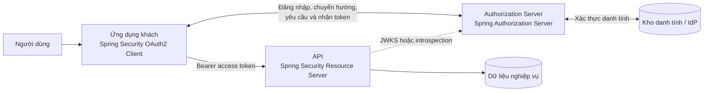
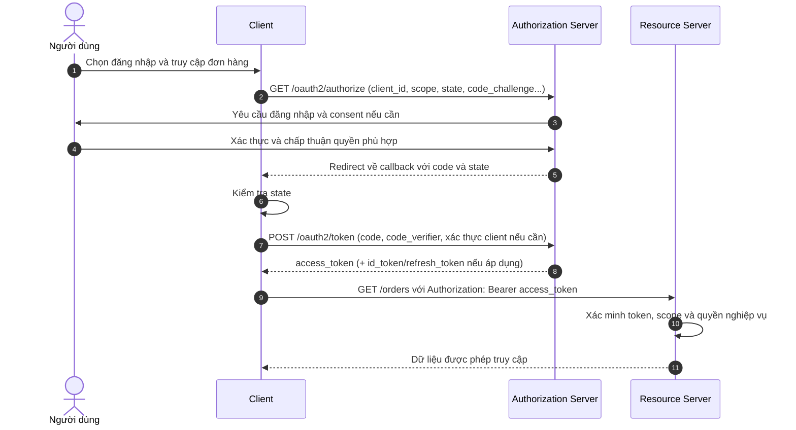

# Vai trò của Authorization Server trong hệ sinh thái Spring Security

## 1. Tại sao cần Authorization Server?

Giả sử một hệ thống có ứng dụng web quản lý đơn hàng, ứng dụng di động cho nhân viên và API quản lý đơn hàng. Cả hai ứng dụng đều cần gọi API thay mặt người dùng, nhưng API không nên yêu cầu từng ứng dụng chuyển tiếp tên đăng nhập và mật khẩu của người dùng trong mỗi yêu cầu. Hệ thống cũng cần biết **ứng dụng nào được phép truy cập, được làm gì, trong bao lâu và nhân danh ai**.

**Authorization Server (máy chủ ủy quyền)** là thành phần trung tâm xử lý bài toán này theo OAuth 2.0. Nó xác thực và đánh giá yêu cầu cấp quyền, rồi phát hành các token phù hợp để ứng dụng khách (client) truy cập tài nguyên được bảo vệ. Với OpenID Connect (OIDC), Authorization Server còn đóng vai trò **OpenID Provider**, cung cấp thông tin xác thực danh tính cho ứng dụng.

Trong hệ sinh thái Spring:

- **Spring Security** cung cấp nền tảng xác thực, phân quyền, bộ lọc bảo mật và các hỗ trợ OAuth 2.0/OIDC.
- **Spring Authorization Server** cung cấp các khả năng cần thiết để **xây dựng một Authorization Server** dựa trên Spring Security.
- **Spring Security OAuth2 Client** giúp ứng dụng đăng nhập qua OIDC/OAuth 2.0, thực hiện luồng ủy quyền và sử dụng token.
- **Spring Security OAuth2 Resource Server** bảo vệ API bằng cách xác minh token và áp dụng quy tắc truy cập.

Điểm cốt lõi: Authorization Server **quyết định việc phát hành token**; Resource Server **quyết định việc cho phép một yêu cầu cụ thể tới tài nguyên**. Hai quyết định liên quan nhau nhưng không thay thế nhau.

### Kết quả cần nắm sau bài học

1. Phân biệt Authorization Server, OAuth2 Client, Resource Server và dịch vụ xác thực người dùng.
2. Giải thích được luồng Authorization Code với PKCE, vai trò của access token, refresh token và ID token.
3. Xác định được thành phần cần cấu hình trong ứng dụng Spring Boot và các ranh giới tin cậy giữa chúng.
4. Nhận diện rủi ro bảo mật, yêu cầu vận hành và các kiểm thử tối thiểu trước khi triển khai thực tế.

## 2. Các vai trò trong OAuth 2.0/OIDC

| Vai trò | Trách nhiệm | Ví dụ trong hệ thống đơn hàng |
| --- | --- | --- |
| **Resource Owner** (chủ sở hữu tài nguyên) | Chủ thể có quyền cấp hoặc từ chối quyền truy cập tài nguyên; trong luồng có người dùng, thường là người dùng | Nhân viên sở hữu quyền xem đơn hàng được phân công |
| **Client** (ứng dụng khách) | Yêu cầu cấp quyền, nhận token và gọi API; có thể là ứng dụng web, di động hoặc dịch vụ backend | Web quản lý đơn hàng hoặc ứng dụng di động |
| **Authorization Server** | Xác thực yêu cầu ủy quyền và client theo luồng áp dụng, kiểm tra chính sách, phát hành token | `https://auth.example.com` |
| **Resource Server** | Nhận yêu cầu kèm access token, xác minh token và thực thi kiểm soát truy cập | `https://api.example.com` |
| **Hệ thống định danh** | Lưu hoặc xác minh danh tính, mật khẩu, MFA, tài khoản, nhóm; có thể nằm cùng hoặc được liên kết với Authorization Server | Cơ sở dữ liệu người dùng, LDAP hoặc nhà cung cấp danh tính bên ngoài |

Không phải mọi luồng đều có người dùng trực tiếp. Chẳng hạn `client_credentials` được dùng cho giao tiếp dịch vụ với dịch vụ: Authorization Server xác thực **client** và phát hành token đại diện cho quyền của client, không nhất thiết có phiên đăng nhập người dùng.

Authorization Server, Client và Resource Server là **vai trò giao thức**, không bắt buộc là ba máy chủ vật lý khác nhau. Trong ứng dụng nhỏ, các vai trò có thể cùng triển khai; khi mở rộng, thường tách Authorization Server để nhiều ứng dụng và API cùng tin cậy một nơi phát hành token.

## 3. Authorization Server nằm ở đâu trong kiến trúc Spring?



Sơ đồ minh họa hai mặt khác nhau của hệ thống:

**Mặt cấp quyền (authorization plane).** Client giao tiếp với Authorization Server để yêu cầu quyền truy cập. Authorization Server xử lý yêu cầu, kiểm tra chính sách đối với client và người dùng, rồi cấp token.

**Mặt truy cập tài nguyên (resource plane).** Client dùng access token để gọi API. Resource Server xác minh token và kiểm tra quyền đối với endpoint, thao tác, bản ghi dữ liệu cụ thể. Với JWT, Resource Server thường lấy và lưu đệm khóa công khai qua JWKS rồi tự xác minh chữ ký; với opaque token, nó thường gọi endpoint introspection để kiểm tra trạng thái token.

Ví dụ, token có scope `orders.read` không đồng nghĩa người dùng được xem **mọi** đơn hàng. Resource Server vẫn phải thực thi quy tắc nghiệp vụ, chẳng hạn chỉ được xem đơn hàng thuộc chi nhánh hoặc tổ chức của người dùng.

### Authorization Server không tự động cung cấp mọi chức năng IAM

Spring Authorization Server hỗ trợ giao thức cấp quyền; khi tự vận hành, đội phát triển vẫn cần thiết kế hoặc tích hợp đăng nhập, quản lý người dùng, xác thực đa yếu tố, khôi phục tài khoản, quản trị client, chính sách bảo mật, lưu trữ và giám sát. Đừng nhầm việc bật các endpoint OAuth 2.0 với việc đã có một sản phẩm quản trị danh tính hoàn chỉnh.

## 4. Một lượt cấp quyền diễn ra thế nào?

Với ứng dụng cho người dùng đăng nhập, **Authorization Code kết hợp PKCE** là luồng nền tảng. PKCE giúp giảm rủi ro kẻ khác đánh cắp authorization code rồi đổi lấy token. Client tạo `code_verifier` bí mật cho từng yêu cầu và gửi `code_challenge` dẫn xuất từ giá trị đó trong bước chuyển hướng ban đầu.



Diễn giải những điểm dễ nhầm:

1. **`/oauth2/authorize`** là điểm vào của yêu cầu cấp quyền qua trình duyệt. Authorization Server có thể chuyển người dùng tới màn hình đăng nhập và màn hình chấp thuận (consent) tùy chính sách.
2. **Authorization code** là mã ngắn hạn, dùng một lần để client đổi lấy token tại `/oauth2/token`. Nó không phải access token để gọi API.
3. **`state`** do client tạo và kiểm tra để ràng buộc yêu cầu ban đầu với phản hồi chuyển hướng, chống nhầm lẫn yêu cầu và các dạng tấn công CSRF. **`code_verifier`** được kiểm chứng tại token endpoint để thực thi PKCE.
4. Với **OIDC**, client yêu cầu scope `openid`; có thể dùng `nonce` và phải kiểm tra các điều kiện hợp lệ của ID token. `nonce` giúp ràng buộc phản hồi định danh với yêu cầu ban đầu.
5. **Confidential client** (ví dụ backend/BFF giữ được bí mật) phải xác thực tại token endpoint theo phương thức đã đăng ký. **Public client** (ví dụ SPA hoặc ứng dụng di động) không thể giữ client secret an toàn, nên không được coi client secret nhúng trong ứng dụng là chứng thực đáng tin cậy.
6. **Refresh token** chỉ được cấp khi loại client, grant type và chính sách máy chủ cho phép. Không nên giả định mọi lần trao đổi code đều nhận refresh token.

Ví dụ một phản hồi token có thể có dạng:

```json
{
  "access_token": "<access-token>",
  "token_type": "Bearer",
  "expires_in": 900,
  "scope": "orders.read",
  "id_token": "<id-token-if-oidc>",
  "refresh_token": "<refresh-token-if-issued>"
}
```

Các trường `id_token` và `refresh_token` trong ví dụ **không phải lúc nào cũng xuất hiện**. `expires_in` là thời hạn minh họa, không phải mặc định áp dụng cho mọi hệ thống.

### Luồng dịch vụ với dịch vụ

Khi một dịch vụ xử lý báo cáo tự động cần đọc API mà không có người dùng đang đăng nhập, client thường sử dụng **Client Credentials**:

```text
Reporting Service -- client authentication + grant_type=client_credentials -->
Authorization Server -- access token với scope reports.read -->
Reporting Service -- Bearer access token --> Reporting API
```

Không có bước chuyển hướng trình duyệt, authorization code hoặc consent người dùng trong luồng này. Quyền của client phải được cấp theo nguyên tắc tối thiểu, tách khỏi quyền của bất kỳ tài khoản người dùng nào.

Các luồng **Implicit** và **Resource Owner Password Credentials** là lựa chọn cũ có rủi ro, không nên dùng để thiết kế hệ thống mới. Chọn luồng dựa trên loại client và ngữ cảnh nghiệp vụ thay vì chọn theo việc triển khai nào ngắn nhất.

## 5. Ba loại token thường gặp và trách nhiệm tương ứng

| Loại | Mục đích | Bên sử dụng chính | Lưu ý |
| --- | --- | --- | --- |
| **Access token** | Ủy quyền gọi API trong thời hạn và phạm vi được cấp | Client gửi cho Resource Server | API phải xác minh token và quyền truy cập; token có thể là JWT hoặc opaque |
| **Refresh token** | Yêu cầu cấp access token mới mà không cần lặp lại toàn bộ luồng đăng nhập | Client gửi cho Authorization Server | Giá trị nhạy cảm, cần lưu trữ an toàn, có chính sách hết hạn/thu hồi/rotation phù hợp |
| **ID token** (OIDC) | Mang các thông tin xác thực danh tính người dùng cho OIDC Client | OIDC Client | Không dùng ID token thay access token để gọi API |

**JWT** là định dạng token gồm các claim và chữ ký. Chữ ký giúp phát hiện sửa đổi và kiểm tra bên phát hành; nội dung payload của JWT thông thường **không được mã hóa**. Vì vậy, không đưa mật khẩu, secret hoặc dữ liệu cá nhân không cần thiết vào claim.

Một Resource Server nhận access token dạng JWT thường kiểm tra chữ ký, thuật toán được chấp nhận, thời hạn (`exp`, `nbf` khi có), bên phát hành (`iss`), đối tượng nhận (`aud`) theo chính sách và scope/authority. Trong Spring Security, scope của JWT thường được chuyển thành authority có tiền tố `SCOPE_` (ví dụ `SCOPE_orders.read`), nhưng ánh xạ này có thể được tùy chỉnh. **Kiểm tra chữ ký thành công chưa đủ để kết luận token được phép gọi một API bất kỳ.**

JWT cho phép API kiểm tra token tại chỗ, giảm phụ thuộc mạng khi xử lý mỗi request; đổi lại, thu hồi JWT đã phát hành có thể không có hiệu lực tức thì ở các Resource Server chỉ tự xác minh chữ ký. Opaque token kết hợp introspection thuận tiện hơn khi cần kiểm tra trạng thái token tập trung, nhưng làm tăng phụ thuộc vào Authorization Server và chi phí gọi mạng. Quyết định định dạng token dựa trên nhu cầu thu hồi, hiệu năng và mức độ tin cậy giữa các dịch vụ.

## 6. Authorization Server cung cấp những endpoint nào?

Các endpoint thực tế phụ thuộc tính năng và phiên bản đã cấu hình. Trong hệ sinh thái Spring Authorization Server, các đường dẫn thường gặp gồm:

| Endpoint thường gặp | Chức năng |
| --- | --- |
| `/oauth2/authorize` | Tiếp nhận yêu cầu cấp quyền, dùng trong Authorization Code |
| `/oauth2/token` | Cấp hoặc làm mới token theo grant type được hỗ trợ |
| `/oauth2/jwks` | Cung cấp các **khóa công khai** để bên nhận xác minh JWT |
| `/oauth2/introspect` | Trả thông tin trạng thái/thuộc tính token cho client được phép introspection |
| `/oauth2/revoke` | Tiếp nhận yêu cầu thu hồi token theo chính sách |
| `/.well-known/oauth-authorization-server` | Metadata discovery của OAuth 2.0 Authorization Server khi được hỗ trợ |
| `/.well-known/openid-configuration` | Metadata discovery của OpenID Provider khi bật OIDC |
| `/userinfo` | Cung cấp claims của người dùng theo OIDC, khi được bật và được cấp quyền |
| `/connect/logout` | Hỗ trợ luồng OIDC logout khi được bật |

Một số tính năng OIDC là **tùy chọn**; không nên kiểm thử bằng giả định rằng mọi endpoint trong bảng đều xuất hiện sau khi thêm dependency. Máy chủ cần cấu hình rõ các tính năng được dùng, client đã đăng ký, khóa ký, issuer và các thành phần xác thực.

**Issuer** là định danh ổn định của Authorization Server, ví dụ `https://auth.example.com`. Giá trị này cần khớp với metadata được công bố và claim `iss` trong token. Nếu hệ thống chạy sau reverse proxy hoặc API gateway, cấu hình public issuer, HTTPS và forwarded headers phải nhất quán để tránh client hoặc Resource Server từ chối token vì khác issuer.

## 7. Các thành phần Spring cần ghép với nhau

Spring Authorization Server cung cấp các điểm mở rộng để tích hợp vào Spring Security. Những thành phần khái niệm và API thường gặp:

| Thành phần | Vai trò trong thiết kế |
| --- | --- |
| `SecurityFilterChain` và cấu hình Authorization Server | Áp dụng bộ lọc, endpoint và chính sách bảo mật cho các yêu cầu OAuth 2.0/OIDC |
| `RegisteredClientRepository` | Lưu cấu hình client: client ID, phương thức xác thực, grant type, redirect URI, scope, cài đặt PKCE và consent |
| `OAuth2AuthorizationService` | Lưu và truy xuất các authorization, token và trạng thái liên quan đến quy trình cấp quyền |
| `OAuth2AuthorizationConsentService` | Quản lý thông tin người dùng đã chấp thuận các scope của client khi cần consent |
| `OAuth2TokenGenerator` và token customizer | Phát hành token, điều chỉnh claim trong giới hạn chính sách an toàn |
| `JWKSource` / khóa ký | Cung cấp vật liệu khóa cho ký token và công bố phần khóa công khai |
| `AuthorizationServerSettings` | Thiết lập issuer và các tham số endpoint của máy chủ |
| Cơ chế đăng nhập của Spring Security | Xác thực người dùng qua form login, provider nội bộ hoặc cơ chế liên kết danh tính khác |

Một ứng dụng Authorization Server thường có ít nhất **hai nhóm quy tắc bảo mật**: quy tắc cho các endpoint giao thức OAuth 2.0/OIDC và quy tắc cho trang đăng nhập/giao diện ứng dụng. Chúng phải phối hợp để người dùng chưa xác thực được dẫn đến luồng đăng nhập, còn các yêu cầu token hay client authentication được xử lý theo giao thức.

Ví dụ nhỏ về **issuer** trong cấu hình Java (mang tính minh họa; cần ghép với các bean còn lại và điều chỉnh theo phiên bản Spring đang sử dụng):

```java
@Bean
AuthorizationServerSettings authorizationServerSettings() {
    return AuthorizationServerSettings.builder()
            .issuer("https://auth.example.com")
            .build();
}
```

Trong **ứng dụng API riêng biệt** đóng vai trò Resource Server, cấu hình Spring Boot thường có thể bắt đầu từ:

```yaml
spring:
  security:
    oauth2:
      resourceserver:
        jwt:
          issuer-uri: https://auth.example.com
```

Cấu hình `issuer-uri` cho phép Resource Server sử dụng metadata từ issuer để tìm thông tin xác minh JWT khi Authorization Server cung cấp discovery tương ứng. API vẫn phải cấu hình kiểm soát truy cập phù hợp, kiểm tra audience theo yêu cầu hệ thống và ánh xạ scope/claims sang quyền nghiệp vụ. Mẫu YAML này **không cấu hình Authorization Server** và không đủ để bảo vệ toàn bộ API.

Đối với ứng dụng Spring Boot làm OAuth2 Client, cấu hình đăng ký client ở phía ứng dụng sử dụng và cấu hình `RegisteredClientRepository` ở phía Authorization Server phải khớp nhau về client ID, redirect URI, phương thức xác thực, grant type và scope.

### Đâu là dữ liệu cần lưu bền vững?

Ví dụ in-memory giúp học luồng nhanh nhưng không thích hợp làm trạng thái vận hành lâu dài. Với hệ thống thật, cần cân nhắc lưu bền vững cấu hình client, authorization, consent, lịch sử thu hồi và khóa ký; thiết kế sao lưu, phục hồi, migrations và phân quyền truy cập dữ liệu. **Khóa riêng dùng để ký token không được công bố qua JWKS**; JWKS chỉ công bố thành phần khóa được phép chia sẻ công khai.

## 8. Quy tắc bảo mật quyết định độ tin cậy của hệ thống

Authorization Server là điểm có quyền phát hành token cho nhiều dịch vụ, nên lỗi cấu hình có thể ảnh hưởng diện rộng. Các nguyên tắc quan trọng:

1. **Bắt buộc HTTPS** với các kết nối thực tế; bảo vệ cookie phiên, mã ủy quyền, client credential và token trên đường truyền.
2. **Đăng ký redirect URI chính xác**, tránh wildcard hoặc redirect mở; xác thực `state` và dùng PKCE với `S256` cho Authorization Code.
3. **Phân biệt public và confidential client**. Không đặt client secret trong JavaScript phía trình duyệt hoặc gói ứng dụng mobile rồi giả định có thể giữ bí mật; với backend, bảo vệ client credential và xoay vòng định kỳ.
4. **Cấp quyền tối thiểu**: giới hạn grant type, scope, thời hạn token và đối tượng nhận; không cấp `admin` hoặc scope bao quát khi chỉ cần `orders.read`.
5. **Phân tách access token và ID token**; Resource Server chỉ chấp nhận đúng loại token và issuer/audience được cấu hình.
6. **Bảo vệ khóa ký và xoay vòng khóa**. Quản lý khóa bằng kho bí mật/KMS/HSM phù hợp, hỗ trợ thời gian chuyển tiếp để các token hợp lệ cũ còn được xác minh trong giai đoạn rotation.
7. **Bảo vệ xác thực người dùng** bằng chính sách mật khẩu phù hợp, MFA khi cần, giới hạn thử đăng nhập, cookie `Secure`, `HttpOnly` và cấu hình `SameSite` phù hợp luồng chuyển hướng. Không vô hiệu hóa CSRF cho toàn bộ ứng dụng chỉ để xử lý một endpoint OAuth 2.0.
8. **Bảo vệ token khi lưu và ghi log**. Tránh ghi nguyên token, authorization code, secret hoặc thông tin nhạy cảm vào log, URL phân tích hay thông báo lỗi. Đánh giá lưu token phía browser so với dùng BFF và session cookie bảo mật.
9. **Không tin mọi token chỉ vì cùng định dạng JWT**. Resource Server phải giới hạn issuer, audience, thuật toán được tin cậy, thời hạn và scope; quy tắc quyền trên từng tài nguyên vẫn thuộc API.
10. **Thiết lập giới hạn tải và giám sát** cho các endpoint đăng nhập, token, introspection và JWKS; triển khai rate limiting, audit và cảnh báo dấu hiệu lạm dụng.

Một ví dụ về ranh giới quyền: client nhận được access token có `scope=orders.read` và `aud=orders-api`. Resource Server có thể cho phép gọi `GET /orders`, nhưng phải từ chối `DELETE /orders/123` nếu thiếu scope phù hợp, và phải từ chối đọc đơn hàng của phòng ban khác nếu chính sách dữ liệu không cho phép. Authorization Server không thể thay API xử lý tất cả các điều kiện nghiệp vụ đó.

## 9. Những điều cần kiểm thử trước khi vận hành

Ngoài kiểm thử happy path, nên tạo các kịch bản lỗi có chủ đích:

| Tình huống | Kết quả mong đợi |
| --- | --- |
| Client dùng đúng redirect URI, scope và Authorization Code + PKCE | Nhận code, đổi token thành công; Resource Server chấp nhận token đủ quyền |
| Client gửi redirect URI chưa đăng ký hoặc yêu cầu scope không được phép | Authorization Server từ chối theo chính sách |
| `state` không khớp sau callback | Client từ chối phản hồi |
| Thiếu hoặc sai `code_verifier`, hoặc tái sử dụng authorization code | Không đổi được access token |
| Confidential client dùng thông tin xác thực không hợp lệ | Token endpoint từ chối yêu cầu |
| JWT hết hạn, chữ ký sai, issuer/audience không khớp | Resource Server từ chối token |
| Token hợp lệ nhưng thiếu scope hoặc không được phép truy cập bản ghi | Resource Server trả lỗi truy cập phù hợp, không lộ dữ liệu |
| Thu hồi token hoặc xoay khóa ký | Hành vi xác minh/thu hồi đúng theo định dạng token, thời hạn và chính sách đã thiết kế |
| Authorization Server tạm thời không truy cập được | Có hành vi lỗi rõ ràng; đánh giá tác động tới cấp token mới, đăng nhập, introspection và API xác minh JWT |

Trong vận hành, theo dõi tỷ lệ lỗi tại `/oauth2/authorize` và `/oauth2/token`, số lần đăng nhập thất bại, độ trễ introspection, tính sẵn sàng của discovery/JWKS, thời hạn chứng chỉ TLS, vòng đời khóa ký và sức khỏe kho lưu trữ. Đặt cảnh báo cho thay đổi đột ngột, đồng thời bảo đảm log có đủ correlation ID để điều tra mà không lộ credential.

## 10. Khi nào nên tự xây Authorization Server?

**Tự vận hành với Spring Authorization Server** phù hợp khi tổ chức cần kiểm soát sâu cách đăng ký client, claim, luồng cấp quyền, tích hợp hệ thống Spring và có năng lực duy trì bảo mật, khóa ký, dữ liệu, nâng cấp và vận hành liên tục.

**Dùng nhà cung cấp danh tính/Authorization Server sẵn có** phù hợp nếu cần nhanh các khả năng quản lý tài khoản, SSO, MFA, federation, quản trị người dùng và quy trình tuân thủ mà đội ngũ không muốn tự xây và vận hành. Ứng dụng Spring Security vẫn có thể đóng vai Client và Resource Server tin cậy nhà cung cấp đó.

Hai lựa chọn có cùng nguyên tắc kiến trúc: ứng dụng phải kiểm tra token đúng ngữ cảnh, API phải kiểm tra quyền nghiệp vụ và người vận hành phải quản lý khóa, cấu hình client, bảo mật luồng chuyển hướng và vòng đời token.

## 11. Tổng kết bằng một tình huống

Một nhân viên mở ứng dụng quản lý đơn hàng:

1. Ứng dụng chuyển tới Authorization Server để đăng nhập và xin scope `orders.read` bằng Authorization Code + PKCE.
2. Authorization Server xác thực người dùng, áp dụng chính sách cấp quyền và phát hành access token; nếu là OIDC, client còn có thể nhận ID token để xác nhận phiên đăng nhập.
3. Ứng dụng gửi **access token** tới Order API.
4. Order API (Spring Security Resource Server) kiểm tra issuer, chữ ký hoặc trạng thái token, thời hạn, audience, scope rồi kiểm tra quyền truy cập từng đơn hàng.
5. Khi token hết hạn, ứng dụng thực hiện luồng cấp token mới phù hợp. Authorization Server tiếp tục chịu trách nhiệm chính sách phát hành, trong khi API tiếp tục chịu trách nhiệm bảo vệ dữ liệu.

**Ghi nhớ:** Authorization Server là **nguồn tin cậy phát hành token**, OAuth2 Client là **bên yêu cầu và sử dụng token**, còn Resource Server là **bên xác minh token và bảo vệ tài nguyên**. OIDC bổ sung lớp xác thực danh tính người dùng; nó không thay thế việc phân quyền ở API.

### Tài liệu tiêu chuẩn để đọc tiếp

- [Spring Authorization Server Reference](https://docs.spring.io/spring-authorization-server/reference/)
- [Spring Security OAuth 2.0 Reference](https://docs.spring.io/spring-security/reference/servlet/oauth2/index.html)
- [RFC 6749 – The OAuth 2.0 Authorization Framework](https://datatracker.ietf.org/doc/html/rfc6749)
- [RFC 7636 – Proof Key for Code Exchange (PKCE)](https://datatracker.ietf.org/doc/html/rfc7636)
- [OpenID Connect Core 1.0](https://openid.net/specs/openid-connect-core-1_0.html)
