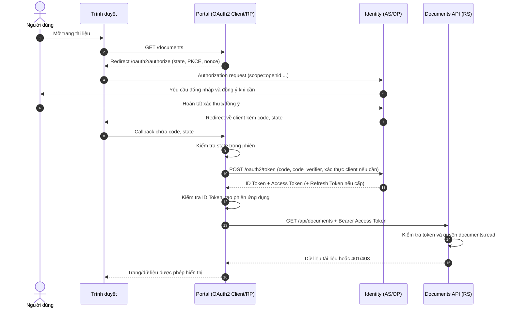

# Phân biệt Authorization Server, Resource Server, OAuth2 Client và OpenID Provider

Trong hệ thống sử dụng OAuth 2.0 và OpenID Connect (OIDC), bốn tên gọi **Authorization Server**, **Resource Server**, **OAuth2 Client** và **OpenID Provider** biểu thị **vai trò trong một giao thức**, không nhất thiết biểu thị bốn ứng dụng triển khai riêng. Một ứng dụng Spring Boot có thể đảm nhiệm một hoặc nhiều vai trò; điều quan trọng là hiểu bên nào cấp token, bên nào sử dụng token và bên nào xác thực danh tính người dùng.

Trong phạm vi xây dựng **Spring Security OAuth2/OIDC Authorization Server** với Spring Boot, việc phân biệt đúng vai trò giúp thiết kế ranh giới tin cậy, chọn cấu hình Spring Security phù hợp, triển khai đúng các luồng đăng nhập/ủy quyền và kiểm thử API một cách an toàn.

## 1. Bối cảnh: các thành phần tham gia

Giả sử hệ thống có một cổng web `portal.example.com`, một API quản lý tài liệu `api.example.com` và một dịch vụ định danh `identity.example.com`. Người dùng đăng nhập vào cổng web để đọc tài liệu được phép truy cập.

- **Resource Owner** (trong tình huống thông thường là người dùng): chủ thể có quyền cho phép ứng dụng truy cập tài nguyên. Một số luồng như `client_credentials` không có người dùng tham gia trực tiếp.
- **User Agent**: trình duyệt hoặc phần mềm phía người dùng, chuyển hướng giữa ứng dụng và dịch vụ định danh. Trình duyệt không đồng nghĩa với OAuth2 Client trong mọi kiến trúc.
- **OAuth2 Client**: ứng dụng yêu cầu quyền truy cập và nhận token theo một grant được hỗ trợ; trong ví dụ là cổng web.
- **Authorization Server (AS)**: dịch vụ xử lý yêu cầu ủy quyền và phát hành token; trong ví dụ là dịch vụ định danh.
- **Resource Server (RS)**: API lưu trữ/cung cấp tài nguyên được bảo vệ; trong ví dụ là API tài liệu.
- **OpenID Provider (OP)**: dịch vụ cung cấp chức năng xác thực danh tính theo OIDC; trong ví dụ, dịch vụ định danh cũng đóng vai trò OP.

Địa chỉ và tên miền trên chỉ mang tính minh họa; trong triển khai thực tế, nhiều vai trò có thể cùng hostname hoặc cùng tiến trình.

## 2. Bảng phân biệt nhanh bốn vai trò

| Tiêu chí | Authorization Server | Resource Server | OAuth2 Client | OpenID Provider |
|---|---|---|---|---|
| Câu hỏi cốt lõi | **Ai cấp quyền/token?** | **Ai bảo vệ tài nguyên?** | **Ai xin và sử dụng quyền?** | **Ai xác thực danh tính theo OIDC?** |
| Nhiệm vụ | Xử lý authorization grant, đăng ký/chính sách client, phát hành và quản lý token | Tiếp nhận access token, kiểm tra hiệu lực và quyền hạn, áp dụng kiểm soát truy cập API | Bắt đầu authorization flow, nhận authorization code/token và gọi API hoặc đăng nhập người dùng | Thực hiện xác thực, phát hành ID Token và cung cấp các chức năng OIDC đã bật |
| Đầu vào điển hình | Authorization request, token request, thông tin client và người dùng tùy grant | HTTP request mang Bearer access token | Tương tác người dùng, authorization code hoặc thông tin xác thực client | Yêu cầu xác thực OIDC với scope `openid` |
| Đầu ra điển hình | Access token, refresh token khi được cấp, phản hồi giao thức | Tài nguyên hoặc lỗi `401`/`403` | HTTP request đến API, phiên đăng nhập ứng dụng | ID Token, thông tin người dùng qua UserInfo khi hỗ trợ |
| Tin cậy dựa vào | Xác thực client, người dùng và chính sách cấp quyền | Kiểm tra issuer, chữ ký hoặc introspection, thời hạn, audience và scope/quyền | Kiểm tra `state`, PKCE, phản hồi token; xác thực ID Token khi dùng OIDC | Bảo đảm các claim định danh và ràng buộc token với đúng client |
| Khả năng đứng độc lập | Có: chỉ cần OAuth 2.0, không bắt buộc OIDC | Có: API nhận access token từ AS | Có: có thể chỉ dùng OAuth 2.0 | **Không độc lập về giao thức:** OP là một OAuth 2.0 Authorization Server triển khai thêm OIDC |
| Hỗ trợ trong Spring | **Spring Authorization Server** | **Spring Security OAuth2 Resource Server** | **Spring Security OAuth2 Client** | **Spring Authorization Server** với OIDC được bật |

**Điểm dễ nhầm:** OpenID Provider không phải là bên gọi API và cũng không phải Resource Server mặc định. Một AS trở thành OP khi thực sự triển khai các yêu cầu OIDC; chỉ phát hành JWT hoặc có trang đăng nhập chưa đủ để gọi là OP.

## 3. OAuth 2.0 ủy quyền; OpenID Connect thêm lớp xác thực

### 3.1. OAuth 2.0 trả lời: ứng dụng được phép làm gì?

OAuth 2.0 là framework **ủy quyền**. Sau khi client hoàn thành một grant hợp lệ, Authorization Server cấp access token để client yêu cầu truy cập tài nguyên. Access token đại diện cho quyền truy cập được cấp, có thể gắn với người dùng hoặc chính client tùy grant.

Ví dụ, `portal.example.com` nhận token có scope `documents.read` rồi gọi `GET /api/documents`. API xác định token có hợp lệ và đủ quyền đọc hay không. **Việc có access token không tự động chứng minh danh tính người đang dùng cổng web**; client không nên coi một access token bất kỳ là bằng chứng đăng nhập OIDC.

### 3.2. OIDC trả lời: ai vừa được xác thực?

OIDC bổ sung **lớp xác thực danh tính** trên OAuth 2.0. Khi client thực hiện một yêu cầu OIDC hợp lệ, thường có scope `openid`, OpenID Provider có thể trả về **ID Token** chứa thông tin về sự kiện xác thực và định danh chủ thể (`sub`). Ứng dụng nhận ID Token và xác thực các claim/chữ ký cần thiết trước khi thiết lập phiên đăng nhập.

Trong ngữ cảnh OIDC, OAuth2 Client nhận xác thực thường được gọi là **Relying Party (RP)**. Vì vậy cùng một ứng dụng Spring Boot có thể vừa là OAuth2 Client, vừa là OIDC Relying Party. Đây là hai cách mô tả tương ứng với hai chức năng của ứng dụng, không phải hai máy chủ bắt buộc khác nhau.

| Loại token | Ai thường nhận? | Ai là đối tượng sử dụng dự kiến? | Mục đích chính |
|---|---|---|---|
| **Access Token** | OAuth2 Client | Resource Server/API được chỉ định | Cho phép truy cập tài nguyên theo quyền hạn và ngữ cảnh token |
| **ID Token** | OIDC Relying Party/Client | Chính client có `client_id` trong `aud` | Chứng thực kết quả đăng nhập, định danh chủ thể và bối cảnh xác thực |
| **Refresh Token** | Client đủ điều kiện | Authorization Server tại token endpoint | Xin access token mới theo chính sách cấp phát, thu hồi và thời hạn |

Không chuyển ID Token vào header `Authorization: Bearer ...` để gọi API. Resource Server cần **access token** dành cho API đó. Access token có thể là JWT hoặc chuỗi opaque; định dạng token **không** quyết định một dịch vụ có phải OpenID Provider hay không.

### 3.3. Các claim có ý nghĩa khác nhau

Một ID Token có thể có nội dung minh họa:

```json
{
  "iss": "https://identity.example.com",
  "sub": "user-42",
  "aud": "portal-web",
  "exp": 1794852000,
  "iat": 1794848400,
  "nonce": "nonce-da-luu-trong-phien"
}
```

Một JWT access token dành cho API có thể có payload minh họa:

```json
{
  "iss": "https://identity.example.com",
  "sub": "user-42",
  "aud": "documents-api",
  "scope": "documents.read",
  "exp": 1794852000,
  "iat": 1794848400
}
```

Đây chỉ là các **payload minh họa, không phải JWT đã được ký**. Cách đặt tên scope, audience và các claim của access token phụ thuộc Authorization Server và hợp đồng với API. `sub` trong access token cũng có thể biểu thị client khi dùng grant `client_credentials`. Không lấy claim có vẻ hợp lý làm bằng chứng hợp lệ nếu chưa kiểm tra token tương ứng.

## 4. Luồng end-to-end: đăng nhập OIDC rồi gọi API bằng OAuth 2.0

Xét mô hình một client web phía máy chủ dùng **Authorization Code + PKCE**. Authorization Server đồng thời bật OIDC nên được gọi là OpenID Provider.



Những điểm cần đọc đúng từ luồng:

1. **Client** khởi tạo authorization request và lưu `state`, PKCE `code_verifier` và `nonce` (khi yêu cầu sử dụng nonce) theo đúng phiên giao dịch. Trong Authorization Code flow, `code_challenge` gửi qua trình duyệt, còn `code_verifier` dùng lúc đổi code lấy token.
2. **AS/OP** xác thực người dùng theo chính sách, kiểm tra client, redirect URI, grant, scope và sự đồng ý nếu cần. AS phát hành **authorization code** trước; token được cấp tại token endpoint khi đổi code hợp lệ.
3. **Client/RP** đối chiếu `state` để ngăn callback bị tráo; dùng PKCE để ràng buộc quá trình đổi code; và xác thực ID Token (ví dụ issuer, audience, chữ ký, thời hạn và nonce khi áp dụng) trước khi tin vào danh tính.
4. **RS** nhận **access token** qua yêu cầu API và tự áp dụng chính sách truy cập. RS không nhận ID Token để thay cho kiểm tra ủy quyền API.
5. **Người dùng** có thể đã đăng nhập tại OP nhưng chưa chắc có quyền `documents.read`. Xác thực danh tính và cấp quyền đọc tài liệu là hai quyết định khác nhau.

Ví dụ authorization request đã rút gọn để dễ đọc:

```http
GET /oauth2/authorize?response_type=code&client_id=portal-web&redirect_uri=https%3A%2F%2Fportal.example.com%2Flogin%2Foauth2%2Fcode%2Fcompany&scope=openid%20profile%20documents.read&state=RANDOM_STATE&code_challenge=BASE64URL_SHA256_VERIFIER&code_challenge_method=S256&nonce=RANDOM_NONCE HTTP/1.1
Host: identity.example.com
```

`RANDOM_STATE`, `RANDOM_NONCE` và `BASE64URL_SHA256_VERIFIER` là placeholder; hệ thống thực phải tạo giá trị ngẫu nhiên an toàn và ràng buộc đúng phiên. `redirect_uri` phải khớp quy tắc đăng ký với AS, sử dụng HTTPS trong môi trường thực tế (ngoại lệ dành cho một số tình huống phát triển cục bộ).

## 5. Vai trò chi tiết và ranh giới bảo mật

### 5.1. Authorization Server: nơi quyết định và phát hành quyền

Authorization Server thường chịu trách nhiệm:

- Quản lý **registered clients** gồm `client_id`, phương thức xác thực, redirect URI, grant type, scope được phép, chính sách PKCE và token.
- Cung cấp **authorization endpoint** và **token endpoint** tương ứng với các grant hỗ trợ.
- Xác thực người dùng khi grant yêu cầu; xác thực client khi loại client và phương thức xác thực yêu cầu.
- Ra quyết định cấp quyền/consent theo chính sách, phát hành và quản lý authorization code, access token và refresh token.
- Cung cấp phương tiện xác minh access token như khóa ký công khai/JWKS cho JWT hoặc introspection endpoint nếu được hỗ trợ và cấu hình.

AS **không mặc định là kho tài nguyên nghiệp vụ**. Dịch vụ phát hành token có thể lưu tài khoản, phiên, consent và metadata bảo mật nhưng không nhất thiết cung cấp `/api/documents`.

Endpoint OAuth 2.0 thường gặp trong Spring Authorization Server:

| Endpoint | Chức năng |
|---|---|
| `/oauth2/authorize` | Bắt đầu xử lý yêu cầu cấp quyền bằng tương tác người dùng khi grant yêu cầu |
| `/oauth2/token` | Đổi authorization code hoặc thực hiện token grant được hỗ trợ |
| `/oauth2/jwks` | Công bố khóa công khai để bên nhận có thể xác minh chữ ký JWT, khi cấu hình khóa phù hợp |
| `/oauth2/introspect` | Cung cấp thông tin trạng thái token cho client được phép introspect |
| `/oauth2/revoke` | Yêu cầu thu hồi token theo điều kiện của giao thức và triển khai |

Các đường dẫn trên là mặc định thường gặp trong Spring Authorization Server, **không phải mọi AS bên ngoài đều bắt buộc sử dụng đúng đường dẫn này**. Chức năng thực tế phụ thuộc phiên bản, cấu hình endpoint và các bean cần thiết.

### 5.2. Resource Server: người gác cổng tài nguyên

Resource Server có trách nhiệm kiểm tra **access token dành cho mình** và phân quyền trước khi trả dữ liệu:

- Với **JWT access token**: xác minh chữ ký bằng khóa tin cậy, kiểm tra `iss`, thời hạn (`exp`, `nbf` nếu có), audience (`aud`) và các ràng buộc cần thiết.
- Với **opaque access token**: dùng introspection (hoặc cơ chế được thiết kế phù hợp) để lấy trạng thái hiệu lực và thuộc tính cần thiết từ AS.
- Áp dụng scope và quyền nghiệp vụ; ví dụ `documents.read` chỉ cho phép một loại thao tác, còn quyền xem *tài liệu cụ thể* vẫn có thể cần kiểm tra chủ sở hữu, tổ chức hoặc chính sách truy cập bản ghi.
- Trả **401 Unauthorized** khi thiếu/không chấp nhận được thông tin xác thực và **403 Forbidden** khi thông tin xác thực đã được chấp nhận nhưng không đủ quyền theo chính sách.

**Không chỉ decode JWT** rồi tin vào payload. Payload JWT có thể được bất kỳ ai tạo dưới dạng văn bản; RS phải xác minh chữ ký và các claim quan trọng. Cấu hình `issuer-uri` của Spring Security giúp xác minh issuer, chữ ký và các mốc thời gian theo cơ chế JWT Resource Server; **kiểm tra audience theo hợp đồng của API cần được cấu hình/xác nhận riêng**, không được mặc nhiên suy ra từ `issuer-uri`.

### 5.3. OAuth2 Client: ứng dụng thay mặt mình hoặc người dùng xin quyền

OAuth2 Client là thành phần **yêu cầu token**, không phải thành phần phát hành token. Có hai kiểu thường gặp:

| Kiểu client | Ví dụ | Lưu ý |
|---|---|---|
| **Confidential client** | Ứng dụng backend quản lý bí mật client an toàn | Có thể xác thực với AS bằng client secret hoặc cơ chế mạnh hơn; thường dùng Authorization Code cho ứng dụng web phía máy chủ |
| **Public client** | Ứng dụng di động, SPA chạy trong trình duyệt | Không thể giữ client secret an toàn; sử dụng PKCE với Authorization Code, tránh nhúng secret vào mã phân phối cho người dùng |

Client có thể yêu cầu quyền **thay mặt người dùng** bằng Authorization Code, hoặc lấy token **cho chính ứng dụng** bằng `client_credentials` khi AS cho phép. Với `client_credentials` không có sự kiện đăng nhập của một người dùng cuối nên không mong đợi ID Token OIDC kiểu đăng nhập người dùng.

OAuth2 Client có thể dùng thư viện Spring Security để đăng nhập (`oauth2Login`) hoặc để quản lý authorized client và gọi API (`oauth2Client`); hai nhu cầu này có thể đồng thời tồn tại trong cùng ứng dụng.

### 5.4. OpenID Provider: AS cung cấp xác thực OIDC

OpenID Provider là **Authorization Server hỗ trợ OIDC**. Ngoài quy trình ủy quyền OAuth 2.0, OP chịu trách nhiệm:

- Xác thực người dùng và phát hành **ID Token** cho Relying Party khi thực hiện một flow OIDC phù hợp.
- Công bố metadata OIDC qua discovery, thường là `/.well-known/openid-configuration` theo issuer và cách triển khai.
- Cung cấp khóa xác minh chữ ký ID Token (thường qua `jwks_uri`) và hỗ trợ các chức năng OIDC bổ sung như UserInfo khi cấu hình.
- Đảm bảo ID Token được ràng buộc với **đúng client** (`aud`) và bối cảnh xác thực, để RP có thể kiểm tra chúng.

**OIDC không bắt buộc Resource Server triển khai OIDC.** API tài liệu chỉ cần xác minh access token và các quyền API của mình. Nếu API đồng thời phát ID Token hoặc phục vụ UserInfo thì đó là một trách nhiệm bổ sung được thiết kế riêng, không phát sinh chỉ vì API dùng JWT.

## 6. Ánh xạ sang Spring Security và Spring Authorization Server

Hệ sinh thái Spring chia trách nhiệm theo các cấu hình/chức năng khác nhau. Những ví dụ dưới đây minh họa **phần phân biệt vai trò**, không phải project hoàn chỉnh có thể chạy ngay; ứng dụng thật cần dependencies phù hợp, cấu hình đăng nhập, client registration, khóa ký và persistence theo yêu cầu.

### 6.1. Dựng Authorization Server và bật vai trò OpenID Provider

Trong ứng dụng đóng vai trò AS, Spring Authorization Server cung cấp cấu hình endpoint và cơ chế phát hành token. Để hỗ trợ OIDC, bật phần mở rộng OIDC trên `OAuth2AuthorizationServerConfigurer`:

```java
@Bean
@Order(1)
SecurityFilterChain authorizationServerFilterChain(HttpSecurity http) throws Exception {
    OAuth2AuthorizationServerConfigurer authorizationServer =
            OAuth2AuthorizationServerConfigurer.authorizationServer();

    http.securityMatcher(authorizationServer.getEndpointsMatcher())
        .with(authorizationServer, server ->
                server.oidc(Customizer.withDefaults()))
        .authorizeHttpRequests(auth -> auth.anyRequest().authenticated())
        .exceptionHandling(ex -> ex.defaultAuthenticationEntryPointFor(
                new LoginUrlAuthenticationEntryPoint("/login"),
                new MediaTypeRequestMatcher(MediaType.TEXT_HTML)));

    return http.build();
}
```

Đoạn cấu hình minh họa API DSL của các phiên bản Spring Authorization Server hỗ trợ `OAuth2AuthorizationServerConfigurer.authorizationServer()` và `HttpSecurity.with(...)`; API có thể thay đổi theo phiên bản. Để hoàn chỉnh ứng dụng, còn cần `RegisteredClientRepository`, `JWKSource` cho token ký, `AuthorizationServerSettings`/issuer phù hợp, một `SecurityFilterChain` dành cho đăng nhập người dùng và các thành phần lưu trữ token/consent theo kiến trúc. Bật `.oidc(...)` giúp cấu hình phần giao thức OIDC; **không tự tạo ra người dùng, dữ liệu consent hoặc client hợp lệ**.

Ví dụ cấu hình thông tin client (minh họa thao tác tạo `RegisteredClient`):

```java
RegisteredClient portal = RegisteredClient.withId(UUID.randomUUID().toString())
        .clientId("portal-web")
        .clientSecret(passwordEncoder.encode(secretFromSecureConfiguration))
        .clientAuthenticationMethod(ClientAuthenticationMethod.CLIENT_SECRET_BASIC)
        .authorizationGrantType(AuthorizationGrantType.AUTHORIZATION_CODE)
        .authorizationGrantType(AuthorizationGrantType.REFRESH_TOKEN)
        .redirectUri("https://portal.example.com/login/oauth2/code/company")
        .scope(OidcScopes.OPENID)
        .scope(OidcScopes.PROFILE)
        .scope("documents.read")
        .clientSettings(ClientSettings.builder().requireProofKey(true).build())
        .build();
```

`secretFromSecureConfiguration` là biến đại diện cho bí mật được nạp từ hệ thống cấu hình bảo mật, không phải giá trị hardcode. Đăng ký client cần được lưu bởi `RegisteredClientRepository`. Một public client sử dụng phương thức xác thực `none` thay vì giả vờ có thể giữ `client_secret`.

### 6.2. Cấu hình API làm Resource Server

Một ứng dụng Spring Boot chỉ cung cấp API được bảo vệ không cần bật OIDC login hoặc token endpoint:

```yaml
spring:
  security:
    oauth2:
      resourceserver:
        jwt:
          issuer-uri: https://identity.example.com
```

```java
@Bean
SecurityFilterChain apiSecurityFilterChain(HttpSecurity http) throws Exception {
    http.securityMatcher("/api/**")
        .authorizeHttpRequests(auth -> auth
            .requestMatchers(HttpMethod.GET, "/api/documents/**")
                .hasAuthority("SCOPE_documents.read")
            .anyRequest().authenticated())
        .oauth2ResourceServer(oauth2 -> oauth2.jwt(Customizer.withDefaults()));

    return http.build();
}
```

Ví dụ dùng JWT access token và scope được Spring ánh xạ sang authority với tiền tố `SCOPE_` theo cấu hình thông dụng. Cần thêm chính sách cho các endpoint khác và **validator audience** phù hợp API. Nếu AS phát **opaque token**, thay cấu hình `jwt` bằng cơ chế `opaqueToken` và thiết lập introspection endpoint/credentials phù hợp. `oauth2ResourceServer()` không tạo token cho người gọi.

### 6.3. Cấu hình portal làm OAuth2 Client và OIDC Relying Party

Ứng dụng web đăng nhập qua OP có thể cấu hình registration với issuer:

```yaml
spring:
  security:
    oauth2:
      client:
        registration:
          company:
            provider: company-identity
            client-id: portal-web
            client-secret: ${PORTAL_OAUTH2_CLIENT_SECRET}
            authorization-grant-type: authorization_code
            redirect-uri: "{baseUrl}/login/oauth2/code/{registrationId}"
            scope: openid, profile, documents.read
        provider:
          company-identity:
            issuer-uri: https://identity.example.com
```

```java
@Bean
SecurityFilterChain portalSecurityFilterChain(HttpSecurity http) throws Exception {
    http.authorizeHttpRequests(auth -> auth
            .requestMatchers("/", "/public/**").permitAll()
            .anyRequest().authenticated())
        .oauth2Login(Customizer.withDefaults())
        .oauth2Client(Customizer.withDefaults());
    return http.build();
}
```

Với registration có scope `openid`, Spring Security xử lý đăng nhập theo OIDC khi nhà cung cấp hỗ trợ đúng giao thức. `oauth2Login()` thiết lập chức năng đăng nhập qua trình duyệt; `oauth2Client()` hỗ trợ các chức năng của OAuth2 Client trong ứng dụng. Cách gửi access token đến API, lưu/đổi mới authorized client và liên kết phiên người dùng vẫn cần thiết kế phù hợp kiến trúc. Bí mật client phải được giữ ở máy chủ hoặc nơi lưu bí mật an toàn, không đưa vào mã JavaScript phía trình duyệt.

### 6.4. Một ứng dụng có thể đảm nhiệm nhiều vai trò

Các bộ cấu hình không ánh xạ một-một với số lượng ứng dụng:

| Kiến trúc | Vai trò có thể gộp | Điều cần giữ rõ |
|---|---|---|
| Hệ thống ba dịch vụ | `identity`: AS/OP; `portal`: Client/RP; `api`: RS | Khóa ký, audience, redirect URI, luồng token và điều kiện truy cập |
| Backend-for-Frontend (BFF) | BFF là Client/RP, gọi các RS ở backend | Bảo vệ session/cookie, quản lý token ở backend, CSRF và quyền theo người dùng |
| Ứng dụng monolith | Cùng tiến trình có thể là Client và RS; AS/OP cũng có thể đặt cùng nơi nếu thiết kế cho phép | Tránh xung đột `SecurityFilterChain`, endpoint và ranh giới trust |
| Nhiều API dùng chung OP | Một AS/OP, nhiều RS với audience/quyền riêng | Không cho token dành cho API A tự động truy cập API B |

Khi dùng nhiều `SecurityFilterChain`, cần kiểm tra `securityMatcher`, thứ tự `@Order` và fallback chain để các endpoint của AS, đăng nhập và API nhận đúng chính sách. Gộp vai trò không cho phép bỏ kiểm tra token chỉ vì các thành phần cùng chạy trong một tiến trình.

## 7. Những trường hợp thường nhầm lẫn

| Nhận định dễ sai | Cách hiểu đúng |
|---|---|
| "Dùng JWT tức là đã có OIDC" | JWT là định dạng token; OIDC cần giao thức xác thực, ID Token và các ràng buộc tương ứng. |
| "Resource Server cấp access token" | Theo mô hình OAuth 2.0 chuẩn, **Authorization Server** cấp token; RS kiểm tra token để bảo vệ tài nguyên. |
| "API nhận ID Token là đủ xác thực và phân quyền" | ID Token dành cho RP, không thay access token có audience/quyền dành cho API. |
| "Đã đăng nhập thì được quyền gọi mọi API" | Đăng nhập xác thực chủ thể; API vẫn kiểm tra token, scope, audience và quyền trên tài nguyên. |
| "Client secret an toàn khi đặt trong SPA" | SPA/public client không giữ bí mật được; dùng thiết kế public client, Authorization Code + PKCE. |
| "OAuth2 Client phải có màn hình đăng nhập" | Client có thể chạy không tương tác người dùng bằng `client_credentials` khi phù hợp. |
| "AS và OP luôn là hai server" | Trong OIDC, OP chính là AS có hỗ trợ OIDC; một dịch vụ có thể cung cấp cả hai vai trò. |
| "JWT hợp lệ về chữ ký thì API nào cũng dùng được" | Cần kiểm tra issuer, thời hạn, audience, scope và chính sách nghiệp vụ của từng RS. |
| "Dịch vụ discovery và JWKS chính là token endpoint" | Discovery công bố metadata; JWKS công bố khóa xác minh; token endpoint xử lý cấp token. |

Một lỗi thiết kế nghiêm trọng là **token substitution**: API B chấp nhận access token hợp lệ do cùng AS ký nhưng vốn chỉ dành cho API A. Cách phòng tránh là định nghĩa audience cho từng API và buộc mỗi RS xác minh `aud` cùng với các điều kiện khác. Một lỗi khác là **nhầm ID Token với access token**, khiến client/API tin vào dữ liệu không được phát hành cho mục đích của mình.

## 8. Cách quyết định vai trò khi thiết kế hệ thống

Đứng trước một thành phần mới, đặt các câu hỏi theo thứ tự:

1. **Thành phần có phát hành authorization code/access token và quản lý client/grant không?** Nếu có, nó đang đảm nhiệm vai trò **Authorization Server**.
2. **Nó có thực hiện xác thực OIDC, phát hành ID Token dành cho RP và công bố metadata OIDC không?** Nếu có, nó còn là **OpenID Provider**.
3. **Nó có nhận access token để trả dữ liệu hoặc thực hiện API được bảo vệ không?** Nếu có, nó đang làm **Resource Server**.
4. **Nó có đăng ký tại AS, xin authorization code/access token rồi dùng token không?** Nếu có, nó đang làm **OAuth2 Client**; nếu dùng OIDC để đăng nhập thì đồng thời là **Relying Party**.

Một thành phần có thể nhận nhiều đáp án "có". Khi đó hãy lập bảng endpoint, token nhận/phát, người tiêu thụ token, dữ liệu cần bảo vệ và SecurityFilterChain tương ứng trước khi viết cấu hình.

### Ví dụ kiểm tra tư duy

**Tình huống A:** Một dịch vụ nền chạy theo lịch, dùng `client_credentials` để lấy token từ `identity.example.com` rồi cập nhật dữ liệu qua API. Dịch vụ nền là **OAuth2 Client**, `identity.example.com` là **AS**, API là **RS**. Không có nhu cầu OIDC/ID Token cho người dùng cuối trong luồng này.

**Tình huống B:** Người dùng chọn "Đăng nhập bằng nhà cung cấp định danh" trên cổng web. Nhà cung cấp hỗ trợ OIDC và cấp ID Token, cổng web xác thực ID Token rồi tạo phiên. Nhà cung cấp là **OP/AS**; cổng web là **OIDC RP/OAuth2 Client**. Nếu cổng web sau đó gọi API với access token, API là **RS**.

**Tình huống C:** Một microservice nhận Bearer JWT và kiểm tra `SCOPE_orders.read`, nhưng không có giao diện đăng nhập hoặc endpoint phát token. Microservice này là **RS**, không phải Authorization Server hay OpenID Provider.

## 9. Gợi ý kiểm thử theo đúng trách nhiệm

| Thành phần cần kiểm thử | Trường hợp tích cực | Trường hợp cần từ chối/kiểm soát |
|---|---|---|
| **AS** | Client, grant, redirect URI và scope hợp lệ nhận phản hồi đúng giao thức | Redirect URI không được đăng ký, client không hợp lệ, grant/scope không được phép, authorization code đã dùng hoặc PKCE sai |
| **OP** | RP xác minh được ID Token đúng issuer, audience và thời hạn | ID Token sai `aud`/`iss`, chữ ký sai, hết hạn hoặc nonce không khớp khi cần |
| **Client/RP** | Luồng Authorization Code + PKCE, đối chiếu `state`, tạo phiên đúng người | Callback sai `state`, thiếu/sai `code_verifier`, trao đổi code thất bại, token không đạt kiểm tra |
| **RS** | Token còn hiệu lực, audience và scope đúng, tài nguyên cho phép | Thiếu token, sai chữ ký/issuer/audience, token hết hạn, thiếu scope hoặc truy cập đối tượng không được phép |

Nên kiểm thử tình huống **một người dùng xác thực thành công nhưng không được phép xem tài nguyên cụ thể**: nó xác minh hệ thống không đánh đồng đăng nhập OIDC với phân quyền nghiệp vụ. Khi tích hợp Spring Security, kiểm tra cả mã HTTP, `WWW-Authenticate` khi thích hợp, audit log không lộ token và hiệu lực của chính sách thu hồi/đổi mới theo loại token đã chọn.

## 10. Kết luận học tập

Trong một kiến trúc OAuth 2.0/OIDC:

- **Authorization Server** phát hành quyền truy cập dưới dạng token sau khi xử lý grant hợp lệ.
- **Resource Server** bảo vệ API bằng cách kiểm tra access token và quyền tương ứng.
- **OAuth2 Client** xin và sử dụng token; khi đăng nhập bằng OIDC, nó cũng là **Relying Party**.
- **OpenID Provider** là Authorization Server có thêm trách nhiệm xác thực danh tính và phát hành ID Token theo OIDC.

Khi xây dựng Authorization Server bằng Spring Authorization Server, hãy kiểm tra riêng **giao thức/token endpoint**, **chức năng OIDC**, **cấu hình client** và **hợp đồng token với các Resource Server**. Việc nắm chắc bốn vai trò này là nền tảng để đi sâu vào thiết kế khóa ký, grants, consent, PKCE, token validation, bảo mật endpoint, kiểm thử tích hợp và vận hành hệ thống định danh thực tế.
