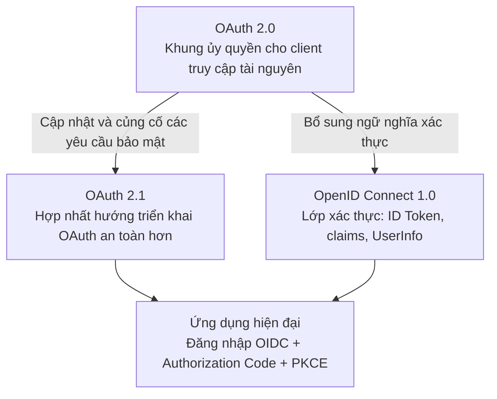
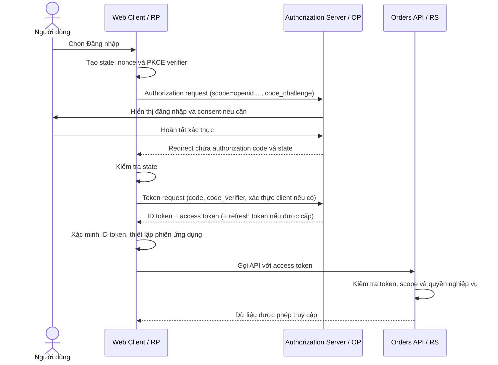

# Quan hệ giữa OAuth 2.0, OAuth 2.1 và OpenID Connect 1.0

## 1. Bối cảnh và mục tiêu học tập

Khi xây dựng **Authorization Server bằng Spring Security và Spring Authorization Server** trong ứng dụng Spring Boot, ba tên gọi **OAuth 2.0**, **OAuth 2.1** và **OpenID Connect (OIDC) 1.0** thường xuất hiện cùng lúc. Chúng liên quan chặt chẽ nhưng giải quyết những câu hỏi khác nhau:

- **OAuth 2.0:** Ứng dụng (client) có thể được cấp quyền truy cập tài nguyên được bảo vệ theo cách nào?
- **OAuth 2.1:** Những thực hành bảo mật hiện đại nào cần được đưa thành nền tảng khi triển khai OAuth, thay cho các cơ chế cũ có rủi ro?
- **OpenID Connect 1.0:** Client xác thực được người dùng đã đăng nhập là ai bằng một giao thức chuẩn hóa dựa trên OAuth như thế nào?

Ví dụ, một hệ thống đặt phòng có giao diện web, ứng dụng di động và API đơn hàng. Người dùng đăng nhập một lần để sử dụng các ứng dụng; client cần biết danh tính người đã đăng nhập, còn API chỉ nên cho phép thao tác phù hợp với quyền được cấp. **OIDC giúp client xác thực phiên đăng nhập**, trong khi **OAuth giúp client lấy access token để gọi API**. Các thực hành bảo mật gắn với OAuth 2.1, như Authorization Code kết hợp PKCE, giúp giảm rủi ro trong cả hành trình.

Sau bài này, bạn có thể:

1. Phân biệt **ủy quyền truy cập tài nguyên** với **xác thực danh tính**.
2. Giải thích quan hệ giữa OAuth 2.0, hướng cập nhật OAuth 2.1 và lớp định danh OIDC 1.0.
3. Theo dõi luồng đăng nhập kết hợp cấp quyền bằng Authorization Code + PKCE.
4. Phân biệt mục đích, người nhận và cách kiểm tra **access token** với **ID token**.
5. Chọn đúng thành phần cấu hình trong Spring Authorization Server, Spring Security OAuth2 Client và Resource Server.

## 2. Mô hình tổng thể: một nền tảng, hai hướng mở rộng

OAuth 2.0 là khung giao thức ủy quyền. OAuth 2.1 phát triển trên nền tảng đó, loại bỏ hoặc siết chặt những lựa chọn đã bị xem là không phù hợp với thực hành bảo mật hiện đại. OIDC 1.0 sử dụng cơ chế ủy quyền của OAuth 2.0 và **bổ sung một lớp giao thức xác thực người dùng**.



Sơ đồ cho thấy **OAuth 2.1 và OIDC không phải hai sản phẩm cạnh tranh**. OAuth 2.1 điều chỉnh cách cấp quyền an toàn; OIDC bổ sung thông tin danh tính và quy tắc để client xác minh quá trình xác thực. Một giải pháp đăng nhập OIDC hiện đại có thể áp dụng các thực hành bảo mật được OAuth 2.1 và OAuth Security Best Current Practice thúc đẩy.

**Lưu ý về phiên bản:** OAuth 2.0 được chuẩn hóa bởi RFC 6749; OIDC Core 1.0 là đặc tả OpenID Foundation. OAuth 2.1 là tiến trình hợp nhất, cập nhật OAuth 2.0. Khi áp dụng yêu cầu mang tính quy phạm của “OAuth 2.1”, cần kiểm tra **phiên bản tài liệu IETF có hiệu lực tại thời điểm triển khai**, vì trạng thái và câu chữ của bản thảo/RFC có thể thay đổi. Các nguyên tắc an toàn được giải thích dưới đây cũng có cơ sở trong RFC 7636 (PKCE) và RFC 9700 (OAuth 2.0 Security Best Current Practice).

## 3. OAuth 2.0: nền tảng của việc ủy quyền

OAuth 2.0 giải quyết bài toán **cấp quyền truy cập tài nguyên được bảo vệ cho một client**. Thay vì yêu cầu người dùng trao mật khẩu cho ứng dụng thứ ba, Authorization Server cấp access token để ứng dụng có thể gọi một API trong giới hạn được cho phép.

Bốn vai trò cơ bản:

| Vai trò | Trách nhiệm | Ví dụ |
|---|---|---|
| **Resource Owner** | Chủ thể có khả năng cho phép truy cập tài nguyên | Người dùng sở hữu dữ liệu đặt phòng |
| **Client** | Ứng dụng yêu cầu quyền truy cập | Web app, mobile app, dịch vụ nền |
| **Authorization Server (AS)** | Xác thực hoặc nhận diện chủ thể khi cần, xử lý cấp quyền và phát hành token | Spring Authorization Server |
| **Resource Server (RS)** | Bảo vệ API, kiểm tra access token và thi hành chính sách truy cập | Orders API chạy Spring Security Resource Server |

Client có thể xin quyền `orders.read` nhưng Resource Server vẫn cần kiểm tra đối tượng, hành động và quy tắc nghiệp vụ cụ thể. **Scope không tự động thay thế kiểm tra phân quyền ở API.**

### 3.1. Các loại grant trong OAuth 2.0

OAuth 2.0 ban đầu mô tả Authorization Code, Implicit, Resource Owner Password Credentials và Client Credentials, đồng thời cho phép các extension grant. Các grant không có cùng mức an toàn hoặc cùng mục đích:

| Grant | Tình huống | Đánh giá trong thiết kế hiện đại |
|---|---|---|
| **Authorization Code** | Client có tương tác với người dùng qua trình duyệt | Lựa chọn chính, kết hợp **PKCE** |
| **Client Credentials** | Dịch vụ gọi dịch vụ nhân danh chính nó | Vẫn phù hợp khi không có người dùng cuối |
| **Implicit** | Cấp access token trực tiếp qua phản hồi trình duyệt | Không nên thiết kế mới; được loại khỏi hướng OAuth 2.1 |
| **Resource Owner Password Credentials** | Client trực tiếp thu thập tên đăng nhập và mật khẩu | Không nên sử dụng; bị loại khỏi hướng OAuth 2.1 |

OAuth 2.0 **không quy định rằng access token phải là JWT**. Authorization Server có thể phát hành token dạng chuỗi không trong suốt (opaque) hoặc JWT. Resource Server phải kiểm tra token theo cơ chế được hệ thống lựa chọn, chẳng hạn xác minh chữ ký JWT hoặc gọi introspection.

### 3.2. OAuth 2.0 không tự định nghĩa một quy trình “đăng nhập chuẩn” cho client

Authorization Server thường xác thực người dùng trong quá trình xin quyền, nhưng **OAuth 2.0 không định nghĩa đầy đủ một bằng chứng xác thực người dùng cho client**. Việc client thấy access token không tự chứng minh token đó được phát hành cho chính client để xác nhận danh tính người đang đăng nhập. Access token được phát hành nhằm truy cập tài nguyên và được Resource Server xử lý.

Vì vậy, “lấy access token rồi giải mã để coi như đã đăng nhập” là thiết kế dễ sai. Với nhu cầu đăng nhập, nên dùng OIDC và kiểm tra **ID token** theo đúng quy tắc của OIDC.

## 4. OAuth 2.1: cập nhật tư duy bảo mật khi sử dụng OAuth

OAuth 2.1 gom các cải tiến bảo mật đã được triển khai qua nhiều RFC và hướng dẫn thực hành, đồng thời thu hẹp các lựa chọn dễ gây lỗi. Nó **không biến OAuth thành giao thức định danh** và không mặc định làm phát sinh ID token.

| Khía cạnh | OAuth 2.0 ban đầu | Hướng OAuth 2.1 và thực hành an toàn hiện đại |
|---|---|---|
| Luồng ủy quyền qua trình duyệt | Authorization Code hoặc Implicit | Ưu tiên **Authorization Code + PKCE**; không dùng Implicit |
| Chống đánh cắp authorization code | PKCE được bổ sung bằng RFC 7636 | Sử dụng PKCE cho luồng Authorization Code; thường chọn `S256` |
| Nhận mật khẩu người dùng tại client | Có Password grant | Loại bỏ/không sử dụng Password grant |
| Redirect URI | Có các quy tắc đăng ký và so khớp | Kiểm tra chặt redirect URI; tránh wildcard và open redirect |
| Token bị lộ | Có các hướng dẫn tách rời | Áp dụng TLS, bảo vệ refresh token, kiểm soát nơi truyền token và thời hạn phù hợp |
| Cách áp dụng | Có thể có nhiều cấu hình kế thừa | Thiết kế theo nguyên tắc bảo mật mặc định, tham chiếu Security BCP |

**PKCE** (*Proof Key for Code Exchange*) ràng buộc lần đổi authorization code lấy token với client đã khởi tạo yêu cầu. Cơ chế hoạt động:

1. Client tạo ngẫu nhiên một `code_verifier` đủ entropy và chỉ lưu ở phía client.
2. Client tính `code_challenge = BASE64URL(SHA256(ASCII(code_verifier)))` khi chọn phương thức `S256`.
3. Client gửi `code_challenge` trong yêu cầu ủy quyền.
4. Khi đổi code lấy token, client gửi `code_verifier`.
5. Authorization Server tự tính lại và so khớp. Bên chỉ đánh cắp được code nhưng không có verifier sẽ không đổi được code thành token.

PKCE giải quyết một nguy cơ cụ thể: **authorization code bị chặn hoặc chuyển sang bên khác**. PKCE không thay thế TLS, kiểm tra redirect URI, `state`, cơ chế xác thực client bí mật, hay kiểm tra token.

> **Điểm cần nhớ:** Một Authorization Server “hỗ trợ OAuth 2.0” vẫn có thể vận hành với cấu hình bảo mật hiện đại. Không tồn tại một công tắc phổ quát “chuyển sang OAuth 2.1” bảo đảm toàn bộ chính sách an toàn. Phải xem grant, client, PKCE, redirect URI và token được cấu hình, kiểm thử ra sao.

## 5. OpenID Connect 1.0: lớp xác thực dựa trên OAuth

OIDC 1.0 thêm các quy tắc chuẩn hóa để một **Relying Party (RP)**, tức client sử dụng OIDC, xác thực danh tính một **End-User** với sự trợ giúp của **OpenID Provider (OP)**. Trong triển khai thông thường, OP cũng đóng vai trò OAuth Authorization Server.

OIDC bổ sung các khái niệm quan trọng:

- **Scope `openid`:** Dấu hiệu yêu cầu là một yêu cầu OIDC. Không có `openid`, một yêu cầu OAuth thông thường không mặc nhiên là OIDC.
- **ID Token:** JWT chứa các claim chuẩn hóa về sự kiện xác thực và danh tính, do OP phát hành cho RP.
- **Claims:** Ví dụ `sub` (định danh chủ thể), `iss` (bên phát hành), `aud` (bên nhận), `auth_time` và thông tin hồ sơ được cấp phép.
- **UserInfo Endpoint:** Điểm cuối có thể cung cấp thông tin người dùng dựa trên access token và phạm vi được cấp.
- **Discovery và JWKS:** Cho phép client khám phá metadata của OP và lấy khóa công khai để xác minh chữ ký ID token.
- **Các phần mở rộng khác:** Có thể hỗ trợ cơ chế đăng xuất, quản lý phiên, đăng ký client động; mức hỗ trợ cần xác nhận với từng sản phẩm và cấu hình cụ thể.

### 5.1. ID token khác access token như thế nào?

| Tiêu chí | Access token | ID token |
|---|---|---|
| Mục đích chính | Cho phép truy cập tài nguyên được bảo vệ | Cung cấp bằng chứng xác thực người dùng cho client |
| Bên sử dụng chính | Resource Server/API được chỉ định | OIDC Relying Party/client |
| Định dạng | Không bị OAuth 2.0 bắt buộc phải là JWT | **JWT** theo OIDC |
| Audience | Thường hướng tới API/Resource Server, theo mô hình phát hành token | Chứa client ID của RP trong `aud` theo OIDC |
| Nội dung quan trọng | Scope/quyền và metadata token theo chính sách phát hành | `iss`, `sub`, `aud`, `exp`, `iat`; có thể có `nonce`, `auth_time`... |
| Cách sử dụng | Gửi như Bearer token tới API phù hợp | Xác minh theo OIDC rồi lập ngữ cảnh đăng nhập của client |
| Điều không nên làm | Xem nó như bằng chứng đăng nhập chuẩn cho RP | Gửi nó thay access token để gọi API |

Ví dụ payload của **ID token đã giải mã** dưới đây chỉ dùng để minh họa; giá trị dấu thời gian và định danh là giả lập:

```json
{
  "iss": "https://auth.example.com",
  "sub": "user-42",
  "aud": "web-client",
  "iat": 1900000000,
  "exp": 1900000300,
  "nonce": "random-nonce-value",
  "auth_time": 1900000000
}
```

- `iss` phải khớp đúng issuer mà RP tin cậy.
- `aud` phải chứa client ID của RP; các quy tắc liên quan `azp` cần được áp dụng khi phù hợp.
- `exp`, `iat` và các yêu cầu thời gian phải được kiểm tra theo đặc tả.
- Chữ ký và thuật toán phải được xác minh bằng khóa đáng tin cậy của OP; **đọc được payload không có nghĩa là đã xác minh token**.
- Nếu yêu cầu gửi `nonce` thì RP phải đối chiếu giá trị trong ID token; `auth_time` cần được kiểm tra khi có yêu cầu xác thực lại như `max_age`.
- `sub` là định danh người dùng trong phạm vi issuer. Không nên dùng `email` làm khóa định danh bất biến vì email có thể đổi hoặc chưa được xác minh.

`profile` và `email` là các scope OIDC dùng để **yêu cầu** những nhóm claim tiêu chuẩn, không bảo đảm mọi claim đều có mặt trong ID token hoặc UserInfo. Việc phát hành còn phụ thuộc vào consent, dữ liệu thực có và chính sách của OP.

### 5.2. Khi nào có ID token?

Trong một yêu cầu OIDC Authorization Code Flow, client gửi `scope` chứa `openid`. Sau khi xác thực và cho phép truy cập, client đổi code tại Token Endpoint; phản hồi thành công bao gồm **ID token** và thông thường có **access token**. Refresh token chỉ có nếu grant, chính sách và cấu hình hỗ trợ.

Ngược lại, với **Client Credentials Grant**, không có phiên xác thực End-User. Client thường nhận access token cho chính nó và **không có ID token người dùng**. Không nên thêm `openid` vào Client Credentials rồi kỳ vọng nhận được danh tính người dùng.

## 6. Luồng phối hợp OIDC + Authorization Code + PKCE

Giả sử ứng dụng web `web-client` cần đăng nhập người dùng và gọi `orders-api`. Luồng đề xuất:



Các tham số trong Authorization Request (tách dòng cho dễ đọc):

```http
GET /oauth2/authorize?response_type=code&client_id=web-client
    &redirect_uri=https%3A%2F%2Fapp.example.com%2Fcallback
    &scope=openid%20profile%20orders.read
    &state=RANDOM_STATE&nonce=RANDOM_NONCE
    &code_challenge=BASE64URL_SHA256_VERIFIER
    &code_challenge_method=S256
```

Ở đây:

- `response_type=code` yêu cầu **Authorization Code Flow**.
- `scope=openid profile orders.read` kết hợp yêu cầu đăng nhập OIDC, claims hồ sơ và quyền API trong cùng một hành trình; mỗi phạm vi phải được server cho phép.
- `state` liên kết phản hồi với yêu cầu ban đầu, giúp chống nhầm lẫn luồng và tấn công CSRF tại client. Client phải kiểm tra giá trị quay về.
- `nonce` gắn ID token với yêu cầu xác thực và giúp giảm nguy cơ phát lại. Trong pure Authorization Code Flow, nonce không luôn là tham số bắt buộc của OIDC Core, nhưng nếu client gửi thì phải xác minh.
- `code_challenge` là giá trị dẫn xuất từ `code_verifier` bằng PKCE; không truyền verifier tại bước này.
- `redirect_uri` phải là URI đã đăng ký hợp lệ cho client.

Sau khi nhận code, client gửi Token Request qua kênh bảo mật:

```http
POST /oauth2/token
Content-Type: application/x-www-form-urlencoded

grant_type=authorization_code&code=AUTHORIZATION_CODE&redirect_uri=https%3A%2F%2Fapp.example.com%2Fcallback&code_verifier=ORIGINAL_RANDOM_VERIFIER
```

Ví dụ trên chỉ nêu các tham số cốt lõi; client bí mật còn phải xác thực theo phương thức đã đăng ký (chẳng hạn `client_secret_basic`), còn public client thường phải gửi `client_id` theo quy tắc Token Endpoint. Code chỉ dùng một lần và phải có thời gian sống ngắn.

Phản hồi minh họa:

```json
{
  "access_token": "ACCESS_TOKEN_VALUE",
  "token_type": "Bearer",
  "expires_in": 300,
  "id_token": "SIGNED_ID_TOKEN_JWT"
}
```

Client **xác minh ID token để xử lý đăng nhập**. API **xác minh access token để quyết định có cho phép đọc dữ liệu hay không**. Hai quyết định có thể dùng chung Authorization Server nhưng không được đánh đồng. Việc hoàn thành OAuth/OIDC cũng không tự động cho quyền truy cập mọi đơn hàng: API cần kiểm tra người dùng có sở hữu đơn hàng hoặc có vai trò phù hợp.

## 7. Ánh xạ vào hệ sinh thái Spring Security

Trong Spring Boot, ba chức năng thường được tách rõ ràng:

| Thành phần Spring | Vai trò giao thức | Công việc chính |
|---|---|---|
| **Spring Authorization Server** | OAuth Authorization Server; có thể bật OIDC Provider | Đăng ký client, xử lý authorization/consent, phát hành token, công bố metadata và khóa |
| **Spring Security OAuth2 Client / `oauth2Login`** | OAuth Client / OIDC Relying Party | Chuyển hướng đăng nhập, xử lý callback, đổi code, kiểm tra ID token, tạo phiên đăng nhập |
| **Spring Security Resource Server** | OAuth Resource Server | Kiểm tra access token (JWT hoặc opaque) và bảo vệ endpoint API |

Một Authorization Server có thể phục vụ **cả OAuth API authorization và OIDC login**. Bật OIDC không có nghĩa là Resource Server tự cho phép truy cập bằng ID token, hoặc mọi client đều nhận ID token.

### 7.1. Bật OIDC Provider

Với Spring Authorization Server dùng API configurer tương ứng, ý tưởng cấu hình như sau (đoạn rút gọn, cần đặt trong Security Filter Chain đúng phiên bản thư viện):

```java
OAuth2AuthorizationServerConfigurer authorizationServerConfigurer =
    OAuth2AuthorizationServerConfigurer.authorizationServer();

http
    .securityMatcher(authorizationServerConfigurer.getEndpointsMatcher())
    .with(authorizationServerConfigurer,
        authorizationServer -> authorizationServer.oidc(Customizer.withDefaults()));
```

Để hoạt động hoàn chỉnh, ứng dụng còn cần **cơ chế xác thực người dùng**, `RegisteredClientRepository`, khóa ký/JWK và `AuthorizationServerSettings` hoặc cấu hình tương ứng. Filter chain cho các endpoint xác thực, điều hướng login và phiên làm việc cũng phải được thiết kế đúng. Đoạn mã trên minh họa điểm **bật OIDC**, không phải toàn bộ cấu hình chạy production.

Một số endpoint thường gặp khi sử dụng các chức năng tương ứng:

| Endpoint | Mục đích |
|---|---|
| `/oauth2/authorize` | Nhận Authorization Request |
| `/oauth2/token` | Đổi code, refresh token hoặc thực hiện grant được hỗ trợ |
| `/oauth2/jwks` | Công bố JWK công khai phục vụ xác minh JWT theo cấu hình |
| `/.well-known/openid-configuration` | Metadata Discovery của OIDC Provider khi OIDC được bật |
| `/userinfo` | Cung cấp thông tin người dùng theo quy tắc UserInfo khi OIDC được bật |

Tên đường dẫn và sự hiện diện thực tế phụ thuộc phiên bản Spring Authorization Server, issuer, endpoint settings và các tính năng đã bật. Các endpoint như revocation, introspection và logout có yêu cầu bảo mật riêng; không suy ra chúng hoạt động chỉ vì đã bật OIDC.

### 7.2. Đăng ký client có PKCE và scope OIDC

Ví dụ client công khai dùng Authorization Code + PKCE, có nhu cầu đăng nhập và gọi API:

```java
RegisteredClient publicClient = RegisteredClient.withId(UUID.randomUUID().toString())
    .clientId("web-client")
    .clientAuthenticationMethod(ClientAuthenticationMethod.NONE)
    .authorizationGrantType(AuthorizationGrantType.AUTHORIZATION_CODE)
    .redirectUri("https://app.example.com/callback")
    .scope(OidcScopes.OPENID)
    .scope(OidcScopes.PROFILE)
    .scope("orders.read")
    .clientSettings(ClientSettings.builder()
        .requireProofKey(true)
        .build())
    .build();
```

Những lựa chọn trên có ý nghĩa cụ thể:

- `ClientAuthenticationMethod.NONE` biểu thị client không giữ được bí mật an toàn; phải phân biệt với backend client bí mật có cơ chế xác thực client.
- `AuthorizationGrantType.AUTHORIZATION_CODE` chọn luồng cấp quyền có redirect.
- `requireProofKey(true)` bắt buộc PKCE khi đổi code.
- `OidcScopes.OPENID` cho biết đây là client có thể thực hiện đăng nhập OIDC, khi provider và luồng đã được cấu hình đầy đủ.
- `orders.read` là scope ứng dụng riêng để xin quyền đọc đơn hàng; tên và kiểm tra quyền do hệ thống định nghĩa.

Đây là đoạn minh họa API đăng ký client, chưa bao gồm repository lưu trữ và các cấu hình an toàn bắt buộc khác. Với ứng dụng SPA, cần cân nhắc rủi ro token trong trình duyệt; mô hình backend-for-frontend (BFF) có thể giảm việc phơi bày token cho JavaScript. **Không đưa client secret vào mã JavaScript hoặc ứng dụng không có khả năng giữ bí mật.**

### 7.3. Các điểm cần tách biệt khi cấu hình

**Đối với Authorization Server:** Cấu hình issuer nhất quán; đăng ký redirect URI chính xác; giới hạn grant type và scope; yêu cầu PKCE; cung cấp khóa ký và kế hoạch xoay khóa; lựa chọn thời hạn token; bảo vệ token, client secret, consent, audit và các điểm cuối quản trị.

**Đối với OIDC Client:** Dùng Discovery/issuer đáng tin cậy; kiểm tra `state` trước khi xử lý callback; xác minh chữ ký ID token, `iss`, `aud`, thời hạn và `nonce` nếu đã gửi; thiết lập phiên riêng của ứng dụng; không lấy access token làm danh tính đăng nhập.

**Đối với Resource Server:** Kiểm tra chữ ký/issuer/audience của JWT access token nếu định dạng và chính sách phát hành có các trường tương ứng, hoặc dùng token introspection cho opaque token; kiểm tra thời hạn, scope, vai trò và quy tắc sở hữu tài nguyên. Không chấp nhận ID token như API bearer token.

## 8. Chọn giao thức cho từng bài toán

| Bài toán | Cách tiếp cận phù hợp | Token/kết quả mong đợi |
|---|---|---|
| Người dùng đăng nhập web hoặc mobile, sau đó gọi API | **OIDC Authorization Code + PKCE**, kết hợp scope của API nếu cần | ID token cho RP; access token cho API |
| Ứng dụng xin quyền truy cập API của người dùng nhưng không cần đăng nhập theo OIDC | **OAuth Authorization Code + PKCE** | Access token; không cần ID token |
| Job nội bộ gọi API dưới danh nghĩa dịch vụ | **OAuth Client Credentials** với xác thực client phù hợp | Access token; không có End-User ID token |
| Cần biết một người dùng đã đăng nhập tại OP là ai | **OIDC**; kiểm tra ID token theo chuẩn | Danh tính đã được xác minh từ ID token |
| Cần phân quyền đọc/sửa đơn hàng | **OAuth access token + chính sách Resource Server** | API cho phép hoặc từ chối dựa trên token và quyền nghiệp vụ |
| Dự án cũ dùng Implicit/Password Grant | Đánh giá và chuyển sang grant phù hợp với hướng bảo mật hiện đại | Hạn chế token lộ và tránh client xử lý mật khẩu người dùng |

### Những ngộ nhận cần tránh

1. **“OAuth 2.0 là đăng nhập.”** OAuth 2.0 là khung ủy quyền; OIDC bổ sung quy tắc xác thực và ID token.
2. **“OAuth 2.1 thay thế OIDC.”** Một bên cập nhật thực hành OAuth, bên còn lại định nghĩa lớp danh tính; chúng có thể phối hợp.
3. **“Có access token thì client biết chắc người dùng là ai.”** Access token dành cho bên nhận API. Client cần bằng chứng xác thực đúng đối tượng nhận như ID token OIDC.
4. **“ID token là JWT nên gửi tới API được.”** Định dạng JWT không quyết định mục đích sử dụng; API phải từ chối token sai loại hoặc sai audience.
5. **“PKCE chỉ dành cho mobile.”** PKCE cũng có ích với ứng dụng web và nhiều client khác; thiết kế mới nên hỗ trợ Authorization Code + PKCE.
6. **“Scope là đủ để phân quyền dữ liệu.”** Scope chỉ là một phần của mô hình; API vẫn phải kiểm tra quyền theo ngữ cảnh nghiệp vụ.
7. **“Bật OIDC trong Spring là xong hệ thống bảo mật.”** Vẫn phải cấu hình đăng nhập, quản lý khóa, client, redirect URI, token, session, Resource Server và kiểm thử các trường hợp thất bại.

## 9. Tình huống kiểm thử tích hợp nên thực hiện

Dù bài này là phần tổng quan, một dự án Authorization Server thực tế nên có các ca kiểm thử chứng minh đúng ranh giới của OAuth và OIDC:

| Kịch bản | Kết quả mong đợi |
|---|---|
| OIDC Authorization Code + PKCE với `openid`, client hợp lệ | Đổi code thành công; RP nhận ID token hợp lệ và access token theo chính sách |
| Authorization Code không có `openid` | Không mặc nhiên sinh ID token OIDC |
| Sai `code_verifier` hoặc thiếu PKCE khi client bắt buộc | Token Request bị từ chối |
| Authorization Response có `state` sai | Client từ chối callback |
| ID token có `iss`, `aud`, chữ ký hoặc `nonce` không hợp lệ | RP từ chối đăng nhập |
| Dùng ID token gửi tới API thay access token | Resource Server từ chối |
| Access token đúng chữ ký nhưng thiếu scope hoặc sai quyền sở hữu | API trả lỗi truy cập phù hợp |
| Redirect URI không đúng đăng ký | Authorization Request bị từ chối |
| Client Credentials Grant không có người dùng | Cấp access token phù hợp, không phát sinh ID token người dùng |
| Khóa ký xoay vòng | Client/Resource Server xác minh được token hợp lệ theo chính sách JWKS và thời gian chuyển tiếp |

## 10. Kiến thức cốt lõi cần ghi nhớ

**OAuth 2.0** cung cấp khung ủy quyền để client lấy access token và gọi tài nguyên được bảo vệ. **OAuth 2.1** thúc đẩy cách dùng OAuth an toàn hơn, nhất là Authorization Code + PKCE và loại bỏ các grant cũ dễ gặp rủi ro. **OIDC 1.0** xây trên OAuth để cung cấp bằng chứng xác thực chuẩn hóa qua ID token, cùng các cơ chế UserInfo, Discovery và claims.

Trong kiến trúc Spring Boot, Spring Authorization Server có thể là cả **OAuth Authorization Server** và **OpenID Provider**; Spring Security OAuth2 Client đóng vai **RP/client**; Spring Security Resource Server bảo vệ **API** bằng access token. Một luồng đăng nhập an toàn thường dùng **OIDC Authorization Code + PKCE**, nhưng việc **xác thực danh tính**, **cấp quyền truy cập API** và **kiểm tra quyền nghiệp vụ** vẫn là ba quyết định riêng.

## Tài liệu tham khảo chuẩn

- [RFC 6749 — The OAuth 2.0 Authorization Framework](https://www.rfc-editor.org/rfc/rfc6749)
- [RFC 6750 — OAuth 2.0 Bearer Token Usage](https://www.rfc-editor.org/rfc/rfc6750)
- [RFC 7636 — Proof Key for Code Exchange (PKCE)](https://www.rfc-editor.org/rfc/rfc7636)
- [RFC 9700 — Best Current Practice for OAuth 2.0 Security](https://www.rfc-editor.org/rfc/rfc9700)
- [OAuth 2.1 — trang trạng thái và phiên bản đặc tả IETF](https://datatracker.ietf.org/doc/draft-ietf-oauth-v2-1/)
- [OpenID Connect Core 1.0](https://openid.net/specs/openid-connect-core-1_0.html)
- [OpenID Connect Discovery 1.0](https://openid.net/specs/openid-connect-discovery-1_0.html)
- [Spring Authorization Server — Reference](https://docs.spring.io/spring-authorization-server/reference/)
