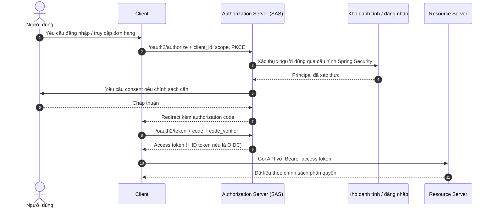

# Phạm vi tính năng của Spring Authorization Server và phần ứng dụng phải tự xây dựng

## 1. Bài toán và ranh giới trách nhiệm

Khi một hệ thống có nhiều ứng dụng web, mobile và API, mỗi ứng dụng không nên tự phát hành access token theo một quy ước riêng. Một **Authorization Server (AS)** tập trung việc xác thực yêu cầu cấp quyền, cấp token theo OAuth 2.0 và cung cấp các giao thức OpenID Connect (OIDC) khi ứng dụng cần đăng nhập liên thông. Trong hệ sinh thái Spring Boot, **Spring Security** cung cấp nền tảng bảo mật, còn **Spring Authorization Server (SAS)** cung cấp các thành phần triển khai vai trò Authorization Server.

Điều quan trọng là phân biệt **hạ tầng giao thức đã được framework cung cấp** với **chức năng sản phẩm mà nhóm phát triển vẫn phải thiết kế, triển khai và vận hành**. SAS giúp xử lý đúng một phần lớn giao thức OAuth 2.0/OIDC; nó không tự biến một ứng dụng Spring Boot thành một hệ thống quản lý danh tính hoàn chỉnh.

| Thành phần | Vai trò chính | Ví dụ |
| --- | --- | --- |
| **Authorization Server** | Nhận yêu cầu ủy quyền, xác thực client, phát hành và quản lý token theo giao thức | Dịch vụ Spring Boot tích hợp SAS tại `auth.example.com` |
| **Resource Owner / End User** | Người dùng sở hữu dữ liệu hoặc có quyền cho phép ứng dụng truy cập | Khách hàng đăng nhập và đồng ý chia sẻ thông tin |
| **Client** | Ứng dụng yêu cầu token để thực hiện thao tác | Web portal, mobile app, dịch vụ backend |
| **Resource Server** | API kiểm tra access token và áp dụng quyền truy cập tài nguyên | API đơn hàng tại `api.example.com` |
| **Identity / User Store** | Lưu và quản lý người dùng, mật khẩu/khóa, trạng thái tài khoản, MFA và chính sách tổ chức | Cơ sở dữ liệu người dùng, LDAP hoặc dịch vụ danh tính ngoài |

Ví dụ: người dùng muốn cho ứng dụng quản lý đơn hàng xem danh sách đơn của mình. Client chuyển trình duyệt tới Authorization Server, người dùng đăng nhập (nếu chưa có phiên), hệ thống thực hiện bước chấp thuận quyền khi cần, rồi client đổi **authorization code** lấy token. Client dùng **access token** gọi Resource Server; chính API đơn hàng quyết định người dùng có được xem đơn cụ thể đó hay không.



Sơ đồ mô tả luồng **Authorization Code + PKCE**. Đường đi cụ thể có thể khác theo loại client và grant type. Trong OAuth 2.0, **ủy quyền truy cập** là mục tiêu cốt lõi; trong OIDC, **xác thực danh tính người dùng** được bổ sung bằng các cơ chế như ID token và UserInfo.

## 2. SAS đã cung cấp những gì?

SAS tổ chức các `SecurityFilterChain`, endpoint, bộ xử lý giao thức, kiểu dữ liệu, cấu hình và điểm mở rộng để ứng dụng triển khai Authorization Server. Các khả năng dưới đây phải được **bật/cấu hình phù hợp** và có thể phụ thuộc phiên bản SAS/Spring Security đang sử dụng.

### 2.1. Endpoint và luồng giao thức

| Nhóm tính năng | Những gì framework xử lý | Việc nhóm phát triển vẫn phải quyết định |
| --- | --- | --- |
| **Authorization Code** | Tiếp nhận yêu cầu `/oauth2/authorize`, kiểm tra tham số, tạo và kiểm soát authorization code, xử lý yêu cầu đổi code tại `/oauth2/token` | Đối tượng người dùng nào được đăng nhập, client nào được sử dụng, redirect URI nào được đăng ký |
| **PKCE** | Xác minh `code_verifier` với `code_challenge` theo cấu hình client | Yêu cầu PKCE cho client phù hợp; chọn cách tích hợp an toàn trên web/mobile |
| **Client Credentials** | Xác thực client và cấp token cho giao tiếp giữa các dịch vụ | Quản lý định danh dịch vụ, credential, scope và quyền tối thiểu |
| **Refresh Token** | Xử lý grant làm mới token và các chính sách hỗ trợ như thời hạn, tái sử dụng token | Có cấp refresh token hay không, thời hạn, cơ chế thu hồi và xử lý mất token |
| **Device Authorization** | Hỗ trợ luồng thiết bị có giao diện nhập mã trên thiết bị khác, cùng các endpoint liên quan | Trải nghiệm hiển thị mã, xác thực người dùng và chính sách chống lạm dụng |
| **Token Revocation / Introspection** | Cung cấp endpoint thu hồi và kiểm tra trạng thái token theo OAuth 2.0 | Client nào được gọi, loại token nào dùng introspection, tác động tới cache |
| **JWK Set và metadata** | Công bố khóa xác minh và metadata để client/Resource Server khám phá cấu hình | Nguồn khóa ký, xoay khóa, issuer, DNS, TLS và cấu hình reverse proxy |
| **OIDC** | Có thể bật OIDC Provider Configuration, ID token, UserInfo, logout theo khả năng từng phiên bản | Dữ liệu profile, claims được công bố, phiên đăng nhập, chính sách logout |
| **Các mở rộng giao thức** | Một số phiên bản có hỗ trợ thêm như Pushed Authorization Requests, Dynamic Client Registration hoặc Token Exchange | Kiểm tra phiên bản và mức hỗ trợ, bật có chủ đích, thiết lập chính sách bổ sung |

Những đường dẫn nêu trên là **đường dẫn mặc định thường dùng**, có thể được điều chỉnh bằng cấu hình `AuthorizationServerSettings`. Không nên dựa vào một bảng endpoint chung để mặc định rằng mọi tính năng đều tự kích hoạt trong mọi phiên bản.

### 2.2. Những khối xây dựng sẵn

- **`RegisteredClient` / `RegisteredClientRepository`**: mô hình và nơi tra cứu ứng dụng khách được phép sử dụng hệ thống, bao gồm `client_id`, cơ chế xác thực client, grant type, redirect URI và scope.
- **`OAuth2Authorization` / `OAuth2AuthorizationService`**: lưu trạng thái các ủy quyền, mã và token phục vụ quá trình cấp token, tra cứu và thu hồi.
- **`OAuth2AuthorizationConsent` / `OAuth2AuthorizationConsentService`**: ghi nhận quyền người dùng đã chấp thuận cho một client (khi luồng và chính sách có dùng consent).
- **`AuthorizationServerSettings`**: cấu hình issuer và các endpoint của Authorization Server.
- **`TokenSettings`, `ClientSettings`**: thiết lập thời hạn token, chính sách refresh token, yêu cầu PKCE và consent theo từng client.
- **`OAuth2TokenCustomizer` cùng các điểm mở rộng**: chèn claim hoặc điều chỉnh một phần xử lý phát hành token theo nhu cầu nghiệp vụ.
- **`JWKSource<SecurityContext>` và bộ xử lý ký token**: tích hợp khóa ký và công bố khóa công khai; ứng dụng phải cung cấp/quản lý khóa.
- **Các implementation lưu trữ mẫu và JDBC**: có đường triển khai nhanh cho phát triển và lựa chọn JDBC để lưu client, authorization, consent; hệ thống thực tế vẫn cần quy hoạch schema, migration, sao lưu và vận hành.

SAS cũng tích hợp với cơ chế xác thực, session, filter và kiểm soát truy cập của Spring Security. Tuy nhiên, **SAS không tự cung cấp dữ liệu người dùng hoặc chính sách tài khoản của doanh nghiệp**. Có hỗ trợ một giao thức không có nghĩa là đã có toàn bộ quy trình sản phẩm tương ứng.

## 3. Những phần ứng dụng phải tự xây dựng

### 3.1. Danh tính, đăng nhập và vòng đời người dùng

Ứng dụng cần lựa chọn cách xác thực người dùng: `UserDetailsService`, cơ sở dữ liệu riêng, LDAP, liên kết với Identity Provider ngoài hoặc một cơ chế tùy biến hợp lệ. Ngoài việc kiểm tra credential, sản phẩm có thể cần đăng ký tài khoản, kích hoạt email, đặt lại mật khẩu, MFA, khóa/mở khóa tài khoản, phát hiện đăng nhập bất thường và quản lý phiên. SAS không tự tạo ra các nghiệp vụ này.

Spring Security có thể tạo trang đăng nhập cơ bản bằng `formLogin()` phục vụ thử nghiệm. **Trang đăng nhập có thương hiệu, khôi phục tài khoản, UX cho MFA, thông báo lỗi và hỗ trợ người dùng** là trách nhiệm của ứng dụng hoặc sản phẩm danh tính bên ngoài.

### 3.2. Đăng ký và quản trị client

Framework biết cách tra cứu một `RegisteredClient`; nó không tự xác định **ai được phép tạo client**, ai phê duyệt redirect URI, cách cấp/đổi client secret, cách đóng client bị lộ credential hay cách phân loại public client và confidential client. Nhóm phát triển phải đặt quy trình quản trị, phân quyền và audit cho các thao tác này.

Một trang quản trị client có thể cần: chủ sở hữu, môi trường, trạng thái hoạt động, grant type được chấp nhận, danh sách redirect URI cố định, scope cho phép, thời hạn credential, lịch sử thay đổi và quy trình thu hồi.

### 3.3. Kho lưu trữ và quản lý khóa

Các kho `InMemory` hữu ích cho demo, nhưng khởi động lại ứng dụng sẽ làm mất trạng thái. Môi trường nhiều instance thường cần lưu client, authorization và consent trong kho bền vững như cơ sở dữ liệu, đồng thời xử lý migration, transaction, backup và tính nhất quán. Chọn JDBC hoặc triển khai repository riêng tùy hệ thống.

Đối với JWT ký bất đối xứng, **khóa riêng là tài sản bảo mật của dịch vụ**. Ứng dụng chịu trách nhiệm tạo/lưu khóa an toàn, giới hạn quyền truy cập, công bố phần khóa công khai qua JWKS, thiết lập `kid`, xoay khóa có giai đoạn chồng lấn và phục hồi sau sự cố. Tạo ngẫu nhiên một cặp RSA mới ở mỗi lần khởi động chỉ thích hợp làm ví dụ kỹ thuật, không phải phương án vận hành.

### 3.4. Quyền nghiệp vụ, scope và dữ liệu claims

Scope như `orders.read` diễn tả phạm vi mà client xin cấp và AS có thể phát hành; nó **không thay thế** việc Resource Server kiểm tra xem người dùng có được xem **đơn hàng số 123** hay không. Phân quyền theo vai trò, chủ sở hữu tài nguyên, phòng ban, tenant hoặc chính sách ABAC cần được thực thi tại nơi xử lý tài nguyên.

Nếu access token hoặc ID token có custom claim (ví dụ tenant, mã định danh nội bộ), phải xác định nguồn tin cậy, ý nghĩa, đối tượng được đọc và giới hạn dữ liệu nhạy cảm. ID token phục vụ client xác minh phiên đăng nhập OIDC; access token phục vụ quyền gọi API. Không dùng ID token làm bearer token gọi API.

### 3.5. Consent, logout và quy trình sản phẩm

SAS quản lý dữ liệu consent và một phần luồng tương tác; sản phẩm phải quyết định khi nào cần hỏi lại, hiển thị scope bằng ngôn ngữ nào, ghi nhận điều gì, và người dùng thu hồi quyền từ đâu. OIDC logout endpoint (nếu bật và được hỗ trợ) không tự giải quyết mọi phiên đăng nhập tại client, phiên người dùng trên nhiều thiết bị và phiên của mọi ứng dụng liên quan.

Các yêu cầu nhiều tenant, liên kết danh tính, đăng nhập mạng xã hội, federation, quản lý thiết bị hay chính sách phê duyệt đặc thù đều cần thiết kế tích hợp riêng.

### 3.6. Bảo mật và vận hành hệ thống

Nhóm triển khai vẫn sở hữu HTTPS, cấu hình reverse proxy, DNS/issuer thống nhất, secret management, giám sát, log có che dữ liệu nhạy cảm, rate limiting, chống dò credential, CSRF đối với giao diện dựa trên cookie, kiểm soát CORS, kiểm thử, nâng cấp phiên bản và ứng phó sự cố. Framework cung cấp cơ chế; việc chọn cấu hình đúng cho môi trường là trách nhiệm của nhóm vận hành.

## 4. Ví dụ ranh giới triển khai trong Spring Boot

Giả sử có **web client public** đăng nhập qua Authorization Code + PKCE và truy cập `orders-api`. Ví dụ dưới đây minh họa cách nối các khối cơ bản theo kiểu API của **Spring Boot 3.x / Spring Authorization Server 1.x**. Phải đối chiếu dependency, API và cách tích hợp theo phiên bản thực tế trước khi sử dụng. Các import được lược bỏ cho dễ tập trung vào trách nhiệm từng phần.

**Phần framework: bật endpoint Authorization Server và OIDC.**

```java
@Configuration
@EnableWebSecurity
class AuthorizationServerSecurityConfig {

    @Bean
    @Order(1)
    SecurityFilterChain authorizationServerChain(HttpSecurity http) throws Exception {
        OAuth2AuthorizationServerConfigurer as =
                OAuth2AuthorizationServerConfigurer.authorizationServer();

        http.securityMatcher(as.getEndpointsMatcher())
                .with(as, configurer -> configurer.oidc(Customizer.withDefaults()))
                .authorizeHttpRequests(auth -> auth.anyRequest().authenticated())
                .exceptionHandling(exceptions -> exceptions.defaultAuthenticationEntryPointFor(
                        new LoginUrlAuthenticationEntryPoint("/login"),
                        new MediaTypeRequestMatcher(MediaType.TEXT_HTML)));

        return http.build();
    }

    @Bean
    @Order(2)
    SecurityFilterChain applicationChain(HttpSecurity http) throws Exception {
        http.authorizeHttpRequests(auth -> auth.anyRequest().authenticated())
                .formLogin(Customizer.withDefaults());
        return http.build();
    }

    @Bean
    AuthorizationServerSettings authorizationServerSettings() {
        return AuthorizationServerSettings.builder()
                .issuer("https://auth.example.com")
                .build();
    }
}
```

Chain thứ nhất xử lý endpoint của Authorization Server; chain thứ hai xử lý đăng nhập người dùng và những URL ứng dụng khác. `formLogin()` chỉ là một lựa chọn cho bước xác thực người dùng. **Cấu hình này chưa phải một Authorization Server hoàn chỉnh để chạy production:** vẫn cần các bean kho client, authorization/consent, nguồn người dùng, nguồn khóa ký, cấu hình triển khai, và các chính sách thích hợp.

**Phần ứng dụng: quyết định một client được phép làm gì.**

```java
@Bean
RegisteredClientRepository registeredClientRepository() {
    RegisteredClient client = RegisteredClient.withId(UUID.randomUUID().toString())
            .clientId("public-web")
            .clientAuthenticationMethod(ClientAuthenticationMethod.NONE)
            .authorizationGrantType(AuthorizationGrantType.AUTHORIZATION_CODE)
            .redirectUri("http://127.0.0.1:8081/callback")
            .scope(OidcScopes.OPENID)
            .scope(OidcScopes.PROFILE)
            .scope("orders.read")
            .clientSettings(ClientSettings.builder()
                    .requireProofKey(true)
                    .requireAuthorizationConsent(true)
                    .build())
            .tokenSettings(TokenSettings.builder()
                    .accessTokenTimeToLive(Duration.ofMinutes(10))
                    .build())
            .build();

    return new InMemoryRegisteredClientRepository(client);
}
```

Đoạn mã cho thấy SAS cung cấp **mô hình** `RegisteredClient`, còn đội ngũ phát triển chọn `client_id`, grant type, redirect URI, scope, PKCE và consent. Đây là **public client**, không sử dụng client secret, nên PKCE đặc biệt quan trọng. Redirect URI dùng HTTP loopback chỉ nhằm minh họa môi trường cục bộ; ứng dụng web triển khai công khai cần URI đã đăng ký chính xác qua HTTPS. Kho `InMemoryRegisteredClientRepository` cũng chỉ phù hợp ví dụ, không bảo toàn client qua lần khởi động lại.

Đối với ứng dụng backend bảo mật được client secret, có thể chọn **confidential client**, cơ chế xác thực thích hợp và quy trình quản lý secret. Không được đưa secret cố định vào mã nguồn hoặc frontend.

**Phần Resource Server: thực thi quyền ở API.** API đơn hàng thường xác thực access token bằng hỗ trợ OAuth 2.0 Resource Server của Spring Security, ví dụ cấu hình JWT với `issuer-uri` hoặc `jwk-set-uri`. Sau khi kiểm tra chữ ký, issuer, thời hạn và các điều kiện cần thiết, API phải kiểm tra **audience/scope thích hợp và quyền trên dữ liệu cụ thể**. Quy tắc “khách hàng chỉ xem được đơn của mình” vẫn phải được hiện thực trong nghiệp vụ API, không thể chỉ dựa vào việc SAS cấp token thành công.

## 5. Một yêu cầu thực tế đi qua những lớp nào?

Với ví dụ đăng nhập web portal để đọc danh sách đơn hàng:

1. **Đội phát triển** tạo `RegisteredClient` `public-web` với redirect URI đã đăng ký, grant `authorization_code`, scope `openid`, `profile`, `orders.read` và yêu cầu PKCE.
2. **Client** sinh `code_verifier`, `code_challenge`, `state` (và `nonce` nếu luồng OIDC cần), rồi mở yêu cầu authorization.
3. **SAS** kiểm tra client, redirect URI, scope và thông số giao thức. **Ứng dụng xác thực người dùng** qua cơ chế Spring Security đã tích hợp; khi cần, luồng consent hỏi người dùng trước khi cấp quyền.
4. **SAS** phát hành authorization code có thời hạn và gắn với yêu cầu tương ứng. Client đổi code cùng `code_verifier` tại token endpoint.
5. **SAS** tạo access token và, khi đủ điều kiện OIDC, ID token. Việc ký, claims, thời hạn và kho trạng thái dựa trên các bean/chính sách đã cấu hình.
6. **Client** gửi access token đến `orders-api`. **Resource Server** xác thực token rồi kiểm tra scope và quyền trên từng đơn trước khi trả dữ liệu.

Nếu client thay `redirect_uri`, gửi `code_verifier` sai hoặc xin scope ngoài danh sách cho phép, Authorization Server phải từ chối ở lớp giao thức. Nếu token hợp lệ nhưng người dùng cố xem đơn của người khác, Resource Server vẫn phải từ chối ở lớp nghiệp vụ. Hai loại kiểm tra giải quyết **hai rủi ro khác nhau**.

## 6. Checklist thiết kế theo phạm vi sở hữu

| Câu hỏi trước khi triển khai | Chủ thể chịu trách nhiệm chính |
| --- | --- |
| Chọn grant type, cơ chế client authentication và PKCE phù hợp? | Nhóm ứng dụng cấu hình SAS theo giao thức |
| Ai đăng ký, phê duyệt và thu hồi client/redirect URI? | Nhóm sản phẩm danh tính và quản trị |
| Người dùng đăng nhập, đặt lại mật khẩu, dùng MFA bằng cách nào? | Dịch vụ danh tính và cơ chế Spring Security tích hợp |
| Client, authorization và consent lưu ở đâu khi chạy nhiều instance? | Nhóm ứng dụng và nền tảng dữ liệu |
| Ai giữ khóa ký, xoay khóa, xuất JWKS, phục hồi sau sự cố? | Nhóm bảo mật và vận hành |
| Thời hạn access/refresh token và chính sách thu hồi là gì? | Nhóm bảo mật xác định chính sách; ứng dụng cấu hình |
| Claim nào được tiết lộ? Claim nào là dữ liệu nhạy cảm? | Nhóm danh tính, nghiệp vụ và bảo mật |
| API dựa vào scope, audience, tenant, ownership thế nào? | Mỗi Resource Server và chủ sở hữu nghiệp vụ |
| Ai phát hiện token abuse, login abuse và sự cố xác thực? | Nhóm vận hành, an ninh và quan sát hệ thống |

Các điểm cần kiểm tra trước khi đưa vào môi trường thật:

- **Giao thức và URL:** issuer nhất quán giữa token, discovery và Resource Server; HTTPS ở môi trường triển khai; redirect URI khớp chính xác; hạn chế tối đa grant type và scope; dùng PKCE theo loại client.
- **Khóa và credential:** khóa ký bền vững, được bảo vệ, hỗ trợ rotation; secret qua kho bí mật thay vì mã nguồn; thông tin nhạy cảm không xuất hiện trong URL log hoặc log ứng dụng.
- **Dữ liệu và phiên:** persistence phù hợp với nhiều instance, sao lưu/khôi phục, chiến lược refresh token, session và logout; cân nhắc độ trễ giữa thu hồi token và hiệu lực của JWT đã cấp.
- **Bảo vệ bề mặt tấn công:** CSRF cho trang đăng nhập/consent dựa trên cookie, CORS có chủ đích, rate limiting và giám sát các endpoint nhạy cảm, kiểm soát brute force và replay.
- **Quyền ở API:** xác thực issuer, chữ ký, thời hạn, audience và scope theo hợp đồng API; kiểm tra quyền từng đối tượng tài nguyên; không coi claim do client tự gửi là dữ liệu đáng tin.
- **Khả năng vận hành:** health check, metrics về lỗi cấp token, log với correlation ID, cảnh báo tăng đột biến lỗi đăng nhập/ủy quyền, nâng cấp dependency và kiểm thử khôi phục.

**Lưu ý về JWT và thu hồi:** Một JWT đã được phát hành có thể được Resource Server xác minh độc lập cho tới khi hết hạn. Gọi endpoint revoke không tự bảo đảm mọi API sẽ từ chối ngay JWT đó nếu API chỉ kiểm tra chữ ký và thời gian. Nếu yêu cầu thu hồi tức thì, cần thiết kế thêm cơ chế kiểm tra trạng thái, thời hạn access token ngắn hoặc giải pháp phù hợp với mức độ rủi ro.

## 7. Các trường hợp kiểm thử cần có

| Trường hợp | Kỳ vọng | Lớp cần kiểm chứng |
| --- | --- | --- |
| Authorization Code + PKCE hợp lệ | Nhận code rồi đổi được access token | SAS + cấu hình client |
| Thiếu/sai `code_verifier` khi client yêu cầu PKCE | Yêu cầu đổi code bị từ chối | SAS + `ClientSettings` |
| Redirect URI không đăng ký | Yêu cầu ủy quyền bị từ chối an toàn | SAS + danh sách URI |
| Client xin scope không được cấp | Không phát hành quyền vượt danh sách cho phép | SAS + chính sách scope |
| Code được dùng lại hoặc hết hạn | Không thể đổi token thêm lần nữa | SAS + kho authorization |
| Người dùng chưa đăng nhập hoặc không đủ điều kiện | Điều hướng xác thực hoặc từ chối theo chính sách | Cơ chế đăng nhập của ứng dụng |
| Consent được yêu cầu nhưng chưa chấp thuận | Không cấp quyền trước khi người dùng đồng ý | SAS + giao diện/chính sách consent |
| Token hết hạn, sai issuer/audience hoặc chữ ký không hợp lệ | API từ chối token | Resource Server |
| Token hợp lệ nhưng truy cập dữ liệu của người khác | API trả 403 hoặc phản hồi phù hợp chính sách | Quyền nghiệp vụ của API |
| Khởi động lại hoặc đổi instance | Client và trạng thái cần thiết vẫn tồn tại | Persistence/triển khai |
| Xoay khóa ký | Token cũ còn được xác minh trong giai đoạn chuyển tiếp đã thiết kế | JWK/Resource Server |
| Ghi log giao thức | Quan sát đủ lỗi nhưng không lộ code, token hoặc secret | Vận hành/bảo mật |

Đối với những luồng đã bật như Client Credentials, Device Authorization, Refresh Token, OIDC UserInfo hoặc Logout, cần bổ sung ca kiểm thử tương ứng; không kết luận hệ thống “hỗ trợ OIDC” chỉ vì login qua trình duyệt đã chạy được.

## 8. Những hiểu lầm thường gặp

**“Thêm dependency SAS là có đầy đủ Identity Provider.”** Dependency tạo nền tảng endpoint và giao thức, còn user store, MFA, account lifecycle, UI và hoạt động vận hành phải được cung cấp riêng.

**“Scope `orders.read` cho phép đọc mọi đơn hàng.”** Scope chỉ biểu thị một khả năng truy cập đã được ủy quyền ở mức client/request; kiểm tra chủ sở hữu đơn vẫn thuộc API.

**“Access token và ID token thay thế được cho nhau.”** ID token chứng minh kết quả xác thực cho OIDC client; access token là bằng chứng quyền gọi Resource Server. Mỗi token có mục đích và đối tượng nhận khác nhau.

**“Revoke token là JWT ngừng dùng được ngay ở mọi API.”** Điều này phụ thuộc cách Resource Server kiểm tra token và cơ chế thu hồi đã thiết kế.

**“Có endpoint logout nghĩa là mọi phiên trên mọi ứng dụng đều kết thúc.”** Trạng thái phiên và logout liên ứng dụng cần hợp đồng rõ ràng với từng client, trình duyệt và dịch vụ liên quan.

**“Cấu hình ví dụ `InMemory` và sinh khóa khi startup đủ để chạy production.”** Dữ liệu và khóa không bền vững sẽ phá vỡ trải nghiệm đăng nhập, xác minh token và khôi phục sự cố khi restart hoặc mở rộng nhiều instance.

## 9. Kết quả học tập cần đạt

Sau bài này, người học cần phân biệt được ba trách nhiệm: **SAS thực thi giao thức cấp quyền/token**, **ứng dụng danh tính cung cấp đăng nhập và quản trị người dùng/client**, còn **Resource Server thực thi quyền truy cập API và dữ liệu**. Khi thiết kế một Authorization Server bằng Spring Boot, hãy vẽ ranh giới này trước khi chọn endpoint, grant type hay kho dữ liệu; đó là cách tránh bỏ sót những chức năng mà framework không thể quyết định thay cho sản phẩm.
