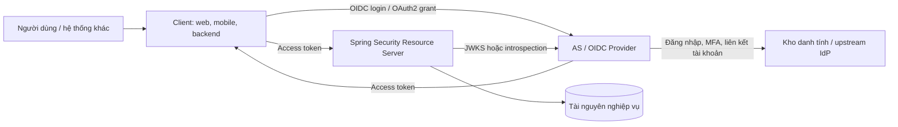

# Đánh giá lựa chọn tự xây Authorization Server hay sử dụng Identity Provider có sẵn

## Mục tiêu bài học

Khi một ứng dụng Spring Boot cần đăng nhập tập trung (SSO), cấp quyền truy cập API hoặc tích hợp với hệ thống danh tính doanh nghiệp, nhóm phát triển phải lựa chọn **tự xây OAuth 2.0/OpenID Connect Authorization Server trên nền Spring Security và Spring Authorization Server**, **vận hành một Identity Provider (IdP) đóng gói**, hoặc **sử dụng IdP do nhà cung cấp quản lý**. Quyết định này ảnh hưởng lâu dài đến kiến trúc bảo mật, trải nghiệm người dùng, chi phí, khả năng mở rộng và khả năng chuyển đổi nhà cung cấp.

Sau bài học, người học có thể:

- Phân biệt phạm vi của Authorization Server, OpenID Connect Provider, Identity Provider, ứng dụng khách và Resource Server.
- Nhận diện phần Spring Authorization Server hỗ trợ và phần sản phẩm danh tính hoàn chỉnh vẫn phải tự xây.
- So sánh ba phương án bằng yêu cầu bắt buộc, năng lực vận hành, tổng chi phí sở hữu và rủi ro.
- Xây bộ tiêu chí kiểm chứng bảo mật, tính sẵn sàng, khả năng tích hợp và lộ trình chuyển đổi trước khi đưa ra quyết định.

> **Nguyên tắc định hướng:** Tự triển khai Authorization Server có thể hợp lý khi cần kiểm soát hoặc tùy biến sâu và có năng lực duy trì an toàn trong nhiều năm. Nếu nhu cầu chủ yếu là đăng nhập, MFA, SSO, quản trị người dùng và liên kết danh tính, hãy đánh giá sản phẩm IdP có sẵn trước. Kết luận cuối cùng phải dựa trên yêu cầu thực tế và kết quả thử nghiệm, không dựa riêng vào số dòng code hay phí giấy phép.

## 1. Hiểu đúng vấn đề cần giải quyết

### 1.1. Các vai trò trong OAuth 2.0 và OpenID Connect

| Khái niệm | Trách nhiệm chính | Câu hỏi cần đặt ra |
|---|---|---|
| **Authorization Server (AS)** | Xác thực yêu cầu cấp quyền, quản lý client, phát hành token, công bố metadata và khóa xác minh; xử lý các luồng OAuth 2.0 được hỗ trợ. | Ai được phép lấy token, với quyền nào, cho tài nguyên nào? |
| **OpenID Provider (OP)** | AS hỗ trợ OpenID Connect (OIDC), phát hành ID Token và cung cấp thông tin định danh theo giao thức. | Ứng dụng xác thực người dùng thông qua nhà phát hành nào? |
| **Identity Provider (IdP)** | Hệ thống cung cấp hoặc liên kết danh tính; thường có đăng nhập, MFA, quản lý tài khoản, SSO và các khả năng doanh nghiệp. | Danh tính được tạo, bảo vệ, khôi phục và liên kết thế nào? |
| **OAuth 2.0 Client / OIDC Relying Party** | Ứng dụng web, mobile hoặc backend yêu cầu cấp quyền/đăng nhập qua AS/OP. | Ứng dụng chuyển người dùng đi đăng nhập và nhận token ra sao? |
| **Resource Server** | API kiểm tra access token và áp dụng quyền truy cập đối với tài nguyên. | Token này có đúng nhà phát hành, đối tượng nhận và quyền cần thiết không? |

**OAuth 2.0 là cơ chế ủy quyền**, còn **OIDC bổ sung lớp xác thực người dùng**. Một access token không mặc nhiên là bằng chứng đăng nhập dành cho client; client OIDC sử dụng ID Token cùng quá trình xác minh tương ứng. Ngoài ra, việc phát hành JWT chỉ là một phần trong vận hành AS: còn có định danh người dùng, quản lý phiên, chính sách truy cập, vòng đời khóa ký, thu hồi quyền và xử lý sự cố.

Ví dụ, một hệ thống có ứng dụng bán hàng Spring Boot, ứng dụng mobile và ba API nội bộ cần đồng thời: người dùng đăng nhập SSO; ứng dụng mobile sử dụng Authorization Code + PKCE; API chấp nhận token theo `issuer` và `audience`; nhân viên đăng nhập qua tài khoản doanh nghiệp; đội vận hành phải có audit log và khả năng vô hiệu hóa phiên. Chỉ thêm chức năng sinh JWT vào ứng dụng hiện có sẽ không giải quyết đầy đủ các yêu cầu này.

### 1.2. Ba phương án khác nhau

1. **Tự xây bằng Spring Authorization Server:** phát triển và vận hành một dịch vụ cấp token tùy biến theo nghiệp vụ. Framework cung cấp nền tảng giao thức; nhóm sở hữu tích hợp danh tính, lưu trữ, quản trị, vận hành và phần bảo mật bổ sung.
2. **Dùng IdP đóng gói, tự vận hành:** triển khai sản phẩm như Keycloak trên hạ tầng của tổ chức. Nhóm ít phải tự lập trình các chức năng danh tính phổ biến hơn, nhưng vẫn phải vá lỗi, vận hành, sao lưu, giám sát và cấu hình an toàn.
3. **Dùng IdP được quản lý:** tích hợp dịch vụ như Auth0, Okta, Amazon Cognito hoặc Microsoft Entra theo đúng sản phẩm/gói phù hợp. Nhà cung cấp đảm nhận nhiều việc vận hành nền tảng, còn ứng dụng vẫn chịu trách nhiệm cấu hình client, quyền truy cập, dữ liệu người dùng, token validation và hợp đồng dịch vụ.

Dù chọn phương án nào, **Spring Security vẫn có thể đóng vai trò OAuth2 Client và Resource Server**. Không cần tự triển khai AS chỉ vì backend được viết bằng Spring Boot.



Sơ đồ thể hiện các vai trò logic. Resource Server dùng JWKS để xác minh chữ ký JWT ngoại tuyến hoặc gọi introspection nếu dùng opaque token/chiến lược kiểm tra tập trung; không nhất thiết gọi AS ở mỗi request. IdP upstream có thể không tồn tại khi AS tự quản lý tài khoản nội bộ.

## 2. Spring Authorization Server thực sự cung cấp gì?

**Spring Authorization Server** là nền tảng xây AS/OIDC Provider trên Spring Security. Tài liệu chính thức công bố các nhóm khả năng như Authorization Code, Client Credentials, Refresh Token, Device Authorization, Token Exchange, các endpoint authorize/token/revocation/introspection, metadata, JWKS và các endpoint OIDC theo cấu hình. Việc một endpoint hoặc tính năng có mặt trong framework **không có nghĩa là hệ thống thành phẩm đã có đầy đủ màn hình quản trị, đăng ký người dùng, quy trình phê duyệt, MFA, quản lý vòng đời tài khoản hoặc vận hành production**. Tính sẵn có và mặc định cụ thể phụ thuộc phiên bản cùng cấu hình.

Nếu tự xây, cần xác định rõ trách nhiệm của từng thành phần:

| Thành phần / cơ chế | Chức năng cần thiết | Quyết định triển khai |
|---|---|---|
| `RegisteredClientRepository` | Lưu client, redirect URI, grant, scope, chính sách xác thực client. | Dùng lưu trữ bền vững và quy trình cấp/thu hồi client có kiểm soát. |
| `OAuth2AuthorizationService` | Lưu trạng thái authorization, authorization code, token và thông tin liên quan. | Thiết kế transaction, lưu trữ bền vững, chính sách xóa và xử lý token hết hạn. |
| `OAuth2AuthorizationConsentService` | Lưu quyết định đồng ý cấp quyền theo client/người dùng. | Xác định scope cần consent, giao diện hiển thị và thao tác rút lại quyền. |
| `JWKSource`, token generator / encoder | Ký token, công bố khóa công khai và tùy biến claim. | Bảo vệ khóa riêng, phân tách môi trường, định kỳ luân chuyển khóa, chuẩn bị sự cố lộ khóa. |
| Chuỗi `SecurityFilterChain` cho AS và đăng nhập | Bảo vệ endpoint giao thức và giao diện xác thực. | Thiết kế chính sách phiên, CSRF, brute force, MFA, cookie và truy cập quản trị. |
| Dịch vụ quản lý danh tính và phân quyền | Tài khoản, nhóm, vai trò, vòng đời người dùng, tích hợp upstream IdP. | Thường phải xây hoặc kết nối riêng; tránh đồng nhất `scope` với quyền nghiệp vụ chi tiết. |
| Hạ tầng vận hành | Cơ sở dữ liệu, cân bằng tải, quan sát, backup, xử lý sự cố. | Chịu trách nhiệm về SLA thực tế, độ tin cậy và khả năng khôi phục. |

Framework có các implementation in-memory phục vụ phát triển/kiểm thử và các implementation JDBC cho một số repository/service. Không coi trạng thái in-memory là lưu trữ production bền vững; cấu hình JDBC cũng không tự giải quyết tối ưu truy vấn, migration schema, quản trị dữ liệu hay tính sẵn sàng cao.

### 2.1. Một quyết định kiến trúc quan trọng: ai sở hữu danh tính?

- **AS tự quản lý người dùng:** phải có cơ chế tạo tài khoản, xác thực, MFA, thay đổi mật khẩu, khôi phục tài khoản, khóa tài khoản, audit và quy trình xử lý lộ thông tin xác thực.
- **AS đóng vai trò môi giới danh tính (broker/federation):** người dùng đăng nhập ở upstream IdP; vẫn phải giải quyết ánh xạ người dùng, liên kết tài khoản an toàn, claim, tenant, phiên và logout.
- **Ứng dụng sử dụng IdP trực tiếp:** giảm một lớp cần vận hành; phù hợp nếu không có nhu cầu biến đổi chính sách token hoặc giao thức vượt khả năng sản phẩm.

Không nên xây một AS trung gian chỉ để “đổi tên claim” nếu yêu cầu có thể xử lý bằng cấu hình IdP, mapper, gateway hoặc cơ chế mapping authority an toàn ở Resource Server.

## 3. Các tiêu chí bắt buộc phải xác nhận trước khi chấm điểm

Trước khi so sánh chi phí hay độ linh hoạt, xác định các **điều kiện loại trừ (hard gates)**. Phương án không đáp ứng yêu cầu bắt buộc cần bị loại hoặc chỉ được giữ lại nếu có cách bù đắp được phê duyệt và kiểm chứng.

| Nhóm điều kiện | Câu hỏi kiểm tra | Bằng chứng chấp nhận |
|---|---|---|
| Chuẩn giao thức | Các client cần OIDC, OAuth 2.0, SAML 2.0, Device Authorization, Token Exchange, SCIM hay chức năng chuyên biệt nào? | Danh mục phiên bản/tính năng và kiểm thử liên thông với từng client thực tế. |
| Bảo mật | Có yêu cầu MFA chống phishing, chính sách truy cập theo rủi ro, session management, thu hồi token, quản lý khóa bằng KMS/HSM không? | Cấu hình, thử nghiệm tấn công, bằng chứng quy trình vận hành. |
| Danh tính & SSO | Cần AD/LDAP, đăng nhập liên kết đối tác, nhiều tenant, self-service, account recovery không? | PoC trên nguồn danh tính và luồng người dùng thực tế. |
| Pháp lý & dữ liệu | Dữ liệu nào cần ở khu vực cụ thể, có yêu cầu kiểm toán/hợp đồng/retention/xóa dữ liệu không? | DPA, vị trí xử lý dữ liệu, chính sách lưu trữ và quy trình xóa. |
| Sẵn sàng | Đăng nhập có phải hoạt động liên tục khi một vùng/cloud gặp sự cố? RTO/RPO và SLO là gì? | Kiến trúc HA/DR và kết quả diễn tập chuyển vùng, phục hồi. |
| Chi phí | Giá có phụ thuộc MAU, số tổ chức, MFA, enterprise connection, API, môi trường hay hỗ trợ không? | Báo giá theo mô hình tải 12–36 tháng, chi phí nhân sự và hạ tầng. |
| Khả năng thoát | Có xuất được tài khoản, cấu hình tenant, logs, user ID và liên kết danh tính khi chuyển hệ thống không? | Kế hoạch migration và thử nhập/xuất dữ liệu được phép. |

**Cần hỏi “hệ thống nào chịu trách nhiệm?” thay vì chỉ hỏi “có tính năng không?”**. Một chức năng MFA của nhà cung cấp có thể chỉ có trong gói cụ thể; một triển khai Keycloak có thể hỗ trợ cơ chế mong muốn nhưng đội vận hành vẫn phải chịu trách nhiệm cập nhật và đảm bảo liên tục dịch vụ. Mọi tuyên bố về tính năng, chứng nhận, địa điểm dữ liệu hoặc SLA phải được kiểm tra theo phiên bản, gói dịch vụ và điều khoản cụ thể.

## 4. So sánh tổng thể ba phương án

| Tiêu chí | Tự xây với Spring Authorization Server | IdP đóng gói tự vận hành | IdP được quản lý |
|---|---|---|---|
| Tùy biến giao thức/nghiệp vụ đặc thù | Rất cao, đổi lại phải tự kiểm chứng. | Theo extension/SPI và giới hạn sản phẩm. | Theo cấu hình, hook/action/API và giới hạn gói. |
| Đăng nhập, MFA, self-service, giao diện quản trị | Tự xây hoặc tích hợp các hệ thống khác. | Thường có nhiều tính năng sẵn; phải cấu hình và kiểm thử. | Thường có nhiều tính năng sẵn; phụ thuộc gói. |
| SSO, AD/LDAP, SAML, OIDC federation | Cần tự tích hợp hoặc chọn thành phần bổ sung. | Phụ thuộc sản phẩm và bộ kết nối. | Phụ thuộc nhà cung cấp, loại kết nối và gói. |
| Kiểm soát dữ liệu/khóa ký | Chủ động nhất nhưng tự chịu trách nhiệm. | Cao nếu triển khai trên hạ tầng kiểm soát. | Phụ thuộc địa điểm dữ liệu, mô hình quản lý khóa và hợp đồng. |
| Vá lỗi và bảo mật nền tảng | Đội tự quản lý framework, custom code và hệ thống. | Đội vận hành quản lý bản vá sản phẩm và hạ tầng. | Nhà cung cấp quản lý phần dịch vụ; khách hàng vẫn phải cấu hình an toàn. |
| Khả năng mở rộng/HA/DR | Tự thiết kế và chứng minh. | Tự thiết kế theo hướng dẫn sản phẩm. | Dựa trên kiến trúc, hạn mức và cam kết của dịch vụ. |
| Triển khai ban đầu | Có thể nhanh cho luồng tối giản, chậm hơn khi thành sản phẩm danh tính đầy đủ. | Thường nhanh hơn tự xây chức năng phổ biến. | Thường nhanh cho use case tiêu chuẩn. |
| Chi phí trực tiếp | Công sức xây dựng, nhân sự lâu dài, hạ tầng và kiểm thử. | Hạ tầng, vận hành, hỗ trợ/giấy phép nếu áp dụng. | Thuê bao/usage/MAU/kết nối/hỗ trợ tùy bảng giá. |
| Phụ thuộc giải pháp | Phụ thuộc vào code nội bộ và framework. | Phụ thuộc sản phẩm, phiên bản và extension. | Phụ thuộc API, chính sách, giá và vòng đời nhà cung cấp. |

Không có cột nào “an toàn mặc định” cho mọi tình huống. Ví dụ, tự xây có thể kiểm soát chính xác claim nhưng thiếu nhân sự bảo mật; IdP SaaS có thể giảm nhiều gánh nặng vận hành nhưng không đáp ứng yêu cầu vùng lưu trữ dữ liệu; IdP tự vận hành có sẵn SSO nhưng vẫn cần đội xử lý failover và upgrade.

### 4.1. Khi nào nên nghiêng về tự xây?

Tự xây AS đáng đưa vào danh sách cuối khi **đồng thời** có các điều kiện sau:

1. Có yêu cầu bắt buộc về xử lý grant, claim, token hoặc tích hợp đặc thù mà giải pháp có sẵn không đáp ứng sau PoC.
2. Tổ chức kiểm soát được vòng đời người dùng và có đội sở hữu kỹ thuật, bảo mật, SRE, trực sự cố.
3. Có ngân sách cho bảo trì dài hạn, kiểm thử giao thức, quản trị khóa ký, vận hành 24/7 theo SLO.
4. Lợi ích của kiểm soát sâu hoặc ràng buộc đặc thù lớn hơn chi phí và rủi ro bổ sung.

Ví dụ: một nền tảng nội bộ có quy trình cấp token gắn với phê duyệt nghiệp vụ độc đáo và cần nhiều dạng token theo hệ sinh thái riêng. Trước khi xây, nên kiểm chứng khả năng giải quyết bằng extension/token exchange/policy của IdP hiện hữu.

### 4.2. Khi nào ưu tiên IdP có sẵn?

Ưu tiên khảo sát IdP có sẵn khi phạm vi chủ yếu là **OIDC login, SSO, MFA, quản trị tài khoản, kết nối danh tính doanh nghiệp và vận hành theo thông lệ**. Chọn giữa IdP tự vận hành và managed theo quyền kiểm soát dữ liệu, mức chấp nhận vận hành, độ linh hoạt, cam kết hỗ trợ và TCO. Một đội nhỏ nhưng cần SSO/MFA thường thu lợi lớn từ giải pháp được quản lý; đội có hạ tầng sẵn và yêu cầu vận hành nội bộ có thể hợp với IdP đóng gói.

### 4.3. Phương án kết hợp

Kiến trúc lai vẫn là một lựa chọn thực tế: ứng dụng Spring Security xác thực qua IdP có sẵn; API sử dụng JWT/opaque token theo chuẩn; một dịch vụ quản lý quyền nghiệp vụ ở phía ứng dụng áp dụng kiểm tra domain-specific; hoặc AS nội bộ liên kết danh tính với upstream IdP khi thật sự cần lớp phát hành token riêng.

Chỉ thêm một lớp token issuer khi có lý do rõ ràng về trust boundary, kiểm soát audience, token exchange, chính sách hoặc yêu cầu tích hợp. Mỗi lớp bổ sung làm tăng độ phức tạp của `issuer`, phiên, logout, khóa và đường đi khắc phục lỗi.

## 5. Trách nhiệm bảo mật không được bỏ qua

Dù dùng sản phẩm có sẵn, hệ thống khách vẫn phải cấu hình chính xác. Với tự xây, nhóm cần **thiết kế, triển khai, kiểm thử và vận hành** cả các điều khiển sau:

### 5.1. Giao thức và client

- Ưu tiên **Authorization Code + PKCE (`S256`)** cho luồng đăng nhập tương tác; public client không chứa bí mật có thể bảo vệ như backend. Theo RFC 9700, AS phải hỗ trợ PKCE; public client phải dùng PKCE, còn confidential client cũng được khuyến nghị sử dụng.
- Đăng ký và đối chiếu chính xác `redirect_uri`; không cho phép wildcard tùy ý, redirect mở hoặc tiếp nhận `client_id` từ ngữ cảnh chưa được xác thực.
- Chống CSRF và trộn phiên: dùng `state` theo phiên giao dịch; với OIDC, kiểm tra `nonce` khi áp dụng, đồng thời ràng buộc phản hồi với giao dịch khởi tạo. Bảo vệ `code_verifier` và session phía client.
- Không thiết kế mới bằng Implicit grant hoặc Resource Owner Password Credentials grant; các luồng này không phù hợp thực hành bảo mật hiện đại theo RFC 9700. Với M2M, dùng `client_credentials` cùng cơ chế xác thực client thích hợp.
- Áp dụng nguyên tắc ít quyền cho scope, audience và consent; không nhét mật khẩu, thông tin bí mật hoặc dữ liệu cá nhân không cần thiết vào JWT.

### 5.2. Token, khóa ký và Resource Server

- Kiểm tra **chữ ký, thuật toán chấp nhận, `iss`, `aud`, `exp`, `nbf`** (khi có), loại token và quyền phù hợp. Ở nhiều cấu hình Resource Server, việc đặt `issuer-uri` chỉ giải quyết discovery, JWKS và issuer; cần thêm validator cho `aud` theo API. Không dùng ID Token làm access token.
- Bảo vệ khóa ký riêng, hỗ trợ `kid`/JWKS, luân chuyển khóa có thời gian chồng lấp và phương án thu hồi khi lộ khóa. Hạn chế truy cập khóa qua KMS/HSM khi yêu cầu, phân tách dev/staging/prod và theo dõi mọi thao tác quản trị.
- Cân nhắc access token sống ngắn. **Thu hồi JWT đã phát hành không tự động có hiệu lực tức thời** tại Resource Server xác minh ngoại tuyến; cần phối hợp TTL ngắn, danh sách chặn, introspection hoặc cơ chế session/sự kiện tùy độ nhạy.
- Khi phát refresh token cho public client, RFC 9700 yêu cầu **sender-constrained refresh token hoặc refresh token rotation** để phát hiện replay; phải xác định rõ hành vi thu hồi cả họ token khi phát hiện reuse. Với confidential client vẫn phải ràng buộc token với client và bảo vệ kênh truyền.
- Với API nhạy cảm, đánh giá mTLS/DPoP (sender-constrained token), chứng chỉ, chính sách cấp quyền theo từng endpoint và thời gian đồng bộ.

### 5.3. Xác thực người dùng và vận hành

- MFA/passkeys khi cần, bảo vệ đăng nhập chống brute force/credential stuffing, xác thực email, khôi phục tài khoản, chặn liên kết tài khoản sai và kiểm tra nâng quyền.
- TLS, cookie `Secure`/`HttpOnly`/`SameSite` phù hợp, CSRF protection ở các luồng dùng cookie, chống clickjacking, kiểm soát CORS và cấu hình reverse proxy tin cậy.
- Audit truy cập quản trị, đăng ký client, đổi policy, thay khóa và các sự kiện đăng nhập bất thường; log không chứa token, mật khẩu hoặc khóa riêng.
- Sao lưu dữ liệu cấu hình, quyền đồng ý, session/authorization tùy yêu cầu; thử khôi phục định kỳ và đo RTO/RPO, thay vì chỉ kiểm tra có bản backup.
- Bản vá thư viện và hệ điều hành, quét phụ thuộc, chạy thử failover, rate limiting, bảo vệ endpoint nhạy cảm trước DDoS; quy trình on-call và diễn tập sự cố lộ credential/khóa.

**Bộ kiểm thử bảo mật tối thiểu của PoC:** sửa `redirect_uri`; tráo `state`/`nonce`; gửi sai/mất `code_verifier`; dùng lại authorization code; phát lại refresh token; gửi token sai `iss` hoặc `aud`; token hết hạn/chữ ký sai; xâm nhập chéo tenant; thực hiện logout và thử dùng lại phiên/token. Kết quả phải thể hiện yêu cầu nào bị từ chối và vì sao.

## 6. So sánh chi phí bằng TCO và rủi ro

Chi phí không chỉ là thuê bao hoặc vài sprint viết code. Hãy xác định cùng một phạm vi chức năng và chân trời đánh giá, chẳng hạn 36 tháng:

```text
TCO = Chi phí triển khai ban đầu
    + Chi phí hạ tầng / giấy phép / mức sử dụng
    + Chi phí đội ngũ vận hành, hỗ trợ, nâng cấp
    + Chi phí kiểm thử bảo mật, tuân thủ, DR
    + Chi phí tích hợp, thay đổi và thoát giải pháp
    + Dự phòng rủi ro sự cố theo đánh giá nội bộ
```

Các câu hỏi kiểm tra mẫu:

- Với managed IdP, phí có tăng theo monthly active users, kết nối SAML, số tenant, MFA, SMS, API call, môi trường non-production hoặc mức hỗ trợ không?
- Với IdP tự vận hành, đã tính database HA, vùng dự phòng, giám sát, nâng cấp phiên bản, on-call và hỗ trợ thương mại nếu cần chưa?
- Với tự xây AS, đã tính chi phí kiểm thử giao thức, threat modeling, khóa ký, lifecycle danh tính, UI quản trị, onboarding client, phòng ngừa abuse và việc mất tập trung vào sản phẩm lõi chưa?
- Chi phí chuyển đổi sau hai năm nếu giá hoặc yêu cầu thay đổi là bao nhiêu?

Có thể dùng ma trận điểm để thảo luận liên phòng ban. Bảng dưới là **ví dụ giả định mang tính minh họa**, không phải điểm xếp hạng cố hữu của công nghệ hay nhà cung cấp:

| Tiêu chí | Trọng số | Tự xây AS | IdP đóng gói | Managed IdP |
|---|---:|---:|---:|---:|
| Mức sẵn sàng cho yêu cầu bảo mật/tuân thủ | 30% | 3 | 4 | 5 |
| Tích hợp chuẩn / hệ thống danh tính sẵn có | 20% | 3 | 4 | 5 |
| Mức đáp ứng tùy biến đặc thù | 20% | 5 | 3 | 3 |
| Năng lực vận hành trong đội hiện tại | 20% | 2 | 3 | 5 |
| TCO theo dự toán của tình huống | 10% | 3 | 4 | 3 |
| **Điểm có trọng số (thang 5)** | **100%** | **3,2** | **3,6** | **4,4** |

Công thức: `Điểm = Σ(trọng số dạng thập phân × điểm từ 1 đến 5)`. Chẳng hạn, điểm của IdP đóng gói bằng `0,30×4 + 0,20×4 + 0,20×3 + 0,20×3 + 0,10×4 = 3,6`. Mỗi tổ chức phải tự thay trọng số, dữ liệu, kết quả PoC và dự toán thực; **điều kiện loại trừ luôn có ưu tiên cao hơn điểm tổng**.

## 7. Bốn tình huống ra quyết định

### Tình huống A — Startup B2C cần đăng nhập nhanh và an toàn

Nhu cầu: ứng dụng web/mobile, đăng nhập email và tài khoản liên kết, quên mật khẩu, MFA, khả năng mở rộng theo MAU. Nhóm kỹ thuật nhỏ, không có người trực chuyên trách hạ tầng danh tính.

**Hướng ưu tiên:** thử managed IdP; kiểm tra gói chức năng, chi phí MAU, khu vực dữ liệu và khả năng xuất dữ liệu. Spring Boot làm OAuth2 Client/Resource Server. Chỉ chuyển sang tự xây nếu có yêu cầu cốt lõi được chứng minh là không thể đáp ứng.

### Tình huống B — SaaS B2B cần mỗi doanh nghiệp đăng nhập qua IdP riêng

Nhu cầu: SSO OIDC/SAML theo từng tenant, ánh xạ domain và quyền, quy trình mời người dùng, quản trị kết nối, audit, khóa tài khoản khi nhân viên rời công ty.

**Hướng ưu tiên:** đánh giá IdP hỗ trợ enterprise federation và multi-tenancy đúng yêu cầu. Kiểm chứng JIT provisioning, SCIM (nếu cần), xử lý va chạm email, ánh xạ `tenant_id` và logout. Tránh gắn quyền tenant chỉ dựa vào email/domain chưa xác minh.

### Tình huống C — Hệ thống nội bộ có cơ chế cấp quyền đặc biệt

Nhu cầu: token chỉ được cấp sau một chuỗi phê duyệt nghiệp vụ, ràng buộc đối tượng tài nguyên bất thường, giao thức nội bộ có kiểm soát, đội bảo mật và SRE đã hiện hữu.

**Hướng cân nhắc:** PoC Spring Authorization Server để đánh giá tính khả thi của extension/token customization/token exchange và yêu cầu vận hành. Nếu upstream IdP vẫn cung cấp xác thực người dùng, có thể liên kết danh tính thay vì tự duy trì mật khẩu. Tự xây hợp lý khi phương án sản phẩm có sẵn không thỏa hard gate và tổ chức chấp nhận trách nhiệm lâu dài.

### Tình huống D — Chỉ cần token cho giao tiếp service-to-service

Nhu cầu: vài backend tin cậy dùng `client_credentials`, không có giao diện login, không có tài khoản người dùng.

**Hướng đánh giá:** tận dụng AS/IdP hiện có trước vì tránh tạo thêm issuer và vòng đời khóa. Một AS nhỏ tự triển khai có thể phù hợp trong hạ tầng biệt lập khi team đủ năng lực. Cần quan tâm `aud`, scope, xác thực client, rotation credential, mTLS/`private_key_jwt` theo rủi ro và khả năng vô hiệu hóa client.

## 8. Ví dụ tích hợp Spring Boot khi chọn IdP có sẵn

Một ứng dụng Spring Boot có thể đồng thời đóng vai trò **OIDC client** (đăng nhập trên web) và **Resource Server** (bảo vệ API); nếu chỉ làm một vai trò thì giữ phần cấu hình tương ứng. Ví dụ minh họa, các URL và client ID phải thay theo IdP thực tế:

```yaml
spring:
  security:
    oauth2:
      client:
        registration:
          company-login:
            provider: company-idp
            client-id: ${OIDC_CLIENT_ID}
            client-secret: ${OIDC_CLIENT_SECRET}
            authorization-grant-type: authorization_code
            scope: openid,profile,email
        provider:
          company-idp:
            issuer-uri: https://id.example.org/realms/company
      resourceserver:
        jwt:
          issuer-uri: https://id.example.org/realms/company
```

Đây là ví dụ cấu hình tích hợp, **không phải cấu hình production hoàn chỉnh**. Cần thêm phụ thuộc Spring Security phù hợp, `oauth2Login`/bảo vệ endpoint theo nhu cầu, quản lý secret qua hệ thống bí mật, validate `aud` riêng cho từng API, mapping claims/roles và kiểm tra chính sách phân quyền ở tầng nghiệp vụ. Đừng nhận token do client tự gửi rồi coi `email` hoặc `roles` là đáng tin khi chưa kiểm tra chữ ký, issuer và audience.

Nếu chọn tự xây, kiến trúc tối thiểu phải bổ sung `RegisteredClientRepository` và các service lưu authorization/consent dùng lưu trữ bền vững, cấu hình issuer công khai ổn định, vòng đời khóa ký, chính sách xác thực người dùng, endpoint tiêu chuẩn, quản trị client, audit và runbook. Hãy kiểm tra tài liệu tương ứng với phiên bản Spring Boot/Spring Security/Spring Authorization Server đang triển khai; tên API và cách kích hoạt mặc định có thể thay đổi giữa các phiên bản.

## 9. Quy trình ra quyết định có thể kiểm chứng

Thực hiện tuần tự theo các cổng quyết định:

**Bước 1 — Đặc tả use case.** Liệt kê client (web, SPA, native, backend), đối tượng người dùng (khách hàng, nhân viên, đối tác), phương thức đăng nhập, scope/audience, tenant, upstream IdP, loại token và luồng logout. Đặt con số cụ thể cho tải đăng nhập, token issuance, RTO/RPO và SLO.

**Bước 2 — Xác lập hard gates.** Phân biệt yêu cầu pháp lý/bảo mật bắt buộc với sở thích kỹ thuật. Ghi bằng chứng cần có cho từng gate; không chấp nhận câu trả lời “hỗ trợ OIDC” nếu thực tế cần enterprise SAML, MFA hoặc federation nhiều tenant.

**Bước 3 — Lập danh sách 2–3 ứng viên.** Ít nhất so sánh một IdP có sẵn với phương án tự xây khi tùy biến là lý do chính. Ghi phiên bản, vùng triển khai, gói dịch vụ, giới hạn, giả định về khối lượng công việc và người chịu trách nhiệm.

**Bước 4 — Làm PoC theo cùng kịch bản.** Yêu cầu các ứng viên vượt cùng bài thử: đăng nhập OIDC với PKCE, client credentials nếu có, mapping người dùng và quyền, đổi khóa/JWKS, hết hạn/thu hồi token, lỗi upstream IdP, xử lý multi-tenant, logging, backup/restore hoặc failover tương ứng. Chụp kết quả và công sức cấu hình, tránh chỉ trình diễn happy path.

**Bước 5 — Định lượng 36 tháng.** TCO gồm nhân lực, hạ tầng, license, vận hành, sự cố, migration. Chấm điểm dựa trên dữ liệu PoC; ghi rõ khoản chưa biết và đưa vào thử nghiệm hoặc điều kiện hợp đồng.

**Bước 6 — Chốt bằng ADR.** Lưu quyết định, lựa chọn bị loại, lý do, trách nhiệm, rủi ro còn lại và điều kiện xem xét lại (ví dụ thay đổi yêu cầu dữ liệu, tăng MAU, mất hỗ trợ tính năng, SLO không đạt).

Ví dụ bản ghi Architecture Decision Record rút gọn:

```text
ADR: Chọn nền tảng danh tính cho hệ thống X
Bối cảnh: 3 web clients, 2 mobile clients, 20 doanh nghiệp SSO
Hard gates: OIDC, enterprise SAML, MFA, audit, RTO 1 giờ
Ứng viên: Spring Authorization Server / IdP tự vận hành / Managed IdP
Bằng chứng: PoC PKCE, SSO tenant, khóa ký, failover; TCO 36 tháng
Quyết định: [phương án được chọn]
Lý do: [gate đạt, lợi ích được đo, năng lực vận hành]
Rủi ro còn lại: [giới hạn, phụ thuộc, biện pháp giảm thiểu]
Chủ sở hữu: [đội nền tảng + bảo mật + sản phẩm]
Xem xét lại khi: [điều kiện khách quan và mốc đánh giá]
```

## 10. Tính đến chuyển đổi giải pháp ngay từ đầu

Danh tính và token khó di chuyển hơn nhiều so với cấu hình endpoint. Dù chọn nhà cung cấp nào, cần chuẩn bị:

1. **Ổn định định danh:** dùng `issuer + subject` làm khóa định danh từ OP, hoặc ánh xạ sang user ID nội bộ bất biến; không dùng email làm định danh bất biến vì email có thể thay đổi, bị tái sử dụng hoặc trùng giữa tenant.
2. **Độc lập dữ liệu nghiệp vụ:** role nghiệp vụ, quyền trên đối tượng và chính sách tenant nên thuộc domain khi cần. Claim từ IdP là đầu vào cho kiểm tra, không phải nguồn duy nhất của mọi quyền.
3. **Chiến lược token khi đổi issuer:** `iss`, discovery URL, JWKS, `aud`, claim mapping và đăng ký client có thể đổi. Resource Server chỉ chấp nhận issuer được cấu hình tin cậy, trong giai đoạn chuyển đổi có thể tạm hỗ trợ nhiều issuer với validator tách biệt; không vô hiệu hóa kiểm tra issuer để “cho chạy”.
4. **Quản lý session và refresh token:** token/session của hệ thống cũ thường không thể di chuyển trực tiếp; lập kế hoạch buộc đăng nhập lại, hết hạn dần hoặc chuyển tiếp có giới hạn, có truyền thông tới người dùng.
5. **Di chuyển tài khoản:** kiểm tra quyền xuất mật khẩu băm, chính sách mật khẩu và giới hạn pháp lý; thường cần tái xác thực hoặc đặt lại mật khẩu nếu không thể chuyển credential. Thử xử lý tài khoản liên kết, tên người dùng trùng và lịch sử consent.
6. **Chứng minh khôi phục:** diễn tập khôi phục backup, thoát nhà cung cấp, khởi động lại token issuance và thu hồi quyền trong điều kiện bị lỗi.

Khi thay `issuer` hoặc nhà cung cấp, chỉ điều chỉnh `issuer-uri` ở một service là **không đủ**: cần đồng bộ client registration, redirect URI, audience, trust configuration, mapping user, session và chính sách thu hồi.

## 11. Các ngộ nhận cần tránh

| Ngộ nhận | Cách hiểu đúng |
|---|---|
| “Đã dùng Spring Boot nên phải dùng Spring Authorization Server.” | Spring Security tích hợp OIDC/OAuth 2.0 với IdP ngoài rất tốt; AS chỉ cần thiết khi tổ chức chủ động phát hành token. |
| “Tự xây chỉ cần endpoint đăng nhập và sinh JWT.” | Cần hoàn chỉnh giao thức, an toàn phiên, lưu trữ, khóa ký, quản trị danh tính, audit, nâng cấp và xử lý sự cố. |
| “Không mất phí license thì rẻ hơn.” | TCO bao gồm nhân sự chuyên trách, vận hành, sự cố, bảo mật và opportunity cost. |
| “Dùng SaaS thì nhà cung cấp chịu hết bảo mật.” | Ứng dụng vẫn có trách nhiệm về client secret, redirect URI, token validation, mapping quyền và cấu hình tenant. |
| “Có JWT thì logout hoặc revoke có tác dụng ngay.” | Resource Server xác minh JWT ngoại tuyến có thể chấp nhận token tới khi hết hạn nếu không có cơ chế vô hiệu hóa bổ sung. |
| “IdP nào có OIDC cũng hỗ trợ mọi yêu cầu doanh nghiệp.” | Phải xác minh rõ SAML, SCIM, MFA, multi-tenancy, vùng dữ liệu, audit, gói dịch vụ và giới hạn. |

## 12. Checklist trước khi chấp thuận kiến trúc

- [ ] Đã tách rõ yêu cầu OAuth 2.0 (ủy quyền), OIDC (xác thực) và quản trị danh tính.
- [ ] Đã xác nhận từng hard gate về bảo mật, giao thức, pháp lý, dữ liệu và SLA.
- [ ] Đã thử login, cấp token, refresh/revoke, client credentials (nếu có) và xác minh JWT với `iss`, `aud`, `exp`.
- [ ] Đã thử trường hợp lỗi: redirect giả, reuse code/token, sai tenant, lộ/đổi khóa, mất kết nối IdP và khôi phục.
- [ ] Đã chỉ rõ chủ sở hữu cho MFA, user lifecycle, client management, audit, backup/restore và trực sự cố.
- [ ] Đã so TCO trên cùng phạm vi chức năng, cùng giả định lưu lượng, cùng thời gian đánh giá.
- [ ] Đã có phương án chuyển đổi issuer, ánh xạ user và xử lý session/token đang hoạt động.
- [ ] Đã ghi ADR với lý do, bằng chứng PoC, rủi ro còn lại và điều kiện xem xét lại.

## Tài liệu tham khảo

1. [Spring Authorization Server — Overview](https://docs.spring.io/spring-authorization-server/reference/overview.html): phạm vi, use case và tính năng của framework.
2. [Spring Authorization Server — Core Model / Components](https://docs.spring.io/spring-authorization-server/reference/core-model-components.html): `RegisteredClientRepository`, `OAuth2AuthorizationService`, consent, token generator và kho lưu trữ.
3. [Spring Authorization Server — Configuration Model](https://docs.spring.io/spring-authorization-server/reference/configuration-model.html): các điểm mở rộng và endpoint.
4. [RFC 9700 — Best Current Practice for OAuth 2.0 Security](https://www.rfc-editor.org/rfc/rfc9700.html): PKCE, bảo vệ token, redirect, refresh token và các kiểu tấn công quan trọng.
5. [OpenID Connect Core 1.0](https://openid.net/specs/openid-connect-core-1_0.html): ID Token, client xác thực người dùng, scope và claim.
6. [Spring Security — OAuth 2.0 Resource Server JWT](https://docs.spring.io/spring-security/reference/servlet/oauth2/resource-server/jwt.html): xác minh JWT và validator bổ sung.

