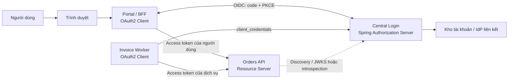
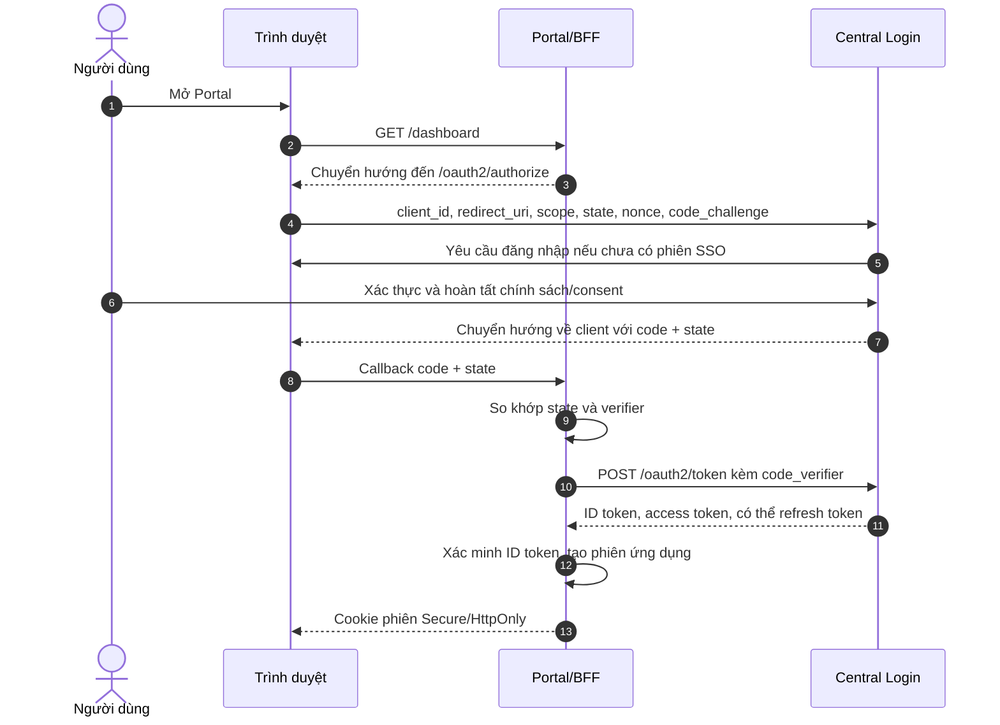
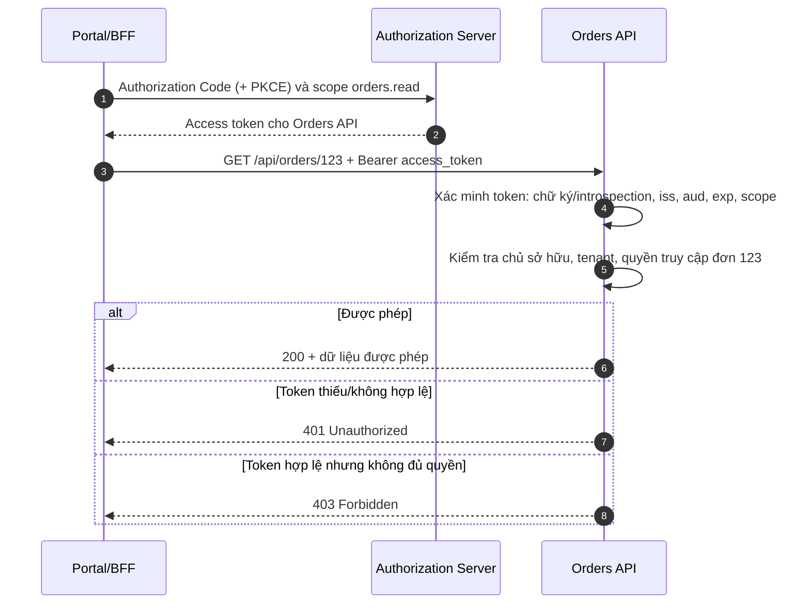
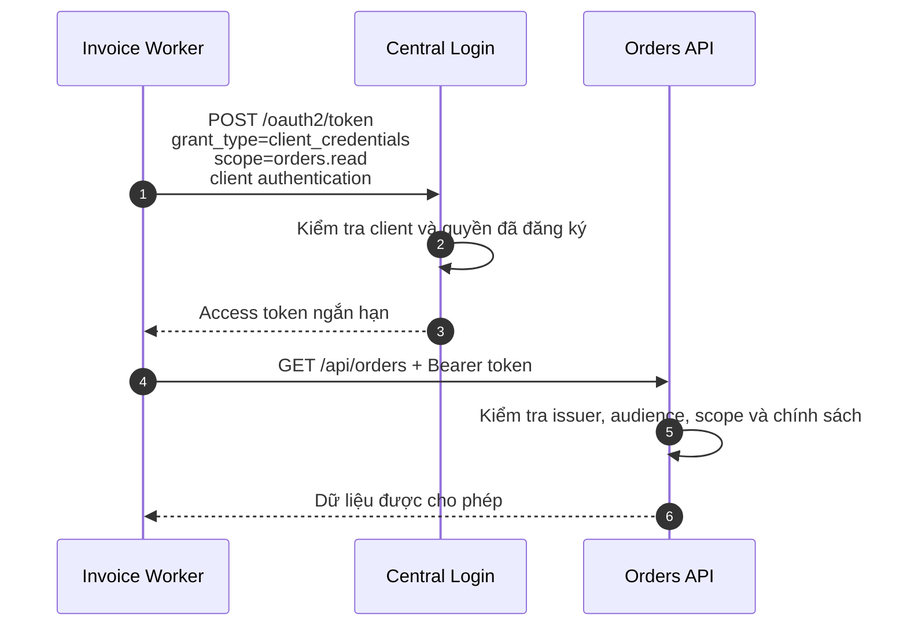
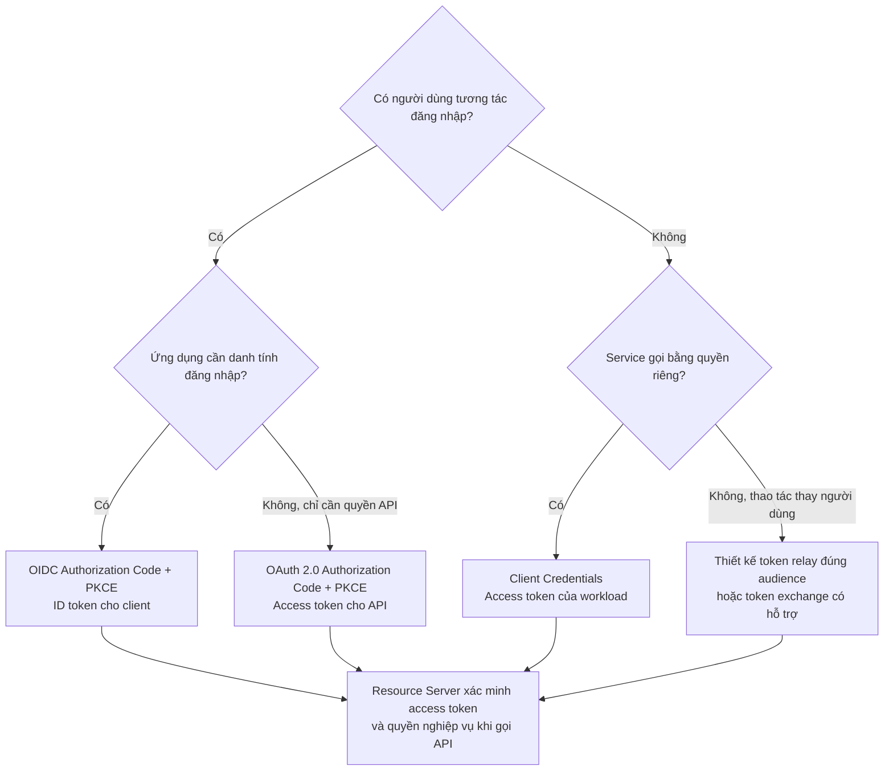

# Các kịch bản đăng nhập tập trung, ủy quyền API và giao tiếp giữa dịch vụ

Trong một hệ thống gồm nhiều ứng dụng Web, API và dịch vụ nền, yêu cầu “đăng nhập một lần”, “cho phép ứng dụng gọi API” và “cho phép hai dịch vụ giao tiếp” có vẻ giống nhau vì đều dùng token. Tuy nhiên, đây là **ba bài toán khác nhau về chủ thể, phạm vi quyền và vòng đời phiên**. Thiết kế một **OAuth 2.0/OpenID Connect Authorization Server** bằng **Spring Security** và **Spring Authorization Server** cần bắt đầu từ việc chọn đúng luồng cho từng bài toán.

Bài học thuộc chương **Tổng quan** của mô-đun **SPRING_SECURITY_OAUTH2_OIDC_AUTHORIZATION_SERVER**. Mục tiêu là hiểu cách đặt Authorization Server vào kiến trúc ứng dụng Spring Boot, mô hình hóa các trường hợp sử dụng và xác định những yêu cầu cấu hình, bảo mật, kiểm thử, vận hành cần có trước khi đi vào mã nguồn chi tiết.

## 1. Ba bài toán và vai trò của Authorization Server

Giả sử một doanh nghiệp có:

- **Portal**: giao diện người dùng nội bộ, mở trên trình duyệt.
- **Orders API**: quản lý đơn hàng và yêu cầu quyền theo nghiệp vụ.
- **Invoice Worker**: dịch vụ chạy nền, định kỳ truy vấn đơn hàng để xuất hóa đơn.
- **Central Login**: điểm xác thực tập trung, phát hành token và công bố metadata/khóa xác minh.

Trong OAuth 2.0, các vai trò cơ bản là:

| Vai trò | Trách nhiệm | Ví dụ |
|---|---|---|
| Resource Owner | Chủ thể có quyền đối với tài nguyên, thường là người dùng | Nhân viên đang sử dụng Portal |
| Client | Ứng dụng yêu cầu quyền hoặc token | Portal, Invoice Worker |
| Authorization Server (AS) | Xác thực/ủy quyền theo chính sách, phát hành token | Central Login dùng Spring Authorization Server |
| Resource Server (RS) | Bảo vệ tài nguyên và kiểm tra access token | Orders API |
| User Agent | Trình duyệt tham gia chuyển hướng đăng nhập | Trình duyệt của nhân viên |

**Authentication (xác thực)** trả lời “ai đang đăng nhập?”. **Authorization (phân quyền)** trả lời “chủ thể được thực hiện thao tác nào trên tài nguyên nào?”. **Delegation (ủy quyền truy cập)** cho phép một client nhận quyền giới hạn để gọi API; nó không đồng nghĩa client có toàn bộ quyền của người dùng.

| Kịch bản | Chủ thể thực sự | Cơ chế phù hợp | Kết quả chính |
|---|---|---|---|
| Đăng nhập tập trung/SSO | Người dùng tương tác | OpenID Connect + Authorization Code + PKCE | Client nhận diện người dùng, tạo phiên ứng dụng |
| Gọi API thay mặt người dùng | Người dùng đã ủy quyền cho client | OAuth 2.0 Authorization Code + PKCE | Access token có scope và audience phù hợp với API |
| Dịch vụ gọi dịch vụ | Ứng dụng/dịch vụ, không có người dùng tương tác | OAuth 2.0 Client Credentials | Access token đại diện cho client với quyền máy được cấp |

> **Phân biệt OIDC và OAuth 2.0:** OAuth 2.0 là khung ủy quyền để client truy cập tài nguyên được bảo vệ. OpenID Connect (OIDC) xây dựng trên OAuth 2.0 để chuẩn hóa đăng nhập và thông tin danh tính qua **ID token**, **UserInfo** và các endpoint liên quan. Có access token **không tự động** có nghĩa ứng dụng đã xác thực người dùng theo OIDC.

### 1.1. Kiến trúc tham chiếu



Trong thực tế, Authorization Server và Resource Server nên có trách nhiệm tách biệt. Authorization Server **cấp** token; Orders API **xác minh** token và áp chính sách phân quyền tại tài nguyên. Cả hai có thể cùng dùng Spring Security nhưng thuộc các ứng dụng hoặc vai trò cấu hình khác nhau.

### 1.2. Các hiện vật không thể dùng thay thế nhau

| Hiện vật | Ai sử dụng? | Mục đích | Không nên dùng để… |
|---|---|---|---|
| **Authorization code** | Client đổi tại token endpoint | Chứng minh quá trình cấp quyền vừa hoàn tất; tồn tại ngắn, chỉ dùng một lần | Gọi API |
| **ID token** (OIDC) | Client/Relying Party | Xác minh sự kiện đăng nhập và thông tin cơ bản về người dùng | Làm Bearer token cho Orders API |
| **Access token** | Resource Server | Quyết định truy cập API dựa trên chữ ký/trạng thái, claims và chính sách | Thay cho phiên đăng nhập của trình duyệt hoặc mặc định suy ra danh tính đăng nhập OIDC |
| **Refresh token** | Client được phép giữ token | Xin access token mới mà không cần lặp lại tương tác người dùng | Gửi đến Resource Server |
| **Session cookie** | Trình duyệt và ứng dụng/AS | Duy trì phiên đăng nhập ở một miền cụ thể | Thay thế token trên mọi API và mọi miền |

Một access token có thể là **JWT tự chứa** (API xác minh chữ ký, `iss`, `aud`, thời hạn, quyền) hoặc **opaque token** (API sử dụng endpoint introspection và xác thực theo chính sách). Không được suy ra tất cả access token đều là JWT. ID token OIDC thông thường là JWT; audience của ID token hướng tới **client**, khác với audience của access token dành cho API.

## 2. Kịch bản A: Đăng nhập tập trung và Single Sign-On (SSO)

### 2.1. Bài toán thực tế

Người dùng mở `portal.example.com`, rồi chuyển sang `reports.example.com`. Cả hai ứng dụng tin cậy `login.example.com` là OIDC Provider. Nếu người dùng đã có phiên hợp lệ ở Central Login, lần mở Reports có thể hoàn tất quy trình OIDC mà không cần nhập lại mật khẩu.

Điểm mấu chốt: **SSO hình thành từ phiên đăng nhập tại nhà cung cấp danh tính**, không phải từ việc sao chép cookie của Portal cho Reports. Mỗi ứng dụng vẫn cần tạo và bảo vệ phiên riêng; Central Login có thể chia sẻ trạng thái xác thực qua quy trình chuyển hướng OIDC.

### 2.2. Luồng Authorization Code + PKCE



Các bước đáng chú ý:

1. **Đăng ký client trước:** `client_id`, chính sách xác thực client, grant type, scope và `redirect_uri` đã được cấp phép. Callback phải khớp đúng giá trị được đăng ký.
2. **Tạo `state` và PKCE:** client tạo `code_verifier` ngẫu nhiên, gửi `code_challenge` theo `S256`. `state` liên kết phản hồi callback với yêu cầu ban đầu để chống giả mạo luồng.
3. **Nếu là OIDC, dùng `scope=openid` và `nonce` thích hợp:** nonce liên kết ID token với yêu cầu đăng nhập và giúp chống replay. Client phải kiểm tra đầy đủ ID token, gồm chữ ký, issuer, audience, expiry và nonce khi áp dụng.
4. **Người dùng xác thực tại AS:** mật khẩu/MFA, chính sách đăng nhập và consent nếu được yêu cầu là trách nhiệm của giải pháp định danh. Spring Authorization Server phát hành token nhưng không thay thế toàn bộ nghiệp vụ quản lý người dùng.
5. **Đổi code tại token endpoint:** một backend confidential client như BFF xác thực bằng phương thức đã đăng ký và gửi `code_verifier`. Trình duyệt không nhận `client_secret`.
6. **Client tạo phiên ứng dụng:** BFF có thể giữ token ở phía máy chủ và trả về cookie `Secure; HttpOnly; SameSite` phù hợp. Việc kiểm tra CSRF vẫn cần thiết với các endpoint dùng cookie.

Ví dụ tham số *minh họa* của authorization request:

```text
GET https://login.example.com/oauth2/authorize
  ?response_type=code
  &client_id=portal-bff
  &redirect_uri=https%3A%2F%2Fportal.example.com%2Flogin%2Foauth2%2Fcode%2Fcentral
  &scope=openid%20profile%20orders.read
  &state=<random-state>
  &nonce=<random-nonce>
  &code_challenge=<base64url-sha256-verifier>
  &code_challenge_method=S256
```

Giá trị trong dấu `<...>` chỉ là chỗ giữ chỗ; phải được tạo ngẫu nhiên theo đúng giao thức và URL encode khi gửi yêu cầu thực tế.

### 2.3. Liên kết nhiều ứng dụng và phiên đăng nhập

Khi Reports khởi tạo một authorization request OIDC mới, Central Login kiểm tra phiên SSO tại chính miền của mình. Nếu phiên còn hợp lệ và chính sách không yêu cầu xác thực lại, AS có thể phát authorization code mới cho Reports. Reports đổi code và tạo phiên riêng.

Cần phân biệt ba hành động:

- **Đăng xuất khỏi một ứng dụng:** xóa phiên Portal; phiên Central Login và phiên Reports có thể vẫn tồn tại.
- **Đăng xuất khỏi nhà cung cấp danh tính:** kết thúc phiên SSO ở Central Login theo giao thức/chính sách; không đồng nghĩa mọi cookie hoặc access token đã phát hành đều tự biến mất.
- **Thu hồi token và đăng xuất liên ứng dụng:** có thể cần token revocation, cơ chế logout OIDC phù hợp, thời gian sống token ngắn và phối hợp nhiều client. Mức hỗ trợ các kiểu logout phụ thuộc phiên bản Spring Authorization Server và phần tích hợp; phải xác minh tính năng cụ thể trước khi cam kết “đăng xuất toàn hệ thống ngay lập tức”.

Nếu Central Login xác thực người dùng bằng Google, Microsoft Entra ID hoặc một IdP tổ chức khác, đó là **federation/upstream login**. Central Login vẫn cần quản lý mapping danh tính, subject, tenant, phiên và hợp đồng phát hành token cho các client nội bộ. Không tự động chuyển nguyên token của IdP ngoài cho mọi API nội bộ.

## 3. Kịch bản B: Ủy quyền truy cập API trong ngữ cảnh người dùng

### 3.1. Câu chuyện nghiệp vụ

Một nhân viên đăng nhập Portal và chọn “Xem đơn hàng”. Portal gửi access token đến Orders API. API phải biết:

1. Token được cấp bởi **Authorization Server được tin cậy** hay không?
2. Token còn hiệu lực, chưa vi phạm các điều kiện thời gian, có đúng **audience** cho Orders API hay không?
3. Token có **scope** cho thao tác đọc đơn hàng hay không?
4. Người dùng có thực sự được xem **đơn hàng cụ thể** theo tenant, phòng ban, chủ sở hữu và chính sách nghiệp vụ không?

Câu hỏi thứ tư thường đòi hỏi kiểm tra dữ liệu trong chính API. Scope `orders.read` không có nghĩa người dùng được đọc tất cả đơn hàng của mọi tổ chức.



**Authentication ở Portal và authorization ở API phải được kiểm tra độc lập.** API không nên tin một header tự khai báo như `X-User-Id` từ Internet, hoặc coi việc request đi qua API Gateway là đủ để bỏ kiểm tra token và phân quyền.

### 3.2. Thiết kế scope, audience và quyền nghiệp vụ

Một cách phân chia minh họa:

| Hành động | Scope OAuth | Audience | Kiểm tra nghiệp vụ tại API |
|---|---|---|---|
| Đọc danh sách đơn được phép | `orders.read` | `orders-api` | Lọc theo tenant và phạm vi người dùng |
| Tạo hoặc cập nhật đơn | `orders.write` | `orders-api` | Vai trò, trạng thái đơn, hạn mức |
| Xem dữ liệu hóa đơn nội bộ | `invoice.read` | `invoice-api` | Quyền trên tổ chức và dữ liệu thanh toán |

**Scope** thường mô tả loại quyền client được cấp; **audience** xác định API đích được phép chấp nhận token; **role/permission nội bộ** mô tả quyền nghiệp vụ. Ba lớp này bổ sung cho nhau. Việc map vai trò từ claims vào `GrantedAuthority` cần quy ước rõ ràng, kiểm soát nguồn claims, và không mặc nhiên coi scope là vai trò quản trị.

Với Spring Security Resource Server, cơ chế JWT mặc định có thể ánh xạ scope thành authority dạng `SCOPE_orders.read`. Các thuộc tính issuer/audience, thời hạn và chữ ký cần được kiểm tra. **Audience thường cần được cấu hình hoặc bổ sung validator một cách tường minh** tùy cấu hình Spring Security; đừng chỉ dựa vào kết quả kiểm tra chữ ký.

### 3.3. Lúc nào dùng access token JWT và opaque?

- **JWT:** API có thể tự xác minh với khóa công khai lấy từ JWKS; phù hợp nhu cầu độ trễ thấp, nhưng token đã phát hành thường tiếp tục có hiệu lực đến khi hết hạn nếu không có lớp kiểm soát bổ sung.
- **Opaque:** API gọi introspection endpoint để lấy trạng thái và quyền của token; dễ đưa quyết định thu hồi vào đường kiểm tra, nhưng phụ thuộc độ sẵn sàng/độ trễ của AS và chính sách cache.
- **Dù chọn loại nào:** chỉ truyền qua HTTPS, hạn chế thời gian sống, không log giá trị Bearer token, tránh đưa token vào URL và giới hạn quyền theo nguyên tắc ít quyền nhất.

Nếu có API Gateway, có thể kiểm tra sơ bộ token tại Gateway để giảm tải và chặn yêu cầu sớm. Các Resource Server vẫn phải có ranh giới tin cậy rõ ràng; Gateway không thể thay thế kiểm tra nghiệp vụ của từng API.

## 4. Kịch bản C: Giao tiếp giữa dịch vụ bằng Client Credentials

### 4.1. Khi không có người dùng tương tác

Invoice Worker chạy hàng đêm, không có người dùng mở trình duyệt để cấp quyền. Worker được đăng ký là một **confidential client** và dùng grant `client_credentials`:

1. Worker xác thực danh tính client tại `/oauth2/token` bằng `client_secret_basic` hoặc phương thức mạnh hơn khi phù hợp, như `private_key_jwt` hay mutual TLS nếu hệ thống hỗ trợ.
2. Authorization Server kiểm tra client, grant type được phép, scope đã đăng ký và chính sách cấp quyền.
3. AS trả access token ngắn hạn, đại diện **cho dịch vụ** và dành cho API đích.
4. Worker gọi Orders API với `Authorization: Bearer ...`. API xác minh token, audience, scope và chính sách truy cập máy.
5. Khi token hết hạn, Worker lấy token mới bằng grant thích hợp. Thông thường `client_credentials` **không cần refresh token**.



Ví dụ request bằng curl (giá trị biến môi trường chỉ mang tính minh họa):

```bash
curl --request POST "https://login.example.com/oauth2/token" \
  --user "$CLIENT_ID:$CLIENT_SECRET" \
  --data-urlencode "grant_type=client_credentials" \
  --data-urlencode "scope=orders.read"
```

Trong ứng dụng thật, secret phải lấy từ hệ thống lưu bí mật phù hợp và không xuất hiện trong repository, log hoặc cấu hình đẩy lên bản public. Lệnh curl ở trên giúp hiểu giao thức; khi chạy trong môi trường dùng chung, chú ý nguy cơ lộ tham số dòng lệnh qua công cụ giám sát tiến trình.

### 4.2. Token của dịch vụ không đại diện cho một nhân viên

Không có người dùng trong `client_credentials`, vì vậy API không nên ghi nhận một nhân viên cụ thể đã phê duyệt thao tác chỉ dựa trên access token đó. Danh tính cần kiểm soát là client/workload. Nếu hành động đòi hỏi danh tính người dùng, hệ thống phải dùng luồng ủy quyền phù hợp với người dùng hoặc mô hình ủy quyền chuyển tiếp được xác định rõ.

Khi **Service A gọi Service B thay mặt người dùng**, có hai cách thường gặp:

- **Chuyển tiếp access token của người dùng:** chỉ phù hợp nếu token đã được cấp cho đúng audience, scope và mô hình tin cậy của Service B. Không chuyển tiếp một token có audience của Service A sang Service B rồi yêu cầu B “chấp nhận hộ”.
- **Token exchange / on-behalf-of:** Service A đổi một token hợp lệ thành token giới hạn dành cho Service B, nếu Authorization Server và hệ sinh thái đã hỗ trợ chính sách đó. Đây **không phải tính năng mặc định có thể giả định** trong mọi phiên bản Spring Authorization Server; phải xác minh hỗ trợ và cấu hình cụ thể.

Mô hình *service có quyền riêng* và mô hình *service thao tác thay mặt người dùng* tạo ra dấu vết kiểm toán khác nhau. Tránh sử dụng quyền máy rộng để thay thế ngữ cảnh người dùng chỉ vì dễ triển khai.

## 5. Áp dụng vào ứng dụng Spring Boot

Ba thành phần có cấu hình khác nhau:

| Thành phần | Spring Security | Nhiệm vụ |
|---|---|---|
| Central Login | Spring Authorization Server + cấu hình xác thực người dùng | Đăng ký client; endpoint OAuth/OIDC; khóa ký; token, consent, session |
| Portal/BFF | OAuth2 Client + OIDC Login | Chuyển hướng đăng nhập; callback; lưu authorized client; tạo phiên |
| Orders API | OAuth2 Resource Server | Xác minh token; ánh xạ authorities; chặn request; kiểm tra quyền nghiệp vụ |
| Invoice Worker | OAuth2 Client | Lấy, cache và tự gia hạn access token của grant client credentials |

### 5.1. Cấu hình Authorization Server: nhiều client, nhiều grant type

Ví dụ sau minh họa việc **đăng ký hai client có mục đích khác nhau** trong Spring Authorization Server. Các import được lược bỏ cho dễ tập trung vào cấu hình; tên miền và bí mật cần thay bằng cấu hình thực tế.

```java
@Bean
RegisteredClientRepository registeredClientRepository(
        PasswordEncoder passwordEncoder,
        @Value("#{environment['PORTAL_BFF_SECRET']}") String portalSecret,
        @Value("#{environment['INVOICE_WORKER_SECRET']}") String workerSecret) {

    RegisteredClient portal = RegisteredClient.withId(UUID.randomUUID().toString())
            .clientId("portal-bff")
            .clientSecret(passwordEncoder.encode(portalSecret))
            .clientAuthenticationMethod(ClientAuthenticationMethod.CLIENT_SECRET_BASIC)
            .authorizationGrantType(AuthorizationGrantType.AUTHORIZATION_CODE)
            .authorizationGrantType(AuthorizationGrantType.REFRESH_TOKEN)
            .redirectUri("https://portal.example.com/login/oauth2/code/central")
            .scope(OidcScopes.OPENID)
            .scope(OidcScopes.PROFILE)
            .scope("orders.read")
            .clientSettings(ClientSettings.builder()
                    .requireProofKey(true)
                    .requireAuthorizationConsent(true)
                    .build())
            .tokenSettings(TokenSettings.builder()
                    .accessTokenTimeToLive(Duration.ofMinutes(10))
                    .reuseRefreshTokens(false)
                    .build())
            .build();

    RegisteredClient worker = RegisteredClient.withId(UUID.randomUUID().toString())
            .clientId("invoice-worker")
            .clientSecret(passwordEncoder.encode(workerSecret))
            .clientAuthenticationMethod(ClientAuthenticationMethod.CLIENT_SECRET_BASIC)
            .authorizationGrantType(AuthorizationGrantType.CLIENT_CREDENTIALS)
            .scope("orders.read")
            .tokenSettings(TokenSettings.builder()
                    .accessTokenTimeToLive(Duration.ofMinutes(5))
                    .build())
            .build();

    return new InMemoryRegisteredClientRepository(portal, worker);
}
```

**Đặc điểm cần đọc đúng trong cấu hình:**

- Portal dùng `authorization_code`, yêu cầu PKCE và redirect URI cụ thể. `openid` khiến yêu cầu trở thành OIDC login; nếu Portal chỉ cần truy cập API mà không cần định danh OIDC, không nên tự động đưa `openid` vào mọi request.
- Invoice Worker chỉ được phép `client_credentials`, không có redirect URI và không cần scope `openid`.
- `reuseRefreshTokens(false)` áp dụng cho client sử dụng refresh token; ứng dụng phải lưu/cập nhật refresh token theo vòng đời an toàn.
- `InMemoryRegisteredClientRepository` và ID ngẫu nhiên chỉ phù hợp thử nghiệm. Môi trường production cần kho client bền vững (chẳng hạn JDBC), quản trị bí mật và chính sách xoay vòng.
- Đoạn mã **chưa phải cấu hình Authorization Server hoàn chỉnh**: còn cần security filter chains, định danh người dùng, `AuthorizationServerSettings`, nguồn khóa ký `JWKSource`, kho authorization/consent và thiết lập endpoint công khai.

Trong cấu hình endpoint, cần kích hoạt OIDC nếu muốn phát ID token và cung cấp các endpoint OIDC, ví dụ dùng `OAuth2AuthorizationServerConfigurer` cùng `oidc(Customizer.withDefaults())` trong security filter chain dành cho Authorization Server. Chuỗi bảo mật cho trang đăng nhập người dùng thường tách riêng và phải có cơ chế xác thực thích hợp. Tên package/API cấu hình cụ thể có thể thay đổi giữa các nhánh Spring Security và Spring Authorization Server; hãy khóa phiên bản dependency thống nhất trước khi áp dụng mẫu mã.

### 5.2. Cấu hình BFF đăng nhập qua OIDC

Client Spring Boot có thể dùng `spring-boot-starter-oauth2-client` và cấu hình theo issuer:

```yaml
spring:
  security:
    oauth2:
      client:
        registration:
          central:
            provider: central
            client-id: portal-bff
            authorization-grant-type: authorization_code
            redirect-uri: "{baseUrl}/login/oauth2/code/{registrationId}"
            scope: openid, profile, orders.read
        provider:
          central:
            issuer-uri: https://login.example.com
```

Đây là mẫu **chưa chứa client secret**. Với BFF confidential client, phải cung cấp secret qua cấu hình an toàn hoặc secret manager và khai báo phương thức xác thực tương thích với client trên Authorization Server. Spring Security có thể sử dụng discovery metadata từ `issuer-uri` để tìm endpoint và JWKS. Khi cấu hình ứng dụng, cần bật `oauth2Login` và các phần OAuth2 Client thích hợp.

Với SPA chạy thuần trong trình duyệt, client là **public client**: không được nhúng client secret. Nên dùng Authorization Code + PKCE và cân nhắc BFF khi bài toán đòi hỏi giảm rủi ro token ở JavaScript. CORS, CSRF, cookie policy và bảo vệ chống XSS vẫn cần được thiết kế theo kiểu ứng dụng.

### 5.3. Orders API xác minh issuer, audience và scope

Một Resource Server dùng JWT có thể áp dụng cấu hình như sau (ví dụ dành cho Spring Security 6.x):

```java
@Configuration
@EnableWebSecurity
class OrdersApiSecurity {

    @Bean
    SecurityFilterChain apiSecurity(HttpSecurity http) throws Exception {
        http.authorizeHttpRequests(authorize -> authorize
                .requestMatchers(HttpMethod.GET, "/api/orders/**")
                    .hasAuthority("SCOPE_orders.read")
                .requestMatchers(HttpMethod.POST, "/api/orders/**")
                    .hasAuthority("SCOPE_orders.write")
                .anyRequest().authenticated())
            .oauth2ResourceServer(oauth2 -> oauth2.jwt(Customizer.withDefaults()));
        return http.build();
    }

    @Bean
    JwtDecoder jwtDecoder(@Value("#{environment['OIDC_ISSUER']}") String issuer) {
        NimbusJwtDecoder decoder =
                NimbusJwtDecoder.withIssuerLocation(issuer).build();

        OAuth2TokenValidator<Jwt> audienceValidator = token ->
                token.getAudience().contains("orders-api")
                    ? OAuth2TokenValidatorResult.success()
                    : OAuth2TokenValidatorResult.failure(
                        new OAuth2Error("invalid_token",
                                "Token không dành cho Orders API", null));

        decoder.setJwtValidator(new DelegatingOAuth2TokenValidator<>(
                JwtValidators.createDefaultWithIssuer(issuer),
                audienceValidator));
        return decoder;
    }
}
```

- `issuer` phải trùng giá trị `iss` do AS phát hành và metadata công bố; không thay bằng hostname nội bộ tùy tiện nếu AS quảng bá issuer công khai khác.
- Validator yêu cầu `aud=orders-api`. Authorization Server **phải thật sự phát access token có audience đó**, thường qua chính sách ánh xạ resource/client và `OAuth2TokenCustomizer<JwtEncodingContext>`. Không nên loại bỏ audience validator chỉ vì token mặc định chưa chứa claim phù hợp.
- Với opaque token, thay cơ chế JWT bằng introspection phù hợp; khi đó API phải xác thực với AS và xử lý timeout, độ sẵn sàng và cache.
- Các điều kiện `hasAuthority` mới kiểm tra scope ở lớp đường dẫn/phương thức; kiểm tra quyền trên từng đơn hàng vẫn đặt ở nghiệp vụ (chẳng hạn service-level authorization).

**Cảnh báo về CSRF:** cấu hình ví dụ chỉ tập trung vào Bearer access token. Nếu Resource Server còn phục vụ endpoint dựa trên cookie/session, chính sách CSRF phải được xem xét riêng; đừng vô hiệu hóa CSRF toàn cục chỉ để sửa một lỗi gọi API.

### 5.4. Invoice Worker lấy token qua OAuth2 Client

Ví dụ cấu hình client credentials trong Spring Boot:

```yaml
spring:
  security:
    oauth2:
      client:
        registration:
          invoice-worker:
            provider: central
            client-id: invoice-worker
            authorization-grant-type: client_credentials
            scope: orders.read
        provider:
          central:
            issuer-uri: https://login.example.com
```

Trong production, client secret phải được cấp từ nguồn bí mật an toàn cho registration `invoice-worker` (hoặc dùng cơ chế xác thực client mạnh hơn nếu được hỗ trợ). Với phía ứng dụng Java, `OAuth2AuthorizedClientManager` cùng provider `clientCredentials()` có thể xin/cấp lại access token và dùng với `RestClient` hoặc `WebClient`. Đừng tự hard-code Bearer token hoặc triển khai cache hết hạn bằng biến toàn cục không kiểm soát đồng thời.

## 6. Ranh giới bảo mật và các lỗi thiết kế thường gặp

| Sai lầm | Hệ quả | Cách phòng tránh |
|---|---|---|
| Dùng ID token để gọi API | Nhầm token xác thực client với quyền API | Chỉ API chấp nhận access token có audience phù hợp |
| Chỉ kiểm tra chữ ký JWT | Token của client/API khác có thể bị dùng nhầm | Kiểm tra `iss`, `aud`, thời hạn, loại token, scope và nghiệp vụ |
| Cho mọi dịch vụ dùng chung một client | Không phân biệt danh tính, khó thu hồi và kiểm toán | Mỗi workload một registration, secret/khóa và quyền tối thiểu |
| Chứa client secret trong SPA/mobile | Bí mật lộ cho người sử dụng ứng dụng | Public client + PKCE, hoặc thiết kế BFF |
| Xem `orders.read` như quyền đọc mọi đơn | Truy cập chéo tenant/khách hàng | Kiểm tra row-level/object-level authorization |
| Sao chép access token qua các service | Token sai audience hoặc lan truyền quyền rộng | Resource-specific token, token exchange được hỗ trợ, phân tách quyền |
| Dùng password grant/implicit cho ứng dụng mới | Tăng nguy cơ lộ mật khẩu/token | Authorization Code + PKCE cho người dùng |
| Coi logout là đã vô hiệu hóa mọi token | Access token còn hạn vẫn có thể dùng | Thời hạn ngắn, revocation/introspection khi cần, phối hợp logout |
| Ghi token, authorization code hoặc secret vào log | Lộ credential | Redact log, giám sát bất thường, chính sách xoay vòng khóa/secret |

Ngoài các lỗi trên, phải bảo đảm kết nối TLS từ client đến các endpoint nhạy cảm, callback exact match, chống CSRF cho phiên dựa trên cookie, kiểm tra `state`/PKCE/`nonce`, giới hạn truy cập vào endpoint quản trị, bảo vệ signing keys và xem xét bảo vệ chống brute-force/MFA ở bước xác thực người dùng.

## 7. Kiểm thử theo kịch bản

Một bộ kiểm thử hữu ích phải kiểm tra **luồng hợp lệ và các đường thất bại**, ở cả client, Authorization Server và Resource Server.

| Nhóm | Kiểm thử cần có | Kết quả kỳ vọng |
|---|---|---|
| SSO | Đăng nhập Portal rồi mở Reports bằng cùng phiên AS | Reports hoàn tất OIDC; chỉ yêu cầu đăng nhập lại khi chính sách/phiên yêu cầu |
| Callback | `state` không khớp, `code_verifier` sai, code tái sử dụng | Request bị từ chối, không tạo phiên ứng dụng |
| OIDC | ID token sai issuer/audience/nonce hoặc hết hạn | Client từ chối đăng nhập |
| Token API | Thiếu token, hết hạn, sai chữ ký, sai issuer/audience | API từ chối (`401` với token thiếu/không hợp lệ) |
| Quyền API | Token đúng nhưng thiếu `orders.write` | API từ chối thao tác ghi (`403`) |
| Tenant | Token có `orders.read` nhưng hỏi đơn ở tenant khác | API từ chối theo nghiệp vụ |
| Máy với máy | Invoice Worker có scope hợp lệ gọi Orders API | Thành công; audit ghi nhận đúng client/workload |
| Máy với máy | Worker yêu cầu scope/grant không đăng ký | Authorization Server từ chối cấp token |
| Vòng đời token | Access token hết hạn; refresh token đã bị xoay vòng được dùng lại | Client lấy token mới đúng cách; yêu cầu dùng token cũ bị từ chối theo chính sách |
| Xoay khóa | JWKS chuyển sang khóa mới và có giai đoạn chồng lấn | Resource Server tiếp tục xác minh token hợp lệ mà không chấp nhận khóa lạ |
| Đăng xuất | Xóa phiên local, đăng xuất AS, thu hồi token | Hành vi khớp chính sách đã công bố; không giả định mọi token bị vô hiệu ngay |

Với kiểm thử tích hợp trong Spring Boot, có thể dùng `spring-security-test`, `MockMvc` và mô phỏng JWT có claims cụ thể để kiểm thử chính sách tại Resource Server. Tuy nhiên, các test dùng token giả lập **không thay thế** test giao thức thật giữa client, AS và API; cần ít nhất một luồng end-to-end kiểm tra discovery, redirect, PKCE, JWKS và validation.

## 8. Vận hành Authorization Server an toàn

Authorization Server là điểm tin cậy chung nên sự cố tại đây ảnh hưởng toàn bộ ứng dụng. Các yêu cầu vận hành quan trọng gồm:

1. **Issuer cố định và nhất quán:** cấu hình URL issuer công khai, HTTPS, reverse proxy/forwarded headers và discovery metadata thống nhất qua các môi trường.
2. **Khóa ký được quản lý:** dùng kho bí mật/KMS/HSM phù hợp, bảo vệ private key, công bố JWKS công khai đúng cách; khi xoay khóa, giữ khóa cũ trong giai đoạn token cũ còn hợp lệ.
3. **Kho lưu trạng thái bền vững:** client registrations, authorizations và consent cần nhất quán giữa các instance; lựa chọn JDBC/cluster/cache phù hợp với chính sách phiên và revocation.
4. **Quyền hạn và bí mật riêng từng client:** định kỳ rà soát scope, redirect URI, phương thức authentication, tuổi thọ token và vòng đời secret/certificate.
5. **Khả năng quan sát có kiểm soát:** theo dõi số request đến authorize/token/introspection, lỗi `invalid_client`, `invalid_grant`, độ trễ, tỉ lệ 401/403, refresh bất thường; audit theo client/correlation ID, không log nguyên token.
6. **Độ sẵn sàng và khôi phục:** sao lưu kho cấu hình/authorization, diễn tập khôi phục khóa và dữ liệu, giới hạn tốc độ endpoint nhạy cảm, có quy trình xử lý lộ secret hoặc signing key.

### 8.1. Chọn luồng theo câu hỏi nghiệp vụ



Một thiết kế phù hợp có thể mô tả được **ai là chủ thể**, **client nào yêu cầu token**, **audience nào được chấp nhận**, **scope nào được cấp**, **kiểm tra quyền nghiệp vụ nằm ở đâu** và **token/phiên bị hủy như thế nào**. Trả lời rõ các câu hỏi này trước khi viết cấu hình Spring Security giúp tránh nhầm lẫn giữa đăng nhập tập trung, ủy quyền API và giao tiếp giữa dịch vụ.

## 9. Tự kiểm tra kiến thức

1. Nếu Portal và Reports cùng tin cậy Central Login, cơ chế nào giúp người dùng không phải nhập mật khẩu hai lần? Tại sao hai ứng dụng vẫn phải giữ phiên riêng?
2. Vì sao một access token hợp lệ về chữ ký có thể vẫn bị Orders API từ chối?
3. Tại sao Invoice Worker không nên dùng `authorization_code` hay giữ một refresh token dài hạn để chạy định kỳ?
4. Khi Service A cần gọi Service B thay mặt người dùng, vì sao không thể tùy tiện chuyển tiếp access token được phát cho Service A?
5. Mô hình kiểm tra nào bảo đảm nhân viên có `orders.read` vẫn không thể đọc đơn thuộc tenant khác?
6. Trong trường hợp cần thu hồi quyền gần như ngay lập tức, lựa chọn JWT tự chứa và opaque token có những đánh đổi gì?

**Kết luận:** Spring Authorization Server là trung tâm phát hành token và thực thi chính sách OAuth2/OIDC; mỗi client chọn grant theo chủ thể và ngữ cảnh; mỗi Resource Server tự bảo vệ API bằng xác minh token và phân quyền nghiệp vụ. Đăng nhập SSO, truy cập API theo người dùng và client credentials được xây dựng trên cùng hạ tầng tin cậy nhưng cần được thiết kế, kiểm thử và vận hành theo các ranh giới khác nhau.
