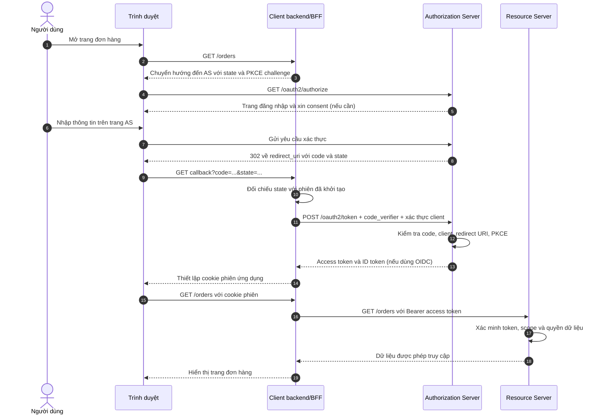

# Ranh giới tin cậy giữa người dùng, client, trình duyệt và máy chủ

Trong OAuth 2.0/OpenID Connect (OIDC), một yêu cầu đăng nhập hoặc cấp quyền đi qua nhiều thành phần: người dùng, trình duyệt, ứng dụng **client**, **Authorization Server** và thường cả **Resource Server**. Các thành phần này nhìn thấy những dữ liệu khác nhau, kiểm soát những phần khác nhau của luồng và không có cùng mức độ tin cậy. Thiết kế Authorization Server bằng Spring Security và Spring Authorization Server chỉ an toàn khi ta xác định rõ **ai được chứng minh điều gì, ở đâu và bằng bằng chứng nào**.

Sau bài này, bạn có thể:

- Phân biệt người dùng, user-agent, OAuth client, Authorization Server và Resource Server; biết trường hợp nào chúng cùng nằm trong một ứng dụng vật lý nhưng vẫn có trách nhiệm bảo mật riêng.
- Chỉ ra ranh giới tin cậy của từng bước trong Authorization Code + PKCE và lý do cần `redirect_uri`, `state`, `nonce`, xác thực client và kiểm tra token.
- So sánh client phía máy chủ (confidential client/BFF) với SPA hoặc ứng dụng di động (public client).
- Liên hệ những ranh giới đó với cấu hình, kiểm thử và vận hành Spring Authorization Server.

## 1. Xác định đúng các chủ thể

| Chủ thể | Vai trò và vùng kiểm soát | Điều không được mặc nhiên tin |
| --- | --- | --- |
| **Người dùng (resource owner/end-user)** | Tương tác với màn hình đăng nhập, xác nhận cấp quyền; có thể là chủ sở hữu dữ liệu. | Một cú nhấp hoặc tham số do người dùng gửi không tự cấp quyền vượt qua chính sách hệ thống. Tên người dùng tự khai không phải bằng chứng đã xác thực. |
| **Trình duyệt (user-agent)** | Điều hướng giữa client và Authorization Server; mang URL, cookie, biểu mẫu và chạy JavaScript. | Trình duyệt do phía người dùng kiểm soát; URL, query, script, cookie bị đánh cắp hoặc dữ liệu do JavaScript gửi đều có thể bị thao túng. |
| **OAuth client** | Ứng dụng yêu cầu quyền truy cập thay mặt người dùng: website có backend/BFF, SPA hoặc ứng dụng native. Có `client_id` và đăng ký chính sách với Authorization Server. | `client_id` là định danh công khai, **không phải** chứng cứ xác thực client; client cũng không có quyền tự phát hành token hay tự quyết định phạm vi quyền. |
| **Authorization Server (AS)** | Xác thực người dùng (trực tiếp hoặc qua IdP), kiểm soát cấp quyền, quản lý client, mã ủy quyền và token; trong OIDC còn phát hành ID token. | Không được tin `client_id`, `redirect_uri`, `scope`, `code_challenge` hay danh tính người dùng chỉ vì chúng nằm trong request. |
| **Resource Server (RS)** | API sở hữu dữ liệu/tài nguyên; quyết định có chấp nhận access token và thao tác cụ thể hay không. | Không được tin header `Authorization`, `client_id`, ID token hoặc lời khẳng định “người dùng đã đăng nhập” từ trình duyệt mà chưa kiểm tra. |

**Một hệ thống có thể cùng lúc đóng nhiều vai trò.** Ví dụ một ứng dụng Spring Boot vừa chạy Authorization Server vừa phục vụ một API. Hai chức năng vẫn có các điều kiện kiểm tra khác nhau: AS chịu trách nhiệm cấp token; API chịu trách nhiệm xác thực token và quyết định truy cập tài nguyên. Không nên suy luận “cùng máy chủ” đồng nghĩa “không cần kiểm tra quyền”.

Trong OAuth, **ủy quyền** là việc cấp quyền truy cập giới hạn cho client. Trong OIDC, lớp **xác thực** bổ sung ID token và quy tắc để client xác minh người dùng đã đăng nhập với một issuer. OAuth thuần túy không biến access token thành bằng chứng đăng nhập dành cho client.

## 2. Ba vùng tin cậy cần hình dung

Xét ví dụ hệ thống đặt hàng:

- `https://id.example.com`: Spring Authorization Server; sở hữu trang đăng nhập, phiên đăng nhập AS, client registry, authorization code và khóa ký.
- `https://portal.example.com`: ứng dụng client có backend (BFF); có phiên ứng dụng riêng, giữ thông tin xác thực client và token trên server.
- `https://api.example.com`: Resource Server; cung cấp API đơn hàng sau khi kiểm tra access token và quyền trên đơn hàng.

Trình duyệt truy cập cả hai domain đầu tiên nhưng **không trở thành thành phần đáng tin của server**. Một người có thể sửa URL, gửi HTTP request thủ công, dùng tiện ích mở rộng độc hại hoặc chạy script bị chèn qua XSS. HTTPS bảo vệ dữ liệu khi truyền và xác thực máy chủ theo chứng chỉ, nhưng không làm nội dung do phía trình duyệt tạo ra trở nên đáng tin.

Có hai loại tin cậy cần phân biệt:

1. **Tin cậy danh tính và giao thức:** AS xác thực người dùng; AS xác định client hợp lệ; client xác minh phản hồi và ID token của AS; RS xác minh access token của issuer được chấp nhận.
2. **Tin cậy nghiệp vụ:** dù token hợp lệ và có `orders.read`, API vẫn phải kiểm tra người dùng/đối tượng được phép đọc **đơn hàng cụ thể nào**. Token hợp lệ không đồng nghĩa có quyền với mọi bản ghi.

Một quy tắc hữu ích: **mọi khi dữ liệu đi từ vùng ít tin cậy hơn sang vùng có quyền quyết định, bên nhận phải kiểm tra bằng chứng và ràng buộc của dữ liệu ngay tại ranh giới đó.**

## 3. Luồng Authorization Code + PKCE và các ranh giới

Sơ đồ sau dùng **confidential web client/BFF**. Việc đổi authorization code thành token diễn ra giữa backend client và AS; trình duyệt chỉ chuyển hướng với code và dùng cookie phiên của portal.



Các đường ranh giới quan trọng nằm ở những nơi sau:

### 3.1. Trình duyệt → Authorization Server: request cấp quyền là đầu vào không đáng tin

Một request ủy quyền có thể chứa:

```http
GET /oauth2/authorize?response_type=code
    &client_id=portal-bff
    &redirect_uri=https%3A%2F%2Fportal.example.com%2Flogin%2Foauth2%2Fcode%2Fsas
    &scope=openid%20orders.read
    &state=RANDOM_STATE
    &code_challenge=BASE64URL_CHALLENGE
    &code_challenge_method=S256
    &nonce=RANDOM_NONCE
```

Đây là minh họa đã xuống dòng cho dễ đọc; trên HTTP thực tế các tham số được mã hóa trong URL. **AS phải kiểm tra**, ít nhất:

- `client_id` có trong `RegisteredClientRepository`, client được phép dùng Authorization Code và có cấu hình tương thích.
- `redirect_uri` khớp với URI đã đăng ký cho client. Không cấp phép tùy tiện bằng wildcard, so khớp tiền tố hoặc host “na ná” domain tin cậy. Ngoại lệ tương thích cho loopback redirect của native app phải xử lý theo tiêu chuẩn liên quan.
- `scope` chỉ yêu cầu quyền được đăng ký, được chính sách cho phép và, nếu cần, được người dùng đồng ý. Consent không thay thế kiểm tra chính sách.
- `code_challenge` hợp lệ và phương pháp `S256` được dùng trong mô hình yêu cầu PKCE; mã cấp ra phải gắn với challenge, client, redirect URI và phiên cấp quyền.
- Phiên xác thực tại AS thực sự thuộc người dùng vừa được xác thực; thao tác đăng nhập, xác nhận consent và các endpoint có thay đổi trạng thái được bảo vệ đúng khỏi CSRF.

**Không đưa mật khẩu người dùng cho client để client “đăng nhập hộ” trong luồng này.** Người dùng đăng nhập tại AS hoặc nhà cung cấp danh tính mà AS ủy nhiệm. Client nhận kết quả giao thức, không cần biết mật khẩu.

### 3.2. Authorization Server → trình duyệt → client: front-channel không được xem là bằng chứng cuối cùng

AS chuyển hướng tới `redirect_uri` với `code` và `state`. Mọi dữ liệu quay về client qua URL đều đi qua trình duyệt, nên client phải:

- Kiểm tra `state` trả về **khớp chính xác** với giá trị ngẫu nhiên đã gắn với phiên/transaction ban đầu. Điều này phát hiện phản hồi ngoài mong đợi và giúp chống login CSRF/code injection. Chỉ kiểm tra “có tham số state” là không đủ.
- Không dùng `code` để cấp quyền ngay lập tức; phải đổi code tại token endpoint, nơi AS kiểm tra ràng buộc và hiệu lực của code.
- Giới hạn rò rỉ `code` và `state` qua log, lịch sử, Referer hoặc script bên thứ ba trên trang callback; chỉ dùng HTTPS, xử lý callback nhanh và cấu hình `Referrer-Policy` phù hợp.

Authorization code phải **ngắn hạn và chỉ sử dụng một lần**. Người lấy được code cũng không nên đổi được token nếu không có `code_verifier` đúng; đó là công dụng của PKCE. Tuy nhiên PKCE không làm `state` trở nên thừa trong việc liên kết phản hồi với phiên đăng nhập ở client.

### 3.3. Client → token endpoint: phân biệt định danh client với xác thực client

Khi gửi `code` và `code_verifier` tới `/oauth2/token`:

- Với **confidential client**, AS xác thực client bằng cơ chế đã đăng ký, ví dụ `client_secret_basic`, `private_key_jwt` hoặc mTLS. Bí mật/khóa riêng phải chỉ nằm ở backend và hạ tầng bí mật, không được gửi qua URL hoặc nhúng vào JavaScript.
- Với **public client** (SPA/native), không thể giữ `client_secret` bí mật. AS không được coi một secret nhúng trong ứng dụng là bằng chứng mạnh. PKCE ràng buộc request cấp code với bên đổi code, nhưng **PKCE không biến public client thành confidential client**.
- Với cả hai, AS đối chiếu code còn hạn, chưa dùng, thuộc client tương ứng, redirect URI ràng buộc đúng và `code_verifier` cho ra challenge khớp.

`client_id` có thể nhìn thấy trong trình duyệt và log; sự hiện diện của nó **không** chứng minh người gửi là ứng dụng chính chủ. Với OAuth client authentication, bằng chứng xác thực nằm ở secret/chữ ký/chứng chỉ đã xác minh; với public client, cần dựa vào ràng buộc PKCE và các biện pháp giao thức khác phù hợp.

### 3.4. Client → Resource Server: access token là đầu vào phải xác minh

RS không chấp nhận một request chỉ vì header khai `Authorization: Bearer ...` hoặc vì caller tự gửi `user_id`. Với JWT access token, RS cần kiểm tra chữ ký theo issuer được tin cậy, thuật toán/khóa được phép, `iss`, thời hạn `exp`/`nbf`, `aud` đúng API và scope/authority cần thiết. Sau đó RS tiếp tục kiểm tra quyền sở hữu và chính sách truy cập trên tài nguyên cụ thể.

Nếu dùng **opaque token**, RS có thể dùng token introspection theo cấu hình tin cậy, kiểm tra trạng thái `active` cùng các ràng buộc liên quan. Không thể chỉ giải mã Base64 hoặc nhìn claim mà bỏ xác minh chữ ký.

**ID token không thay thế access token.** ID token phục vụ client xác thực người dùng trong OIDC; `aud` của ID token thường là `client_id`, không phải định danh API. API phải yêu cầu access token có audience và quyền phù hợp.

### 3.5. Trình duyệt → ứng dụng client: hai phiên đăng nhập khác nhau

AS có thể duy trì cookie đăng nhập tại `id.example.com`; portal có thể duy trì cookie phiên riêng tại `portal.example.com`. Hai cookie có mục đích, phạm vi domain và vòng đời khác nhau. Việc đăng nhập tại AS không tự tạo phiên portal hợp lệ cho mọi trình duyệt; portal còn phải hoàn tất callback và xác minh giao dịch OIDC.

Ở client backend/BFF, nên giữ token phía server và chỉ đưa trình duyệt cookie phiên đã cấu hình `Secure`, `HttpOnly` và `SameSite` phù hợp. Cookie không xóa bỏ nguy cơ CSRF; endpoint thay đổi trạng thái cần biện pháp CSRF tương ứng. `SameSite=Lax` có thể phù hợp với nhiều luồng redirect top-level, nhưng hành vi cookie phải được kiểm tra theo luồng và cấu trúc domain thực tế.

## 4. Confidential client và public client khác nhau ở đâu?

| Câu hỏi | Web client có backend / BFF (confidential) | SPA chạy trong trình duyệt (public) | Ứng dụng native (public) |
| --- | --- | --- | --- |
| Có thể giữ client secret không? | Có, nếu chỉ nằm trên server và quản lý đúng. | Không; bundle JavaScript công khai. | Không; binary và thiết bị do người dùng kiểm soát. |
| Ai thực hiện token request? | Backend gọi AS trực tiếp. | JavaScript gọi token endpoint từ trình duyệt; cần cấu hình CORS đúng phạm vi nếu khác origin. | Ứng dụng gọi token endpoint từ thiết bị. |
| PKCE? | Khuyến nghị và nên yêu cầu. | Bắt buộc theo thực hành bảo mật hiện đại cho Authorization Code. | Bắt buộc theo thực hành bảo mật hiện đại cho Authorization Code. |
| Token nằm ở đâu? | Lưu trên server; trình duyệt giữ cookie phiên app. | Có thể nằm trong bộ nhớ/không gian ứng dụng JS, dễ bị tác động bởi XSS hơn. | Nằm trên thiết bị; cần lưu trong kho khóa an toàn của hệ điều hành nếu có. |
| Redirect cần quan tâm gì? | HTTPS callback được đăng ký chính xác. | HTTPS callback được đăng ký chính xác; bảo vệ dữ liệu và script của origin. | Dùng redirect phù hợp native app (claimed HTTPS/loopback hoặc cơ chế được hỗ trợ), tránh tranh chấp URI. |
| Rủi ro đáng chú ý | Lộ secret ở log/config, chiếm phiên app, CSRF, backend lộ token. | XSS, độc hại trong dependency, lưu token không an toàn, giả lập client. | Đánh cắp token trên thiết bị, chiếm redirect, giả lập ứng dụng. |

Điểm cốt lõi: thuật ngữ **“client”** trong OAuth mô tả vai trò giao thức, **không mặc định chỉ máy chủ**. Với SPA, chính chương trình JavaScript là OAuth client; trình duyệt là môi trường thực thi của client. Với mô hình BFF, backend là OAuth client thực hiện trao đổi token, còn trình duyệt chủ yếu tương tác bằng phiên ứng dụng.

Đối với public client có refresh token, cần thêm biện pháp như **refresh token rotation** hoặc token gắn với bên gửi (sender-constrained) theo chính sách AS và tiêu chuẩn bảo mật hiện hành. Cất token trong `localStorage` khiến token có thể bị đọc trực tiếp khi xuất hiện XSS; ngay cả token chỉ nằm trong bộ nhớ cũng không ngăn mã JavaScript độc hại dùng token trong thời gian nó còn hợp lệ.

## 5. Phân biệt các vật mang thông tin bảo mật

| Giá trị | Bên phát hành/tạo | Mục đích và bên kiểm tra | Không được hiểu thành |
| --- | --- | --- | --- |
| `client_id` | AS cấp khi đăng ký client | Tìm cấu hình client. | Secret hoặc bằng chứng xác thực client. |
| `state` | Client tạo ngẫu nhiên cho mỗi giao dịch | Client đối chiếu với trạng thái đã lưu khi nhận callback. | Cơ chế cấp quyền hoặc thay thế PKCE. |
| `code_verifier` và `code_challenge` | Client tạo; AS lưu challenge | AS kiểm tra verifier lúc đổi code. | Client secret hoặc bằng chứng danh tính người dùng. |
| Authorization `code` | AS phát hành | Token endpoint kiểm tra và tiêu thụ một lần. | Access token hoặc chứng cứ cho phép gọi API. |
| `nonce` (OIDC) | Client tạo nếu sử dụng | Client đối chiếu `nonce` trong ID token với yêu cầu ban đầu để liên kết token với giao dịch. | Thay thế `state` hoặc PKCE. |
| ID token | OIDC Provider/AS ký | Client xác minh chữ ký, issuer, audience, thời hạn và nonce khi đã yêu cầu. | Token dùng thay access token để gọi API. |
| Access token | AS cấp | RS xác minh token và quyết định quyền truy cập. | Mật khẩu người dùng hoặc quyền truy cập vô hạn. |
| Refresh token | AS có thể cấp | Client dùng xin access token mới theo chính sách; AS kiểm tra và chống tái sử dụng phù hợp. | Dữ liệu an toàn để đưa lên URL/log/trình duyệt tùy ý. |
| Cookie phiên | AS hoặc client web phát hành theo từng domain | Chính server sở hữu phiên kiểm tra cookie khi xử lý request. | Bằng chứng có thể dùng trực tiếp ở domain/API khác. |

OIDC có thể không yêu cầu `nonce` với mọi trường hợp Authorization Code Flow, nhưng khi client gửi `nonce` thì phải kiểm tra nó trong ID token nhận về. `state` và `nonce` bảo vệ **những liên kết khác nhau**: request–callback và request–ID token.

## 6. Gắn ranh giới tin cậy vào Spring Authorization Server

Spring Authorization Server cung cấp các mô hình và điểm mở rộng để kiểm tra ở đúng bên sở hữu trách nhiệm:

| Thành phần Spring | Trách nhiệm liên quan đến ranh giới |
| --- | --- |
| `RegisteredClientRepository` / `RegisteredClient` | Tra client đã đăng ký: `client_id`, authentication method, grant type, redirect URI, scope, chính sách PKCE/consent. |
| `OAuth2AuthorizationService` | Lưu và truy xuất trạng thái ủy quyền, authorization code và token để kiểm tra hiệu lực/ràng buộc. |
| `OAuth2AuthorizationConsentService` | Lưu các consent được người dùng chấp thuận khi ứng dụng yêu cầu. |
| `SecurityFilterChain` của AS | Bảo vệ endpoint OAuth/OIDC và thiết lập cơ chế xác thực, entry point thích hợp. |
| `AuthorizationServerSettings` | Định nghĩa issuer và đường dẫn endpoint; issuer phải ổn định, chính xác theo URL công khai. |
| `JWKSource<SecurityContext>` và cấu hình ký | Quản lý khóa ký token; chỉ công bố khóa công khai/JWKS, giữ khóa riêng an toàn. |
| Spring Security OAuth2 Client | Phía ứng dụng client xử lý redirect/callback, state, token request và xác minh kết quả theo cấu hình. |
| Spring Security Resource Server | Phía API xác minh JWT hoặc introspection opaque token; cần kiểm tra audience và quyền nghiệp vụ bổ sung. |

Ví dụ **đăng ký confidential client** cho portal (đoạn Java minh họa, giả định đã có `passwordEncoder` và cấu hình lưu client):

```java
String clientSecret = System.getenv("PORTAL_BFF_CLIENT_SECRET");
if (clientSecret == null || clientSecret.isBlank()) {
    throw new IllegalStateException("Missing client secret");
}

RegisteredClient portal = RegisteredClient.withId(UUID.randomUUID().toString())
    .clientId("portal-bff")
    .clientSecret(passwordEncoder.encode(clientSecret))
    .clientAuthenticationMethod(ClientAuthenticationMethod.CLIENT_SECRET_BASIC)
    .authorizationGrantType(AuthorizationGrantType.AUTHORIZATION_CODE)
    .authorizationGrantType(AuthorizationGrantType.REFRESH_TOKEN)
    .redirectUri("https://portal.example.com/login/oauth2/code/sas")
    .scope(OidcScopes.OPENID)
    .scope("orders.read")
    .clientSettings(ClientSettings.builder()
        .requireProofKey(true)
        .requireAuthorizationConsent(true)
        .build())
    .build();
```

Các ràng buộc đáng chú ý:

- `requireProofKey(true)` yêu cầu PKCE cho client này; backend phải tạo và lưu verifier gắn với giao dịch OAuth.
- `redirectUri(...)` khai báo callback được phép; không đưa URI tùy ý từ tham số trình duyệt vào danh sách này.
- `clientSecret(...)` chỉ áp dụng cho confidential client; thực tế nên nạp từ hệ quản lý bí mật và không ghi giá trị thô vào log hoặc source control.
- `requireAuthorizationConsent(true)` yêu cầu trải qua bước consent theo cấu hình; sự đồng ý của người dùng vẫn phải nằm trong giới hạn scope và chính sách server.
- `InMemoryRegisteredClientRepository` phù hợp với ví dụ hoặc thử nghiệm; triển khai vận hành thường cần lưu trữ bền vững, có quản trị và bảo vệ thông tin client.

Trong Resource Server, cấu hình `issuer-uri` có thể hỗ trợ tự truy xuất metadata/khóa và xác thực issuer. Tuy nhiên **phải xác định rõ API audience được phép** và triển khai kiểm tra audience khi cấu hình mặc định chưa bao phủ yêu cầu này. Các luật phân quyền theo bản ghi, chủ sở hữu hoặc tenant tiếp tục nằm trong logic API.

Khi AS chạy sau reverse proxy/load balancer, URL issuer và HTTPS công khai phải thống nhất với metadata và token. Chỉ chấp nhận header forwarded từ proxy **được tin cậy**; không dùng `X-Forwarded-Host` do client Internet tùy ý gửi để thay đổi issuer hay URL chuyển hướng.

## 7. Những lỗi thiết kế thường gặp và phản ví dụ

### Tình huống A: redirect tới miền của kẻ tấn công

Client hợp lệ đã đăng ký callback `https://portal.example.com/login/oauth2/code/sas`. Kẻ tấn công sửa request thành:

```text
client_id=portal-bff
redirect_uri=https://attacker.example/callback
```

AS **phải từ chối** vì callback không thuộc danh sách đăng ký, kể cả khi `client_id` hợp lệ hoặc người dùng đang đăng nhập tại AS. Nếu AS chấp nhận redirect tùy ý, code có thể bị gửi tới nơi không mong muốn. Trong trường hợp redirect URI không hợp lệ, AS không nên chuyển hướng thông báo lỗi đến chính URI không đáng tin đó.

### Tình huống B: attacker chèn phản hồi đăng nhập vào phiên người khác

Kẻ tấn công có code tạo từ phiên của họ và tìm cách khiến nạn nhân truy cập callback chứa code đó. Nếu client không đối chiếu `state` với giao dịch đã khởi tạo tại phiên nạn nhân, client có thể liên kết sai danh tính hoặc phiên. Client cần tạo state khó đoán cho từng yêu cầu và từ chối callback không khớp. PKCE tiếp tục bảo vệ việc đổi code tại AS.

### Tình huống C: API chấp nhận ID token

Một client gửi ID token tới `/orders` thay access token. ID token có thể được ký hợp lệ nhưng audience dành cho client, không phải API. RS phải từ chối loại token không phù hợp với mục đích, audience hoặc chính sách token của API.

### Tình huống D: ứng dụng SPA chứa secret “giấu” trong file build

Client secret xuất hiện trong file JavaScript, biến môi trường được nhúng khi build hoặc ứng dụng native. Người dùng và người tấn công có thể trích xuất nó. Phải đăng ký ứng dụng như **public client**, dùng Authorization Code + PKCE và biện pháp bảo vệ token phù hợp; không xem secret đó là yếu tố xác thực bảo mật.

### Tình huống E: token hợp lệ nhưng dữ liệu không thuộc người dùng

Access token có `orders.read` và `aud` đúng API. Người dùng đổi URL từ `/orders/123` sang `/orders/999` của người khác. Nếu API chỉ kiểm tra token và scope mà không kiểm tra quyền trên đơn hàng `999`, hệ thống vẫn có lỗ hổng truy cập đối tượng (IDOR/BOLA). Ranh giới bảo mật cuối cùng nằm tại quyết định nghiệp vụ của Resource Server.

## 8. Kiểm thử theo ranh giới thay vì chỉ kiểm tra happy path

| Kiểm thử | Kết quả an toàn mong đợi |
| --- | --- |
| Đăng ký callback cố định; gửi `redirect_uri` khác hoặc URI có host gần giống | AS từ chối request; không gửi code tới URI lạ. |
| Đổi code với `code_verifier` sai | Token endpoint từ chối. |
| Dùng lại một authorization code đã đổi thành công | Token endpoint từ chối lần sau. |
| Callback trả về `state` không khớp phiên yêu cầu ban đầu | Client từ chối đăng nhập/callback. |
| Confidential client gửi sai thông tin xác thực | AS không cấp token. |
| Resource Server nhận access token hết hạn, sai issuer hoặc sai audience | API từ chối. |
| API nhận ID token ở chỗ yêu cầu access token | API từ chối. |
| Token đúng scope nhưng yêu cầu tài nguyên của người dùng khác | API từ chối theo chính sách sở hữu tài nguyên. |
| OIDC ID token trả `nonce` khác với nonce đã yêu cầu | Client từ chối ID token. |
| Đăng xuất portal trong khi phiên AS còn tồn tại | Kiểm tra hành vi đúng với thiết kế SSO/logout; không mặc định hai phiên tự kết thúc đồng thời. |

Khi viết integration test, cần kiểm tra **phía quyết định tại ranh giới**: AS kiểm tra đăng ký client và mã; OAuth client kiểm tra state/ID token; RS kiểm tra access token và quyền đối tượng. Một bài test “người dùng đăng nhập thành công” không đủ chứng minh các đường từ chối hoạt động.

## 9. Checklist khi thiết kế và vận hành

1. **Vẽ đúng actor:** browser, client backend/SPA/native, AS và RS; chỉ rõ nơi chứa secret, token, cookie và khóa ký.
2. **Cấu hình registration chặt:** client authentication method phù hợp, callback khai báo chính xác, scope/grant được giới hạn, PKCE và consent theo chính sách.
3. **Đóng kín front-channel:** HTTPS, state gắn với transaction, nonce khi dùng OIDC, chống rò rỉ code trên callback.
4. **Bảo vệ token endpoint và lưu trữ:** code ngắn hạn/một lần, verifier đúng, client authentication cho confidential client, bảo vệ refresh token và secret.
5. **Kiểm tra token ở bên nhận:** issuer, chữ ký/introspection, thời hạn, audience, scope; ID token chỉ đến đúng client; API còn kiểm tra quyền dữ liệu.
6. **Bảo vệ các phiên và runtime:** cookie an toàn, CSRF, XSS, dependency, secret manager, chính sách log, HTTPS và reverse proxy tin cậy.
7. **Thử đường lỗi:** redirect sai, state/nonce sai, code replay, token sai audience và truy cập dữ liệu của người khác.

**Nguyên tắc kết thúc:** Authorization Server chỉ nên phát hành bằng chứng sau khi tự kiểm tra điều kiện cấp phát; client chỉ nên tạo phiên người dùng sau khi kiểm tra đúng phản hồi OIDC/OAuth; Resource Server chỉ nên trả dữ liệu sau khi tự kiểm tra token **và** quyền truy cập thực tế. Không thành phần nào được chuyển quyền quyết định bảo mật sang một tham số do trình duyệt hoặc caller tự khai.

**Tài liệu chuẩn để đọc thêm:** RFC 6749 (OAuth 2.0), RFC 7636 (PKCE), RFC 9700 (OAuth 2.0 Security Best Current Practice), OpenID Connect Core 1.0 và tài liệu Spring Authorization Server/Spring Security về Registered Client, OAuth2 Client, Resource Server.
