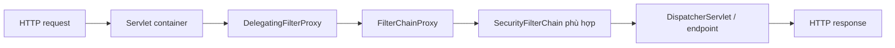
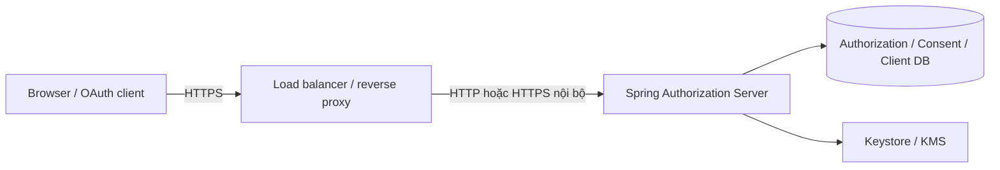
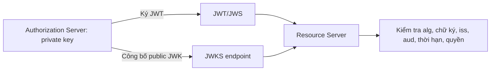

# Yêu cầu kiến thức về Servlet Security, HTTP, TLS và mật mã

## 1. Vì sao cần các kiến thức nền tảng này?

Trong module **SPRING_SECURITY_OAUTH2_OIDC_AUTHORIZATION_SERVER**, mục tiêu là học cách thiết kế, cấu hình, bảo mật, kiểm thử và vận hành một **OAuth 2.0/OpenID Connect Authorization Server** bằng Spring Security và Spring Authorization Server trong ứng dụng Spring Boot. Trước khi cấu hình endpoint cấp token, đăng nhập hoặc phát hành ID Token, người học cần hiểu bốn lớp nền tảng:

1. **Servlet Security** giải thích request được xử lý qua các bộ lọc bảo mật, người dùng được xác thực như thế nào và trạng thái đăng nhập được giữ ra sao.
2. **HTTP** giải thích cách trình duyệt, OAuth client, Authorization Server và Resource Server trao đổi request, response, redirect, header, cookie và mã lỗi.
3. **TLS** bảo vệ kênh truyền, giúp xác thực tên máy chủ và bảo mật dữ liệu như authorization code, client credential và token khi đi qua mạng.
4. **Mật mã ứng dụng** bảo vệ mật khẩu, chứng minh tính toàn vẹn của token, tạo giá trị khó đoán và chống đánh cắp authorization code bằng PKCE.

Đây là **kiến thức tiên quyết**, không phải yêu cầu người học tự triển khai giao thức OAuth 2.0 hoặc thuật toán mật mã. Spring Security và Spring Authorization Server đã cung cấp phần lớn cơ chế; nhiệm vụ của người phát triển là hiểu đúng ranh giới tin cậy và cấu hình chúng an toàn.

### Kết quả học tập mong đợi

Sau bài này, người học có thể:

- Theo dấu một request qua `SecurityFilterChain`, phân biệt **authentication** với **authorization**, giải thích khi nào session và cookie được sử dụng.
- Đọc và giải thích HTTP redirect, `GET`, `POST`, status code, header và định dạng dữ liệu trong Authorization Code Flow.
- Mô tả đường đi của HTTPS qua reverse proxy; nhận diện các lỗi cấu hình `issuer`, chứng chỉ, cookie và forwarded header.
- Phân biệt hash, HMAC, chữ ký số, mã hóa và dữ liệu ngẫu nhiên an toàn; đọc cấu trúc JWT/JWK/JWKS và ý nghĩa của PKCE.
- Liên hệ các nền tảng trên với việc thiết kế, kiểm thử và vận hành Authorization Server trên Spring Boot.

## 2. Bức tranh tổng thể: một lần đăng nhập và cấp token

Một hệ thống điển hình có bốn vai trò: **Resource Owner** (người dùng), **Client** (ứng dụng muốn truy cập), **Authorization Server** (xác thực và cấp token) và **Resource Server** (API bảo vệ tài nguyên). Với OpenID Connect (OIDC), Authorization Server còn đóng vai trò **OpenID Provider**, phát hành **ID Token** cho client xác thực danh tính người dùng.

```mermaid
sequenceDiagram
    autonumber
    actor U as Người dùng
    participant B as Trình duyệt / Client
    participant AS as Authorization Server
    participant RS as Resource Server
    B->>AS: GET /oauth2/authorize + state + code_challenge
    AS-->>B: 302 /login (nếu chưa có phiên)
    U->>B: Nhập thông tin đăng nhập
    B->>AS: POST /login qua HTTPS
    AS-->>B: Set-Cookie phiên; chuyển về luồng ủy quyền
    AS-->>B: 302 redirect_uri?code=...&state=...
    B->>AS: POST /oauth2/token + code + code_verifier
    AS-->>B: Access Token (+ ID Token nếu dùng OIDC)
    B->>RS: GET /api/... với Authorization: Bearer ...
    RS-->>B: Dữ liệu được phép truy cập
```

Sơ đồ đơn giản hóa một số bước, chẳng hạn màn hình đồng ý cấp quyền (*consent*) và cách client backend trao đổi token. Hai điểm cần phân biệt:

- **Đăng nhập của người dùng tại Authorization Server** thường liên quan đến session, cookie và các Servlet Security Filter. Token được phát hành cho client sau đó có vòng đời riêng.
- **Xác minh Access Token tại Resource Server** là một nhiệm vụ khác. Nếu token là JWT, Resource Server thường kiểm tra chữ ký và claims; nếu là opaque token, nó có thể dùng introspection. Có JWT không có nghĩa toàn bộ Authorization Server trở thành ứng dụng không trạng thái.

## 3. Kiến thức Servlet Security cần nắm

### 3.1. Servlet request đi qua đâu?

Trong Spring Boot sử dụng servlet stack, web container (ví dụ Tomcat) nhận HTTP request và chuyển qua **Servlet Filter Chain** trước khi request đến `DispatcherServlet`, controller hoặc endpoint phù hợp. Spring Security tích hợp vào chuỗi này thông qua `DelegatingFilterProxy`, thường trỏ đến `FilterChainProxy` có tên `springSecurityFilterChain`.



`FilterChainProxy` chọn một `SecurityFilterChain` phù hợp theo `RequestMatcher` và thứ tự ưu tiên. **Không phải mọi request đều lần lượt đi qua mọi chain**: chain khớp đầu tiên được áp dụng. Trong một chain, các security filter xử lý trách nhiệm như trích xuất credential, khôi phục security context, xác thực, xử lý exception và kiểm tra quyền truy cập. Thứ tự các filter có ý nghĩa bảo mật; vì vậy cần sử dụng cấu hình Spring Security thay vì tự đặt filter tùy tiện.

Các thành phần và trách nhiệm chính:

| Thành phần | Vai trò cần hiểu |
| --- | --- |
| `HttpSecurity` | DSL cấu hình các quy tắc bảo mật cho một `SecurityFilterChain`. |
| `SecurityFilterChain` | Tập các security filter áp dụng cho một nhóm request. |
| `RequestMatcher` | Xác định request thuộc chain hoặc quy tắc nào. |
| `Authentication` | Đại diện cho principal, credential và quyền hạn; trạng thái đã xác thực cần được xác lập qua cơ chế đáng tin cậy. |
| `AuthenticationManager` / `AuthenticationProvider` | Phối hợp, kiểm tra credential hoặc phương thức xác thực cụ thể. |
| `SecurityContext` / `SecurityContextHolder` | Nơi truy cập thông tin authentication của request đang xử lý. |
| `SecurityContextRepository` | Cơ chế tải/lưu security context giữa các request khi cần, ví dụ dùng HTTP session. |
| `AuthorizationManager` | Đánh giá request hoặc thao tác có được phép hay không. |

**Authentication** hỏi: *Ai đang thực hiện yêu cầu?* Ví dụ xác minh tài khoản và mật khẩu để tạo phiên đăng nhập. **Authorization** hỏi: *Chủ thể đã được xác thực có được thực hiện hành động này hay không?* Ví dụ người dùng có đồng ý cho client xin scope `profile`, và client có được đăng ký sử dụng grant type đó hay không. Quyền của người dùng, quyền của client và scope OAuth không nên bị đánh đồng.

### 3.2. Tại sao Authorization Server thường cần hai security chain?

Trong ứng dụng vừa phục vụ các endpoint giao thức (`/oauth2/authorize`, `/oauth2/token`, `/oauth2/jwks`, endpoint OIDC...) vừa có trang đăng nhập (`/login`), các nhóm request có yêu cầu khác nhau. Cấu hình Spring Authorization Server thường đặt **chain ưu tiên cao** cho endpoint giao thức, rồi dùng **chain mặc định** cho giao diện đăng nhập và các request ứng dụng còn lại.

Ví dụ dưới đây minh họa cách phân tách chain trong các phiên bản Spring Authorization Server có API `OAuth2AuthorizationServerConfigurer.authorizationServer()`:

```java
@Configuration
@EnableWebSecurity
public class SecurityConfig {

    @Bean
    @Order(1)
    SecurityFilterChain authorizationServerChain(HttpSecurity http) throws Exception {
        OAuth2AuthorizationServerConfigurer configurer =
                OAuth2AuthorizationServerConfigurer.authorizationServer();

        http.securityMatcher(configurer.getEndpointsMatcher())
                .with(configurer, server -> server.oidc(Customizer.withDefaults()))
                .authorizeHttpRequests(auth -> auth.anyRequest().authenticated())
                .exceptionHandling(ex -> ex.defaultAuthenticationEntryPointFor(
                        new LoginUrlAuthenticationEntryPoint("/login"),
                        new MediaTypeRequestMatcher(MediaType.TEXT_HTML)));

        return http.build();
    }

    @Bean
    @Order(2)
    SecurityFilterChain applicationChain(HttpSecurity http) throws Exception {
        http.authorizeHttpRequests(auth -> auth.anyRequest().authenticated())
                .formLogin(Customizer.withDefaults());
        return http.build();
    }
}
```

Đoạn code tập trung vào **phân luồng bảo mật**, chưa phải cấu hình Authorization Server hoàn chỉnh. Một hệ thống thực tế còn cần `RegisteredClientRepository`, `OAuth2AuthorizationService`, khóa ký/JWK và `AuthorizationServerSettings`, cùng với cơ chế quản lý người dùng, mật khẩu và consent. API cấu hình có thể thay đổi theo phiên bản Spring Security/Spring Authorization Server; cần đối chiếu tài liệu chính thức của phiên bản đang dùng.

Khi đọc cấu hình, hãy tự trả lời: `GET /oauth2/authorize` khớp chain nào? Request chưa đăng nhập sẽ được chuyển đến đâu? Vì sao `/login` phải được xử lý qua chain ứng dụng? Nếu đổi `@Order`, request có thể bị chain tổng quát bắt trước hay không?

### 3.3. Session, cookie, CSRF và CORS

**HTTP mặc định không lưu trạng thái giữa các request**, nhưng trải nghiệm đăng nhập qua trình duyệt thường cần session. Sau khi xác thực thành công, trình duyệt có thể nhận cookie định danh phiên (thường là `JSESSIONID`); trên request tiếp theo, cơ chế `SecurityContextRepository` có thể khôi phục `Authentication` từ phiên tương ứng. `SecurityContextHolder` thường sử dụng ngữ cảnh gắn với luồng xử lý hiện tại; không tự suy ra nó sẽ được mang nguyên vẹn sang mọi asynchronous thread.

Các cơ chế dễ nhầm lẫn:

- **Session cookie** là bằng chứng trình duyệt đang gắn với một phiên; nó không phải Access Token hay ID Token. Nên bật `Secure`, `HttpOnly` và chọn chính sách `SameSite` phù hợp với luồng đăng nhập thực tế.
- **CSRF** lợi dụng việc trình duyệt tự gửi cookie để thực hiện request không mong muốn. Đặc biệt quan trọng với thao tác thay đổi trạng thái như `POST /login`, logout, consent hoặc các form dựa trên session. Không tắt CSRF cho toàn ứng dụng chỉ vì Authorization Server có endpoint token; Spring Authorization Server có cấu hình đặc thù cho các endpoint giao thức.
- **CORS** là cơ chế trình duyệt kiểm soát JavaScript từ origin khác đọc response. CORS không thay thế authentication, authorization, PKCE hoặc CSRF. Redirect trình duyệt đến trang ủy quyền không đồng nghĩa với một `fetch()` cross-origin, và không nên mở `Access-Control-Allow-Origin: *` bừa bãi cho endpoint nhạy cảm.
- **SameSite** kiểm soát khi nào cookie được gửi trong các ngữ cảnh cross-site. `Lax` thường phù hợp với nhiều redirect đăng nhập thông thường; những luồng đặc biệt như response OIDC `form_post` có thể cần đánh giá kỹ `SameSite=None; Secure` cùng biện pháp chống CSRF.

### 3.4. Các câu hỏi Servlet Security cần trả lời trước khi triển khai

Một request chưa đăng nhập được chuyển tới login bằng filter hay controller nào? Sau khi đăng nhập, `Authentication` được lưu và khôi phục ở đâu? Login form và consent form có CSRF token hay chưa? Endpoint giao thức có bị `SecurityFilterChain` tổng quát bắt nhầm không? Nếu triển khai nhiều instance, trạng thái phiên, authorization code và consent được chia sẻ/lưu bền vững thế nào?

## 4. Kiến thức HTTP cần nắm

### 4.1. Phương thức, endpoint và mã trạng thái

OAuth 2.0 và OIDC hoạt động trên HTTP, vì vậy phải đọc chính xác **method**, **URL**, **header**, **body** và **response status**. Một số request thường gặp:

| Request hoặc response | Ý nghĩa |
| --- | --- |
| `GET /oauth2/authorize?...` | Trình duyệt bắt đầu yêu cầu ủy quyền bằng query parameter. Có thể cần đăng nhập và consent. |
| `302 Location: /login` | Chuyển hướng trình duyệt để đăng nhập. |
| `POST /login` | Gửi dữ liệu xác thực trong body qua HTTPS, theo cấu hình form login. |
| `302 Location: https://client.example/callback?code=...&state=...` | Trả authorization code về redirect URI đã đăng ký. |
| `POST /oauth2/token` | Client đổi code lấy token; thông thường gửi body dạng `application/x-www-form-urlencoded`. |
| `GET /.well-known/openid-configuration` | Lấy metadata discovery khi bật OIDC. |
| `GET /oauth2/jwks` | Lấy bộ public JWK để bên nhận xác minh token có chữ ký phù hợp. |
| `401 Unauthorized` | Thường báo chưa xác thực hoặc thông tin xác thực không hợp lệ; có thể đi kèm `WWW-Authenticate`. |
| `403 Forbidden` | Chủ thể đã được nhận diện nhưng không đủ quyền, hoặc chính sách bảo vệ từ chối thao tác. |

Không áp dụng máy móc `401`/`403` cho mọi tình huống OAuth: endpoint token còn trả lỗi giao thức dạng JSON như `invalid_client`, `invalid_grant`, `invalid_request` theo tiêu chuẩn tương ứng. Khi kiểm thử, cần đọc **cả HTTP status và phần thân lỗi**.

**Redirect là phần của giao thức bảo mật**:

- `Location` đưa trình duyệt sang URL mới. Trong Authorization Code Flow, `redirect_uri` phải được kiểm tra chặt chẽ với URI đã đăng ký; không chấp nhận URL tùy ý dẫn đến open redirect hay thất thoát code.
- `302` và `303` thường được dùng cho các chuyển hướng sau thao tác form. `307`/`308` bảo toàn method và body nên cần đặc biệt thận trọng để tránh chuyển tiếp một request `POST` chứa credential sang địa chỉ khác.
- `code`, `state`, `client_id`, `scope`, `redirect_uri` và `code_challenge` có vai trò khác nhau; không được xem chúng đều là credential bí mật. Tuy nhiên authorization code vẫn phải được bảo vệ và không được ghi log công khai.

### 4.2. Header, content type, URL encoding và cookie

Ví dụ một request đổi authorization code lấy token bằng một confidential client:

```http
POST /oauth2/token HTTP/1.1
Host: auth.example.com
Content-Type: application/x-www-form-urlencoded
Authorization: Basic <base64-client-credentials>

grant_type=authorization_code&code=<one-time-code>&redirect_uri=https%3A%2F%2Fclient.example%2Fcallback&code_verifier=<pkce-verifier>
```

Trong ví dụ này:

- `Content-Type` mô tả kiểu body, **không phải** cơ chế xác thực. Các tham số form phải được URL-encode đúng quy tắc.
- `Authorization: Basic ...` mang client credentials đã được mã hóa Base64 để vận chuyển theo cú pháp HTTP; **Base64 không phải mã hóa bảo mật**. Chỉ sử dụng qua HTTPS và bảo vệ secret. Public client không có secret để tự chứng minh danh tính theo cách này; phải cấu hình phương thức client authentication phù hợp.
- `Authorization: Bearer <access-token>` được Resource Server sử dụng khi client gọi API; ai nắm giữ bearer token còn hiệu lực có thể sử dụng token trong phạm vi quyền tương ứng.
- `Cookie` gửi session identifier về server, còn `Set-Cookie` trả cookie cho trình duyệt. Phải phân biệt cookie phiên với header bearer token.
- `Cache-Control: no-store` và chính sách không cache thích hợp cần được áp dụng cho response chứa token hoặc dữ liệu nhạy cảm. Tránh ghi secret, token và authorization code vào access log, trace, analytics hoặc URL công khai.

### 4.3. HTTP stateless không có nghĩa nghiệp vụ stateless

Một Authorization Server thường quản lý **authorization code dùng một lần**, consent, refresh token, thông tin client và session đăng nhập. Dù Access Token phát hành dưới dạng JWT tự kiểm chứng, quá trình cấp phát/thu hồi token vẫn có thể cần lưu trữ trạng thái. Ngược lại, Resource Server có thể xác minh JWT cục bộ dựa vào JWKS mà không gọi Authorization Server trên mọi request.

Phải hiểu rõ khác biệt giữa:

- **Xác thực người dùng bằng session** trong tương tác trình duyệt.
- **Xác thực OAuth client** tại token endpoint hoặc những endpoint cần client authentication.
- **Ủy quyền truy cập tài nguyên** bằng Access Token tại Resource Server.

Ba cơ chế phục vụ các chủ thể và ranh giới tin cậy khác nhau.

## 5. Kiến thức TLS và hạ tầng HTTPS

### 5.1. TLS bảo vệ điều gì?

TLS tạo kênh giao tiếp được xác thực và mã hóa giữa client với đầu kết nối TLS. Khi truy cập `https://auth.example.com`, client kiểm tra chứng chỉ và tên miền (qua thông tin SAN), chuỗi tin cậy tới CA thích hợp, thời hạn chứng chỉ và tham số phiên TLS. Trong quá trình bắt tay TLS, hai phía thiết lập khóa phiên để bảo vệ tính bí mật và toàn vẹn của dữ liệu trao đổi.

Đối với Authorization Server, TLS bảo vệ thông tin xác thực người dùng, authorization code, client secret, access/refresh token và session cookie trên đường truyền. **TLS không tự thay thế phân quyền ứng dụng, CSRF protection, PKCE hay chữ ký token**; mỗi cơ chế bảo vệ một loại rủi ro khác nhau.

Những điểm triển khai tối thiểu:

- Phục vụ các endpoint công khai bằng **HTTPS**, dùng cấu hình TLS hiện đại (ưu tiên TLS 1.3, hỗ trợ TLS 1.2 an toàn khi cần tương thích). Không bật phiên bản giao thức và cipher suite yếu.
- Chứng chỉ hợp lệ, tên miền trùng khớp, chuỗi chứng chỉ đầy đủ và có quy trình gia hạn trước khi hết hạn.
- Không tắt xác minh chứng chỉ hoặc hostname trong OAuth client, Resource Server, test client triển khai thực tế.
- Cân nhắc HTTP Strict Transport Security (HSTS) khi toàn bộ miền và subdomain liên quan đáp ứng yêu cầu HTTPS; thiết lập `Secure` cho cookie chứa phiên hoặc dữ liệu nhạy cảm.
- Giữ đồng hồ các máy chủ tương đối chính xác để tránh lỗi kiểm tra chứng chỉ, `exp`, `nbf` và các mốc thời gian trong token.

### 5.2. Terminate TLS ở reverse proxy và issuer URL

Một hệ thống triển khai thực tế có thể đặt load balancer hoặc reverse proxy ở trước Spring Boot:



Khi proxy terminate TLS, ứng dụng có thể **nhìn thấy kết nối nội bộ là HTTP** dù người dùng truy cập HTTPS. Nếu cấu hình sai public origin hoặc forwarded header, Authorization Server có thể phát hành discovery metadata, redirect URI hoặc claim `iss` sử dụng `http://` hay hostname nội bộ. Điều này dẫn đến lỗi xác minh issuer, lỗi redirect và có thể làm lộ dữ liệu qua đường truyền không mong muốn.

Ví dụ khai báo issuer rõ ràng:

```java
@Bean
AuthorizationServerSettings authorizationServerSettings() {
    return AuthorizationServerSettings.builder()
            .issuer("https://auth.example.com")
            .build();
}
```

Issuer là **định danh công khai** của Authorization Server; token, discovery metadata và cấu hình của client/Resource Server phải nhất quán với giá trị đó. Trường hợp dùng reverse proxy, chỉ tin `Forwarded` hoặc `X-Forwarded-*` do proxy đáng tin cậy thiết lập và loại bỏ header giả mạo từ client trước khi truyền tới ứng dụng. Nếu đoạn kết nối proxy → ứng dụng chạy HTTP, phải có kiểm soát hạ tầng tương ứng; có thể dùng HTTPS/mTLS nội bộ khi mô hình đe dọa yêu cầu.

**mTLS** (mutual TLS) bổ sung xác thực chứng chỉ phía client, có thể được dùng làm một cơ chế xác thực OAuth client trong triển khai phù hợp. Nó không phải yêu cầu bắt buộc cho mọi OAuth 2.0/OIDC client, và khác với HTTPS thông thường chỉ xác thực máy chủ.

### 5.3. Kiểm tra TLS trong môi trường phát triển và production

Trong môi trường cục bộ, có thể dùng `localhost` và cấu hình riêng để học và thử nghiệm. Khi triển khai thực tế, không dựa vào ngoại lệ `localhost` để cho phép callback HTTP; phải dùng issuer công khai ổn định, redirect URI đã đăng ký và HTTPS với chứng chỉ được client tin cậy. Kiểm tra toàn bộ đường đi gồm browser → proxy, proxy → backend, Authorization Server → database/keystore và những lời gọi tới hệ thống ngoài theo mô hình đe dọa tương ứng.

## 6. Kiến thức mật mã cần nắm

### 6.1. Phân biệt các kỹ thuật thường gặp

| Kỹ thuật | Dùng để làm gì? | Ví dụ trong Authorization Server | Nhầm lẫn cần tránh |
| --- | --- | --- | --- |
| Hàm băm mật mã (`SHA-256`) | Tạo digest có chiều dài cố định để kiểm tra sự ràng buộc/toàn vẹn trong giao thức. | Tính `code_challenge` của PKCE `S256`. | Hash nhanh không phải cách lưu mật khẩu an toàn. |
| Password hashing (`bcrypt`, `Argon2id`, PBKDF2 phù hợp) | Biến mật khẩu/secret thành giá trị kiểm chứng một chiều, có salt và chi phí tính toán. | Lưu mật khẩu người dùng hoặc client secret phù hợp. | Không lưu mật khẩu thô hay dùng SHA-256 đơn lẻ cho password. |
| HMAC | Xác thực tính toàn vẹn và nguồn gốc thông điệp bằng **khóa đối xứng chung**. | Một số thiết kế token/chữ ký đối xứng như `HS256`, khi hai phía tin cậy chia sẻ secret. | Bên kiểm tra chữ ký HMAC cũng biết khóa có thể tạo chữ ký. |
| Chữ ký số bất đối xứng | Bên giữ **private key** ký, bên giữ **public key** kiểm tra. | Ký JWT bằng thuật toán phù hợp như `RS256` hoặc `ES256`. | Không cần phân phối private key cho Resource Server. |
| Mã hóa | Che nội dung khỏi bên không có khóa giải mã. | TLS bảo vệ đường truyền; JWE có thể bảo vệ payload token nếu hệ thống thực sự yêu cầu. | JWT ký bằng JWS thường **đọc được** payload, không được bảo mật nội dung bằng mã hóa. |
| Bộ sinh số ngẫu nhiên an toàn (CSPRNG) | Tạo giá trị không thể dự đoán thực tế. | Authorization code, `state`, `nonce`, `code_verifier`, token bí mật, session identifier. | Không dùng bộ sinh số ngẫu nhiên thông thường cho security token. |

Một ứng dụng Spring Security thường sử dụng `PasswordEncoder` thích hợp (ví dụ `DelegatingPasswordEncoder`) để kiểm tra mật khẩu. Khi xử lý khóa ký token, phải quản lý vòng đời và quyền truy cập khóa; **không nhúng private key hoặc client secret thực vào source code hay tài liệu học tập**.

### 6.2. JWT, JWS, JWK và JWKS liên hệ thế nào?

JWT (*JSON Web Token*) là định dạng mang claims. Trường hợp phổ biến là **JWT được ký** theo JWS, gồm ba phần được Base64URL-encode và ngăn cách bằng dấu chấm:

```text
BASE64URL(header).BASE64URL(payload).BASE64URL(signature)
```

Header có thể mang `alg` (thuật toán ký) và `kid` (mã định danh khóa); payload có thể mang `iss` (issuer), `sub` (subject), `aud` (audience), `exp` (hết hạn), `iat` (thời điểm phát hành) và những claim dành riêng cho Access Token hoặc ID Token. Việc decode Base64URL **không** chứng minh token hợp lệ. Bên xác minh phải kiểm tra chữ ký bằng khóa và thuật toán được cho phép, sau đó kiểm tra các claim bắt buộc theo mục đích sử dụng.

Ví dụ luồng dùng chữ ký bất đối xứng:



- **JWK** (*JSON Web Key*) là biểu diễn khóa ở dạng JSON. Với khóa bất đối xứng, JWK public chứa phần khóa công khai có thể chia sẻ.
- **JWKS** (*JSON Web Key Set*) là tập các JWK; endpoint JWKS cho phép bên xác minh lấy các public key và dùng `kid` chọn khóa thích hợp.
- **JWS** xác nhận tính toàn vẹn và nguồn gốc trong phạm vi khóa tin cậy; không che giấu claims. **JWE** mới là cấu trúc để mã hóa nội dung khi có yêu cầu bảo mật payload riêng.
- **Access Token** chứng minh quyền gọi API theo scope/audience; **ID Token** dành cho client xác nhận kết quả xác thực người dùng trong OIDC. Resource Server không được mặc định dùng ID Token thay Access Token.
- Khi **xoay khóa ký (key rotation)**, cần công bố và giữ public key cũ đủ lâu để kiểm tra token còn hiệu lực, đồng thời ngừng sử dụng private key cũ theo chính sách. Không bao giờ trả private key qua JWKS endpoint.

Thường ưu tiên chữ ký bất đối xứng khi nhiều Resource Server cần xác minh token, vì các hệ thống chỉ giữ public key. Bộ xác minh phải có danh sách thuật toán được cho phép; **không** lấy bất kỳ giá trị `alg` từ header token làm chỉ dẫn tin cậy tuyệt đối. Token chỉ hợp lệ khi `iss`, `aud`, thời hạn và các điều kiện nghiệp vụ phù hợp với endpoint đang gọi.

### 6.3. PKCE S256, `state` và `nonce`

Trong Authorization Code Flow, mã `code` đi qua trình duyệt và redirect. Nếu code bị chặn, kẻ tấn công có thể cố đổi nó lấy token. **Proof Key for Code Exchange (PKCE)** ràng buộc lần đổi code với một giá trị bí mật do client tạo ở đầu luồng.

1. Client tạo `code_verifier` ngẫu nhiên bằng CSPRNG, dài từ **43 đến 128 ký tự** theo cú pháp RFC 7636.
2. Client tính `code_challenge = BASE64URL(SHA256(ASCII(code_verifier)))` với phương thức `S256`; Base64URL ở đây **không có dấu `=` padding**.
3. Request `/oauth2/authorize` mang `code_challenge` và `code_challenge_method=S256`, còn client giữ kín `code_verifier`.
4. Khi đổi code tại `/oauth2/token`, client gửi `code_verifier`. Authorization Server kiểm chứng nó khớp challenge được gắn với authorization code.

Ví dụ minh họa:

```text
GET /oauth2/authorize?
  response_type=code&client_id=sample-client&scope=openid&
  redirect_uri=https%3A%2F%2Fclient.example%2Fcallback&
  state=<random-state>&
  code_challenge=<base64url-sha256-verifier>&
  code_challenge_method=S256

POST /oauth2/token
  grant_type=authorization_code&code=<returned-code>&
  redirect_uri=https%3A%2F%2Fclient.example%2Fcallback&
  code_verifier=<original-verifier>
```

`state`, `nonce` và PKCE không thay thế cho nhau:

| Giá trị | Ai tạo và dùng? | Mục đích chính |
| --- | --- | --- |
| `state` | Client tạo trước redirect và kiểm tra khi nhận response. | Liên kết response với request ủy quyền ban đầu, góp phần chống CSRF/nhầm phiên trong luồng redirect. |
| `code_verifier` / `code_challenge` | Client tạo; Authorization Server xác minh lúc đổi code. | Chống sử dụng authorization code bị chặn bởi bên không biết verifier. |
| `nonce` | OIDC client tạo; đưa trong yêu cầu khi áp dụng và kiểm tra trên ID Token. | Ràng buộc ID Token với yêu cầu xác thực, giảm nguy cơ replay/token substitution. |

Nên sử dụng Authorization Code Flow với PKCE `S256`, đặc biệt bắt buộc coi PKCE là phần quan trọng đối với public client; các khuyến nghị an ninh hiện đại cũng áp dụng PKCE rộng rãi cho các client khác. Một public client chạy trên trình duyệt hoặc thiết bị không thể giữ client secret như một bí mật đáng tin cậy, dù secret có được điền trong file cấu hình frontend.

### 6.4. Mật khẩu, client secret và token trong lưu trữ

- **Mật khẩu người dùng:** dùng password hashing có salt và chi phí tính toán thích hợp; Spring Security `PasswordEncoder` hỗ trợ xác minh và nâng cấp định dạng hash. Không log mật khẩu, không lưu plaintext.
- **Client secret:** chỉ cấp cho confidential client có khả năng giữ bí mật, lưu dưới dạng được bảo vệ và kiểm chứng với encoder phù hợp. Nên có quy trình cấp phát, thu hồi và luân chuyển secret.
- **Signing key:** private key phải được kiểm soát chặt, có thể quản lý bằng keystore, KMS hoặc HSM theo mức độ an toàn yêu cầu; public key mới được công bố cho bên kiểm tra chữ ký.
- **Authorization code/refresh token:** phải khó đoán, có thời hạn và chính sách sử dụng/thu hồi rõ ràng. Authorization code cần ngắn hạn và **chỉ dùng một lần**; refresh token phải được bảo vệ ở phía client và có chiến lược rotation/revocation theo rủi ro.
- **Token và dữ liệu định danh:** giới hạn dữ liệu nhạy cảm trong claims; tránh ghi token, secret, verifier, session ID vào log. JWT có chữ ký thường bị đọc được nội dung bởi bất cứ ai nắm giữ chuỗi token.

## 7. Ghép kiến thức thành mô hình đe dọa

| Rủi ro thực tế | Dấu hiệu hoặc nguyên nhân | Kiến thức/biện pháp cần áp dụng |
| --- | --- | --- |
| Kẻ khác đọc token trên đường truyền | HTTP thường hoặc TLS bị tắt kiểm tra | HTTPS/TLS và xác minh hostname/chứng chỉ. |
| Đánh cắp authorization code | Redirect bị lộ hoặc code bị chặn | PKCE `S256`, code ngắn hạn, single-use, redirect URI kiểm tra chặt. |
| Đánh tráo response đăng nhập | Client không ràng buộc request với callback | `state`, OIDC `nonce` khi cần, kiểm tra đúng `redirect_uri` và phiên ứng dụng. |
| Request trái ý muốn bằng cookie phiên | Form thay đổi trạng thái thiếu bảo vệ | CSRF protection, cookie `SameSite` phù hợp, kiểm soát origin theo yêu cầu. |
| API chấp nhận token sai audience | Chỉ decode JWT hoặc chỉ kiểm tra chữ ký | Xác minh `iss`, `aud`, `exp`, `nbf`, thuật toán, quyền và scope. |
| Public key không thể xác minh sau rotation | Xóa khóa cũ khỏi JWKS quá sớm | Quy trình rotation và thời gian công bố public key cũ phù hợp vòng đời token. |
| Discovery công bố URL nội bộ hoặc HTTP | Sai issuer hay tin forwarded header giả mạo | Khai báo public issuer, reverse proxy đáng tin cậy, kiểm tra HTTPS end-to-end. |
| Lộ client secret/private key | Hardcode, log, repository hoặc cấu hình truy cập rộng | Secret manager/KMS, phân quyền, rotate, không đưa secret vào client công khai. |

Một lỗi thường gặp là chỉ nhìn trạng thái `200 OK` ở token endpoint rồi kết luận hệ thống an toàn. Một Authorization Server đạt yêu cầu còn phải từ chối những trường hợp **sai client, sai `redirect_uri`, sai verifier, code đã dùng, token sai issuer/audience, cookie thiếu bảo vệ** và request không hợp lệ.

## 8. Bài thực hành kiểm tra kiến thức nền

Giả sử ứng dụng Spring Boot có giao diện `/login`, Authorization Server tại `https://auth.example.com`, OAuth client tại `https://client.example` và Resource Server tại `https://api.example.com`.

**Tình huống A — Chọn filter chain.** Khi trình duyệt gọi `/oauth2/authorize` mà chưa đăng nhập, chain giao thức nhận request, điều hướng tới `/login`, sau đó chain ứng dụng xử lý form login. Hãy giải thích vì sao chain nào được chọn phụ thuộc vào `securityMatcher` và `@Order`, và người dùng được nhận diện lại sau redirect nhờ cơ chế nào.

**Tình huống B — Phát hiện lỗi reverse proxy.** Discovery endpoint có thể được truy cập qua HTTPS nhưng trả issuer `http://internal-service:9000`. Hãy kiểm tra `AuthorizationServerSettings`, public hostname, các forwarded header do proxy phát và giá trị `iss` của token. Client phải nhìn thấy một issuer HTTPS nhất quán; không sửa token bằng tay để làm cho lỗi biến mất.

**Tình huống C — Từ chối đổi code sai.** Lặp lại request `POST /oauth2/token` với cùng authorization code hoặc với `code_verifier` không khớp. Authorization Server phải từ chối theo chính sách một lần sử dụng và cơ chế PKCE; đọc nội dung lỗi giao thức để biết nguyên nhân.

**Tình huống D — Phân biệt token.** Một API nhận ID Token có chữ ký hợp lệ nhưng `aud` là client ID thay vì API. API không được xem ID Token như Access Token: mục đích token và audience phải phù hợp, bên cạnh việc chữ ký hợp lệ.

### Checklist trước khi học cấu hình Authorization Server chi tiết

- [ ] Giải thích được Servlet Filter Chain, `SecurityFilterChain`, `SecurityContext` và vai trò của session login.
- [ ] Phân biệt authentication của người dùng, authentication của client và authorization tại Resource Server.
- [ ] Đọc được request/response của authorization endpoint, token endpoint, redirect và cookie; hiểu form encoding, HTTP status và OAuth error.
- [ ] Biết vì sao cần TLS ở mọi ranh giới phù hợp, issuer HTTPS ổn định và reverse proxy được cấu hình an toàn.
- [ ] Phân biệt hash, password hash, HMAC, chữ ký số và mã hóa; hiểu JWT ký không mặc nhiên giữ bí mật payload.
- [ ] Biết vai trò của JWK/JWKS, `kid`, private/public key và các bước kiểm tra claims JWT.
- [ ] Mô tả được PKCE `S256`, `state`, `nonce` và cách mỗi cơ chế chặn một nhóm tấn công riêng.

## 9. Tài liệu chuẩn và hướng đọc tiếp

- [Spring Security Reference](https://docs.spring.io/spring-security/reference/) — Servlet Architecture, authentication, authorization, session management, CSRF và HTTP headers.
- [Spring Authorization Server Reference](https://docs.spring.io/spring-authorization-server/reference/) — cấu hình Authorization Server, endpoint, registered client, token, JWK và OIDC.
- [RFC 6749 — The OAuth 2.0 Authorization Framework](https://www.rfc-editor.org/rfc/rfc6749) — các vai trò, grant, endpoint và error response căn bản.
- [RFC 7636 — Proof Key for Code Exchange](https://www.rfc-editor.org/rfc/rfc7636) — cách tính, gửi và xác minh PKCE.
- [RFC 9700 — Best Current Practice for OAuth 2.0 Security](https://www.rfc-editor.org/rfc/rfc9700) — các khuyến nghị an ninh hiện đại cho OAuth 2.0.
- [OpenID Connect Core 1.0](https://openid.net/specs/openid-connect-core-1_0.html) — ID Token, nonce và các quy tắc xác minh của OIDC.
- [RFC 7517 — JSON Web Key](https://www.rfc-editor.org/rfc/rfc7517), [RFC 7519 — JSON Web Token](https://www.rfc-editor.org/rfc/rfc7519) và [RFC 8446 — TLS 1.3](https://www.rfc-editor.org/rfc/rfc8446) — nền tảng khóa, token và bảo mật kênh truyền.

**Điều kiện chuyển sang phần cấu hình:** người học có thể theo dõi đầy đủ hành trình request từ trình duyệt, qua các security filter và HTTPS, tới việc phát hành authorization code, đổi token và xác minh Access Token tại API; đồng thời giải thích được ít nhất một biện pháp bảo vệ tương ứng ở mỗi chặng.
