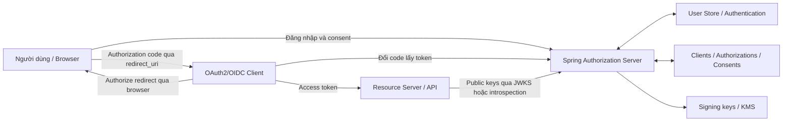
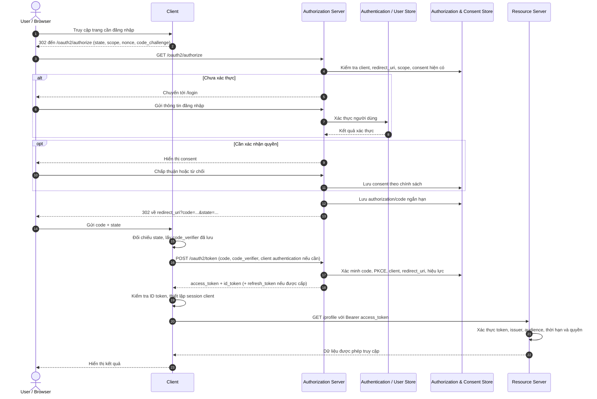
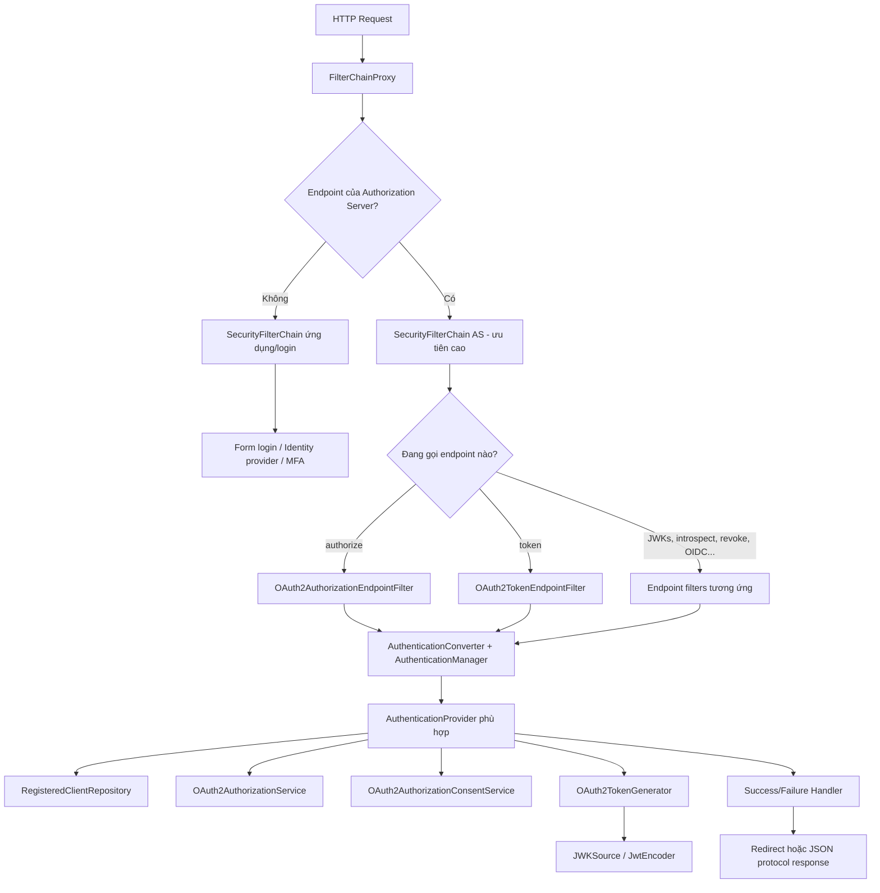
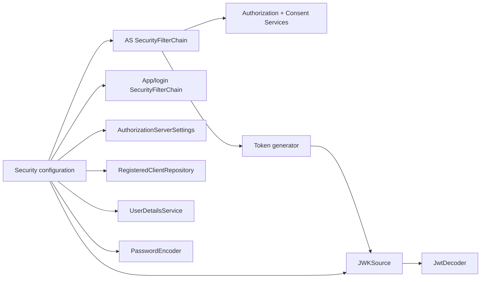
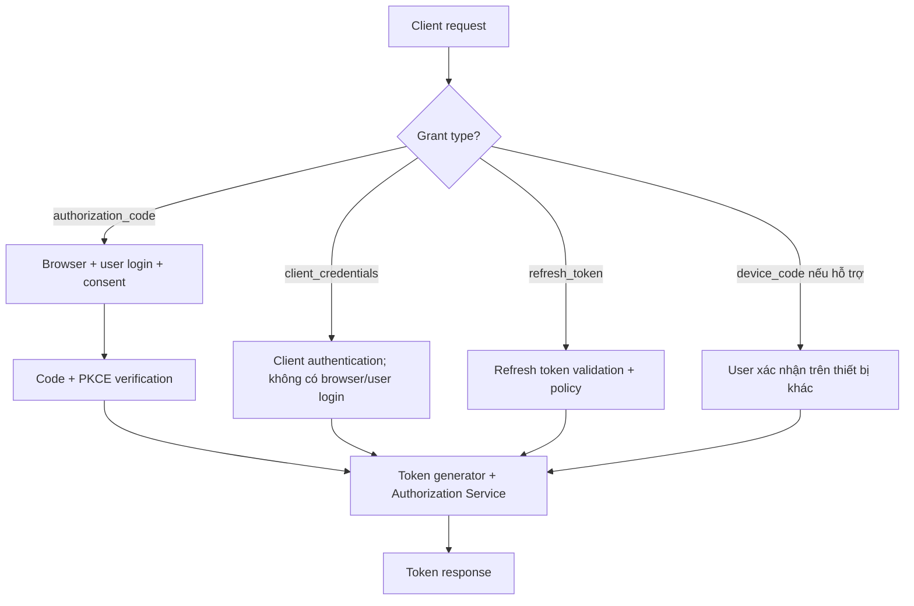
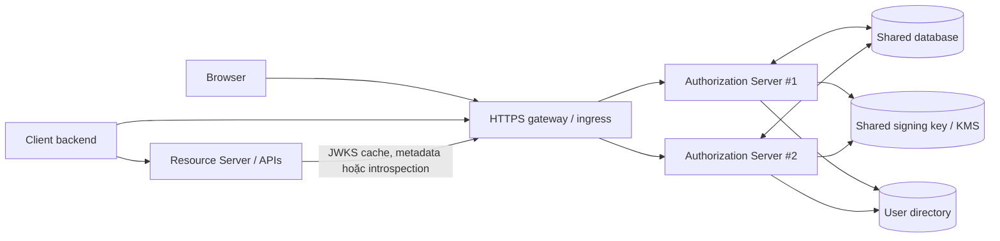

# Bản đồ luồng xử lý và các thành phần cần triển khai

## 1. Mục tiêu và phạm vi

Trong hệ sinh thái **Spring Security OAuth2 OIDC Authorization Server**, một Authorization Server (AS) là thành phần xác thực người dùng, nhận diện ứng dụng khách (client), xử lý việc cấp quyền và phát hành các token theo OAuth 2.0/OpenID Connect (OIDC). Để thiết kế, cấu hình, bảo mật, kiểm thử và vận hành hệ thống bằng **Spring Boot** và **Spring Authorization Server (SAS)**, cần nhìn thấy cả **đường đi của một yêu cầu** lẫn **các thành phần nội bộ chịu trách nhiệm cho từng bước**.

Sau bài này, bạn có thể:

- Vẽ được ranh giới giữa Authorization Server, Client, Resource Server, trình duyệt và kho dữ liệu.
- Theo dõi luồng **Authorization Code + PKCE** khi client yêu cầu thêm `openid` để đăng nhập bằng OIDC.
- Ánh xạ từng bước giao thức sang `SecurityFilterChain`, các `AuthenticationProvider`, service và endpoint trong SAS.
- Xác định những bean cần cấu hình, dữ liệu cần lưu bền vững, khóa ký cần quản lý và điểm cần kiểm thử trước khi triển khai thực tế.
- Phân biệt đường đi của access token, ID token và refresh token để tránh trao nhầm trách nhiệm giữa các dịch vụ.

**Phạm vi:** Bản đồ chính dùng Authorization Code + PKCE và OIDC; những luồng khác như Client Credentials, Refresh Token và Device Authorization được đặt trong mối liên hệ với kiến trúc chung. Đây là bài tổng quan về bản đồ triển khai, không thay thế tài liệu chuyên sâu của từng grant type.

## 2. Toàn cảnh: ai nói chuyện với ai?

| Thành phần | Vai trò | Trách nhiệm quan trọng |
| --- | --- | --- |
| **User / Resource Owner** | Người sử dụng hệ thống | Đăng nhập, quyết định có đồng ý cấp các quyền được yêu cầu hay không. |
| **Browser / User Agent** | Kênh điều hướng tương tác | Chuyển hướng tới trang đăng nhập, đồng ý cấp quyền và quay về client bằng `redirect_uri`. |
| **OAuth2/OIDC Client** | Ứng dụng web, mobile hoặc backend yêu cầu token | Đăng ký `client_id`, các `redirect_uri` và grant type; tạo `state`, `code_verifier`, `nonce` khi thích hợp; lưu token an toàn. |
| **Authorization Server** | Nơi phát hành token và xác thực theo giao thức | Xử lý `/oauth2/authorize`, `/oauth2/token`, metadata, JWKs và các endpoint được bật. |
| **Identity / User Store** | Nơi chứa danh tính và thông tin xác thực | Cung cấp người dùng và kiểm tra thông tin đăng nhập; có thể là cơ sở dữ liệu, LDAP hoặc một cơ chế xác thực khác. |
| **Resource Server (API)** | Dịch vụ lưu trữ tài nguyên được bảo vệ | Kiểm tra access token và thẩm quyền của token trước khi trả dữ liệu; không mặc nhiên là nơi phát hành token. |
| **Kho cấu hình và phiên cấp quyền** | Dữ liệu của AS | Lưu registered clients, authorization, consent, khóa và cấu hình vận hành tùy kiến trúc. |



**Phân biệt ba loại token:**

- **Access token** phục vụ việc truy cập API; Resource Server phải kiểm tra token và quyền (`scope`/`authority`) tương ứng. Token có thể là JWT hoặc opaque token, tùy thiết kế.
- **ID token** là khẳng định danh tính theo OIDC dành cho **client (Relying Party)**, thường chứa các claim như `iss`, `sub`, `aud`, `exp`, `iat`, có thể có `nonce`. Không dùng ID token thay access token khi gọi API.
- **Refresh token** cho phép client xin access token mới theo chính sách của AS; không đưa refresh token tới Resource Server.

## 3. Luồng chuẩn Authorization Code + PKCE với OIDC

Giả sử một client web tên `web-client` đã được đăng ký, người dùng muốn đăng nhập và gọi API hồ sơ. Cả client lẫn AS phải biết chính xác `redirect_uri` đã đăng ký; AS có issuer cố định `https://auth.example.com`.



Đọc luồng theo những mốc sau:

1. **Client chuẩn bị trước khi điều hướng.** Sinh `state` ngẫu nhiên để ràng buộc phiên yêu cầu, sinh `code_verifier` đủ ngẫu nhiên, tính `code_challenge = BASE64URL(SHA256(ASCII(code_verifier)))` với `code_challenge_method=S256`. Khi đăng nhập OIDC, sinh thêm `nonce` để kiểm tra ID token theo nhu cầu của client.
2. **Browser tới authorization endpoint.** AS kiểm tra `client_id`, `redirect_uri`, `response_type=code`, `scope`, PKCE và quyền sử dụng grant của client. Nếu người dùng chưa đăng nhập, AS chuyển tới cơ chế authentication của ứng dụng.
3. **Người dùng xác thực và đồng ý cấp quyền.** Authentication trả về principal đã được xác thực. Consent là quyết định cấp scope cho một client, không đồng nghĩa với bước đăng nhập. Nếu user từ chối, AS trả lỗi giao thức theo một redirect hợp lệ.
4. **AS cấp authorization code.** Code có thời hạn ngắn, gắn với client, principal, redirect URI và thử thách PKCE. Browser chỉ mang code về client, không nhận access token qua fragment như Implicit Flow.
5. **Client đổi code qua kênh hậu trường.** Client gửi lại `code_verifier`; AS đối chiếu với `code_challenge`, kiểm tra code chưa dùng, đã hết hạn hay chưa, client authentication nếu cần và `redirect_uri` khớp với yêu cầu ban đầu.
6. **AS phát hành token.** Khi scope có `openid` và OIDC đã được bật, phản hồi thành công có ID token ngoài access token. Refresh token chỉ xuất hiện nếu client và chính sách cấp quyền cho phép.
7. **Client gọi API bằng access token.** Resource Server xác minh chữ ký JWT qua JWK Set hoặc dùng introspection theo cấu hình; sau đó áp dụng authorization tại endpoint và nghiệp vụ.

Ví dụ một yêu cầu authorization đã được client dựng đúng cách (các giá trị viết hoa chỉ là chỗ giữ chỗ):

```http
GET /oauth2/authorize?response_type=code
    &client_id=web-client
    &redirect_uri=https%3A%2F%2Fapp.example.com%2Flogin%2Foauth2%2Fcode%2Fweb-client
    &scope=openid%20profile
    &state=RANDOM_STATE
    &nonce=RANDOM_NONCE
    &code_challenge=BASE64URL_SHA256_OF_VERIFIER
    &code_challenge_method=S256 HTTP/1.1
Host: auth.example.com
```

**Lưu ý:** Dấu xuống dòng ở trên chỉ để dễ đọc; HTTP request thực tế gửi query string trên một dòng. Với `redirect_uri` chưa được đăng ký hoặc không hợp lệ, AS không được chuyển hướng browser đến một địa chỉ tùy ý do request cung cấp.

## 4. Bản đồ xử lý bên trong Spring Security và SAS

Ở mức HTTP, SAS dùng **Spring Security filter chain**. Khi request vào ứng dụng, `FilterChainProxy` chọn `SecurityFilterChain` đầu tiên có matcher phù hợp. Vì vậy nên có một chain ưu tiên cao cho **các endpoint giao thức của AS** và một chain riêng để xử lý đăng nhập/ứng dụng thông thường.



Sơ đồ là **bản đồ trách nhiệm**, không biểu diễn thứ tự gọi cứng nhắc cho mọi endpoint. Ví dụ JWK Set endpoint công bố khóa công khai; không phải mọi request đều đi qua `AuthenticationProvider` hay cần sinh token. Tương tự, xác thực mật khẩu ở `/login` thuộc chain ứng dụng, còn kiểm tra authorization code thuộc chain AS.

### 4.1. Thành phần nào phải có?

| Thành phần / API | Vị trí trong kiến trúc | Việc cần quyết định khi triển khai |
| --- | --- | --- |
| `SecurityFilterChain` | Bảo vệ HTTP và định tuyến xử lý security | Thứ tự `@Order`, endpoint matcher, form login, CSRF, authentication entry point. |
| `OAuth2AuthorizationServerConfigurer` | Lắp các endpoint OAuth2 của AS | Bật OIDC và các endpoint mở rộng theo nhu cầu. |
| `AuthorizationServerSettings` | Định nghĩa thông tin server | **Issuer chính xác**, endpoint paths, sự nhất quán với URL public qua reverse proxy. |
| `RegisteredClientRepository` | Kho đăng ký client | `client_id`, bí mật client nếu có, redirect URI, authentication method, grant type, scope, PKCE, consent. |
| `OAuth2AuthorizationService` | Lưu trạng thái authorization | Authorization code, access/refresh token, trạng thái token và metadata phục vụ kiểm tra/thu hồi. |
| `OAuth2AuthorizationConsentService` | Lưu quyền đã đồng ý | Gắn scope đã được chấp thuận với người dùng và client. |
| `AuthenticationManager` / `AuthenticationProvider` | Xác minh yêu cầu giao thức | Cặp client/grant/authorization code/PKCE tùy endpoint. |
| `UserDetailsService` hoặc cơ chế identity khác | Xác thực người dùng tương tác | Mật khẩu, liên kết SSO, MFA, khóa tài khoản, quản lý phiên. |
| `OAuth2TokenGenerator<?>` | Sinh token | JWT/opaque token, claim customization, thời hạn, chính sách token. |
| `JWKSource<SecurityContext>` | Cung cấp khóa cho JWT | Khóa ký riêng được bảo vệ, khóa công khai qua JWKS, `kid`, xoay khóa. |
| `JwtDecoder` | Xác minh JWT tại các chức năng cần decoder | Cần cho một số chức năng OIDC; không nên nhầm với bộ xác thực token của Resource Server. |
| `OAuth2TokenCustomizer<JwtEncodingContext>` | Mở rộng claim được phép | Claim tối thiểu, định danh chính xác, tránh đưa dữ liệu nhạy cảm vào token. |
| Resource Server security config | Phía API, ứng dụng **khác vai trò** với AS | Cấu hình `issuer-uri`/`jwk-set-uri`, kiểm tra `aud` và mapping scope/role. |

Với một ứng dụng AS có **user đăng nhập tương tác**, cần thiết kế thêm `/login`, session, cookie và nguồn danh tính. SAS cung cấp hạ tầng giao thức; nó không tự giải quyết toàn bộ trải nghiệm đăng nhập, MFA, quản trị người dùng hay chính sách kinh doanh.

### 4.2. Đường đi của những request quan trọng

| Request | Bộ phận xử lý chính | Dữ liệu đọc/ghi | Đầu ra |
| --- | --- | --- | --- |
| `GET /oauth2/authorize` | Authorization endpoint + chain AS | Registered client, authentication session, authorization/consent | Redirect login, consent, lỗi hoặc code. |
| `POST /oauth2/token` | Token endpoint và provider của grant | Client, authorization code hoặc refresh token, token metadata | JSON token response hoặc OAuth error. |
| `GET /oauth2/jwks` | JWK Set endpoint | Phần **public** của bộ khóa | JWK Set để các verifier xác minh JWT. |
| `POST /oauth2/introspect` | Introspection endpoint | Token metadata và trạng thái còn hiệu lực | Thông tin token theo RFC 7662 cho client được phép. |
| `POST /oauth2/revoke` | Revocation endpoint | Token và authorization liên quan | Phản hồi thu hồi theo RFC 7009. |
| `GET /.well-known/openid-configuration` | OIDC discovery (khi bật OIDC) | Issuer và endpoint/config được công bố | Metadata JSON cho OIDC client. |
| `GET /userinfo` | OIDC UserInfo (khi bật và cấu hình phù hợp) | Access token hợp lệ, principal và claims | Claims danh tính được phép công bố. |
| `GET/POST /connect/logout` | OIDC logout (khi bật và hỗ trợ) | ID token hint, client/redirect policy, browser session | Kết thúc phiên và redirect hợp lệ. |

Một số endpoint như device authorization, pushed authorization request (PAR) hoặc dynamic client registration phụ thuộc phiên bản SAS, cấu hình và trường hợp sử dụng. Không mặc định coi tất cả endpoint tùy chọn đều đã bật hoặc sẵn sàng đưa ra Internet.

## 5. Ví dụ cấu hình Spring Boot tối thiểu

Ví dụ sau mô tả một bản dựng **phục vụ học tập cục bộ**. Spring Boot quản lý phiên bản dependency tương thích; hãy chọn phiên bản Boot/SAS theo tài liệu dự án, không tự trộn các bản Spring Security khác thế hệ.

```xml
<!-- pom.xml: ngoài cấu hình Spring Boot và các dependency cần thiết khác -->
<dependency>
    <groupId>org.springframework.boot</groupId>
    <artifactId>spring-boot-starter-oauth2-authorization-server</artifactId>
</dependency>
<dependency>
    <groupId>org.springframework.boot</groupId>
    <artifactId>spring-boot-starter-web</artifactId>
</dependency>
```

Sơ đồ bean tối thiểu:



Tập trung vào phần wiring chính (lược bớt `import` để dễ quan sát):

```java
@Configuration(proxyBeanMethods = false)
@EnableWebSecurity
public class AuthorizationServerConfig {

    @Bean
    @Order(1)
    SecurityFilterChain authorizationServerChain(HttpSecurity http)
            throws Exception {
        OAuth2AuthorizationServerConfigurer as =
                OAuth2AuthorizationServerConfigurer.authorizationServer();

        http
            .securityMatcher(as.getEndpointsMatcher())
            .with(as, server -> server.oidc(Customizer.withDefaults()))
            .authorizeHttpRequests(auth -> auth.anyRequest().authenticated())
            .exceptionHandling(ex -> ex.defaultAuthenticationEntryPointFor(
                new LoginUrlAuthenticationEntryPoint("/login"),
                new MediaTypeRequestMatcher(MediaType.TEXT_HTML)));

        return http.build();
    }

    @Bean
    @Order(2)
    SecurityFilterChain applicationChain(HttpSecurity http)
            throws Exception {
        http
            .authorizeHttpRequests(auth -> auth.anyRequest().authenticated())
            .formLogin(Customizer.withDefaults());
        return http.build();
    }

    @Bean
    AuthorizationServerSettings authorizationServerSettings() {
        return AuthorizationServerSettings.builder()
                .issuer("http://localhost:9000")
                .build();
    }

    @Bean
    PasswordEncoder passwordEncoder() {
        return new BCryptPasswordEncoder();
    }

    @Bean
    UserDetailsService userDetailsService(PasswordEncoder encoder) {
        UserDetails user = User.withUsername("alice")
                .password(encoder.encode("local-password"))
                .roles("USER")
                .build();
        return new InMemoryUserDetailsManager(user);
    }

    @Bean
    RegisteredClientRepository registeredClientRepository(
            PasswordEncoder encoder) {
        RegisteredClient client = RegisteredClient
                .withId(UUID.randomUUID().toString())
                .clientId("web-client")
                .clientSecret(encoder.encode("local-client-secret"))
                .clientAuthenticationMethod(
                        ClientAuthenticationMethod.CLIENT_SECRET_BASIC)
                .authorizationGrantType(
                        AuthorizationGrantType.AUTHORIZATION_CODE)
                .authorizationGrantType(
                        AuthorizationGrantType.REFRESH_TOKEN)
                .redirectUri(
                        "http://127.0.0.1:8080/login/oauth2/code/web-client")
                .scope(OidcScopes.OPENID)
                .scope(OidcScopes.PROFILE)
                .clientSettings(ClientSettings.builder()
                        .requireProofKey(true)
                        .requireAuthorizationConsent(true)
                        .build())
                .tokenSettings(TokenSettings.builder()
                        .reuseRefreshTokens(false)
                        .build())
                .build();

        return new InMemoryRegisteredClientRepository(client);
    }

    @Bean
    JWKSource<SecurityContext> jwkSource()
            throws NoSuchAlgorithmException {
        KeyPairGenerator generator = KeyPairGenerator.getInstance("RSA");
        generator.initialize(2048);
        KeyPair pair = generator.generateKeyPair();

        RSAKey rsaKey = new RSAKey.Builder(
                (RSAPublicKey) pair.getPublic())
                .privateKey((RSAPrivateKey) pair.getPrivate())
                .keyID(UUID.randomUUID().toString())
                .build();

        JWKSet keys = new JWKSet(rsaKey);
        return (selector, context) -> selector.select(keys);
    }

    @Bean
    JwtDecoder jwtDecoder(JWKSource<SecurityContext> jwkSource) {
        return OAuth2AuthorizationServerConfiguration.jwtDecoder(jwkSource);
    }
}
```

Đặt cổng nội bộ ở `server.port=9000` để khớp issuer của ví dụ. Phần cấu hình này cho thấy **quan hệ giữa các bean**, không phải blueprint production: user và client đang nằm trong bộ nhớ, credential minh họa là giá trị thử nghiệm, còn RSA private key được sinh mới mỗi lần khởi động. Khi khởi động lại, token đã ký bởi khóa cũ có thể không xác minh được; production phải lưu khóa an toàn và có kế hoạch rotate.

**Vì sao phải có hai filter chain?** Endpoint `/oauth2/authorize` thuộc AS chain, nhưng `/login` thường thuộc application chain. Nếu matcher hoặc thứ tự chain sai, yêu cầu có thể nhận 404/403, lặp redirect hoặc bị áp dụng chính sách CSRF/authentication không như dự kiến.

**Vì sao cần `JwtDecoder`?** Một số chức năng OIDC của SAS cần decoder riêng. Điều đó không có nghĩa AS đang làm nhiệm vụ kiểm tra access token thay tất cả Resource Server.

### 5.1. Từ cấu hình demo sang lưu trữ bền vững

| Dữ liệu | Demo / thử nghiệm | Hướng production |
| --- | --- | --- |
| Registered clients | `InMemoryRegisteredClientRepository` | `JdbcRegisteredClientRepository` hoặc repository tùy chỉnh, kiểm soát thay đổi client. |
| Authorization code, access/refresh token và metadata | `InMemoryOAuth2AuthorizationService` | `JdbcOAuth2AuthorizationService` hay adapter lưu bền vững tương đương. |
| Authorization consent | `InMemoryOAuth2AuthorizationConsentService` | `JdbcOAuth2AuthorizationConsentService` hoặc kho bền vững. |
| Tài khoản người dùng | `InMemoryUserDetailsManager` | Identity store đã được quản trị, hashing, lockout/MFA theo yêu cầu. |
| Private signing keys | `KeyPairGenerator` lúc khởi động | Key store được bảo vệ, KMS/HSM nếu phù hợp, vòng đời `kid` và xoay khóa. |
| Issuer, endpoint và client redirect | `localhost` | HTTPS domain công khai ổn định, quản lý cấu hình riêng mỗi môi trường. |

Cấu trúc bảng SQL phải tương ứng phiên bản Spring Authorization Server được dùng. Khi chuyển sang JDBC, khai báo bean service/repository phù hợp, áp dụng schema và chiến lược migration; không dùng bộ nhớ làm nguồn dữ liệu chung cho nhiều instance AS nếu nghiệp vụ cần chia sẻ authorization/consent.

## 6. Bản đồ các nhánh grant và cách tái sử dụng thành phần



- **Authorization Code + PKCE:** Phù hợp cho đăng nhập qua browser/app có người dùng; `RegisteredClient` phải cho phép `authorization_code`. OIDC thêm `openid` và xử lý ID token.
- **Client Credentials:** Dành cho giao tiếp máy với máy; AS xác thực client và cấp access token trong phạm vi client được quyền. **Không có ID token đại diện người dùng** trong luồng thông thường.
- **Refresh Token:** Client sử dụng refresh token được cấp trước đó theo chính sách server. Kiểm tra ràng buộc client và vòng đời token; thiết kế rotation và khả năng phát hiện tái sử dụng nếu hệ thống có yêu cầu.
- **Device Authorization:** Hữu ích cho thiết bị nhập liệu hạn chế; có thêm endpoint, user code và luồng chờ xác nhận. Chỉ triển khai khi sản phẩm cần và SAS đang dùng hỗ trợ.

Không ưu tiên Implicit Flow hoặc Resource Owner Password Credentials cho thiết kế mới. Với ứng dụng public client không giữ được client secret, PKCE là biện pháp thiết yếu; với confidential client, PKCE vẫn có giá trị bổ sung cho Authorization Code.

## 7. Điểm bảo mật phải gắn vào đúng bước xử lý

| Rủi ro | Điểm kiểm soát | Cách thực hiện |
| --- | --- | --- |
| Thay đổi đích redirect để đánh cắp code | Authorization endpoint | Chỉ chấp nhận `redirect_uri` đã đăng ký, so khớp chính xác theo quy tắc áp dụng; tránh wildcard redirect. |
| Giả mạo hoặc tráo authorization response | Client trước khi đổi code | Tạo `state` mạnh, lưu gắn với phiên và kiểm tra lúc callback. |
| Code bị chặn hoặc đánh tráo | Authorization + Token endpoints | Bắt buộc PKCE S256, code sống ngắn, chỉ dùng một lần, kiểm tra client/redirect URI. |
| ID token replay / nhầm issuer hoặc client | OIDC client | Xác minh chữ ký, `iss`, `aud`, `exp`/`iat` và `nonce` khi được dùng. |
| Giả mạo client | Token endpoint | Dùng `client_secret_basic`, `private_key_jwt` hoặc phương thức phù hợp với loại client; bảo vệ và xoay credential. |
| JWT bị chấp nhận tại API khác | Resource Server | Kiểm tra signature, issuer, expiry, **audience** và scope/permission; không chỉ kiểm tra chữ ký. |
| Rò rỉ signing key hoặc phát hành khóa sai | AS + khóa | Private key không bao giờ xuất qua `/oauth2/jwks`; dùng kho khóa an toàn, giám sát và rotation có overlap. |
| Đánh cắp refresh token | Client, token store | Lưu an toàn, hạn chế thời gian sống, rotation khi phù hợp, thu hồi khi bị lộ. |
| CSRF trên trang đăng nhập/consent | Browser endpoints | Giữ cơ chế CSRF thích hợp của Spring Security; không tắt CSRF toàn cục chỉ để token endpoint hoạt động. |
| Sai issuer sau proxy | AS settings + gateway | Public URL dùng HTTPS, forward headers được cấu hình có kiểm soát; `iss` phải khớp với discovery, token và cấu hình verifier. |

**Thu hồi JWT có giới hạn tức thời:** Nếu Resource Server tự kiểm tra JWT offline, token đã phát hành vẫn có thể hợp lệ đến `exp` dù AS ghi nhận revocation. Khi yêu cầu vô hiệu hóa gần như tức thì, cân nhắc opaque token + introspection, access token ngắn hạn hoặc cơ chế denylist phù hợp; mỗi cách có chi phí vận hành riêng.

**Client credentials là danh tính của ứng dụng, không phải của end user.** Không đặt thông tin mật trong JavaScript frontend/mobile; phân biệt public client và confidential client ngay khi đăng ký client.

## 8. Bản đồ triển khai thực tế theo từng lớp

Nên phân rã trách nhiệm thành những phần dễ kiểm soát:

1. **Lớp giao thức:** cấu hình AS filter chain, `AuthorizationServerSettings`, OIDC, các grant/endpoint được bật; công bố metadata và JWKs đúng issuer.
2. **Lớp xác thực người dùng:** thiết kế form login hoặc liên kết identity provider, MFA/session, quy trình consent; kiểm soát cookie và CSRF.
3. **Lớp client và authorization:** khai báo `RegisteredClientRepository`, chính sách redirect, grant, scope, PKCE, consent; lưu các authorization/refresh token và dữ liệu liên quan.
4. **Lớp token và khóa:** lựa chọn JWT/opaque, claims, thời hạn, refresh policy, private key, `kid`, public JWKs, rotation.
5. **Lớp Resource Server:** cấu hình validator token ở từng API, phân quyền ở endpoint/service, chỉ dựa vào các claim đáng tin cậy.
6. **Lớp vận hành:** TLS, reverse proxy, secrets, migration, audit log có che token, rate limiting, metrics, tracing, backup và cảnh báo.

Một sơ đồ deployment điển hình có gateway hoặc reverse proxy đứng trước AS:



Trong kiến trúc nhiều instance, cần đặc biệt quan tâm **tính nhất quán**: khóa ký và `kid`, lưu trữ authorization/consent, session đăng nhập (nếu ứng dụng cần), URL issuer và state mã cấp quyền. Tránh để một instance phát code mà instance khác không thể đọc trạng thái khi request đổi code tới.

### 8.1. Quan sát hệ thống theo điểm cắt luồng

- **Authorization:** lượng redirect tới `/login`, consent accepted/denied, lỗi `invalid_request`/`unauthorized_client`, thời gian xử lý.
- **Token:** số lần trao đổi code thành công/thất bại, `invalid_grant`, lỗi client authentication, latency, lượng refresh token sử dụng.
- **Security:** bất thường về redirect, yêu cầu đổi code lại, brute force login, thất bại xác minh chữ ký, thay đổi đăng ký client/khóa.
- **Availability:** discovery/JWKS sẵn sàng, kết nối kho dữ liệu và KMS ổn định, độ trễ các endpoint, sai lệch đồng hồ giữa các thành phần.

Không ghi nguyên văn access token, ID token, refresh token, client secret, password hay authorization code vào log/traces. Tìm lỗi qua correlation ID và metadata đã làm sạch.

## 9. Chiến lược kiểm thử dựa trên bản đồ luồng

Thay vì chỉ kiểm tra server khởi động thành công, hãy kiểm thử cả **đường đi thành công và các ranh giới thất bại**.

| Nhóm kiểm thử | Kịch bản | Điều cần xác nhận |
| --- | --- | --- |
| Cấu hình | Discovery và JWKS từ issuer public | URL, `issuer`, `jwks_uri` hợp lệ; JWKs không chứa private key. |
| HTTP security | `/login`, `/oauth2/authorize`, `/oauth2/token` | Filter chain đúng, redirect login khi cần, token endpoint không bị áp form login không phù hợp. |
| Authorization Code | Login + consent + callback + đổi code | Trả code rồi token hợp lệ; `state` được client xác minh. |
| PKCE | Sai/thiếu `code_verifier` khi bắt buộc | Token request thất bại; đúng verifier thì thành công. |
| Client validation | Sai `client_id`, secret, `redirect_uri`, grant, scope | Yêu cầu bị từ chối đúng giao thức, không cấp token. |
| Code lifecycle | Đổi code hai lần, code hết hạn | Bị từ chối; code không thể tái sử dụng. |
| OIDC | `openid`, ID token và UserInfo | `iss`/`sub`/`aud`/`nonce` phù hợp, claim policy chính xác. |
| Token lifecycle | Refresh, rotation, revoke | Áp đúng chính sách và xác định rõ ảnh hưởng lên API. |
| Resource Server | JWT sai issuer/audience, hết hạn, scope thiếu | Trả 401 cho xác thực thất bại, 403 khi thiếu quyền phù hợp. |
| Vận hành | Restart, multi-instance, key rotation | Authorization state còn dùng được theo thiết kế, token hợp lệ trong thời gian chuyển khóa. |

Có thể phối hợp **Spring Security Test / MockMvc** cho các điểm giao thức, **integration test với cơ sở dữ liệu thật hoặc Testcontainers** cho persistence, và kiểm thử end-to-end với OAuth2 client + Resource Server thực tế. Dữ liệu thử nghiệm nên tách khỏi secrets production. Đối chiếu hành vi với phiên bản Spring Boot/SAS đang dùng vì endpoint mở rộng và API cấu hình có thể thay đổi.

### 9.1. Quy trình xác nhận tối thiểu sau khi dựng demo

1. Khởi động AS ở cổng 9000, xác nhận `/.well-known/openid-configuration` trả issuer mong muốn.
2. Kiểm tra `/oauth2/jwks` chỉ lộ public key; `kid` của JWT ký ra có khóa tương ứng.
3. Dùng một OIDC client đã đăng ký chuyển hướng browser tới authorize endpoint với `openid` và PKCE S256.
4. Đăng nhập, xử lý consent, xác minh callback có code và `state` chính xác.
5. Đổi code bằng đúng client/redirect/`code_verifier`; nhận token, xác minh ID token ở client.
6. Gọi API bằng access token, thử lại với scope thiếu, audience sai, token hết hạn.
7. Thử sai verifier, sai redirect URI, code dùng lại và thu hồi/refresh theo policy để xác nhận thất bại an toàn.

## 10. Những nhầm lẫn thường gặp

**“Spring Authorization Server có nghĩa là đã có đầy đủ hệ thống quản lý danh tính.”** Không. SAS cung cấp hạ tầng OAuth2/OIDC; quản trị người dùng, MFA, khôi phục tài khoản, audit và các chính sách identity phải được thiết kế bổ sung.

**“Đã đăng nhập thành công thì chắc chắn được cấp mọi scope.”** Không. Client phải được đăng ký scope và grant phù hợp; user/AS có thể cần consent hoặc chính sách cấp quyền bổ sung.

**“Có JWT hợp lệ thì API phải chấp nhận.”** Không. JWT có chữ ký hợp lệ vẫn có thể sai issuer, audience, thời hạn hoặc không có quyền cần thiết.

**“Authorization Server cũng phải kiểm tra mỗi request tới mọi API.”** Không. Resource Server tự chịu trách nhiệm xác thực, phân quyền; có thể dùng JWKS cache hoặc introspection tùy loại token và yêu cầu thu hồi.

**“Chỉ cần đặt các endpoint giao thức trong một chain là xong.”** Không. Luồng browser còn phụ thuộc đăng nhập, session, consent, policy CSRF và xử lý lỗi trong chain ứng dụng.

## 11. Bản đồ ghi nhớ trước khi bắt đầu xây dựng

Khi đọc yêu cầu cho một hệ thống OAuth2/OIDC, hãy trả lời được những câu hỏi thiết kế sau:

- **Ai là client?** Public hay confidential, redirect URI nào, grant type nào, có PKCE và consent không?
- **Ai là người dùng?** Xác thực ở đâu, login/MFA/session do thành phần nào xử lý?
- **Token đi đâu?** Access token phục vụ API nào, ID token phục vụ client nào, refresh token được lưu ở đâu?
- **Trạng thái ở đâu?** Client, authorization code, token metadata, consent và signing key có tồn tại sau restart/multi-instance không?
- **Ai kiểm tra bảo mật?** AS kiểm tra giao thức và cấp quyền; client kiểm tra `state`/ID token; Resource Server kiểm tra access token, audience và quyền.
- **Vận hành thế nào?** Issuer và TLS, rotation, revocation, audit, giám sát và kiểm thử các luồng lỗi đã được hoạch định chưa?

Một AS triển khai đúng phải nối liền **giao thức → filter chain → provider/service → dữ liệu và khóa → token → Resource Server**. Nắm được bản đồ này sẽ giúp tìm đúng vị trí cấu hình, sửa lỗi và kiểm thử mà không nhầm lẫn trách nhiệm giữa Spring Security, Spring Authorization Server và những ứng dụng sử dụng token.
