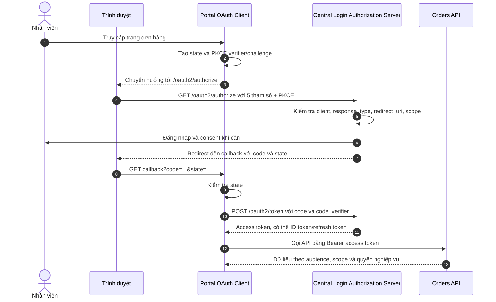
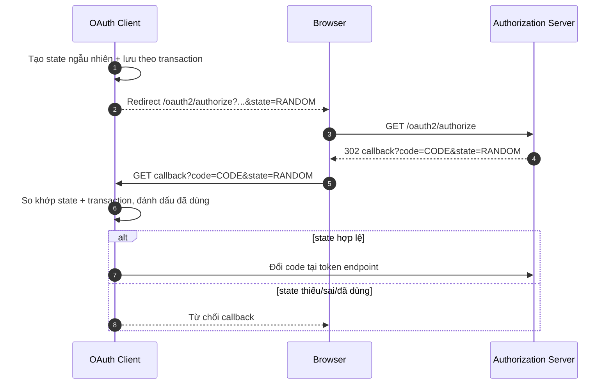
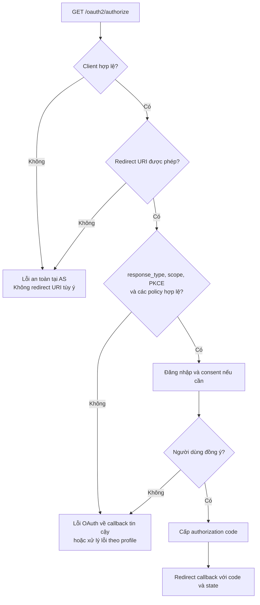

# Tham số response_type, client_id, redirect_uri, scope và state

**Authorization Endpoint** là nơi OAuth 2.0/OpenID Connect (OIDC) Authorization Server nhận yêu cầu bắt đầu quy trình cấp quyền từ trình duyệt người dùng. Trong kiến trúc Spring Boot sử dụng **Spring Security** và **Spring Authorization Server**, endpoint thường có địa chỉ `/oauth2/authorize`. Một yêu cầu thường gặp chứa năm tham số: **`response_type`**, **`client_id`**, **`redirect_uri`**, **`scope`** và **`state`**.

Năm tham số này không phải các tùy chọn trang trí trên URL: chúng giúp máy chủ hiểu **cần cấp loại phản hồi nào**, **ứng dụng nào đang yêu cầu**, **phản hồi được phép quay về đâu**, **những quyền nào đang được xin** và **client liên kết callback với yêu cầu ban đầu bằng cách nào**. Một sai sót ở một tham số có thể dẫn đến lỗi đăng nhập, cấp quyền vượt nhu cầu hoặc rò rỉ authorization code.

Bài thuộc chương **Authorization Endpoint** của mô-đun **SPRING_SECURITY_OAUTH2_OIDC_AUTHORIZATION_SERVER**. Mục tiêu xuyên suốt là thiết kế, cấu hình, bảo mật, kiểm thử và vận hành OAuth 2.0/OIDC Authorization Server với Spring Security và Spring Authorization Server trong ứng dụng Spring Boot.

> Các URL và mã minh họa dưới đây dùng miền giả định `login.example.com`, `portal.example.com` và `api.example.com`. Để chạy được trong dự án thật, cần đăng ký client, cấu hình issuer, kho authorization/consent, người dùng, khóa ký và các security filter chain tương ứng.

## 1. Authorization Endpoint nằm ở đâu trong luồng OAuth2/OIDC?

Giả sử Portal là một OAuth client, nhân viên muốn vào màn hình đơn hàng, còn Central Login là Authorization Server. Portal chuyển trình duyệt đến endpoint xin quyền. Central Login xác thực người dùng nếu cần, kiểm tra yêu cầu, xin consent khi chính sách đòi hỏi, rồi gửi phản hồi về callback đã đăng ký.



Sơ đồ mô tả **Authorization Code Flow với PKCE**. Đây là luồng phù hợp cho phần lớn ứng dụng tương tác hiện đại. Một request đến `/oauth2/authorize` **không phát access token trực tiếp qua URL callback** trong luồng này; Authorization Server phát **authorization code** trước, sau đó client đổi code ở token endpoint.

### 1.1. Authorization Endpoint khác Token Endpoint

| Thành phần | Mục đích | Ai thường gửi request? |
|---|---|---|
| `/oauth2/authorize` | Khởi tạo ủy quyền với người dùng, kiểm tra client/redirect/scope, xử lý login/consent và trả code hoặc lỗi | Trình duyệt được client chuyển hướng |
| `/oauth2/token` | Đổi authorization code thành token, làm mới token hoặc thực hiện grant khác được cho phép | OAuth client qua HTTP back-channel |
| `/login` | Nhập thông tin xác thực người dùng | Trình duyệt tại Authorization Server |
| `/userinfo` nếu OIDC bật | Trả thông tin người dùng dựa trên access token hợp lệ | OIDC client |
| `/oauth2/jwks` | Công bố khóa công khai để xác minh JWT ký | OIDC client hoặc Resource Server |

Người dùng chưa đăng nhập có thể bị chuyển hướng từ `/oauth2/authorize` sang `/login`. Đây là một **HTTP request mới**, có thể đi qua `SecurityFilterChain` của ứng dụng đăng nhập; sau khi xác thực, trình duyệt quay lại yêu cầu authorization ban đầu. Client không được nhận mật khẩu của người dùng trong luồng này.

## 2. Cấu trúc một authorization request

Ví dụ tham số đầy đủ ở dạng **dễ đọc**:

```text
GET https://login.example.com/oauth2/authorize
    ?response_type=code
    &client_id=portal-bff
    &redirect_uri=https%3A%2F%2Fportal.example.com%2Flogin%2Foauth2%2Fcode%2Fcentral
    &scope=openid%20profile%20orders.read
    &state=7oY9p...random...
    &code_challenge=xYz...base64url...
    &code_challenge_method=S256
    &nonce=4rK...random...
```

Trong request thật, URL là **một chuỗi URL-encoded**, không chứa các dòng xuống hàng như bản minh họa. Tham số sau dấu `?` và nối bằng `&`. Không thêm token hoặc bí mật vào URL. Ngoài năm tham số chính của bài, ví dụ còn có `code_challenge`/`code_challenge_method` để thực thi PKCE và `nonce` phục vụ OIDC.

| Tham số | Giá trị mẫu | Trách nhiệm chính | Bên kiểm tra chính |
|---|---|---|---|
| `response_type` | `code` | Chọn kiểu phản hồi authorization | Authorization Server |
| `client_id` | `portal-bff` | Xác định OAuth client đã đăng ký | Authorization Server |
| `redirect_uri` | `https://portal.example.com/login/oauth2/code/central` | Xác định điểm nhận phản hồi được cho phép | Authorization Server |
| `scope` | `openid profile orders.read` | Yêu cầu các quyền/claims trong phạm vi cho phép | Authorization Server và chính sách consent |
| `state` | Chuỗi ngẫu nhiên, không đoán được | Gắn callback với giao dịch client tạo trước đó | **OAuth client** |

**Phân biệt bên chịu trách nhiệm:** Authorization Server thường **trả lại nguyên `state`** nếu giá trị này có trong yêu cầu được xử lý theo giao thức; client phải tự so khớp giá trị đó với giao dịch đã khởi tạo. Chỉ thấy `state` xuất hiện trong callback không có nghĩa phản hồi đã an toàn.

### 2.1. Những tham số nào bắt buộc?

Theo mô hình Authorization Code của OAuth 2.0, `response_type=code` và `client_id` là các tham số cơ bản bắt buộc. `redirect_uri` có tính điều kiện theo quy tắc giao thức và registration; trên thực tế nên **gửi rõ URI đã đăng ký** và kiểm tra chính xác, đặc biệt khi có nhiều callback. `scope` là tùy chọn ở lớp OAuth2 cơ bản nhưng mang ý nghĩa cụ thể với ứng dụng và OIDC; khi yêu cầu OIDC, `openid` trong scope làm phát sinh ngữ nghĩa OIDC. `state` được **khuyến nghị mạnh** để liên kết và kiểm tra response, và có thể được yêu cầu bởi profile bảo mật của client.

**Không nên đồng nhất “tùy chọn theo một phần đặc tả” với “nên bỏ trống trong production”.** Kiểm tra chính sách thực tế của Spring Authorization Server, bản đăng ký `RegisteredClient` và hồ sơ bảo mật được áp dụng cho hệ thống.

## 3. response_type: client đang xin kiểu phản hồi nào?

`response_type` cho biết client muốn Authorization Server xử lý authorization request theo response type nào.

### 3.1. `response_type=code`

Đối với Authorization Code Flow:

```text
response_type=code
```

Khi request hợp lệ và người dùng hoàn tất đăng nhập/consent theo chính sách, Authorization Server trả về **một authorization code có thời hạn ngắn, dùng một lần**. Client dùng code đó tại `/oauth2/token`. Nếu yêu cầu có PKCE, token request cần gửi `code_verifier` tương ứng.

Ví dụ response thành công:

```http
HTTP/1.1 302 Found
Location: https://portal.example.com/login/oauth2/code/central?code=AUTH_CODE_EXAMPLE&state=STATE_EXAMPLE
```

Authorization code không phải access token. Không đưa code vào log, analytics, referer không kiểm soát hay tài liệu công khai; callback nên xử lý và loại bỏ code khỏi URL theo cơ chế an toàn sau khi dùng.

### 3.2. Nếu truyền `response_type` khác `code`?

Một số profile OAuth2/OIDC định nghĩa thêm response type như `token` hoặc giá trị kết hợp cho implicit/hybrid flows. **Không suy ra Spring Authorization Server tự hỗ trợ tất cả những response type này.** Trong ứng dụng mới, ưu tiên Authorization Code + PKCE, hạn chế luồng trả token trực tiếp từ authorization endpoint theo hướng dẫn bảo mật hiện đại.

Nếu client đã đăng ký `authorization_code` mà request một response type không được hỗ trợ, máy chủ phải từ chối theo giao thức, chẳng hạn `unsupported_response_type` hoặc lỗi phù hợp với tình trạng client/grant. Không tự đổi `response_type` sai thành `code` mà vẫn tiếp tục cấp quyền.

### 3.3. Liên hệ với `authorizationGrantType`

Ở Spring Authorization Server, đăng ký:

```java
.authorizationGrantType(AuthorizationGrantType.AUTHORIZATION_CODE)
```

cho phép client sử dụng Authorization Code Flow. Đây là **chính sách đăng ký**, không phải cùng một trường với `response_type` trên request. Authorization Server kiểm tra request response type và grant được phép cho client; một client chỉ đăng ký `client_credentials` không được tự bắt đầu authorization code cho người dùng.

**`grant_type=authorization_code`** xuất hiện ở **token endpoint**, còn **`response_type=code`** xuất hiện ở **authorization endpoint**. Nhầm hai tham số thường gây lỗi `invalid_request` hoặc `unsupported_response_type` tùy giai đoạn.

## 4. client_id: xác định client nào đang yêu cầu quyền

`client_id` là định danh công khai do Authorization Server cấp cho mỗi client đã đăng ký. Ví dụ:

```text
client_id=portal-bff
```

Authorization Server dùng giá trị này để tìm `RegisteredClient`, rồi kiểm tra các thuộc tính:

- Client có tồn tại và còn được cho phép hoạt động không?
- Có được dùng Authorization Code Flow không?
- `redirect_uri` có thuộc tập URI được đăng ký không?
- `scope` được yêu cầu có thuộc quyền client được phép xin không?
- `ClientSettings` yêu cầu PKCE/consent như thế nào?
- Client là public hay confidential, và token endpoint sẽ yêu cầu phương thức client authentication nào?

### 4.1. Client ID không phải secret

Bất kỳ ai xem authorization URL đều có thể biết `client_id`. Giá trị này **không phải bằng chứng ứng dụng là bản gốc đáng tin**. Với confidential client, bằng chứng xác thực client thường nằm ở bước đổi code tại token endpoint, qua `client_secret_basic`, `private_key_jwt` hoặc cơ chế được hỗ trợ. Public client dùng `ClientAuthenticationMethod.NONE`, kết hợp Authorization Code + PKCE và các ràng buộc giao thức.

Không đưa `client_secret` vào query tại authorization endpoint. Việc nhúng secret vào URL làm tăng nguy cơ lộ qua lịch sử trình duyệt, log, analytics và hệ thống trung gian; đối với SPA/native app, secret nhúng trong bản build không được coi là bảo mật.

### 4.2. Đăng ký client ở phía Spring Authorization Server

Ví dụ một client Portal có backend, cho phép đăng nhập OIDC và đọc Orders API:

```java
RegisteredClient portal = RegisteredClient
    .withId("portal-client-record")
    .clientId("portal-bff")
    .clientSecret(passwordEncoder.encode(portalSecret))
    .clientAuthenticationMethod(
        ClientAuthenticationMethod.CLIENT_SECRET_BASIC)
    .authorizationGrantType(AuthorizationGrantType.AUTHORIZATION_CODE)
    .authorizationGrantType(AuthorizationGrantType.REFRESH_TOKEN)
    .redirectUri(
        "https://portal.example.com/login/oauth2/code/central")
    .scope(OidcScopes.OPENID)
    .scope(OidcScopes.PROFILE)
    .scope("orders.read")
    .clientSettings(ClientSettings.builder()
        .requireProofKey(true)
        .requireAuthorizationConsent(true)
        .build())
    .build();
```

`portalSecret` và `passwordEncoder` trong ví dụ cần được inject/cấu hình từ nguồn an toàn; không hard-code secret trong mã. Mục đích đoạn mã là nêu rõ những thuộc tính Authorization Server đối chiếu khi `client_id=portal-bff` xuất hiện, không phải một chương trình Spring Boot chạy độc lập.

### 4.3. Sai hoặc không tồn tại client ID

Nếu không tìm được client hợp lệ, Authorization Server **không được tùy tiện redirect đến `redirect_uri` do request khai báo**. Đây là quy tắc quan trọng: redirect chỉ an toàn khi đã xác định được client và callback được phép. Máy chủ có thể hiển thị lỗi an toàn tại chính nó thay vì gửi code hoặc lỗi đến một địa chỉ không được xác minh.

## 5. redirect_uri: điểm nhận phản hồi phải được tin cậy

`redirect_uri` chỉ nơi Authorization Server đưa trình duyệt về sau khi xử lý yêu cầu authorization. Trong ví dụ:

```text
https://portal.example.com/login/oauth2/code/central
```

Đường dẫn thường là **callback route** của OAuth2 Client, nơi client đọc authorization code và `state` rồi tiếp tục trao đổi token. Với Spring Security OAuth2 Client, callback mặc định thường có dạng `/login/oauth2/code/{registrationId}`, nhưng ứng dụng có thể cấu hình khác nếu đăng ký đồng bộ với Authorization Server.

### 5.1. Redirect URI phải khớp registration

Một trong các kiểm tra quan trọng nhất là so sánh `redirect_uri` của request với URI đã đăng ký cho `client_id` đó. Với ứng dụng web production, nên dùng **exact matching**, HTTPS và callback cố định. Không cho phép wildcard tùy ý hoặc lấy host callback từ tham số request người dùng điều khiển.

| Registration đã cho phép | URI được yêu cầu | Xử lý dự kiến |
|---|---|---|
| `https://portal.example.com/oauth/callback` | Cùng chính xác URI | Có thể tiếp tục nếu các điều kiện khác hợp lệ |
| `https://portal.example.com/oauth/callback` | `https://evil.example.net/callback` | **Từ chối; không redirect đến URI lạ** |
| `https://portal.example.com/oauth/callback` | `http://portal.example.com/oauth/callback` | Từ chối do scheme khác |
| `https://portal.example.com/oauth/callback` | `https://portal.example.com/oauth/callback/` | Từ chối nếu không trùng đăng ký |
| `https://portal.example.com/oauth/callback` | `https://portal.example.com.evil.net/oauth/callback` | Từ chối do hostname khác |
| `https://portal.example.com/oauth/callback` | `https://portal.example.com/redirect?next=https://evil.example.net` | Từ chối trừ khi URI đó được đăng ký rõ ràng; dù đăng ký cũng phải tránh open redirect |

**Ngoại lệ theo profile:** Với ứng dụng native sử dụng loopback redirect, một số tiêu chuẩn cho phép quy tắc riêng đối với cổng động. Không suy ra tất cả phiên bản Spring Authorization Server tự hỗ trợ mọi trường hợp này; phải kiểm tra behavior/profile cụ thể.

### 5.2. URI có query và fragment

URI callback có thể chứa query component hợp lệ nếu profile và cơ chế registration hỗ trợ, ví dụ:

```text
https://portal.example.com/oauth/callback?tenant=acme
```

Khi thêm `code` và `state`, Authorization Server cần nối tham số theo cách bảo toàn query đã được chấp nhận. Tuy nhiên, **redirect endpoint URI không được chứa fragment component** theo OAuth 2.0. Tránh đưa thông tin nhạy cảm/tenant không đáng tin vào callback; kiểm tra mọi giá trị query mà ứng dụng sử dụng.

Đặc biệt, URL encoding rất dễ gây lỗi: một giá trị `redirect_uri` đầy đủ được percent-encode **khi đặt bên trong query của `/oauth2/authorize`**; sau khi decode đúng một lần, nó phải khớp URI đăng ký theo chính sách. Không double-encode hoặc so sánh bằng `startsWith("https://portal.example.com")`.

### 5.3. Lỗi redirect URI phải xử lý trước khi điều hướng

Giả sử kẻ tấn công gửi:

```http
GET /oauth2/authorize?response_type=code&client_id=portal-bff&redirect_uri=https%3A%2F%2Fattacker.example%2Fcollect&scope=openid&state=x HTTP/1.1
Host: login.example.com
```

Nếu callback không được phép, Authorization Server phải từ chối yêu cầu **tại phía máy chủ**, không đưa trình duyệt về `attacker.example` kèm `code` hoặc cả `error`. Ngược lại, khi callback đã được xác minh và lỗi thuộc bước sau, giao thức có thể cho phép gửi `error` và `state` qua callback hợp lệ.

Đây là ranh giới rất quan trọng giữa **“yêu cầu sai”** và **“địa chỉ để trả lỗi có đáng tin hay không”**.

## 6. scope: client xin quyền gì?

`scope` là danh sách các chuỗi quyền, thường phân cách bằng dấu cách:

```text
scope=openid profile orders.read
```

Trong URL, khoảng trắng cần encode đúng:

```text
scope=openid%20profile%20orders.read
```

Khi sử dụng bộ mã hóa `application/x-www-form-urlencoded`, khoảng trắng cũng có thể được biểu diễn thành dấu `+` theo ngữ cảnh. Dùng thư viện dựng URI thay vì ghép chuỗi thủ công.

### 6.1. Scope đã đăng ký, được yêu cầu và được cấp

Có ba tập scope khác nhau:

- **Registered scopes:** tập cho phép trong `RegisteredClient`, ví dụ `openid`, `profile` và `orders.read`.
- **Requested scopes:** tập client đưa vào request, có thể là tập con, ví dụ `openid` và `orders.read`.
- **Granted scopes:** tập thực tế được cấp sau kiểm tra policy và consent. Không được vượt allowlist của client.

Trong trường hợp đơn giản:

```text
granted_scopes ⊆ requested_scopes ⊆ registered_scopes
```

Ví dụ client đăng ký `orders.read` nhưng gửi `scope=orders.admin` thì Authorization Server phải từ chối hoặc áp chính sách theo giao thức mà không cấp scope ngoài quyền đã đăng ký. Client không thể tự tăng quyền bằng cách thay giá trị query.

### 6.2. `openid` có ý nghĩa riêng trong OIDC

| Scope | Thuộc tính | Ý nghĩa |
|---|---|---|
| `openid` | OIDC | Báo hiệu yêu cầu đăng nhập OIDC; gắn với ID token và các quy tắc OIDC |
| `profile` | OIDC standard scope | Xin các profile claims được phép theo chính sách |
| `email` | OIDC standard scope | Xin claims liên quan email khi được cấp |
| `orders.read` | Scope nghiệp vụ OAuth2 | Cho phép yêu cầu đọc dữ liệu Orders API theo policy |
| `orders.write` | Scope nghiệp vụ OAuth2 | Cho phép yêu cầu sửa dữ liệu Orders API theo policy |

**Nếu không có `openid`**, luồng Authorization Code có thể vẫn là OAuth2 cấp quyền API, nhưng không tự động trở thành OIDC login và **không tự phát ID token** chỉ vì máy chủ hỗ trợ OIDC.

Ngược lại, `openid` **không cho phép** gọi mọi Resource Server API. ID token được phát cho OIDC client để xác minh đăng nhập; API nhận **access token**, kiểm tra audience, scope và quyền nghiệp vụ.

### 6.3. Consent và nguyên tắc ít quyền nhất

Client yêu cầu `orders.read` chưa có nghĩa người dùng đồng ý cấp quyền này. Nếu registration/chính sách yêu cầu consent, Authorization Server có thể hiển thị các scope để người dùng cho phép hoặc từ chối. Chính sách consent phải diễn giải quyền theo ngôn ngữ dễ hiểu, không làm người dùng hiểu nhầm rằng các scope nhạy cảm đều vô hại.

Đăng ký scope theo nhu cầu thực tế. Ví dụ Portal chỉ hiển thị đơn hàng thì không tự thêm `orders.write`, `orders.export` hoặc scope quản trị. Phạm vi `orders.read` vẫn không thay kiểm tra quyền theo tenant và đối tượng tại Resource Server.

### 6.4. Audience không phải scope

Một access token mang `orders.read` vẫn có thể không phù hợp với `Orders API` nếu `aud` dành cho API khác. Authorization Server cần chính sách phát token với audience phù hợp; Orders API phải xác minh `iss`, `aud`, chữ ký/trạng thái, thời hạn và scope. Việc định nghĩa scope ở `RegisteredClient` **không tự động** cấu hình audience cho JWT.

## 7. state: liên kết callback với yêu cầu client đã khởi tạo

`state` là giá trị do **OAuth client** tạo trước khi gửi trình duyệt tới `/oauth2/authorize`. Client lưu giá trị đó theo **authorization transaction**, sau đó kiểm tra giá trị được trả về tại callback.

Mục đích là liên kết response với đúng luồng đã khởi tạo, giúp ngăn một số dạng CSRF và response injection/mix-up. Giá trị nên đủ ngẫu nhiên, không đoán được, dùng một lần và hết hạn.



### 7.1. state không phải mã bảo mật do Authorization Server xác thực hộ client

Authorization Server không biết trạng thái nội bộ của client và thường phản hồi `state` như dữ liệu opaque. Client phải xác minh callback:

1. Có giao dịch authorization nào đang chờ cho ứng dụng/client này không?
2. `state` có mặt và khớp chính xác giá trị đã lưu không?
3. Giao dịch còn hiệu lực và chưa được dùng không?
4. Khi chạy song song nhiều tab, callback đang gắn với bộ `state`/`code_verifier`/`nonce` nào?
5. Response có đến từ đúng issuer và tuân thủ profile bảo mật của client không?

Không chấp nhận callback chỉ vì có tham số `code`. Nếu `state` sai, **dừng trước khi đổi code**, không tự tạo state mới để khớp response.

### 7.2. Tạo state bằng nguồn ngẫu nhiên mật mã

Ví dụ JavaScript trong môi trường trình duyệt tin cậy:

```javascript
function base64url(bytes) {
  let binary = "";
  for (const byte of bytes) binary += String.fromCharCode(byte);
  return btoa(binary).replace(/\+/g, "-").replace(/\//g, "_").replace(/=+$/g, "");
}

function newOAuthState() {
  const bytes = new Uint8Array(32);
  crypto.getRandomValues(bytes);
  return base64url(bytes);
}

const state = newOAuthState();
```

Ví dụ lấy 32 byte ngẫu nhiên (256 bit) và Base64URL không padding. Có thể lưu `state` trong session server-side (BFF) hoặc cơ chế trạng thái giao dịch thích hợp phía client. Nếu dùng `sessionStorage` trong SPA, cần lưu từng transaction và nhớ rằng JavaScript độc hại cùng origin vẫn có thể truy cập.

Không dùng timestamp, username hoặc `Math.random()` làm state. Không đưa token bí mật, số định danh cá nhân, mật khẩu, dữ liệu phiên nhạy cảm vào `state` rồi gửi trong URL. Nếu cần lưu thông tin điều hướng, giữ nó server-side và chỉ dùng state làm khóa tham chiếu, hoặc dùng giá trị có kiểm tra toàn vẹn với thiết kế bảo mật rõ ràng.

### 7.3. PKCE, state và nonce khác nhau

| Giá trị | Chức năng | Ai xác minh? |
|---|---|---|
| `state` | Liên kết response với authorization transaction | OAuth client |
| `code_challenge` / `code_verifier` | Ràng buộc authorization code với yêu cầu đã khởi tạo | Authorization Server lúc đổi code |
| `nonce` khi OIDC áp dụng | Liên kết ID token với authentication request, giảm replay | OIDC client |
| `client_secret`/client assertion | Xác thực confidential client tại token endpoint | Authorization Server |
| Session cookie AS | Duy trì phiên đăng nhập của người dùng | Authorization Server |

Các biện pháp có thể bổ trợ nhau nhưng không thay thế hoàn toàn. PKCE đặc biệt quan trọng với public client; confidential client cũng nên dùng PKCE. Client vẫn cần xử lý response/issuer binding, callback validation và quản lý state đúng cách.

## 8. Cấu hình Spring Authorization Server cho Authorization Code Flow

Sau khi hiểu năm tham số, có thể nối chúng với cấu hình `RegisteredClient` và `SecurityFilterChain`.

### 8.1. Đăng ký client có callback, grant và scope cụ thể

Ví dụ một cấu hình **tập trung vào client registration**, với bean `PasswordEncoder` và `RegisteredClientRepository`. Đây là đoạn độc lập về đăng ký; máy chủ hoàn chỉnh còn cần xác thực người dùng, khóa ký, authorization/consent services, issuer và endpoint chains.

```java
package example.authorizationserver.config;

import java.time.Duration;
import org.springframework.context.annotation.Bean;
import org.springframework.context.annotation.Configuration;
import org.springframework.core.env.Environment;
import org.springframework.security.crypto.factory.PasswordEncoderFactories;
import org.springframework.security.crypto.password.PasswordEncoder;
import org.springframework.security.oauth2.core.AuthorizationGrantType;
import org.springframework.security.oauth2.core.ClientAuthenticationMethod;
import org.springframework.security.oauth2.core.oidc.OidcScopes;
import org.springframework.security.oauth2.server.authorization.client.RegisteredClient;
import org.springframework.security.oauth2.server.authorization.client.RegisteredClientRepository;
import org.springframework.security.oauth2.server.authorization.client.InMemoryRegisteredClientRepository;
import org.springframework.security.oauth2.server.authorization.settings.ClientSettings;
import org.springframework.security.oauth2.server.authorization.settings.TokenSettings;

@Configuration(proxyBeanMethods = false)
public class PortalClientConfiguration {

    @Bean
    PasswordEncoder passwordEncoder() {
        return PasswordEncoderFactories.createDelegatingPasswordEncoder();
    }

    @Bean
    RegisteredClientRepository registeredClientRepository(
            PasswordEncoder encoder, Environment env) {

        String secret = env.getRequiredProperty("PORTAL_CLIENT_SECRET");

        RegisteredClient portal = RegisteredClient
            .withId("portal-client-record")
            .clientId("portal-bff")
            .clientSecret(encoder.encode(secret))
            .clientAuthenticationMethod(
                ClientAuthenticationMethod.CLIENT_SECRET_BASIC)
            .authorizationGrantType(AuthorizationGrantType.AUTHORIZATION_CODE)
            .authorizationGrantType(AuthorizationGrantType.REFRESH_TOKEN)
            .redirectUri(
                "https://portal.example.com/login/oauth2/code/central")
            .scope(OidcScopes.OPENID)
            .scope(OidcScopes.PROFILE)
            .scope("orders.read")
            .clientSettings(ClientSettings.builder()
                .requireProofKey(true)
                .requireAuthorizationConsent(true)
                .build())
            .tokenSettings(TokenSettings.builder()
                .accessTokenTimeToLive(Duration.ofMinutes(10))
                .build())
            .build();

        return new InMemoryRegisteredClientRepository(portal);
    }
}
```

Đối chiếu với request:

| Giá trị request | Thuộc tính ở server | Điều kiện xử lý |
|---|---|---|
| `response_type=code` | `authorizationGrantType(AUTHORIZATION_CODE)` | Grant đã đăng ký và endpoint hỗ trợ |
| `client_id=portal-bff` | `clientId("portal-bff")` | Client tồn tại |
| `redirect_uri=https://portal.example.com/...` | `redirectUri(...)` | Callback đúng registration |
| `scope=openid profile orders.read` | `scope(...)` | Không vượt allowlist và policy |
| `state=...` | Không phải secret được lưu trong `RegisteredClient` | Server trả lại khi xử lý; client phải kiểm tra |
| `code_challenge_method=S256` | `requireProofKey(true)` | Bắt buộc PKCE; kiểm tra chính sách S256 cụ thể |

**Giới hạn ví dụ:** `InMemoryRegisteredClientRepository` dùng cho học và thử nghiệm. Production nên dùng repository bền vững, giữ `id` và `clientId` ổn định, quản lý secret trong vault/secret manager và thực hiện vòng đời rotation. Không copy giá trị secret trực tiếp từ env vào log.

### 8.2. Bật endpoint giao thức đúng SecurityFilterChain

Trong Spring Security 6.x với Spring Authorization Server 1.x hỗ trợ API `with(...)`, mẫu cấu hình cơ bản:

```java
@Bean
@Order(1)
SecurityFilterChain authorizationServerSecurityFilterChain(
        HttpSecurity http) throws Exception {

    OAuth2AuthorizationServerConfigurer as =
        OAuth2AuthorizationServerConfigurer.authorizationServer();

    http
        .securityMatcher(as.getEndpointsMatcher())
        .with(as, configurer -> configurer.oidc(Customizer.withDefaults()))
        .authorizeHttpRequests(auth -> auth
            .anyRequest().authenticated())
        .exceptionHandling(exceptions -> exceptions
            .defaultAuthenticationEntryPointFor(
                new LoginUrlAuthenticationEntryPoint("/login"),
                new MediaTypeRequestMatcher(MediaType.TEXT_HTML)))
        .oauth2ResourceServer(oauth2 -> oauth2.jwt(Customizer.withDefaults()));

    return http.build();
}

@Bean
@Order(2)
SecurityFilterChain applicationSecurityFilterChain(
        HttpSecurity http) throws Exception {
    http
        .authorizeHttpRequests(auth -> auth.anyRequest().authenticated())
        .formLogin(Customizer.withDefaults());
    return http.build();
}
```

Đây là đoạn **minh họa wiring**; các import và bean còn lại đã được lược bỏ. Chain giao thức chọn `/oauth2/authorize` và các OAuth2/OIDC endpoints thông qua `getEndpointsMatcher()`. Chain ứng dụng phục vụ `/login`. Nếu chưa xác thực, browser có thể được chuyển đến login và sau đó quay về authorization request ban đầu nhờ phiên và saved request.

Không tự giới hạn protocol chain vào `/oauth2/**` vì có các endpoint discovery/oidc nằm ngoài pattern. Không dùng login success handler luôn chuyển người dùng về home nếu điều đó làm mất authorization request đã lưu.

### 8.3. Issuer và redirect URI sau reverse proxy

Authorization Server có thể đứng sau ingress hoặc load balancer. Cần cấu hình issuer công khai, ví dụ:

```java
@Bean
AuthorizationServerSettings authorizationServerSettings() {
    return AuthorizationServerSettings.builder()
        .issuer("https://login.example.com")
        .build();
}
```

Với reverse proxy, phải cấu hình forwarded headers theo proxy tin cậy để Spring tạo redirect chính xác, dùng HTTPS ngoài Internet dù kết nối nội bộ khác scheme. Một proxy sai host/port có thể dẫn đến callback mismatch hoặc issuer không đúng metadata.

**Không xử lý lỗi bằng cách chấp nhận mọi redirect URI**: sửa đúng registration và public URL của hệ thống.

## 9. Gửi authorization request từ Spring Security OAuth2 Client

Ở phía Portal/BFF, Spring Boot dùng `spring-boot-starter-oauth2-client` và cấu hình một `ClientRegistration` có thể tự xây authorization URL từ provider metadata.

```yaml
spring:
  security:
    oauth2:
      client:
        registration:
          central:
            provider: central
            client-id: portal-bff
            client-secret: "REPLACE_FROM_SECRET_MANAGER"
            client-authentication-method: client_secret_basic
            authorization-grant-type: authorization_code
            redirect-uri: "{baseUrl}/login/oauth2/code/{registrationId}"
            scope: openid, profile, orders.read
        provider:
          central:
            issuer-uri: https://login.example.com
```

Giá trị `client-secret` trên **chỉ là placeholder**. Ở ứng dụng thật, inject từ secret manager hoặc cấu hình bí mật được bảo vệ. `ClientRegistration` nằm ở **OAuth2 Client**; `RegisteredClient` nằm ở **Authorization Server**. Hai cấu hình phải khớp grant, phương thức client authentication, redirect URI và scope.

### 9.1. Ai sinh `state` và tham số PKCE trong Spring Client?

Spring Security OAuth2 Client có các cơ chế quản lý authorization request, lưu `state` theo giao dịch và xử lý callback. Khi tự tùy biến `OAuth2AuthorizationRequestResolver` hoặc URI builder, cần giữ đúng contract này. Nếu thay toàn bộ authorization request bằng chuỗi tự ghép, bạn cũng phải chịu trách nhiệm:

- Sinh `state` ngẫu nhiên và lưu cùng transaction;
- Tạo PKCE verifier/challenge theo chính sách client;
- Giữ `redirect_uri` trùng registration;
- Gửi đúng `scope`, `nonce` nếu là OIDC;
- Kiểm tra callback, khôi phục verifier/state rồi đổi code;
- Dọn authorization request sau thành công hoặc lỗi.

**Không giả định PKCE tự động được thêm trong mọi cấu hình và phiên bản**. Kiểm tra `ClientRegistration`, chính sách Spring OAuth2 Client và request thực tế; nếu Authorization Server bật `requireProofKey(true)`, client phải gửi PKCE đầy đủ.

### 9.2. Dựng URL từ code thay vì nối query thủ công

Dưới đây là ví dụ Java chỉ minh họa **percent-encoding** các tham số; production thường nên để Spring Security OAuth2 Client xử lý cùng state store/callback binding:

```java
String authorizationUrl = UriComponentsBuilder
    .fromUriString("https://login.example.com/oauth2/authorize")
    .queryParam("response_type", "code")
    .queryParam("client_id", "portal-bff")
    .queryParam("redirect_uri",
        "https://portal.example.com/login/oauth2/code/central")
    .queryParam("scope", "openid profile orders.read")
    .queryParam("state", state)
    .queryParam("code_challenge", challenge)
    .queryParam("code_challenge_method", "S256")
    .build()
    .encode()
    .toUriString();
```

`state` và `challenge` phải được tạo bằng thuật toán an toàn, lưu liên kết với giao dịch client; đoạn trên không tự giải quyết phần đó. Nếu client là OIDC và dùng `nonce`, phải thêm/kiểm tra nonce. Đối chiếu URL cuối cùng trên wire để tránh trường hợp các API build/encode khác nhau tạo double-encoding.

## 10. Phản hồi thành công, từ chối consent và lỗi validation

### 10.1. Thành công: redirect với code và state

Khi đã xác thực người dùng, kiểm tra registration, PKCE, scope và consent (nếu cần), AS tạo code gắn với authorization context và callback hợp lệ:

```http
HTTP/1.1 302 Found
Location: https://portal.example.com/login/oauth2/code/central?code=CODE_EXAMPLE&state=STATE_EXAMPLE
Cache-Control: no-store
```

Bên client phải kiểm tra state **trước khi** gửi code sang token endpoint, rồi thực hiện client authentication nếu là confidential client và gửi `code_verifier` khi dùng PKCE. Sau token response, OIDC client xác minh ID token riêng (issuer, audience, expiry, nonce khi áp dụng).

**Đừng dùng callback URL như một đường vận chuyển access token.** Access token được trả từ token endpoint; không log code hoặc token.

### 10.2. Lỗi sau khi callback đã được xác minh

Nếu lỗi xảy ra trong một authorization request đã xác định được client và **callback hợp lệ**, Authorization Server có thể phản hồi bằng cách redirect đến callback kèm tham số lỗi:

```http
HTTP/1.1 302 Found
Location: https://portal.example.com/login/oauth2/code/central?error=access_denied&state=STATE_EXAMPLE
```

Một số lỗi thường gặp:

| Tình huống | Loại lỗi có thể gặp | Lưu ý |
|---|---|---|
| `response_type` không được hỗ trợ | `unsupported_response_type` | Chỉ khi callback đã an toàn để nhận lỗi |
| Client không được dùng grant tương ứng | `unauthorized_client` | Đối chiếu registration |
| `scope` sai hoặc ngoài allowlist | `invalid_scope` | Không cấp scope ngoài đăng ký |
| Thiếu tham số hoặc request sai định dạng | `invalid_request` | Tùy nơi validation phát hiện lỗi |
| Người dùng từ chối consent | `access_denied` | Không phát code |
| Lỗi nội bộ có thể trả theo giao thức | `server_error` | Không lộ stack trace/secret |

Mã lỗi cụ thể phụ thuộc loại lỗi, thời điểm xác minh và profile OAuth2/OIDC. Không nên viết test cứng rằng mọi request sai đều trả `302` hoặc mọi lỗi đều dùng `invalid_request`.

### 10.3. Lỗi client hoặc callback không hợp lệ: không redirect tùy tiện

Khi `client_id` không xác định hoặc `redirect_uri` sai, máy chủ **không thể tin vào URL callback** do request tự cung cấp. Authorization Server phải hiển thị/trả lỗi an toàn tại chính endpoint hoặc cơ chế phù hợp, **không gửi trình duyệt đến URI lạ chỉ để thông báo lỗi**.



Sơ đồ này đặt trọng tâm vào ranh giới an toàn khi trả phản hồi; thứ tự chi tiết của từng provider/filter và các mã lỗi có thể khác theo cấu hình Spring Authorization Server.

## 11. Tương tác với PKCE, OIDC và các tham số mở rộng

Năm tham số bài học tạo khung authorization request, nhưng một ứng dụng an toàn thường còn cần:

| Tham số/khái niệm | Vai trò | Khi nào dùng? |
|---|---|---|
| `code_challenge` | Giá trị băm của verifier liên kết code | Authorization Code + PKCE |
| `code_challenge_method=S256` | Phương thức biến đổi challenge an toàn | Nên dùng với PKCE |
| `code_verifier` | Proof gửi **ở token endpoint**, không ở authorization request | Khi đổi code |
| `nonce` | Gắn ID token với yêu cầu đăng nhập | OIDC, tùy profile/flow |
| `prompt` | Gợi ý hành vi tương tác người dùng trong OIDC | Nếu chức năng OIDC/provider hỗ trợ |
| `login_hint` | Gợi ý nhận diện tài khoản | Nếu provider hỗ trợ, không coi là danh tính xác thực |
| `max_age` | Yêu cầu mức độ mới của sự kiện xác thực | OIDC theo chính sách |
| `response_mode` | Hình thức vận chuyển authorization response | Chỉ khi implementation/profile hỗ trợ |
| PAR / Request Object | Bảo vệ/kết cấu authorization request theo profile | Khi Authorization Server hỗ trợ và yêu cầu |

Không tự giả định mọi thông số OIDC nâng cao đều được Spring Authorization Server phiên bản đang chạy hỗ trợ. Authorization Server phải công bố metadata/khả năng phù hợp và kiểm thử hành vi. Riêng `response_type=code` + PKCE, `client_id`, `redirect_uri`, `scope` và `state` là nền tảng dễ kiểm chứng của Authorization Code Flow.

### 11.1. PKCE bảo vệ code, không thay state hay redirect URI

Client tạo `code_verifier` ngẫu nhiên, gửi `code_challenge` tại authorize, và gửi verifier gốc khi đổi code. Đối với public client, PKCE là thiết yếu; với confidential client cũng nên bật. Nhưng PKCE không tự chữa được một callback trỏ tới kẻ tấn công, lỗi xử lý `state`, XSS trên SPA hoặc cấp quyền quá rộng. Mỗi lớp bảo vệ có mục tiêu riêng.

### 11.2. OIDC `openid` không biến mọi scope thành danh tính

Khi `scope` chứa `openid`, client yêu cầu cơ chế định danh theo OIDC; ID token hướng đến client (audience thường là `client_id`). Scope `orders.read` lại nói về quyền gọi Resource Server. Việc một người dùng đăng nhập thành công không cho phép bỏ kiểm tra audience/scope/tenant tại Orders API.

### 11.3. URL length, request object và dữ liệu nhạy cảm

Authorization request thường dùng front-channel qua trình duyệt, vì vậy URL có thể được ghi trong history, log reverse proxy và các công cụ quan sát. Không đưa client secret, password, access token, private data hoặc thông tin nhạy cảm không cần thiết vào query. Nếu ứng dụng có nhiều tham số phức tạp hoặc yêu cầu bảo đảm tính toàn vẹn/yêu cầu riêng tư cao, cân nhắc các profile như pushed authorization request (PAR) hay signed request object **nếu hệ thống hỗ trợ**, thay vì tiếp tục tăng URL tùy ý.

## 12. Ma trận kiểm thử năm tham số

Các test nên bao gồm cả trường hợp thành công và **các đường từ chối**. Mục đích là xác minh Authorization Server và OAuth2 Client có thực thi đúng hợp đồng, không chỉ thấy giao diện login hiện lên.

| Test case | Request/thao tác | Kỳ vọng |
|---|---|---|
| Happy path | `response_type=code`, client hợp lệ, callback hợp lệ, scope được đăng ký, state ngẫu nhiên, PKCE đúng | Cấp code; callback chứa state tương ứng |
| Thiếu `response_type` | Không có tham số | Request bị từ chối theo giao thức |
| `response_type=token` không được hỗ trợ | Client chỉ đăng ký Authorization Code | Không trả access token qua fragment |
| Thiếu `client_id` | Không xác định client | Không tạo authorization/code; không redirect tùy ý |
| Client không tồn tại | `client_id=unknown-client` | Từ chối an toàn |
| Client không được dùng auth code | Client chỉ đăng ký `client_credentials` | Từ chối grant/response type |
| Redirect hợp lệ | URI trùng chính xác registration | Có thể tiếp tục |
| Redirect đổi scheme/host/path | Thay một phần callback đã đăng ký | Từ chối; **không redirect URI lạ** |
| Redirect với host giả | `portal.example.com.evil.net` | Từ chối, không dùng kiểm tra prefix |
| Redirect không được khai báo | Tự thêm callback mới trong request | Không cấp code |
| Scope là tập con | Xin `openid orders.read` khi registration chứa chúng | Không tự cấp `orders.write` |
| Scope ngoài allowlist | Xin `orders.admin` | Không cấp quyền ngoài registration |
| Không có `openid` | Chỉ yêu cầu `orders.read` | Không suy ra đây là OIDC login |
| State hợp lệ | Callback echo đúng state ban đầu | Client tiếp tục đổi code |
| State thiếu/sai/đã dùng | Thay, xóa hoặc tái sử dụng state | Client dừng flow |
| Hai tab đồng thời | Hai request có state/verifier khác nhau | Mỗi callback khớp đúng transaction |
| PKCE thiếu | Client yêu cầu `requireProofKey(true)` | Authorization request bị từ chối |
| Verifier sai | Token request dùng code_verifier không khớp | Không cấp token, thường `invalid_grant` |
| Code tái sử dụng | Đổi một code hai lần | Lần thứ hai bị từ chối |
| Consent bị từ chối | Người dùng không chấp nhận quyền | Không phát code; lỗi theo profile |
| Sai audience ở API | Token cấp cho API khác được gửi Orders API | API từ chối |
| Proxy/issuer | Gọi qua HTTPS public host trước reverse proxy | Redirect/issuer chính xác |
| Callback chứa open redirect | Client có endpoint redirect bất cẩn | App không chuyển tiếp code sang host lạ |

### 12.1. Test ở đâu?

**Authorization Server:** Dùng `MockMvc`/`spring-security-test` và integration test để kiểm tra đăng ký client, redirect URI, authorization request, login/consent, PKCE, cấp code và lỗi giao thức.

**OAuth2 Client:** Kiểm tra sinh/lưu state và verifier, ghép transaction, validation callback/ID token, token exchange, xử lý lỗi khi người dùng từ chối.

**Resource Server:** Kiểm tra JWT signature/introspection, issuer, audience, thời hạn, scope và phân quyền trên tài nguyên. Authorization endpoint hợp lệ không chứng minh API đã được bảo vệ đúng.

Với end-to-end test, cần giữ cookie session browser và đi đủ các bước authorize → login/consent → callback → token. Mock sẵn principal hoặc token không chứng minh callback/state và redirect URI đã được xử lý đúng.

### 12.2. Ví dụ curl và cách hiểu giới hạn

Để quan sát authorization endpoint, có thể gửi request demo (một phần tham số được truyền qua cơ chế URL-encode):

```bash
curl --get --include "https://login.example.com/oauth2/authorize" \
  --data-urlencode "response_type=code" \
  --data-urlencode "client_id=portal-bff" \
  --data-urlencode "redirect_uri=https://portal.example.com/login/oauth2/code/central" \
  --data-urlencode "scope=openid profile orders.read" \
  --data-urlencode "state=$OAUTH_STATE" \
  --data-urlencode "code_challenge=$PKCE_CHALLENGE" \
  --data-urlencode "code_challenge_method=S256"
```

`$OAUTH_STATE` và `$PKCE_CHALLENGE` là các biến môi trường chứa giá trị **được tạo an toàn cho lần thử**; lệnh minh họa không tự sinh chúng. Nếu chưa có phiên trình duyệt, response có thể là redirect đến login; `curl` đơn lẻ không tự hoàn thành bước đăng nhập/consent. Khi kiểm tra 302, đừng tự động `-L` qua mọi redirect nếu không hiểu nơi gửi cookie/token và chính sách môi trường.

Để kiểm tra lỗi redirect, thay callback bằng một URI không được đăng ký trong **môi trường kiểm thử** và xác nhận response **không** chuyển hướng đến URI giả. Không dùng callback lạ để kiểm thử trên tài khoản production.

## 13. Các lỗi triển khai thường gặp và cách chẩn đoán

| Triệu chứng | Nguyên nhân khả dĩ | Cách xác minh/sửa |
|---|---|---|
| Redirect loop từ authorize sang login | Session/saved request hoặc filter chain sai | Xem thứ tự `SecurityFilterChain`, cookie session, login success handler |
| OAuth client báo `invalid_state_parameter` hoặc lỗi tương đương | State mất, sai hoặc callback từ tab khác | So khớp transaction, không overwrite state dùng chung |
| `invalid_redirect_uri` / `invalid_request` | Callback khác registration hoặc proxy tạo URL sai | So sánh URI chính xác, issuer/base URL/forwarded headers |
| Chỉ production lỗi redirect | HTTPS public URL khác host/port nội bộ | Cấu hình public issuer và proxy trust |
| `invalid_scope` | Scope request ngoài registered scope | Kiểm tra `RegisteredClient.scopes` và policy |
| Authorization Code không cấp được | Grant chưa đăng ký, PKCE thiếu hoặc login/consent thất bại | Đọc error theo giai đoạn, kiểm tra grant và client settings |
| Token endpoint `invalid_grant` | Code hết hạn/đã dùng, verifier hoặc redirect sai | Kiểm tra binding code/client/verifier/URI |
| Client có ID token nhưng API `401` | Gửi nhầm ID token hoặc access token sai audience | Dùng access token, kiểm tra API validator |
| Scope `orders.read` nhưng dữ liệu bị từ chối | Tenant/object-level policy từ Resource Server | Kiểm tra quyền nghiệp vụ, không mở rộng scope tùy tiện |
| Authorization request dài/sai encoding | Ghép URL thủ công hoặc double-encode redirect URI | Dùng URI builder, kiểm tra request thực trên wire |
| Lộ state/code/token qua log | Log request query/callback không che dữ liệu | Redact và hạn chế retention |
| Authorization endpoint nhận client lạ | Registration không tồn tại hoặc cấu hình nhiều môi trường lẫn nhau | Phân tách client ID, redirect/issuer theo môi trường |

## 14. Checklist thiết kế và vận hành

1. **`response_type`:** mặc định chọn `code` cho luồng người dùng; chỉ cho phép response type tương ứng các grant được server hỗ trợ.
2. **`client_id`:** có registration hợp lệ, không coi ID là secret; tách client theo sản phẩm, workload, môi trường và ranh giới tin cậy.
3. **`redirect_uri`:** đăng ký callback chính xác, dùng HTTPS cho web production, không wildcard/open redirect; không redirect khi URI chưa xác minh.
4. **`scope`:** yêu cầu ít quyền, bảo đảm allowlist/consent; API kiểm tra audience, scope và quyền nghiệp vụ.
5. **`state`:** sinh ngẫu nhiên bằng CSPRNG, lưu theo authorization transaction, kiểm tra callback và hủy khi dùng/timeout.
6. **PKCE:** tạo verifier/challenge mới mỗi lần; ưu tiên `S256`, yêu cầu từ server theo client settings và kiểm thử các trường hợp sai.
7. **OIDC:** dùng `openid` khi thật sự cần đăng nhập, kiểm tra ID token/nonce theo profile; không dùng ID token thay access token.
8. **Spring wiring:** cấu hình `RegisteredClientRepository`, `AuthorizationServerSettings`, protocol/login filter chains, authorization/consent storage và khóa ký.
9. **Vận hành:** dùng issuer public ổn định, quản trị signing keys/secrets, kiểm tra reverse proxy, phân tách môi trường và giới hạn log query nhạy cảm.
10. **Kiểm thử:** cả đường thành công và các lỗi response type, client, callback, scope, state, PKCE, consent và token validation.

### 14.1. Tình huống áp dụng

**Portal BFF:** Backend giữ client secret, lưu state/verifier server-side, gửi `response_type=code` và `scope=openid profile orders.read`. Authorization Server cho phép callback chính xác, yêu cầu PKCE và consent theo chính sách. BFF xác minh state, đổi code bằng client authentication rồi giữ token ở phía server.

**Dashboard SPA:** Public client với `ClientAuthenticationMethod.NONE`, Authorization Code + PKCE. SPA tự tạo và quản lý transaction state/verifier; không nhúng secret. Authorization Server phải bảo vệ redirect URI/CORS theo cấu hình phù hợp; SPA chú trọng XSS và token storage.

**Invoice Worker:** Không có người dùng tương tác; dùng `client_credentials` ở **token endpoint**, nên không tạo `response_type`, `redirect_uri` hoặc `state` như một browser authorization request. Đây là lý do không thể áp một mẫu URL authorize cho mọi loại OAuth client.

## 15. Câu hỏi tự đánh giá

1. `response_type=code` khác `grant_type=authorization_code` ở endpoint nào?
2. Vì sao `client_id` không được dùng làm bằng chứng bí mật của ứng dụng?
3. Khi `redirect_uri` không khớp registration, vì sao server không được redirect đến URI đó ngay cả để trả lỗi?
4. Nếu `scope` có `orders.read` nhưng không có `openid`, ứng dụng có đang yêu cầu OIDC login không?
5. Ai tạo và ai kiểm tra `state`? Điều gì phải xảy ra khi state không khớp?
6. PKCE giải quyết nguy cơ nào và vì sao nó không thay thế kiểm tra `state` hoặc redirect URI?
7. Vì sao URL encoding của `redirect_uri` và danh sách `scope` dễ sai khi ghép thủ công?
8. Vì sao một access token có scope `orders.read` vẫn có thể bị Orders API từ chối?
9. Trường hợp nào Authorization Server có thể redirect lỗi OAuth về client, và trường hợp nào phải trả lỗi tại chính máy chủ?
10. Khi Portal có nhiều tab đăng nhập đồng thời, quản lý `state` và `code_verifier` như thế nào để không trộn lẫn giao dịch?
11. Khi thêm PKCE ở `RegisteredClient`, client phải cập nhật những bước nào trong authorization và token request?
12. Nếu ứng dụng chỉ là worker nền, vì sao nó không cần năm tham số Authorization Endpoint của bài này?

## 16. Tài liệu nền tảng

- [RFC 6749 — OAuth 2.0, mục Authorization Request và Response](https://www.rfc-editor.org/rfc/rfc6749): định nghĩa `response_type`, `client_id`, `redirect_uri`, `scope`, `state` và lỗi authorization.
- [RFC 7636 — Proof Key for Code Exchange](https://www.rfc-editor.org/rfc/rfc7636): bảo vệ authorization code bằng `code_challenge` và `code_verifier`.
- [RFC 9700 — OAuth 2.0 Security Best Current Practice](https://www.rfc-editor.org/rfc/rfc9700): hướng dẫn bảo mật hiện đại cho Authorization Code, redirect URI và chống các cuộc tấn công trong luồng OAuth.
- [OpenID Connect Core 1.0](https://openid.net/specs/openid-connect-core-1_0.html): `openid`, ID token, `nonce` và các yêu cầu xác thực liên quan.
- [Spring Authorization Server — Core Model](https://docs.spring.io/spring-authorization-server/reference/core-model-components.html): `RegisteredClient`, grant, scope và các service liên quan.
- [Spring Security — OAuth2 Client](https://docs.spring.io/spring-security/reference/servlet/oauth2/client/index.html): xây authorization request, quản lý callback và token exchange tại client.

**Ghi nhớ:** `response_type` chọn loại phản hồi, `client_id` xác định client được đăng ký, `redirect_uri` giới hạn nơi nhận code, `scope` giới hạn quyền được xin và `state` giúp client kiểm tra callback thuộc đúng giao dịch. Khi kết hợp Authorization Code + PKCE và OIDC, năm tham số này tạo nên hợp đồng giữa OAuth client và Spring Authorization Server. Việc bảo vệ callback, kiểm tra scope, quản lý state và từ chối redirect không đáng tin là những điều kiện thiết yếu để một Authorization Endpoint vận hành an toàn.
