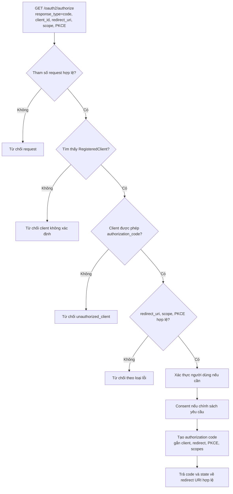

# Kiểm tra client đã đăng ký và grant được phép sử dụng

## 1. Vị trí của bước kiểm tra trong Authorization Endpoint

Trong **Spring Security OAuth 2.0 / OpenID Connect Authorization Server** xây bằng **Spring Boot** và **Spring Authorization Server**, không phải ứng dụng nào biết địa chỉ `/oauth2/authorize` cũng được phép bắt đầu bất kỳ luồng ủy quyền nào. Authorization Server phải nhận diện **client đã đăng ký**, xác minh **client được phép dùng luồng yêu cầu**, rồi tiếp tục kiểm tra redirect URI, scope và các tham số bảo mật trước khi phát hành authorization code.

Đây là trọng tâm của bài **“Kiểm tra client đã đăng ký và grant được phép sử dụng”**, thuộc chương **Authorization Endpoint** trong mô-đun **SPRING_SECURITY_OAUTH2_OIDC_AUTHORIZATION_SERVER**. Kiểm tra này có ý nghĩa trực tiếp trong thiết kế, cấu hình, bảo mật, kiểm thử và vận hành một Authorization Server thực tế.

Hãy hình dung hai ứng dụng:

- **`orders-web`** là web backend, được đăng ký dùng **Authorization Code Flow** để người dùng đăng nhập rồi ủy quyền `orders.read`.
- **`nightly-report-job`** là tác vụ nền, chỉ được đăng ký **Client Credentials Grant** để truy cập báo cáo thay mặt chính ứng dụng.

Nếu `nightly-report-job` gửi `GET /oauth2/authorize?response_type=code...`, Authorization Server **phải từ chối** luồng đó vì client chưa được cho phép sử dụng `authorization_code`. Việc client tồn tại trong repository **không đủ** để cấp authorization code.

### Sau bài học, bạn có thể

1. Phân biệt *client identification*, *client authentication*, *xác thực người dùng* và *kiểm tra quyền dùng grant*.
2. Giải thích cách `RegisteredClientRepository` và `RegisteredClient.authorizationGrantTypes` tham gia xử lý authorization request.
3. Ánh xạ `response_type=code` tại authorization endpoint với `AuthorizationGrantType.AUTHORIZATION_CODE` trong đăng ký client.
4. Cấu hình hai client với chính sách grant khác nhau và dự đoán request nào được phép xử lý.
5. Chẩn đoán `unauthorized_client`, `invalid_request`, `invalid_scope` và các lỗi liên quan mà không tạo lỗ hổng redirect.
6. Kiểm thử hành vi qua Authorization Endpoint và Token Endpoint, kể cả khi có PKCE, consent và OIDC.

## 2. Phải tách bốn câu hỏi khác nhau

| Câu hỏi | Thành phần trả lời | Ví dụ |
| --- | --- | --- |
| **Client nào đang yêu cầu?** | `client_id` và `RegisteredClientRepository` | `client_id=orders-web` tìm được registration tương ứng |
| **Client được phép dùng luồng này không?** | `RegisteredClient.authorizationGrantTypes` | Có `authorization_code` thì mới được bắt đầu Authorization Code Flow |
| **Ai đang đăng nhập và có đồng ý không?** | Cơ chế authentication người dùng và consent tại AS | Alice đăng nhập và chấp thuận `orders.read` nếu cần |
| **Client có chứng minh được danh tính khi đổi code không?** | Xác thực client tại **Token Endpoint** (nếu là confidential client), kết hợp PKCE | `client_secret_basic`, `private_key_jwt` hoặc public client + PKCE |

**Điểm dễ nhầm:** Authorization Endpoint xác định client bằng **`client_id`** và kiểm tra registration/grant. Nó **không** yêu cầu trình duyệt gửi `client_secret` trong query string. Một confidential client thường xác thực bằng secret hoặc phương thức mạnh hơn khi gọi **`POST /oauth2/token`**. Ngược lại, người dùng nhập mật khẩu vào trang đăng nhập của Authorization Server để xác thực **resource owner**, không phải xác thực OAuth client.

Trong OAuth 2.0, **authorization grant** là cơ chế/căn cứ client dùng để nhận access token; **grant type** là loại luồng được server hỗ trợ và được cho phép trên client. Trong Authorization Code Flow:

```text
Authorization Endpoint:
GET /oauth2/authorize?response_type=code&client_id=orders-web&...
                               |
                               v
RegisteredClient.authorizationGrantTypes
    chứa AuthorizationGrantType.AUTHORIZATION_CODE ?
                               |
                       Có --> xử lý tiếp
                       Không --> từ chối

Token Endpoint, sau khi client nhận code:
POST /oauth2/token
grant_type=authorization_code&code=...&...
```

Đừng đưa `grant_type=authorization_code` vào authorization request rồi nghĩ đó là cách bật grant. Ở **authorization endpoint**, client yêu cầu loại authorization response bằng `response_type=code`; ở **token endpoint**, client chọn grant để đổi code bằng `grant_type=authorization_code`.

## 3. `RegisteredClientRepository` là nguồn xác minh quyền của client

Spring Authorization Server biểu diễn client đăng ký bằng `RegisteredClient` và tra cứu qua `RegisteredClientRepository`. Với yêu cầu có `client_id=orders-web`, luồng xử lý về mặt ý nghĩa là:

```java
RegisteredClient client = registeredClientRepository.findByClientId("orders-web");

if (client == null) {
    // Client chưa đăng ký: không tiếp tục cấp authorization code.
}

boolean allowed = client != null && client.getAuthorizationGrantTypes()
        .contains(AuthorizationGrantType.AUTHORIZATION_CODE);
```

Đây là **mã minh họa ý nghĩa nghiệp vụ**, không phải đoạn cần tự chép vào filter của ứng dụng. Spring Authorization Server đã có các authentication converter/provider và validator cho authorization request; khi sử dụng cấu hình chuẩn, framework thực hiện việc tìm client và kiểm tra grant phù hợp. Phần code giúp bạn nhận diện API và hiểu đường đi dữ liệu.

### 3.1. Các thuộc tính ảnh hưởng việc chấp nhận authorization request

| Thuộc tính của `RegisteredClient` | Kiểm tra / ý nghĩa |
| --- | --- |
| `clientId` | Giá trị public trong request dùng để tìm client registration |
| `authorizationGrantTypes` | Cho biết client có được dùng `authorization_code` hay không |
| `redirectUris` | Tập redirect URI hợp lệ để trả code/kết quả về đúng client |
| `scopes` | Các scope client được phép xin, ví dụ `orders.read`, `openid` |
| `clientSettings.requireProofKey` | Quy định có bắt buộc PKCE khi gửi authorization code request không |
| `clientSettings.requireAuthorizationConsent` | Quy định có cần người dùng chấp thuận scope khi phù hợp không |
| `clientAuthenticationMethods` | Cách client xác thực khi gọi endpoint cần client authentication, điển hình token endpoint |
| `clientSecret` và `clientSecretExpiresAt` | Thông tin xác thực confidential client; **không gửi secret tại Authorization Endpoint** |

Phân biệt hai định danh quan trọng:

- `RegisteredClient.clientId` là giá trị client gửi trong HTTP request; không phải bí mật.
- `RegisteredClient.id` là định danh **nội bộ** do repository/Authorization Server dùng để lưu liên hệ với `OAuth2Authorization`.

Nếu có `client_id` nhưng không tìm thấy `RegisteredClient`, hệ thống không được tự “đăng ký tạm” client theo URL redirect client đã gửi. Việc đăng ký và xét duyệt client là quy trình riêng, không nằm trong authorization request thông thường.

### 3.2. Tính hợp lệ của client không chỉ là “có trong database”

Một client có thể đã đăng ký nhưng không được dùng Authorization Code Flow. Nó cũng có thể được phép dùng authorization code nhưng gửi `redirect_uri` không thuộc danh sách đã đăng ký, xin scope vượt quyền hoặc thiếu PKCE bắt buộc. Vì vậy, một request hợp lệ phải **thỏa toàn bộ các điều kiện liên quan**, không chỉ `findByClientId(...) != null`.

Các cấu hình quản trị bổ sung như trạng thái client “suspended”, hạn đăng ký, chủ sở hữu hoặc danh sách môi trường triển khai có thể do sản phẩm tự xây. **`RegisteredClient` mặc định không có một cờ “enabled” phổ quát** để tự động thực thi mọi quy trình khóa client. Nếu cần chức năng này, phải bổ sung chính sách trong tầng quản lý/authentication của hệ thống, không giả định framework đã cung cấp.

## 4. Authorization Endpoint xử lý request theo thứ tự nào?

Giả sử client mở URL:

```http
GET /oauth2/authorize?response_type=code&client_id=orders-web&redirect_uri=https%3A%2F%2Fapp.example.com%2Foauth%2Fcallback&scope=orders.read&state=RANDOM_STATE&code_challenge=RANDOM_CHALLENGE&code_challenge_method=S256 HTTP/1.1
Host: auth.example.com
```

Trong triển khai Spring Authorization Server, request đến **Authorization Endpoint**, mặc định `/oauth2/authorize`, nơi các thành phần xác thực/kiểm tra authorization request xử lý tham số. Với Authorization Code Flow, các lớp thường cần nhận diện là `OAuth2AuthorizationEndpointFilter`, `OAuth2AuthorizationCodeRequestAuthenticationConverter` và `OAuth2AuthorizationCodeRequestAuthenticationProvider`. Tên lớp và điểm tùy biến chi tiết phụ thuộc phiên bản đang dùng; mô tả dưới đây là **trình tự logic**, không cam kết thứ tự nội bộ từng dòng code.



Các bước quan trọng:

1. **Phân tích request:** kiểm tra `response_type`, `client_id`, `redirect_uri`, `scope`, `state`, PKCE và các tham số mở rộng theo yêu cầu của endpoint.
2. **Tìm RegisteredClient:** tra repository bằng client ID yêu cầu; không tìm thấy thì từ chối.
3. **Kiểm tra grant:** với `response_type=code` phải cho phép `AuthorizationGrantType.AUTHORIZATION_CODE` trên registration này. Việc server *có hỗ trợ* grant không có nghĩa *mọi client đều được dùng* grant.
4. **Kiểm tra redirect URI:** callback phải hợp lệ và được đăng ký cho client; không được chuyển code hay thông báo lỗi đến địa chỉ tùy ý từ request.
5. **Kiểm tra scope và PKCE:** scope được yêu cầu phải được phép theo registration/chính sách; khi yêu cầu PKCE thì challenge/phương thức phải hợp lệ.
6. **Đăng nhập, consent:** các bước tương tác với người dùng chỉ có ý nghĩa sau khi request được xác định đủ điều kiện tiếp tục.
7. **Lưu trạng thái và cấp code:** code có thời hạn ngắn, được ràng buộc với client và thông tin request, rồi gửi về redirect URI đã xác thực.

**Lưu ý về thứ tự thực thi:** một filter chain có thể chuyển người dùng sang login trước khi một số nhánh validation hoàn thành, tùy tình trạng authentication, loại request và phiên bản. Vì vậy, **thấy HTTP 302 tới `/login` chưa chứng minh client/grant đã được chấp nhận**. Khi kiểm thử, cần thực hiện đủ phiên đăng nhập và quan sát phản hồi cuối cùng (code hoặc lỗi), cùng trạng thái authorization tương ứng.

## 5. Cấu hình hai client với grant khác nhau

Ví dụ dưới đây tạo hai registration tại Spring Authorization Server:

- `orders-web`: confidential web client, cho phép `authorization_code` và `refresh_token`; chỉ được redirect về `https://app.example.com/oauth/callback`; yêu cầu PKCE `S256` khi xin code.
- `nightly-report-job`: confidential service client, chỉ cho phép `client_credentials`; không cần trình duyệt, redirect URI hay authorization code.

Đây là đoạn cấu hình **đăng ký client** tự chứa ở mức bean; một Authorization Server chạy hoàn chỉnh còn cần SecurityFilterChain, cơ chế đăng nhập, signing key/JWK source, AuthorizationServerSettings và các service tương ứng. Đừng coi bean này là toàn bộ dự án.

```java
package com.example.authserver;

import java.util.UUID;

import org.springframework.context.annotation.Bean;
import org.springframework.context.annotation.Configuration;
import org.springframework.security.crypto.factory.PasswordEncoderFactories;
import org.springframework.security.crypto.password.PasswordEncoder;
import org.springframework.security.oauth2.core.AuthorizationGrantType;
import org.springframework.security.oauth2.core.ClientAuthenticationMethod;
import org.springframework.security.oauth2.server.authorization.client.InMemoryRegisteredClientRepository;
import org.springframework.security.oauth2.server.authorization.client.RegisteredClient;
import org.springframework.security.oauth2.server.authorization.client.RegisteredClientRepository;
import org.springframework.security.oauth2.server.authorization.settings.ClientSettings;

@Configuration
public class DemoClientRegistration {

    @Bean
    PasswordEncoder passwordEncoder() {
        return PasswordEncoderFactories.createDelegatingPasswordEncoder();
    }

    @Bean
    RegisteredClientRepository registeredClients(PasswordEncoder encoder) {
        RegisteredClient ordersWeb = RegisteredClient
                .withId(UUID.randomUUID().toString())
                .clientId("orders-web")
                // Secret chỉ dùng trong môi trường thử nghiệm.
                .clientSecret(encoder.encode("lab-only-orders-secret"))
                .clientAuthenticationMethod(
                        ClientAuthenticationMethod.CLIENT_SECRET_BASIC)
                .authorizationGrantType(
                        AuthorizationGrantType.AUTHORIZATION_CODE)
                .authorizationGrantType(
                        AuthorizationGrantType.REFRESH_TOKEN)
                .redirectUri("https://app.example.com/oauth/callback")
                .scope("orders.read")
                .scope("orders.write")
                .clientSettings(ClientSettings.builder()
                        .requireProofKey(true)
                        .requireAuthorizationConsent(true)
                        .build())
                .build();

        RegisteredClient nightlyReportJob = RegisteredClient
                .withId(UUID.randomUUID().toString())
                .clientId("nightly-report-job")
                .clientSecret(encoder.encode("lab-only-report-secret"))
                .clientAuthenticationMethod(
                        ClientAuthenticationMethod.CLIENT_SECRET_BASIC)
                .authorizationGrantType(
                        AuthorizationGrantType.CLIENT_CREDENTIALS)
                .scope("reports.read")
                .build();

        return new InMemoryRegisteredClientRepository(
                ordersWeb, nightlyReportJob);
    }
}
```

### Vì sao cấu hình này tạo hành vi khác nhau?

| Request | Client | Grant trong registration | Kết luận |
| --- | --- | --- | --- |
| `GET /oauth2/authorize?response_type=code...` | `orders-web` | Có `authorization_code` | Có thể tiếp tục **nếu** redirect URI, scope, PKCE và các điều kiện khác hợp lệ |
| `GET /oauth2/authorize?response_type=code...` | `nightly-report-job` | Chỉ `client_credentials` | **Không được phép** dùng Authorization Code Flow |
| `POST /oauth2/token` với `grant_type=client_credentials` | `nightly-report-job` | Có `client_credentials` | Có thể cấp token sau khi xác thực client và kiểm tra scope |
| `POST /oauth2/token` với `grant_type=client_credentials` | `orders-web` | Không có `client_credentials` | Từ chối grant, dù client có thể dùng authorization code |
| `POST /oauth2/token` với `grant_type=refresh_token` | `orders-web` | Có `refresh_token` | Chỉ tiếp tục nếu có refresh token hợp lệ, ràng buộc với client |
| `GET /oauth2/authorize?response_type=code...` | client ID không tồn tại | Không có registration | Từ chối request, không tự đăng ký client |

Đăng ký thêm `REFRESH_TOKEN` **không** tạo thêm một authorization response type ở `/oauth2/authorize`. Nó cho phép client sử dụng grant refresh tại **token endpoint**, khi đủ điều kiện. Tương tự, `CLIENT_CREDENTIALS` không tạo authorization request có tương tác người dùng.

**Chú ý:** `InMemoryRegisteredClientRepository` phù hợp bài học và kiểm thử. Khi sử dụng production, đăng ký client cần được quản lý bền vững, ví dụ bằng `JdbcRegisteredClientRepository` hoặc repository phù hợp, cùng quy trình phê duyệt/thu hồi client. Không hard-code client secret trong source hoặc sinh ID registration mới mỗi lần restart production.

## 6. Những tham số phải kiểm tra ngoài client và grant

Kiểm tra client và grant là hai cổng đầu tiên. Việc request vượt qua chúng **không đủ để phát authorization code**. Một authorization request có thể gồm:

```http
GET /oauth2/authorize?response_type=code&client_id=orders-web&redirect_uri=https%3A%2F%2Fapp.example.com%2Foauth%2Fcallback&scope=orders.read&state=STATE_SAMPLE&code_challenge=CHALLENGE_SAMPLE&code_challenge_method=S256 HTTP/1.1
Host: auth.example.com
```

`STATE_SAMPLE` và `CHALLENGE_SAMPLE` chỉ là placeholder; khi chạy thật phải dùng giá trị ngẫu nhiên/PKCE hợp lệ. Cần kiểm tra:

| Tham số | Vai trò | Điều cần đối chiếu |
| --- | --- | --- |
| `response_type=code` | Yêu cầu authorization code | Server hỗ trợ response type này và client được phép `AUTHORIZATION_CODE` |
| `client_id=orders-web` | Tìm client đăng ký | Phải tìm được `RegisteredClient` đúng client ID |
| `redirect_uri` | Nơi nhận authorization response | Phải phù hợp URI đã đăng ký; không chuyển code tới URI tùy ý |
| `scope=orders.read` | Scope yêu cầu | Không vượt phạm vi client được phép và chính sách server |
| `state` | Ràng buộc authorization response với request phía client | Client tạo, lưu theo phiên và **kiểm tra lại ở callback** |
| `code_challenge` | PKCE challenge | Bắt buộc khi `requireProofKey(true)`, phải có cú pháp hợp lệ |
| `code_challenge_method=S256` | Phương pháp tạo challenge | Ưu tiên `S256`; client cần giữ `code_verifier` tương ứng |

### 6.1. Redirect URI phải được ràng buộc với client đăng ký

Với client `orders-web` đã đăng ký `https://app.example.com/oauth/callback`, request sau **không hợp lệ**:

```http
GET /oauth2/authorize?response_type=code&client_id=orders-web&redirect_uri=https%3A%2F%2Fattacker.example%2Fcollect&scope=orders.read HTTP/1.1
Host: auth.example.com
```

Dù client ID tồn tại và có grant `authorization_code`, authorization code **không được gửi** đến `https://attacker.example/collect`. Với redirect URI chưa xác thực hợp lệ, Authorization Server **không nên và theo yêu cầu giao thức không được tùy tiện redirect đến URI đó để báo lỗi**, vì hành động này biến Authorization Server thành open redirect hoặc rò rỉ thông tin.

Trong kiểm thử, hãy dùng URI khớp chính xác registration thay vì suy luận rằng hai địa chỉ “gần giống nhau” là tương đương. Khác scheme, host, path, port, ký tự hoặc thành phần URI có thể làm request bị từ chối. Ngoại lệ và yêu cầu đặc thù cho native app/loopback URI phải tuân thủ cấu hình và chuẩn áp dụng; không tự bật wildcard redirect cho tiện.

### 6.2. Scope được đăng ký khác scope thực sự được cấp

Giả sử client được phép `orders.read` và `orders.write`:

```text
RegisteredClient.scopes = {orders.read, orders.write}
Authorization Request  = scope=orders.read
Authorized scopes       = {orders.read}   // nếu được chấp thuận đầy đủ
```

Client **được phép xin** `orders.write` không có nghĩa mọi lần authorization đều **được cấp** `orders.write`. Authorization Server phải xét scope request, chính sách cấp quyền và consent; Resource Server phải kiểm tra quyền thực tế trong access token.

Nếu request xin `scope=admin.all` nhưng registration không có quyền này, server phải từ chối theo quy tắc scope/chính sách phù hợp, điển hình `invalid_scope`. Nếu client bỏ `scope`, hành vi mặc định/phạm vi cuối cùng cần dựa trên giao thức và chính sách cấu hình; **đừng giả định** mọi scope đăng ký đều tự động được cấp.

### 6.3. PKCE ràng buộc authorization request với token request

Với `ClientSettings.requireProofKey(true)`, authorization code request phải có PKCE phù hợp. Client tạo `code_verifier` ngẫu nhiên, lưu cục bộ; với `S256`:

```text
code_challenge = BASE64URL_NO_PADDING(
    SHA256(ASCII(code_verifier))
)
```

Authorization request gửi `code_challenge`, token request sau đó mới gửi `code_verifier`. Nếu challenge bị thiếu khi bắt buộc hoặc có định dạng/phương thức không được phép, authorization request sẽ bị từ chối. Nếu challenge hợp lệ nhưng verifier khi đổi code sai, lỗi thuộc **token endpoint** (thường `invalid_grant`), dù client đã qua kiểm tra grant ở authorization endpoint.

PKCE là biện pháp bảo vệ authorization code, đặc biệt cần thiết với public client, và cũng nên dùng cho confidential client. Nó **không thay thế** client authentication khi client đã đăng ký là confidential client.

### 6.4. OIDC cần cả điều kiện client và tính năng server

Để yêu cầu OpenID Connect, client thường gửi `scope=openid` cùng `response_type=code`. Khi đó:

- Authorization Server phải **bật hỗ trợ OIDC** theo cấu hình của Spring Authorization Server.
- Client phải được đăng ký scope `openid` và grant phù hợp.
- Authorization request vẫn phải tuân thủ điều kiện redirect URI, PKCE và các kiểm tra liên quan.
- Khi flow OIDC thành công, token response có thể chứa **ID Token**; token này dùng để xác thực danh tính phía OIDC client, **không thay access token gọi API**.

Đừng suy luận rằng chỉ thêm `openid` vào `RegisteredClient.scopes` là đã tự kích hoạt toàn bộ OIDC; tính năng OIDC còn cần được cấu hình trong Authorization Server.

## 7. Phản hồi lỗi: phân loại đúng và bảo vệ redirect

Authorization Endpoint có thể trả lỗi bằng cách redirect tới **redirect URI đã được xác nhận là hợp lệ**, hoặc trả lỗi trực tiếp khi không thể tin cậy callback. Loại lỗi và cách trả cụ thể phụ thuộc điều kiện bị vi phạm, mức độ request đã được xác thực và quy tắc OAuth/OIDC áp dụng.

### Những mã lỗi thường gặp

| Lỗi | Ý nghĩa điển hình | Phân biệt khi gỡ lỗi |
| --- | --- | --- |
| `unauthorized_client` | Client đã được xác định nhưng không được phép sử dụng cách ủy quyền được yêu cầu | Kiểm tra grant type trong `RegisteredClient.authorizationGrantTypes` |
| `invalid_request` | Request thiếu, trùng, mâu thuẫn hoặc có tham số bắt buộc không hợp lệ | Kiểm tra `client_id`, `response_type`, redirect URI, PKCE và cú pháp |
| `unsupported_response_type` | Authorization Server không hỗ trợ giá trị `response_type` được yêu cầu | Kiểm tra khả năng của server; đừng nhầm với grant chưa đăng ký |
| `invalid_scope` | Scope request không hợp lệ, không được phép hoặc bị chính sách từ chối | So sánh scope được xin với registration và policy |
| `access_denied` | Resource Owner từ chối hoặc Authorization Server không cấp quyền theo quyết định tương ứng | Phân biệt với lỗi kiểm tra client/grant |
| `server_error` | Lỗi nội bộ không thể xử lý request | Cần log nội bộ và bảo vệ dữ liệu nhạy cảm |

Ví dụ, với **client có redirect URI hợp lệ**, một lỗi có thể được trả như sau:

```http
HTTP/1.1 302 Found
Location: https://app.example.com/oauth/callback?error=unauthorized_client&state=STATE_SAMPLE
```

Đây chỉ là **mẫu hình response hợp lệ về mặt giao thức trong điều kiện có thể redirect an toàn**. Không dựa vào mẫu để khẳng định Spring Authorization Server luôn trả HTTP 302 hoặc luôn chọn mã `unauthorized_client` với mọi request sai. Client phải xử lý cả phản hồi lỗi khác và trạng thái HTTP phù hợp.

Nếu request gửi `redirect_uri=https://attacker.example/collect` chưa được đăng ký, Authorization Server **không được** gửi:

```http
HTTP/1.1 302 Found
Location: https://attacker.example/collect?error=invalid_request
```

Đoạn này mô tả **hành vi không an toàn cần tránh**, không phải response được kỳ vọng. Việc redirect về URI do kẻ tấn công kiểm soát có thể tạo open redirect và tạo cơ hội rò rỉ dữ liệu. Authorization Server phải xử lý lỗi mà không tin vào callback chưa được xác minh.

### Unknown client không tương đương secret sai

Ba tình huống cần tách:

1. **`client_id` không tìm thấy tại Authorization Endpoint:** client không được nhận authorization code; không có secret nào được kiểm tra ở request front channel này.
2. **Client tồn tại nhưng thiếu `authorization_code`:** từ chối Authorization Code Flow, dù client có thể được phép `client_credentials` ở token endpoint.
3. **Client có code grant nhưng gửi secret sai tại Token Endpoint:** lỗi xác thực client, thường mã `invalid_client`; không phải lỗi quyền sử dụng code grant tại Authorization Endpoint.

Chẩn đoán nhầm ba nhóm lỗi này thường dẫn tới cách sửa nguy hiểm, ví dụ thêm grant không cần thiết hoặc bỏ kiểm tra redirect thay vì sửa cấu hình client.

## 8. Kiểm tra grant ở Authorization Endpoint khác gì Token Endpoint?

Một OAuth client được đăng ký nhiều grant chỉ có quyền dùng **những grant được cho phép**, mỗi grant có điều kiện riêng. Hai endpoint thực thi các hợp đồng khác nhau:

| Nội dung | Authorization Endpoint | Token Endpoint |
| --- | --- | --- |
| Đường dẫn mặc định | `GET /oauth2/authorize`; có thể dùng POST trong các bước tương tác như consent | `POST /oauth2/token` |
| Ý định | Xin sự ủy quyền, thường để lấy authorization code | Trao đổi grant/credential để nhận token |
| Tham số chọn luồng | `response_type=code` | `grant_type=authorization_code`, `client_credentials`, `refresh_token`... |
| Tìm client | Từ `client_id` trong request | Từ xác thực/định danh client theo phương thức đã đăng ký |
| Kiểm tra quyền grant | Client có `AUTHORIZATION_CODE` cho code flow? | Client có grant type tương ứng token request? |
| Người dùng | Có thể cần đăng nhập và consent | Không tạo màn hình đăng nhập người dùng tại request đổi token |
| Bảo vệ riêng | Redirect URI, state, scope, PKCE challenge | Client authentication, code/verifier/redirect binding, refresh token hoặc dữ liệu từng grant |
| Kết quả | Code/authorization response hoặc lỗi | Access token và token liên quan hoặc lỗi |

### 8.1. Authorization Code: hai lớp kiểm tra cùng một flow

Ở bước trước:

```http
GET /oauth2/authorize?response_type=code&client_id=orders-web&redirect_uri=https%3A%2F%2Fapp.example.com%2Foauth%2Fcallback&scope=orders.read&state=STATE_SAMPLE&code_challenge=CHALLENGE_SAMPLE&code_challenge_method=S256 HTTP/1.1
Host: auth.example.com
```

Sau khi người dùng xác thực/chấp thuận và server cấp code, client gửi request **back channel**:

```http
POST /oauth2/token HTTP/1.1
Host: auth.example.com
Authorization: Basic <base64-of-client-credentials>
Content-Type: application/x-www-form-urlencoded

grant_type=authorization_code&code=CODE_SAMPLE&redirect_uri=https%3A%2F%2Fapp.example.com%2Foauth%2Fcallback&code_verifier=VERIFIER_SAMPLE
```

Token endpoint kiểm tra:

- Confidential client có xác thực đúng phương thức và bí mật/khóa đã đăng ký hay không.
- Grant `authorization_code` có được phép trên registration của client hay không.
- Code còn hạn, chưa dùng, thuộc đúng client và được ràng buộc với redirect URI ban đầu hay không.
- `code_verifier` có đúng với `code_challenge` đã lưu khi authorization request hay không.

Một authorization request có thể hợp lệ và cấp code thành công nhưng token request **vẫn thất bại** do secret sai, code bị dùng lại, code hết hạn hoặc PKCE verifier không đúng. Vì vậy, test chỉ dừng ở callback có `code` là chưa chứng minh toàn bộ Authorization Code Flow hoạt động.

### 8.2. Client Credentials: không bắt đầu ở Authorization Endpoint

Client `nightly-report-job` gọi token endpoint bằng:

```http
POST /oauth2/token HTTP/1.1
Host: auth.example.com
Authorization: Basic <base64-of-nightly-report-job-credentials>
Content-Type: application/x-www-form-urlencoded

grant_type=client_credentials&scope=reports.read
```

Luồng này không có `response_type=code`, redirect URI, đăng nhập end user hoặc consent ở authorization endpoint. Token nhận được đại diện **client**, không mặc nhiên đại diện một người dùng đã đăng nhập. Nếu cố đưa client này tới `/oauth2/authorize` để xin code, yêu cầu bị từ chối.

### 8.3. Refresh Token: không phải response type

Nếu `orders-web` được cấp refresh token và đăng ký grant `refresh_token`, client có thể xin access token mới tại `/oauth2/token`:

```http
POST /oauth2/token HTTP/1.1
Host: auth.example.com
Authorization: Basic <base64-of-client-credentials>
Content-Type: application/x-www-form-urlencoded

grant_type=refresh_token&refresh_token=REFRESH_TOKEN_SAMPLE
```

Client không gửi `response_type=refresh_token` tới Authorization Endpoint. Authorization Server vẫn kiểm tra client authentication, grant và refresh token theo vòng đời riêng.

## 9. Cấu hình Spring Authorization Server: lớp chịu trách nhiệm và giới hạn tùy biến

Spring Authorization Server cung cấp cấu hình security cho các endpoint OAuth 2.0/OIDC. Ở tầng nhận authorization request, một số thành phần thường xuất hiện:

| Thành phần | Vai trò |
| --- | --- |
| `OAuth2AuthorizationEndpointFilter` | Tiếp nhận các request thuộc authorization endpoint và chuyển tới cơ chế xác thực/xử lý phù hợp |
| `OAuth2AuthorizationCodeRequestAuthenticationConverter` | Phân tích tham số authorization code request thành authentication token |
| `OAuth2AuthorizationCodeRequestAuthenticationProvider` | Kiểm tra/hoàn tất authorization code request, gồm client đăng ký, grant và các validation liên quan |
| `RegisteredClientRepository` | Tra cứu client theo ID; chứa chính sách grant, redirect URI, scope, authentication method |
| `OAuth2AuthorizationService` | Lưu trạng thái authorization và code/token liên quan |
| `OAuth2AuthorizationConsentService` | Lưu consent theo chính sách khi có người dùng chấp thuận |

Một phần cấu hình Authorization Server điển hình với API cấu hình hiện đại:

```java
import org.springframework.context.annotation.Bean;
import org.springframework.core.annotation.Order;
import org.springframework.http.MediaType;
import org.springframework.security.config.Customizer;
import org.springframework.security.config.annotation.web.builders.HttpSecurity;
import org.springframework.security.oauth2.server.authorization.config.annotation.web.configurers.OAuth2AuthorizationServerConfigurer;
import org.springframework.security.web.SecurityFilterChain;
import org.springframework.security.web.authentication.LoginUrlAuthenticationEntryPoint;
import org.springframework.security.web.util.matcher.MediaTypeRequestMatcher;

@Bean
@Order(1)
SecurityFilterChain authorizationServerSecurityFilterChain(HttpSecurity http)
        throws Exception {
    OAuth2AuthorizationServerConfigurer as =
            OAuth2AuthorizationServerConfigurer.authorizationServer();

    http.securityMatcher(as.getEndpointsMatcher())
        .with(as, configurer -> configurer
                .oidc(Customizer.withDefaults()))
        .authorizeHttpRequests(requests ->
                requests.anyRequest().authenticated())
        .exceptionHandling(ex -> ex.defaultAuthenticationEntryPointFor(
                new LoginUrlAuthenticationEntryPoint("/login"),
                new MediaTypeRequestMatcher(MediaType.TEXT_HTML)));

    return http.build();
}
```

**Phạm vi của đoạn mã:** đây là phần security chain cho endpoint, chưa gồm registration bean, user login chain, JWK source, issuer, token generator, CSRF/consent integration và các cấu hình cần thiết khác cho một ứng dụng hoàn chỉnh. `oidc(Customizer.withDefaults())` chỉ cần khi ứng dụng muốn hỗ trợ OIDC; nó không thay quyền grant được đăng ký trên từng client.

Điều quan trọng: **không cần tự viết một filter “nếu `client_id` tồn tại thì cho phép”**. Cách đó dễ bỏ sót grant/redirect/scope/PKCE. Hãy để framework xử lý validation mặc định, điều chỉnh chính sách client bằng `RegisteredClientRepository`; nếu có yêu cầu nghiệp vụ bổ sung, dùng điểm mở rộng chính thức của phiên bản framework và **giữ lại** các kiểm tra bắt buộc.

### Khác biệt giữa kiểm tra nghiệp vụ và cấu hình route

Cho phép request đi qua `authorizeHttpRequests`, ví dụ `anyRequest().authenticated()`, **không** có nghĩa một client tự động được phép sử dụng mọi grant. Luồng kiểm tra có hai tầng:

1. **Spring Security filter chain** xác định request nào đi vào authorization endpoint và yêu cầu authentication phù hợp.
2. **OAuth2 Authorization Code Request Authentication Provider** kiểm tra **quy tắc giao thức và registration** của client cụ thể.

Nhầm lẫn hai tầng này có thể dẫn đến việc sửa `requestMatchers` hoặc tắt xác thực khi thực chất chỉ cần cập nhật grant trên `RegisteredClient`, hay ngược lại mở quyền grant quá rộng để che một lỗi routing.

## 10. Kiểm thử client và grant: những tình huống phải phân biệt

Một bộ kiểm thử tốt chứng minh client/grant bị giới hạn **theo đăng ký cụ thể**, đồng thời không bỏ sót redirect URI, scope và PKCE. Nên tạo các registration dành riêng cho môi trường test để không ảnh hưởng client production.

### 10.1. Ma trận kiểm thử authorization request

| Mã | Điều kiện đầu vào | Kết quả mong đợi |
| --- | --- | --- |
| AE-01 | `orders-web`, `response_type=code`, redirect đúng, scope đúng, PKCE đúng | Có thể tiếp tục login/consent và cấp code |
| AE-02 | `client_id` không tồn tại | Từ chối; không phát code, không redirect tới URI chưa xác minh |
| AE-03 | Client tồn tại nhưng không đăng ký `authorization_code` | Không cấp code; báo lỗi client không được phép hoặc lỗi tương ứng |
| AE-04 | Client đăng ký `authorization_code` nhưng yêu cầu `response_type=token` | Không phát implicit token; xử lý theo response type hỗ trợ |
| AE-05 | Client code grant nhưng `redirect_uri` không được đăng ký | Từ chối; **không redirect** đến URI lạ |
| AE-06 | Client code grant nhưng yêu cầu scope ngoài registration | Từ chối hoặc giới hạn theo quy tắc xử lý scope; không cấp quyền ngoài chính sách |
| AE-07 | `requireProofKey(true)` nhưng request thiếu `code_challenge` | Từ chối authorization request |
| AE-08 | PKCE challenge không hợp lệ hoặc method không được hỗ trợ | Từ chối authorization request |
| AE-09 | Người dùng từ chối consent ở request hợp lệ | Không cấp code; phản hồi lỗi như `access_denied` khi callback hợp lệ |
| AE-10 | Client được đăng ký grant nhưng secret đã hết hạn | **Không** dùng kết quả authorize để kết luận client authentication thành công; token request phải xác thực lại |
| AE-11 | Scope `openid` nhưng OIDC chưa bật hoặc client chưa đăng ký scope | Không tự suy rằng OIDC hợp lệ; xử lý theo tính năng và scope thực tế |
| AE-12 | Hai client có cùng redirect URI nhưng grant/scopes khác nhau | Quyền được quyết định theo **RegisteredClient của từng client ID**, không theo URI |

Ở AE-06, lỗi phạm vi vượt quyền thường là `invalid_scope`; không thiết kế kiểm thử chỉ dựa vào HTTP status cụ thể khi các quy tắc/extension có thể khác. Các tình huống AE-07 và AE-08 cần dùng PKCE đủ điều kiện kiểm tra cú pháp, thay vì trộn thêm lỗi redirect hoặc client ID để tránh kết quả sai nguyên nhân.

### 10.2. Kiểm thử độc lập lỗi “grant chưa được phép”

Nếu muốn khẳng định provider thực sự từ chối **do grant**, cần làm cho các phần còn lại của request hợp lệ. Chẳng hạn, trong một **test fixture riêng**, có thể đăng ký `client-credentials-only-test` với grant `CLIENT_CREDENTIALS` và một redirect URI thử nghiệm để cô lập phép kiểm tra grant:

```java
RegisteredClient jobOnly = RegisteredClient.withId("grant-restriction-test")
        .clientId("client-credentials-only-test")
        .clientSecret(encoder.encode("test-only-secret"))
        .clientAuthenticationMethod(ClientAuthenticationMethod.CLIENT_SECRET_BASIC)
        .authorizationGrantType(AuthorizationGrantType.CLIENT_CREDENTIALS)
        .redirectUri("https://test-client.example.com/callback")
        .scope("orders.read")
        .build();
```

**Đây là dữ liệu phục vụ kiểm thử**, không phải gợi ý production phải đăng ký redirect URI cho client credentials. Khi gửi authorization request tới `/oauth2/authorize` với `response_type=code`, `client_id=client-credentials-only-test`, redirect URI và scope đúng như fixture, request vẫn **không được phép** dùng Authorization Code Flow. Việc thêm redirect test giúp tránh kết luận sai do thiếu redirect trong registration.

### 10.3. Kiểm thử tiếp từ authorization code sang token

Chỉ khi đã nhận được code hợp lệ, tiếp tục test token endpoint:

| Mã | Token request | Kết quả mong đợi |
| --- | --- | --- |
| TE-01 | `orders-web`, secret đúng, `authorization_code`, code chưa dùng, verifier đúng | Cấp access token phù hợp |
| TE-02 | Cùng code dùng lần thứ hai | Từ chối, thường `invalid_grant` |
| TE-03 | PKCE verifier sai | Từ chối token request |
| TE-04 | Client khác dùng code của `orders-web` | Từ chối do code ràng buộc với client ban đầu |
| TE-05 | Secret của confidential client sai | Từ chối client authentication, thường `invalid_client` |
| TE-06 | `orders-web` xin `client_credentials` dù không đăng ký | Từ chối grant |
| TE-07 | `nightly-report-job` xin `client_credentials` và scope `reports.read` | Có thể cấp token đại diện client nếu xác thực và chính sách hợp lệ |

Việc **thấy login page, consent page hoặc callback chứa code** không đủ để kết luận Token Endpoint sẽ cấp token thành công. Mỗi endpoint kiểm tra bộ điều kiện riêng.

### 10.4. Một cách chạy thử thủ công có kiểm soát

Trong môi trường lab sử dụng HTTPS và các host minh họa đã được ánh xạ thực tế, tạo một authorization URL hợp lệ:

```text
https://auth.example.com/oauth2/authorize
  ?response_type=code
  &client_id=orders-web
  &redirect_uri=https%3A%2F%2Fapp.example.com%2Foauth%2Fcallback
  &scope=orders.read
  &state=<state-random>
  &code_challenge=<S256-challenge>
  &code_challenge_method=S256
```

Mỗi lần test, sinh **state, verifier và challenge mới**. Đừng sao chép nguyên chuỗi placeholder trên. Thực hiện đăng nhập/consent và quan sát callback đã xác minh. Sau đó thay từng điều kiện:

1. Thay `client_id` thành một client ID không tồn tại.
2. Thay thành client chỉ có `client_credentials`, dùng test fixture redirect hợp lệ như phần 10.2.
3. Giữ `orders-web` nhưng đổi `redirect_uri` sang URI không đăng ký.
4. Giữ client và redirect đúng nhưng xin `scope=admin.all`.
5. Giữ các điều kiện đúng nhưng bỏ `code_challenge` khi đăng ký bắt buộc PKCE.

Mỗi thử nghiệm phải dùng phiên trình duyệt và tham số phù hợp để tách nguyên nhân; nếu dùng cùng state/code/verifier từ một lần đã hoàn tất, kết quả có thể bị nhiễu bởi code đã hết hạn hoặc đã sử dụng. Khi request sai redirect URI, xác nhận trình duyệt **không bị chuyển tới URI ngoài danh sách**.

## 11. Góc nhìn vận hành: đăng ký client, thay đổi grant và giám sát

### 11.1. Quy trình thay đổi grant phải có phê duyệt

Grant type là một phần **chính sách bảo mật của client**. Ví dụ, thay đổi `nightly-report-job` từ `CLIENT_CREDENTIALS` sang hỗ trợ thêm `AUTHORIZATION_CODE` mở ra một cách lấy token mới, gắn với người dùng và callback. Đây không phải một chỉnh sửa kỹ thuật nhỏ để “cho request chạy qua”.

Một quy trình quản trị nên ghi rõ:

- Client ID, owner, ứng dụng và môi trường triển khai.
- Grant types được phép và lý do nghiệp vụ; authentication methods tương ứng.
- Redirect URIs, scopes, chính sách PKCE/consent, TTL và các giới hạn bổ sung.
- Phê duyệt, thời điểm áp dụng, audit trail và kiểm thử trước/sau thay đổi.
- Cách cập nhật đồng bộ khi có nhiều instance Authorization Server hoặc tầng cache client registration.

Khi thay một registration bền vững, cần giữ **ID nội bộ** và những trường không liên quan bằng cách cập nhật bản ghi hiện có. Thay client ID hay tạo registration mới có thể ảnh hưởng các authorization/token đã gắn với client trước đó. Không đổi grant type mà bỏ qua việc đánh giá tác động tới những authorization còn hiệu lực.

### 11.2. Thông tin log cần đủ để chẩn đoán mà không lộ dữ liệu

Ghi log bảo mật ở mức phù hợp có thể gồm:

| Trường | Mục đích |
| --- | --- |
| Thời điểm, request/correlation ID | Liên kết sự kiện trong trace |
| Client ID đã được xác định | Tìm đúng registration liên quan |
| `response_type`, loại endpoint | Nhận diện luồng được yêu cầu |
| Nhóm kết quả và mã lỗi | Phân biệt unknown client, disallowed grant, invalid redirect, invalid scope |
| Môi trường và phiên bản cấu hình | Phát hiện node/cache chứa registration lỗi thời |

**Không log** client secret, mã authorization, access/refresh token, PKCE verifier, giá trị nhạy cảm trong query string, URL callback đầy đủ chứa code, hoặc thông tin người dùng không cần thiết. Cẩn trọng với reverse proxy và access log: URL `/oauth2/authorize` có thể chứa scope, state và PKCE challenge; callback có thể chứa authorization code. Hãy giới hạn dữ liệu được ghi, mã hóa truyền tải và thiết lập quyền truy cập log.

### 11.3. Metadata server khác quyền của từng client

Authorization Server có thể công bố metadata như:

```json
{
  "authorization_endpoint": "https://auth.example.com/oauth2/authorize",
  "token_endpoint": "https://auth.example.com/oauth2/token",
  "response_types_supported": ["code"],
  "grant_types_supported": [
    "authorization_code",
    "client_credentials",
    "refresh_token"
  ]
}
```

Đây là **ví dụ trích đoạn metadata**, không phải phản hồi cố định của mọi phiên bản Spring Authorization Server. Metadata cho biết **năng lực server nói chung**, không cho biết một client cụ thể đã được duyệt tất cả grant trong `grant_types_supported`. Quyền cuối cùng nằm trong `RegisteredClient.authorizationGrantTypes` cùng chính sách server.

### 11.4. Ba lỗi cấu hình dễ gây hiểu nhầm

**Trường hợp A — “Client ID đúng mà vẫn bị `unauthorized_client`”:** Client có trong repository nhưng chỉ đăng ký `CLIENT_CREDENTIALS`. Không chữa bằng cách tắt validator; cần kiểm tra lý do nghiệp vụ và chỉ thêm `AUTHORIZATION_CODE` nếu client thật sự được phép dùng Authorization Code Flow.

**Trường hợp B — “Tới màn hình login nghĩa là grant đã đúng”:** Đường dẫn qua login phụ thuộc filter chain và phiên người dùng; không bảo đảm request đủ điều kiện nhận code. Phải hoàn tất thử nghiệm và xác nhận authorization response được chấp nhận.

**Trường hợp C — “Client đã đăng ký AUTHORIZATION_CODE nên bất kỳ callback nào cũng nhận được code”:** Grant hợp lệ **không loại bỏ** yêu cầu kiểm tra redirect URI, scope và PKCE. Callback tùy ý là rủi ro rò rỉ code, không thể chấp nhận để “giúp môi trường dev”.

## 12. Bài tập ứng dụng và câu hỏi tự kiểm tra

### Bài tập

Thiết kế một Authorization Server cho ba ứng dụng:

| Client | Nghiệp vụ | Grant yêu cầu | Yêu cầu bổ sung |
| --- | --- | --- | --- |
| `shopping-web` | Người dùng đăng nhập và xem giỏ hàng | `authorization_code`, có thể `refresh_token` | Redirect URI chính xác, PKCE, scope `cart.read` |
| `inventory-worker` | Dịch vụ tự động đồng bộ tồn kho | `client_credentials` | Client authentication mạnh, scope `stock.sync` |
| `shopping-mobile` | Ứng dụng di động người dùng | `authorization_code` | Public client, PKCE, redirect URI theo khuyến nghị dành cho native apps |

Yêu cầu thực hiện:

1. Mô tả một `RegisteredClient` phù hợp cho mỗi ứng dụng, gồm grant types, authentication methods, scopes và redirect URI nếu áp dụng.
2. Dự đoán kết quả khi `inventory-worker` gửi `response_type=code` tới `/oauth2/authorize`.
3. Giải thích vì sao `shopping-mobile` không thể giữ client secret an toàn và PKCE cần thiết thế nào.
4. Giả sử `shopping-web` được cấp `cart.read` nhưng cố xin `admin.all`. Chỉ ra thành phần cần từ chối request.
5. Phân biệt lỗi khi `shopping-web` xin code hợp lệ nhưng gửi secret sai ở token endpoint.
6. Đề xuất những trường audit cần ghi lại khi thay đổi quyền grant của `inventory-worker`.

### Câu hỏi kèm đáp án

**Câu 1.** `client_id` có phải bí mật và có đủ để xác thực confidential client không?  
**Đáp án:** Không. `client_id` là định danh công khai; confidential client phải xác thực bằng phương thức được đăng ký tại endpoint cần client authentication, điển hình token endpoint.

**Câu 2.** Client đăng ký `refresh_token` nhưng không đăng ký `authorization_code` có được dùng `response_type=code` tại Authorization Endpoint không?  
**Đáp án:** Không. Quyền sử dụng refresh token không cho phép client xin authorization code.

**Câu 3.** Authorization Server công bố hỗ trợ `authorization_code`, vậy mọi client đã đăng ký có dùng được flow này không?  
**Đáp án:** Không. Từng `RegisteredClient` phải được cấp `AuthorizationGrantType.AUTHORIZATION_CODE`.

**Câu 4.** Client có code grant và redirect URI đúng nhưng thiếu PKCE khi `requireProofKey(true)` thì sao?  
**Đáp án:** Authorization request không đủ điều kiện và bị từ chối; grant hợp lệ không miễn kiểm tra PKCE.

**Câu 5.** Có thể dùng ID Token do OIDC cấp để thay access token gọi Resource Server không?  
**Đáp án:** Không. ID Token dành cho OIDC client xác minh đăng nhập; Resource Server phải xác minh **access token** với audience và quyền phù hợp.

**Câu 6.** Nếu redirect URI không khớp registration, có nên redirect đến URI client vừa gửi để báo lỗi?  
**Đáp án:** Không. Phải tránh redirect tới đích chưa được xác thực, để không tạo open redirect và nguy cơ rò rỉ dữ liệu.

### Bản đồ ghi nhớ

```text
Authorization Request (GET /oauth2/authorize)
  response_type=code
  client_id=orders-web
  redirect_uri=...
  scope=orders.read
  state=...
  code_challenge=...
          |
          v
RegisteredClientRepository.findByClientId(client_id)
          |
          +--> Không tìm thấy: từ chối
          |
          v
RegisteredClient.authorizationGrantTypes
  có AUTHORIZATION_CODE?
          |
          +--> Không: từ chối luồng
          |
          v
Kiểm tra redirect URI + scope + PKCE + chính sách
          |
          +--> Không hợp lệ: từ chối an toàn
          |
          v
Đăng nhập người dùng / consent (nếu cần)
          |
          v
Cấp authorization code, trả về redirect URI hợp lệ
          |
          v
POST /oauth2/token
  grant_type=authorization_code
  code + PKCE verifier + xác thực client (nếu cần)
          |
          v
Phát hành token nếu mọi điều kiện token request đều hợp lệ
```

**Điểm cốt lõi:** Authorization Endpoint cần xác định **client đã đăng ký** và **được phép sử dụng Authorization Code Grant**, đồng thời kiểm tra redirect URI, scope, PKCE cùng những điều kiện giao thức. Cấu hình quyền dùng grant đặt trên `RegisteredClient`, còn việc client xác thực bằng secret/khóa khi đổi code là một bước độc lập ở Token Endpoint. Hiểu và kiểm thử ranh giới này giúp tránh cấp quyền sai cho client trong Spring Authorization Server.

## Tài liệu chuẩn để đối chiếu

- [Spring Authorization Server Reference](https://docs.spring.io/spring-authorization-server/reference/) — `RegisteredClient`, `RegisteredClientRepository`, Authorization Endpoint và khả năng cấu hình.
- [Spring Security Reference — OAuth 2.0](https://docs.spring.io/spring-security/reference/servlet/oauth2/index.html) — xác thực, phân quyền và tích hợp OAuth 2.0.
- [RFC 6749 — The OAuth 2.0 Authorization Framework](https://www.rfc-editor.org/rfc/rfc6749) — §3.1 Authorization Endpoint, §4.1 Authorization Code Grant, §4.1.2.1 Error Response.
- [RFC 7636 — Proof Key for Code Exchange](https://www.rfc-editor.org/rfc/rfc7636) — yêu cầu PKCE và bảo vệ authorization code.
- [RFC 8414 — OAuth 2.0 Authorization Server Metadata](https://www.rfc-editor.org/rfc/rfc8414) — metadata năng lực server.
- [OpenID Connect Core 1.0](https://openid.net/specs/openid-connect-core-1_0.html) — authorization request và Authorization Code Flow trong OIDC.
