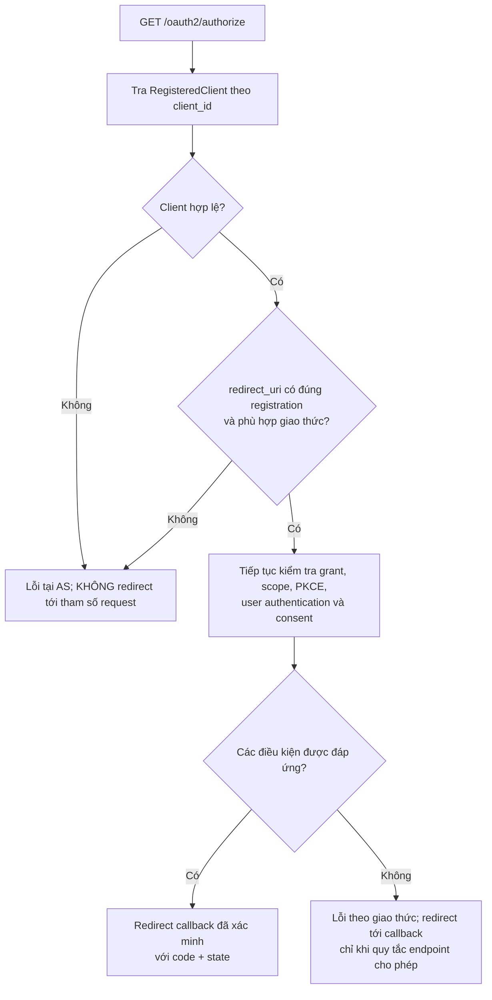
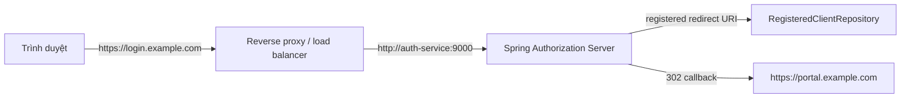

# Đối chiếu redirect_uri chính xác và chặn open redirect

Trong **OAuth 2.0/OpenID Connect (OIDC)**, Authorization Endpoint thường trả kết quả cấp quyền bằng cách yêu cầu trình duyệt chuyển hướng đến một địa chỉ của **OAuth client**. Tham số `redirect_uri` là ranh giới bảo mật quyết định **authorization code hoặc thông báo lỗi được gửi về đâu**. Nếu Authorization Server cho phép client tự chọn đích đến tùy ý, một request được kẻ tấn công tạo ra có thể biến máy chủ đăng nhập đáng tin thành công cụ chuyển hướng hoặc làm rò rỉ mã cấp quyền.

Bài học thuộc chương **Authorization Endpoint** của module **SPRING_SECURITY_OAUTH2_OIDC_AUTHORIZATION_SERVER**, tập trung vào việc thiết kế, cấu hình, bảo mật, kiểm thử và vận hành Spring Authorization Server trong ứng dụng Spring Boot. Trọng tâm là **đối chiếu redirect URI với những URI đã đăng ký**, ngăn open redirect ở cả Authorization Server và ứng dụng client, đồng thời hiểu đúng các ngoại lệ dành cho ứng dụng native.

**Sau bài này, bạn có thể:**

- Giải thích vì sao `redirect_uri` là tham số nhạy cảm trong Authorization Code Flow và vì sao `client_id` không đủ để tin một callback.
- Phân biệt kiểm tra **exact match** với so khớp hostname, tiền tố đường dẫn, wildcard hoặc chuẩn hóa URI tùy ý.
- Xác định khi nào Authorization Server phải báo lỗi **tại chỗ**, thay vì chuyển hướng đến `redirect_uri` không hợp lệ.
- Đăng ký callback cố định qua `RegisteredClient`, kiểm tra hành vi của Spring Authorization Server, và không vô tình làm yếu validator mặc định.
- Bảo vệ callback ở phía OAuth client bằng `state`, PKCE và cơ chế chuyển hướng sau đăng nhập an toàn.
- Viết bộ kiểm thử chống open redirect, bao gồm host giả mạo, dấu `@`, URL mã hóa, query, fragment, sai scheme và routing qua reverse proxy.

## 1. redirect_uri nằm ở đâu trong luồng ủy quyền?

Xét một web portal dùng Spring Security OAuth2 Client, đăng nhập qua Spring Authorization Server:

| Vai trò | URL ví dụ | Nhiệm vụ |
| --- | --- | --- |
| Authorization Server | `https://login.example.com` | Xác thực người dùng, kiểm tra yêu cầu cấp quyền và phát authorization code. |
| OAuth client có backend | `https://portal.example.com` | Khởi động request, giữ `state` và PKCE verifier, nhận callback, đổi code lấy token. |
| Callback **đã đăng ký** | `https://portal.example.com/login/oauth2/code/sas` | Chỉ đích được phép nhận phản hồi OAuth của client `portal-web`. |
| Resource Server | `https://api.example.com` | Kiểm tra access token và quyền đọc dữ liệu. |

Luồng rút gọn:

```mermaid
sequenceDiagram
    autonumber
    actor U as Người dùng
    participant B as Trình duyệt
    participant C as OAuth Client portal-web
    participant AS as Authorization Server
    participant DB as RegisteredClientRepository

    U->>B: Chọn Đăng nhập
    B->>C: GET /orders
    C-->>B: Redirect tới AS; tạo state, PKCE
    B->>AS: GET /oauth2/authorize?client_id=portal-web&redirect_uri=...
    AS->>DB: Tra RegisteredClient portal-web
    DB-->>AS: Danh sách redirectUris đã đăng ký
    AS->>AS: Đối chiếu redirect_uri và validate request
    AS-->>B: Đăng nhập / consent nếu cần
    U->>B: Xác thực và đồng ý
    B->>AS: Gửi kết quả
    AS-->>B: 302 đến callback đã xác minh + code + state
    B->>C: GET /login/oauth2/code/sas?code=...&state=...
    C->>C: Đối chiếu state
    C->>AS: POST /oauth2/token + code + verifier + client auth
    AS-->>C: Token khi giao dịch hợp lệ
```

Trình duyệt là trung gian mang response từ AS về client, không phải bên có quyền quyết định callback có hợp lệ hay không. Kẻ tấn công có thể tự gõ URL `/oauth2/authorize`, sửa query string, xây liên kết trong email hoặc chủ động gửi HTTP request. Vì vậy **mọi tham số từ front-channel phải được Authorization Server xác minh theo registration đáng tin cậy**.

### 1.1. Ví dụ authorization request hợp lệ

Để dễ đọc, request dưới đây được xuống dòng. Khi gửi thật, các tham số query cần được URL-encode và đặt trên một URL hợp lệ:

```http
GET /oauth2/authorize?response_type=code
    &client_id=portal-web
    &redirect_uri=https%3A%2F%2Fportal.example.com%2Flogin%2Foauth2%2Fcode%2Fsas
    &scope=openid%20orders.read
    &state=RANDOM_STATE_FROM_CLIENT
    &code_challenge=BASE64URL_SHA256_OF_VERIFIER
    &code_challenge_method=S256
    &nonce=RANDOM_NONCE
```

Trong ví dụ:

- `client_id=portal-web` chỉ giúp AS **tìm đăng ký client**, không xác thực rằng người gửi URL là portal chính chủ.
- `redirect_uri` yêu cầu AS gửi kết quả tới đúng callback mà portal đã đăng ký.
- `state` là giá trị ngẫu nhiên do **client** tạo để liên kết callback với giao dịch đăng nhập; client phải kiểm tra khi nhận phản hồi.
- `code_challenge` dùng trong PKCE; token endpoint kiểm tra `code_verifier` để chứng minh bên đổi code là bên đã khởi tạo request.
- `nonce` có thể liên kết ID token OIDC với giao dịch khi client yêu cầu nó; không thay `state` hoặc PKCE.

## 2. Open redirect tại Authorization Endpoint nguy hiểm như thế nào?

Một **open redirect** là hành vi cho phép người dùng hoặc kẻ tấn công quyết định đích chuyển hướng mà ứng dụng không kiểm soát thích hợp. Ví dụ Authorization Server sai lầm dùng trực tiếp tham số request để tạo `Location`:

```java
// PHẢN VÍ DỤ: không triển khai.
String redirectUri = request.getParameter("redirect_uri");
response.sendRedirect(redirectUri + "?code=" + authorizationCode);
```

Kẻ tấn công gửi nạn nhân liên kết:

```text
https://login.example.com/oauth2/authorize
  ?response_type=code
  &client_id=portal-web
  &redirect_uri=https%3A%2F%2Fattacker.example%2Fcallback
  &scope=openid
```

Nếu AS không đối chiếu callback với registration, sau khi người dùng xác thực, trình duyệt có thể mang mã ủy quyền đến `https://attacker.example/callback`.

Ngay cả khi code còn được bảo vệ bởi PKCE, **chuyển hướng đến đích do attacker chỉ định vẫn là lỗi bảo mật**: có nguy cơ rò rỉ dữ liệu trong URL, bị dùng cho phishing, hoặc trở thành mắt xích trong tấn công khác. PKCE giảm khả năng đổi code bị đánh cắp; nó **không hợp pháp hóa callback tùy ý**.

Các hệ quả thường gặp:

1. **Rò rỉ authorization code:** nếu đích đến do attacker kiểm soát, code nằm trong URL/HTTP request của attacker; khả năng đổi code tùy thuộc các cơ chế bảo vệ còn lại.
2. **Phishing bằng hostname đáng tin:** liên kết bắt đầu bằng `login.example.com` nhưng cuối cùng dẫn người dùng đến trang khác.
3. **Chuyển hướng vòng qua ứng dụng hợp lệ:** attacker có thể thử khai thác một endpoint redirect trong miền client được tin cậy để tiếp tục đưa trình duyệt ra ngoài.
4. **Login CSRF/code injection:** nếu client xử lý callback sai `state`, một code do attacker tạo có thể bị gắn nhầm vào phiên của nạn nhân.
5. **Mở rộng phạm vi tấn công khi cấu hình nhiều tenant:** nếu mọi tenant được điền callback tùy ý, người dùng có thể bị gửi tới miền không thuộc tenant/ứng dụng đã đăng ký.

**Đích chuyển hướng sau cấp quyền phải lấy từ danh sách đã được phê duyệt trong registration, không phải từ niềm tin vào tên miền hiển thị trong liên kết.**

## 3. Đối chiếu redirect_uri chính xác là gì?

Với một web client thông thường, AS phải đối chiếu `redirect_uri` nhận được với **một trong những URI hoàn chỉnh đã đăng ký cho chính client đó**. So khớp chính xác bao gồm scheme, host, port khi có, path, query và các ký tự có ý nghĩa. Không dùng wildcard, so khớp tiền tố hoặc chỉ kiểm tra cùng origin để thay thế.

Ví dụ chỉ đăng ký:

```text
https://portal.example.com/login/oauth2/code/sas
```

Ma trận:

| `redirect_uri` trong request | Được chấp nhận? | Lý do |
| --- | --- | --- |
| `https://portal.example.com/login/oauth2/code/sas` | **Có** | Trùng URI đã đăng ký. |
| `https://portal.example.com/login/oauth2/code/sas/` | **Không** | Thừa dấu `/` ở cuối path. |
| `http://portal.example.com/login/oauth2/code/sas` | **Không** | Khác scheme `https`. |
| `https://portal.example.com:444/login/oauth2/code/sas` | **Không** | Khác port được đăng ký. |
| `https://portal.example.com.evil.example/login/oauth2/code/sas` | **Không** | Host thuộc miền khác. |
| `https://portal.example.com@evil.example/callback` | **Không** | Trong cú pháp URI, `evil.example` là host; phần trước `@` là userinfo. |
| `https://portal.example.com/login/oauth2/code/sas?next=https://attacker.example` | **Không** | Có query thêm không nằm trong registration. |
| `https://portal.example.com/login/oauth2/code/sas#fragment` | **Không hợp lệ** | OAuth redirect endpoint URI không được chứa fragment. |
| `https://other.example.com/login/oauth2/code/sas` | **Không** | Khác host. |
| `https://portal.example.com/redirect?target=https://attacker.example` | **Không** | Không thuộc danh sách callback đã đăng ký. |

Một đăng ký có thể chứa **nhiều URI chính xác**, ví dụ để hỗ trợ hai callback cố định cho hai entry points của cùng client; mỗi URI vẫn phải được đánh giá và phê duyệt rõ ràng. Càng nhiều callback thì bề mặt tấn công và chi phí quản trị càng tăng.

### 3.1. So khớp chuỗi khác với đoán tính tương đương mạng

Các URI có vẻ tương tự chưa chắc là **cùng định danh trong giao thức**:

```text
https://portal.example.com/callback
https://portal.example.com/callback/
https://portal.example.com:443/callback
https://portal.example.com/callback?flow=login
https://PORTAL.example.com/callback
```

Một trình duyệt, reverse proxy hoặc thư viện HTTP có thể chuẩn hóa một số chi tiết khi gửi request. Tuy nhiên chính sách đăng ký client không nên dựa vào việc “hai URL chắc sẽ tới cùng máy” để chấp nhận callback. Với web OAuth client, giữ **một URI canonical được đăng ký** và dùng nhất quán ở cả request lẫn token exchange.

Chú ý hai lớp URL encoding:

- Bản thân `redirect_uri` là một URI, ví dụ `https://portal.example.com/callback?mode=login`.
- Khi đặt nó vào **query parameter** của `/oauth2/authorize`, dấu `:`, `/`, `?`, `=` được mã hóa theo cách gửi tham số HTTP, ví dụ `redirect_uri=https%3A%2F%2Fportal.example.com%2Fcallback%3Fmode%3Dlogin`.
- HTTP framework giải mã **lớp mã hóa tham số bên ngoài** để thu giá trị URI; AS sau đó kiểm tra giá trị đó theo registration. Không cố tình giải mã nhiều lần, thay đổi path hay dựng lại callback từ các phần do client kiểm soát.

**Tuyệt đối không “nới” kiểm tra** bằng cách tự xóa query, bỏ dấu `/` cuối, chuyển `http` thành `https`, bỏ port hoặc tự chấp nhận mọi subdomain. Việc đổi URI phải đi qua quy trình đăng ký/cập nhật client, không do attacker quyết định trong request.

### 3.2. Vì sao so khớp prefix hoặc wildcard nguy hiểm?

Những kiểm tra tự viết sau **đều không đủ**:

```java
// PHẢN VÍ DỤ: chỉ so khớp tiền tố.
boolean allow1 = requestedRedirect.startsWith("https://portal.example.com");

// PHẢN VÍ DỤ: chỉ so khớp suffix của hostname.
boolean allow2 = requestedHost.endsWith("example.com");

// PHẢN VÍ DỤ: wildcard mọi path và query trong origin.
boolean allow3 = requestedRedirect.matches(
    "https://portal[.]example[.]com/.*");
```

- `startsWith(...)` có thể chấp nhận `https://portal.example.com.evil.example/callback` hoặc dạng có `@` gây nhầm lẫn hostname.
- `endsWith("example.com")` có thể khớp cả `badexample.com`; kể cả kiểm tra hậu tố với dấu chấm đúng vẫn cho phép **mọi subdomain**, trong đó có subdomain bị chiếm quyền hoặc dành cho tenant khác.
- Wildcard path có thể cho phép chuyển hướng tới `/redirect?target=...`, một endpoint open redirect khác trong cùng host.
- Kiểm tra host đúng nhưng **bỏ qua port/path/query** vẫn cho phép gửi code đến endpoint không phải callback thực.

Cách đúng khi dùng framework là đăng ký exact URI trong `RegisteredClient` rồi để **Authorization Server validator** kiểm tra. Đoạn so khớp dưới đây chỉ minh họa ý tưởng exact membership, **không** phải thay thế đầy đủ validator giao thức:

```java
// MÔ HÌNH Ý TƯỞNG cho web client, không phải toàn bộ OAuth validator.
boolean isRegistered =
    registeredClient.getRedirectUris().contains(requestedRedirectUri);
```

Validator thật còn phải kiểm tra yêu cầu bắt buộc của giao thức, URI hợp lệ, client/grant, trường hợp đặc biệt được tiêu chuẩn cho phép và ràng buộc khác. Nếu phải mở rộng, ưu tiên **giữ lại default validator** và chỉ bổ sung chính sách cụ thể.

## 4. Quy tắc xử lý lỗi: không redirect đến URI chưa tin cậy

Đây là ranh giới quan trọng nhất của Authorization Endpoint: **không được dùng một `redirect_uri` sai để gửi phản hồi lỗi**.

Xét hai tình huống:

| Tình huống | Cách xử lý an toàn |
| --- | --- |
| `client_id` không tồn tại, `redirect_uri` không hợp lệ hoặc không thuộc registration | AS **không chuyển hướng** trình duyệt tới URI đó. Thường hiển thị lỗi tại AS hoặc trả phản hồi lỗi trực tiếp. |
| `redirect_uri` đã được xác minh hợp lệ, nhưng request có lỗi như scope/response type không được phép | Theo quy tắc của endpoint, AS **có thể chuyển hướng lỗi giao thức** tới callback **đã xác minh**, kèm `error` và `state` nếu request có state hợp lệ để phản hồi. |

Sơ đồ quyết định:



Ví dụ khi callback hợp lệ nhưng request không được cấp quyền, phản hồi có thể là:

```http
HTTP/1.1 302 Found
Location: https://portal.example.com/login/oauth2/code/sas?error=access_denied&state=RANDOM_STATE_FROM_CLIENT
```

Ngược lại, khi request đòi callback `https://attacker.example/callback` không được đăng ký, một phản hồi **không an toàn** là:

```http
HTTP/1.1 302 Found
Location: https://attacker.example/callback?error=invalid_request
```

**Không nên trả phản hồi thứ hai.** Một lỗi redirect URI phải được xử lý trước khi quyết định dùng callback đó làm nơi trả lỗi. Các HTTP status và hình thức error page cụ thể có thể khác giữa các phiên bản/điểm vào, nên kiểm thử cần tập trung vào điều kiện bảo mật: **không có `Location` tới URI không đáng tin và không rò rỉ code/token**.

### 4.1. Khi không truyền redirect_uri thì sao?

Tùy grant, loại request và đặc tả áp dụng, tham số `redirect_uri` có thể bắt buộc hoặc có các quy tắc suy ra callback từ đăng ký. Với **OIDC Authentication Request**, `redirect_uri` là tham số bắt buộc; với OAuth 2.0 thuần, cần xem quy tắc của specification và phiên bản triển khai khi chỉ có một redirect URI đã đăng ký.

**Không suy đoán** rằng thiếu `redirect_uri` luôn có thể chấp nhận; cũng không tự triển khai cơ chế chọn callback đầu tiên trong danh sách. Để dễ kiểm soát, client nên gửi **URI chính xác đã đăng ký** và kiểm thử hành vi của bản Spring Authorization Server đang chạy.

### 4.2. Khi callback đã xác minh nhưng code không hợp lệ?

Có thể xuất hiện `code` và `state` trong callback do attacker chèn hoặc giao dịch đã hết hạn. Ở phía OAuth client, việc nhìn thấy URI callback đúng **không có nghĩa** request là hợp lệ. Client phải đối chiếu `state`; sau đó đổi authorization code ở token endpoint, nơi AS xác minh code, client, redirect URI, PKCE và các điều kiện khác.

**Chặn open redirect là điều kiện cần, không phải toàn bộ bảo mật của Authorization Code Flow.**

## 5. Cấu hình redirect URI trong Spring Authorization Server

Spring Authorization Server lưu callback được cho phép trong `RegisteredClient.redirectUris`. Bên gửi request chỉ có thể dùng callback nằm trong đăng ký theo các quy tắc validator của giao thức.

Ví dụ confidential web client, Spring Boot 3.x + Spring Authorization Server 1.x tương thích. Đoạn sau chỉ là **đăng ký client**, giả định ứng dụng đã có các bean bảo mật, khóa ký và form login cần thiết để chạy Authorization Server.

### 5.1. Cấu hình Java với callback cố định

```java
package com.example.authserver.config;

import java.util.UUID;

import org.springframework.beans.factory.annotation.Value;
import org.springframework.context.annotation.Bean;
import org.springframework.context.annotation.Configuration;
import org.springframework.security.crypto.password.PasswordEncoder;
import org.springframework.security.oauth2.core.AuthorizationGrantType;
import org.springframework.security.oauth2.core.ClientAuthenticationMethod;
import org.springframework.security.oauth2.core.oidc.OidcScopes;
import org.springframework.security.oauth2.server.authorization.client.InMemoryRegisteredClientRepository;
import org.springframework.security.oauth2.server.authorization.client.RegisteredClient;
import org.springframework.security.oauth2.server.authorization.client.RegisteredClientRepository;
import org.springframework.security.oauth2.server.authorization.settings.ClientSettings;

@Configuration(proxyBeanMethods = false)
public class PortalClientRegistrationConfig {

    @Bean
    RegisteredClientRepository registeredClientRepository(
            PasswordEncoder passwordEncoder,
            @Value("${oauth.portal.client-secret}") String clientSecret) {

        RegisteredClient portal = RegisteredClient
            .withId(UUID.randomUUID().toString())
            .clientId("portal-web")
            .clientSecret(passwordEncoder.encode(clientSecret))
            .clientAuthenticationMethod(
                ClientAuthenticationMethod.CLIENT_SECRET_BASIC)
            .authorizationGrantType(
                AuthorizationGrantType.AUTHORIZATION_CODE)
            .redirectUri(
                "https://portal.example.com/login/oauth2/code/sas")
            .scope(OidcScopes.OPENID)
            .scope("orders.read")
            .clientSettings(ClientSettings.builder()
                .requireProofKey(true)
                .requireAuthorizationConsent(true)
                .build())
            .build();

        return new InMemoryRegisteredClientRepository(portal);
    }
}
```

`src/main/resources/application.yml`:

```yaml
oauth:
  portal:
    client-secret: ${PORTAL_OAUTH_CLIENT_SECRET}
```

Điểm cần hiểu:

1. `redirectUri(...)` được gọi **trong quá trình đăng ký trusted client**, không lấy trực tiếp từ query của `/oauth2/authorize`. Callback chính xác phải được duyệt khi onboarding hoặc cấu hình.
2. `clientAuthenticationMethod(CLIENT_SECRET_BASIC)` áp dụng cho backend client giữ secret; nó không thay thế việc kiểm tra redirect URI khi nhận authorization request từ trình duyệt.
3. `requireProofKey(true)` yêu cầu PKCE cho client. Dù đã bật PKCE, một redirect URI ngoài danh sách vẫn phải bị từ chối.
4. `requireAuthorizationConsent(true)` điều khiển yêu cầu đồng ý cấp quyền, **không** cấp quyền chọn callback.
5. `UUID.randomUUID()` và `InMemoryRegisteredClientRepository` chỉ thích hợp demo. Trong production cần ID ổn định, repository bền vững và quản trị thay đổi callback.
6. Secret được cấu hình từ môi trường và mã hóa để lưu registration; không ghi literal secret thật trong code hoặc log.

**Không nên sửa validator mặc định chỉ để cho phép callback “linh hoạt” theo query string.** Nếu cần nhiều callback hợp lệ, đăng ký từng URI cố định; nếu cần nhiều tenant độc lập, cân nhắc registration riêng với ranh giới quản lý và callback rõ ràng.

### 5.2. Spring Authorization Server kiểm tra ở đâu?

Trong Authorization Code Flow, Spring Authorization Server sử dụng các thành phần như:

| Thành phần | Vai trò |
| --- | --- |
| `OAuth2AuthorizationEndpointFilter` | Nhận và xử lý request tới Authorization Endpoint. |
| `OAuth2AuthorizationCodeRequestAuthenticationConverter` | Chuyển HTTP request thành đối tượng xác thực request cấp quyền. |
| `OAuth2AuthorizationCodeRequestAuthenticationProvider` | Xác thực authorization request và điều phối việc cấp quyền. |
| `OAuth2AuthorizationCodeRequestAuthenticationValidator` | Thực thi các kiểm tra request chuẩn, trong đó có logic redirect URI và scope. |
| `RegisteredClientRepository` | Tra cấu hình đáng tin về client, redirect URIs, grant types và scopes. |
| `OAuth2AuthorizationService` | Lưu trạng thái giao dịch/authorization code phục vụ token exchange. |

Các class và điểm mở rộng có thể thay đổi theo phiên bản Spring Authorization Server. Khi tùy biến `authorizationEndpoint(...)` hoặc thay `setAuthenticationValidator(...)`, phải hiểu rằng bạn có thể **thay thế** logic kiểm tra mặc định. Một custom validator chỉ kiểm tra tenant mà không tiếp tục kiểm tra redirect URI sẽ tạo lỗ hổng.

Một hướng an toàn khi cần thêm chính sách nghiệp vụ là **giữ kiểm tra mặc định**, bổ sung kiểm tra hẹp sau hoặc trước đó theo API extension được bản thư viện hỗ trợ. Nếu có ngoại lệ thực sự (như redirect URI của native loopback client), phải áp dụng chỉ cho registration được phân loại phù hợp và bao phủ bằng test.

### 5.3. Phân biệt redirect URI của client với URL issuer của server

Giả sử Authorization Server public qua `https://login.example.com` nhưng backend chạy ở `http://auth-service:9000`. Issuer có thể được cấu hình trong `AuthorizationServerSettings`:

```java
@Bean
AuthorizationServerSettings authorizationServerSettings() {
    return AuthorizationServerSettings.builder()
        .issuer("https://login.example.com")
        .build();
}
```

Issuer cho biết **ai phát hành token**; redirect URI thuộc **OAuth client**. Hai địa chỉ này không cần cùng domain và không nên được suy từ `Host` header hoặc tên container.

Ở phía Spring Security OAuth2 Client, callback phổ biến có dạng `{baseUrl}/login/oauth2/code/{registrationId}`. Giá trị `baseUrl` cần được proxy và cấu hình origin xác định chính xác. **Client phải tạo URI khớp với URI AS đã đăng ký**; không thay URI theo header forwarded không đáng tin.

## 6. Open redirect vẫn có thể nằm trong chính ứng dụng client

Một Authorization Server kiểm tra callback chính xác có thể vẫn bị ảnh hưởng nếu **ứng dụng sở hữu callback có open redirect hoặc forwarding thiếu kiểm soát**.

Ví dụ callback cố định đã đăng ký:

```text
https://portal.example.com/login/oauth2/code/sas
```

Sau khi xử lý đăng nhập, portal cho người dùng chọn một trang đích với tham số `next`:

```text
https://portal.example.com/after-login?next=https://attacker.example
```

Nếu controller viết:

```java
// PHẢN VÍ DỤ: next do trình duyệt kiểm soát.
@GetMapping("/after-login")
void afterLogin(@RequestParam String next,
                HttpServletResponse response) throws IOException {
    response.sendRedirect(next);
}
```

portal đã có open redirect ngay trong miền hợp lệ. Điều này có thể bị dùng để phishing và, tùy cách xử lý callback, làm rò rỉ code hoặc dữ liệu liên quan nếu ứng dụng chuyển tiếp nguyên URL, query hoặc fragment chưa làm sạch.

**Giải pháp:** đích điều hướng sau đăng nhập phải thuộc **danh sách route nội bộ được phép**, hoặc định danh route do server quản lý. Ví dụ:

```java
import java.io.IOException;
import java.util.Set;

import jakarta.servlet.http.HttpServletResponse;
import org.springframework.web.bind.annotation.GetMapping;
import org.springframework.web.bind.annotation.RequestParam;
import org.springframework.web.bind.annotation.RestController;

@RestController
class AfterLoginController {

    private static final Set<String> ALLOWED_PATHS =
        Set.of("/home", "/orders", "/profile");

    @GetMapping("/after-login")
    void afterLogin(@RequestParam(required = false) String next,
                    HttpServletResponse response) throws IOException {

        String destination = next != null && ALLOWED_PATHS.contains(next)
            ? next
            : "/home";

        response.sendRedirect(destination);
    }
}
```

Đoạn ví dụ chỉ cho phép **ba path literal**, loại bỏ đích tuyệt đối, dấu `//`, backslash, host lạ và các biến thể ngoài allowlist. Với ứng dụng thực tế, nếu có context path, locale hoặc route động, hãy biểu diễn route bằng **ID do server kiểm soát** hoặc xử lý bằng một thành phần điều hướng đã được kiểm thử kỹ, tránh nhận URL tự do.

### 6.1. Bảo vệ callback OAuth client

Một callback an toàn nên:

1. Kiểm tra `state` trong response khớp chính xác với giá trị khó đoán đã lưu cho transaction của trình duyệt; từ chối callback không khởi tạo từ client.
2. Chuyển authorization code tới token endpoint với đúng `client_id`, `redirect_uri` và `code_verifier`; confidential client xác thực theo method đã đăng ký.
3. Nếu dùng OIDC, xác minh ID token: chữ ký, `iss`, `aud`, thời hạn, `nonce` nếu đã yêu cầu và các điều kiện giao thức khác.
4. Thiết lập phiên ứng dụng an toàn; cookie cần cấu hình `Secure`, `HttpOnly`, `SameSite` theo luồng và có bảo vệ CSRF thích hợp.
5. Dọn code khỏi URL hiển thị sau khi hoàn tất callback, hạn chế log URL callback và script bên thứ ba tại trang xử lý callback.
6. Chỉ điều hướng tiếp đến route đáng tin sau khi xử lý callback thành công, không phản chiếu `next`/`returnUrl` từ query vào `Location` tùy ý.

Trong luồng Authorization Code + PKCE, callback không nên đưa nguyên code tới một frontend/trang thứ ba để “tự xử lý” nếu client backend là bên đã khởi tạo transaction và giữ verifier.

### 6.2. Tham số redirect_uri chứa query thì sao?

OAuth 2.0 có thể cho phép redirect URI đã đăng ký chứa query component. Ví dụ nếu registration thật sự có `https://portal.example.com/callback?source=sso`, AS phải xử lý URI **như một chuỗi đã đăng ký**; khi thêm `code` và `state` vào redirect response, chúng được thêm theo quy tắc của giao thức, không phải bằng cách nối thủ công dấu `?` lần thứ hai.

Tuy nhiên, query trong callback không nên chứa tham số chuyển tiếp tùy ý như `next=https://attacker.example`. Một query literal được đăng ký không làm ứng dụng trở nên an toàn nếu server ở đích lại lấy dữ liệu attacker kiểm soát để quyết định nơi redirect tiếp.

## 7. Trường hợp đặc biệt: ứng dụng native và loopback redirect

Quy tắc **exact match** dành cho web clients là mặc định quan trọng. Tuy nhiên có một ngoại lệ được tiêu chuẩn hóa cho một số ứng dụng native: **loopback redirect URI**.

Theo RFC 8252, ứng dụng native có thể mở HTTP listener tạm thời tại một cổng ngẫu nhiên trên loopback interface, ví dụ:

```text
http://127.0.0.1:51001/callback
http://127.0.0.1:62037/callback
http://[::1]:60001/callback
```

Đối với loại callback loopback IP literal, Authorization Server **phải cho phép cổng thay đổi** khi cơ chế này được triển khai theo RFC 8252; phần URI còn lại vẫn phải được kiểm tra theo đăng ký và chính sách. Đây là **ngoại lệ hẹp** theo loại ứng dụng và redirect, không phải lý do để chấp nhận `https://portal.example.com:*`, mọi localhost hostname hay mọi path của client.

Những điểm cần nhớ:

- `localhost` không tương đương hoàn toàn với địa chỉ loopback IP literal (`127.0.0.1` hoặc `[::1]`) trong các hướng dẫn native-app OAuth.
- Native app vẫn phải dùng **Authorization Code + PKCE** và không thể giữ client secret như confidential backend.
- Một số native apps còn dùng **claimed HTTPS URI** hoặc custom URI scheme được hỗ trợ; mỗi cách có rủi ro hijack redirect khác nhau và phải đăng ký theo tiêu chuẩn liên quan.
- Khả năng cho phép port động và hành vi kiểm tra URI cụ thể **phụ thuộc Spring Authorization Server phiên bản và cấu hình**. Không mặc định một config `RegisteredClient.redirectUri(...)` bình thường luôn đáp ứng ngoại lệ; cần integration test và extension phù hợp.
- Không mở rộng exception cho web client hoặc bỏ kiểm tra `redirect_uri` toàn cục để “hỗ trợ mobile”.

**Đừng áp chính sách native loopback cho SPA chạy tại `https://spa.example.com` hoặc backend web ở domain public.**

## 8. Reverse proxy, hostname và môi trường triển khai

Một hệ thống Spring Boot thực tế thường có:



Khi chuyển HTTP qua proxy, cần tách:

- **Authorization Server issuer public:** `https://login.example.com`, cấu hình tường minh trong `AuthorizationServerSettings`.
- **Backend bind URL:** `http://auth-service:9000`, chỉ để kết nối nội bộ.
- **Client callback:** `https://portal.example.com/login/oauth2/code/sas`, được lưu trong `RegisteredClient`.

Không đăng ký `http://auth-service:9000` làm callback chỉ vì ứng dụng đang chạy trong container. Callback thuộc ứng dụng client, và phải truy cập được từ trình duyệt theo đúng luồng.

Các header `Forwarded`/`X-Forwarded-Host`/`X-Forwarded-Proto` có thể ảnh hưởng cách client và AS tạo URL chuyển hướng. Chỉ tin các header này khi đến từ **reverse proxy được kiểm soát**, nơi header tự khai từ Internet đã bị loại bỏ/ghi đè. Với Spring Boot, `server.forward-headers-strategy` phải được lựa chọn đúng theo topology và chính sách mạng; đừng cấu hình tùy tiện để chấp nhận mọi host.

### 8.1. Dev, staging và production cần callback nào?

| Môi trường | Ví dụ callback | Cách quản lý |
| --- | --- | --- |
| Local development | `http://127.0.0.1:8081/login/oauth2/code/sas` | Registration dành riêng cho local, chỉ dùng loopback và kiểm thử nội bộ. |
| Staging | `https://staging-portal.example.com/login/oauth2/code/sas` | Client registration/secret riêng, issuer của staging riêng. |
| Production | `https://portal.example.com/login/oauth2/code/sas` | Đăng ký chính xác, kiểm soát quyền thay đổi và audit. |

Ưu tiên **registration riêng theo môi trường** để không vô tình cho client production chuyển code về localhost hoặc staging. Nếu tổ chức cố gắng dùng một client registration cho mọi môi trường, mọi callback trong đó trở thành đích AS có thể gửi code; vì vậy rủi ro sẽ tăng, ngay cả khi các URI được liệt kê chính xác.

### 8.2. Tenant hoặc domain động

Tránh các dạng:

```text
https://*.example.com/oauth/callback
https://{tenant}.example.com/oauth/callback
https://portal.example.com/oauth/callback?returnUrl=*
```

Mô hình đa tenant có thể dùng:

- Một callback cố định và mapping tenant được bảo vệ bằng **server-side state**. Client chỉ dùng callback duy nhất; sau callback thành công, server xác định tenant và route đã cho phép.
- Các `RegisteredClient` riêng cho từng tenant/ứng dụng, mỗi client có danh sách callback cụ thể được phê duyệt.
- Một danh sách callback URI chính xác với quy trình onboarding/thu hồi nghiêm ngặt, nếu số tenant nhỏ và có thể quản trị.

Không nhận miền callback tùy ý ngay trong authorization request rồi tự thêm vào registration hoặc tạo client mới không cần xác minh quyền sở hữu.

## 9. Những biện pháp bổ sung ngoài exact redirect matching

**Exact redirect matching bảo vệ đích trả kết quả**, nhưng Authorization Code Flow còn cần các cơ chế bổ sung:

| Rủi ro | Biện pháp bổ sung | Vì sao redirect match chưa đủ? |
| --- | --- | --- |
| Code bị lấy cắp trên front-channel | PKCE `S256`; code ngắn hạn, một lần, gắn với client/redirect. | Callback đúng vẫn có thể bị lộ code qua log, extension hoặc client bị tấn công. |
| Login CSRF/code injection | `state` ngẫu nhiên, gắn transaction với phiên client. | URI đúng không chứng minh callback thuộc request vừa khởi tạo. |
| ID token bị dùng nhầm hoặc chèn từ issuer khác | Client xác minh issuer, audience, chữ ký, nonce; cân nhắc OAuth authorization server issuer identification khi liên thông nhiều AS. | Callback thuộc client nhưng response có thể xuất phát từ luồng/issuer khác. |
| Client bị chiếm qua XSS | CSP, bảo vệ dependency, token storage và callback page. | Kẻ tấn công chạy mã trong origin hợp lệ có thể đọc hoặc lạm dụng dữ liệu frontend. |
| Open redirect sau đăng nhập | Route allowlist, định danh route server-side, không forward URL do client gửi. | AS chỉ kiểm tra callback đầu tiên, không kiểm soát mọi redirect tiếp theo trong ứng dụng client. |
| Authorization request bị sửa trên browser | Validator AS, PKCE/state, có thể áp dụng PAR/JAR trong hệ thống phù hợp. | Request đi qua trình duyệt vẫn là dữ liệu không đáng tin. |

**PAR (Pushed Authorization Requests, RFC 9126)** hoặc **JAR (JWT-Secured Authorization Request)** có thể hỗ trợ bảo vệ thông tin của authorization request trong những hệ thống yêu cầu mức bảo mật cao. Tuy vậy, chúng **không cho phép bỏ qua** việc kiểm tra callback đã đăng ký.

Trong OIDC, `response_type` và `response_mode` quyết định cách phản hồi được gửi (query, fragment hoặc form post theo luồng được hỗ trợ). Bài này ưu tiên **Authorization Code Flow**; không suy luận mọi response đều có `code` trong query, và không sử dụng implicit flow chỉ để né token endpoint.

## 10. Kiểm thử chống open redirect

Kiểm thử cần bao phủ ít nhất hai ranh giới: **Authorization Server** quyết định callback nào được chấp nhận và **OAuth client** quyết định redirect sau đăng nhập có an toàn hay không.

### 10.1. Ma trận test ở Authorization Endpoint

Giả định `portal-web` chỉ có callback đăng ký `https://portal.example.com/login/oauth2/code/sas`.

| Input/điều kiện | Kết quả mong đợi |
| --- | --- |
| URI đúng, client/grant/scope và PKCE hợp lệ | Có thể tiếp tục đăng nhập/consent, rồi redirect về callback chính xác với code và state. |
| `redirect_uri=https://attacker.example/callback` | Không redirect đến attacker, không phát code tới URI đó. |
| Host `portal.example.com.evil.example` | Từ chối. |
| Userinfo trick: `https://portal.example.com@evil.example/callback` | Từ chối. |
| Callback đúng host nhưng sai path hoặc thêm `/` | Từ chối URI chưa đăng ký. |
| Callback đổi HTTPS thành HTTP | Từ chối (trừ những ngoại lệ native loopback đã được hỗ trợ/đăng ký phù hợp). |
| Callback đúng path nhưng thêm query `next` | Từ chối URI khác với registration. |
| Redirect URI có fragment | Từ chối yêu cầu không hợp lệ. |
| `client_id` không có trong repository | Không redirect dựa vào URI do request cung cấp. |
| `client_id` client A nhưng callback thuộc client B | Từ chối; không chia sẻ callback theo host chung. |
| URI đã xác minh, scope không được phép | Theo quy tắc OAuth, có thể phản hồi lỗi đến **callback đã xác minh**, không cấp code. |
| Thiếu hoặc sai PKCE ở client bắt buộc PKCE | Không cấp code/token theo request không hợp lệ. |
| Code đổi tại token endpoint với `redirect_uri` khác | Token endpoint từ chối. |
| Authorization code bị tái sử dụng | Token endpoint từ chối lần sau. |
| Cố tình gửi header `Host`/`X-Forwarded-Host` giả | Không phát callback ngoài registration; proxy/issuer URL không bị điều khiển bởi client chưa tin. |

**Đừng chỉ assert mã HTTP**: có thể request chưa đăng nhập nên AS chuyển tới form login, hoặc lỗi được trả bằng HTML/JSON tùy chain. Trong test có phiên xác thực, kiểm tra cả `Location` và nội dung response; xác nhận **không bao giờ gửi code hay lỗi nhạy cảm tới URI chưa đăng ký**.

### 10.2. Ví dụ dựng yêu cầu bằng curl

Một request đến Authorization Endpoint, **chỉ để kiểm thử callback lạ**, có thể tạo bằng:

```bash
curl --silent --show-error --include --get \
  'https://login.example.com/oauth2/authorize' \
  --data-urlencode 'response_type=code' \
  --data-urlencode 'client_id=portal-web' \
  --data-urlencode 'redirect_uri=https://attacker.example/callback' \
  --data-urlencode 'scope=openid orders.read' \
  --data-urlencode 'state=test-state' \
  --data-urlencode 'code_challenge=test-challenge' \
  --data-urlencode 'code_challenge_method=S256'
```

Đây là request **âm tính**; `code_challenge` placeholder không phải PKCE challenge hợp lệ. Để tách riêng lỗi callback khỏi các lỗi khác, trong integration test hãy dựng request với PKCE hợp lệ và phiên người dùng được kiểm soát.

Kết quả cần kiểm tra là **không có `Location: https://attacker.example/...`** và **không cấp code**. Với một request không đăng nhập, có thể AS yêu cầu login trước khi mọi lỗi được thể hiện; test mạnh phải hoàn tất các điều kiện còn lại hoặc dùng test harness mô phỏng user authentication.

Một test thành công cần cả **authorization redirect** và **token request**: nhận code từ callback chính xác, xác minh `state`, rồi đổi code bằng PKCE verifier tương ứng và đúng redirect URI. Điều này đảm bảo route hợp lệ thật sự hoạt động thay vì chỉ kiểm tra nhánh chặn.

### 10.3. Test open redirect ở chính client

Cần kiểm tra:

- `/after-login?next=https://attacker.example` không trả `Location` tới miền attacker.
- `next=//attacker.example` không bị coi là route nội bộ.
- `next=%2F%2Fattacker.example` không bị lợi dụng qua giải mã nhiều lần.
- `next=\\attacker.example` hoặc các biến thể dấu slash/backslash không được chấp nhận.
- `next=/orders` được phép nếu ứng dụng có route đó.
- Callback với `state` sai hoặc thiếu bị từ chối và không tạo phiên người dùng.
- Callback hợp lệ không lộ `code` trong log, query của redirect tiếp theo hoặc referrer tới tài nguyên bên thứ ba.

Không coi kiểm thử AS là đủ để chứng minh callback page an toàn; lỗi open redirect tại client là một lớp riêng.

## 11. Troubleshooting: lỗi thường gặp

### `invalid_request` hoặc AS từ chối callback dù URL trông đúng

So sánh **chuỗi callback trong request thực tế** với chuỗi của `RegisteredClient.redirectUris`: scheme, host, port, path, query và dấu slash. Kiểm tra có bị proxy thêm port nội bộ, chuyển `https` thành `http` hay Spring OAuth2 Client tạo callback với registration ID khác không.

Nếu khác, sửa cấu hình phía client hoặc đăng ký URI đúng qua quy trình quản trị. Không tắt redirect URI validation.

### Dùng localhost ở local nhưng production cũng chấp nhận localhost

Có thể một registration đang trộn callback dev và production. Tách registration theo môi trường và giới hạn client secret/grant/scope tương ứng. Một client production cho phép callback local làm tăng rủi ro vì trình duyệt của người dùng có thể gửi code đến listener cục bộ.

### Đã kiểm tra host, vẫn bị chuyển hướng tới attacker

Có thể code dùng so khớp prefix, wildcard hoặc một endpoint redirect trên host hợp lệ. Kiểm tra **toàn bộ URI** và mọi hop trong chuỗi `302 Location`; dừng sử dụng callback động, sửa open redirect ở client.

### Thêm query vào redirect_uri rồi token exchange trả `invalid_grant`

Authorization code được liên kết với giao dịch và redirect URI khi cấp. Token request phải gửi `redirect_uri` phù hợp với giá trị ở authorization request khi giao thức yêu cầu. Nếu client thêm/bớt query hoặc đổi path giữa hai bước, AS có thể từ chối mã dù còn hạn.

### Callback hợp lệ nhưng người dùng bị đăng nhập vào tài khoản sai

Đừng chỉ nhìn redirect URI. Kiểm tra `state` phía client, PKCE, binding authorization code và kết quả xác minh ID token. Đây có thể là login CSRF/code injection hoặc lỗi quản lý session, không phải lỗi exact-match đơn thuần.

### Sau reverse proxy, callback bị tạo sai scheme hoặc host

Kiểm tra URL issuer/public origin, cấu hình client `{baseUrl}`, TLS termination và header forwarded được tin cậy. Không nhận `X-Forwarded-Host` trực tiếp từ Internet. Đối với môi trường nhiều instance, đảm bảo registration và issuer nhất quán.

## 12. Bài tập thiết kế

Bạn xây Spring Authorization Server cho ba client:

| Client | Kiểu | Callback cần quản lý |
| --- | --- | --- |
| `staff-portal` | Confidential web BFF | `https://staff.example.com/login/oauth2/code/sas` |
| `customer-spa` | Public SPA | `https://app.example.com/auth/callback` |
| `mobile-app` | Native app với loopback redirect | `http://127.0.0.1:{dynamic-port}/callback` theo RFC 8252 |

Hãy tự thiết kế `RegisteredClient` cho từng client và trả lời:

1. Vì sao `https://staff.example.com.evil.example/login/oauth2/code/sas` phải bị từ chối dù chứa chuỗi `staff.example.com`?
2. Tại sao không đăng ký `https://*.example.com/callback` chung cho web portal và SPA?
3. Nếu `staff-portal` dùng callback đã đăng ký nhưng controller `/after-login` cho chuyển đến URL tùy ý, hệ thống còn rủi ro nào?
4. Với native app, phần nào của loopback URI được phép thay đổi theo RFC 8252? Điều đó có hợp thức hóa wildcard port/path cho web client không?
5. Client muốn redirect về `/orders/123` sau đăng nhập thì nên truyền URI đó trực tiếp vào `redirect_uri` hay lưu một định danh route đã kiểm soát trong trạng thái giao dịch?
6. Nếu AS phát lỗi vì scope không hợp lệ nhưng callback đã được xác minh, phản hồi có thể đi đâu? Nếu callback **không** được xác minh thì sao?
7. Vì sao client vẫn cần `state` và PKCE sau khi AS đã thực hiện exact callback validation?
8. Khi dùng nhiều môi trường và reverse proxy, kiểm thử nào xác minh callback do client tạo **khớp chính xác** registration trên AS?

**Hướng trả lời:** callback là đích giao thức đã đăng ký, không phải đường dẫn điều hướng nghiệp vụ tùy ý. Web client sử dụng URI cụ thể; native loopback có ngoại lệ hẹp theo RFC 8252. AS chỉ phản hồi đến callback đã xác minh; client còn phải xác thực giao dịch và kiểm soát redirect sau đăng nhập.

## 13. Checklist trước khi vận hành

- [ ] Mỗi `RegisteredClient` có danh sách callback **chính xác, ngắn gọn và được phê duyệt**.
- [ ] Không sử dụng wildcard, tiền tố, domain suffix hoặc thông tin do `Host`/forwarded header không đáng tin quyết định URI.
- [ ] Authorization Endpoint từ chối callback chưa đăng ký mà **không redirect lỗi đến chính URI đó**.
- [ ] Phương thức/validator tùy biến không bỏ qua các kiểm tra redirect URI mặc định của Spring Authorization Server.
- [ ] OAuth client tạo cùng một URI ở authorization request và token exchange; kiểm tra `state`, PKCE và OIDC ID token nếu áp dụng.
- [ ] Callback page và điều hướng sau đăng nhập không tạo open redirect; chỉ cho phép route nội bộ được kiểm soát.
- [ ] Đã tách đăng ký theo dev/staging/production và quản trị callback cho từng tenant.
- [ ] Nếu dùng native loopback, ngoại lệ cổng động chỉ áp dụng cho client/URI đủ điều kiện và đã được kiểm thử.
- [ ] Reverse proxy tạo đúng public origin, issuer và forwarded headers đến từ nguồn tin cậy.
- [ ] Đã kiểm thử host giả, `@`, sai scheme, port, path, query, fragment, double encoding và callback qua redirect chain.
- [ ] Log/monitoring không ghi authorization code, token, client secret hoặc tham số nhạy cảm trong callback URL.
- [ ] Đã có kiểm thử đường thành công và đường bị từ chối của Authorization Code Flow trước khi nâng cấp Spring Authorization Server.

**Ghi nhớ:** `redirect_uri` là **đích được đăng ký của một OAuth client**, không phải tham số để trình duyệt tự chọn nơi nhận kết quả cấp quyền. Trong Spring Authorization Server, hãy dùng `RegisteredClient.redirectUri(...)` để lưu callback chính xác và giữ validator chuẩn. Nếu callback chưa được xác minh, AS không được dùng nó làm nơi gửi **kể cả thông báo lỗi**. Bảo vệ hoàn chỉnh còn đòi hỏi PKCE, `state`, kiểm soát callback client, TLS và quy trình vận hành registration.

**Tài liệu tham khảo:**

- [RFC 6749 — OAuth 2.0 Authorization Framework](https://www.rfc-editor.org/rfc/rfc6749.html): `3.1.2` (Redirection Endpoint), `4.1` (Authorization Code), `10.15` (Open Redirectors).
- [RFC 9700 — Best Current Practice for OAuth 2.0 Security](https://www.rfc-editor.org/rfc/rfc9700.html): yêu cầu so khớp redirect URI, phòng chống code leakage và các tấn công redirect.
- [RFC 8252 — OAuth 2.0 for Native Apps](https://www.rfc-editor.org/rfc/rfc8252.html): loopback IP redirect và ngoại lệ cổng động.
- [RFC 7636 — Proof Key for Code Exchange (PKCE)](https://www.rfc-editor.org/rfc/rfc7636.html): code verifier/challenge và ràng buộc code.
- [OpenID Connect Core 1.0](https://openid.net/specs/openid-connect-core-1_0.html): Authentication Request, redirect URI và ID token validation.
- [Spring Authorization Server Reference — Protocol Endpoints](https://docs.spring.io/spring-authorization-server/reference/protocol-endpoints.html): Authorization Endpoint và khả năng tùy biến.
- [Spring Authorization Server Reference — Core Model and Components](https://docs.spring.io/spring-authorization-server/reference/core-model-components.html): `RegisteredClient` và `RegisteredClientRepository`.

