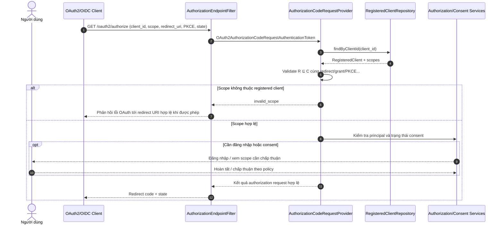
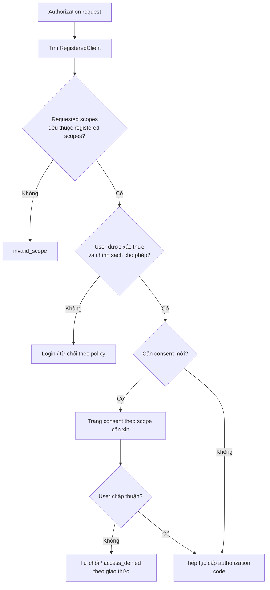
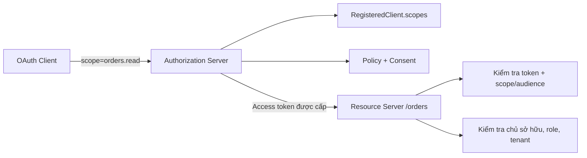

# Kiểm tra scope yêu cầu so với cấu hình client

## 1. Bài toán: client đăng ký một tập quyền nhưng chỉ xin một phần

Trong Spring Boot ứng dụng **Spring Security** và **Spring Authorization Server (SAS)** để xây OAuth 2.0/OpenID Connect (OIDC) Authorization Server, một client có thể được đăng ký với nhiều **scope** nhưng mỗi yêu cầu cấp quyền chỉ cần một số scope cụ thể.

Ví dụ, ứng dụng web `orders-portal` có các scope trong `RegisteredClient`:

```text
openid
profile
orders.read
orders.write
```

Người dùng mở chức năng xem đơn hàng; client gửi đến Authorization Endpoint:

```http
GET /oauth2/authorize?response_type=code
    &client_id=orders-portal
    &redirect_uri=https%3A%2F%2Fportal.example.com%2Flogin%2Foauth2%2Fcode%2Forders
    &scope=openid%20orders.read
    &state=STATE_RANDOM
    &code_challenge=CHALLENGE_S256
    &code_challenge_method=S256
```

Ở đây, **scope yêu cầu** là `{openid, orders.read}`. Nó là tập con của **scope đã đăng ký** `{openid, profile, orders.read, orders.write}`, nên vượt qua bước kiểm tra giới hạn scope *nếu các điều kiện khác đều hợp lệ*. Ngược lại, nếu client gửi `orders.admin` dù không được đăng ký, Authorization Server phải từ chối yêu cầu phù hợp với quy tắc OAuth 2.0, **không tự cấp thêm** scope đó.

Bài học thuộc chương **Authorization Endpoint** tập trung vào mối quan hệ này: scope trong request, scope trong `RegisteredClient`, logic kiểm tra ở authorization endpoint, consent của người dùng, quyền thực tế tại Resource Server và cách kiểm thử khi tùy chỉnh Spring Authorization Server.

Sau bài này, người học phải giải thích được:

1. `scope` trong HTTP khác gì `RegisteredClient.getScopes()` và khác gì authority `SCOPE_...` ở Spring Security.
2. Yêu cầu scope nào được chấp nhận, scope nào phải bị từ chối.
3. `OAuth2AuthorizationCodeRequestAuthenticationProvider` và validator tham gia kiểm tra như thế nào.
4. Cách bổ sung chính sách scope nhưng **không xóa validator mặc định**.
5. Vì sao kiểm tra scope tại Authorization Server không thay thế consent, PKCE, client authentication và phân quyền từng tài nguyên ở API.

> **Phạm vi phiên bản:** Ví dụ Java sử dụng phong cách API của **Spring Authorization Server 1.x / Spring Security 6.x**. Ở các thế hệ Spring Security tích hợp Authorization Server hoặc phiên bản SAS khác, entrypoint cấu hình và các extension point có thể thay đổi. Hãy đối chiếu tài liệu/Javadoc chính thức của phiên bản đang dùng trước khi sao chép vào dự án.

## 2. Scope là gì và không phải là gì?

OAuth 2.0 dùng **scope** để biểu thị phạm vi truy cập mà client xin và Authorization Server có thể cấp. Các giá trị scope cụ thể như `orders.read` hay `billing.export` được hệ thống định nghĩa; OAuth không tự biết thế nào là “đọc một đơn hàng” hay “xuất dữ liệu”.

Một tham số `scope` có thể chứa nhiều scope token, phân tách bằng **dấu cách**. Khi đặt trong URL, dấu cách thường được mã hóa thành `%20`.

| Khái niệm | Ví dụ | Ý nghĩa |
| --- | --- | --- |
| **Requested scopes** | `scope=openid%20orders.read` | Những phạm vi client yêu cầu cho **lần authorization này** |
| **Registered scopes** | `RegisteredClient.getScopes() = {openid, profile, orders.read}` | Giới hạn trên theo **đăng ký client**, không có nghĩa mọi phạm vi được cấp mặc định |
| **Granted / authorized scopes** | `{openid, orders.read}` | Những phạm vi được Authorization Server thực sự cho phép trong kết quả cấp quyền, sau các kiểm tra phù hợp |
| **Consent** | Người dùng chấp thuận `orders.read` | Quyết định của người dùng theo policy, không thể tự nâng quyền vượt client registration |
| **Token scope claim / response scope** | `scope: "orders.read"` | Thông tin về phạm vi của access token; cần kiểm tra theo token format và giao thức |
| **Spring Security authority** | `SCOPE_orders.read` | Biểu diễn quyền mà cơ chế Resource Server có thể ánh xạ từ scope token để áp rule |
| **Business authorization** | Người dùng được xem đơn #123 | Quyền trên đối tượng cụ thể, cần xử lý trong Resource Server/ứng dụng |

Các scope token thường **phân biệt chữ hoa/chữ thường**: `orders.read` không tương đương `Orders.Read`. Phân tách bằng dấu cách, không dùng dấu phẩy hoặc danh sách JSON cho tham số `scope` chuẩn. Nếu client gửi lặp cùng một tham số `scope`, hệ thống phải kiểm tra theo cơ chế parse/validation của endpoint thay vì tùy tiện lấy giá trị đầu hoặc cuối.

### 2.1. Không đồng nhất scope với role

`orders.read` mô tả quyền client được phép xin để gọi API; `ROLE_MANAGER` có thể là role của người dùng trong hệ thống; còn `Order.ownerId == principal.id` là điều kiện truy cập dữ liệu. Ba khái niệm có thể kết hợp nhưng không thay thế nhau.

Ví dụ `orders-portal` được cấp `orders.read` và Alice đăng nhập thành công. Điều này **chưa chứng minh** Alice có quyền xem đơn hàng của Bob. API đơn hàng vẫn cần đánh giá owner/tenant/role trước khi trả dữ liệu.

### 2.2. OIDC scope `openid` và các scope hồ sơ

Trong một yêu cầu OIDC, `openid` là scope đặc biệt cho biết client muốn sử dụng OIDC để xác thực người dùng. Các scope như `profile`, `email`, `address` và `phone` có ý nghĩa chuẩn trong OIDC; nhưng claim thực tế phụ thuộc nguồn dữ liệu, policy và sự hỗ trợ/cấu hình của OP.

- `openid` **không** có nghĩa client được mọi API chấp nhận access token.
- `profile` **không** tự cấp mọi trường thông tin cá nhân; dữ liệu được công bố phải tuân theo chính sách claims.
- `email` **không** đảm bảo `email_verified=true`; hai claim có ý nghĩa khác nhau.
- `orders.read` là scope nghiệp vụ, được ứng dụng đặt tên và mô tả rõ ràng cho client/API.

Nếu client xin `openid` nhưng `RegisteredClient` không đăng ký scope này, request không được qua bước kiểm tra chỉ vì OP bật OIDC. Tương tự, một client OAuth 2.0 chỉ xin `orders.read` không đương nhiên nhận ID token.

## 3. Luật kiểm tra quan trọng nhất: requested ⊆ registered

Gọi:

- `R` là **tập requested scopes** của authorization request;
- `C` là **tập registered scopes** của `RegisteredClient`;
- `G` là **tập scope được cấp** sau các kiểm tra và policy hợp lệ.

Điều kiện cơ bản:

\[
R \subseteq C
\]

Để cấp quyền an toàn, scope trong kết quả không được tự động vượt những gì client đã yêu cầu và được phép:

\[
G \subseteq R \subseteq C
\]

Khi scope yêu cầu không được phép:

\[
R \setminus C \ne \varnothing \Rightarrow \texttt{invalid\_scope}
\]

Đây là **mô hình kiểm tra giới hạn**, không phải khẳng định SAS luôn tự động lấy giao `R ∩ C` để trả về một phần khi request sai. Trong cấu hình chuẩn, một yêu cầu mang scope ngoài danh sách cho phép phải bị từ chối theo xử lý validation, không “âm thầm bỏ scope nguy hiểm và vẫn cấp code” như một quy tắc chung.

### 3.1. Bảng tình huống

Giả sử `RegisteredClient.scopes` là:

```text
{ "openid", "profile", "orders.read", "orders.write" }
```

| Scope yêu cầu (`R`) | Hợp lệ tại bước so với `C`? | Giải thích |
| --- | --- | --- |
| `openid orders.read` | Có | Cả hai đã đăng ký |
| `orders.read` | Có | Client xin ít hơn tập được phép; không phải OIDC login nếu thiếu `openid` |
| `openid profile orders.read orders.write` | Có | Tất cả scope đều nằm trong tập đăng ký; còn phụ thuộc consent/chính sách |
| `orders.admin` | Không | Scope chưa được đăng ký |
| `orders.read orders.admin` | Không | Có **một** scope không được phép cũng phải bị từ chối |
| `OpenId orders.read` | Không | `OpenId` khác `openid` |
| `openid,orders.read` | Không theo danh sách ví dụ | Dấu phẩy không phân tách scope token; đây là một giá trị scope khác |
| `scope` bị bỏ trống/vắng mặt | Cần xem policy/phiên bản | Chuẩn cho phép dùng phạm vi mặc định hoặc từ chối; **không suy** được quyền lấy toàn bộ `C` |

Một scope hợp lệ ở bước so sánh với `RegisteredClient` vẫn có thể bị từ chối tại các bước khác, ví dụ client sai `redirect_uri`, không được dùng grant, thiếu PKCE, không đạt policy, người dùng không có phiên xác thực, hoặc consent không được cấp.

### 3.2. Trường hợp không gửi scope

RFC 6749 cho phép client không gửi `scope`; Authorization Server khi ấy phải có cách xử lý rõ ràng, ví dụ áp dụng **default scope** được xác định trước hoặc từ chối request. Hành vi cụ thể của SAS có thể phụ thuộc phiên bản, endpoint, client và cấu hình; phải xác minh bằng integration test.

Không nên tự bổ sung:

```java
// Ví dụ phản mẫu: không tự động biến thiếu scope thành xin toàn bộ quyền.
if (requestedScopes.isEmpty()) {
    requestedScopes = registeredClient.getScopes();
}
```

Ví dụ phản mẫu này có thể làm một request không chỉ định quyền trở thành yêu cầu phạm vi lớn nhất. Nếu hệ thống cần default scope, hãy xác định chính sách tối thiểu, document rõ ràng và kiểm thử đường đi đó.

## 4. Scope được kiểm tra tại đâu trong Spring Authorization Server?

Ở Authorization Code Flow, `OAuth2AuthorizationEndpointFilter` tiếp nhận `/oauth2/authorize`. Converter tạo `OAuth2AuthorizationCodeRequestAuthenticationToken`, sau đó `AuthenticationManager` chuyển cho provider phù hợp, thường có `OAuth2AuthorizationCodeRequestAuthenticationProvider`.

Provider sử dụng thông tin `RegisteredClient`, request và các validator để kiểm tra những điều kiện như client/grant, redirect URI và scope. Với yêu cầu chưa đăng nhập, cơ chế Spring Security cho người dùng xác thực trước khi hoàn tất authorization; với yêu cầu cần consent, user phải đi qua bước consent tương ứng.



Sơ đồ diễn giải **đường xử lý logic**. Các lần redirect cho login/consent, thứ tự provider và cách tiếp tục request thực tế có thể khác nhau theo phiên bản/cấu hình. Nếu **redirect URI không hợp lệ**, server không được đưa lỗi tới URI bị nghi ngờ; điều kiện này tách biệt với việc xử lý `invalid_scope`.

### 4.1. Phân biệt ba thành phần

| Thành phần | Vai trò |
| --- | --- |
| `OAuth2AuthorizationCodeRequestAuthenticationConverter` | Đọc tham số authorization request và tạo đối tượng `Authentication` chưa xác thực |
| `OAuth2AuthorizationCodeRequestAuthenticationProvider` | Xử lý request, kết hợp kiểm tra client, redirect, scopes và trạng thái cần thiết để cấp code |
| `OAuth2AuthorizationCodeRequestAuthenticationValidator` | Validator mặc định của authorization code request; có các phần kiểm tra redirect URI/scope để có thể kết hợp khi mở rộng |

Không nên dùng tên `OAuth2AuthorizationCodeAuthenticationProvider` (provider **đổi code tại token endpoint**) khi chỉ muốn thay đổi validation **scope tại authorization endpoint**. Hai provider xử lý hai request khác nhau.

### 4.2. Kiểm tra bằng mô hình RegisteredClient

Trong SAS 1.x, danh sách scope được cấu hình khi tạo `RegisteredClient`:

```java
RegisteredClient ordersPortal = RegisteredClient.withId(stableId)
        .clientId("orders-portal")
        .clientName("Orders Portal")
        .clientAuthenticationMethod(ClientAuthenticationMethod.NONE)
        .authorizationGrantType(AuthorizationGrantType.AUTHORIZATION_CODE)
        .redirectUri(
            "https://portal.example.com/login/oauth2/code/orders")
        .scope(OidcScopes.OPENID)
        .scope(OidcScopes.PROFILE)
        .scope("orders.read")
        .scope("orders.write")
        .clientSettings(ClientSettings.builder()
            .requireProofKey(true)
            .requireAuthorizationConsent(true)
            .build())
        .build();
```

`stableId` là khóa nội bộ bền vững của client, khác `clientId`; mã trên chỉ là **một đoạn builder minh họa**, chưa bao gồm repository, user authentication, token generator, persistence, JWK và endpoint configuration đầy đủ.

Các chi tiết đáng chú ý:

- `scope(...)` gọi nhiều lần để đăng ký các giá trị được phép. Nó **không** cấp tất cả scope đó cho mọi request.
- `ClientAuthenticationMethod.NONE` phù hợp với **public client**; authorization code yêu cầu PKCE theo `requireProofKey(true)`.
- `requireAuthorizationConsent(true)` bổ sung quyết định người dùng khi luồng cần; không thể cho phép scope chưa đăng ký bằng cách người dùng “đồng ý”.
- Mọi callback phải nằm trong `redirectUris`; scope hợp lệ cũng không cứu được request có redirect URI lạ.

## 5. Diễn giải kết quả kiểm tra và lỗi invalid_scope

Theo OAuth 2.0, `invalid_scope` thể hiện scope được yêu cầu không hợp lệ, không xác định, sai định dạng hoặc vượt phạm vi cho phép. Trên Authorization Endpoint, khi request có redirect URI **đã được xác nhận hợp lệ**, một lỗi có thể được phản hồi qua redirect với tham số `error` và `state` tương ứng.

Ví dụ minh họa khi client xin `orders.admin` chưa đăng ký:

```http
GET /oauth2/authorize?response_type=code
    &client_id=orders-portal
    &redirect_uri=https%3A%2F%2Fportal.example.com%2Flogin%2Foauth2%2Fcode%2Forders
    &scope=openid%20orders.admin
    &state=STATE_RANDOM
    &code_challenge=CHALLENGE_S256
    &code_challenge_method=S256
```

Một phản hồi lỗi dạng redirect có thể có cấu trúc:

```http
HTTP/1.1 302 Found
Location: https://portal.example.com/login/oauth2/code/orders?error=invalid_scope&state=STATE_RANDOM
```

Đây là **ví dụ dạng phản hồi** để học hợp đồng giao thức, không phải cam kết tuyệt đối về mã HTTP, tham số tùy chọn hoặc error handling của từng phiên bản SAS. Authorization Server có thể hiển thị trang lỗi tại chỗ trong các tình huống mà chuyển hướng không an toàn hoặc không hợp lệ.

**Không làm ba điều sau:**

1. Trả authorization code thành công dù scope yêu cầu vượt danh sách client cho phép.
2. Chuyển hướng lỗi đến `redirect_uri` chưa được xác minh.
3. Ghi mã code, token, credential hoặc toàn bộ URL chứa dữ liệu nhạy cảm vào log chỉ để chẩn đoán `invalid_scope`.

Đối với token endpoint, scope trong token response được diễn giải theo RFC và grant cụ thể. Authorization Code Grant không cho phép dùng bước đổi code để tự xin thêm scope chưa từng được cấp qua authorization request.

## 6. Consent: scope hợp lệ với client chưa chắc đã được người dùng đồng ý

Kiểm tra `R ⊆ C` là điều kiện bắt buộc nhưng **không thay thế authorization consent**. Với một client yêu cầu consent, người dùng có thể được hỏi về phạm vi mà ứng dụng đang xin.

Giả sử `orders-portal` được đăng ký `orders.read` và `orders.write`:

1. Lần đầu client xin `orders.read`, Alice chấp thuận quyền đọc.
2. Lần sau client xin thêm `orders.write`, client vẫn hợp lệ tại bước so với `RegisteredClient`, nhưng có thể cần bước chấp thuận bổ sung.
3. Nếu client xin `orders.admin` chưa đăng ký, **không nên đưa tới màn hình consent rồi cho người dùng duyệt**; yêu cầu phải bị từ chối ở tầng kiểm tra client/scope.



Trong SAS, `OAuth2AuthorizationConsent` và `OAuth2AuthorizationConsentService` hỗ trợ lưu quyền đã chấp thuận. Các scope consent có thể được biểu diễn thành `GrantedAuthority` dạng `SCOPE_orders.read`; đó là **biểu diễn lưu consent**, không có nghĩa `ROLE_*` hoặc mọi authority trong `SecurityContext` đều là scope của client.

**Quan trọng:** màn hình consent và logic tùy biến không được đưa scope ngoài tập `RegisteredClient.scopes` vào trạng thái authorization chỉ vì người dùng chọn một checkbox. Xử lý consent có thể phụ thuộc version, client settings và custom UI; phải có integration test.

## 7. Bổ sung chính sách scope khi yêu cầu vượt mức đăng ký mặc định

### 7.1. Khi nào thật sự cần custom validator?

Trong phần lớn dự án, **validator chuẩn của SAS đã đáp ứng kiểm tra requested scopes có thuộc scope được đăng ký hay không**. Không cần viết lại phép `containsAll` nếu chỉ muốn ngăn client xin scope chưa đăng ký.

Chỉ cân nhắc custom policy khi có ràng buộc nghiệp vụ **bổ sung**, ví dụ:

- `orders.export` chỉ được dùng bởi các client nằm trong tập đã phê duyệt.
- Một client chỉ được yêu cầu `finance.read` sau ngày kích hoạt và trước thời điểm ngừng hoạt động.
- Quy tắc tenant cấm một nhóm client xin `customer.pii.read` dù scope ấy đang tồn tại trong hồ sơ đăng ký.
- Scope nhạy cảm phải đáp ứng profile hoặc yêu cầu xác thực/consent bổ sung.

Nên bắt đầu bằng cách cập nhật **`RegisteredClient.scopes`** và quy trình quản trị client. Chính sách động nên có nguồn dữ liệu tin cậy, audit và cache invalidation phù hợp.

### 7.2. Nguyên tắc giữ nguyên validation mặc định

Một lỗi dễ mắc khi gọi `setAuthenticationValidator(custom)` là **thay toàn bộ validator**. Khi đó custom validator chỉ kiểm tra `orders.export` có thể vô tình bỏ kiểm tra redirect URI, giới hạn scope hoặc điều kiện mặc định khác.

Với API SAS 1.x, có thể kết hợp validator mặc định cho redirect URI và scope với policy bổ sung theo mẫu sau:

```java
Consumer<OAuth2AuthorizationCodeRequestAuthenticationContext> validator =
        OAuth2AuthorizationCodeRequestAuthenticationValidator
                .DEFAULT_REDIRECT_URI_VALIDATOR
        .andThen(OAuth2AuthorizationCodeRequestAuthenticationValidator
                .DEFAULT_SCOPE_VALIDATOR)
        .andThen(context -> {
            Set<String> requestedScopes = context.getAuthentication().getScopes();
            String clientId = context.getRegisteredClient().getClientId();

            // approvedExportClientIds do ứng dụng quản trị và nạp từ nguồn tin cậy.
            if (requestedScopes.contains("orders.export")
                    && !approvedExportClientIds.contains(clientId)) {
                throw new OAuth2AuthorizationCodeRequestAuthenticationException(
                        new OAuth2Error(OAuth2ErrorCodes.INVALID_SCOPE),
                        context.getAuthentication());
            }
        });
```

Đây là **đoạn cấu hình minh họa**, phụ thuộc các import và tập `approvedExportClientIds` do ứng dụng cung cấp. Lỗi được chuyển bằng exception thích hợp của authorization request để endpoint tạo phản hồi OAuth an toàn. Không đưa chi tiết chính sách nội bộ hay nguồn dữ liệu nhạy cảm vào thông điệp lỗi trả client.

### 7.3. Đăng ký validator vào đúng provider

Một cách mở rộng được SAS 1.x hỗ trợ là dùng cấu hình `authorizationEndpoint().authenticationProviders(...)` để tìm `OAuth2AuthorizationCodeRequestAuthenticationProvider` rồi đặt validator đã ghép.

```java
OAuth2AuthorizationServerConfigurer authorizationServer =
        OAuth2AuthorizationServerConfigurer.authorizationServer();

http.securityMatcher(authorizationServer.getEndpointsMatcher())
    .with(authorizationServer, server -> server
        .authorizationEndpoint(authorizationEndpoint ->
            authorizationEndpoint.authenticationProviders(providers ->
                providers.forEach(provider -> {
                    if (provider instanceof
                            OAuth2AuthorizationCodeRequestAuthenticationProvider p) {
                        p.setAuthenticationValidator(validator);
                    }
                }))))
    .authorizeHttpRequests(auth -> auth.anyRequest().authenticated());
```

Mã này thuộc một `SecurityFilterChain`/cấu hình đã hoàn chỉnh; chưa có khai báo bean, login chain, repository, JWK hay token generator. Cần kiểm tra API theo phiên bản. Đặc biệt, nếu hệ thống còn tiếp nhận yêu cầu qua **Pushed Authorization Requests (PAR)** hoặc extension khác, phải xác nhận policy scope cũng có hiệu lực tại các đường xử lý tương ứng; không coi việc sửa một provider là bảo vệ mọi loại request.

Trong trường hợp chỉ muốn kiểm tra phạm vi có thuộc client registration, hãy **giữ validator chuẩn**. Không cần tự thêm policy trùng lặp.

## 8. Tách biệt giới hạn đăng ký client và chính sách quyền nghiệp vụ

Một kiến trúc thực tế có thể có ba lớp:



1. **Client registration** xác định trần phạm vi client có thể yêu cầu. Ví dụ `orders-portal` có `orders.read`.
2. **Authorization Server policy/consent** quyết định phạm vi được cấp trong lần tương tác cụ thể, theo user/client và quy tắc sản phẩm.
3. **Resource Server** kiểm tra access token và quyền đối với tài nguyên thật. Ví dụ Alice chỉ được xem đơn thuộc tài khoản của Alice dù token có `orders.read`.

Ví dụ Spring Security Resource Server (giả định ứng dụng đã cấu hình JWT validation/issuer/audience phù hợp):

```java
@PreAuthorize("hasAuthority('SCOPE_orders.read')")
@GetMapping("/orders/{id}")
public OrderDto getOrder(@PathVariable UUID id, Authentication authentication) {
    // orderService phải tiếp tục kiểm tra quyền của principal trên id,
    // ví dụ owner/tenant/role, trước khi trả dữ liệu.
    return orderService.getOrderVisibleTo(authentication, id);
}
```

`SCOPE_orders.read` là cách ánh xạ thường gặp khi Spring Security chuyển scope của bearer token thành `GrantedAuthority`. Việc ánh xạ có thể được tùy chỉnh; API vẫn cần kiểm tra `iss`, chữ ký, thời hạn, `aud` và chính sách nghiệp vụ. Nếu client nhận ID token qua OIDC, không dùng ID token thay access token để gọi API.

## 9. Thiết kế scope tốt để hạn chế yêu cầu quá rộng

### 9.1. Scope nên nhỏ, rõ nghĩa và ổn định

| Thiết kế | Nhận xét | Gợi ý |
| --- | --- | --- |
| `all` | Quá rộng, khó audit và dùng nguyên tắc tối thiểu | Tách quyền đọc, ghi, xuất dữ liệu |
| `orders.read` | Hợp lý cho API đọc đơn hàng | Dùng kèm quyền trên từng đơn tại API |
| `orders.write` | Hợp lý cho thao tác thay đổi đơn | Cần phân biệt cập nhật, hủy, phê duyệt nếu độ nhạy khác nhau |
| `orders.export` | Nhạy cảm, có thể xuất dữ liệu hàng loạt | Cân nhắc approval/policy bổ sung |
| `openid` | Scope OIDC đặc biệt | Chỉ đăng ký khi client cần OIDC; tách khỏi scope API |
| `tenant-123-read` | Trộn dữ liệu tenant vào tên scope có thể gây bùng nổ số scope | Xem xét claim tenant + kiểm tra quyền tại Resource Server |

Đổi tên hoặc ý nghĩa scope ảnh hưởng hợp đồng giữa client, Authorization Server và Resource Server. Cần versioning, migration và tài liệu API. Không dùng scope như một mã phiên hoặc truyền dữ liệu nhạy cảm qua tên scope.

### 9.2. Quản trị scope đã đăng ký

Quy trình cấp scope nhạy cảm nên có: chủ sở hữu client, lý do nghiệp vụ, môi trường, nhóm API liên quan, mức dữ liệu có thể truy cập, approver và lịch sử thay đổi. Thêm một scope vào `RegisteredClient` **mở rộng phạm vi client có thể xin**, ngay cả khi các phiên hiện có chưa được cấp scope mới.

Nếu nhiều instance sử dụng cache `RegisteredClient`, phải đảm bảo thay đổi scope được lan truyền. Nếu một instance còn scope cũ, kết quả validation có thể không nhất quán giữa các request.

### 9.3. Scope và audience không thể thay thế nhau

Một token có scope `orders.read` nhưng được cấp cho API A không nên tự được API B chấp nhận. Resource Server phải kiểm tra **audience** theo hợp đồng riêng, ngoài scope và issuer. Tên scope giống nhau giữa nhiều API không tự làm access token có quyền trên tất cả các API đó.

## 10. Ma trận kiểm thử authorization scope

Đối với client `orders-portal` đăng ký `{openid, profile, orders.read, orders.write}`, các trường hợp cần kiểm chứng:

| Test | Request / điều kiện | Kỳ vọng |
| --- | --- | --- |
| Tập con hợp lệ | `scope=openid orders.read` | Đi tiếp nếu redirect, PKCE, user và các điều kiện khác hợp lệ |
| Chỉ một scope hợp lệ | `scope=orders.read` | Qua bước registered scope; không tự coi là OIDC |
| Tất cả scope đã đăng ký | `scope=openid profile orders.read orders.write` | Không lỗi `invalid_scope` chỉ vì đủ cả tập; còn policy/consent |
| Scope chưa đăng ký | `scope=orders.admin` | `invalid_scope`, không cấp code/token có scope đó |
| Trộn hợp lệ và không hợp lệ | `scope=orders.read orders.admin` | Toàn request bị từ chối theo validation |
| Khác chữ hoa/chữ thường | `scope=Orders.Read` | Không khớp `orders.read` |
| Dùng dấu phẩy làm separator | `scope=openid,orders.read` | Không coi là hai scope chuẩn |
| Trùng scope token | `scope=orders.read orders.read` | Hành vi parse/normalization rõ ràng, không cấp quyền thêm; test theo phiên bản |
| Trùng tham số `scope` | Hai query params `scope` khác nhau | Không diễn giải mơ hồ; kiểm tra lỗi theo parser thực tế |
| Bỏ `scope` | Không có tham số `scope` | Default/từ chối đúng policy đã tài liệu hóa, không tự cấp tất cả scope |
| Redirect URI sai, scope đúng | Callback chưa đăng ký | Từ chối, không redirect tới URI lạ |
| Scope sai, redirect URI đúng | Callback hợp lệ, scope chưa đăng ký | Phản hồi `invalid_scope` an toàn |
| PKCE sai, scope đúng | `code_verifier` không khớp | Từ chối khi đổi code |
| User không chấp thuận | Consent bị từ chối | Không cấp quyền không được đồng ý |
| User trước đó chỉ chấp thuận đọc | Client xin `orders.write` | Theo chính sách có bước consent bổ sung |
| Custom policy chặn `orders.export` | Client đăng ký scope nhưng chưa được phê duyệt | Từ chối theo policy |
| Client khác yêu cầu scope giống nhau | Client B không đăng ký `orders.read` | Xác thực giới hạn **theo từng RegisteredClient** |
| Code thuộc client A đổi ở client B | Code đúng dạng nhưng khác client | Bị từ chối, không cấp token |
| Resource Server nhận token thiếu scope | Token hợp lệ nhưng không có `orders.read` | API từ chối |
| Resource Server nhận token có scope, sai owner | Alice dùng `orders.read` xem đơn của Bob | API từ chối theo quyền nghiệp vụ |

### 10.1. Test qua HTTP để kiểm tra hành vi thật

Ví dụ minh họa cách gọi authorization endpoint bằng client thử nghiệm:

```bash
curl -i -G "https://auth.example.com/oauth2/authorize" \
  --data-urlencode "response_type=code" \
  --data-urlencode "client_id=orders-portal" \
  --data-urlencode "redirect_uri=https://portal.example.com/login/oauth2/code/orders" \
  --data-urlencode "scope=openid orders.admin" \
  --data-urlencode "state=STATE_RANDOM" \
  --data-urlencode "code_challenge=CHALLENGE_S256" \
  --data-urlencode "code_challenge_method=S256"
```

Ví dụ dùng placeholder và giả định có client/issuer phù hợp; nó **không phải lệnh kiểm thử end-to-end có thể chạy ngay** vì authorization endpoint là luồng trình duyệt cần user authentication/consent và PKCE challenge hợp lệ. Với integration test, có thể dùng `MockMvc` cùng user đã xác thực để quan sát kết quả validation theo cấu hình thực.

Nên kiểm tra không chỉ HTTP status mà còn `Location`, `error`, `state`, nơi browser bị chuyển hướng, absence của authorization code và trạng thái token/authorization trong kho khi request bị từ chối. Không ghi token, code, verifier hoặc dữ liệu nhạy cảm trong log test được xuất bản.

### 10.2. Kiểm thử sai lệch do custom validator

Nếu thay validator để áp chính sách riêng, thêm các test hồi quy:

- Scope chưa đăng ký vẫn bị từ chối bởi validator chuẩn.
- Redirect URI lạ vẫn bị từ chối; không có open redirect.
- Client có scope nhạy cảm nhưng không thuộc nhóm approved vẫn bị từ chối.
- Client approved với scope bình thường và grant/consent hợp lệ vẫn hoạt động.
- Những luồng khác như PAR, nếu bật, không tạo đường vòng bỏ qua policy.
- Token endpoint không nhận scope mở rộng thêm khi đổi authorization code.

## 11. Sự cố thường gặp khi triển khai

| Triệu chứng | Nguyên nhân thường gặp | Cách điều tra |
| --- | --- | --- |
| `invalid_scope` sau khi client đổi phiên bản | Client mới xin scope chưa được đăng ký | Đối chiếu `client_id`, `RegisteredClient.scopes`, request thực tế |
| OAuth login được nhưng không có ID token | Client thiếu `openid`, hoặc cấu hình OIDC không đầy đủ | Kiểm tra scope request, OIDC endpoint và token response |
| API trả 403 dù token endpoint cấp token thành công | Access token thiếu scope/authority hoặc quyền nghiệp vụ | Kiểm tra token `scope`/`scp`, authority mapping, ownership |
| API trả 401 | Token không hợp lệ, sai issuer/audience/hạn | Kiểm tra Resource Server JWT/opaque token validation |
| Có scope đăng ký nhưng phải consent lại | Scope mới chưa được user chấp thuận hoặc policy yêu cầu | Đối chiếu consent service, client settings và scope request |
| Một instance cấp code, instance khác báo `invalid_scope` | Cache/repository client không đồng bộ | Kiểm tra dữ liệu, cache, deployment và issuer |
| Bổ sung custom validator xong callback lạ được chấp nhận | Thay validator làm mất kiểm tra redirect mặc định | Khôi phục default validators và thêm negative tests |
| Không rõ request `scope` rỗng được xử lý ra sao | Policy default chưa được định nghĩa hoặc test | Đặt hợp đồng rõ ràng rồi kiểm thử theo phiên bản |
| Scope `orders.read` bị từ chối dù client khác dùng được | Mỗi client có tập `RegisteredClient.scopes` riêng | Tra đúng client theo `client_id`, không dùng scope toàn cục tùy tiện |

**Ghi log an toàn:** ghi correlation ID, tên client, endpoint, mã lỗi và tập **tên scope không nhạy cảm** nếu chính sách cho phép. Tránh log raw authorization URL khi có `code`, `state`, token hoặc thông tin phiên. Không trả thông tin nội bộ về approved clients hay danh sách scope bí mật trong error description.

## 12. Bài tập thiết kế

Một Authorization Server có ba client:

```text
orders-portal:
  scopes = {openid, profile, orders.read, orders.write}
  grant  = authorization_code

reports-console:
  scopes = {openid, reports.read, reports.export}
  grant  = authorization_code

inventory-worker:
  scopes = {inventory.read, inventory.write}
  grant  = client_credentials
```

Nhóm sản phẩm đặt yêu cầu: `reports.export` chỉ được cấp khi client đã được bộ phận an toàn thông tin phê duyệt; `orders-portal` không được xuất báo cáo; `inventory-worker` không có người dùng đăng nhập.

Hãy trả lời:

1. `orders-portal` xin `openid orders.read reports.export` có nên được cấp code không? Vì sao?
2. `reports-console` xin `openid reports.export` nhưng chưa approved: bước nào từ chối, dù scope đã đăng ký?
3. Consent của Alice có thể khiến `orders-portal` được thêm `reports.export` hay không?
4. Khi `inventory-worker` xin `inventory.write`, kiểm tra scope nằm ở authorization endpoint hay token endpoint? Vì sao?
5. Token `orders.read` được phát hành cho Alice có tự cho phép xem mọi đơn của doanh nghiệp không?
6. Nếu custom validator trả về thành công với tất cả request có scope chứa `reports.export`, cơ chế bảo vệ nào có nguy cơ bị bỏ qua?

**Gợi ý đáp án:**

1. Không; `reports.export` không thuộc `RegisteredClient.scopes` của `orders-portal`, dẫn tới `invalid_scope`.
2. Policy bổ sung ở đường xử lý authorization phải từ chối `reports.export` khi client chưa được phê duyệt, bên cạnh validator mặc định.
3. Không; consent không mở rộng quyền client vượt đăng ký.
4. `client_credentials` là grant tại **token endpoint**, không đi qua authorization endpoint trình duyệt. Phải có kiểm tra scope/grant ở provider của token endpoint và policy tương ứng.
5. Không; Resource Server vẫn kiểm tra chủ sở hữu, tenant và các quy tắc dữ liệu.
6. Có nguy cơ mất kiểm tra scope mặc định và redirect URI khi thay toàn bộ validator thay vì ghép phần mở rộng.

## 13. Checklist đưa tính năng vào production

1. **Mô hình:** mỗi client có tập scope được đăng ký rõ ràng và phù hợp loại grant; không có scope quá rộng mặc định.
2. **Authorization request:** `scope` được parse đúng định dạng, không bị diễn giải mơ hồ; từng requested scope phải thuộc `RegisteredClient.scopes`.
3. **Bảo mật luồng:** kiểm tra redirect URI, PKCE, client/grant, state phía client và xác thực người dùng được duy trì.
4. **Consent:** chính sách consent rõ ràng; không đưa scope chưa đăng ký vào màn hình cho phép.
5. **Custom policy:** giữ validator mặc định khi mở rộng; không có đường vòng qua endpoint/flow khác như PAR.
6. **Token và API:** access token không có quyền vượt phạm vi được cấp; Resource Server kiểm tra issuer, audience, chữ ký, scope và quyền tài nguyên.
7. **Vận hành:** thay đổi đăng ký client có phê duyệt, audit, invalidation cache và kiểm thử nhiều instance.
8. **Kiểm thử âm:** scope lạ, case khác, redirect lạ, PKCE sai, consent từ chối, client khác và quyền trên dữ liệu đều được xác minh.

## 14. Tài liệu đối chiếu

- [Spring Authorization Server — Protocol Endpoints](https://docs.spring.io/spring-authorization-server/reference/protocol-endpoints.html): Authorization Endpoint, `OAuth2AuthorizationCodeRequestAuthenticationProvider` và cách tùy chỉnh validation.
- [Spring Authorization Server — Core Model Components](https://docs.spring.io/spring-authorization-server/reference/core-model-components.html): `RegisteredClient`, `OAuth2Authorization`, `OAuth2AuthorizationConsent` và các services.
- [Spring Security — OAuth 2.0 Resource Server](https://docs.spring.io/spring-security/reference/servlet/oauth2/resource-server/index.html): kiểm tra access token, mapping scope sang authority và phân quyền API.
- [RFC 6749 — OAuth 2.0 Authorization Framework](https://www.rfc-editor.org/rfc/rfc6749): phạm vi `scope`, các lỗi `invalid_scope` và authorization request.
- [RFC 9700 — OAuth 2.0 Security BCP](https://www.rfc-editor.org/rfc/rfc9700): nguyên tắc bảo mật Authorization Code, redirect URI và thực hành OAuth hiện đại.
- [OpenID Connect Core 1.0](https://openid.net/specs/openid-connect-core-1_0.html): `openid` và ý nghĩa scope OIDC.

Các ví dụ cho thấy trách nhiệm của từng lớp trong SAS; phiên bản framework, chính sách sản phẩm và cách triển khai cụ thể quyết định hành vi cuối cùng. Không sao chép cấu hình minh họa thành hệ thống production khi chưa có repository bền vững, khóa ký, login/consent và các kiểm thử liên thông cần thiết.

**Ghi nhớ:** tại Authorization Endpoint, **scope yêu cầu phải nằm trong tập scope được đăng ký cho chính client đó**. Đây là bước giới hạn quyền quan trọng nhưng chưa phải quyết định cuối cùng về quyền của người dùng hay API. Giữ các validator mặc định khi thêm policy, xử lý `invalid_scope` an toàn, thực thi consent phù hợp và để Resource Server kiểm tra quyền trên tài nguyên mới tạo thành một luồng OAuth 2.0/OIDC an toàn.
