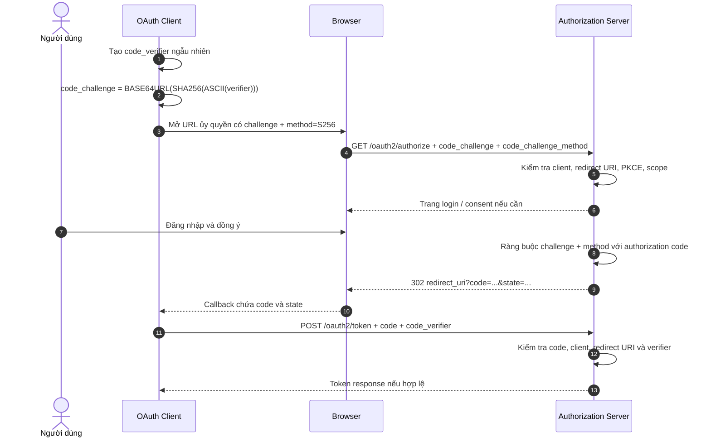
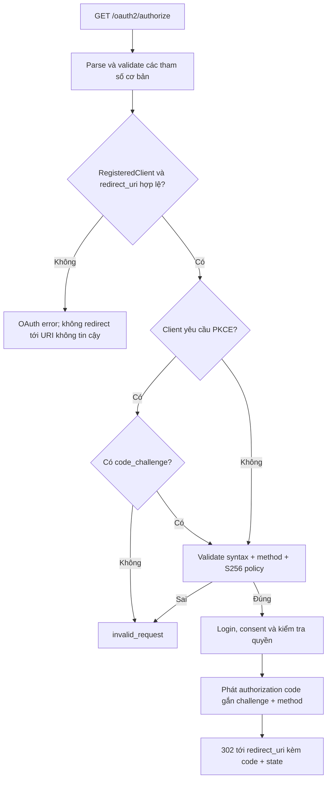
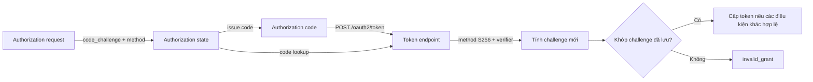

# Tiếp nhận code_challenge và code_challenge_method

## 1. Bài toán tại Authorization Endpoint

Trong chương **Authorization Endpoint** của module **SPRING_SECURITY_OAUTH2_OIDC_AUTHORIZATION_SERVER**, chúng ta học cách thiết kế, cấu hình, bảo mật, kiểm thử và vận hành một OAuth 2.0/OpenID Connect Authorization Server bằng Spring Security và Spring Authorization Server trong Spring Boot.

Khi client mở `/oauth2/authorize` để bắt đầu **Authorization Code Flow**, Authorization Server phải tiếp nhận và kiểm tra hai tham số của **Proof Key for Code Exchange (PKCE)**:

- `code_challenge`: bằng chứng dẫn xuất từ một giá trị ngẫu nhiên mà **chỉ client giữ**.
- `code_challenge_method`: phương thức biến đổi `code_verifier` thành `code_challenge`, thường là `S256`.

Ở Authorization Endpoint, server **chưa nhận `code_verifier`** và **chưa thể chứng minh client biết verifier**. Việc của endpoint này là **kiểm tra cú pháp và chính sách PKCE, sau đó ràng buộc challenge/method vào authorization code sắp phát hành**. Đến Token Endpoint, client mới gửi verifier để server kiểm chứng và quyết định có cấp token hay không.

Đây là cơ chế bảo vệ quan trọng nếu authorization code bị lộ trên đường redirect: kẻ có code nhưng không có verifier hợp lệ sẽ không đổi code thành Access Token được.

### Mục tiêu học tập

Sau bài này, người học có thể:

1. Giải thích vai trò, thời điểm xuất hiện và cú pháp của `code_challenge`, `code_challenge_method`.
2. Hiểu sự khác nhau giữa `S256` và `plain`, cũng như quy tắc mặc định khi bỏ trống method.
3. Mô tả cách Authorization Endpoint tiếp nhận, validate và lưu liên kết PKCE với authorization code.
4. Đăng ký một `RegisteredClient` dùng Authorization Code Flow, bật `requireProofKey(true)` trong Spring Authorization Server.
5. Tạo `code_verifier` và `code_challenge` hợp lệ, thực hiện luồng qua trình duyệt và đổi code tại Token Endpoint.
6. Thiết kế các trường hợp từ chối: thiếu PKCE, method lạ, challenge sai định dạng, verifier không khớp, code hết hạn hoặc đã dùng.
7. Phân biệt PKCE với `state`, `nonce`, client authentication, redirect URI validation và TLS.

## 2. Nhìn toàn bộ luồng trước khi phân tích hai tham số

### 2.1. Ai tạo và ai biết bí mật?

PKCE bắt đầu **ở client**, không phải ở Authorization Server. Mỗi giao dịch ủy quyền cần một `code_verifier` mới, được tạo bằng bộ sinh ngẫu nhiên mật mã (CSPRNG). Client tính `code_challenge` rồi gửi challenge tới Authorization Endpoint, nhưng giữ kín verifier cho đến lúc đổi code.



Thực tế nhiều client backend tự xử lý callback sau redirect, còn SPA/browser client gọi token endpoint theo cơ chế được triển khai. Sơ đồ tập trung vào quan hệ giữa PKCE và hai endpoint.

### 2.2. Mỗi tham số nằm ở đâu?

| Tham số | Nơi truyền | Vai trò | Có được giữ bí mật? |
| --- | --- | --- | --- |
| `code_verifier` | **Token Endpoint**, trong request đổi code | Bí mật một lần do client sinh để chứng minh sở hữu challenge. | **Có**; không đưa vào authorize URL, log hoặc analytics. |
| `code_challenge` | **Authorization Endpoint**, trong authorization request | Dấu ràng buộc được server lưu cùng giao dịch ủy quyền. | Không xem là secret, nhưng vẫn tránh thu thập/log dữ liệu không cần thiết. |
| `code_challenge_method` | **Authorization Endpoint** | Chỉ cách biến đổi verifier thành challenge lúc đổi code. | Không bí mật. |
| `state` | Authorization request và authorization response | Liên kết callback với yêu cầu trước đó, hỗ trợ bảo vệ CSRF/mix-up theo cách client triển khai. | Giá trị khó đoán, phải so khớp; không thay thế verifier. |
| `nonce` | Yêu cầu OIDC và ID Token khi áp dụng | Ràng buộc kết quả xác thực OIDC với yêu cầu ban đầu. | Khác `state` và PKCE. |

Authorization Endpoint **không được yêu cầu client gửi `code_verifier`**. Nếu verifier bị đặt vào URL authorize, nó có thể xuất hiện trong browser history, referrer hoặc log HTTP, làm mất ý nghĩa bảo vệ của PKCE.

## 3. Cú pháp code_verifier và code_challenge

### 3.1. Tạo code_verifier đúng chuẩn

RFC 7636 quy định `code_verifier` là chuỗi **43–128 ký tự** thuộc tập `unreserved`:

```text
ALPHA / DIGIT / "-" / "." / "_" / "~"
```

Tức là chỉ dùng chữ cái Latin, chữ số và bốn ký tự `- . _ ~`. Client nên sử dụng ít nhất **256 bit entropy**; cách phổ biến là lấy 32 byte ngẫu nhiên bảo mật và mã hóa Base64URL không padding để tạo chuỗi 43 ký tự.

Không dùng `Math.random()`, timestamp, ID tăng dần, password cố định hoặc cùng một verifier cho nhiều lần xin authorization code.

### 3.2. S256 là phép biến đổi nên dùng

Với `code_challenge_method=S256`, công thức chuẩn:

```text
code_challenge = BASE64URL-ENCODE(SHA256(ASCII(code_verifier)))
```

Kết quả SHA-256 dài 32 byte; khi Base64URL **không có padding**, challenge dài **43 ký tự**. Base64URL ở đây dùng ký tự `-` và `_` thay `+` và `/`, bỏ các dấu `=` cuối; đây **không phải mã hóa bảo mật** mà là cách biểu diễn dữ liệu binary trong URL.

Một cặp giá trị kiểm chứng công khai từ RFC 7636:

```text
code_verifier  = dBjftJeZ4CVP-mB92K27uhbUJU1p1r_wW1gFWFOEjXk
code_challenge = E9Melhoa2OwvFrEMTJguCHaoeK1t8URWbuGJSstw-cM
method         = S256
```

Những giá trị trên chỉ là **test vector**, không dùng làm verifier thật của hệ thống triển khai. Client phải tạo giá trị ngẫu nhiên mới cho **mỗi** giao dịch.

### 3.3. Method plain và giá trị mặc định khi không gửi method

RFC 7636 định nghĩa hai phương thức ban đầu:

| `code_challenge_method` | Công thức | Đánh giá |
| --- | --- | --- |
| `S256` | `BASE64URL(SHA256(ASCII(code_verifier)))` | Ưu tiên và nên áp dụng cho các client hiện đại. |
| `plain` | `code_challenge = code_verifier` | Chỉ tồn tại để tương thích với trường hợp đặc biệt; không nên dùng cho hệ thống mới. |

**Chi tiết tiêu chuẩn dễ bỏ sót:** nếu request đã có `code_challenge` nhưng **không có `code_challenge_method`**, RFC 7636 quy định method **mặc định là `plain`**. Điều đó không có nghĩa server bắt buộc cho phép `plain` trong mọi cấu hình. Một Authorization Server muốn áp chính sách **S256-only** cần từ chối yêu cầu bỏ method hoặc ghi `plain`, thay vì âm thầm suy thành `S256`.

Không tự chuyển từ `S256` sang `plain` khi client gặp lỗi; RFC 7636 cảnh báo nguy cơ **PKCE downgrade attack**. S256 là phương thức bắt buộc hỗ trợ đối với server triển khai PKCE theo RFC 7636, còn việc chấp nhận `plain` phải theo chính sách tương thích rõ ràng. Tham chiếu: [RFC 7636, mục 4.2–4.4](https://www.rfc-editor.org/rfc/rfc7636#section-4.2).

### 3.4. Cú pháp challenge ở Authorization Endpoint

Theo RFC 7636, `code_challenge` cũng phải có **43–128 ký tự** thuộc tập unreserved; với `S256` chuẩn của SHA-256, challenge hợp lệ sẽ **43 ký tự** của Base64URL không padding. Ví dụ:

```text
Hợp lệ S256:
E9Melhoa2OwvFrEMTJguCHaoeK1t8URWbuGJSstw-cM

Không hợp lệ:
abc                 # quá ngắn
abc+def/ghi=        # chứa ký tự không thuộc dạng PKCE challenge
<chuỗi quá dài>     # vượt giới hạn 128 ký tự
```

Việc kiểm tra độ dài, tập ký tự, method được hỗ trợ và chính sách client cần diễn ra **trước khi phát hành authorization code**. Không nên đợi đến Token Endpoint mới phát hiện method không hỗ trợ hoặc challenge sai cú pháp.

## 4. Authorization Endpoint phải xử lý những gì?

### 4.1. Một authorization request hợp lệ

Ví dụ public client `public-spa` được đăng ký callback `http://127.0.0.1:4200/callback`. Request thường là điều hướng trình duyệt tới:

```http
GET /oauth2/authorize?response_type=code&client_id=public-spa&redirect_uri=http%3A%2F%2F127.0.0.1%3A4200%2Fcallback&scope=openid%20profile&state=<random-state>&code_challenge=E9Melhoa2OwvFrEMTJguCHaoeK1t8URWbuGJSstw-cM&code_challenge_method=S256 HTTP/1.1
Host: localhost:9000
```

Ở môi trường production, URL authorize và callback phải đáp ứng yêu cầu HTTPS/redirect URI của loại client và nền tảng. `localhost`/loopback trong ví dụ chỉ để học tập.

Các trường cơ bản:

| Tham số | Giá trị ví dụ | Kiểm tra |
| --- | --- | --- |
| `response_type` | `code` | Chỉ chấp nhận response type đã được Authorization Server và client cho phép. |
| `client_id` | `public-spa` | Phải khớp một `RegisteredClient` hợp lệ. |
| `redirect_uri` | `http://127.0.0.1:4200/callback` | Phải đáp ứng quy tắc so khớp với URI đăng ký; không có callback tùy ý. |
| `scope` | `openid profile` | Chỉ sử dụng scopes client được phép yêu cầu và người dùng chấp thuận khi cần. |
| `state` | Chuỗi ngẫu nhiên | Client tạo, lưu và đối chiếu ở callback; server trả lại nếu hợp lệ. |
| **`code_challenge`** | `E9Mel...` | Kiểm tra hiện diện khi client bắt buộc PKCE, cú pháp và độ dài. |
| **`code_challenge_method`** | `S256` | Kiểm tra method được hỗ trợ và đáp ứng policy. |

Server cũng cần xử lý trạng thái đăng nhập của người dùng và consent khi cần. **Một request có challenge hợp lệ chưa đủ để phát hành code**, vì còn phải xác thực principal, kiểm tra client, redirect URI, scope và các điều kiện nghiệp vụ.

### 4.2. Quy trình xác minh tại thời điểm tiếp nhận

Với một client được cấu hình bắt buộc PKCE, Authorization Endpoint nên đi qua các bước logic:

1. Parse request và kiểm tra những tham số authorization cơ bản, kể cả việc tham số nhạy cảm xuất hiện lặp lại hoặc không thể giải mã đúng.
2. Tìm `RegisteredClient` theo `client_id`; kiểm tra client cho phép `authorization_code` và `response_type=code`.
3. Kiểm tra `redirect_uri` hợp lệ. Nếu redirect URI không đáng tin, **không redirect lỗi tới URI đó**.
4. Đọc `code_challenge` và `code_challenge_method`.
5. Nếu `RegisteredClient.getClientSettings().isRequireProofKey()` là `true`, từ chối khi thiếu challenge.
6. Kiểm tra challenge và method theo RFC 7636 và policy (ưu tiên `S256`; từ chối `plain` nếu áp dụng S256-only).
7. Kiểm tra phạm vi quyền, phiên đăng nhập, consent; cuối cùng phát hành authorization code **được ràng buộc với challenge và method đã chấp nhận**.
8. Redirect về đúng callback đã đăng ký, trả `code` và `state`, **không trả verifier**.



Sơ đồ tập trung luồng PKCE; khi client không yêu cầu PKCE theo policy, việc thiếu challenge có thể được xử lý theo quy tắc tương thích của server. Với public client hiện đại, nên **bắt buộc PKCE** để không có đường đi vòng qua cơ chế bảo vệ.

### 4.3. Không cần biết verifier ở bước này

Server không thể so sánh `code_verifier` ngay tại authorize, vì verifier **không có mặt** ở request đó. Điều server làm là lưu hoặc ràng buộc **bản challenge và method đã duyệt** với authorization code. Đến token endpoint, client gửi verifier và server tính lại challenge theo đúng method đã lưu rồi đối chiếu.

Không giải quyết yêu cầu bằng cách tự gửi thêm `code_verifier` ở query authorize, trong cookie trình duyệt do server đặt, hay trong redirect response. Điều đó phá vỡ mục đích tách bí mật một lần và bằng chứng công khai của PKCE.

## 5. Ràng buộc challenge/method với authorization code

### 5.1. Vì sao phải lưu cả hai?

Nếu chỉ lưu một authorization code mà quên challenge hoặc method, token endpoint sẽ không còn đủ dữ kiện để chứng minh client nào đã khởi tạo giao dịch. Nếu lưu challenge nhưng không lưu method, token endpoint có thể tính sai phép biến đổi hoặc cho phép client tự chọn method khác lúc đổi code.

Ví dụ dữ liệu logic cho authorization vừa được duyệt:

```text
authorization_code: <short-lived-one-time-code>
registered_client_id: <internal-registered-client-id>
principal_name: dev.user
redirect_uri: http://127.0.0.1:4200/callback
authorized_scopes: [openid, profile]
state: <original-state>
code_challenge: E9Melhoa2OwvFrEMTJguCHaoeK1t8URWbuGJSstw-cM
code_challenge_method: S256
code_expires_at: <short-expiry>
```

Đây là **mô hình logic**, không phải schema database bắt buộc hoặc cấu trúc field nội bộ của mọi phiên bản Spring Authorization Server. Framework thường giữ thông tin authorization request/PKCE trong trạng thái `OAuth2Authorization` được phục vụ bởi `OAuth2AuthorizationService`, sau đó token endpoint đọc lại dữ liệu ràng buộc.



**Ràng buộc phải bất biến đối với một code cụ thể.** Token endpoint không được lấy `code_challenge_method` mới từ token request để thay phép biến đổi ban đầu, hoặc lấy challenge từ một authorization request khác.

### 5.2. Lưu trữ trong môi trường nhiều instance

Nếu node A phát authorization code nhưng node B nhận request đổi code, hai node cần nhìn thấy cùng trạng thái authorization và PKCE; hệ thống dùng `InMemoryOAuth2AuthorizationService` độc lập trên từng node có thể không hỗ trợ điều này.

Production thường cần repository bền vững/chia sẻ, giao dịch cập nhật atomic và cơ chế đảm bảo code **chỉ dùng một lần**. PKCE không thay thế TTL của code, kiểm tra client, kiểm tra redirect URI, cũng không tự giải quyết race condition khi hai request đổi cùng một code.

Không ghi raw authorization code, client secret hoặc `code_verifier` vào audit log. Với dữ liệu trạng thái chứa challenge, chỉ lưu những gì cần thiết trong repository bảo vệ phù hợp, giới hạn truy cập và thời hạn lưu.

### 5.3. Mối liên hệ với TokenSettings

`TokenSettings.authorizationCodeTimeToLive(Duration)` giới hạn thời gian sống code; `ClientSettings.requireProofKey(true)` yêu cầu PKCE cho client. Đây là **hai chính sách khác nhau**:

```java
ClientSettings clientSettings = ClientSettings.builder()
        .requireProofKey(true)
        .requireAuthorizationConsent(true)
        .build();

TokenSettings tokenSettings = TokenSettings.builder()
        .authorizationCodeTimeToLive(Duration.ofMinutes(3))
        .build();
```

Code ngắn hạn không thay cho PKCE; PKCE cũng không có nghĩa code được sử dụng vô hạn hoặc nhiều lần.

## 6. Vai trò của Spring Authorization Server

### 6.1. Những thành phần xử lý Authorization Endpoint

Trong cấu hình thông dụng của Spring Authorization Server (Servlet stack), nhóm thành phần liên quan đến authorization code request gồm:

| Thành phần | Vai trò |
| --- | --- |
| `OAuth2AuthorizationEndpointFilter` | Tiếp nhận request tới Authorization Endpoint và phối hợp converter, authentication manager, success/error handler. |
| `OAuth2AuthorizationCodeRequestAuthenticationConverter` | Chuyển HTTP authorization request thành token authentication request có các tham số. |
| `OAuth2AuthorizationCodeRequestAuthenticationToken` | Mô hình request chứa client ID, redirect URI, `state`, scopes và `additionalParameters`. |
| `OAuth2AuthorizationCodeRequestAuthenticationProvider` | Xử lý request, liên kết client, kiểm tra điều kiện, tạo authorization/authorization code. |
| `OAuth2AuthorizationCodeRequestAuthenticationValidator` | Xác minh những tham số authorization theo default validator/extension point của phiên bản. |
| `RegisteredClientRepository` | Truy xuất đăng ký client và `ClientSettings`. |
| `OAuth2AuthorizationService` | Lưu/truy xuất trạng thái authorization chứa dữ liệu cần thiết cho bước đổi code. |
| `OAuth2TokenEndpointFilter` và provider xử lý authorization code | Kiểm tra verifier khi đổi code, cùng các điều kiện khác rồi cấp token. |

Với phiên bản Spring Authorization Server 1.5.x, API `OAuth2AuthorizationEndpointConfigurer` có các extension point như `authorizationRequestConverter(...)`, `authenticationProviders(...)` và `errorResponseHandler(...)`. **Không nên viết một controller thay thế `/oauth2/authorize`** chỉ để tự parse challenge, vì dễ bỏ sót validation và cơ chế bảo vệ giao thức hiện có.

### 6.2. Lấy tham số PKCE trong authentication token

`OAuth2AuthorizationCodeRequestAuthenticationToken` có `getAdditionalParameters()`. Ví dụ code **chỉ để quan sát** hai tham số trong một callback/validator phù hợp; không thay thế framework validation:

```java
import java.util.Map;
import org.springframework.security.oauth2.server.authorization.authentication.OAuth2AuthorizationCodeRequestAuthenticationToken;

public final class PkceRequestInspector {
    private PkceRequestInspector() {}

    public static void inspect(
            OAuth2AuthorizationCodeRequestAuthenticationToken request) {
        Map<String, Object> params = request.getAdditionalParameters();

        Object challenge = params.get("code_challenge");
        Object method = params.get("code_challenge_method");

        // Chỉ quan sát hoặc kiểm tra kiểu dữ liệu/giá trị khi cần.
        // Không log nguyên request, authorization code hoặc code_verifier.
        boolean hasChallenge = challenge instanceof String s && !s.isBlank();
        boolean hasMethod = method instanceof String s && !s.isBlank();

        if (hasChallenge && hasMethod) {
            // Tại đây có thể áp thêm policy theo RegisteredClient,
            // nhưng phải giữ nguyên các validator giao thức mặc định.
        }
    }
}
```

Đây là đoạn code minh họa getter của authentication token; nó **không tự được Spring gọi**. Nếu cần enforce policy ngoài mặc định, phải gắn custom validator đúng extension point trong phiên bản sử dụng. Để biết trường nào đã được converter lọc/chuyển đổi, kiểm tra API và request model của chính phiên bản đó.

### 6.3. Cấu hình RegisteredClient bắt buộc PKCE

Ví dụ public client dùng Authorization Code Flow:

```java
import java.util.UUID;
import org.springframework.context.annotation.Bean;
import org.springframework.security.oauth2.core.AuthorizationGrantType;
import org.springframework.security.oauth2.core.ClientAuthenticationMethod;
import org.springframework.security.oauth2.server.authorization.client.RegisteredClient;
import org.springframework.security.oauth2.server.authorization.client.RegisteredClientRepository;
import org.springframework.security.oauth2.server.authorization.client.InMemoryRegisteredClientRepository;
import org.springframework.security.oauth2.server.authorization.settings.ClientSettings;

@Bean
RegisteredClientRepository registeredClientRepository() {
    RegisteredClient publicSpa = RegisteredClient.withId(UUID.randomUUID().toString())
            .clientId("public-spa")
            .clientAuthenticationMethod(ClientAuthenticationMethod.NONE)
            .authorizationGrantType(AuthorizationGrantType.AUTHORIZATION_CODE)
            .redirectUri("http://127.0.0.1:4200/callback")
            .scope("openid")
            .scope("profile")
            .clientSettings(ClientSettings.builder()
                    .requireProofKey(true)
                    .requireAuthorizationConsent(true)
                    .build())
            .build();

    return new InMemoryRegisteredClientRepository(publicSpa);
}
```

Đây là bean minh họa cần đặt **trong class `@Configuration` của dự án**. Nếu đã có một `RegisteredClientRepository`, hãy thêm client vào repository hiện tại thay vì tạo bean trùng lặp. Mẫu trên không tự cung cấp toàn bộ Authorization Server: còn cần security filter chains, login, authorization service, issuer, signing key/JWK và cấu hình OIDC nếu dùng `openid`.

Vì browser/SPA không thể giữ client secret một cách đáng tin cậy, phương thức `ClientAuthenticationMethod.NONE` phản ánh **public client**. `requireProofKey(true)` là yêu cầu quan trọng chống việc public client bỏ qua PKCE. Đây là cơ chế riêng của `ClientSettings`; không nhầm với `TokenSettings`.

### 6.4. requireProofKey(true) chưa đồng nghĩa S256-only

`requireProofKey(true)` yêu cầu client cung cấp proof key challenge và verifier khi dùng Authorization Code Grant. Nó **không nên được hiểu là bằng chứng mọi phiên bản chỉ chấp nhận `S256` và đã chặn tất cả `plain`**.

Nếu sản phẩm đặt policy `S256-only`, hãy kiểm tra cơ chế xác minh PKCE của phiên bản Spring Authorization Server hiện tại; bổ sung validation từ đúng extension point nếu cần. Một thuật toán/policy tùy chỉnh ở Authorization Endpoint phải:

- Chỉ chấp nhận `code_challenge_method=S256`.
- Không chấp nhận thiếu method rồi ngầm hiểu là `S256` (RFC 7636 mặc định `plain`).
- Đảm bảo `code_challenge` đúng dạng Base64URL SHA-256, dài 43 ký tự không padding.
- Không bỏ qua validator mặc định về `redirect_uri` và `scope` hoặc PKCE validation mà framework đang thực hiện.
- Giữ tương thích với luồng token endpoint: verifier vẫn phải được kiểm tra theo **method đã gắn với code**.

Lưu ý: tài liệu chính thức của Spring Authorization Server nói `OAuth2AuthorizationCodeRequestAuthenticationProvider.setAuthenticationValidator(...)` dùng để thay validator authorization request. Tùy phiên bản, validator mặc định phụ trách các tham số như redirect URI và scope; **thay hoàn toàn** bằng custom validator chỉ kiểm tra PKCE có thể vô tình bỏ các bước bảo mật quan trọng. Cần kết hợp chain validator đúng cách và kiểm thử các trường hợp từ chối.

### 6.5. Không tự viết lại token endpoint để so sánh PKCE

Trong Spring Authorization Server, token endpoint có provider xử lý `authorization_code` và kiểm tra `code_verifier` theo dữ liệu ràng buộc. Một controller mới tự so sánh chuỗi `code_verifier` với `code_challenge` mà không biết method đã lưu sẽ sai với `S256`.

Mã **giả lập phép đối chiếu** dưới đây chỉ phục vụ hiểu công thức, không thay thế logic trong framework:

```java
// PSEUDOCODE; method/challenge đọc từ authorization đã xác minh.
String expectedChallenge = authorization.getStoredCodeChallenge();
String method = authorization.getStoredCodeChallengeMethod();

String calculated = switch (method) {
    case "S256" -> base64UrlSha256(clientSuppliedCodeVerifier);
    case "plain" -> clientSuppliedCodeVerifier;
    default -> throw invalidGrant();
};

if (!securelyEquals(calculated, expectedChallenge)) {
    throw invalidGrant();
}
```

Trong ứng dụng thực tế, để Spring Authorization Server thực hiện quy trình này bằng các provider có sẵn; mã giả không phản ánh tên method trực tiếp của `OAuth2Authorization`. So sánh cũng phải diễn ra cùng kiểm tra code còn hạn/chưa dùng, client đã đăng ký và redirect URI gắn với code.

## 7. Tạo cặp PKCE bằng Java

### 7.1. Mã client tạo verifier bằng SecureRandom

Client có thể dùng đoạn Java độc lập dưới đây để sinh verifier mới và tính S256 challenge:

```java
import java.nio.charset.StandardCharsets;
import java.security.MessageDigest;
import java.security.NoSuchAlgorithmException;
import java.security.SecureRandom;
import java.util.Base64;

public final class PkceSupport {
    private static final SecureRandom RANDOM = new SecureRandom();
    private static final Base64.Encoder URL_ENCODER =
            Base64.getUrlEncoder().withoutPadding();

    private PkceSupport() {}

    public static String newVerifier() {
        byte[] randomBytes = new byte[32]; // 256 bit entropy
        RANDOM.nextBytes(randomBytes);
        return URL_ENCODER.encodeToString(randomBytes);
    }

    public static String toS256Challenge(String verifier) {
        try {
            MessageDigest digest = MessageDigest.getInstance("SHA-256");
            byte[] hash = digest.digest(
                    verifier.getBytes(StandardCharsets.US_ASCII));
            return URL_ENCODER.encodeToString(hash);
        } catch (NoSuchAlgorithmException ex) {
            throw new IllegalStateException("SHA-256 is unavailable", ex);
        }
    }

    public static void main(String[] args) {
        String verifier = newVerifier();
        String challenge = toS256Challenge(verifier);
        System.out.println("method=S256, challenge=" + challenge);
        // Không in verifier ra log trong ứng dụng thực.
    }
}
```

Mã ở trên dùng `SecureRandom`, 32 byte và Base64URL không padding. `newVerifier()` cho chuỗi 43 ký tự thuộc tập hợp lệ; `toS256Challenge(...)` cho challenge 43 ký tự. Trong sản phẩm thật, code tạo verifier phải chạy ở client, và verifier phải được giữ an toàn gắn với giao dịch ủy quyền đang chờ callback.

### 7.2. Không tự giữ verifier chung cho mọi yêu cầu

Một ứng dụng web có thể mở hai cửa sổ login hoặc bắt đầu nhiều giao dịch song song. Nếu dùng một biến toàn cục `currentVerifier` và request thứ hai ghi đè request thứ nhất, token exchange cho request đầu sẽ thất bại hoặc dẫn tới nhầm luồng.

Thay vào đó, client cần lưu verifier tách biệt theo **giao dịch**, thường dựa trên `state`/correlation ID và session hoặc một nơi lưu tạm được bảo vệ phù hợp với loại ứng dụng. Sau khi nhận callback và so khớp `state`, client lấy đúng verifier liên kết với request đó, dùng một lần rồi xóa theo vòng đời giao dịch.

Không lưu verifier vào URL callback, không đưa vào browser analytics, không chia sẻ giữa client hoặc phiên người dùng.

## 8. Thực hành qua trình duyệt với test vector

### 8.1. Chuẩn bị môi trường demo

Giả sử Spring Authorization Server chạy ở:

```text
http://localhost:9000
```

Client mẫu:

```text
client_id = public-spa
redirect_uri = http://127.0.0.1:4200/callback
grant = authorization_code
client authentication = none
requireProofKey = true
```

Nếu chưa có ứng dụng nhận callback ở port 4200, trình duyệt có thể hiển thị lỗi khi redirect cuối cùng; trong **môi trường local dùng dữ liệu giả lập**, người học vẫn có thể đọc URL callback để quan sát `code` và `state`. Không dùng thao tác sao chép code từ URL như quy trình production.

### 8.2. Gửi authorization request có S256

Để tái hiện phép tính, dùng test vector của RFC 7636 ở phần 3 và tạo `state` riêng cho phiên thử nghiệm. Ví dụ PowerShell:

```powershell
$verifier = 'dBjftJeZ4CVP-mB92K27uhbUJU1p1r_wW1gFWFOEjXk'
$challenge = 'E9Melhoa2OwvFrEMTJguCHaoeK1t8URWbuGJSstw-cM'
$state = [guid]::NewGuid().ToString('N')
$redirect = [uri]::EscapeDataString('http://127.0.0.1:4200/callback')

$authorizeUrl = 'http://localhost:9000/oauth2/authorize' +
    '?response_type=code&client_id=public-spa' +
    "&redirect_uri=$redirect" +
    '&scope=openid%20profile' +
    "&state=$state" +
    "&code_challenge=$challenge&code_challenge_method=S256"

Start-Process $authorizeUrl
```

Lưu ý test vector cố định **không dùng trong môi trường thật**. Khi chạy sản phẩm, tạo verifier/challenge ngẫu nhiên trên từng yêu cầu. Cũng cần một giá trị `state` đủ ngẫu nhiên và được so khớp ở client.

Trình duyệt sẽ được chuyển tới login nếu chưa đăng nhập, có thể đi qua màn hình consent. Sau khi thành công, ví dụ response:

```http
HTTP/1.1 302 Found
Location: http://127.0.0.1:4200/callback?code=<authorization-code>&state=<same-state>
```

Authorization code thường ngắn hạn và dùng một lần. **Không xác nhận chỉ vì redirect thành công**: client phải kiểm tra `state` đúng giá trị đã lưu và bảo vệ code trong luồng trao đổi token.

### 8.3. Dùng verifier ở Token Endpoint

Sau khi nhận code hợp lệ và chưa được dùng:

```powershell
$code = '<authorization-code-from-callback>'

curl.exe -i -X POST 'http://localhost:9000/oauth2/token' -H 'Content-Type: application/x-www-form-urlencoded' --data-urlencode 'grant_type=authorization_code' --data-urlencode 'client_id=public-spa' --data-urlencode "code=$code" --data-urlencode 'redirect_uri=http://127.0.0.1:4200/callback' --data-urlencode "code_verifier=$verifier"
```

Vì `public-spa` được đăng ký là **public client**, request không gửi `client_secret`. Bên server phải dùng `code_verifier` để xác minh challenge đã ràng buộc với code. Trong ví dụ local test, URL sử dụng HTTP trên loopback; khi triển khai thực cần HTTPS và các yêu cầu bảo mật phù hợp.

Response thành công có thể chứa:

```json
{
  "access_token": "<issued-access-token>",
  "token_type": "Bearer",
  "expires_in": 900,
  "scope": "openid profile",
  "id_token": "<issued-id-token-if-oidc-enabled>"
}
```

Giá trị JSON chỉ để minh họa; `id_token` chỉ có khi bật OIDC và đáp ứng điều kiện của luồng. Public clients có thể bị hạn chế cấp Refresh Token theo cấu hình/chính sách server; không tự suy Refresh Token có mặt khi chỉ bật PKCE.

### 8.4. Kịch bản verifier sai

Khởi tạo **authorization request mới** để có code chưa dùng, sau đó thay verifier bằng một giá trị khác có cú pháp hợp lệ. Server phải từ chối token request, thường trả lỗi OAuth `invalid_grant` theo RFC 7636. Đừng thử trên code đã đổi thành công trước đó rồi kết luận lỗi chắc chắn là do PKCE, vì code đã dùng lại cũng phải bị từ chối.

Ví dụ phản hồi lỗi minh họa:

```json
{
  "error": "invalid_grant"
}
```

Không nên ghi lại raw code hoặc verifier trong log. Khi gỡ lỗi, ghi correlation ID, client ID, mã lỗi và giai đoạn từ chối đã chuẩn hóa.

## 9. Bảng lỗi Authorization Endpoint cần nhận diện

| Điều kiện request | Nên được xử lý thế nào? | Lý do |
| --- | --- | --- |
| Public client `requireProofKey(true)` nhưng thiếu `code_challenge` | Từ chối `invalid_request` tại authorize. | Không cho phép bỏ qua PKCE. |
| Có `code_challenge` hợp lệ và `code_challenge_method=S256` | Tiếp tục xác minh những điều kiện còn lại. | Mẫu PKCE chuẩn khuyến nghị. |
| Có challenge nhưng thiếu method | Theo RFC, method mặc định là `plain`; **S256-only policy phải từ chối**. | Không ngầm suy ra `S256`, tránh downgrade. |
| `code_challenge_method=plain` | Từ chối nếu hệ thống áp S256-only; chỉ chấp nhận khi có chính sách tương thích rõ ràng. | Plain lộ verifier nếu challenge bị quan sát. |
| `code_challenge_method=S512` hoặc không biết | Từ chối `invalid_request` nếu method không được hỗ trợ. | Không thể xác minh đúng ở token endpoint. |
| Challenge rỗng hoặc ngắn hơn 43 ký tự | Từ chối. | Sai cú pháp RFC 7636. |
| Challenge trên 128 ký tự | Từ chối. | Sai cú pháp RFC 7636. |
| Challenge chứa `+`, `/`, `=` hoặc whitespace | Từ chối nếu không phải dạng challenge được phép. | Sai tập ký tự PKCE; challenge S256 Base64URL không padding. |
| `response_type` không được client đăng ký | Từ chối theo quy tắc OAuth. | PKCE không mở quyền dùng grant/response khác. |
| `client_id` lạ | Từ chối. | Không có client đáng tin để ràng buộc code. |
| `redirect_uri` sai hoặc không đăng ký | Từ chối; **không redirect tới URI không tin cậy**. | Chống thất thoát code/open redirect. |
| Scope vượt quyền client | Từ chối theo cơ chế OAuth/consent phù hợp. | PKCE không cấp thêm quyền. |
| Tham số PKCE lặp lại, nhập nhằng | Từ chối hoặc xử lý nghiêm ngặt theo converter/validator đã kiểm chứng. | Không cho frontend/backend diễn giải khác nhau. |
| Có `code_verifier` trong authorization URL | Không thiết kế flow như vậy, coi là dữ liệu nhạy cảm bị truyền sai chỗ. | Verifier phải chỉ xuất hiện tại token request. |

Phân biệt **địa điểm từ chối**: challenge/method không hợp lệ được phát hiện ở **Authorization Endpoint** trước khi cấp code; verifier sai thường được phát hiện ở **Token Endpoint** sau khi client đã có code.

Khi redirect URI đã được xác minh và một lỗi OAuth có thể trả qua redirect an toàn, server có thể trả `error` và `state` về callback; nếu redirect URI sai hoặc client chưa đáng tin, server không được redirect theo URI chưa xác minh. HTTP status và chi tiết lỗi phụ thuộc ngữ cảnh/phiên bản; không nên kiểm tra chỉ dựa trên một status cố định.

## 10. Phân biệt PKCE với những cơ chế bảo vệ khác

### 10.1. PKCE và state

PKCE bảo vệ **việc đổi authorization code**: bên đổi code phải biết verifier đã dùng ở lần authorize. `state` là cơ chế liên kết **authorization response với yêu cầu do client khởi tạo**, thường dùng để chống CSRF/nhầm phiên. Hai giá trị có thể được cùng tạo trước redirect nhưng có trách nhiệm khác nhau.

Không bỏ `state` chỉ vì đã bật PKCE mà chưa đánh giá đầy đủ cơ chế session/correlation và điều kiện chống CSRF theo chuẩn/thư viện client đang sử dụng. Cũng không dùng `state` làm `code_verifier`: nên tạo riêng hai giá trị từ nguồn ngẫu nhiên an toàn.

### 10.2. PKCE và client authentication

Confidential client có thể xác thực ở token endpoint bằng `client_secret_basic`, `private_key_jwt` hoặc cơ chế khác. PKCE vẫn có ích vì ngăn người không sở hữu verifier dùng code bị chặn; điều này **khác** với việc client chứng minh giữ secret/private key.

Public clients như SPA/mobile không có client secret được bảo vệ đáng tin cậy; PKCE là một phần thiết yếu của Authorization Code Flow, nhưng không biến public client thành confidential client.

### 10.3. PKCE và redirect URI

PKCE không cho phép dùng bất kỳ redirect URI nào. Authorization Server phải kiểm tra callback đúng URI đã đăng ký. Nếu một authorization code và verifier bị lộ cùng nhau, PKCE không còn bảo vệ giao dịch đó; vì vậy cần HTTPS, kiểm soát URL, không log verifier và bảo vệ các kênh lưu trữ.

### 10.4. PKCE và TLS

PKCE không thay thế TLS. Credential đăng nhập, authorization code, verifier và token vẫn cần được bảo vệ trên đường truyền. Không tắt xác minh chứng chỉ TLS chỉ vì có `S256`.

### 10.5. PKCE và OIDC nonce

Với OIDC, `nonce` khi được dùng sẽ liên kết ID Token với authentication request. Nó không chứng minh client biết verifier và không thay vai trò của PKCE. Đặc biệt, Authorization Endpoint có thể xử lý thêm các trường OIDC như `nonce`, `prompt`, `max_age` tùy cấu hình; chúng không làm thay đổi công thức `S256`.

## 11. Kiểm thử tích hợp trên Spring Authorization Server

### 11.1. Ma trận kiểm thử thành công và thất bại

| Bước | Thử nghiệm | Kỳ vọng |
| --- | --- | --- |
| Authorization | Có challenge S256 hợp lệ; client đăng ký PKCE. | Tiếp tục login/consent; cấp code nếu mọi điều kiện hợp lệ. |
| Authorization | Thiếu challenge khi `requireProofKey(true)`. | Không cấp code, lỗi `invalid_request`. |
| Authorization | Thiếu method khi policy S256-only. | Bị từ chối; không ngầm suy thành S256. |
| Authorization | Method là `plain` khi policy S256-only. | Bị từ chối. |
| Authorization | Method không hỗ trợ. | Bị từ chối `invalid_request`. |
| Authorization | Challenge rỗng, 42 ký tự hoặc 129 ký tự. | Bị từ chối do sai cú pháp. |
| Authorization | Challenge có ký tự không thuộc `unreserved`. | Bị từ chối. |
| Authorization | Redirect URI không đăng ký. | Không redirect code/error tới URI đó. |
| Authorization | Scope không được client phép yêu cầu. | Từ chối theo chính sách. |
| Token | Gửi đúng code mới và verifier ban đầu. | Token được cấp nếu mọi điều kiện còn lại đúng. |
| Token | Verifier sai. | Bị từ chối, thường `invalid_grant`. |
| Token | Thiếu verifier cho code có challenge. | Bị từ chối. |
| Token | Dùng lại code đã đổi thành công. | Bị từ chối vì authorization code một lần. |
| Token | Code hết hạn. | Bị từ chối. |
| Token | `redirect_uri` khác request gốc hoặc client khác. | Bị từ chối. |
| Multi-node | Node A phát code, node B nhận token request. | Khôi phục đúng challenge/method từ shared authorization state. |
| Concurrency | Hai request đổi cùng một code đồng thời. | Chỉ một yêu cầu được sử dụng code thành công. |

Một integration test hữu ích cần kiểm tra **response lẫn state**: không chỉ xem authorize trả redirect mà còn xác minh token request dùng sai verifier không nhận được token; ngược lại, verifier đúng với code chưa dùng phải được chấp nhận.

### 11.2. Ví dụ test cho phép tính PKCE ở client

Có thể kiểm thử công thức S256 riêng bằng JUnit 5:

```java
import static org.junit.jupiter.api.Assertions.assertEquals;
import org.junit.jupiter.api.Test;

class PkceSupportTest {

    @Test
    void computesRfc7636Challenge() {
        String verifier = "dBjftJeZ4CVP-mB92K27uhbUJU1p1r_wW1gFWFOEjXk";
        String expected = "E9Melhoa2OwvFrEMTJguCHaoeK1t8URWbuGJSstw-cM";

        assertEquals(expected, PkceSupport.toS256Challenge(verifier));
    }
}
```

Test này chỉ kiểm tra **hàm biến đổi của client**; nó không chứng minh Authorization Server từ chối request PKCE sai. Cần một integration test riêng chạy qua `/oauth2/authorize` và `/oauth2/token` hoặc sử dụng cấu hình test phù hợp để kiểm tra toàn bộ luồng.

### 11.3. Kiểm thử chính sách S256-only

Nếu ứng dụng có thêm validator chỉ chấp nhận S256, nên kiểm tra ít nhất:

1. Public client thiếu challenge không thể nhận authorization code.
2. Request có challenge nhưng không có method bị từ chối theo policy (dù RFC có mặc định `plain`).
3. Request có `plain` bị từ chối.
4. Request có `S256` hợp lệ được chấp nhận.
5. Sau khi thêm validator, kiểm tra lại **redirect URI không đăng ký** và **scope sai** vẫn bị từ chối; điều này bảo đảm custom validator không làm mất lớp bảo vệ mặc định.

Tránh hardcode expectation rằng mọi bản Spring Authorization Server xử lý `plain` giống nhau; bài kiểm thử phải diễn đạt policy sản phẩm và được xác nhận với phiên bản thực tế.

## 12. Các tình huống vận hành nâng cao

### 12.1. Pushed Authorization Requests (PAR)

Với **Pushed Authorization Requests**, client có thể gửi các tham số authorization, gồm PKCE challenge/method, qua một yêu cầu trực tiếp tới **PAR endpoint** rồi nhận `request_uri` để trình duyệt tiếp tục. Khi triển khai PAR, server cần kiểm tra và giữ nguyên ràng buộc PKCE qua hai giai đoạn, không để request trình duyệt thay đổi challenge đã gửi trước.

Về mặt kiến trúc, PKCE vẫn cần được ràng buộc với **authorization code được phát hành**, còn verifier vẫn chỉ được sử dụng tại Token Endpoint. Đừng coi PAR là lý do bỏ PKCE đối với public client.

### 12.2. Multiple issuers và nhiều tenant

Nếu cùng một ứng dụng phục vụ nhiều issuer/tenant, client registration, authorization state, redirect URIs, PKCE challenge/method và code phải được gắn đúng với issuer của giao dịch. Token Endpoint của tenant B không được đổi code được phát hành bởi tenant A chỉ vì nhận đúng một verifier.

PKCE kiểm tra một ràng buộc trong giao dịch, **không tự kiểm tra tenant**. Cần kết hợp xác minh issuer, client, grant, authorization code và datastore đúng phạm vi.

### 12.3. SPA, cookie và CORS

Với SPA, `ClientAuthenticationMethod.NONE` và `requireProofKey(true)` là cấu hình thường gặp, nhưng OAuth client vẫn cần bảo vệ verifier trong ngữ cảnh trình duyệt và xử lý đúng callback. CORS có thể liên quan khi SPA gọi token endpoint bằng `fetch` từ origin khác, nhưng **CORS không thay thế PKCE**.

Không mở CORS quá rộng chỉ để demo hoạt động. Nếu dùng backend-for-frontend (BFF), backend có thể quản lý token/verifier trên server thay vì để token trực tiếp trong SPA; lựa chọn phụ thuộc mô hình ứng dụng và rủi ro.

### 12.4. Quan sát và ghi log

Chỉ ghi những thông tin cần thiết cho vận hành: correlation ID, client ID, loại grant, thành công/thất bại của bước validate, loại lỗi và thời gian xử lý. Tránh ghi:

- `code_verifier` và raw token request;
- authorization code hoặc Access/Refresh Token;
- client secret, session cookie hoặc dữ liệu định danh không cần thiết.

Không dùng `code_challenge` như một định danh ổn định của client để phân tích sử dụng, vì mỗi giao dịch cần challenge riêng. Khi cần theo dõi flow, dùng correlation ID được tạo riêng và bảo vệ.

## 13. Những hiểu nhầm cần tránh

1. **“Authorization Endpoint phải xác minh `code_verifier` ngay.”** Sai: verifier được gửi ở Token Endpoint; authorize chỉ nhận và ràng buộc challenge/method.
2. **“Không gửi method thì server mặc định dùng S256.”** Sai theo RFC 7636: mặc định là `plain`; hệ thống S256-only phải chủ động từ chối.
3. **“Dùng plain cũng an toàn như S256 vì có TLS.”** Sai: `plain` để lộ verifier ngay qua challenge nếu request bị quan sát; S256 tránh lộ trực tiếp.
4. **“Có `requireProofKey(true)` thì tự động chặn mọi `plain`.”** Không nên giả định; phải xác minh hành vi phiên bản và policy.
5. **“PKCE thay client authentication hoặc redirect URI validation.”** Sai: các cơ chế kiểm tra chủ thể và giao dịch khác nhau.
6. **“Có state rồi không cần PKCE.”** Sai: `state` không buộc bên đổi code phải biết verifier.
7. **“Có PKCE rồi không cần state/nonce.”** Sai: tùy loại client, OIDC và ràng buộc phiên, vẫn có các cơ chế cần kiểm tra riêng.
8. **“Cùng verifier dùng cho nhiều lần authorize tiết kiệm tài nguyên.”** Sai: phải tạo verifier mới đủ entropy cho mỗi giao dịch.
9. **“Có thể để client gửi method mới cùng verifier tại Token Endpoint.”** Sai: method đã phải ràng buộc với code từ Authorization Endpoint.
10. **“Chỉ cần đổi code là đủ chứng minh quyền của client.”** Sai: code còn phải khớp client, redirect URI, PKCE và các điều kiện liên quan.

## 14. Bài tập tự kiểm tra

**Bài 1 — Tạo cặp S256.** Viết một hàm Java sinh verifier bằng `SecureRandom` và tính challenge. Kiểm tra độ dài, tập ký tự và test vector RFC 7636.

**Bài 2 — Chỉ ra bước nhận dữ liệu.** Với request có `code_challenge` và `code_challenge_method=S256`, vẽ đường đi từ `OAuth2AuthorizationEndpointFilter` đến authorization state, rồi tới `OAuth2TokenEndpointFilter` khi verifier được gửi. Giải thích vì sao verifier không thuộc authorization URL.

**Bài 3 — Tạo chính sách S256-only.** Mô tả điều kiện từ chối method `plain` hoặc thiếu method. Nếu dùng custom validator, nêu cách bảo toàn validator về `redirect_uri` và `scope`.

**Bài 4 — Lỗi token endpoint.** Một code được phát hành với challenge từ verifier A, nhưng client gửi verifier B. Giải thích phép đối chiếu `BASE64URL(SHA256(ASCII(B)))` với challenge của A và mã lỗi mong đợi.

**Bài 5 — Hai giao dịch đồng thời.** Client bắt đầu hai authorization requests trong hai tab. Thiết kế cách liên kết từng `state` với verifier tương ứng để không bị ghi đè hoặc trộn giao dịch.

**Bài 6 — Multiple nodes.** Node A nhận authorization request, node B nhận token request. Chỉ ra thành phần lưu trữ/đồng bộ phải chia sẻ để PKCE vẫn kiểm tra được và code chỉ được dùng một lần.

### Checklist hoàn thành bài

- [ ] Nêu được hai tham số PKCE Authorization Endpoint nhận và thời điểm client tạo chúng.
- [ ] Biết công thức `S256`, định dạng `code_verifier` và `code_challenge` theo RFC 7636.
- [ ] Phân biệt `S256` và `plain`, biết method thiếu sẽ mặc định `plain` theo chuẩn.
- [ ] Cấu hình được `RegisteredClient` với `requireProofKey(true)`.
- [ ] Giải thích được cách authorization code được gắn challenge/method để token endpoint kiểm tra verifier.
- [ ] Biết thêm S256-only policy mà không làm mất các validator bảo mật khác.
- [ ] Thực hiện được happy path và kiểm thử sai verifier, thiếu challenge, method không hợp lệ, code đã dùng.
- [ ] Phân biệt PKCE với `state`, `nonce`, redirect URI validation, client authentication và TLS.
- [ ] Hiểu cách lưu trạng thái PKCE khi chạy nhiều node hoặc nhiều issuer.

## 15. Tài liệu chuẩn và hướng học tiếp

- [RFC 7636 — Proof Key for Code Exchange](https://www.rfc-editor.org/rfc/rfc7636) — định nghĩa `code_verifier`, `code_challenge`, `S256`, `plain` và cách xác minh ở token endpoint.
- [RFC 6749 — OAuth 2.0 Authorization Framework](https://www.rfc-editor.org/rfc/rfc6749) — Authorization Code Grant, authorization endpoint, token endpoint và redirect URI.
- [RFC 9700 — Best Current Practice for OAuth 2.0 Security](https://www.rfc-editor.org/rfc/rfc9700) — khuyến nghị bảo mật Authorization Code Flow và PKCE hiện đại.
- [RFC 9126 — OAuth 2.0 Pushed Authorization Requests](https://www.rfc-editor.org/rfc/rfc9126) — truyền authorization request qua PAR endpoint.
- [Spring Authorization Server: PKCE for SPA](https://docs.spring.io/spring-authorization-server/reference/guides/how-to-pkce.html) — cấu hình public client và `requireProofKey(true)`.
- [Spring Authorization Server: Protocol Endpoints](https://docs.spring.io/spring-authorization-server/reference/protocol-endpoints.html) — các thành phần của Authorization Endpoint và extension point cho validation.
- [Spring Authorization Server: RegisteredClient and ClientSettings](https://docs.spring.io/spring-authorization-server/reference/core-model-components.html) — chính sách client và các mô hình core.
- [Spring Security Reference](https://docs.spring.io/spring-security/reference/) — OAuth 2.0 Client, login và servlet security.
- [OpenID Connect Core 1.0](https://openid.net/specs/openid-connect-core-1_0.html) — phạm vi `openid`, `nonce` và các yêu cầu OIDC.

**Kết quả cốt lõi:** Authorization Endpoint **tiếp nhận, kiểm tra và ràng buộc** `code_challenge` cùng `code_challenge_method` với authorization code; Token Endpoint mới **xác minh `code_verifier`**. Cấu hình `requireProofKey(true)` và ưu tiên `S256` giúp bảo vệ Authorization Code Flow trước việc sử dụng code bị đánh cắp, miễn là hệ thống vẫn kiểm tra đúng client, redirect URI, thời hạn code và các chính sách OAuth liên quan.
