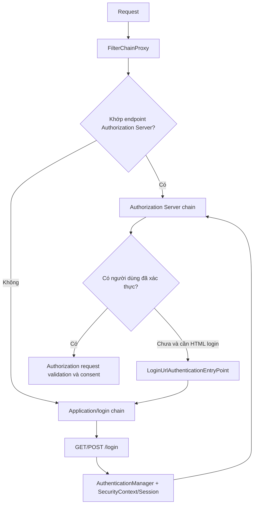

# Xử lý người dùng chưa đăng nhập và chuyển hướng đến login

## 1. Bối cảnh

Trong **Authorization Code Flow** của OAuth 2.0/OpenID Connect (OIDC), ứng dụng khách chuyển trình duyệt đến **Authorization Endpoint**, thông thường là `GET /oauth2/authorize`. Trước khi cấp authorization code, máy chủ cần biết người dùng cuối là ai, kiểm tra yêu cầu của client và quyết định có cần consent hay không. Nhưng người dùng có thể chưa đăng nhập, session đã hết hạn hoặc có yêu cầu xác thực lại.

Trong Spring Boot, **Spring Authorization Server** chịu trách nhiệm xử lý giao thức cấp quyền, còn **Spring Security** cung cấp cơ chế xác thực người dùng, security context, session, login entry point và form login. Chúng cần phối hợp để chuyển trình duyệt sang trang login, **giữ ngữ cảnh giao dịch OAuth**, rồi quay về Authorization Endpoint sau khi đăng nhập thành công.

Bài thuộc chương **Authorization Endpoint** của module `SPRING_SECURITY_OAUTH2_OIDC_AUTHORIZATION_SERVER`. Đây là một phần của việc học thiết kế, cấu hình, bảo mật, kiểm thử và vận hành OAuth 2.0/OIDC Authorization Server bằng Spring Security và Spring Authorization Server trong Spring Boot.

### Mục tiêu học tập

Sau bài này, bạn có thể:

1. Phân biệt người dùng chưa đăng nhập, OAuth client chưa được nhận diện, yêu cầu consent và bước đổi authorization code.
2. Giải thích đường đi qua `SecurityFilterChain`, `AuthenticationEntryPoint`, `RequestCache`, `SecurityContext` và login success handler.
3. Cấu hình hai security filter chain để browser nhận redirect login nhưng token endpoint vẫn trả lỗi OAuth phù hợp.
4. Bảo vệ ngữ cảnh authorization request khi login, sử dụng CSRF/session/cookie và kiểm soát URL chuyển hướng.
5. Kiểm thử các trường hợp session đã có/chưa có, nhiều tab, OIDC `prompt`, reverse proxy, lỗi 302/401/403 và mất saved request.

> **Phiên bản minh họa:** Mã chính dùng Spring Authorization Server **1.x** với Spring Security **6.2+**: `OAuth2AuthorizationServerConfigurer.authorizationServer()` và `HttpSecurity.with(...)`. Với Spring Security 7.x, DSL tích hợp Authorization Server có thể sử dụng cú pháp khác. Cần đối chiếu API/import theo phiên bản thực tế trước khi chạy.

## 2. Những vai trò không được nhầm lẫn

| Câu hỏi | Thành phần | Ví dụ |
| --- | --- | --- |
| Người dùng đã đăng nhập chưa? | Spring Security user authentication, `SecurityContext` | Session có `Authentication` hợp lệ hay không |
| Client muốn cấp quyền là ai? | Authorization Server, `RegisteredClientRepository` | `client_id=orders-web` |
| Client có được phép dùng redirect URI, grant, scope không? | Authorization Endpoint và các authentication provider liên quan | URI callback phải khớp registration |
| Người dùng có chấp thuận scope cho client chưa? | Consent policy/`OAuth2AuthorizationConsentService` | Consent cho `orders.read` |
| Code có được đổi thành token không? | Token Endpoint, client/grant authentication | Code hợp lệ, client authentication, PKCE |
| API có cho phép truy cập dữ liệu không? | Resource Server | `iss`, `aud`, scope và quyền nghiệp vụ |

**Login không phải consent.** Người dùng nhập đúng mật khẩu không có nghĩa họ đồng ý cấp mọi scope. **Login cũng không phải client authentication**: confidential OAuth client vẫn có thể cần xác thực bằng client secret hoặc khóa riêng tại token endpoint.

Authorization Endpoint nhận `client_id` qua trình duyệt để tra cứu metadata; không gửi client secret của backend qua trình duyệt. Form login nhận mật khẩu trực tiếp trên miền Authorization Server, không phải OAuth2 Client và không phải `POST /oauth2/token`.

## 3. Luồng chuẩn khi trình duyệt chưa có phiên đăng nhập

Giả sử:

- OAuth2/OIDC Client: `https://orders.example.com`.
- Authorization Server: `https://auth.example.com`.
- Authorization Endpoint: `https://auth.example.com/oauth2/authorize`.
- Trang login: `https://auth.example.com/login`.
- Callback đã đăng ký: `https://orders.example.com/login/oauth2/code/orders-web`.

```mermaid
sequenceDiagram
    autonumber
    actor U as Người dùng
    participant B as Trình duyệt
    participant C as Orders Web
    participant AS as Authorization Server
    participant RC as RequestCache / Session
    participant L as Spring Security Login
    U->>C: Chọn đăng nhập
    C->>C: Tạo state, PKCE; nonce nếu OIDC
    C-->>B: Redirect tới /oauth2/authorize
    B->>AS: GET /oauth2/authorize?... (session cookie nếu có)
    AS->>AS: Chưa có principal đã xác thực
    AS->>RC: Lưu yêu cầu cần khôi phục
    AS-->>B: 302 Location: /login
    B->>L: GET /login
    L-->>B: Form HTML + CSRF token
    U->>B: Nhập username/password
    B->>L: POST /login + CSRF
    L->>L: AuthenticationManager xác thực user
    L->>RC: Lưu SecurityContext vào session
    L-->>B: Redirect về authorization request đã lưu
    B->>AS: GET /oauth2/authorize?...
    AS->>AS: Validate client, redirect URI, grant, scope, PKCE
    opt Consent cần thiết
        AS-->>B: Hiển thị màn hình chấp thuận
        U->>AS: Chấp thuận hoặc từ chối
    end
    AS-->>B: Redirect về client?code=...&state=...
    B->>C: Callback có code/state
    C->>C: Kiểm tra state của giao dịch
    C->>AS: POST /oauth2/token với code, PKCE/client authentication
    AS-->>C: Token response nếu hợp lệ
```

Đây là **luồng điển hình** với browser và form login. Nếu session người dùng hợp lệ, Authorization Server có thể bỏ qua bước login. Với các yêu cầu OIDC đòi xử lý không tương tác hoặc xác thực lại, quy tắc còn phụ thuộc `prompt`, `max_age` và chính sách/phiên bản triển khai.

### 3.1. Yêu cầu authorization cần được giữ nguyên

Ví dụ request được trình bày ngắt dòng để dễ đọc; HTTP thực tế dùng một URL/query được percent-encode hợp lệ:

```http
GET /oauth2/authorize?response_type=code&
    client_id=orders-web&
    redirect_uri=https%3A%2F%2Forders.example.com%2Flogin%2Foauth2%2Fcode%2Forders-web&
    scope=openid%20profile%20orders.read&
    state=RANDOM_STATE&
    code_challenge=BASE64URL_SHA256_CHALLENGE&
    code_challenge_method=S256&
    nonce=RANDOM_NONCE HTTP/1.1
Host: auth.example.com
Accept: text/html
```

Sau khi đăng nhập, hệ thống cần tiếp tục **đúng yêu cầu** với `client_id`, `redirect_uri`, `scope`, `state`, `code_challenge` và `nonce` tương ứng. Không nên chuyển người dùng tới một URL tự tạo làm mất hoặc thay đổi tham số bảo mật.

### 3.2. Vì sao trả redirect, không cấp code ngay?

Authorization code liên kết với **client và người dùng đã được xác thực**, cùng yêu cầu cấp quyền đã được kiểm tra. Nếu chưa xác thực người dùng, máy chủ chưa có principal thích hợp để gắn authorization. Nó cần bắt đầu login thay vì phát code cho một người dùng vô danh.

Phản hồi redirect minh họa:

```http
HTTP/1.1 302 Found
Location: /login
```

Địa chỉ `Location` có thể là path trong context hoặc URL tuyệt đối, tùy entry point và cấu hình proxy. Trong production, browser phải đi đến **public HTTPS login URL** đúng mà không bị đổi sang HTTP hoặc hostname nội bộ.

## 4. Spring Security quyết định chuyển hướng như thế nào?

### 4.1. FilterChainProxy và hai SecurityFilterChain

Spring Security chọn **SecurityFilterChain đầu tiên có matcher khớp request**. Trong Authorization Server thường tách:

| Filter chain | Request điển hình | Vai trò |
| --- | --- | --- |
| **Chain ưu tiên cao `@Order(1)`** | `/oauth2/authorize`, `/oauth2/token` và các protocol endpoints | Bộ lọc OAuth2/OIDC, xác thực yêu cầu giao thức |
| **Application chain `@Order(2)`** | `/login`, `/logout`, trang MVC, tài nguyên giao diện | Form login, xác thực người dùng, session/CSRF |



`securityMatcher(...)` xác định **phạm vi chain**, trong khi `requestMatchers(...)` trong `authorizeHttpRequests` quyết định **quyền truy cập sau khi chọn chain**. Nếu chain đầu tiên có matcher quá rộng, nó có thể nuốt luôn `/login` và tạo vòng lặp hoặc 404.

### 4.2. AuthenticationEntryPoint

Khi một protected request đòi người dùng xác thực nhưng chưa có `Authentication` hợp lệ, cơ chế xử lý ngoại lệ bảo mật của Spring Security sẽ chọn một **`AuthenticationEntryPoint`**. Với request cần HTML, `LoginUrlAuthenticationEntryPoint("/login")` có thể chuyển browser sang trang đăng nhập.

**`ExceptionTranslationFilter`** là thành phần trung tâm biến một số tình huống chưa xác thực/bị từ chối thành response phù hợp; trong trường hợp bắt đầu authentication, nó có thể phối hợp `RequestCache` để lưu request trước khi gọi entry point.

Các protocol filters và providers của Spring Authorization Server vẫn chịu trách nhiệm kiểm tra giao thức. Không tự xây controller `/oauth2/authorize` rồi redirect dựa vào việc `session == null` để thay cho framework, vì rất dễ bỏ qua validation của `redirect_uri`, grant và các phản hồi lỗi chuẩn.

### 4.3. Vì sao phải giới hạn redirect login cho HTML?

Trình duyệt tương tác thường gửi `Accept: text/html` và cần login UI. Nhưng một backend gọi `POST /oauth2/token` không cần HTML; client authentication hoặc code/PKCE sai cần lỗi OAuth2 thích hợp, ví dụ `invalid_client` hay `invalid_grant`.

Vì vậy nên chọn `LoginUrlAuthenticationEntryPoint` cho **HTML browser requests** bằng `MediaTypeRequestMatcher(MediaType.TEXT_HTML)`, thay vì mặc định chuyển mọi request qua `/login`. Request với Accept khác hoặc client gửi header đặc biệt phải được kiểm tra bằng integration test thay vì giả định rằng tất cả request mang header giống trình duyệt.

## 5. Cấu hình hai security chain trong Spring Authorization Server 1.x

```java
import org.springframework.context.annotation.Bean;
import org.springframework.context.annotation.Configuration;
import org.springframework.core.annotation.Order;
import org.springframework.http.MediaType;
import org.springframework.security.config.Customizer;
import org.springframework.security.config.annotation.web.builders.HttpSecurity;
import org.springframework.security.config.annotation.web.configuration.EnableWebSecurity;
import org.springframework.security.oauth2.server.authorization.config.annotation.web.configurers.OAuth2AuthorizationServerConfigurer;
import org.springframework.security.web.SecurityFilterChain;
import org.springframework.security.web.authentication.LoginUrlAuthenticationEntryPoint;
import org.springframework.security.web.util.matcher.MediaTypeRequestMatcher;

@Configuration
@EnableWebSecurity
public class SecurityConfig {

    @Bean
    @Order(1)
    SecurityFilterChain authorizationServerSecurityFilterChain(HttpSecurity http)
            throws Exception {

        OAuth2AuthorizationServerConfigurer authorizationServer =
                OAuth2AuthorizationServerConfigurer.authorizationServer();

        http
            .securityMatcher(authorizationServer.getEndpointsMatcher())
            .with(authorizationServer, configurer ->
                configurer.oidc(Customizer.withDefaults()))
            .authorizeHttpRequests(authorize ->
                authorize.anyRequest().authenticated())
            .exceptionHandling(exceptions -> exceptions
                .defaultAuthenticationEntryPointFor(
                    new LoginUrlAuthenticationEntryPoint("/login"),
                    new MediaTypeRequestMatcher(MediaType.TEXT_HTML)))
            // OIDC UserInfo và các endpoint cần Bearer JWT.
            .oauth2ResourceServer(resourceServer ->
                resourceServer.jwt(Customizer.withDefaults()));

        return http.build();
    }

    @Bean
    @Order(2)
    SecurityFilterChain applicationSecurityFilterChain(HttpSecurity http)
            throws Exception {

        http
            .authorizeHttpRequests(authorize ->
                authorize.anyRequest().authenticated())
            .formLogin(Customizer.withDefaults());

        return http.build();
    }
}
```

**Phạm vi:** Đây là minh họa các filter chain, không phải ứng dụng Spring Boot hoàn chỉnh. Để chạy cần nguồn người dùng, `RegisteredClientRepository`, `OAuth2AuthorizationService`, `AuthorizationServerSettings` và các bean khóa ký/`JwtDecoder` cần thiết khi bật OIDC/JWT. `oauth2ResourceServer().jwt()` cũng cần decoder phù hợp để xử lý các endpoint OIDC sử dụng Bearer JWT.

Giải thích những điểm quyết định hành vi redirect:

1. `@Order(1)` bảo đảm authorization request đi vào chain giao thức.
2. `getEndpointsMatcher()` giới hạn chain 1, không chiếm `/login`.
3. `LoginUrlAuthenticationEntryPoint("/login")` chỉ định **trang login của Authorization Server**, không phải `redirect_uri` của OAuth client.
4. Matcher `text/html` định tuyến các yêu cầu cần tương tác tới login.
5. `formLogin(Customizer.withDefaults())` cung cấp trang GET login mặc định và xử lý POST login ở application chain.
6. Sau login, cơ chế session/saved request có thể đưa browser về Authorization Endpoint với ngữ cảnh giao dịch trước đó.

Không đổi `securityMatcher` của chain 1 thành `/**` và đừng bật login redirect toàn cục cho mọi request token/introspection. Cần kiểm tra bằng HTTP/browser thay vì chỉ suy luận từ code.

## 6. RequestCache, SecurityContext và login success handler

### 6.1. RequestCache giữ đích quay về

Trong flow thông thường, request `GET /oauth2/authorize` được lưu trước khi chuyển sang login, thường qua `HttpSessionRequestCache`. Sau khi login thành công, handler như `SavedRequestAwareAuthenticationSuccessHandler` có thể redirect browser tới **SavedRequest**.

Chuỗi chuyển hướng:

```text
GET /oauth2/authorize?...  (chưa có session authenticated)
    -> 302 /login
GET /login
POST /login             (password + CSRF token)
    -> 302 /oauth2/authorize?...  (saved request)
GET /oauth2/authorize?... (đã có session authenticated)
    -> tiếp tục authorization/consent
    -> 302 https://orders.example.com/login/oauth2/code/orders-web?code=...&state=...
```

**SavedRequest không phải OAuth2AuthorizationService.** RequestCache giúp quay về đúng đường dẫn; `OAuth2AuthorizationService` quản lý authorization code/token state; `OAuth2AuthorizationConsentService` lưu consent theo policy.

Nếu tự viết login success handler, cần giữ khả năng sử dụng SavedRequest hợp lệ, và tuyệt đối không redirect theo tham số `returnUrl` tùy ý chưa được kiểm tra vì có nguy cơ **open redirect**.

### 6.2. Đừng ép thành công login về dashboard

Cấu hình sau có thể làm đứt flow:

```java
// Tránh ép mọi login về một trang cố định:
.formLogin(form -> form.defaultSuccessUrl("/dashboard", true))
```

Giá trị `true` của `alwaysUse` buộc handler ưu tiên `/dashboard`, bỏ qua SavedRequest. Người dùng có thể đăng nhập được nhưng OAuth Client không nhận authorization code. Nếu cần trang đích mặc định cho login trực tiếp, hãy thiết kế success handler sao cho nó ưu tiên **yêu cầu đang chờ** khi có.

### 6.3. SecurityContext và phiên người dùng

`UsernamePasswordAuthenticationFilter` đọc form, gọi `AuthenticationManager`/`AuthenticationProvider`, sau đó Spring Security lưu kết quả `Authentication` trong `SecurityContext` qua cơ chế session/persistence đã cấu hình.

Lần thứ hai browser gọi `/oauth2/authorize`, cookie session cho phép máy chủ nhận biết principal đã xác thực. Nếu cookie không được gửi (sai `Secure`, `SameSite`, `Path`, domain hoặc timeout), request có thể bị redirect login vô hạn.

Đừng áp dụng `SessionCreationPolicy.STATELESS` cho toàn bộ browser authorization flow nếu hệ thống đang dùng session để lưu login, CSRF và RequestCache. Trong cụm nhiều node, cân nhắc shared session store hoặc cơ chế nhất quán thích hợp; authorization request trước login và sau login có thể tới những instance khác nhau.

### 6.4. Hai tab, hai yêu cầu authorization

Ví dụ:

```text
Tab A: /oauth2/authorize?client_id=orders-web&state=A...
Tab B: /oauth2/authorize?client_id=reports-web&state=B...
```

RequestCache của session không nhất thiết là một hàng đợi hỗ trợ mọi giao dịch độc lập đồng thời. Khi người dùng login tại một tab, kiểm tra request nào được restore, tránh giả định rằng URL của cả hai tab sẽ được lưu riêng. Bên OAuth Client **phải** duy trì `state` và PKCE cho từng giao dịch để phát hiện callback sai ngữ cảnh.

Nếu triển khai RequestCache tùy biến, cần kiểm soát tuổi request, phiên, ownership, đích redirect và các tham số được phép; không dùng biến static lưu `redirect_uri`/`state` chung cho mọi người.

## 7. Form login mặc định và tài khoản người dùng

Spring Security thường cung cấp các bước:

1. Browser nhận `GET /login`: form HTML (nếu dùng trang mặc định).
2. Browser gửi `POST /login` với `username`, `password` và CSRF token.
3. `CsrfFilter` kiểm tra tính hợp lệ của token theo cấu hình.
4. `UsernamePasswordAuthenticationFilter` tạo authentication request.
5. `AuthenticationManager` gọi provider, ví dụ `DaoAuthenticationProvider` sử dụng `UserDetailsService` và `PasswordEncoder`.
6. Khi thành công, `SecurityContext` được lưu và success handler redirect.
7. Khi thất bại, không tạo session authenticated; browser được đưa về trang lỗi login phù hợp.

**Không nên viết controller POST /login tự xử lý password** nếu đang dùng form login mặc định. Nếu cần thêm MFA, khóa tài khoản hoặc tích hợp LDAP/IdP, dùng authentication provider/flow mở rộng phù hợp.

### 7.1. Một nguồn người dùng thử nghiệm

```java
@Bean
PasswordEncoder passwordEncoder() {
    return PasswordEncoderFactories.createDelegatingPasswordEncoder();
}

@Bean
UserDetailsService userDetailsService(PasswordEncoder encoder) {
    UserDetails learner = User.withUsername("learner")
            .password(encoder.encode("test-password-only"))
            .roles("USER")
            .build();
    return new InMemoryUserDetailsManager(learner);
}
```

Đoạn này chỉ phù hợp **demo/test**; không dùng tài khoản/mật khẩu hard-code ở production. Trong thực tế, quản lý credential qua kho danh tính, password hashing có tham số an toàn, MFA, rate limit và audit không ghi thông tin nhạy cảm.

## 8. Chuyển sang trang login tùy biến mà không làm hỏng flow

Giả sử sản phẩm dùng trang `/signin`. Cần đổi **đồng thời** entry point của chain giao thức và cấu hình login của chain ứng dụng.

Trong Authorization Server chain:

```java
.exceptionHandling(exceptions -> exceptions
    .defaultAuthenticationEntryPointFor(
        new LoginUrlAuthenticationEntryPoint("/signin"),
        new MediaTypeRequestMatcher(MediaType.TEXT_HTML)))
```

Trong application chain:

```java
.authorizeHttpRequests(authorize -> authorize
    .requestMatchers("/signin", "/assets/**").permitAll()
    .anyRequest().authenticated())
.formLogin(form -> form
    .loginPage("/signin")
    .loginProcessingUrl("/signin")
    .failureUrl("/signin?error")
    .permitAll())
```

Đây là các **đoạn cấu hình rút gọn** để thay vào chain tương ứng, không phải hai bean mới. Phải có GET controller và view cho `/signin`; khi tùy biến login page, Spring Security không tự tạo HTML tương ứng.

```java
@Controller
class SigninController {
    @GetMapping("/signin")
    String signin() {
        return "signin"; // View Thymeleaf signin.html
    }
}
```

Ví dụ form với CSRF token:

```html
<form th:action="@{/signin}" method="post">
  <label for="username">Tên đăng nhập</label>
  <input id="username" name="username" autocomplete="username" required>

  <label for="password">Mật khẩu</label>
  <input id="password" type="password" name="password"
         autocomplete="current-password" required>

  <input type="hidden"
         th:name="${_csrf.parameterName}"
         th:value="${_csrf.token}">
  <button type="submit">Đăng nhập</button>
</form>
```

Ví dụ dùng trường CSRF **tường minh**; một số cấu hình Thymeleaf/Spring MVC có thể tự thêm trường này cho POST form. Chỉ chọn cách đưa token phù hợp, tránh hai trường trùng tên không cần thiết. `th:action="@{/signin}"` giúp tạo form URL theo context path nếu các thành phần được cấu hình đúng.

Phải cho phép `GET /signin` truy cập khi chưa đăng nhập; nếu không, browser có thể lặp 302 vô hạn. Tài nguyên CSS/JS thực sự cần cho login có thể được `permitAll` có giới hạn, không mở mọi endpoint.

### 8.1. CSRF form và OAuth state là hai cơ chế riêng

**CSRF token của POST login/consent** giúp bảo vệ thao tác thay đổi trạng thái của trình duyệt. **OAuth `state`** giúp OAuth Client xác nhận callback thuộc đúng yêu cầu cấp quyền ban đầu. Một cơ chế không thay thế cơ chế kia.

Không tắt CSRF trên toàn ứng dụng để tránh lỗi 403 từ trang login, và không xử lý password từ form như thể đó là một token grant `password`.

## 9. Session sẵn có và các tham số OIDC yêu cầu tương tác

### 9.1. Đã đăng nhập: có thể không cần hiện form

Nếu `SecurityContext` có principal hợp lệ, Authorization Endpoint thường có thể tiếp tục validate request/consent. Tuy nhiên **đã có session** không luôn đồng nghĩa được bỏ qua mọi yêu cầu xác thực mới. Một số giao dịch đòi reauthentication/step-up hoặc một mức độ xác thực cụ thể.

### 9.2. OIDC `prompt=none`

Theo OIDC, `prompt=none` yêu cầu Authorization Server **không hiển thị giao diện người dùng**. Nếu browser chưa có phiên phù hợp hoặc máy chủ không thể đáp ứng mà không tương tác, nó phải dùng **phản hồi lỗi OIDC thích hợp**, chẳng hạn `login_required` hoặc `interaction_required` theo tình huống, thay vì đưa người dùng tới form.

Việc hỗ trợ đầy đủ `prompt` phụ thuộc phiên bản/configuration. Phải kiểm thử nhánh này trên implementation đang chạy; không giả định rằng một `LoginUrlAuthenticationEntryPoint` chung đã đủ cho mọi OIDC authentication request.

### 9.3. OIDC `prompt=login`

`prompt=login` yêu cầu người dùng xác thực lại, ngay cả khi đang có session. Nếu server chỉ kiểm tra `isAuthenticated()` rồi bỏ qua, ứng dụng có thể không thực thi đúng yêu cầu của OIDC Client. Cần xác định phiên bản framework có hỗ trợ chính sách này hay không và triển khai reauthentication khi bắt buộc.

### 9.4. `max_age` và `auth_time`

`max_age` ràng buộc tuổi xác thực tối đa, còn `auth_time` ghi nhận thời điểm người dùng thực sự xác thực. Đừng coi thời gian tạo session cookie mặc nhiên bằng thời điểm xác thực; khi hệ thống cần step-up/re-authentication, phải ghi nhận và kiểm tra dữ liệu phù hợp.

### 9.5. Consent không đồng nghĩa login

Nếu authorization request hợp lệ nhưng cần consent, Authorization Server có thể hiển thị màn hình chấp thuận **sau khi người dùng đã đăng nhập**. Với `prompt=consent`, chính sách tương tác cần được kiểm tra phù hợp với OIDC. Màn hình consent tùy biến cần xác định đúng client và scopes đã đăng ký, chống CSRF và không tự động đồng ý mọi scope.

## 10. Những nhánh lỗi phải tách riêng

### 10.1. Client ID hoặc redirect URI không hợp lệ

Authorization Server không được dùng một `redirect_uri` chưa được đăng ký làm đích redirect cho lỗi hoặc authorization code. Request chưa login mà chứa URI độc hại **không trở thành hợp lệ chỉ vì người dùng nhập đúng mật khẩu**. Endpoint filter/provider phải tuân thủ kiểm tra theo giao thức; không tự chuyển browser sang URL tùy ý trong query string.

### 10.2. Token endpoint không phải trang login

Nếu confidential client gửi secret sai tới `POST /oauth2/token` hoặc code đã hết hạn, response thường là OAuth error như `invalid_client` hoặc `invalid_grant` theo ngữ cảnh. Không trả HTML login redirect cho request máy với máy.

Nếu token endpoint bất ngờ trả `302 Location: /login`, hãy kiểm tra:

- `@Order` và `securityMatcher` có chọn đúng Authorization Server chain không.
- Entry point nào xử lý request không phải HTML.
- Client authentication/grant validation có xảy ra trước phản hồi không.
- Reverse proxy có rewrite request khiến Spring nhận sai endpoint không.

### 10.3. Đăng nhập thất bại

| Nguyên nhân | Phản ứng mong muốn |
| --- | --- |
| Username/password sai | Không xác thực; phản hồi lỗi login chung, không tiết lộ user có tồn tại hay không |
| CSRF token thiếu hoặc sai | Từ chối POST login, không tắt CSRF để né lỗi |
| Session hết hạn giữa các bước | Không phát code từ ngữ cảnh cũ; khởi tạo lại an toàn |
| Tài khoản bị khóa, MFA chưa đạt | Không xem là đã hoàn tất authentication |
| User hủy consent | Trả kết quả từ chối theo giao thức, không tự đồng ý scope |
| Saved request bị mất | Quay về đích an toàn hoặc yêu cầu client khởi tạo lại flow |

Không log password, CSRF token, session cookie, authorization code, access/refresh token hoặc `code_verifier` khi phân tích lỗi.

## 11. Đảm bảo an toàn cho redirect và session

### 11.1. Không cho open redirect

OAuth2 Client khai báo `redirect_uri` **phải được so với client registration**. Còn redirect sau form login cần gắn với **SavedRequest hợp lệ của server**, không lấy `returnUrl` hoặc `next` không kiểm soát từ user. Hai redirect có nhiệm vụ khác nhau, đều không được mở cho đích tùy ý.

### 11.2. Tránh session fixation

Sau login thành công, Spring Security có cơ chế **session fixation protection** theo cấu hình. RequestCache/SecurityContext phải tiếp tục hoạt động đúng khi session ID được thay đổi. Đặt timeout và chính sách invalidation phù hợp; nếu nhiều instance, đảm bảo có session store đồng bộ hoặc kiến trúc affinity được thiết kế cẩn thận.

### 11.3. Cookie, HTTPS và reverse proxy

Khi TLS termination ở reverse proxy, Spring Boot có thể thấy kết nối HTTP nội bộ, trong khi browser chỉ dùng HTTPS. Ví dụ:

```yaml
server:
  forward-headers-strategy: framework
  servlet:
    session:
      cookie:
        secure: true
        http-only: true
        same-site: lax
```

`forward-headers-strategy=framework` chỉ nên dùng khi proxy **xóa/ghi đè** `Forwarded`/`X-Forwarded-*` từ nguồn không tin cậy và hạn chế truy cập trực tiếp tới backend. Nó không tự xác minh rằng header của client ngoài Internet là an toàn.

Với context path `/auth`, login có thể công khai tại `https://login.example.com/auth/login`. Nếu proxy giữ prefix và servlet context cũng là `/auth`, không thêm `/auth` một lần nữa vào URL; nếu proxy strip prefix, cần xử lý `X-Forwarded-Prefix` và các đường dẫn tùy biến nhất quán.

`SameSite=Lax` phù hợp nhiều redirect top-level, nhưng những flow có cross-site POST/response mode khác có thể cần cấu hình cookie khác. Kiểm tra `Location` và `Set-Cookie` **từ public URL**, không chỉ gọi localhost.

## 12. Ma trận kiểm thử Authorization Endpoint khi chưa đăng nhập

| Ca thử | Điều kiện | Kết quả mong đợi |
| --- | --- | --- |
| Browser chưa login | Request authorization hợp lệ, Accept HTML | Chuyển tới login, không cấp code trước xác thực |
| Browser đã login | Session người dùng hợp lệ | Tiếp tục validate/consent nếu không cần reauthentication |
| Login trang mặc định | GET `/login` không có session | Trang có thể truy cập, không vòng lặp |
| Login thành công | POST `/login` đúng credential và CSRF | Quay lại authorization request đã lưu |
| Login sai | Mật khẩu không hợp lệ | Không cấp code, hiển thị lỗi an toàn |
| Login thiếu CSRF | POST không kèm CSRF hợp lệ | Bị từ chối, không tạo session authenticated |
| Login page tùy biến | Entry point `/signin`, GET và POST tương ứng | Không rơi về `/login` hoặc 404 |
| SavedRequest bị bỏ qua | Success handler ép target khác | Test phát hiện client không nhận code |
| SavedRequest hết hạn | Cookie/session hết hạn trước login | Không tái sử dụng ngữ cảnh cũ; flow restart an toàn |
| Hai authorization request đồng thời | Hai tab với client/state khác nhau | Không nhầm giao dịch, không cấp code sai client |
| OIDC `prompt=none` khi chưa login | Không thể xử lý im lặng | Không hiện UI; trả lỗi OIDC phù hợp nếu hỗ trợ |
| OIDC `prompt=login` khi đã login | Client yêu cầu xác thực lại | Thực thi/chứng minh chính sách reauthentication |
| Redirect URI sai | URI không khớp registration | Không redirect code hoặc thông tin tới URI sai |
| Token request lỗi | Secret/code/PKCE không hợp lệ | OAuth error, không HTML login |
| Reverse proxy có prefix | Public URL `/auth`, proxy keep/strip | Login và authorize không mất/lặp prefix |
| Cookie Path hoặc Secure sai | Browser không gửi lại cookie | Test phát hiện mất session/vòng lặp |
| Nhiều node | Các bước authorize/login tới node khác nhau | Session và authorization state nhất quán |

### 12.1. Chọn lớp kiểm thử phù hợp

**MockMvc/Spring Security Test**: kiểm tra `@Order`/matcher, 302 login, GET login, POST login có/không CSRF và request cache. `@WithMockUser` chỉ giả lập principal đã xác thực, **không** kiểm thử đường xác thực password.

**End-to-end**: dùng browser hoặc HTTP client giữ cookie. Khởi tạo authorization request hợp lệ cho `RegisteredClient`, theo redirect login, submit form có CSRF, khôi phục request, xử lý consent, nhận authorization code về client rồi đổi token bằng PKCE/client authentication. Xác minh token issuer/claims và quyền Resource Server.

**Quan sát vận hành**: ghi correlation ID, endpoint, chain đã chọn, loại lỗi và thời gian nhưng che query/token/credential nhạy cảm. Phân biệt rõ lỗi user authentication, client authentication, authorization validation và token exchange.

## 13. Chẩn đoán sự cố theo triệu chứng

| Hiện tượng | Điểm cần kiểm tra |
| --- | --- |
| `GET /oauth2/authorize` trả 401/403 thay vì 302 | HTML entry point/Accept matcher, security matcher và session |
| Browser lặp `/login` ↔ `/oauth2/authorize` | Login bị bảo vệ, cookie không quay về, request cache hoặc success handler |
| `GET /signin` 404 | Chưa có controller/view hoặc request rơi nhầm chain |
| `POST /signin` 403 | CSRF token thiếu/sai, session cookie không tương ứng |
| Đăng nhập xong về `/dashboard` | `defaultSuccessUrl(..., true)` hoặc handler bỏ SavedRequest |
| Đăng nhập xong Authorization Endpoint vẫn thấy anonymous | `SecurityContext` persistence, session policy, cookie/path, multi-node |
| `/auth/auth/login` hoặc `http://localhost/login` | Context path, proxy rewrite, forwarded proto/host/prefix |
| `POST /oauth2/token` nhận 302 HTML login | Token endpoint rơi sai chain hoặc entry point áp sai |
| `prompt=none` vẫn mở form | OIDC interaction logic chưa được hỗ trợ/cấu hình phù hợp |
| Consent hiện lại liên tục | Consent service, scope/client settings và session/giao dịch |

Nên chẩn đoán theo thứ tự: **URL và filter chain → Authentication trong SecurityContext → RequestCache → cookie/session → auth endpoint validation → consent → token exchange**. Cách này tránh sửa nhầm token endpoint chỉ vì một vòng lặp login.

## 14. Tình huống tổng hợp: Orders Web và Authorization Server

Hệ thống gồm Orders Web, Authorization Server và Orders API. Orders Web là confidential OIDC Client dùng Authorization Code + PKCE. Authorization Server xác thực nhân viên qua form login và yêu cầu consent cho một số scope.

1. Orders Web sinh `state`, `nonce`, `code_verifier`/`code_challenge` theo từng giao dịch.
2. Browser đến `/oauth2/authorize`. Authorization Server chain phát hiện chưa có người dùng được xác thực nên dùng HTML login entry point.
3. RequestCache giữ authorization request; application chain phục vụ GET/POST login, kiểm tra CSRF và credential.
4. Sau login, Spring Security giữ `SecurityContext`/session, chuyển browser về authorization request đã lưu.
5. Authorization Server kiểm tra client, redirect URI, scope, PKCE, consent; cấp code về callback đã đăng ký của Orders Web.
6. Orders Web đối chiếu `state`, đổi code với PKCE/client authentication, xác minh ID token/nonce và tạo session **riêng tại client**.
7. Orders API chỉ chấp nhận access token có issuer/audience/scope phù hợp cùng quyền truy cập đơn hàng.

Nếu user đã login, hệ thống có thể bỏ qua form cho yêu cầu thường; nếu OIDC request có `prompt=none`, cần xét nhánh không hiển thị UI; nếu `prompt=login`, phải kiểm thử xác thực lại. Không coi tất cả tình huống có session là hoàn thành như nhau.

## 15. Checklist trước khi chạy production

- Authorization Server chain chỉ nhận protocol endpoints; login UI nằm trong application chain.
- HTML request chưa được xác thực có entry point đúng; token/introspection không bị ép redirect sang HTML.
- RequestCache và login success handler giữ được authorization request hợp lệ; không có open redirect.
- Login form có CSRF, nguồn user/password hashing phù hợp, MFA/rate limit và session fixation protection.
- Cookie `Secure`, `HttpOnly`, `SameSite`, `Path` phù hợp với HTTPS/proxy/context path và các luồng OIDC.
- `RegisteredClient`, redirect URI, PKCE, scope, consent, issuer và validation ở client/API được kiểm thử riêng.
- Các hành vi OIDC `prompt`, `max_age` và reauthentication được kiểm chứng với phiên bản framework thực tế nếu hệ thống sử dụng.
- Có test end-to-end từ `/oauth2/authorize` qua login tới callback/code/token, không chỉ test form login trả HTTP 200.
- Logging/audit không ghi password, session cookie, authorization code, client secret hoặc token.

## 16. Tổng kết

**Chuyển hướng người dùng chưa đăng nhập từ Authorization Endpoint là trách nhiệm phối hợp giữa Spring Authorization Server và Spring Security.** Authorization Server tiếp nhận yêu cầu cấp quyền; Spring Security nhận ra yêu cầu cần authentication, điều hướng browser tới login, duy trì session và khôi phục yêu cầu đang chờ. Đăng nhập thành công **không tự động cấp token**: client, redirect URI, grant, PKCE, consent và quyền vẫn phải được xác minh.

Ghi nhớ bốn câu hỏi:

1. **Ai khởi tạo `/oauth2/authorize`?** — OAuth2/OIDC Client.
2. **Ai chuyển browser chưa authenticated sang login?** — Security chain, entry point và cơ chế xử lý ngoại lệ.
3. **Ai giữ và khôi phục authorization request?** — RequestCache/session kết hợp login success handler.
4. **Ai phát authorization code?** — Authorization Endpoint sau khi mọi điều kiện giao thức và quyền được đáp ứng.

### Tài liệu tham khảo

- [Spring Authorization Server — Getting Started](https://docs.spring.io/spring-authorization-server/reference/getting-started.html)
- [Spring Authorization Server — Configuration Model](https://docs.spring.io/spring-authorization-server/reference/configuration-model.html)
- [Spring Authorization Server — Protocol Endpoints](https://docs.spring.io/spring-authorization-server/reference/protocol-endpoints.html)
- [Spring Security — Form Login](https://docs.spring.io/spring-security/reference/servlet/authentication/passwords/form.html)
- [Spring Security — Java Configuration and Filter Chains](https://docs.spring.io/spring-security/reference/servlet/configuration/java.html)
- [Spring Security — CSRF](https://docs.spring.io/spring-security/reference/servlet/exploits/csrf.html)
- [Spring Security — Session Management](https://docs.spring.io/spring-security/reference/servlet/authentication/session-management.html)
- [RFC 6749 — OAuth 2.0 Authorization Framework](https://www.rfc-editor.org/rfc/rfc6749)
- [RFC 9700 — OAuth 2.0 Security Best Current Practice](https://www.rfc-editor.org/rfc/rfc9700)
- [OpenID Connect Core 1.0](https://openid.net/specs/openid-connect-core-1_0.html)
